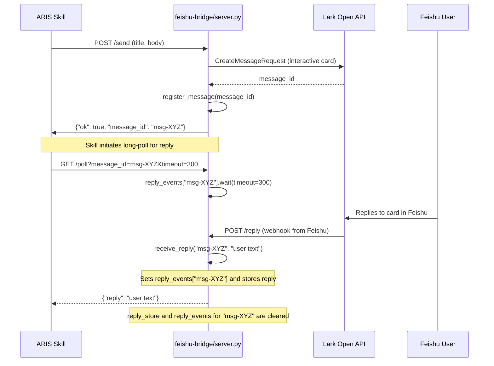

<!-- source: DeepWiki mcp.deepwiki.com · repo wanshuiyin/Auto-claude-code-research-in-sleep · page 5.6 Feishu/Lark Notifications · fetched 2026-10-26 -->

# Feishu/Lark Notifications

<details>
<summary>Relevant source files</summary>

The following files were used as context for generating this wiki page:

- [docs/integrations/FEISHU.md](docs/integrations/FEISHU.md)
- [docs/integrations/FEISHU_CN.md](docs/integrations/FEISHU_CN.md)
- [docs/integrations/OBSIDIAN.md](docs/integrations/OBSIDIAN.md)
- [docs/integrations/OBSIDIAN_CN.md](docs/integrations/OBSIDIAN_CN.md)
- [docs/integrations/VAST_GPU_GUIDE.md](docs/integrations/VAST_GPU_GUIDE.md)
- [docs/integrations/VAST_GPU_GUIDE_CN.md](docs/integrations/VAST_GPU_GUIDE_CN.md)
- [docs/integrations/ZOTERO.md](docs/integrations/ZOTERO.md)
- [docs/integrations/ZOTERO_CN.md](docs/integrations/ZOTERO_CN.md)
- [mcp-servers/feishu-bridge/requirements.txt](mcp-servers/feishu-bridge/requirements.txt)
- [mcp-servers/feishu-bridge/server.py](mcp-servers/feishu-bridge/server.py)
- [tests/_feishu_bridge_helpers.py](tests/_feishu_bridge_helpers.py)
- [tests/test_feishu_bridge_server.py](tests/test_feishu_bridge_server.py)

</details>


This page documents the optional Feishu/Lark integration for ARIS, which enables mobile notifications and remote workflow control. Feishu (known as Lark outside China) is an instant messaging and collaboration platform. ARIS can send rich card notifications to Feishu groups and optionally enable bidirectional communication for checkpoint approvals and custom instructions via private chat.

**Scope**: This page covers configuration, setup, and operation of the Feishu integration. For general external integrations philosophy, see [External Integrations](). For configuring other notification systems (Slack, Discord), adapt the webhook patterns documented here.

**Default behavior**: Feishu integration is **off by default** with zero overhead—without `~/.claude/feishu.json`, all skills behave identically to their non-Feishu configuration [docs/integrations/FEISHU.md:20]().

---

## Architecture Overview

The Feishu integration operates in one of three mutually exclusive modes, controlled by the `mode` field in `~/.claude/feishu.json` [docs/integrations/FEISHU.md:12-18]().

### System Data Flow

```mermaid
graph TB
    subgraph "ARIS Core (Natural Language Space)"
        Skills["Skills<br/>(auto-review-loop,<br/>run-experiment,<br/>idea-discovery)"]
        FeishuNotify["/feishu-notify<br/>(Internal Utility)"]
    end
    
    subgraph "Configuration (Code Entity Space)"
        FeishuJSON["~/.claude/feishu.json"]
        ConfigMode["mode: push | interactive | off"]
    end
    
    subgraph "Infrastructure Layer"
        Bridge["feishu-bridge/server.py<br/>(HTTP Bridge)"]
        LarkSDK["lark_oapi<br/>(Lark Client)"]
        Webhook["Feishu Bot Webhook"]
        FeishuApp["Feishu Mobile/Desktop"]
    end
    
    Skills -->|Invoke| FeishuNotify
    FeishuNotify -->|Read| FeishuJSON
    FeishuJSON -->|Check| ConfigMode
    
    ConfigMode -- "mode: push" --> Webhook
    ConfigMode -- "mode: interactive" --> Bridge
    
    Bridge -->|Call send_card/send_text| LarkSDK
    LarkSDK -->|API Request| FeishuApp
    
    FeishuApp -.->|User Reply (via webhook)| Bridge
    Bridge -.->|receive_reply()| Bridge
    Bridge -.->|poll_reply() response| FeishuNotify
```
**Sources**: [docs/integrations/FEISHU.md:12-18](), [mcp-servers/feishu-bridge/server.py:1-19](), [mcp-servers/feishu-bridge/server.py:51](), [mcp-servers/feishu-bridge/server.py:59-92](), [mcp-servers/feishu-bridge/server.py:95-113](), [mcp-servers/feishu-bridge/server.py:136-142]()

---

## Three Modes Comparison

| Mode | What Happens | Configuration Required | Use Case |
|------|-------------|------------------------|----------|
| **Off** (default) | Nothing. Skills execute without notifications [docs/integrations/FEISHU.md:16]() | None (no `~/.claude/feishu.json`) | Local development |
| **Push** | Webhook sends rich cards to group chat at key events [docs/integrations/FEISHU.md:17]() | `webhook_url` from Feishu group bot | Mobile status monitoring |
| **Interactive** | Push cards **plus** bidirectional chat for checkpoints/approvals [docs/integrations/FEISHU.md:18]() | `webhook_url` + `bridge_url` + running `feishu-bridge` | Remote workflow control |

**Key distinction**: Push cards go to **group chat** (read-only). Interactive conversations involve polling for user input via the `feishu-bridge` [mcp-servers/feishu-bridge/server.py:7-8]().

**Sources**: [docs/integrations/FEISHU.md:12-18](), [mcp-servers/feishu-bridge/server.py:115-133]()

---

## Configuration File Schema

Location: `~/.claude/feishu.json` [docs/integrations/FEISHU.md:38-44]()

### Push Mode
```json
{
  "mode": "push",
  "webhook_url": "https://open.feishu.cn/open-apis/bot/v2/hook/YOUR_WEBHOOK_ID"
}
```

### Interactive Mode
```json
{
  "mode": "interactive",
  "webhook_url": "https://open.feishu.cn/open-apis/bot/v2/hook/YOUR_WEBHOOK_ID",
  "interactive": {
    "bridge_url": "http://localhost:5000",
    "timeout_seconds": 300
  }
}
```
**Sources**: [docs/integrations/FEISHU.md:38-44](), [docs/integrations/FEISHU.md:167-177]()

---

## Implementation Detail: Feishu Bridge

The `feishu-bridge` server (`mcp-servers/feishu-bridge/server.py`) provides an HTTP interface for ARIS skills to interact with the Lark Open API.

### Key Components and Logic

1.  **Lark Client**: Initialized using `FEISHU_APP_ID` and `FEISHU_APP_SECRET` via `lark.Client.builder()` [mcp-servers/feishu-bridge/server.py:51]().
2.  **Reply Store**: A thread-safe dictionary (`reply_store`) and `threading.Event` mapping (`reply_events`) managed by a `threading.Lock` to handle long-polling for user responses [mcp-servers/feishu-bridge/server.py:53-56]().
    *   `send_card` [mcp-servers/feishu-bridge/server.py:59-92]() and `send_text` [mcp-servers/feishu-bridge/server.py:95-113]() functions prepare the `reply_events` and `reply_store` for a new message.
    *   `poll_reply` [mcp-servers/feishu-bridge/server.py:115-133]() waits for a reply event to be set.
    *   `receive_reply` [mcp-servers/feishu-bridge/server.py:136-142]() is called by an external webhook (or `/reply` endpoint) to store the user's response and signal the waiting `poll_reply` call.
3.  **Interactive Cards**: The `send_card` function constructs a JSON payload for the Feishu "interactive" message type and uses `CreateMessageRequest.builder()` to send it [mcp-servers/feishu-bridge/server.py:59-81]().
4.  **HTTP Endpoints**:
    *   `POST /send`: Sends a card or text message. Requires `user_id`, `type`, `title`, `body`, `color` in the request body [mcp-servers/feishu-bridge/server.py:175-195]().
    *   `GET /poll`: Long-polls for a user reply to a specific `message_id` [mcp-servers/feishu-bridge/server.py:151-170]().
    *   `POST /reply`: An external endpoint (e.g., Feishu webhook) can call this to deliver a user's reply to a `message_id` [mcp-servers/feishu-bridge/server.py:197-208]().
    *   `GET /health`: Basic health check [mcp-servers/feishu-bridge/server.py:147-149]().

### Data Flow: Interactive Polling


**Sources**: [mcp-servers/feishu-bridge/server.py:59-92](), [mcp-servers/feishu-bridge/server.py:115-133](), [mcp-servers/feishu-bridge/server.py:136-142](), [mcp-servers/feishu-bridge/server.py:145-208](), [tests/_feishu_bridge_helpers.py:46-51]()

---

## Event Types and Card Templates

When a skill invokes `feishu-notify`, it uses specific templates based on the event [docs/integrations/FEISHU.md:62-70]().

| Event | Title | Color | Content | Triggered By |
|-------|-------|-------|---------|--------------|
| `review_scored >= 6` | Review Scored | `green` | Score, verdict, top weaknesses | `/auto-review-loop` [docs/integrations/FEISHU.md:64]() |
| `review_scored < 6` | Review Scored | `orange` | Score, verdict, action items | `/auto-review-loop` [docs/integrations/FEISHU.md:65]() |
| `experiment_complete` | Experiment Complete | `green` | Results table, delta vs baseline | `/monitor-experiment` [docs/integrations/FEISHU.md:66]() |
| `checkpoint_waiting` | Checkpoint Waiting | `yellow` | Question, options, context | `/idea-discovery`, `/research-pipeline` [docs/integrations/FEISHU.md:67]() |
| `error` | Error | `red` | Error message, suggested fix | Internal Error Handling [docs/integrations/FEISHU.md:68]() |
| `pipeline_done` | Pipeline Done | `purple` | Score progression, deliverables | `/research-pipeline` [docs/integrations/FEISHU.md:69]() |

### Implementation in Skills
Skills check for configuration and invoke the notification block. For example, `/monitor-experiment` sends an `experiment_done` notification containing a results summary table and delta vs baseline after results are collected.

**Sources**: [docs/integrations/FEISHU.md:62-70]()

---

## Interactive Mode Setup

Interactive mode requires the bridge service to be running locally or on a reachable server.

### Environment Variables for Bridge
The bridge requires the following environment variables [mcp-servers/feishu-bridge/server.py:14-19]():
*   `FEISHU_APP_ID`: Feishu app ID.
*   `FEISHU_APP_SECRET`: Feishu app secret.
*   `FEISHU_USER_ID`: Target user's `open_id` (receives the notification). This is optional if `user_id` is always provided in the request body [mcp-servers/feishu-bridge/server.py:47-49]().
*   `BRIDGE_PORT`: HTTP port (default: 5000).

### Step-by-Step
1.  **Install dependencies**: `pip install lark-oapi` [mcp-servers/feishu-bridge/requirements.txt:1]().
2.  **Start bridge**: `python mcp-servers/feishu-bridge/server.py`. This will start an HTTP server on the specified `BRIDGE_PORT` (default 5000) [mcp-servers/feishu-bridge/server.py:41]().
3.  **Configure ARIS**: Set `mode` to `interactive` and `bridge_url` in `~/.claude/feishu.json` [docs/integrations/FEISHU.md:167-177]().

**Sources**: [mcp-servers/feishu-bridge/server.py:14-19](), [mcp-servers/feishu-bridge/server.py:41](), [mcp-servers/feishu-bridge/server.py:47-49](), [mcp-servers/feishu-bridge/requirements.txt:1](), [docs/integrations/FEISHU.md:167-177]()

---

## Key Rules for Integration

*   **Fail Open**: Never block a workflow if Feishu is unreachable [docs/integrations/FEISHU.md:20]().
*   **Zero Impact**: All skills must function perfectly without a Feishu configuration [docs/integrations/FEISHU.md:20]().
*   **Timeout Handling**: If a user does not reply within the `timeout_seconds`, the system follows its default logic [mcp-servers/feishu-bridge/server.py:133]().
*   **Security**: Ensure `FEISHU_APP_SECRET` is kept in `.env` or environment variables, never hardcoded [mcp-servers/feishu-bridge/server.py:43-45]().

**Sources**: [docs/integrations/FEISHU.md:12-20](), [mcp-servers/feishu-bridge/server.py:115-133]()

---

