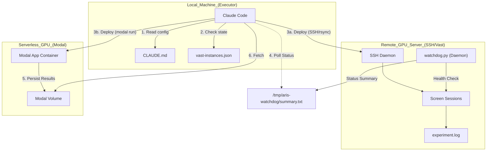
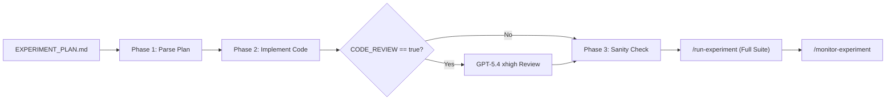
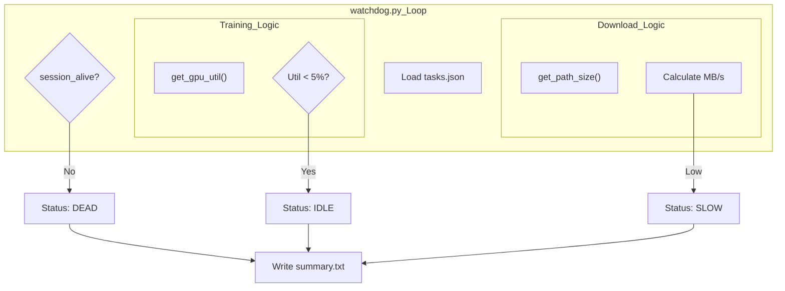

<!-- source: DeepWiki mcp.deepwiki.com · repo wanshuiyin/Auto-claude-code-research-in-sleep · page 5.7 GPU Infrastructure · fetched 2026-10-26 -->

# GPU Infrastructure

<details>
<summary>Relevant source files</summary>

The following files were used as context for generating this wiki page:

- [docs/GPU_SETUP.md](docs/GPU_SETUP.md)
- [docs/GPU_SETUP_CN.md](docs/GPU_SETUP_CN.md)
- [docs/WATCHDOG_GUIDE.md](docs/WATCHDOG_GUIDE.md)
- [docs/WATCHDOG_GUIDE_CN.md](docs/WATCHDOG_GUIDE_CN.md)
- [skills/monitor-experiment/SKILL.md](skills/monitor-experiment/SKILL.md)
- [skills/qzcli/SKILL.md](skills/qzcli/SKILL.md)
- [skills/run-experiment/SKILL.md](skills/run-experiment/SKILL.md)
- [skills/serverless-modal/SKILL.md](skills/serverless-modal/SKILL.md)
- [skills/shared-references/compute-env-contract.md](skills/shared-references/compute-env-contract.md)
- [skills/skills-codex/qzcli/SKILL.md](skills/skills-codex/qzcli/SKILL.md)
- [skills/skills-codex/run-experiment/SKILL.md](skills/skills-codex/run-experiment/SKILL.md)
- [skills/skills-codex/serverless-modal/SKILL.md](skills/skills-codex/serverless-modal/SKILL.md)
- [skills/skills-codex/shared-references/compute-env-contract.md](skills/skills-codex/shared-references/compute-env-contract.md)
- [skills/skills-codex/vast-gpu/SKILL.md](skills/skills-codex/vast-gpu/SKILL.md)
- [skills/vast-gpu/SKILL.md](skills/vast-gpu/SKILL.md)
- [tests/test_watchdog_loop.py](tests/test_watchdog_loop.py)
- [tools/watchdog.py](tools/watchdog.py)

</details>


This page documents how to configure GPU infrastructure for ARIS's automated experiment deployment. ARIS supports a hybrid infrastructure model: fixed remote servers (SSH), on-demand GPU provisioning (Vast.ai), and serverless GPU functions (Modal). When skills like `/run-experiment` and `/auto-review-loop` execute, they delegate code deployment, session management, and result collection to these environments.

---

## Overview

ARIS skills do not execute GPU workloads on the local machine running Claude Code. Instead, they delegate to remote environments by:

1.  **Environment Detection**: Reading configuration from project-level `CLAUDE.md` [skills/run-experiment/SKILL.md:14-23]().
2.  **Code Deployment**: Syncing code via `rsync`, `git`, or Modal's internal mounting system [skills/run-experiment/SKILL.md:59-75](), [skills/serverless-modal/SKILL.md:117-118]().
3.  **Execution Management**: Launching experiments in detached `screen` sessions for persistent servers [skills/run-experiment/SKILL.md:140-148]() or using serverless entry points for Modal [skills/serverless-modal/SKILL.md:139-142]().
4.  **Persistent Monitoring**: Utilizing `watchdog.py` on remote servers to catch silent failures [docs/WATCHDOG_GUIDE.md:7-15]().

### GPU Infrastructure Data Flow

The following diagram illustrates how the `run-experiment` and `monitor-experiment` skills interact with various infrastructure backends.

**Diagram: GPU Execution & Monitoring Architecture**

**Sources:** [skills/run-experiment/SKILL.md:14-175](), [docs/WATCHDOG_GUIDE.md:17-39](), [skills/serverless-modal/SKILL.md:105-143]()

---

## Infrastructure Backends

### 1. Remote Server (SSH)
Traditional fixed-resource servers accessed via SSH. Requires manual environment setup (Conda).
*   **Config**: Defined in `CLAUDE.md` under `## Remote Server` [skills/run-experiment/SKILL.md:19]().
*   **Sync**: Uses `rsync` or `git` [skills/run-experiment/SKILL.md:59-75]().
*   **Workflow**: Creates a dedicated `screen` session with `CUDA_VISIBLE_DEVICES` binding and log redirection via `tee` [skills/run-experiment/SKILL.md:140-148]().

### 2. Vast.ai (On-Demand)
Provisioning of cheap on-demand GPUs. ARIS handles the lifecycle: Search → Rent → Setup → Destroy.
*   **Logic**: `/vast-gpu provision` analyzes the task (VRAM, hours) and presents 3 cost-optimized options [skills/vast-gpu/SKILL.md:55-128]().
*   **State**: Tracks active instances in `vast-instances.json` [skills/vast-gpu/SKILL.md:30-49]().
*   **Sync**: Always uses `rsync` to `/workspace/project/` [skills/run-experiment/SKILL.md:79-90]().
*   **Cleanup**: If `auto_destroy: true` is set in `CLAUDE.md`, instances are torn down after the experiment finishes.

### 3. Modal (Serverless)
Zero-config serverless GPU functions. Best for short/medium workloads and debugging [skills/serverless-modal/SKILL.md:14-20]().
*   **Scaling**: Auto scale-to-zero; no idle billing [skills/serverless-modal/SKILL.md:16]().
*   **Deployment**: Generates a `modal_launcher.py` that mounts local code using `modal.Mount.from_local_dir` and defines a `modal.Image` [skills/serverless-modal/SKILL.md:105-130]().
*   **Persistence**: Uses `modal.Volume` for checkpoints and result persistence [skills/serverless-modal/SKILL.md:120-137]().

### 4. Qizhi (启智) Platform
The Qizhi platform is a scheduler-cluster environment managed via the `qzcli` tool.
*   **Environment Contract**: Images are built off-platform and referenced at submission time. The `compute-env-contract.md` defines the declarative environment specification, and a ledger (`.aris/compute/qizhi.md`) tracks image hashes [skills/qzcli/SKILL.md:16-20]().
*   **Authentication**: Credentials can be configured via environment variables, a `.env` file, or interactive login [skills/qzcli/SKILL.md:46-61]().
*   **Job Submission**: Supports interactive and non-interactive job submission, including batch submissions from a config file [skills/qzcli/SKILL.md:152-261]().
*   **Resource Discovery**: `qzcli avail` checks for available nodes and compute groups [skills/qzcli/SKILL.md:128-146]().

**Sources:** [skills/qzcli/SKILL.md:1-324]()

---

## CLAUDE.md Compute Configuration

The `CLAUDE.md` file serves as the manifest for the experiment environment. It defines the `gpu` type and specific configurations for each backend.

### Example Configuration
```markdown
## GPU Environment
- gpu: remote              # Options: local, remote, vast, modal, qizhi

## Remote Server
- SSH: `ssh my-cluster`
- Conda: `conda activate research`
- Code dir: `/home/user/experiments/`
- code_sync: rsync

## Vast.ai
- image: `pytorch/pytorch:2.1.0-cuda12.1-cudnn8-devel`
- auto_destroy: true

## Modal
- modal_gpu: A100-80GB
- modal_volume: my-results

## Qizhi
- qzcli_workspace: "My Workspace"
- qzcli_compute_group: "My Compute Group"
- qzcli_image: "YOUR_REGISTRY/team/image:tag"
- qzcli_instances: 4
```
**Sources:** [skills/run-experiment/SKILL.md:16-29](), [skills/run-experiment/SKILL.md:154-175]()

### Compute Environment Contract
All compute skills adhere to a `compute-env-contract.md` [skills/shared-references/compute-env-contract.md:1-9](). This contract defines a declarative specification for environments, ensuring consistency across different providers (SSH, Modal, Vast.ai, Qizhi).
*   **Declarative Spec**: A YAML-based specification (`env-spec.yaml`) defines the base image, system packages, ordered `pip_phases`, environment variables, and run commands [skills/shared-references/compute-env-contract.md:31-50]().
*   **Environment Ledger**: Each provider maintains an `.aris/compute/<provider>.md` file, which stores a content-hash of the environment specification. This hash ensures that changes to the environment are mechanically detected, preventing stale configurations [skills/shared-references/compute-env-contract.md:67-83]().
*   **Validation Tiers**: Environments undergo a three-tier validation process:
    1.  **Import works**: Basic package import checks [skills/shared-references/compute-env-contract.md:105-106]().
    2.  **Kernel-dispatch witness**: A seeded forward pass to verify GPU functionality [skills/shared-references/compute-env-contract.md:107-113]().
    3.  **Agent-follows-doc**: A fresh subagent executes the documented invocation verbatim to ensure real-world functionality [skills/shared-references/compute-env-contract.md:114-117]().

**Sources:** [skills/shared-references/compute-env-contract.md:1-163]()

---

## Experiment Bridge & Monitoring

The `/experiment-bridge` (Workflow 1.5) uses the infrastructure to implement and deploy code from an `EXPERIMENT_PLAN.md`.

### Deployment Flow
The bridge manages a milestone system: `sanity` → `baseline` → `main` → `ablation` → `polish`.

**Diagram: Experiment Deployment & Review Loop**

**Sources:** [skills/run-experiment/SKILL.md:140-188]()

### Monitoring and W&B Integration
If `wandb: true` is configured in `CLAUDE.md`, ARIS automatically injects `wandb.init` and logging calls into training scripts [skills/run-experiment/SKILL.md:98-127](). The `/monitor-experiment` skill then pulls training curves and final metrics via the W&B Python API to provide a richer signal for the auto-review loop [skills/monitor-experiment/SKILL.md:56-102]().

---

## Watchdog: Persistent Monitoring

While `/monitor-experiment` provides deep inspection (W&B, logs), `watchdog.py` is a lightweight server-side daemon for surface-level health checks [docs/WATCHDOG_GUIDE.md:155-160]().

### Watchdog Logic Flow
The daemon monitors registered tasks and writes status to a shared summary file for low-frequency polling.

**Diagram: Watchdog Internal Checks**

**Sources:** [tools/watchdog.py:166-255](), [docs/WATCHDOG_GUIDE.md:21-26]()

### Watchdog Status Codes

| Status | Meaning | Action |
|--------|---------|--------|
| `OK` | Task running normally. | None. |
| `DEAD` | Session no longer exists. | Check for crash/OOM [docs/WATCHDOG_GUIDE.md:136](). |
| `IDLE` | GPU utilization < 5%. | Check for data loading stalls [docs/WATCHDOG_GUIDE.md:137](). |
| `STALLED` | Download file size not growing. | Check network/auth [docs/WATCHDOG_GUIDE.md:138](). |
| `SLOW` | Download speed < 1 MB/s. | Investigate throttling [docs/WATCHDOG_GUIDE.md:139](). |
| `STALE` | Loop's state file not updated within `stale_after_seconds`. | Loop may have died silently; restart/nudge it [docs/WATCHDOG_GUIDE.md:144](). |
| `MISSING` | Loop registered but state file absent past grace. | Path typo or loop never started [docs/WATCHDOG_GUIDE.md:145](). |
| `PENDING` | Loop registered, awaiting first state write. | Normal at startup [docs/WATCHDOG_GUIDE.md:146](). |
| `COMPLETED` | Loop reported completion. | Unregister it [docs/WATCHDOG_GUIDE.md:147](). |
| `ERROR` | Watchdog encountered an error checking this task. | Check watchdog logs [docs/WATCHDOG_GUIDE.md:148](). |

### Usage Commands
*   **Start Daemon**: `screen -dmS watchdog python3 tools/watchdog.py` [docs/WATCHDOG_GUIDE.md:56]().
*   **Register Training**: `python3 tools/watchdog.py --register '{"name":"exp01","type":"training","session":"exp01","gpus":[0,1]}' ` [docs/WATCHDOG_GUIDE.md:71-77]().
*   **Remote Poll**: `ssh your-server "cat /tmp/aris-watchdog/status/summary.txt"` [docs/WATCHDOG_GUIDE.md:105]().

**Sources:** [docs/WATCHDOG_GUIDE.md:41-107](), [tools/watchdog.py:1-40]()

---

