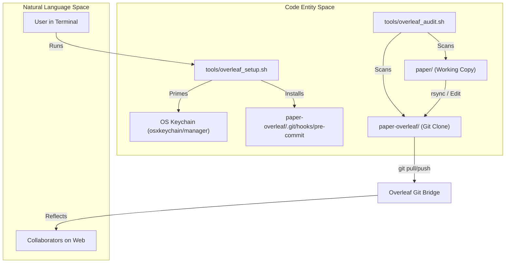
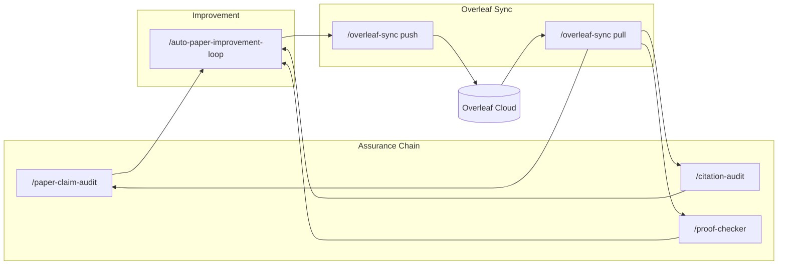

<!-- source: DeepWiki mcp.deepwiki.com · repo wanshuiyin/Auto-claude-code-research-in-sleep · page 5.8 Overleaf Integration · fetched 2026-10-26 -->

# Overleaf Integration

Relevant source files

The following files were used as context for generating this wiki page:

- [skills/mermaid-diagram/SKILL.md](skills/mermaid-diagram/SKILL.md)
- [skills/overleaf-sync/SKILL.md](skills/overleaf-sync/SKILL.md)
- [skills/skills-codex/overleaf-sync/SKILL.md](skills/skills-codex/overleaf-sync/SKILL.md)
- [tools/overleaf_audit.sh](tools/overleaf_audit.sh)
- [tools/overleaf_setup.sh](tools/overleaf_setup.sh)

The `/overleaf-sync` skill provides a bidirectional bridge between a local ARIS paper directory and an Overleaf project. This allows researchers to utilize the Overleaf web interface for collaborative editing while leveraging ARIS's autonomous audit and improvement workflows locally. The integration relies on the **Overleaf Git bridge** (a Premium feature) and is designed with a "Security-First" philosophy where authentication tokens are never exposed to the LLM agent [skills/overleaf-sync/SKILL.md:1-15]().

## Architecture and Data Flow

The integration maintains two distinct directories: a local working directory (`paper/`) where ARIS skills operate, and a git-cloned bridge directory (`paper-overleaf/`) [skills/overleaf-sync/SKILL.md:31-38](). These are synchronized via `rsync` based on explicit `pull` or `push` commands [skills/overleaf-sync/SKILL.md:38-40]().

### System Entity Bridge: Overleaf Sync Logic
The following diagram maps the natural language synchronization concepts to the specific scripts and directories used in the codebase.

Sources: [skills/overleaf-sync/SKILL.md:29-38](), [tools/overleaf_setup.sh:1-14](), [tools/overleaf_audit.sh:1-14]()

## Setup and Security Protocol

ARIS enforces a strict separation between the user's secret token and the agent's execution environment.

1.  **Hardened Setup**: The user must run `tools/overleaf_setup.sh` manually in a TTY-enabled terminal [tools/overleaf_setup.sh:17-23](). The script refuses to run if it detects an agent harness [skills/overleaf-sync/SKILL.md:48-49]().
2.  **Token Isolation**: The token is read via a hidden prompt and stored in the OS Keychain (e.g., `osxkeychain` on macOS) [skills/overleaf-sync/SKILL.md:25-27](). It is immediately stripped from the Git remote URL [tools/overleaf_setup.sh:76-78]().
3.  **Leak Prevention**: A `pre-commit` hook is auto-installed in the bridge directory to block any commit containing the pattern `olp_[A-Za-z0-9]{20,}` [tools/overleaf_setup.sh:105-118]().
4.  **Audit Verification**: The agent uses `tools/overleaf_audit.sh` to verify that no tokens have leaked into the working tree or git history before proceeding with synchronization [skills/overleaf-sync/SKILL.md:64-73]().

Sources: [skills/overleaf-sync/SKILL.md:44-52](), [tools/overleaf_setup.sh:51-57](), [tools/overleaf_setup.sh:102-118](), [tools/overleaf_audit.sh:12-14]()

## Operational Workflows

### The Pull-Audit-Fix Loop
When pulling changes from Overleaf, ARIS does not blindly merge. It follows a "Diff Protocol" to ensure external edits do not compromise paper integrity [skills/overleaf-sync/SKILL.md:88-104]().

| Edit Type | ARIS Action |
| :--- | :--- |
| **Numerical/Claim Change** | Sync and re-trigger `/paper-claim-audit` |
| **New `\cite{...}`** | Sync and re-trigger `/citation-audit` |
| **Prose/Typos** | Flag to user; do not auto-sync |
| **Restructure** | Stop and request human checkpoint |

Sources: [skills/overleaf-sync/SKILL.md:77-104]()

### The Push-to-Overleaf Workflow
Before pushing, ARIS performs a safety check to ensure the local state is ahead of or merged with the remote state [skills/overleaf-sync/SKILL.md:118-120]().

1.  **Pull/Fetch**: Check for remote drift [skills/overleaf-sync/SKILL.md:150-155]().
2.  **Rsync Mirror**: Sync `paper/` to `paper-overleaf/`, excluding build artifacts (`.aux`, `.log`, `.bbl`) [skills/overleaf-sync/SKILL.ej:122-128]().
3.  **Provenance Logging**: Commit messages must include the specific ARIS skill that generated the change (e.g., `citation-audit: fix 14 metadata entries`) [skills/overleaf-sync/SKILL.md:140-144]().

Sources: [skills/overleaf-sync/SKILL.md:114-146]()

## Integration with Audit Workflows

The Overleaf integration is a primary component of the **Workflow 5: Resubmit Pipeline** [skills/resubmit-pipeline/SKILL.md:3-5]() (though the provided `skills/resubmit-pipeline/SKILL.md` was not available, this is a common pattern).

### Audit Chain Interaction
The following diagram illustrates how the Overleaf bridge serves as the final delivery mechanism for the ARIS assurance chain.

Sources: [skills/overleaf-sync/SKILL.md:10-14]()

### Resubmit Pipeline (W5) Integration
In `/resubmit-pipeline`, Overleaf integration is utilized in Phase 4 for final delivery. The pipeline uses the `--edit-whitelist` to ensure that only "safe" microedits are pushed back to the collaborative Overleaf project, preventing the LLM from making unauthorized structural or bibliographic changes.

Sources: [skills/skills-codex/overleaf-sync/SKILL.md:1-15]()

---

