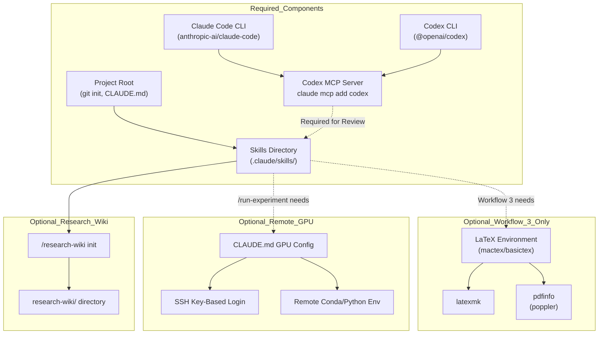

<!-- source: DeepWiki mcp.deepwiki.com · repo wanshuiyin/Auto-claude-code-research-in-sleep · page 6.1 Initial Setup Checklist · fetched 2026-10-26 -->

# Initial Setup Checklist

<details>
<summary>Relevant source files</summary>

The following files were used as context for generating this wiki page:

- [.env.example](.env.example)
- [SETUP_GUIDE.md](SETUP_GUIDE.md)
- [SETUP_GUIDE_CN.md](SETUP_GUIDE_CN.md)
- [tests/test_skill_picker.py](tests/test_skill_picker.py)
- [tools/skill_picker.py](tools/skill_picker.py)

</details>


This page provides a complete step-by-step checklist for setting up ARIS from scratch. It covers required components (Claude Code, Codex MCP, skills installation), optional integrations (LaTeX, Zotero, Obsidian, Feishu, GPU servers), and verification procedures to confirm everything is working.

**Scope:** This checklist focuses on initial installation and configuration. For advanced configuration like auto-allow permissions for overnight runs, see [Auto-Allow for Overnight Runs](). For alternative model combinations (GLM, MiniMax), see [IDE Adaptations](). For individual integration details, see pages [Codex MCP (OpenAI Models)]() through [Feishu/Lark Notifications]().

---

## Setup Dependency Tree



Sources: [SETUP_GUIDE.md:11-16](), [SETUP_GUIDE.md:21-31](), [SETUP_GUIDE.md:48-52](), [SETUP_GUIDE.md:61-66](), [SETUP_GUIDE.md:137-140](), [SETUP_GUIDE.md:190-191]()

---

## Required Components

### 1. Claude Code Installation

Claude Code is the execution backbone for all ARIS workflows. It acts as the "Executor" in the dual-layer architecture [SETUP_GUIDE.md:5-6]().

**Installation:**

```bash
# See the Claude Code docs for installation
# Example verification:
claude --version   # verify installation
```

**What it provides:**
- CLI interface for Claude models
- Skill execution framework
- MCP server management

**Verification:** Run `claude --version` and confirm a version number is displayed [SETUP_GUIDE.md:18-19]().

Sources: [SETUP_GUIDE.md:13-19]()

---

### 2. Codex CLI + MCP Registration

The Codex CLI is used to call GPT as a cross-model reviewer [SETUP_GUIDE.md:22-23](). After installing the Codex CLI, it must be registered as a Claude Code MCP server. This is **required** for all review-based skills.

**Installation and Registration:**

```bash
codex --version   # verify installation
codex login       # one-time ChatGPT auth (skip if already logged in)
claude mcp add codex -s user -- codex mcp-server
```
- `codex` (after `add`) is the registered name. ARIS skills hardcode this name, **do not change it** [SETUP_GUIDE.md:33]().
- `-s user` applies globally to all projects [SETUP_GUIDE.md:34]().
- `codex mcp-server` is the built-in subcommand that starts the MCP server mode [SETUP_GUIDE.md:35]().

**Important:** After registering or modifying any MCP server, you **must restart Claude Code** for the change to take effect. MCP configurations are loaded at startup [SETUP_GUIDE.md:44-45]().

**Verification:**

```bash
claude mcp list | grep codex
# should show: codex: codex mcp-server - ✓ Connected
```
This command should show the `codex` MCP server as connected [SETUP_GUIDE.md:39-42]().

Sources: [SETUP_GUIDE.md:21-45]()

---

### 3. Create a Research Project

ARIS skills operate within a project context.

```bash
mkdir ~/your-paper-project
cd ~/your-paper-project
git init
touch CLAUDE.md
```
- `git init`: Some skills need Git to locate the project root [SETUP_GUIDE.md:68]().
- `CLAUDE.md`: Claude Code's project config file; the install script will write ARIS info into it [SETUP_GUIDE.md:69]().

Sources: [SETUP_GUIDE.md:61-69]()

---

### 4. Skills Installation

Install ARIS skills into your project via symlinks (the recommended project-local install method) [SETUP_GUIDE.md:75](). This ensures Claude Code can discover the skills while allowing you to keep them in sync with the upstream repository.

```bash
# 1. Clone ARIS once to a stable location, ~/aris_repo is the local dir name (customizable)
git clone https://github.com/wanshuiyin/Auto-claude-code-research-in-sleep.git ~/aris_repo

# 2. Install in each project that uses ARIS (via symlinks):
cd ~/your-paper-project
bash ~/aris_repo/tools/install_aris.sh
```

The `install_aris.sh` script performs the following actions [SETUP_GUIDE.md:97-103]():
- Creates symlinks from `.claude/skills/<skill>` to `~/aris_repo/skills/<skill>`.
- Creates `.aris/installed-skills.txt` to track installed skills.
- Creates symlinks for helper scripts in `.aris/tools`.
- Updates the ARIS config block in `CLAUDE.md`.

**Selective Installation:**
You can install specific skill groups or individual skills:
```bash
bash ~/aris_repo/tools/install_aris.sh --list-groups                  # show the 10 skill groups
bash ~/aris_repo/tools/install_aris.sh --groups paper-core,lit-search # install by group
bash ~/aris_repo/tools/install_aris.sh --skills paper-writing         # by skill (hard deps auto-included)
```
A fresh install with no selection flags (run in a terminal) opens a checkbox picker [SETUP_GUIDE.md:88-89](), powered by `tools/skill_picker.py` [tools/skill_picker.py:1-2]().

**Updating Skills:**
- **Case 1: Upstream modified existing skill content:** Symlinks pick up changes automatically. Just pull the latest ARIS repo [SETUP_GUIDE.md:108-110]().
  ```bash
  cd ~/aris_repo && git pull
  ```
- **Case 2: Upstream added or removed skill directories:** Pull first, then rerun the install script to sync [SETUP_GUIDE.md:112-116]().
  ```bash
  cd ~/aris_repo && git pull
  cd ~/your-paper-project
  bash ~/aris_repo/tools/install_aris.sh
  ```

**Verification:**
```bash
# List installed skills
ls -1 .claude/skills/
```

Sources: [SETUP_GUIDE.md:73-117](), [tools/skill_picker.py:1-2]()

---

## Optional Integrations

### 1. LaTeX Environment (Workflow 3)

Required for Workflow 3 (paper writing), providing `latexmk` and `pdfinfo` [SETUP_GUIDE.md:48-49](). If you only need Workflow 1 & 2 (idea discovery + auto review), LaTeX is not required [SETUP_GUIDE.md:57]().

**Installation:**

```bash
# macOS:
brew install --cask mactex    # or: brew install basictex
brew install poppler          # provides pdfinfo

# Verify:
latexmk --version && pdfinfo -v
```

Sources: [SETUP_GUIDE.md:48-56]()

### 2. Configure GPU Server (for Experiments)

If your experiments run on a remote GPU server, you need SSH key-based authentication and server information in `CLAUDE.md` [SETUP_GUIDE.md:137-138]().

#### 2.1 Set Up SSH Key-Based Login

Ensure you have an SSH key locally; generate one if you don't [SETUP_GUIDE.md:141-149]():
```bash
ls ~/.ssh/id_*.pub
# If no output, run:
ssh-keygen -t ed25519   # press Enter through all prompts
```
Copy your public key to the server [SETUP_GUIDE.md:152-156]():
```bash
ssh-copy-id username@your-server-ip
```
Verify passwordless login [SETUP_GUIDE.md:159-162]():
```bash
ssh username@your-server-ip "echo ok"
```

#### 2.2 Write Server Information to `CLAUDE.md`

Add the following to the end of your project's `CLAUDE.md`, replacing placeholders with your actual values [SETUP_GUIDE.md:165-179]():
```markdown
## Remote Server

- gpu: remote
- SSH: `ssh username@your-server-ip` (key-based auth, no password)
- GPU: 8x RTX 4090 (24GB)
- Conda env: `YOUR_ENV` (Python 3.x + PyTorch x.x.x)
- Activate: `eval "$(/path/to/miniconda3/bin/conda shell.bash hook)" && conda activate YOUR_ENV`
- Code directory: `/home/user/experiments/`
- Use `tmux` for background jobs: `tmux new -d -s exp0 'bash -c "..."'`
```
You can also use `screen` [SETUP_GUIDE.md:181]().

**Verify Remote Environment:**
```bash
ssh username@your-server-ip 'eval "$(/path/to/miniconda3/bin/conda shell.bash hook)" && conda activate YOUR_ENV && python --version && python -c "import torch; print(torch.__version__, torch.cuda.device_count())"'
```
This should output your Python version, PyTorch version, and the number of GPUs [SETUP_GUIDE.md:189]().

Sources: [SETUP_GUIDE.md:137-189]()

### 3. Initialize Research Wiki

The Research Wiki is ARIS's core knowledge base, automatically accumulating papers, ideas, and experiments. Other skills will write to it automatically [SETUP_GUIDE.md:192-194]().

**Important:** If you registered MCP servers in Step 1.2 or 3.2 and haven't restarted Claude Code, do so now [SETUP_GUIDE.md:196-197]().

In your research project directory, open Claude Code and run:
```
/research-wiki init
```
This creates the `research-wiki/` directory with the following structure [SETUP_GUIDE.md:205-216]():
```
research-wiki/
  index.md               ← Categorized index (auto-generated)
  log.md                 ← Timeline log
  gap_map.md             ← Research gap map
  query_pack.md          ← Compressed summary (for /idea-creator)
  papers/                ← /alphaxiv, /arxiv etc. auto-write here
  ideas/                 ← /idea-creator auto-writes here
  experiments/           ← /result-to-claim auto-writes here
  claims/                ← Scientific claims
  graph/                 ← Knowledge graph (edges.jsonl)
```

Sources: [SETUP_GUIDE.md:190-216]()

### 4. Register Additional MCP Servers (Optional)

Depending on your model combination, you may need to register additional MCP servers beyond the default `codex` registered in the "Required Components" section [SETUP_GUIDE.md:120-121](). ARIS ships with several MCP servers for different reviewer backends.

| MCP Server | Registered Into | Required When | Registration Method |
|---|---|---|---|
| `codex` | Claude Code | Default setup (Claude + GPT review) | `claude mcp add codex -s user -- codex mcp-server` (already done in Step 1.2) |
| `claude-review` | Codex CLI | Using Codex as executor with Claude as reviewer | `codex mcp add claude-review -- python3 ~/.codex/mcp-servers/claude-review/server.py` (see `mcp-servers/claude-review/README.md`) |
| `gemini-review` | Codex CLI | Using Codex as executor with Gemini as reviewer | `codex mcp add gemini-review --env GEMINI_REVIEW_BACKEND=api -- python3 ~/.codex/mcp-servers/gemini-review/server.py` (see `mcp-servers/gemini-review/README.md`) |
| `llm-chat` | Claude Code | Using arbitrary OpenAI-compatible API as reviewer | `claude mcp add llm-chat -s user -- python3 /path/to/aris_repo/mcp-servers/llm-chat/server.py` (see `docs/LLM_API_MIX_MATCH_GUIDE.md`) |
| `minimax-chat` | Claude Code | Using MiniMax as reviewer (no OpenAI key needed) | See `docs/MINIMAX_MCP_GUIDE.md` |
| `manual-review` | Claude Code | Human-in-the-loop manual review | `claude mcp add manual-review -s user -- python3 /path/to/aris_repo/mcp-servers/manual-review/server.py` |
| `feishu-bridge` | — (standalone HTTP service) | Receiving notifications via Feishu/飞书 | See `mcp-servers/feishu-bridge/` |
| `codex-image2` | Claude Code | Enhanced image processing in Codex | See `mcp-servers/codex-image2/` |

**Important:** After registering or modifying any MCP server, you **must restart Claude Code** for the changes to take effect. MCP configurations are loaded at startup. The correct order is: register all needed MCP servers → restart Claude Code → start using ARIS workflows [SETUP_GUIDE.md:134-135]().

Sources: [SETUP_GUIDE.md:119-135](), [.env.example:18-20](), [.env.example:22-23](), [.env.example:37-38](), [.env.example:46-47]()

---

## Verification

After completing the setup, restart Claude Code and perform the following checks in your research project directory.

### 1. Verify MCP Services

In your terminal, check if the `codex` MCP service is connected:
```bash
claude mcp list | grep codex
# Expected output: codex: codex mcp-server - ✓ Connected
```
If you registered other MCP services (e.g., `llm-chat`, `manual-review`), verify them similarly:
```bash
claude mcp list | grep llm-chat
claude mcp list | grep manual-review
```

### 2. Test a Review Skill

Launch Claude Code and run a test review:
```
/research-review test
```
This skill uses the `codex` MCP server to perform a review. If successful, you should see a GPT-generated response.

### 3. Test LaTeX (if installed)

If you installed the LaTeX environment for Workflow 3, test paper compilation:
```
/paper-compile paper/
```
This command attempts to compile a sample LaTeX document. A successful compilation indicates your LaTeX environment is correctly set up.

### 4. Test Research Wiki

Verify the Research Wiki was initialized:
```bash
ls research-wiki/
# Expected output should include: index.md, log.md, gap_map.md, query_pack.md, papers/, ideas/, experiments/, claims/, graph/
```

Sources: [SETUP_GUIDE.md:220-224]()

---

## Component Verification Flowchart

```mermaid
graph TD
    Start["Setup_Complete?"]
    
    Start --> CheckClaude{"claude --version<br/>succeeds?"}
    CheckClaude -->|No| InstallClaude["Install Claude Code"]
    CheckClaude -->|Yes| CheckCodexCLI
    InstallClaude --> CheckCodexCLI
    
    CheckCodexCLI{"codex --version<br/>succeeds?"}
    CheckCodexCLI -->|No| InstallCodexCLI["Install Codex CLI"]
    CheckCodexCLI -->|Yes| CheckCodexMCP
    InstallCodexCLI --> CheckCodexMCP
    
    CheckCodexMCP{"claude mcp list | grep codex<br/>shows '✓ Connected'?"}
    CheckCodexMCP -->|No| AddCodexMCP["claude mcp add codex ..."]
    CheckCodexMCP -->|Yes| CheckProject
    AddCodexMCP --> RestartClaude["Restart Claude Code"]
    RestartClaude --> CheckCodexMCP
    
    CheckProject{"Project created<br/>(git init, CLAUDE.md)?"}
    CheckProject -->|No| CreateProject["mkdir, cd, git init, touch CLAUDE.md"]
    CheckProject -->|Yes| CheckSkillsInstall
    CreateProject --> CheckSkillsInstall
    
    CheckSkillsInstall{"ls .claude/skills/<br/>shows skills?"}
    CheckSkillsInstall -->|No| RunInstaller["bash ~/aris_repo/tools/install_aris.sh"]
    CheckSkillsInstall -->|Yes| CheckResearchWiki
    RunInstaller --> CheckResearchWiki
    
    CheckResearchWiki{"research-wiki/ exists<br/>after /research-wiki init?"}
    CheckResearchWiki -->|No| InitWiki["/research-wiki init"]
    CheckResearchWiki -->|Yes| TestReview
    InitWiki --> TestReview
    
    TestReview["Launch claude<br/>Run: /research-review test"]
    TestReview --> ReviewWorks{"Review returns<br/>GPT response?"}
    ReviewWorks -->|No| DebugReview["Check OPENAI_API_KEY<br/>Check MCP server logs"]
    ReviewWorks -->|Yes| CoreReady["Core Setup Complete<br/>Workflows 1 & 2 Ready"]
    
    DebugReview -.->|Fixed| TestReview
    
    CoreReady --> OptionalW3{"Need Workflow 3<br/>(paper writing)?"}
    OptionalW3 -->|No| OptionalGPU{"Need Remote GPU<br/>for experiments?"}
    OptionalW3 -->|Yes| CheckLaTeX
    
    CheckLaTeX{"latexmk --version<br/>pdfinfo -v<br/>succeed?"}
    CheckLaTeX -->|No| InstallLaTeX["Install LaTeX Environment"]
    CheckLaTeX -->|Yes| TestPaper
    InstallLaTeX --> TestPaper
    
    TestPaper["Run: /paper-compile paper/"]
    TestPaper --> PaperWorks{"PDF compiles?"}
    PaperWorks -->|No| DebugLaTeX["Check LaTeX errors"]
    PaperWorks -->|Yes| OptionalGPU
    
    DebugLaTeX -.->|Fixed| TestPaper

    OptionalGPU -->|No| AllDone["All Setup Complete"]
    OptionalGPU -->|Yes| CheckGPUConfig
    
    CheckGPUConfig{"CLAUDE.md GPU config<br/>and SSH login work?"}
    CheckGPUConfig -->|No| SetupGPU["Configure SSH, CLAUDE.md"]
    CheckGPUConfig -->|Yes| AllDone
    SetupGPU --> CheckGPUConfig
```



Sources: [SETUP_GUIDE.md:11-224]()

---

## Configuration File Locations

| File Path | Purpose | Key Content |
|-----------|---------|-------------|
| `~/.claude/settings.json` | Claude Code Global Config | MCP server definitions |
| `.claude/skills/` | Project Skills (Symlinked) | `SKILL.md` files |
| `.aris/installed-skills.txt` | Skill Manifest | Tracks managed symlinks [SETUP_GUIDE.md:100]() |
| `CLAUDE.md` | Project Dashboard | Pipeline status, GPU config [SETUP_GUIDE.md:69](), [SETUP_GUIDE.md:170-179]() |
| `research-wiki/` | Research Wiki Directory | Knowledge base, ideas, papers [SETUP_GUIDE.md:205-216]() |
| `.env` | Environment Variables | API keys for optional integrations (e.g., `EXA_API_KEY`, `MINIMAX_API_KEY`, `LLM_API_KEY`, `GEMINI_API_KEY`, `FEISHU_APP_ID`) |

Sources: [SETUP_GUIDE.md:69](), [SETUP_GUIDE.md:100](), [SETUP_GUIDE.md:170-179](), [SETUP_GUIDE.md:205-216](), [.env.example:2-36]()

---

