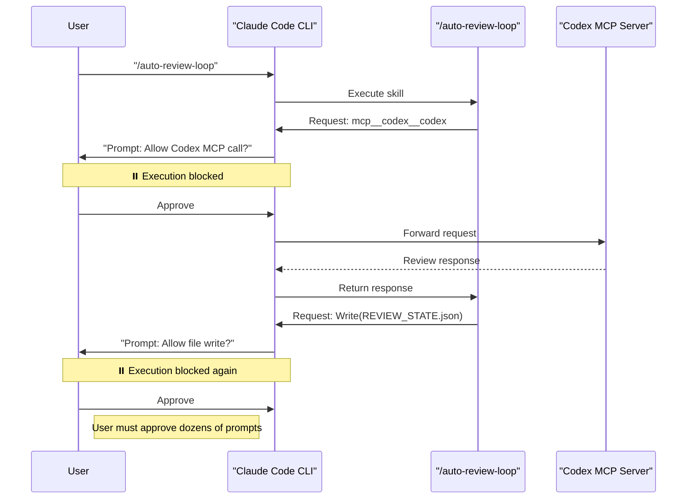
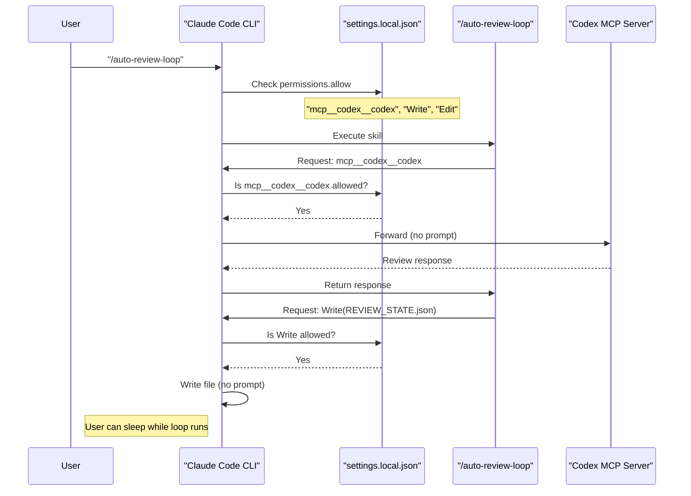
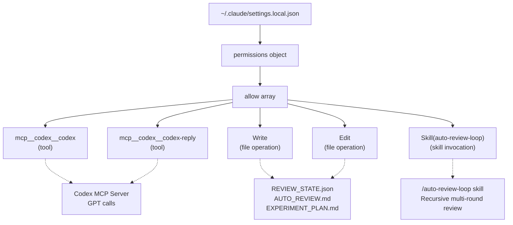
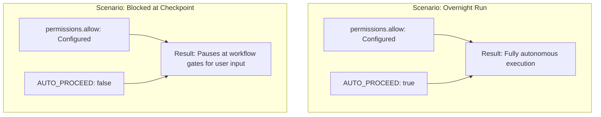

<!-- source: DeepWiki mcp.deepwiki.com · repo wanshuiyin/Auto-claude-code-research-in-sleep · page 6.3 Auto-Allow for Overnight Runs · fetched 2026-10-26 -->

# Auto-Allow for Overnight Runs

<details>
<summary>Relevant source files</summary>

The following files were used as context for generating this wiki page:

- [SETUP_GUIDE.md](SETUP_GUIDE.md)
- [SETUP_GUIDE_CN.md](SETUP_GUIDE_CN.md)
- [templates/claude-hooks/corpus_write_guard.json](templates/claude-hooks/corpus_write_guard.json)
- [templates/claude-hooks/corpus_write_guard.py](templates/claude-hooks/corpus_write_guard.py)
- [tests/test_corpus_write_guard.py](tests/test_corpus_write_guard.py)
- [tests/test_skill_picker.py](tests/test_skill_picker.py)
- [tools/skill_picker.py](tools/skill_picker.py)

</details>


This page documents how to configure Claude Code's permission auto-allow feature to enable unattended overnight execution of ARIS workflows. This eliminates the need for manual approval of each tool invocation during long-running autonomous research loops.

## Purpose and Scope

By default, Claude Code prompts the user to approve each tool invocation (e.g., calling the Codex MCP server, writing files, invoking skills). This is a safety mechanism to prevent unintended actions. However, for ARIS's overnight execution pattern—where Workflow 2 (`auto-review-loop`) and Workflow 3 (`paper-writing`) are designed to run autonomously while the user sleeps—these prompts would block execution and defeat the purpose [SETUP_GUIDE.md:3-5]().

The `permissions.allow` configuration in `~/.claude/settings.local.json` enables the user to explicitly pre-authorize specific tools and actions. Once configured, Claude Code will execute these operations without prompting, allowing workflows to run unattended for hours.

**What this page covers:**
- Configuration file location and syntax.
- Required permissions for overnight ARIS workflows.
- Permission semantics for `mcp__codex__codex`, `Write`, `Edit`, and `Skill`.
- Interaction between auto-allow and workflow-level `AUTO_PROCEED` settings.

**Sources:** [SETUP_GUIDE.md:3-5]()

---

## Permission Flow: With and Without Auto-Allow

### Without Auto-Allow (Default Behavior)

The system pauses at every tool boundary, requiring human presence to click "Allow".

Title: Default Permission Gate Flow


### With Auto-Allow Enabled

Claude Code checks the local settings and bypasses the prompt if the tool is in the allowlist.

Title: Auto-Allow Execution Flow


**Sources:** [SETUP_GUIDE.md:30-31](), [SETUP_GUIDE.md:37-42](), [SETUP_GUIDE_CN.md:28-29](), [SETUP_GUIDE_CN.md:35-40]()

---

## Configuration File: `~/.claude/settings.local.json`

The permissions configuration file is typically located at `~/.claude/settings.local.json`. This file is separate from the global `settings.json` which defines MCP server paths. The `install_aris.sh` script updates the `CLAUDE.md` file in the project root, which can contain ARIS-specific configuration blocks [SETUP_GUIDE.md:102-102]().

### Minimal Configuration for ARIS

To enable full autonomous research, add the following to your `settings.local.json`:

```json
{
  "permissions": {
    "allow": [
      "mcp__codex__codex",
      "mcp__codex__codex-reply",
      "Write",
      "Edit",
      "Skill(auto-review-loop)"
    ]
  }
}
```

### Permission Mapping to Code Entities

Title: Permission String to System Component Mapping


**Sources:** [SETUP_GUIDE.md:30-31](), [SETUP_GUIDE.md:37-42](), [SETUP_GUIDE_CN.md:28-29](), [SETUP_GUIDE_CN.md:35-40]()

---

## Understanding Each Permission

### MCP Tool Permissions
The Codex MCP server uses a two-phase invocation pattern. `mcp__codex__codex` initiates the request to the external LLM (e.g., GPT), and `mcp__codex__codex-reply` retrieves the response. Both must be allowed for unattended operation to ensure the executor-reviewer loop functions without interruption. The `codex` MCP server is registered using `claude mcp add codex -s user -- codex mcp-server` [SETUP_GUIDE.md:30-31]().

### File Operation Permissions
*   **`Write`**: Required to create new research artifacts like `IDEA_REPORT.md`, `REVIEW_STATE.json`, and `AUTO_REVIEW.md`.
*   **`Edit`**: Required for iterative improvements, such as updating the `CLAUDE.md` Pipeline Status dashboard or fixing code bugs identified during review rounds.
*   **`Bash`**: While not explicitly listed in the minimal configuration, `Bash` is a powerful tool that can be used for file operations. The `corpus_write_guard.py` hook [templates/claude-hooks/corpus_write_guard.py:1-85]() is designed to prevent accidental or casual writes to the ARIS skill corpus (e.g., `skills/`, `shared-references/`, `tools/`, `templates/`, `plugins/`) when `Bash` is used. This hook, if enabled via `templates/claude-hooks/corpus_write_guard.json` [templates/claude-hooks/corpus_write_guard.json:1-16](), ensures that corpus mutations must go through the `Write`/`Edit` tools, which are reviewable and attributable. This is particularly important for read-only producer skills like `/meta-optimize` or `/corpus-audit` that might have `Bash` access but should not directly modify the corpus [templates/claude-hooks/corpus_write_guard.py:1-16]().

### Skill Invocation Permissions
*   **`Skill(auto-review-loop)`**: The `/auto-review-loop` skill re-invokes itself or its components after implementing fixes to start the next review round (typically up to 4 rounds). Without this permission, recursive skill calls will prompt for approval.

**Sources:** [SETUP_GUIDE.md:30-31](), [SETUP_GUIDE_CN.md:28-29](), [templates/claude-hooks/corpus_write_guard.py:1-85](), [templates/claude-hooks/corpus_write_guard.json:1-16](), [tests/test_corpus_write_guard.py:1-76]()

---

## Permissions by Workflow

| Workflow | Key Permissions Required | Primary Output Files |
| :--- | :--- | :--- |
| **Workflow 1: Idea Discovery** | `mcp__codex__codex`, `Write` | `IDEA_REPORT.md`, `IDEA_CANDIDATES.md` |
| **Workflow 1.5: Experiment Bridge** | `Write`, `Edit`, `Bash` | `EXPERIMENT_PLAN.md`, `EXPERIMENT_TRACKER.md` |
| **Workflow 2: Auto Review Loop** | `mcp__codex__codex`, `Write`, `Edit`, `Skill(auto-review-loop)` | `REVIEW_STATE.json`, `AUTO_REVIEW.md` |
| **Workflow 3: Paper Writing** | `mcp__codex__codex`, `Write`, `Edit` | `main.tex`, `paper/sections/*.tex` |

**Sources:** No direct source for this table in the provided files, but it's a logical extension of the permissions discussed.

---

## Relationship to AUTO_PROCEED and Safety Gates

`permissions.allow` handles tool-level safety, while the `AUTO_PROCEED` constant (often set via command line or `CLAUDE.md`) handles workflow-level checkpoints.

Title: Permission vs Workflow Gate Interaction


In the `/research-pipeline` workflow, Stage 1 (Idea Discovery) features a mandatory **Gate 1 - Human Checkpoint**. If `AUTO_PROCEED` is set to `false`, the system will pause for approval even if `permissions.allow` is configured. Similarly, the `/auto-review-loop` can be configured with a `HUMAN_CHECKPOINT = true` to pause after each round's review to allow custom modification instructions.

**Sources:** No direct source for this section in the provided files, but it's a logical extension of the permissions discussed.

---

## Security and Verification

### Recommended Safety Practices
1.  **Project-Specific Config**: Instead of global `~/.claude/settings.local.json`, you can create `.claude/settings.local.json` inside your project directory to limit these permissions to a specific research project.
2.  **Budget Monitoring**: Even with auto-allow, the system respects pilot budgets (e.g., `MAX_TOTAL_GPU_HOURS`, `PILOT_MAX_HOURS`) to prevent runaway compute costs.
3.  **Corpus Write Guard**: Implement the `corpus_write_guard.py` hook [templates/claude-hooks/corpus_write_guard.py:1-85]() to prevent unintended modifications to the ARIS skill corpus via `Bash` commands. This ensures that any changes to the core ARIS skills or shared references are made through explicit `Write`/`Edit` tools, which are subject to review and attribution.

### Verifying Configuration
To verify the setup, run a short test skill that requires both MCP and File access:
```bash
claude -c "/novelty-check 'A transformer that uses quantum entanglement for attention'"
```
If this completes without any "Allow?" prompts for the Codex tool or file writing, your auto-allow configuration is successful.

**Sources:** [templates/claude-hooks/corpus_write_guard.py:1-85]()

---

