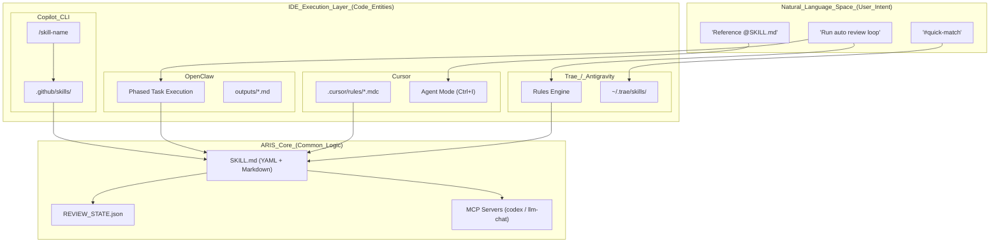
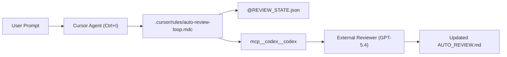
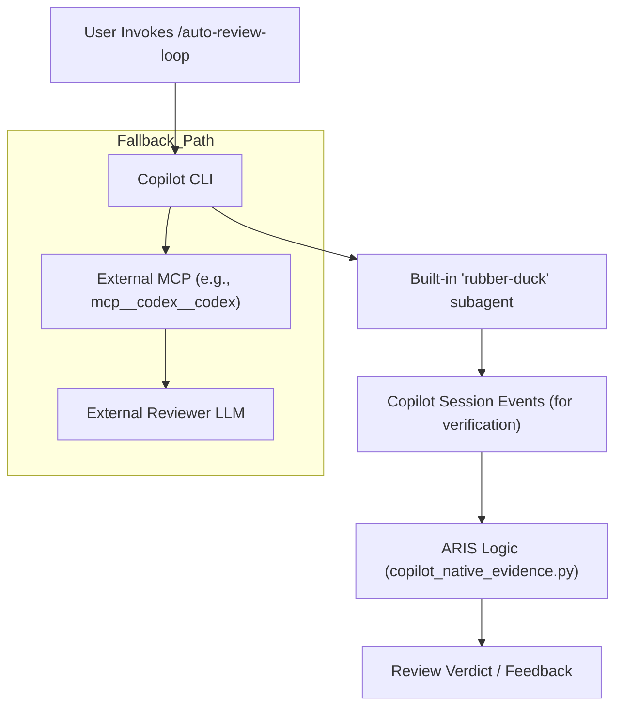
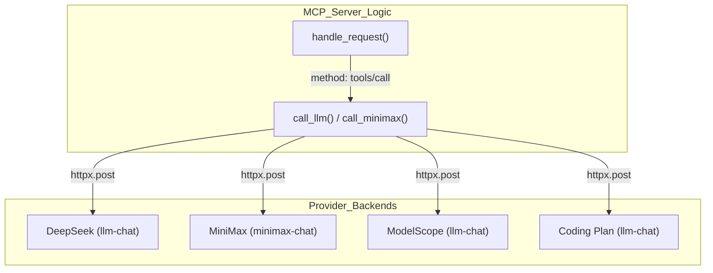

<!-- source: DeepWiki mcp.deepwiki.com · repo wanshuiyin/Auto-claude-code-research-in-sleep · page 6.4 IDE Adaptations · fetched 2026-10-26 -->

# IDE Adaptations

Relevant source files

The following files were used as context for generating this wiki page:

- [docs/ALI_CODING_PLAN_GUIDE.md](docs/ALI_CODING_PLAN_GUIDE.md)
- [docs/ANTIGRAVITY_ADAPTATION.md](docs/ANTIGRAVITY_ADAPTATION.md)
- [docs/ANTIGRAVITY_ADAPTATION_CN.md](docs/ANTIGRAVITY_ADAPTATION_CN.md)
- [docs/COPILOT_CLI_ADAPTATION.md](docs/COPILOT_CLI_ADAPTATION.md)
- [docs/CURSOR_ADAPTATION.md](docs/CURSOR_ADAPTATION.md)
- [docs/MINIMAX_MCP_GUIDE.md](docs/MINIMAX_MCP_GUIDE.md)
- [docs/MODELSCOPE_GUIDE.md](docs/MODELSCOPE_GUIDE.md)
- [docs/OPENCLAW_ADAPTATION.md](docs/OPENCLAW_ADAPTATION.md)
- [docs/TRAE_ARIS_RUNBOOK_CN.md](docs/TRAE_ARIS_RUNBOOK_CN.md)
- [docs/TRAE_ARIS_RUNBOOK_EN.md](docs/TRAE_ARIS_RUNBOOK_EN.md)
- [mcp-servers/llm-chat/requirements.txt](mcp-servers/llm-chat/requirements.txt)
- [mcp-servers/llm-chat/server.py](mcp-servers/llm-chat/server.py)
- [mcp-servers/minimax-chat/requirements.txt](mcp-servers/minimax-chat/requirements.txt)
- [mcp-servers/minimax-chat/server.py](mcp-servers/minimax-chat/server.py)
- [tests/test_copilot_native_evidence.py](tests/test_copilot_native_evidence.py)

This page provides a technical guide for running ARIS (Auto-claude-code-research-in-sleep) in non-Claude-Code IDEs, including Trae, Cursor, Antigravity, OpenClaw, and Copilot CLI. While ARIS was originally designed for the Claude Code CLI, its core logic is encapsulated in `SKILL.md` files and Multi-Agent Communication Protocol (MCP) servers, making it portable to any IDE that supports agentic workflows and MCP.

**Purpose**: Enable researchers to leverage ARIS automation within their preferred development environments while maintaining the "Executor-Reviewer" architectural pattern.

**Scope**:
- Configuration of MCP servers in different IDEs.
- Translation of Claude Code slash commands (`/skill`) to IDE-specific triggers.
- State management and task recovery in session-based IDEs.
- Adaptation of skills for alternative models (DeepSeek, MiniMax, Gemini, Qwen).

---

## 1. IDE Adaptation Architecture

The following diagram illustrates how ARIS components map from the native Claude Code environment to alternative IDEs.

**System Mapping: Natural Language to Code Entity Space**

Sources: [docs/TRAE_ARIS_RUNBOOK_EN.md:5-15](), [docs/CURSOR_ADAPTATION.md:5-15](), [docs/ANTIGRAVITY_ADAPTATION_CN.md:9-18](), [docs/COPILOT_CLI_ADAPTATION.md:9-20]()

---

## 2. Trae Adaptation

Trae (by ByteDance) uses a "Rules and Skills" engine that natively understands the `SKILL.md` format.

### 2.1 Skill Invocation Patterns
Trae replaces slash commands with three primary discovery mechanisms:
1.  **Natural Language Auto-Discovery**: Trae matches user prompts against the `description` field in the `SKILL.md` YAML frontmatter [docs/TRAE_ARIS_RUNBOOK_EN.md:131-139]().
2.  **`#` Quick Match**: Users can type `#` in the chat to search for and trigger specific skills like `#auto-review-loop` [docs/TRAE_ARIS_RUNBOOK_EN.md:141-147]().
3.  **`@` File Reference**: Directly referencing the `SKILL.md` file (e.g., `@skills/research-lit/SKILL.md`) forces the agent to follow that specific protocol [docs/TRAE_ARIS_RUNBOOK_EN.md:149-158]().

### 2.2 Setup and MCP Configuration
Trae requires manual MCP configuration in `Settings → MCP → Manual Add` [docs/TRAE_ARIS_RUNBOOK_EN.md:62-67]().

| Setting | Value |
| :--- | :--- |
| **Name** | `codex` |
| **Command** | `codex` |
| **Args** | `["mcp-server"]` |

For alternative reviewers (e.g., DeepSeek), the `llm-chat` server must be used with absolute paths to the virtual environment Python [docs/TRAE_ARIS_RUNBOOK_EN.md:97-113]().

Sources: [docs/TRAE_ARIS_RUNBOOK_EN.md:62-79](), [docs/TRAE_ARIS_RUNBOOK_EN.md:129-166]()

---

## 3. Cursor Adaptation

Cursor utilizes `.cursorrules` or `.cursor/rules/*.mdc` files for context-aware automation.

### 3.1 MDC Conversion
To make ARIS skills "native" to Cursor, `SKILL.md` files can be converted to `.mdc` format by moving the YAML frontmatter into the Cursor-specific header [docs/CURSOR_ADAPTATION.md:98-117]().

**Data Flow: Skill Execution in Cursor**

Sources: [docs/CURSOR_ADAPTATION.md:84-117]()

### 3.2 State Recovery
Unlike Claude Code's persistent CLI session, Cursor uses discrete chat sessions. Recovery is achieved by explicitly referencing state files in the prompt:
`"@REVIEW_STATE.json @AUTO_REVIEW.md Resume the loop from saved state."` [docs/CURSOR_ADAPTATION.md:14-15]().

Sources: [docs/CURSOR_ADAPTATION.md:14-15](), [docs/CURSOR_ADAPTATION.md:272-279]()

---

## 4. Antigravity Adaptation

Antigravity (Google DeepMind) is an agent-first IDE that natively supports `SKILL.md` files [docs/ANTIGRAVITY_ADAPTATION_CN.md:3-5]().

### 4.1 Multi-Model Executor
Antigravity allows switching the **Executor** model via a selector, which is critical for ARIS's cross-model collaboration [docs/ANTIGRAVITY_ADAPTATION_CN.md:20-29]().

| Executor Model | Strength | Configuration |
| :--- | :--- | :--- |
| **Claude Opus 4.6 (Thinking)** | Reasoning accuracy | Default selector [docs/ANTIGRAVITY_ADAPTATION_CN.md:26]() |
| **Gemini 3.1 Pro (high)** | Large context (1M+ tokens) | `reasoning_effort: "high"` [docs/ANTIGRAVITY_ADAPTATION_CN.md:41-48]() |

### 4.2 Configuration
Antigravity looks for skills in `~/.gemini/antigravity/skills/` (global) or `<workspace>/.agents/skills/` (project-local) [docs/ANTIGRAVITY_ADAPTATION_CN.md:58-65](). It uses `GEMINI.md` as the equivalent to `CLAUDE.md` for project instructions [docs/ANTIGRAVITY_ADAPTATION_CN.md:137-156]().

Sources: [docs/ANTIGRAVITY_ADAPTATION_CN.md:9-18](), [docs/ANTIGRAVITY_ADAPTATION_CN.md:52-67]()

---

## 5. OpenClaw Adaptation

OpenClaw lacks a native skill/rule engine, necessitating a "Phased Task Execution" approach [docs/OPENCLAW_ADAPTATION.md:3-5]().

### 5.1 Phased Execution Strategy
Instead of slash commands, ARIS workflows are executed by providing the agent with specific phase instructions and enforcing file-based outputs to prevent context drift [docs/OPENCLAW_ADAPTATION.md:12-14]().

**OpenClaw Workflow Mapping**
| Phase | Instruction | Output Artifact |
| :--- | :--- | :--- |
| **Lit Scan** | "Perform literature scan for [Topic]" | `outputs/lit_scan.md` [docs/OPENCLAW_ADAPTATION.md:20]() |
| **Idea Gen** | "Generate 3 ideas based on lit_scan.md" | `outputs/idea_report.md` [docs/OPENCLAW_ADAPTATION.md:21]() |
| **Experiment Script** | "Generate experiment matrix and weekly plan" | `outputs/experiment_plan.md` / `outputs/runbook.md` [docs/OPENCLAW_ADAPTATION.md:22]() |
| **Review** | "Start review loop, max 4 rounds" | `outputs/review_loop.md` [docs/OPENCLAW_ADAPTATION.md:23]() |

Sources: [docs/OPENCLAW_ADAPTATION.md:16-24](), [docs/OPENCLAW_ADAPTATION.md:30-49]()

---

## 6. Copilot CLI Adaptation

GitHub Copilot CLI (`gh copilot` or standalone `copilot`) is highly compatible with ARIS due to its native support for `SKILL.md` files and slash commands [docs/COPILOT_CLI_ADAPTATION.md:12-13]().

### 6.1 Skill Installation and Invocation
ARIS skills can be installed via symlinking using `tools/install_aris_copilot.sh` [docs/COPILOT_CLI_ADAPTATION.md:36-37]() or by copying them to `~/.copilot/skills/` (global) or `.github/skills/` (project-local) [docs/COPILOT_CLI_ADAPTATION.md:67-70]().
Invocation is identical to Claude Code, using `/skill-name "args"` [docs/COPILOT_CLI_ADAPTATION.md:182-189]().

### 6.2 Native Reviewer and MCP Configuration
Copilot CLI's built-in `rubber-duck` subagent can serve as the complementary reviewer for `/auto-review-loop` [docs/COPILOT_CLI_ADAPTATION.md:81-83](). This native integration verifies the lifecycle and model pair from Copilot session events, reducing the need for an external Codex MCP for this specific workflow.

For other reviewer skills or fallback scenarios, a Codex MCP can be configured in `~/.copilot/mcp-config.json` or project-level `.mcp.json` [docs/COPILOT_CLI_ADAPTATION.md:106-126]().

**Copilot CLI Reviewer Flow**

The `copilot_native_evidence.py` module is responsible for processing Copilot CLI session events to extract evidence of review activity, including the models used and the binding of challenges [tests/test_copilot_native_evidence.py:15-19](). It creates a `challenge.json` artifact that contains details about the review, such as the executor model and tool call IDs [tests/test_copilot_native_evidence.py:177-184]().

Sources: [docs/COPILOT_CLI_ADAPTATION.md:81-93](), [docs/COPILOT_CLI_ADAPTATION.md:106-126](), [tests/test_copilot_native_evidence.py:15-19](), [tests/test_copilot_native_evidence.py:177-184]()

---

## 7. Reviewer Backend Adaptations

Since non-Claude IDEs often run in environments where OpenAI API access is restricted, ARIS provides alternative reviewer bridges.

### 7.1 `llm-chat` MCP Server
This server (located at `mcp-servers/llm-chat/server.py`) uses `httpx` [mcp-servers/llm-chat/requirements.txt:1]() to connect to any OpenAI-compatible API (DeepSeek, MiniMax, GLM, ModelScope).

**Implementation Detail**: It maps standard MCP `tools/call` requests to `/v1/chat/completions` endpoints [mcp-servers/llm-chat/server.py:83](), bypassing the proprietary OpenAI Responses API required by the default Codex MCP [docs/MODELSCOPE_GUIDE.md:31-35](). The server supports configuration via environment variables such as `LLM_API_KEY`, `LLM_BASE_URL`, and `LLM_MODEL` [mcp-servers/llm-chat/server.py:52-56]().

### 7.2 MiniMax Specialized Bridge
The `minimax-chat` server (located at `mcp-servers/minimax-chat/server.py`) provides a specialized bridge for MiniMax models, requiring `httpx` [mcp-servers/minimax-chat/requirements.txt:1](). It handles authentication via `MINIMAX_API_KEY` [mcp-servers/minimax-chat/server.py:49]() and request formatting specific to the MiniMax API. It also includes logic to clamp the `temperature` parameter to MiniMax's allowed range of (0.0, 1.0] [mcp-servers/minimax-chat/server.py:54-71]().

**Reviewer Model Logic**

Sources: [mcp-servers/llm-chat/server.py:77-124](), [mcp-servers/minimax-chat/server.py:87-120](), [docs/MINIMAX_MCP_GUIDE.md:7-11](), [docs/MODELSCOPE_GUIDE.md:31-35](), [docs/ALI_CODING_PLAN_GUIDE.md:23-27]()

---

