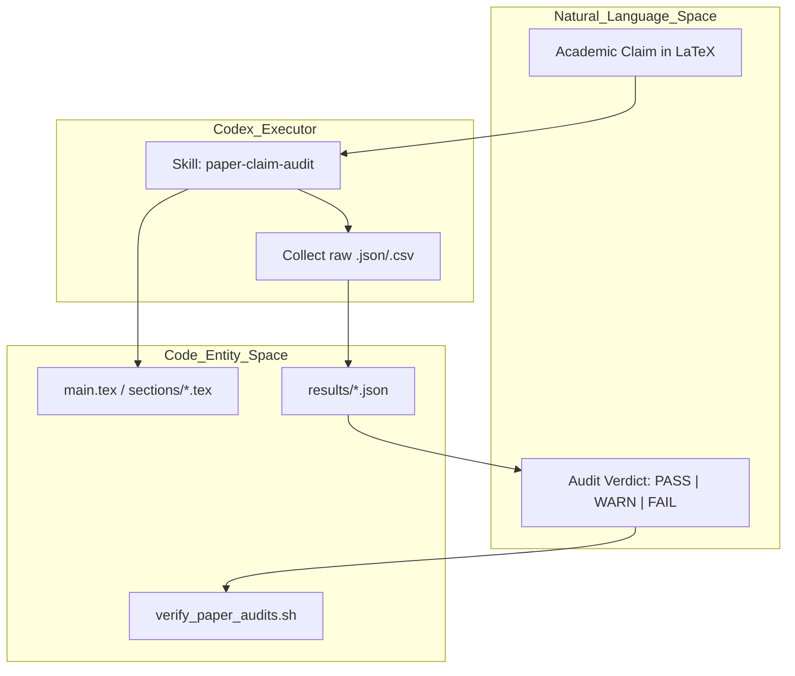
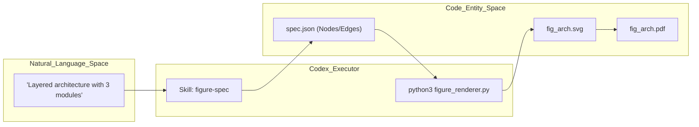
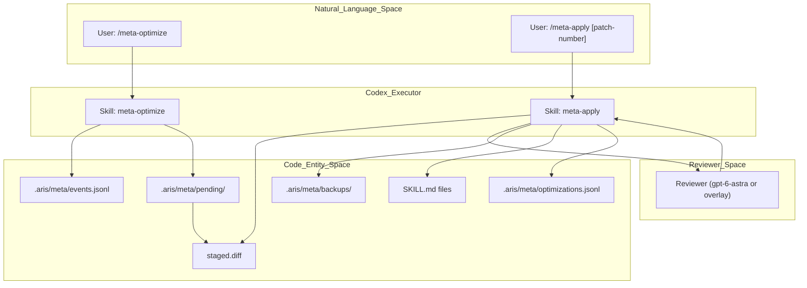

<!-- source: DeepWiki mcp.deepwiki.com · repo wanshuiyin/Auto-claude-code-research-in-sleep · page 6.5 Codex Skills Package · fetched 2026-10-26 -->

# Codex Skills Package

<details>
<summary>Relevant source files</summary>

The following files were used as context for generating this wiki page:

- [docs/CODEX_GEMINI_REVIEW_GUIDE.md](docs/CODEX_GEMINI_REVIEW_GUIDE.md)
- [docs/CODEX_GEMINI_REVIEW_GUIDE_CN.md](docs/CODEX_GEMINI_REVIEW_GUIDE_CN.md)
- [mcp-servers/gemini-review/README.md](mcp-servers/gemini-review/README.md)
- [skills/meta-apply/SKILL.md](skills/meta-apply/SKILL.md)
- [skills/shared-references/output-language.md](skills/shared-references/output-language.md)
- [skills/shared-references/output-versioning.md](skills/shared-references/output-versioning.md)
- [skills/skills-codex-claude-review/paper-figure/SKILL.md](skills/skills-codex-claude-review/paper-figure/SKILL.md)
- [skills/skills-codex-claude-review/paper-plan/SKILL.md](skills/skills-codex-claude-review/paper-plan/SKILL.md)
- [skills/skills-codex-gemini-review/README.md](skills/skills-codex-gemini-review/README.md)
- [skills/skills-codex-gemini-review/README_CN.md](skills/skills-codex-gemini-review/README_CN.md)
- [skills/skills-codex-gemini-review/grant-proposal/SKILL.md](skills/skills-codex-gemini-review/grant-proposal/SKILL.md)
- [skills/skills-codex-gemini-review/idea-discovery-robot/SKILL.md](skills/skills-codex-gemini-review/idea-discovery-robot/SKILL.md)
- [skills/skills-codex-gemini-review/paper-figure/SKILL.md](skills/skills-codex-gemini-review/paper-figure/SKILL.md)
- [skills/skills-codex-gemini-review/paper-plan/SKILL.md](skills/skills-codex-gemini-review/paper-plan/SKILL.md)
- [skills/skills-codex-gemini-review/paper-slides/SKILL.md](skills/skills-codex-gemini-review/paper-slides/SKILL.md)
- [skills/skills-codex-gemini-review/research-refine/SKILL.md](skills/skills-codex-gemini-review/research-refine/SKILL.md)
- [skills/skills-codex/meta-apply/SKILL.md](skills/skills-codex/meta-apply/SKILL.md)
- [tests/test_claude_review_generator.py](tests/test_claude_review_generator.py)
- [tests/test_codex_skill_mirror.py](tests/test_codex_skill_mirror.py)

</details>


The `skills-codex` package is a specialized distribution of the ARIS research skills designed specifically for the **Codex** executor. It provides a complete set of 67 research skills that are functionally aligned with the native Claude Code versions but optimized for the Codex environment and its unique orchestration patterns [skills/skills-codex/README.md:1-7]().

## Overview and Purpose

The primary purpose of the `skills-codex` package is to enable autonomous ML research workflows within Codex while maintaining parity with the main ARIS development line. It removes Claude-specific thread orchestration logic (such as `mcp__codex__` calls) in favor of direct skill execution within the Codex tool-calling framework using `spawn_agent` and `send_input` patterns [skills/skills-codex/README.md:9-12]().

### Key Differences from Claude Version
- **No Thread Orchestration**: Unlike the Claude version, which often relies on `mcp__codex__` for complex multi-turn sub-agent coordination, the Codex version uses `spawn_agent` to invoke a secondary reviewer model [skills/skills-codex/README.md:9-12]().
- **Resource Bundling**: Certain skills like `paper-writing` include additional LaTeX templates and audit scripts to ensure "out-of-the-box" compilation and verification readiness [skills/skills-codex/paper-writing/SKILL.md:27-28]().
- **Reviewer Reasoning Effort**: By default, reviewer-heavy skills in the Codex pack are configured with `reasoning_effort: xhigh` to ensure maximum critique depth [skills/skills-codex/README.md:12]().
- **Follow-up Chain Integration**: Codex versions explicitly include the post-experiment follow-up chain: `training-check`, `result-to-claim`, and `ablation-planner` [skills/skills-codex/ablation-planner/SKILL.md:1-5](), [skills/skills-codex/result-to-claim/SKILL.md:1-6]().

### Package Structure
The package is organized into a base layer and optional reviewer overlays:
1.  **Base Layer**: `skills/skills-codex/` (Mirror of all 67 mainline skills) [skills/skills-codex/README.md:7]().
2.  **Shared References**: `shared-references/` directory containing common contracts like `assurance-contract.md` and `reviewer-independence.md` [skills/skills-codex/README.md:8]().
3.  **Reviewer Overlays**: Specialized packages that override the reviewer routing while keeping Codex as the executor [skills/skills-codex/README.md:13-16]().

**Sources:** [skills/skills-codex/README.md:1-17](), [skills/skills-codex/paper-writing/SKILL.md:1-33]()

---

## Installation and Setup

Installation follows a managed symlink approach to ensure easy updates and reconcile logic.

### Installation Process
The canonical way to install is via the `install_aris_codex.sh` tool, which creates a flat managed layout in the target project [skills/skills-codex/README.md:21-28]().

1.  **Base Skills**: Link the core Codex skills to `.agents/skills/` [skills/skills-codex/README.md:33]().
2.  **Reviewer Overlay**: Re-run the installer with the specific overlay flag to replace reviewer routing [skills/skills-codex/README.md:38-43]().

### Implementation Example
```bash
# 1. Install Base Package
bash ~/aris_repo/tools/install_aris_codex.sh ~/your-project

# 2. Apply Claude Reviewer Overlay
bash ~/aris_repo/tools/install_aris_codex.sh ~/your-project --reconcile --with-claude-review-overlay
```
**Sources:** [skills/skills-codex/README.md:19-63](), [skills/skills-codex-claude-review/README.md:28-40]()

---

## Reviewer Overlay Packages

ARIS implements an "Executor-Reviewer" split. While Codex executes the code, a second model (the Reviewer) provides adversarial critique.

### 1. Codex-Native (Default)
Uses a second Codex agent (typically `gpt-5.5`) as the reviewer. This is handled internally using `spawn_agent` [skills/skills-codex/README.md:9-12]().

### 2. Claude Reviewer (`skills-codex-claude-review`)
This overlay routes all review tasks to **Claude Code** via a local `claude-review` MCP bridge. It is designed for users who want Codex's execution speed but Claude's high-fidelity academic critique [skills/skills-codex-claude-review/README.md:1-9](). It overrides a core set of 8 reviewer-aware skills, including `research-review`, `auto-review-loop`, `paper-write`, and `auto-paper-improvement-loop` [skills/skills-codex-claude-review/README.md:17-26](). For example, the `paper-plan` skill in this overlay explicitly sets `REVIEWER_MODEL = claude-review` [skills/skills-codex-claude-review/paper-plan/SKILL.md:21](). Similarly, `paper-figure` uses `claude-review` as its reviewer [skills/skills-codex-claude-review/paper-figure/SKILL.md:40]().

### 3. Gemini Reviewer (`skills-codex-gemini-review`)
This overlay routes reviews to the Gemini backend via the local `gemini-review` MCP bridge. It is designed for users who want Codex as the executor and Gemini as the reviewer [skills/skills-codex-gemini-review/README.md:1-8](). This package is a thin override layer that sits on top of `skills/skills-codex/` [skills/skills-codex-gemini-review/README.md:9]().

The `skills-codex-gemini-review` package contains overrides for 15 reviewer-aware skills. These include the "Core 8" skills that align with the Claude-review overlay, such as `research-review`, `novelty-check`, `research-refine`, `auto-review-loop`, `paper-plan`, `paper-figure`, `paper-write`, and `auto-paper-improvement-loop` [skills/skills-codex-gemini-review/README.md:48-55](). Additionally, it extends coverage to 7 more skills: `idea-creator`, `idea-discovery`, `idea-discovery-robot`, `grant-proposal`, `paper-writing`, `paper-slides`, and `paper-poster-html` [skills/skills-codex-gemini-review/README.md:59-66]().

For example, the `paper-slides` skill in this overlay explicitly sets `REVIEWER_MODEL = gemini-review` [skills/skills-codex-gemini-review/paper-slides/SKILL.md:31](), and `grant-proposal` also uses `gemini-review` [skills/skills-codex-gemini-review/grant-proposal/SKILL.md:39]().

The `gemini-review` MCP bridge exposes both synchronous (`review`, `review_reply`) and asynchronous (`review_start`, `review_reply_start`, `review_status`) tools. The asynchronous tools are preferred for long reviewer prompts to avoid host-side MCP tool timeouts [mcp-servers/gemini-review/README.md:9-18](). It also supports multimodal review for local images via `imagePaths` when using the direct Gemini API backend [mcp-servers/gemini-review/README.md:19-20]().

### Installation Order
The installation order for these packages is crucial:
1.  Install `skills/skills-codex/*` first.
2.  Then install the desired reviewer overlay, e.g., `skills/skills-codex-gemini-review/*`.
3.  Finally, register the corresponding MCP server, e.g., `gemini-review` MCP [docs/CODEX_GEMINI_REVIEW_GUIDE.md:18-23]().

### Mirror Tests
The `test_codex_skill_mirror.py` suite ensures that the `skills-codex` package maintains parity with the mainline skills and that shared references resolve correctly.
- `test_codex_skill_set_matches_mainline()` verifies that the set of skill names in `skills-codex` is identical to the mainline `skills` directory [tests/test_codex_skill_mirror.py:35-39]().
- `test_codex_shared_reference_set_matches_mainline()` checks for parity in shared references [tests/test_codex_skill_mirror.py:42-46]().
- `test_codex_mirror_shared_reference_links_resolve()` ensures that all `shared-references/*.md` links within `SKILL.md` files in the mirror and overlay packages resolve to existing files within the mirror's own `shared-references/` directory [tests/test_codex_skill_mirror.py:49-64]().
- `test_codex_mirror_wiki_writers_wired()` confirms that the Codex mirror uses deterministic wiki writers and avoids mainline-specific conventions that would break in the Codex environment [tests/test_codex_skill_mirror.py:67-98]().

**Sources:** [skills/skills-codex/README.md:13-16](), [skills/skills-codex-claude-review/README.md:1-27](), [skills/skills-codex-claude-review/paper-plan/SKILL.md:21](), [skills/skills-codex-claude-review/paper-figure/SKILL.md:40](), [skills/skills-codex-gemini-review/README.md:1-8](), [skills/skills-codex-gemini-review/README.md:9](), [skills/skills-codex-gemini-review/README.md:48-55](), [skills/skills-codex-gemini-review/README.md:59-66](), [skills/skills-codex-gemini-review/paper-slides/SKILL.md:31](), [skills/skills-codex-gemini-review/grant-proposal/SKILL.md:39](), [mcp-servers/gemini-review/README.md:9-20](), [docs/CODEX_GEMINI_REVIEW_GUIDE.md:18-23](), [tests/test_codex_skill_mirror.py:35-39](), [tests/test_codex_skill_mirror.py:42-46](), [tests/test_codex_skill_mirror.py:49-64](), [tests/test_codex_skill_mirror.py:67-98]()

---

## Key Workflow Implementations

### Assurance & Audit Chain
The Codex package includes advanced audit skills to verify research integrity before submission.

| Skill | Purpose | Key Tool/File |
| :--- | :--- | :--- |
| `experiment-audit` | Detects fake ground truth and phantom results [skills/skills-codex/experiment-audit/SKILL.md:14-20]() | `EXPERIMENT_AUDIT.json` |
| `paper-claim-audit` | Zero-context verification of numbers in LaTeX [skills/skills-codex/paper-claim-audit/SKILL.md:8-20]() | `PAPER_CLAIM_AUDIT.md` |
| `proof-checker` | Formal verification of mathematical derivations [skills/skills-codex/proof-checker/SKILL.md:8-10]() | `PROOF_AUDIT.md` |

### Diagram: Assurance Verification Flow
This diagram shows how the system bridges raw code/results to verified academic claims.

"Research Assurance and Audit Chain"

**Sources:** [skills/skills-codex/paper-claim-audit/SKILL.md:49-156](), [skills/skills-codex/paper-writing/SKILL.md:74-80]()

---

### Figure Generation: FigureSpec
Codex users utilize `figure-spec` for deterministic architecture and pipeline diagrams, avoiding the hallucination risks of direct AI image generation [skills/skills-codex/figure-spec/SKILL.md:8-10]().

"Deterministic Figure Generation Flow"

**Sources:** [skills/skills-codex/figure-spec/SKILL.md:79-143](), [skills/skills-codex/paper-writing/SKILL.md:151-155]()

---

## Specialized Workflows

### Resubmit Pipeline (Workflow 5)
The `resubmit-pipeline` is a text-only microedit mode for porting polished papers to new venues without mutating the original source [skills/skills-codex/resubmit-pipeline/SKILL.md:8-21]().
- **Physical Isolation**: Creates a sibling directory (e.g., `NeurIPS/`) to keep prior submissions immutable [skills/skills-codex/resubmit-pipeline/SKILL.md:64-81]().
- **Edit Whitelist**: Restricts the agent to specific files and microedits only [skills/skills-codex/resubmit-pipeline/SKILL.md:41]().

### Meta-Optimize (Outer Loop)
The `meta-optimize` skill analyzes `events.jsonl` to propose improvements to the harness itself, such as adjusting `SCORE_THRESHOLD` or watchwords [skills/skills-codex/meta-optimize/SKILL.md:8-16]().
- **Signal Analysis**: Identifies where users frequently override defaults [skills/skills-codex/meta-optimize/SKILL.md:64-84]().
- **Patch Proposal**: Generates minimal diffs for `SKILL.md` files [skills/skills-codex/meta-optimize/SKILL.md:103-122]().

The `meta-apply` skill is the privileged landing gate for these self-modification patches. It enforces a privilege boundary, ensuring that producers like `/meta-optimize` are read-only and can only stage candidate patches. `meta-apply` is the only skill permitted to make real changes to the corpus [skills/skills-codex/meta-apply/SKILL.md:8-20](). It is human-invoked only [skills/skills-codex/meta-apply/SKILL.md:23-25]().

Crucially, `meta-apply` runs a fresh landing review itself, at landing time, on the actual staged diff, rather than trusting any producer-written verdict [skills/skills-codex/meta-apply/SKILL.md:28-34](). This review is performed by a fresh `gpt-6-astra` reviewer via `spawn_agent` with `reasoning_effort: ultra` [skills/skills-codex/meta-apply/SKILL.md:41-43](). The mainline `meta-apply` skill uses `mcp__codex__codex` for this cross-model jury [skills/meta-apply/SKILL.md:38]().

"Meta-Optimize and Meta-Apply Workflow"

**Sources:** [skills/skills-codex/resubmit-pipeline/SKILL.md:1-81](), [skills/skills-codex/meta-optimize/SKILL.md:1-122](), [skills/skills-codex/meta-apply/SKILL.md:8-20](), [skills/skills-codex/meta-apply/SKILL.md:23-25](), [skills/skills-codex/meta-apply/SKILL.md:28-34](), [skills/skills-codex/meta-apply/SKILL.md:41-43](), [skills/meta-apply/SKILL.md:38]()

---

