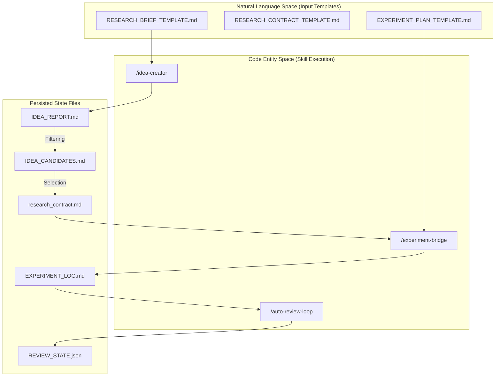
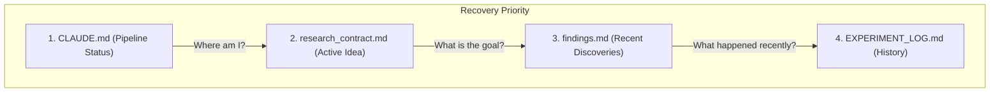

<!-- source: DeepWiki mcp.deepwiki.com · repo wanshuiyin/Auto-claude-code-research-in-sleep · page 6.6 Templates & Project Files · fetched 2026-10-26 -->

# Templates & Project Files

<details>
<summary>Relevant source files</summary>

The following files were used as context for generating this wiki page:

- [docs/PROJECT_FILES_GUIDE.md](docs/PROJECT_FILES_GUIDE.md)
- [docs/PROJECT_FILES_GUIDE_CN.md](docs/PROJECT_FILES_GUIDE_CN.md)
- [docs/SESSION_RECOVERY_GUIDE.md](docs/SESSION_RECOVERY_GUIDE.md)
- [docs/SESSION_RECOVERY_GUIDE_CN.md](docs/SESSION_RECOVERY_GUIDE_CN.md)
- [templates/CLAUDE_MD_TEMPLATE.md](templates/CLAUDE_MD_TEMPLATE.md)
- [templates/EXPERIMENT_LOG_TEMPLATE.md](templates/EXPERIMENT_LOG_TEMPLATE.md)
- [templates/EXPERIMENT_PLAN_TEMPLATE.md](templates/EXPERIMENT_PLAN_TEMPLATE.md)
- [templates/FINDINGS_TEMPLATE.md](templates/FINDINGS_TEMPLATE.md)
- [templates/IDEA_CANDIDATES_TEMPLATE.md](templates/IDEA_CANDIDATES_TEMPLATE.md)
- [templates/IDEA_CANDIDATES_TEMPLATE_CN.md](templates/IDEA_CANDIDATES_TEMPLATE_CN.md)
- [templates/MANIFEST_TEMPLATE.md](templates/MANIFEST_TEMPLATE.md)
- [templates/NARRATIVE_REPORT_TEMPLATE.md](templates/NARRATIVE_REPORT_TEMPLATE.md)
- [templates/PAPER_PLAN_TEMPLATE.md](templates/PAPER_PLAN_TEMPLATE.md)
- [templates/README.md](templates/README.md)
- [templates/RESEARCH_BRIEF_TEMPLATE.md](templates/RESEARCH_BRIEF_TEMPLATE.md)
- [templates/RESEARCH_BRIEF_TEMPLATE_CN.md](templates/RESEARCH_BRIEF_TEMPLATE_CN.md)
- [templates/RESEARCH_CONTRACT_TEMPLATE.md](templates/RESEARCH_CONTRACT_TEMPLATE.md)
- [templates/claude-hooks/corpus_write_guard.json](templates/claude-hooks/corpus_write_guard.json)
- [templates/claude-hooks/corpus_write_guard.py](templates/claude-hooks/corpus_write_guard.py)
- [tests/test_corpus_write_guard.py](tests/test_corpus_write_guard.py)

</details>


The ARIS framework utilizes a structured directory of templates and project files to maintain state, guide LLM execution, and ensure research continuity across long-running workflows. These templates serve as the "connective tissue" between different research phases, enabling the system to recover from context compaction and transition seamlessly between idea discovery, experimentation, and paper writing.

## Core Template Ecosystem

The `templates/` directory contains pre-structured Markdown and YAML files designed to bootstrap new projects and provide standardized inputs for ARIS skills.

### Workflow Input Templates
These templates are manually or semi-automatically filled to initiate specific research stages.

| Template | Primary Workflow | Purpose |
| :--- | :--- | :--- |
| `RESEARCH_BRIEF_TEMPLATE.md` | Workflow 1 | Defines high-level research direction and constraints [templates/README.md:9](). |
| `RESEARCH_CONTRACT_TEMPLATE.md` | Workflow 1.5 | Focused working document for the active idea to prevent context pollution [docs/SESSION_RECOVERY_GUIDE.md:71-72](). |
| `EXPERIMENT_PLAN_TEMPLATE.md` | Workflow 1.5 | Claim-driven roadmap including run order and GPU budgets [templates/README.md:11](). |
| `NARRATIVE_REPORT_TEMPLATE.md` | Workflow 3 | Structuring claims, evidence, and results for paper generation [templates/README.md:12](). |
| `PAPER_PLAN_TEMPLATE.md` | Workflow 3 | Pre-made outline to skip the initial planning phase of paper writing [templates/README.md:13](). |

### Project Dashboard: CLAUDE.md
The `CLAUDE.md` file (based on `CLAUDE_MD_TEMPLATE.md`) is the most critical file for state persistence. It contains the `## Pipeline Status` block, a YAML-structured snapshot used by LLMs to orient themselves after context compaction [docs/SESSION_RECOVERY_GUIDE.md:16-18]().

**Sources:** [templates/README.md:5-15](), [docs/SESSION_RECOVERY_GUIDE.md:22-39](), [templates/CLAUDE_MD_TEMPLATE.md:1-16]()

---

## Data Flow: From Idea to Paper

The following diagram illustrates how data flows from Natural Language Space (Templates) into Code Entity Space (Skill Execution) and results in persisted State Files.

### Research Data Transformation Flow
"Natural Language Space" -> "Code Entity Space"


**Sources:** [docs/PROJECT_FILES_GUIDE_CN.md:72-96](), [docs/SESSION_RECOVERY_GUIDE.md:79-84]()

---

## Patent & Specialized Templates

ARIS includes a parallel branch for patent generation (`/patent-pipeline`) with dedicated templates to satisfy legal and jurisdictional requirements.

| File | Skill | Role |
| :--- | :--- | :--- |
| `INVENTION_BRIEF_TEMPLATE.md` | `/patent-pipeline` | Initial disclosure of technical problems and solutions [templates/README.md:29](). |
| `PATENT_CLAIMS_TEMPLATE.md` | `/claims-drafting` | Worksheet for claim hierarchy (CN/US/EP styles) [templates/README.md:30](). |
| `PATENT_SPECIFICATION_TEMPLATE.md` | `/specification-writing` | Skeleton for the full patent description [templates/README.md:31](). |

**Sources:** [templates/README.md:25-31]()

---

## State Management & Recovery Files

ARIS uses specific files to handle "Compact Mode" execution, ensuring that LLMs do not lose progress when the context window is flushed.

### Key State Files
*   **`REVIEW_STATE.json`**: Persists the current round, `thread_id`, and `last_score` for the autonomous review loop [docs/SESSION_RECOVERY_GUIDE_CN.md:190-195]().
*   **`FINDINGS.md`**: A lightweight log for recording anomalies and engineering decisions (e.g., "OOM fix applied") that are critical for future sessions [templates/FINDINGS_TEMPLATE.md:3-5]().
*   **`MANIFEST.md`**: An auto-maintained index of every artifact generated by skills, allowing for pre-flight dependency checks [templates/MANIFEST_TEMPLATE.md:3-4]().

### Session Recovery Logic
When a new session starts, the system follows a strict reading order to reconstruct the "Mental Model" of the project:


**Sources:** [docs/SESSION_RECOVERY_GUIDE.md:79-84](), [docs/PROJECT_FILES_GUIDE_CN.md:109-118]()

---

## Claude Code Hooks for Automation

For Claude Code users, specific hooks can automate aspects of state management and recovery, reducing the LLM's cognitive load. These are copy-paste snippets and not part of the `install_aris.sh` script [docs/SESSION_RECOVERY_GUIDE.md:112-114]().

### Claude Code Hook Overview

| Hook | Event | Purpose |
| :--- | :--- | :--- |
| `session-restore.sh` | `PreToolUse` (first call) | New session → auto-read Pipeline Status + state files [docs/SESSION_RECOVERY_GUIDE.md:120](). |
| `context-refresh.sh` | `PreToolUse` (throttled) | Periodically inject Pipeline Status into context [docs/SESSION_RECOVERY_GUIDE.md:121](). |
| `pre-compact-remind.sh` | `PreCompact` | Remind LLM to save state before compaction [docs/SESSION_RECOVERY_GUIDE.md:122](). |
| `corpus_write_guard.json` | `PreToolUse` (Bash) | Blocks common Bash shell-write patterns to the skill corpus [templates/claude-hooks/corpus_write_guard.json:2-15](). |

### `session-restore.sh` Implementation Details
This hook is crucial for new session recovery. It checks for the project's `CLAUDE.md` and extracts the `Pipeline Status`. It also checks for `research_contract.md` and `REVIEW_STATE.json` to inform the LLM about the active idea and any ongoing review loops [docs/SESSION_RECOVERY_GUIDE_CN.md:165-195]().

```mermaid
graph TD
    A[New Session / First Tool Use] --> B{Is CLAUDE.md present?};
    B -- Yes --> C[Read "## Pipeline Status"];
    C --> D{Is research_contract.md present?};
    D -- Yes --> E[Instruct LLM to read research_contract.md];
    E --> F{Is training_status running?};
    F -- Yes --> G[Instruct LLM to check remote status];
    G --> H{Is REVIEW_STATE.json in_progress?};
    H -- Yes --> I[Instruct LLM that auto-review-loop can resume];
    I --> J[LLM resumes work];
    B -- No --> K[Exit];
```
**Sources:** [docs/SESSION_RECOVERY_GUIDE.md:117-122](), [docs/SESSION_RECOVERY_GUIDE_CN.md:139-195](), [templates/claude-hooks/corpus_write_guard.json:2-15]()

---

## Usage: Bootstrapping a Project

To start a new research project, users are encouraged to copy the templates into their project root.

1.  **Initialize Dashboard**: `cp templates/CLAUDE_MD_TEMPLATE.md CLAUDE.md` [docs/SESSION_RECOVERY_GUIDE.md:41]().
2.  **Define Brief**: Fill `RESEARCH_BRIEF_TEMPLATE.md` and run `/idea-discovery`.
3.  **Contracting**: Once an idea is selected from `IDEA_REPORT.md`, create the `idea-stage/docs/research_contract.md` to focus the LLM's attention [docs/PROJECT_FILES_GUIDE_CN.md:79]().
4.  **Execution**: Use `EXPERIMENT_PLAN_TEMPLATE.md` to guide the `/experiment-bridge` skill [templates/README.md:45-49]().

**Sources:** [templates/README.md:41-49](), [docs/PROJECT_FILES_GUIDE_CN.md:120-132]()

---

