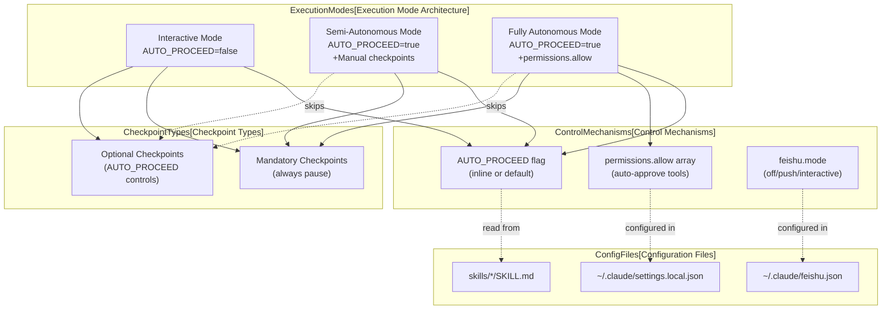
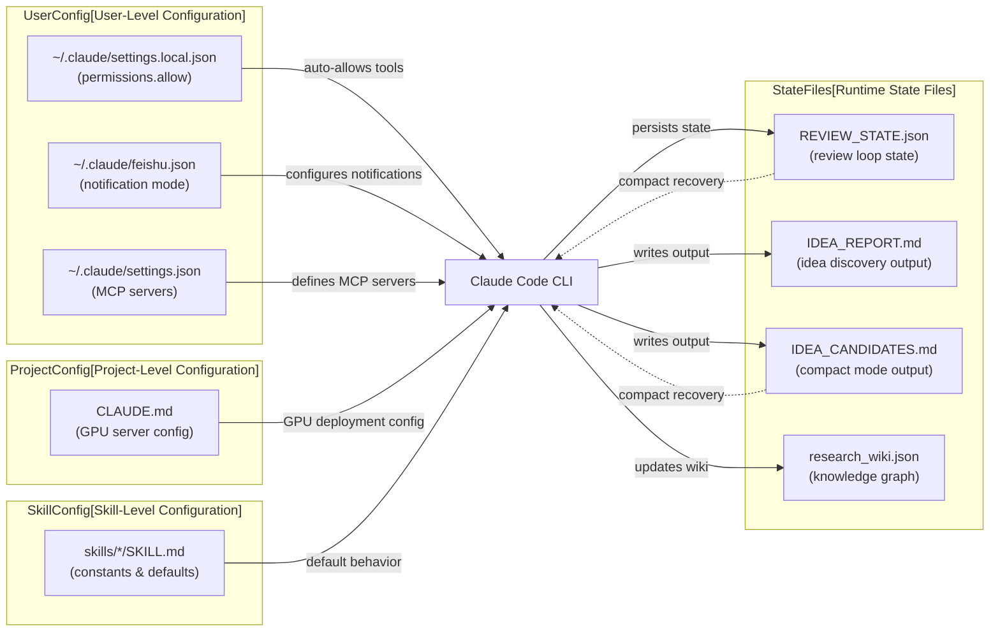
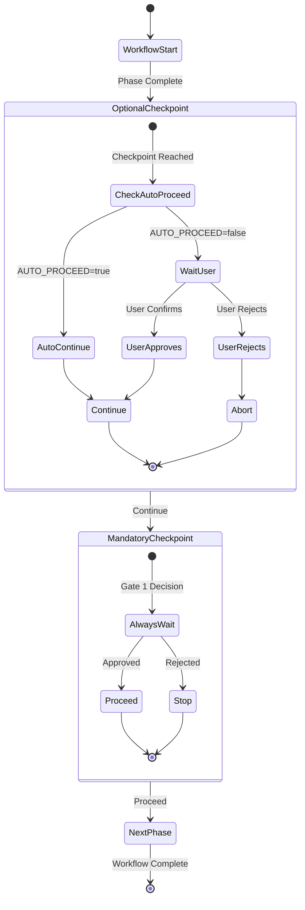

<!-- source: DeepWiki mcp.deepwiki.com · repo wanshuiyin/Auto-claude-code-research-in-sleep · page 7 Usage Patterns · fetched 2026-10-26 -->

# Usage Patterns

Relevant source files

The following files were used as context for generating this wiki page:

- [docs/CUSTOMIZATION.md](docs/CUSTOMIZATION.md)
- [docs/CUSTOMIZATION_CN.md](docs/CUSTOMIZATION_CN.md)
- [skills/research-pipeline/SKILL.md](skills/research-pipeline/SKILL.md)
- [skills/skills-codex-claude-review/research-review/SKILL.md](skills/skills-codex-claude-review/research-review/SKILL.md)
- [skills/skills-codex-gemini-review/research-review/SKILL.md](skills/skills-codex-gemini-review/research-review/SKILL.md)
- [skills/skills-codex/research-pipeline/SKILL.md](skills/skills-codex/research-pipeline/SKILL.md)
- [skills/skills-codex/research-review/SKILL.md](skills/skills-codex/research-review/SKILL.md)
- [tests/test_auto_proceed_contract.py](tests/test_auto_proceed_contract.py)

This page documents common usage patterns for ARIS, covering execution modes, workflow customization strategies, and configuration options. It provides an overview of how to operate ARIS in different scenarios, from fully interactive step-by-step execution to autonomous overnight runs.

For detailed setup instructions, see [Initial Setup Checklist](#6.1). For information about the core workflows themselves, see [Research Workflows](#3). For advanced state management and recovery mechanisms, see [State Persistence & Recovery](#8.1).

## Execution Modes Overview

ARIS supports three distinct execution modes that control the level of automation and human oversight. The mode is primarily controlled by the `AUTO_PROCEED` flag and permission settings in `~/.claude/settings.local.json`.

Title: Execution Mode Architecture

**Execution Mode Characteristics:**

| Mode | `AUTO_PROCEED` | `permissions.allow` | Use Case | Checkpoints |
|------|--------------|-------------------|----------|-------------|
| Interactive | `false` | Not required | Learning, high-risk decisions | Pauses at every decision point |
| Semi-Autonomous | `true` | Not required | Daytime supervision | Pauses only at mandatory gates |
| Fully Autonomous | `true` | Required | Overnight execution | Mandatory gates + mobile approval via Feishu |

Sources: [skills/research-pipeline/SKILL.md:33-35](), [skills/skills-codex/research-pipeline/SKILL.md:19-21]()

## Configuration File Architecture

ARIS behavior is controlled by three main configuration layers. Understanding these files is essential for customizing execution patterns.

Title: Configuration & State Entity Map

**Configuration Priority:**

1.  **Inline arguments** (highest priority) — Override defaults per-invocation, e.g., `/research-pipeline "topic" — AUTO_PROCEED: false, human checkpoint: true, difficulty: nightmare` [skills/research-pipeline/SKILL.md:47-47]().
2.  **Skill defaults** — Constants defined in `SKILL.md` files, such as `AUTO_PROCEED = true` or `REVIEWER_DIFFICULTY = medium` [skills/research-pipeline/SKILL.md:33-37]().
3.  **User settings** — `~/.claude/settings.local.json` for permissions and `~/.claude/settings.json` for MCP servers.
4.  **System defaults** — Hardcoded fallbacks when no configuration exists.

Sources: [skills/research-pipeline/SKILL.md:33-47](), [skills/skills-codex/research-pipeline/SKILL.md:19-33](), [docs/CUSTOMIZATION.md:27-38](), [docs/CUSTOMIZATION_CN.md:29-40]()

## Common Usage Patterns Summary

### 1. Autonomous Overnight Execution ([Autonomous Overnight Execution](#7.1))
The "sweet spot" pattern: initiate `/research-pipeline` in the evening, approve the Gate 1 checkpoint after idea discovery, then sleep while implementation and review loops run.
-   **Characteristics**: `AUTO_PROCEED=true`, `permissions.allow` configured for `mcp__codex__codex` and filesystem tools.
-   **Workflow**: W1 → W1.5 → W2 → W3.
Sources: [skills/research-pipeline/SKILL.md:33-33]()

### 2. Interactive Mode with Checkpoints ([Interactive Mode with Checkpoints](#7.2))
Step-by-step execution with explicit approval at each decision point. Ideal for high-risk research or when tight control over the method is needed.
-   **Characteristics**: `AUTO_PROCEED=false`, manual approval per tool call.
-   **Feishu Integration**: Use `feishu.mode: interactive` for mobile approval of checkpoints while away from the terminal.
Sources: [skills/research-pipeline/SKILL.md:54-69]()

### 3. Customizing Workflow Behavior ([Customizing Workflow Behavior](#7.3))
Workflows support various constants that can be overridden to customize behavior, including reviewer difficulty, pilot budgets, and auto-writing options.
-   **Example**: `/research-pipeline "topic" — AUTO_PROCEED: false, human checkpoint: true, difficulty: nightmare, code review: false, auto_write: true, venue: NeurIPS` [skills/research-pipeline/SKILL.md:47-47]().
-   **Reviewer Difficulty**: `medium` (default), `hard` (adds reviewer memory + debate protocol), `nightmare` (GPT reads repo directly via `codex exec` + memory + debate) [skills/research-pipeline/SKILL.md:37-37]().
-   **Pilot Budgets**: `PILOT_MAX_HOURS`, `PILOT_TIMEOUT_HOURS`, `MAX_PILOT_IDEAS`, `MAX_TOTAL_GPU_HOURS` [docs/CUSTOMIZATION.md:68-71]().
Sources: [skills/research-pipeline/SKILL.md:33-47](), [skills/skills-codex/research-pipeline/SKILL.md:19-33](), [docs/CUSTOMIZATION.md:18-116](), [docs/CUSTOMIZATION_CN.md:18-117]()

### 4. Project File Organization ([Project File Organization](#7.4))
ARIS maintains a structured filesystem to ensure persistence across context window compactions.
-   **Dashboard**: `CLAUDE.md` contains the Pipeline Status.
-   **Outputs**: `IDEA_REPORT.md` (W1), `AUTO_REVIEW.md` (W2), `PASTE_READY.txt` (W4).
-   **Recovery**: `REVIEW_STATE.json` and `IDEA_CANDIDATES.md` (compact mode).
Sources: [skills/research-pipeline/SKILL.md:40-40](), [skills/skills-codex/research-pipeline/SKILL.md:25-25]()

## Checkpoint Architecture

Title: Checkpoint Logic Flow

The `AUTO_PROCEED` flag dictates the behavior at selection checkpoints. When `AUTO_PROCEED=true`, the system reports the chosen option and continues in the same turn without waiting for user confirmation. When `AUTO_PROCEED=false`, the system presents options, asks the user, and ends the turn, waiting for an explicit reply to resume [skills/research-pipeline/SKILL.md:50-61](). This rule applies only to `AUTO_PROCEED`-controlled checkpoints; explicit Feishu interactive gates are always blocking [skills/research-pipeline/SKILL.md:65-69]().

**Checkpoint Types in Each Workflow:**

| Workflow | Mandatory Checkpoints | Optional Checkpoints |
|----------|----------------------|---------------------|
| `/research-pipeline` | After `IDEA_REPORT.md` (Gate 1) [skills/research-pipeline/SKILL.md:50-74]() | Between major stages, controlled by `AUTO_PROCEED` [skills/research-pipeline/SKILL.md:33-33]() |
| `/auto-review-loop` | `HUMAN_CHECKPOINT=true` pauses after each round's review [skills/research-pipeline/SKILL.md:36-36]() | N/A |

Sources: [skills/research-pipeline/SKILL.md:33-74](), [skills/skills-codex/research-pipeline/SKILL.md:19-55](), [tests/test_auto_proceed_contract.py:37-50]()

## Related Pages
-   [Autonomous Overnight Execution](#7.1) — Detailed setup for the 'sweet spot' pattern.
-   [Interactive Mode with Checkpoints](#7.2) — Step-by-step execution and Feishu bridge.
-   [Customizing Workflow Behavior](#7.3) — Overriding constants and using the effort/assurance axes.
-   [Project File Organization](#7.4) — Layered project file system and dashboard patterns.
-   [ARIS-Monitor Desktop Widget](#7.5) — Document aris-monitor/: the always-on-top macOS Tkinter widget that shows which Claude Code sessions need approval — scanner.py, widget.py, ticker.py, focus.py, focus-tty.sh, run.sh, read-only monitoring guarantees and the opt-in Focus action.

---

