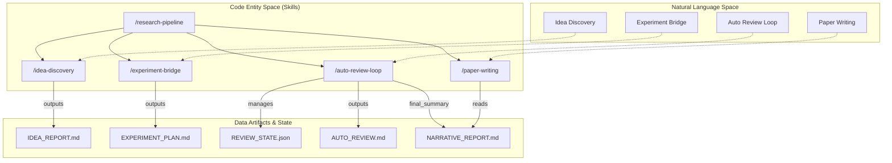
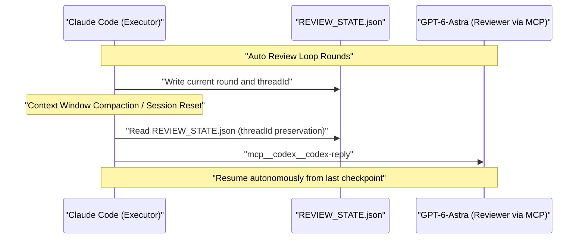
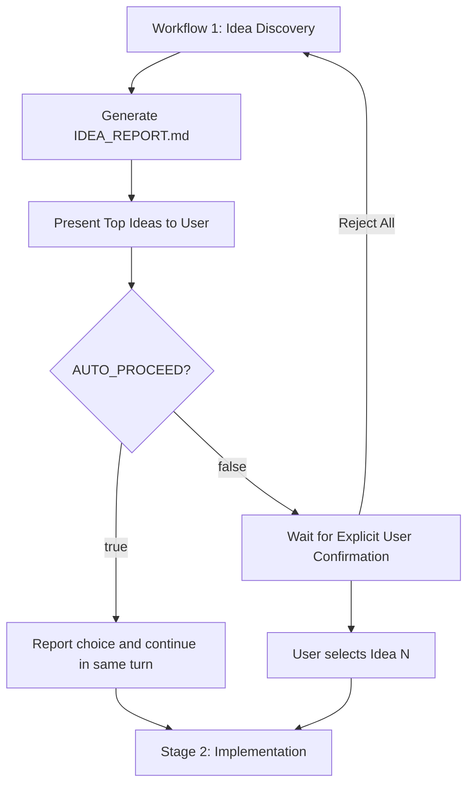

<!-- source: DeepWiki mcp.deepwiki.com · repo wanshuiyin/Auto-claude-code-research-in-sleep · page 7.1 Autonomous Overnight Execution · fetched 2026-10-26 -->

# Autonomous Overnight Execution

Relevant source files

The following files were used as context for generating this wiki page:

- [README.md](README.md)
- [README_CN.md](README_CN.md)
- [docs/CUSTOMIZATION.md](docs/CUSTOMIZATION.md)
- [docs/CUSTOMIZATION_CN.md](docs/CUSTOMIZATION_CN.md)
- [skills/auto-paper-improvement-loop/SKILL.md](skills/auto-paper-improvement-loop/SKILL.md)
- [skills/paper-write/SKILL.md](skills/paper-write/SKILL.md)
- [skills/paper-writing/SKILL.md](skills/paper-writing/SKILL.md)
- [skills/research-pipeline/SKILL.md](skills/research-pipeline/SKILL.md)
- [skills/skills-codex-claude-review/research-review/SKILL.md](skills/skills-codex-claude-review/research-review/SKILL.md)
- [skills/skills-codex-gemini-review/research-review/SKILL.md](skills/skills-codex-gemini-review/research-review/SKILL.md)
- [skills/skills-codex/research-pipeline/SKILL.md](skills/skills-codex/research-pipeline/SKILL.md)
- [skills/skills-codex/research-review/SKILL.md](skills/skills-codex/research-review/SKILL.md)
- [tests/test_auto_proceed_contract.py](tests/test_auto_proceed_contract.py)

This document describes the "overnight execution" usage pattern—ARIS's designed workflow for unattended research automation. This pattern leverages the system's ability to persist state, manage long-running experiments, and execute multi-hour workflows autonomously while the user sleeps.

## Purpose and Design Intent

The autonomous overnight execution pattern addresses a fundamental constraint in ML research: experiments and review iterations take hours, but researchers cannot monitor terminals overnight. ARIS solves this by:

1.  **Front-loading interactive decisions** to the evening via `Workflow 1: Idea Discovery` [skills/idea-discovery/SKILL.md:8-21]().
2.  **Enforcing a mandatory human checkpoint** (Gate 1) before expensive operations begin [skills/research-pipeline/SKILL.md:50-73]().
3.  **Running compute-intensive phases autonomously** including `Workflow 2: Auto Review Loop` and `Workflow 3: Paper Writing` [skills/research-pipeline/SKILL.md:124-140]().
4.  **Persisting state** via `REVIEW_STATE.json` to survive context window compaction without human intervention [skills/research-pipeline/SKILL.md:138-140]().

The system is specifically designed for the `/research-pipeline` skill, which chains all major workflows end-to-end [skills/research-pipeline/SKILL.md:25-32]().

**Sources:** [README.md:25-27](), [skills/research-pipeline/SKILL.md:8-32](), [skills/idea-discovery/SKILL.md:8-21]()

---

## System Entity Mapping

The following diagrams bridge the high-level research stages to the specific code entities, files, and state management mechanisms that enable autonomous transitions.

### Research Workflow to Code Entity Map

**Sources:** [skills/research-pipeline/SKILL.md:25-32](), [skills/idea-discovery/SKILL.md:17-21](), [skills/paper-write/SKILL.md:20-28]()

### Persistence & Recovery Mechanism

**Sources:** [skills/research-pipeline/SKILL.md:138-140](), [skills/skills-codex/research-pipeline/SKILL.md:29-32](), [skills/skills-codex/research-review/SKILL.md:17-17]()

---

## The Sweet Spot Timeline

The recommended execution pattern follows this schedule:

### Overnight Execution Timeline

```mermaid
gantt
    title "Overnight Execution Timeline"
    dateFormat HH:mm
    axisFormat %H:%M
    
    section "Evening"
    Launch_research_pipeline["Launch /research-pipeline"]    :active, evening1, 18:00, 15m
    Workflow_1_Discovery["Workflow 1 (Discovery)"]       :active, evening2, 18:15, 60m
    Review_ranked_ideas["Review ranked ideas"]          :crit, evening3, 19:15, 15m
    Approve_Gate_1["Approve Gate 1"]               :milestone, evening4, 19:30, 0m
    
    section "Night"
    Implementation["Implementation"]               :night1, 19:30, 45m
    Deploy_run_experiment["Deploy /run-experiment"]       :night2, 20:15, 15m
    Workflow_2_Round_1["Workflow 2 Round 1"]           :night3, 20:30, 90m
    Workflow_2_Round_2["Workflow 2 Round 2"]           :night4, 22:00, 90m
    Workflow_2_Round_3["Workflow 2 Round 3"]           :night5, 23:30, 90m
    Workflow_2_Round_4["Workflow 2 Round 4"]           :night6, 01:00, 90m
    
    section "Morning"
    Workflow_3_Paper["Workflow 3 (Paper)"]           :morning1, 02:30, 120m
    Wake_up["Wake up"]                      :milestone, morning2, 08:00, 0m
    Review_Final_PDF["Review Final PDF"]             :morning3, 08:00, 30m
```

| Phase | Duration | User Present? | Autonomy Level |
|-------|----------|---------------|----------------|
| Launch | 5 min | ✅ Required | Command input |
| Workflow 1 | 45-60 min | ✅ Optional | Interactive checkpoints [skills/research-pipeline/SKILL.md:50-73]() |
| **Gate 1** | 5-15 min | ✅ Required | **Mandatory gate** [skills/research-pipeline/SKILL.md:50-73]() |
| Implementation | 15-60 min | ❌ Not needed | Fully autonomous [skills/research-pipeline/SKILL.md:75-92]() |
| Workflow 2 | 1-6 hours | ❌ Not needed | Fully autonomous [skills/research-pipeline/SKILL.md:124-138]() |
| Workflow 3 | 2-3 hours | ❌ Not needed | Fully autonomous [skills/research-pipeline/SKILL.md:142-152]() |

**Sources:** [skills/research-pipeline/SKILL.md:36-152]()

---

## Configuration for Autonomy

### Permissions for Unattended Execution
To bypass permission prompts during autonomous phases, users should configure `~/.claude/settings.local.json` to allow critical tools and skills [README_CN.md:33-37]().

| Permission | Why Required | Used By |
|-----------|--------------|---------|
| `mcp__codex__codex` | External LLM review invocation | `/research-review`, `/auto-review-loop` [skills/skills-codex/research-review/SKILL.md:17-17]() |
| `Write` / `Edit` | Create experiment scripts, state files | `/run-experiment`, `REVIEW_STATE.json` [skills/research-pipeline/SKILL.md:81-85]() |
| `Skill(auto-review-loop)` | Invoke the workflow skill | `/research-pipeline` [skills/research-pipeline/SKILL.md:129-129]() |

### AUTO_PROCEED Settings
The `AUTO_PROCEED` constant controls whether the system waits for human confirmation at internal workflow transitions [skills/research-pipeline/SKILL.md:34-34]().

*   **Workflow 1 (`/idea-discovery`)**: Defaults to `true`. If the user is silent at literature survey or idea generation checkpoints, it auto-selects the top option [skills/research-pipeline/SKILL.md:34-34]().
*   **Pipeline Gate 1**: This is the primary safety gate. Even if `AUTO_PROCEED=true`, the system presents results and waits for user input before proceeding [skills/research-pipeline/SKILL.md:50-73](). The system explicitly states that it will "continue executing in the **same turn**" and will "Do not ask for confirmation, request user input, sleep, wait for silence, or end the turn at a checkpoint" when `AUTO_PROCEED=true` [skills/research-pipeline/SKILL.md:53-57]().
*   **Workflow 2 (`/auto-review-loop`)**: Runs fully autonomously unless `HUMAN_CHECKPOINT=true` is passed, which forces a pause after each review round [skills/research-pipeline/SKILL.md:36-36]().

**Sources:** [skills/research-pipeline/SKILL.md:34-36](), [skills/research-pipeline/SKILL.md:50-73](), [test_auto_proceed_contract.py:40-44]()

---

## The Mandatory Human Gate (Gate 1)

The `/research-pipeline` skill enforces a human gate after `Workflow 1` completes to ensure compute resources are not wasted on unpromising ideas [skills/research-pipeline/SKILL.md:50-52]().

### Gate 1 Logic Flow

**Sources:** [skills/research-pipeline/SKILL.md:50-73]()

---

## Implementation & Deployment (Night Phase)

Once Gate 1 is passed, the system enters the autonomous "sleep" phase.

### Stage 2: Implementation
Claude Code reads the chosen idea from `IDEA_REPORT.md` (hypothesis, experimental design, pilot code) and extends it to a full-scale experiment [skills/research-pipeline/SKILL.md:77-85]().
*   **Code Review**: It performs a self-review to ensure hyperparameters are configurable, seeds are fixed, and logging is proper [skills/research-pipeline/SKILL.md:87-91]().

### Stage 3: Deployment
The system deploys the full-scale experiments. It auto-routes based on job count [skills/research-pipeline/SKILL.md:93-95]().
*   **Tool Invocation**: Uses `/run-experiment` for small batches (≤5 jobs) or `/experiment-queue` for large sweeps [skills/research-pipeline/SKILL.md:97-105]().
*   **Monitoring**: Uses `/monitor-experiment` to track progress and collect results autonomously [skills/research-pipeline/SKILL.md:118-122]().

**Sources:** [skills/research-pipeline/SKILL.md:75-122]()

---

## Auto-Review & Paper Generation

### Stage 4: Review Loop
The `/auto-review-loop` skill executes up to 4 rounds of improvement [skills/research-pipeline/SKILL.md:132-136]().
*   **Adversarial Review**: `gpt-6-astra` (Reviewer) reviews the work and identifies weaknesses while Claude (Executor) implements fixes [skills/skills-codex/research-review/SKILL.md:17-17](). This can be overridden to use `claude-review` or `gemini-review` via skill overlays for cross-family review [skills/skills-codex-claude-review/research-review/SKILL.md:22-24](), [skills/skills-codex-gemini-review/research-review/SKILL.md:16-16]().
*   **Stop Condition**: Iterates until the review score is ≥ 6/10 or the round limit is reached [skills/research-pipeline/SKILL.md:136-136]().

### Stage 5 & 6: Research Summary & Writing
The final stage generates a `NARRATIVE_REPORT.md` summarizing all findings [skills/research-pipeline/SKILL.md:142-145]().
*   **Auto-Write**: If `AUTO_WRITE=true`, the system automatically invokes `/paper-writing` to generate a polished LaTeX PDF for the target venue [skills/research-pipeline/SKILL.md:18-19](), [skills/research-pipeline/SKILL.md:147-152]().

**Sources:** [skills/research-pipeline/SKILL.md:124-152](), [skills/paper-write/SKILL.md:8-26](), [skills/skills-codex/research-review/SKILL.md:17-17](), [skills/skills-codex-claude-review/research-review/SKILL.md:22-24](), [skills/skills-codex-gemini-review/research-review/SKILL.md:16-16]()

---

