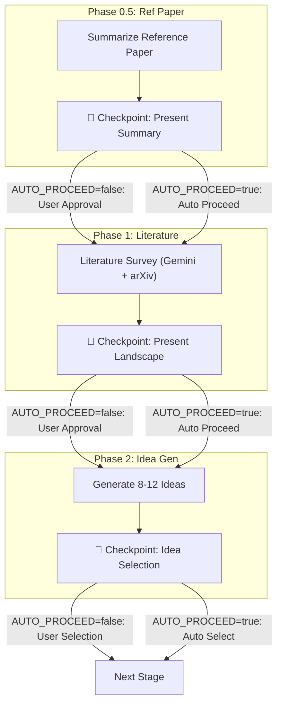

<!-- source: DeepWiki mcp.deepwiki.com · repo wanshuiyin/Auto-claude-code-research-in-sleep · page 7.2 Interactive Mode with Checkpoints · fetched 2026-10-26 -->

# Interactive Mode with Checkpoints

<details>
<summary>Relevant source files</summary>

The following files were used as context for generating this wiki page:

- [docs/CUSTOMIZATION.md](docs/CUSTOMIZATION.md)
- [docs/CUSTOMIZATION_CN.md](docs/CUSTOMIZATION_CN.md)
- [mcp-servers/feishu-bridge/requirements.txt](mcp-servers/feishu-bridge/requirements.txt)
- [mcp-servers/feishu-bridge/server.py](mcp-servers/feishu-bridge/server.py)
- [skills/research-pipeline/SKILL.md](skills/research-pipeline/SKILL.md)
- [skills/skills-codex-claude-review/research-review/SKILL.md](skills/skills-codex-claude-review/research-review/SKILL.md)
- [skills/skills-codex-gemini-review/research-review/SKILL.md](skills/skills-codex-gemini-review/research-review/SKILL.md)
- [skills/skills-codex/research-pipeline/SKILL.md](skills/skills-codex/research-pipeline/SKILL.md)
- [skills/skills-codex/research-review/SKILL.md](skills/skills-codex/research-review/SKILL.md)
- [tests/test_auto_proceed_contract.py](tests/test_auto_proceed_contract.py)

</details>


## Purpose and Scope

This document describes how to use ARIS in **interactive collaborative mode**, where the system pauses at key decision points to await human approval and guidance. This mode is ideal for exploratory research where you want to steer the research direction, validate assumptions before committing expensive GPU resources, or guide the system's reasoning process.

Interactive mode bridges the gap between fully autonomous execution and manual research by implementing "Human-in-the-Loop" (HITL) gates.

**Sources:** [skills/research-pipeline/SKILL.md:33-36](), [skills/skills-codex/research-pipeline/SKILL.md:19-20]()

---

## Core Concept: AUTO_PROCEED and HUMAN_CHECKPOINT

Interactive mode is controlled by two primary mechanisms: the `AUTO_PROCEED` orchestrator flag and the `HUMAN_CHECKPOINT` skill constant. These determine whether skills automatically select the top-ranked option or halt for explicit user confirmation.

| Configuration | Behavior | Use Case |
|--------------|----------|----------|
| `AUTO_PROCEED=false` | Pause at major phase transitions (e.g., Gate 1 in `research-pipeline`), wait for user input. | **Default for exploration.** High-stakes decisions, selecting between generated ideas. |
| `HUMAN_CHECKPOINT=true` | Specific to loops; pauses after the Review Phase to present scores and weaknesses. | **Granular control.** Reviewing GPT-5.5 feedback before Claude implements code fixes. |

In the `research-pipeline`, `AUTO_PROCEED` specifically governs **selection checkpoints**. If `false`, the system presents options, asks the user, and ends the turn, resuming only after an explicit reply [skills/research-pipeline/SKILL.md:54-59]().

**Sources:** [skills/research-pipeline/SKILL.md:33-36](), [skills/research-pipeline/SKILL.md:50-74](), [skills/skills-codex/research-pipeline/SKILL.md:19-20()]

---

## Configuring Interactive Mode

### Method 1: Inline Override (Per-Invocation)

You can override the default behavior at skill invocation time using the argument syntax:

```bash
# Force interactive checkpoints for the full research pipeline
> /research-pipeline "topic" — AUTO_PROCEED: false, human checkpoint: true

# Enable human checkpoints within the auto review loop
> /auto-review-loop "topic" — human checkpoint: true
```
This is demonstrated in the `research-pipeline` skill documentation [skills/research-pipeline/SKILL.md:47-47]().

**Sources:** [skills/research-pipeline/SKILL.md:47-47]()

### Method 2: Skill File Modification (Persistent)

Edit the skill's `SKILL.md` file (e.g., `skills/research-pipeline/SKILL.md`) to change the default constant:

```markdown
## Constants
- **AUTO_PROCEED = false** — When `true`, every selection checkpoint is informational: report the choice and continue in the same turn. When `false`, ask for explicit user confirmation and end the turn at the checkpoint.
```
This constant is defined in the `research-pipeline` skill [skills/research-pipeline/SKILL.md:33-36]().

**Sources:** [skills/research-pipeline/SKILL.md:33-36]()

---

## Checkpoint Mechanisms by Workflow

### Workflow Orchestration: `AUTO_PROCEED` Rule

The `AUTO_PROCEED` constant dictates the behavior at selection checkpoints. This value is resolved once from `$ARGUMENTS` before Stage 1 and passed to nested workflows [skills/research-pipeline/SKILL.md:51-52]().

*   **`AUTO_PROCEED=true` is non-blocking:** A checkpoint is a progress update, not a question. The system states the result and the automatically selected next action, then continues executing in the **same turn**. It does not ask for confirmation, request user input, sleep, wait for silence, or end the turn at a checkpoint [skills/research-pipeline/SKILL.md:54-57]().
*   **`AUTO_PROCEED=false` is blocking:** The system presents the options, asks the user, and ends the turn. Execution resumes only after an explicit reply [skills/research-pipeline/SKILL.md:58-59]().

It's crucial that `AUTO_PROCEED` is never implemented as "ask, then continue if there is no response," as silence cannot resume the pipeline once a turn ends [skills/research-pipeline/SKILL.md:61-62]().

**Sources:** [skills/research-pipeline/SKILL.md:51-62](), [skills/skills-codex/research-pipeline/SKILL.md:37-49](), [tests/test_auto_proceed_contract.py:37-47]()

### Workflow 1: Idea Discovery Checkpoints

The `idea-discovery` pipeline, when invoked by `/research-pipeline`, inherits the `AUTO_PROCEED` setting. While the specific checkpoints are not detailed in the provided `research-pipeline` skill, the `AUTO_PROCEED` rule applies to any selection checkpoints within `idea-discovery`.


**Sources:** [skills/research-pipeline/SKILL.md:51-52](), [skills/skills-codex/research-pipeline/SKILL.md:37-38]()

### Workflow Orchestration: Gate 1

In the full `research-pipeline`, Gate 1 serves as a primary decision point. The `AUTO_PROCEED` setting determines whether this gate requires human interaction.

```mermaid
stateDiagram-v2
    [*] --> IdeaDiscovery: "/idea-discovery"
    IdeaDiscovery --> Gate1: "Generate IDEA_REPORT.md"
    
    state "Gate 1: User Decision" as Gate1 {
        direction LR
        Approve: "Proceed to Stage 2"
        PickDifferent: "Select Idea #2"
        RequestChanges: "Refine Constraints"
        RejectAll: "Re-run Discovery"
    }
    
    Gate1 -- "AUTO_PROCEED=false: User Action" --> Implementation: "Approve / Pick"
    Gate1 -- "AUTO_PROCEED=true: Auto Proceed" --> Implementation: "Auto-selected"
    Implementation --> Stage3: "Deploy Experiments"
    Gate1 --> IdeaDiscovery: "Request Changes / Reject"
    Gate1 --> [*]: "Stop"
```
**Sources:** [skills/research-pipeline/SKILL.md:54-59](), [skills/skills-codex/research-pipeline/SKILL.md:40-45]()

---

## Feishu Interactive Mode

ARIS supports a bidirectional bridge via Feishu (Lark) for mobile approvals. This is implemented in the `feishu-bridge` server and consumed by notification skills. If the user explicitly enables a Feishu **interactive** gate, this external approval or reply is an intentional blocking exception, and the system waits for that user-controlled gate rather than treating it as a silence timeout. Feishu off/push-only modes remain non-blocking under `AUTO_PROCEED=true` [skills/research-pipeline/SKILL.md:65-69]().

### Data Flow: Code to Mobile Approval

The `feishu-bridge` server (`mcp-servers/feishu-bridge/server.py`) provides endpoints for sending interactive cards and polling for user replies.

```mermaid
graph TD
    subgraph "Local ARIS Environment"
        EX["Executor (Claude Code)"]
        SK["Notification Skill (e.g., /feishu-notify)"]
    end

    subgraph "feishu-bridge [server.py]"
        POST_SEND["POST /send (send_card)"]
        GET_POLL["GET /poll (poll_reply)"]
        POST_REPLY["POST /reply (receive_reply)"]
    end

    subgraph "Feishu Cloud & Mobile"
        LARK_OAPI["Lark OAPI"]
        FEISHU_APP["Feishu Mobile App"]
    end

    EX --> SK
    SK -->| "Call MCP: feishu-bridge" | POST_SEND
    POST_SEND -->| "lark.Client.im.v1.message.create" | LARK_OAPI
    LARK_OAPI -->| "Push Interactive Card" | FEISHU_APP
    FEISHU_APP -->| "User Action (e.g., Approve button)" | POST_REPLY
    SK -->| "Call MCP: feishu-bridge (long-poll)" | GET_POLL
    POST_REPLY -->| "receive_reply sets threading.Event" | GET_POLL
    GET_POLL -->| "Return User Input" | SK
    SK --> EX
```
**Sources:** [mcp-servers/feishu-bridge/server.py:7-10](), [mcp-servers/feishu-bridge/server.py:59-92](), [mcp-servers/feishu-bridge/server.py:115-133](), [skills/research-pipeline/SKILL.md:65-69]()

### Implementation Details
*   **Threading Model:** The `feishu-bridge` uses a thread-safe `reply_store` (a dictionary mapping `message_id` to reply text) and `reply_events` (a dictionary mapping `message_id` to `threading.Event` objects) to manage asynchronous replies. When an interactive card is sent, an `Event` is created and stored. When a reply is received via the `/reply` endpoint, the corresponding `Event` is set, unblocking any waiting `poll_reply` call [mcp-servers/feishu-bridge/server.py:54-56](), [mcp-servers/feishu-bridge/server.py:88-90](), [mcp-servers/feishu-bridge/server.py:138-142]().
*   **Polling Pattern:** A skill initiates a long-poll by calling `GET /poll?message_id=<id>&timeout=<seconds>`. The `poll_reply` function waits on the `threading.Event` associated with the `message_id` for a specified `timeout`. If the event is set (meaning a reply was received) or the timeout occurs, the function returns the reply or a timeout indication [mcp-servers/feishu-bridge/server.py:115-133](), [mcp-servers/feishu-bridge/server.py:161-170]().
*   **Interactive Cards:** The `send_card` function constructs a JSON payload for an interactive message card, including a title, body, and optional color, then sends it using the `lark_oapi` client. This allows for rich, actionable notifications on the Feishu mobile app [mcp-servers/feishu-bridge/server.py:59-92]().
*   **Configuration:** The `feishu-bridge` requires `FEISHU_APP_ID`, `FEISHU_APP_SECRET`, and `FEISHU_USER_ID` environment variables for authentication and targeting. It listens on a configurable `BRIDGE_PORT` (default 5000) [mcp-servers/feishu-bridge/server.py:38-49]().

**Sources:** [mcp-servers/feishu-bridge/server.py:38-49](), [mcp-servers/feishu-bridge/server.py:54-92](), [mcp-servers/feishu-bridge/server.py:115-133](), [mcp-servers/feishu-bridge/server.py:138-142](), [mcp-servers/feishu-bridge/server.py:161-170]()

---

## Best Practices: Interactive vs Autonomous

| Feature | Interactive (`AUTO_PROCEED=false`) | Autonomous (`AUTO_PROCEED=true`) |
| :--- | :--- | :--- |
| **Idea Selection** | Manual choice from `IDEA_REPORT.md` after `idea-discovery`. | Auto-selects top-ranked idea and proceeds [skills/research-pipeline/SKILL.md:54-57](). |
| **GPU Safety** | Verify experiment scripts before `/run-experiment` (e.g., `CODE_REVIEW=true` with `AUTO_DEPLOY=false`). | Automatic deployment after implementation and review (e.g., `CODE_REVIEW=true` with `AUTO_DEPLOY=true`). |
| **Literature Scope** | Adjust search terms after initial literature survey summary. | Proceeds with top-ranked direction based on initial search. |
| **Review Loops** | `HUMAN_CHECKPOINT=true` pauses after each review round for manual fix approval or modification instructions [skills/research-pipeline/SKILL.md:37-38](). | Full multi-round loop without intervention [skills/research-pipeline/SKILL.md:37-38](). |
| **Feishu Integration** | Explicitly enabled interactive gate blocks execution until user approval [skills/research-pipeline/SKILL.md:65-69](). | Feishu push-only notifications are non-blocking [skills/research-pipeline/SKILL.md:65-69](). |

### When to use Interactive Mode
1.  **High-Risk Direction:** When starting a new project where the research direction is uncertain or requires careful human judgment.
2.  **Mobile Monitoring:** Using the Feishu bridge to approve transitions or provide input while away from the terminal [skills/research-pipeline/SKILL.md:65-69]().
3.  **Constraint Refinement:** When initial results (e.g., literature survey) suggest the need to refine problem definitions or experimental constraints.
4.  **Learning and Debugging:** To observe the system's decision-making process step-by-step and understand its reasoning.

### When to use Autonomous Mode
1.  **Overnight Execution:** The standard "research-in-sleep" pattern where `research-pipeline` runs from idea to results without intervention [skills/research-pipeline/SKILL.md:10-16]().
2.  **Repetitive Tasks:** Running multiple seeds, ablation sweeps, or hyperparameter optimizations where the experimental logic is already verified.
3.  **Final Polish:** Automated paper improvement loops for notation, formatting, or minor revisions.
4.  **Well-Defined Problems:** When the research problem is clear, and the system is expected to execute a known, validated workflow.

**Sources:** [skills/research-pipeline/SKILL.md:10-16](), [skills/research-pipeline/SKILL.md:33-38](), [skills/research-pipeline/SKILL.md:54-57](), [skills/research-pipeline/SKILL.md:65-69]()

---

