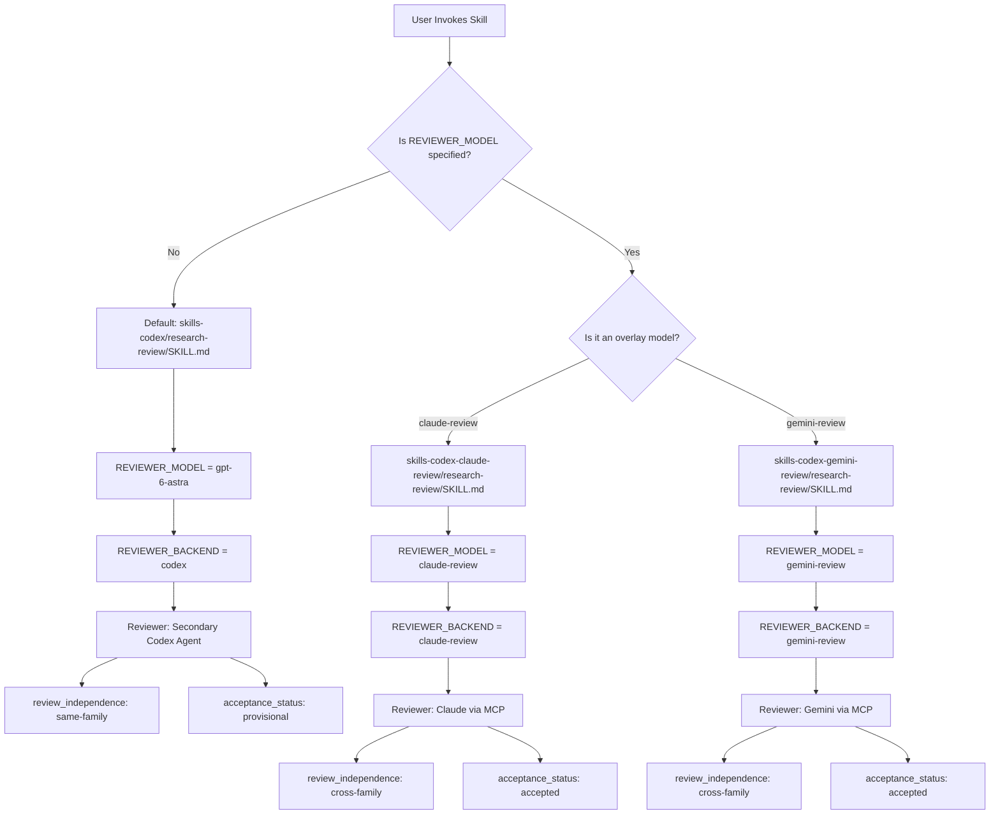
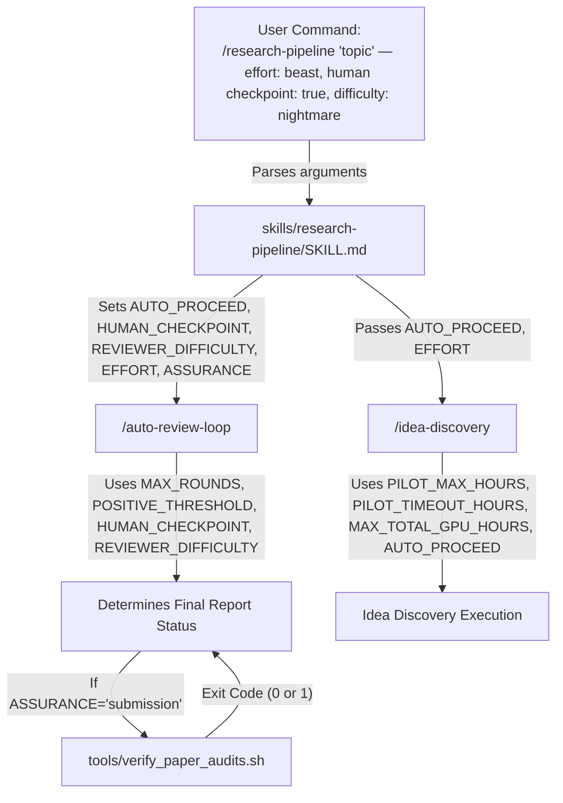

<!-- source: DeepWiki mcp.deepwiki.com · repo wanshuiyin/Auto-claude-code-research-in-sleep · page 7.3 Customizing Workflow Behavior · fetched 2026-10-26 -->

# Customizing Workflow Behavior

Relevant source files

The following files were used as context for generating this wiki page:

- [docs/CUSTOMIZATION.md](docs/CUSTOMIZATION.md)
- [docs/CUSTOMIZATION_CN.md](docs/CUSTOMIZATION_CN.md)
- [skills/research-pipeline/SKILL.md](skills/research-pipeline/SKILL.md)
- [skills/shared-references/assurance-contract.md](skills/shared-references/assurance-contract.md)
- [skills/shared-references/effort-contract.md](skills/shared-references/effort-contract.md)
- [skills/skills-codex-claude-review/research-review/SKILL.md](skills/skills-codex-claude-review/research-review/SKILL.md)
- [skills/skills-codex-gemini-review/research-review/SKILL.md](skills/skills-codex-gemini-review/research-review/SKILL.md)
- [skills/skills-codex/research-pipeline/SKILL.md](skills/skills-codex/research-pipeline/SKILL.md)
- [skills/skills-codex/research-review/SKILL.md](skills/skills-codex/research-review/SKILL.md)
- [skills/skills-codex/shared-references/acceptance-gate.md](skills/skills-codex/shared-references/acceptance-gate.md)
- [skills/skills-codex/shared-references/assurance-contract.md](skills/skills-codex/shared-references/assurance-contract.md)
- [skills/skills-codex/shared-references/effort-contract.md](skills/skills-codex/shared-references/effort-contract.md)
- [skills/skills-codex/shared-references/review-tracing.md](skills/skills-codex/shared-references/review-tracing.md)
- [tests/test_auto_proceed_contract.py](tests/test_auto_proceed_contract.py)
- [tests/test_verify_paper_audits.py](tests/test_verify_paper_audits.py)
- [tools/verify_paper_audits.sh](tools/verify_paper_audits.sh)

This page documents how to override default workflow parameters via command arguments. ARIS workflows expose key behavioral constants—effort levels, assurance strictness, pilot budgets, review rounds, score thresholds, and reviewer models—that can be customized per invocation without modifying skill files. This allows adapting workflows to different resource constraints, quality requirements, and time budgets.

**Scope**: This page covers argument-based parameter overrides for the orchestrator workflows (`/idea-discovery`, `/auto-review-loop`, `/research-pipeline`, `/auto-paper-improvement-loop`) and their constituent atomic skills.

---

## The Two Independent Control Axes

ARIS behavior is primarily governed by two independent control axes that manage the trade-off between speed, cost, and rigor [skills/research-pipeline/SKILL.md:47]().

### Axis 1: `effort` (Depth / Budget)
Controls the intensity of the work, including the number of papers searched, ideas generated, and experiment rounds [skills/shared-references/effort-contract.md:3-5]().
- **lite**: Minimum viable depth (~0.4x tokens) [skills/shared-references/effort-contract.md:31-33]().
- **balanced**: Default behavior (1x tokens) [skills/shared-references/effort-contract.md:35-37]().
- **max**: Increased depth and more detail (~2.5x tokens) [skills/shared-references/effort-contract.md:39-41]().
- **beast**: No budget limit; every knob to maximum (~5-8x tokens) [skills/shared-references/effort-contract.md:43-46]().

### Axis 2: `assurance` (Audit Strictness)
Controls whether mandatory audits gate the final report, independent of the effort level [skills/shared-references/assurance-contract.md:3-5]().
- **draft**: Audits run only if content matches; silent skips are allowed [skills/shared-references/assurance-contract.md:30-34]().
- **submission**: Load-bearing audits; any `FAIL`, `BLOCKED`, or `ERROR` verdict from `verify_paper_audits.sh` blocks the final report [skills/shared-references/assurance-contract.md:36-42]().

**Sources**: [skills/research-pipeline/SKILL.md:47](), [skills/shared-references/effort-contract.md:3-46](), [skills/shared-references/assurance-contract.md:3-42]()

---

## Workflow Parameter Architecture

The following diagram associates natural language customization intents with the specific code entities (constants) they modify across different skills.

**Diagram 1: Parameter Mapping to Code Entities**

```mermaid
graph TD
    subgraph "NaturalLanguageIntents"
        Budget["'pilot budget: 4h per idea'"]
        Rounds["'6 rounds'"]
        Threshold["'threshold: 7'"]
        Checkpoint["'human checkpoint: true'"]
        Model["'reviewer: claude-review'"]
        Diff["'difficulty: nightmare'"]
        Effort["'effort: beast'"]
        Assurance["'assurance: submission'"]
        AutoProceed["'auto proceed: false'"]
    end

    subgraph "CodeEntitySpace_SKILL_md_Constants"
        IDC_PILOT["PILOT_MAX_HOURS<br/>(idea-discovery)"]
        IDC_TOTAL["MAX_TOTAL_GPU_HOURS<br/>(idea-discovery)"]
        ARL_ROUNDS["MAX_ROUNDS<br/>(auto-review-loop)"]
        ARL_THRESH["POSITIVE_THRESHOLD<br/>(auto-review-loop)"]
        ARL_HITL["HUMAN_CHECKPOINT<br/>(research-pipeline, auto-review-loop)"]
        RP_AUTO_PROCEED["AUTO_PROCEED<br/>(research-pipeline)"]
        GEN_MODEL["REVIEWER_MODEL<br/>(research-review)"]
        ARL_DIFF["REVIEWER_DIFFICULTY<br/>(research-pipeline, auto-review-loop)"]
        EFF_PARAM["EFFORT<br/>(effort-contract.md)"]
        ASR_PARAM["ASSURANCE<br/>(assurance-contract.md)"]
    end

    Budget --> IDC_PILOT
    Budget --> IDC_TOTAL
    Rounds --> ARL_ROUNDS
    Threshold --> ARL_THRESH
    Checkpoint --> ARL_HITL
    AutoProceed --> RP_AUTO_PROCEED
    Model --> GEN_MODEL
    Diff --> ARL_DIFF
    Effort --> EFF_PARAM
    Assurance --> ASR_PARAM
```

**Sources**: [skills/research-pipeline/SKILL.md:34-37](), [skills/research-pipeline/SKILL.md:47](), [skills/skills-codex/research-pipeline/SKILL.md:19-22](), [skills/skills-codex/research-pipeline/SKILL.md:33](), [skills/skills-codex-claude-review/research-review/SKILL.md:23-24](), [skills/skills-codex/research-review/SKILL.md:16-18](), [skills/shared-references/effort-contract.md:1-12](), [skills/shared-references/assurance-contract.md:1-23]()

---

## Override Syntax and Common Parameters

Parameters are overridden using natural language suffixes or scoped flags after the main argument. The skill parser extracts key-value pairs following the em-dash (`—`) separator [skills/research-pipeline/SKILL.md:47]().

### Recognized Override Patterns

| Natural Language Pattern | Target Parameter | Default Value |
|:---|:---|:---|
| `— effort: beast` | `EFFORT` | `balanced` [skills/shared-references/effort-contract.md:11]() |
| `— assurance: submission` | `ASSURANCE` | Derived from effort [skills/shared-references/assurance-contract.md:44-51]() |
| `— pilot budget: 4h per idea` | `PILOT_MAX_HOURS` | 2h [docs/CUSTOMIZATION.md:68]() |
| `— total budget: 8h` | `MAX_TOTAL_GPU_HOURS` | 8h [docs/CUSTOMIZATION.md:71]() |
| `— max rounds: 6` | `MAX_ROUNDS` | 4 [docs/CUSTOMIZATION.md:51]() |
| `— positive threshold: 7` | `POSITIVE_THRESHOLD` | 6/10 [docs/CUSTOMIZATION.md:52]() |
| `— human checkpoint: true` | `HUMAN_CHECKPOINT` | `false` [skills/research-pipeline/SKILL.md:36]() |
| `— difficulty: nightmare` | `REVIEWER_DIFFICULTY` | `medium` [skills/research-pipeline/SKILL.md:37]() |
| `— auto proceed: false` | `AUTO_PROCEED` | `true` [skills/research-pipeline/SKILL.md:34]() |
| `— reviewer: claude-review` | `REVIEWER_MODEL` | `gpt-6-astra` [skills/skills-codex/research-review/SKILL.md:16]() |

**Sources**: [skills/research-pipeline/SKILL.md:47](), [skills/skills-codex/research-pipeline/SKILL.md:33](), [skills/shared-references/effort-contract.md:1-51](), [skills/shared-references/assurance-contract.md:1-51](), [docs/CUSTOMIZATION.md:49-74]()

---

## Workflow 1: Idea Discovery Customization

The `/idea-discovery` workflow manages the transition from literature to pilot-tested ideas. Its behavior is governed by budget constraints and checkpoint logic.

### Budget and Failsafe Constants
- **PILOT_MAX_HOURS**: Skips any pilot estimated to take longer than this value per GPU (default 2h) [docs/CUSTOMIZATION.md:68]().
- **PILOT_TIMEOUT_HOURS**: A hard timeout that kills running pilots exceeding the limit (default 3h), collecting partial results if available [docs/CUSTOMIZATION.md:69]().
- **MAX_PILOT_IDEAS**: Maximum number of ideas to pilot in parallel (default 3) [docs/CUSTOMIZATION.md:70]().
- **MAX_TOTAL_GPU_HOURS**: A global budget cap across all parallel pilots (default 8h) [docs/CUSTOMIZATION.md:71]().

### Checkpoint Behavior
- **AUTO_PROCEED**: When `true` (default), the system automatically continues at selection checkpoints. When `false`, it asks for explicit user confirmation and ends the turn [skills/research-pipeline/SKILL.md:34,53-59]().
- **ARXIV_DOWNLOAD**: When `true`, `/research-lit` downloads top relevant arXiv PDFs during literature survey. When `false` (default), only fetches metadata [skills/research-pipeline/SKILL.md:35]().

**Sources**: [docs/CUSTOMIZATION.md:64-74](), [skills/research-pipeline/SKILL.md:34-35,53-59]()

---

## Workflow 2: Auto Review Loop Customization

The `/auto-review-loop` is an iterative improvement process. Customizing its stop conditions and difficulty is critical for balancing autonomy and quality.

### Stop Condition Logic
The loop continues until one of two conditions is met:
1. **MAX_ROUNDS** (default 4) is reached [docs/CUSTOMIZATION.md:51]().
2. **POSITIVE_THRESHOLD** (score >= 6/10) is achieved, indicating the work is submission-ready [docs/CUSTOMIZATION.md:52]().

### Reviewer Difficulty
Users can customize the adversarial level of the reviewer via `REVIEWER_DIFFICULTY` [skills/research-pipeline/SKILL.md:37]():
- **medium**: Standard MCP review (default) [skills/research-pipeline/SKILL.md:37]().
- **hard**: Adds reviewer memory + debate protocol [skills/research-pipeline/SKILL.md:37]().
- **nightmare**: GPT reads repo directly via `codex exec` + memory + debate [skills/research-pipeline/SKILL.md:37]().

### Human Checkpoint
- **HUMAN_CHECKPOINT**: When `true`, the auto-review loops pause after each round's review for user inspection and modification instructions [skills/research-pipeline/SKILL.md:36]().

**Sources**: [docs/CUSTOMIZATION.md:49-55](), [skills/research-pipeline/SKILL.md:36-37]()

---

## Reviewer Model Customization

The choice of reviewer model significantly impacts the review process, especially regarding cross-model verification.

### Default Reviewer
The default reviewer for Codex-native skills is a secondary Codex agent, typically `gpt-6-astra`, with `reasoning_effort: ultra` [skills/skills-codex/research-review/SKILL.md:16-17](). This is considered "same-family" review, resulting in a `provisional` `acceptance_status` [skills/skills-codex/research-review/SKILL.md:8-11]().

### Cross-Family Reviewers
ARIS supports "overlay" packages that allow using different model families as reviewers, enabling cross-family verification.
- **Claude Reviewer**: By installing `skills-codex-claude-review`, the `research-review` skill can be configured to use `claude-review` MCP. This results in `review_independence: cross-family` and `acceptance_status: accepted` [skills/skills-codex-claude-review/research-review/SKILL.md:6-13]().
- **Gemini Reviewer**: Similarly, `skills-codex-gemini-review` allows using `gemini-review` MCP, also yielding `cross-family` and `accepted` status [skills/skills-codex-gemini-review/research-review/SKILL.md:6-10]().

**Diagram 2: Reviewer Model Resolution**

**Sources**: [skills/skills-codex/research-review/SKILL.md:8-18](), [skills/skills-codex-claude-review/research-review/SKILL.md:6-24](), [skills/skills-codex-gemini-review/research-review/SKILL.md:6-17]()

---

## Assurance & Audit Enforcement

When `assurance: submission` is set (either explicitly or via `effort: max/beast`), ARIS enforces a strict audit chain.

### The Verifier Gate
In submission mode, Phase 6 of `/paper-writing` invokes `tools/verify_paper_audits.sh`. This script is the single source of truth for audit completeness and currentness [tools/verify_paper_audits.sh:4-6]().
- **Exit 0**: All required audits present, schema-valid, fresh (no `STALE`), and no blocking verdicts (`FAIL`/`BLOCKED`/`ERROR`) at submission level [tools/verify_paper_audits.sh:15-17]().
- **Exit 1**: Any blocking issue (missing artifact, schema invalid, `STALE`, or `FAIL`/`BLOCKED`/`ERROR` verdict) [tools/verify_paper_audits.sh:18-19]().

### Mandatory Audits
The `verify_paper_audits.sh` script defines a set of `MANDATORY_AUDITS` that must pass for `submission` assurance [tools/verify_paper_audits.sh:38-43](). These include:
- **PROOF_AUDIT**: Verified by `proof-checker` skill.
- **PAPER_CLAIM_AUDIT**: Verified by `paper-claim-audit` skill.
- **CITATION_AUDIT**: Verified by `citation-audit` skill.
- **KILL_ARGUMENT**: Verified by `kill-argument` skill.

**Sources**: [skills/shared-references/assurance-contract.md:36-43](), [tools/verify_paper_audits.sh:1-48]()

---

## Data Flow and Inheritance

When an orchestrator is invoked, arguments are parsed and propagated down the call stack to sub-skills.

**Diagram 3: Parameter Propagation and Execution Flow**

### Parameter Inheritance Rules
1.  **Explicit Overrides**: Concrete knobs (e.g., `max rounds: 2`) take precedence over effort levels [skills/shared-references/effort-contract.md:156-161]().
2.  **Implied Mapping**: If `assurance` is not provided, it is derived from `effort` (e.g., `beast` implies `submission`) [skills/shared-references/effort-contract.md:55-63]().
3.  **Hard Invariants**: Reviewer quality (`reasoning_effort: xhigh`) and citation integrity are never changed by effort settings [skills/shared-references/effort-contract.md:13-25]().

**Sources**: [skills/research-pipeline/SKILL.md:34-37](), [skills/shared-references/effort-contract.md:13-63,154-164](), [skills/shared-references/assurance-contract.md:44-51]()

---

