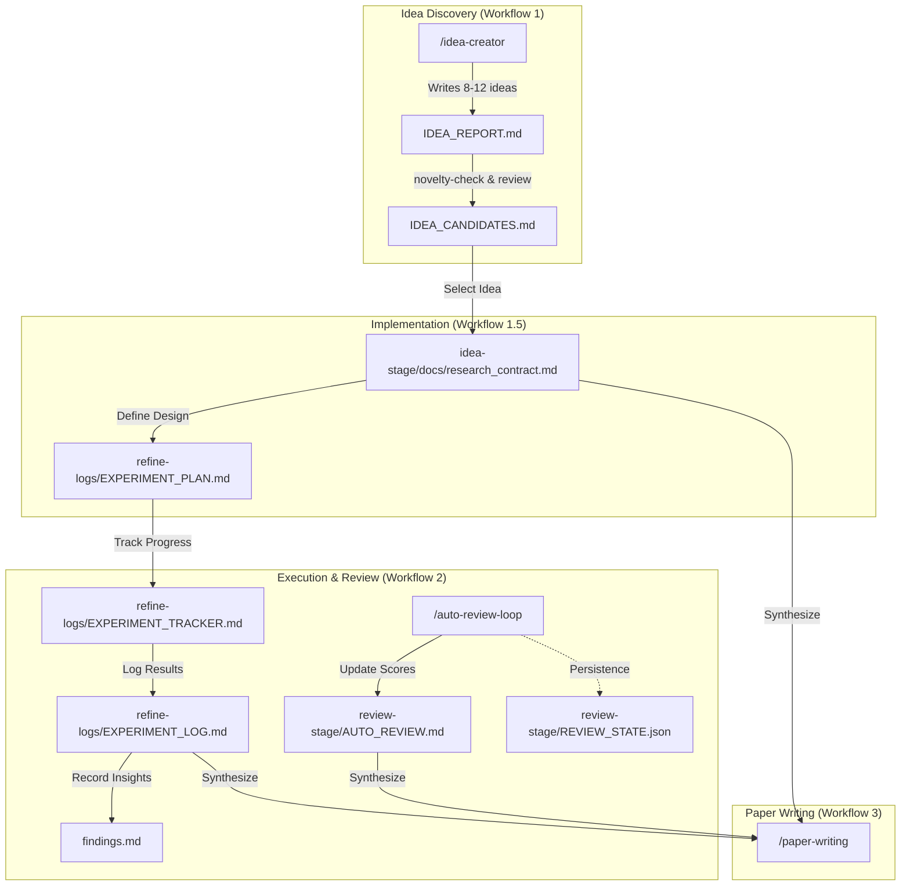
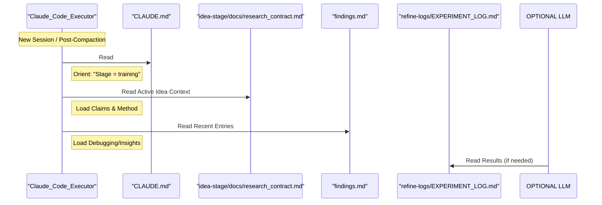

<!-- source: DeepWiki mcp.deepwiki.com · repo wanshuiyin/Auto-claude-code-research-in-sleep · page 7.4 Project File Organization · fetched 2026-10-26 -->

# Project File Organization

Relevant source files

The following files were used as context for generating this wiki page:

- [docs/PROJECT_FILES_GUIDE.md](docs/PROJECT_FILES_GUIDE.md)
- [docs/PROJECT_FILES_GUIDE_CN.md](docs/PROJECT_FILES_GUIDE_CN.md)
- [docs/SESSION_RECOVERY_GUIDE.md](docs/SESSION_RECOVERY_GUIDE.md)
- [docs/SESSION_RECOVERY_GUIDE_CN.md](docs/SESSION_RECOVERY_GUIDE_CN.md)
- [templates/CLAUDE_MD_TEMPLATE.md](templates/CLAUDE_MD_TEMPLATE.md)
- [templates/EXPERIMENT_LOG_TEMPLATE.md](templates/EXPERIMENT_LOG_TEMPLATE.md)
- [templates/FINDINGS_TEMPLATE.md](templates/FINDINGS_TEMPLATE.md)
- [templates/IDEA_CANDIDATES_TEMPLATE.md](templates/IDEA_CANDIDATES_TEMPLATE.md)
- [templates/IDEA_CANDIDATES_TEMPLATE_CN.md](templates/IDEA_CANDIDATES_TEMPLATE_CN.md)
- [templates/MANIFEST_TEMPLATE.md](templates/MANIFEST_TEMPLATE.md)
- [templates/README.md](templates/README.md)
- [templates/RESEARCH_CONTRACT_TEMPLATE.md](templates/RESEARCH_CONTRACT_TEMPLATE.md)

The ARIS (Auto-claude-code-research-in-sleep) framework utilizes a layered file system to manage state, research insights, and experiment metadata across long-running autonomous workflows. This organization ensures that critical context is preserved even when the LLM's context window is compacted or when a user initiates a fresh session to restore model performance [docs/SESSION_RECOVERY_GUIDE.md:5-12]().

## System Overview and Data Flow

The file system is designed to prevent "context pollution" by separating raw brainstorms from active working context. Data flows from broad discovery towards focused implementation and finally to permanent archival logs.

### Idea and Experiment Lifecycle

The following diagram illustrates how research entities transition between different file-based state containers.

**Diagram: Research Entity State Transitions**

**Sources:** [docs/PROJECT_FILES_GUIDE_CN.md:72-82](), [docs/PROJECT_FILES_GUIDE_CN.md:15-49]()

---

## Core Dashboard: CLAUDE.md

The `CLAUDE.md` file serves as the primary "Pipeline Status" dashboard. It is the first file read by the system during session recovery to reconstruct the current stage of the research pipeline [docs/SESSION_RECOVERY_GUIDE.md:16-18]().

### Pipeline Status Structure
The `## Pipeline Status` section uses a YAML-like structure to provide a 30-second orientation for the LLM [docs/SESSION_RECOVERY_GUIDE.md:24-37]():

| Field | Purpose | Example |
|-------|---------|---------|
| `stage` | Current workflow phase (idle, idea-discovery, implementation, training, review, paper). | `training` |
| `idea` | One-line description of the active research goal. | `"factorized attention gap"` |
| `contract` | Path to the `research_contract.md` for deep context. | `idea-stage/docs/research_contract.md` |
| `current_branch` | Git branch for the current idea. | `feature/factorized-gap` |
| `baseline` | Baseline numbers for comparison. | `"WikiText-103 PPL=18.2"` |
| `training_status` | Overall training state (idle, running, complete, failed). | `running on server-X, tmux=train01` |
| `active_tasks` | List of all running background jobs (training, downloads, evals) with location and check commands. | `training exp01 on server-X (GPU 0-3)` |
| `language` | Controls skill output language (`en` or `zh`). | `en` |
| `last_updated` | Auto-updated timestamp by skills on every output write. | `2025-06-15 14:30` |
| `next` | Concrete next step. | `"wait for training, then run eval on test set"` |

**Sources:** [docs/SESSION_RECOVERY_GUIDE.md:39-55](), [docs/SESSION_RECOVERY_GUIDE.md:25-37](), [templates/CLAUDE_MD_TEMPLATE.md:6-15]()

---

## The Discovery Layer

These files manage the transition from raw brainstorming to a concrete research agreement.

### IDEA_REPORT.md vs. IDEA_CANDIDATES.md
*   **`idea-stage/IDEA_REPORT.md`**: Generated by `/idea-creator`. Contains the raw output of 8-12 ideas, including pilot results and eliminated candidates [docs/PROJECT_FILES_GUIDE_CN.md:55]().
*   **`idea-stage/IDEA_CANDIDATES.md`**: A curated pool of 3-5 viable ideas that survived novelty checks and review. This file acts as a "buffer" so the LLM can quickly pivot if the primary idea fails without re-running the full discovery pipeline [docs/PROJECT_FILES_GUIDE_CN.md:65](), [templates/README.md:37](), [templates/IDEA_CANDIDATES_TEMPLATE.md:3-5]().

### idea-stage/docs/research_contract.md
Created when an idea is selected for implementation (transition from W1 to W1.5). It extracts *only* the active idea's details (claims, method summary, experiment design, baselines) to avoid wasting context on discarded ideas [templates/RESEARCH_CONTRACT_TEMPLATE.md:3-5](). It is updated at every major milestone [docs/SESSION_RECOVERY_GUIDE.md:67-75]().

**Sources:** [docs/PROJECT_FILES_GUIDE_CN.md:72-82](), [templates/RESEARCH_CONTRACT_TEMPLATE.md:7-30]()

---

## The Execution Layer (`refine-logs/`)

The `refine-logs/` directory contains files used by `/experiment-bridge` and `/auto-review-loop` to manage code execution and tracking.

### EXPERIMENT_PLAN.md
A claim-driven roadmap that maps high-level research claims to specific experiment blocks. It defines the execution order and compute budgets [docs/PROJECT_FILES_GUIDE_CN.md:56](), [templates/README.md:11]().

### EXPERIMENT_TRACKER.md
A lightweight execution checklist. It tracks the status of specific runs (e.g., `TODO`, `RUNNING`, `DONE`) and provides a quick view of what remains to be executed to prevent losing track of background work [docs/PROJECT_FILES_GUIDE_CN.md:57]().

**Sources:** [docs/PROJECT_FILES_GUIDE_CN.md:86-98](), [templates/README.md:23]()

---

## The Insight & Review Layer

These files record the knowledge gained during execution and the feedback from the adversarial reviewer.

### findings.md
A "discovery log" for both research insights (e.g., "Attention module ineffective on small datasets") and engineering lessons (e.g., "WandB logging breaks DDP") [templates/FINDINGS_TEMPLATE.md:9-52](). It prevents the system from repeating the same debugging mistakes in subsequent sessions [templates/FINDINGS_TEMPLATE.md:3-5]().

### EXPERIMENT_LOG.md
Located in `refine-logs/`, this is the authoritative record of all completed experiments. It includes full results, configurations, and reproduction commands [docs/PROJECT_FILES_GUIDE_CN.md:67](), [templates/README.md:38](), [templates/EXPERIMENT_LOG_TEMPLATE.md:3-5]().

### AUTO_REVIEW.md & REVIEW_STATE.json
*   **`review-stage/AUTO_REVIEW.md`**: A cumulative log of the `/auto-review-loop`, recording scores, raw reviewer critiques, and the specific actions taken to address them [docs/PROJECT_FILES_GUIDE_CN.md:58]().
*   **`review-stage/REVIEW_STATE.json`**: A machine-readable file used to recover the state of a multi-round review loop (round number, thread IDs, pending experiments) after context compaction [docs/PROJECT_FILES_GUIDE_CN.md:59]().

**Sources:** [templates/FINDINGS_TEMPLATE.md:1-52](), [docs/PROJECT_FILES_GUIDE_CN.md:58-60]()

---

## Session Recovery Protocol

The system follows a strict priority when reconstructing state to minimize token usage while maximizing context accuracy.

**Diagram: Session Recovery Data Fetching**

**Sources:** [docs/PROJECT_FILES_GUIDE_CN.md:109-118](), [docs/SESSION_RECOVERY_GUIDE.md:77-85]()

---

## Relationship Summary

The table below summarizes the separation of concerns between different file types to ensure the LLM maintains a clear "Code Entity Space" without losing "Natural Language" research intent.

| Question | File Answer |
|----------|-------------|
| Where does a brainstorm idea go? | `IDEA_REPORT.md` (raw) → `IDEA_CANDIDATES.md` (curated) |
| Where does the current idea's full context go? | `idea-stage/docs/research_contract.md` |
| Where does "experiment X is running" go? | `EXPERIMENT_TRACKER.md` |
| Where does "experiment X got accuracy 95.2" go? | `EXPERIMENT_LOG.md` |
| Where does "lr=1e-4 diverges on dataset-X" go? | `findings.md` |
| Where does "reviewer says add ablation" go? | `AUTO_REVIEW.md` |
| Where does "chose approach A over B because Z" go? | `findings.md` |
| Where does "current stage is training" go? | `CLAUDE.md` Pipeline Status |

**Sources:** [docs/PROJECT_FILES_GUIDE_CN.md:120-132]()

---

