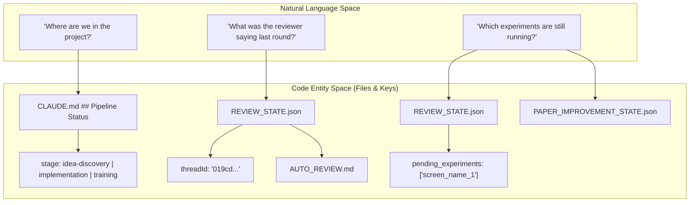
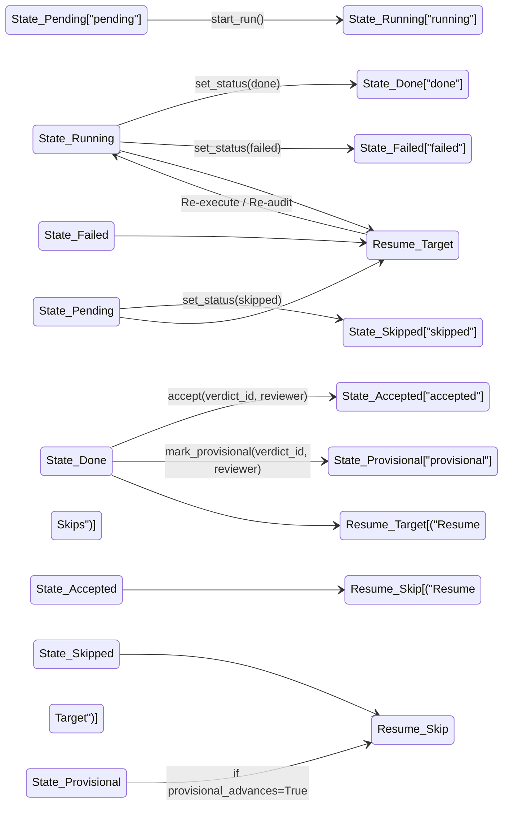
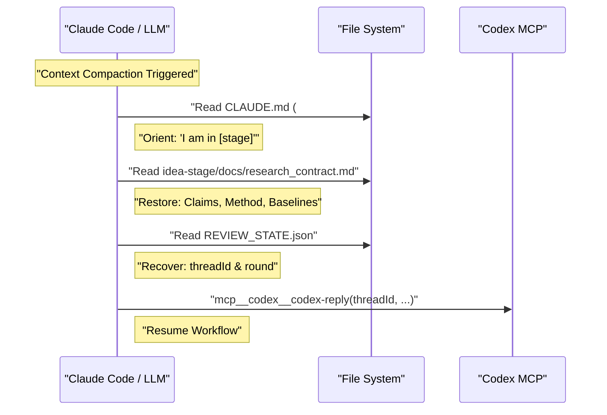

<!-- source: DeepWiki mcp.deepwiki.com · repo wanshuiyin/Auto-claude-code-research-in-sleep · page 8.1 State Persistence & Recovery · fetched 2026-10-26 -->

# State Persistence & Recovery

<details>
<summary>Relevant source files</summary>

The following files were used as context for generating this wiki page:

- [docs/PROJECT_FILES_GUIDE_CN.md](docs/PROJECT_FILES_GUIDE_CN.md)
- [docs/SESSION_RECOVERY_GUIDE.md](docs/SESSION_RECOVERY_GUIDE.md)
- [docs/SESSION_RECOVERY_GUIDE_CN.md](docs/SESSION_RECOVERY_GUIDE_CN.md)
- [skills/shared-references/resumable-runs.md](skills/shared-references/resumable-runs.md)
- [skills/skills-codex/shared-references/resumable-runs.md](skills/skills-codex/shared-references/resumable-runs.md)
- [templates/CLAUDE_MD_TEMPLATE.md](templates/CLAUDE_MD_TEMPLATE.md)
- [templates/IDEA_CANDIDATES_TEMPLATE_CN.md](templates/IDEA_CANDIDATES_TEMPLATE_CN.md)
- [templates/MANIFEST_TEMPLATE.md](templates/MANIFEST_TEMPLATE.md)
- [templates/README.md](templates/README.md)
- [templates/RESEARCH_CONTRACT_TEMPLATE.md](templates/RESEARCH_CONTRACT_TEMPLATE.md)
- [tests/test_run_state.py](tests/test_run_state.py)
- [tools/run_state.py](tools/run_state.py)

</details>


## Purpose and Scope

This document provides a deep dive into how ARIS (Auto-claude-code-research-in-sleep) maintains project state across context window compaction and proactive session restarts. Long-running iterative workflows, such as `/auto-review-loop` and `/research-pipeline`, can exceed the context window of Claude Code, triggering automatic compaction that discards execution details. ARIS prevents state loss through a multi-layered persistence strategy involving `REVIEW_STATE.json`, a structured `## Pipeline Status` dashboard in `CLAUDE.md`, and focused context documents like `idea-stage/docs/research_contract.md`.

---

## The State Persistence Architecture

ARIS uses a layered file system to ensure that the LLM can orient itself within 30 seconds of a session recovery or post-compaction event.

### Project State Layering

| Layer | File(s) | Role | Update Trigger |
| :--- | :--- | :--- | :--- |
| **Dashboard** | `CLAUDE.md` | High-level "Where am I?" (Pipeline Status) | Stage transitions, training start/stop [docs/SESSION_RECOVERY_GUIDE.md:56-65]() |
| **Recovery** | `REVIEW_STATE.json` | Machine-readable loop state (round, threadId) | End of every Review Phase E [skills/shared-references/resumable-runs.md:10]() |
| **Active Context**| `idea-stage/docs/research_contract.md` | Focused details for the *currently selected* idea | Idea selection, baseline confirmation [docs/SESSION_RECOVERY_GUIDE.md:67-76]() |
| **Knowledge** | `findings.md`, `EXPERIMENT_LOG.md` | Permanent record of results and insights | Experiment completion, debugging discovery [docs/PROJECT_FILES_GUIDE_CN.md:100-107]() |

### System Entity Mapping
The following diagram bridges the natural language concepts of "Research State" to the specific code entities and files that manage them.

**Diagram: Research State to Code Entity Mapping**

**Sources:** [docs/SESSION_RECOVERY_GUIDE.md:25-39](), [docs/PROJECT_FILES_GUIDE_CN.md:59]()

---

## Run State Persistence with `tools/run_state.py`

For multi-phase workflows like `/research-pipeline`, `/paper-writing`, or `/idea-discovery`, ARIS uses `tools/run_state.py` to manage and persist the execution state. This module tracks the progress of an ordered list of phases, allowing workflows to resume from where they left off, even after crashes or timeouts [tools/run_state.py:2-7](). The state is stored in a JSON file at `<root>/.aris/runs/<run_id>.json` [tools/run_state.py:34]().

### Phases and Statuses

The core innovation of `run_state.py` is the distinction between `done` (executor finished) and `accepted` (cross-model reviewer or deterministic verifier approved) [tools/run_state.py:10-26](). This ensures that a phase is not silently skipped on resume if it was merely completed by the executor but not yet independently verified.

| Status | Meaning | Who Sets It | Gate Class |
| :--- | :--- | :--- | :--- |
| `pending` | Not started | `start_run()` [tools/run_state.py:160]() | — |
| `running` | In progress | Executor (`set_status()`) [tools/run_state.py:28]() | — |
| `failed` | Executor errored | Executor (`set_status()`) [tools/run_state.py:28]() | — |
| `done` | Executor finished writing the artifact | Executor (`set_status()`) [tools/run_state.py:28]() | EXECUTION-completeness — safe same-model self-report [skills/shared-references/resumable-runs.md:32]() |
| `accepted` | A cross-model reviewer or deterministic verifier returned a positive verdict | `accept()` [tools/run_state.py:29]() | QUALITY/correctness — cross-family (or a deterministic check) [skills/shared-references/resumable-runs.md:33]() |
| `provisional` | A fresh same-family reviewer returned a positive verdict | `mark_provisional()` [skills/shared-references/resumable-runs.md:34]() | Terminal for resume ONLY when `provisional_advances` policy is true [skills/shared-references/resumable-runs.md:34]() |
| `skipped` | The phase does not apply to this run | Executor (`set_status()`) [tools/run_state.py:28]() | Terminal — a deterministic config decision [skills/shared-references/resumable-runs.md:35]() |

### Resumption Logic

`resume_point(root, run_id)` identifies the first phase that is *not* terminal. Terminal statuses include `accepted` and `skipped`. `provisional` is also considered terminal if the run's policy (`policy.provisional_advances`) is set to `True` [tools/run_state.py:63-76](). This ensures that `done`-but-unaccepted phases are re-validated on resume, preventing silent skipping [skills/shared-references/resumable-runs.md:37-40]().

**Diagram: `run_state.py` Phase Transitions and Resumption**

**Sources:** [tools/run_state.py:10-35](), [tools/run_state.py:63-76](), [skills/shared-references/resumable-runs.md:26-40]()

### ThreadId Preservation and Provenance

When a phase is `accepted` or `provisional`, `run_state.py` records the `verdict_id` and `reviewer` [tools/run_state.py:161-162](). The `verdict_id` should be a durable handle, such as a reviewer thread/trace ID, to allow for later auditing [skills/shared-references/resumable-runs.md:66-69](). The `reviewer` field, along with `executor_model` and `executor_family`, is used to enforce the reviewer independence protocol, ensuring that an executor cannot `accept` its own work [tools/run_state.py:154-155](), [tests/test_run_state.py:84-92]().

### Concurrency and Atomicity

`run_state.py` employs a best-effort advisory file lock (`fcntl.flock` on POSIX systems) and atomic file replacement using temporary files to guard against concurrent writes and ensure state integrity [tools/run_state.py:90-112](), [skills/shared-references/resumable-runs.md:71-75]().

**Sources:** [tools/run_state.py:39-164](), [tests/test_run_state.py:1-162](), [skills/shared-references/resumable-runs.md:1-109]()

---

## Human-Readable Recovery: Pipeline Status

While JSON files help the skill logic, the **Pipeline Status** in `CLAUDE.md` helps the LLM agent orient itself globally across different workflows.

### Pipeline Status Schema
[docs/SESSION_RECOVERY_GUIDE.md:25-39]()
```yaml
## Pipeline Status
stage: idea-discovery | implementation | training | paper
idea: "one-line description of the current idea"
contract: idea-stage/docs/research_contract.md
current_branch: feature/idea-name
baseline: "representative dataset acc=95.2 (paper reports 95.5)"
training_status: running on server-X, GPU 0-3, tmux=train01, wandb=run_id
active_tasks:
  - "training exp01 on server-X (tmux=exp01, GPU 0-3)"
next: what to do next
```

### Context Compaction Recovery Flow
When the context window is compacted, the LLM is instructed to follow a specific recovery sequence starting from the most high-level dashboard.

**Diagram: Post-Compaction Recovery Sequence**

**Sources:** [docs/SESSION_RECOVERY_GUIDE.md:77-86](), [docs/SESSION_RECOVERY_GUIDE.md:100-106]()

---

## Automated Recovery via Claude Code Hooks

To ensure the LLM actually performs these recovery steps, ARIS provides optional shell scripts that hook into Claude Code's lifecycle events [docs/SESSION_RECOVERY_GUIDE.md:108-112]().

### Key Hooks
*   **`session-restore.sh`**: Triggered on the first tool use of a new session (`PreToolUse`). It automatically reads the `Pipeline Status`, checks for `research_contract.md`, and detects if `REVIEW_STATE.json` is in progress to suggest stage-appropriate resumption [docs/SESSION_RECOVERY_GUIDE.md:133-195]().
*   **`context-refresh.sh`**: Periodically re-injects the `Pipeline Status` to ensure the LLM doesn't drift during long sessions [docs/SESSION_RECOVERY_GUIDE.md:119]().
*   **`pre-compact-remind.sh`**: Triggered before compaction (`PreCompact`) to remind the LLM to update its state files [docs/SESSION_RECOVERY_GUIDE.md:120]().

**Sources:** [docs/SESSION_RECOVERY_GUIDE.md:108-122](), [docs/SESSION_RECOVERY_GUIDE.md:133-201]()

---

## Compact Mode vs. Full Mode

The `/auto-review-loop` skill supports a `COMPACT` constant (default `false`). When enabled, the system prioritizes reading summary files over full logs to save context window tokens.

| Feature | Standard Mode | Compact Mode (`COMPACT=true`) |
| :--- | :--- | :--- |
| **Recovery Logic** | Parse full `AUTO_REVIEW.md` | Read `findings.md` + `EXPERIMENT_LOG.md` |
| **Log Persistence** | Raw log parsing | Append key findings to `findings.md` after each round |
| **Paper Improvement**| Full LaTeX text in prompt | (N/A - Paper writing requires full text) |

**Sources:** [docs/SESSION_RECOVERY_GUIDE.md:67-76]()

---

