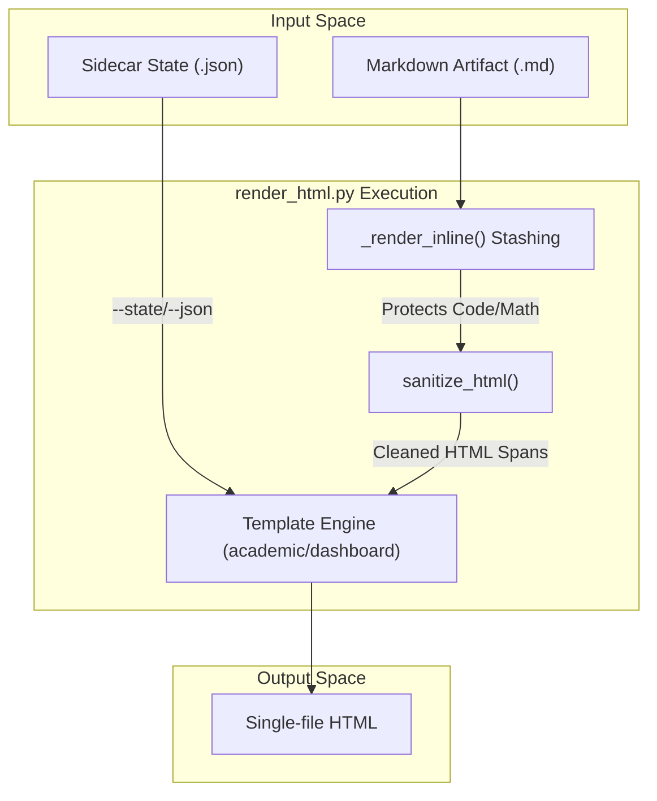

<!-- source: DeepWiki mcp.deepwiki.com · repo wanshuiyin/Auto-claude-code-research-in-sleep · page 8.10 Tutorials & Interview Cheat Sheets · fetched 2026-10-26 -->

# Tutorials & Interview Cheat Sheets

<details>
<summary>Relevant source files</summary>

The following files were used as context for generating this wiki page:

- [docs/tutorials/3d_generation_tutorial.html](docs/tutorials/3d_generation_tutorial.html)
- [docs/tutorials/3d_generation_tutorial.md](docs/tutorials/3d_generation_tutorial.md)
- [docs/tutorials/3d_generation_tutorial.review.json](docs/tutorials/3d_generation_tutorial.review.json)
- [docs/tutorials/README.md](docs/tutorials/README.md)
- [docs/tutorials/agentic_rl_tutorial.html](docs/tutorials/agentic_rl_tutorial.html)
- [docs/tutorials/agentic_rl_tutorial.md](docs/tutorials/agentic_rl_tutorial.md)
- [docs/tutorials/agentic_rl_tutorial.review.json](docs/tutorials/agentic_rl_tutorial.review.json)
- [docs/tutorials/attention_tutorial.html](docs/tutorials/attention_tutorial.html)
- [docs/tutorials/attention_tutorial.md](docs/tutorials/attention_tutorial.md)
- [docs/tutorials/attention_tutorial.review.json](docs/tutorials/attention_tutorial.review.json)
- [docs/tutorials/flow_matching_tutorial.html](docs/tutorials/flow_matching_tutorial.html)
- [docs/tutorials/flow_matching_tutorial.md](docs/tutorials/flow_matching_tutorial.md)
- [docs/tutorials/image_generation_systems_tutorial.html](docs/tutorials/image_generation_systems_tutorial.html)
- [docs/tutorials/image_generation_systems_tutorial.md](docs/tutorials/image_generation_systems_tutorial.md)
- [docs/tutorials/image_generation_systems_tutorial.review.json](docs/tutorials/image_generation_systems_tutorial.review.json)
- [docs/tutorials/moe_tutorial.html](docs/tutorials/moe_tutorial.html)
- [docs/tutorials/moe_tutorial.md](docs/tutorials/moe_tutorial.md)
- [docs/tutorials/moe_tutorial.review.json](docs/tutorials/moe_tutorial.review.json)
- [docs/tutorials/multi_agent_long_horizon_tutorial.html](docs/tutorials/multi_agent_long_horizon_tutorial.html)
- [docs/tutorials/multi_agent_long_horizon_tutorial.md](docs/tutorials/multi_agent_long_horizon_tutorial.md)
- [docs/tutorials/multi_agent_long_horizon_tutorial.review.json](docs/tutorials/multi_agent_long_horizon_tutorial.review.json)
- [docs/tutorials/quantization_tutorial.html](docs/tutorials/quantization_tutorial.html)
- [docs/tutorials/quantization_tutorial.md](docs/tutorials/quantization_tutorial.md)
- [docs/tutorials/quantization_tutorial.review.json](docs/tutorials/quantization_tutorial.review.json)
- [docs/tutorials/reasoning_models_tutorial.html](docs/tutorials/reasoning_models_tutorial.html)
- [docs/tutorials/reasoning_models_tutorial.md](docs/tutorials/reasoning_models_tutorial.md)
- [docs/tutorials/reasoning_models_tutorial.review.json](docs/tutorials/reasoning_models_tutorial.review.json)
- [docs/tutorials/rlhf_dpo_grpo_ppo_tutorial.html](docs/tutorials/rlhf_dpo_grpo_ppo_tutorial.html)
- [docs/tutorials/rlhf_dpo_grpo_ppo_tutorial.md](docs/tutorials/rlhf_dpo_grpo_ppo_tutorial.md)
- [docs/tutorials/rlhf_dpo_grpo_ppo_tutorial.review.json](docs/tutorials/rlhf_dpo_grpo_ppo_tutorial.review.json)
- [docs/tutorials/self_evolving_agents_tutorial.html](docs/tutorials/self_evolving_agents_tutorial.html)
- [docs/tutorials/self_evolving_agents_tutorial.md](docs/tutorials/self_evolving_agents_tutorial.md)
- [docs/tutorials/self_evolving_agents_tutorial.review.json](docs/tutorials/self_evolving_agents_tutorial.review.json)
- [docs/tutorials/vae_vqvae_vqgan_tutorial.html](docs/tutorials/vae_vqvae_vqgan_tutorial.html)
- [skills/comm-lit-review/SKILL.md](skills/comm-lit-review/SKILL.md)
- [skills/feishu-notify/SKILL.md](skills/feishu-notify/SKILL.md)
- [skills/interview-cheatsheet/SKILL.md](skills/interview-cheatsheet/SKILL.md)
- [skills/skills-codex/feishu-notify/SKILL.md](skills/skills-codex/feishu-notify/SKILL.md)
- [skills/skills-codex/interview-cheatsheet/SKILL.md](skills/skills-codex/interview-cheatsheet/SKILL.md)
- [skills/skills-codex/system-profile/SKILL.md](skills/skills-codex/system-profile/SKILL.md)
- [skills/system-profile/SKILL.md](skills/system-profile/SKILL.md)

</details>


The `docs/tutorials/` directory serves as the knowledge dissemination hub for ARIS, housing a curated collection of long-form technical tutorials and Machine Learning (ML)/Large Language Model (LLM) interview preparation cheat sheets. These artifacts are generated using the `/interview-cheatsheet` skill and rendered into high-fidelity HTML via the `/render-html` skill.

## The /interview-cheatsheet Skill

The `/interview-cheatsheet` skill is an automated pipeline designed to generate comprehensive, Chinese-language technical documentation. It follows a strict pedagogical structure and undergoes rigorous cross-model verification to ensure mathematical and technical accuracy.

### Implementation and Data Flow

The skill operates as a multi-step workflow that bridges high-level user requests to finalized, reviewed documentation.

1.  **Planning Phase**: The agent sketches a 12-14 section structure including TL;DR, intuition, formula derivations, from-scratch PyTorch code, and 25 interview questions categorized by difficulty (L1/L2/L3) [skills/interview-cheatsheet/SKILL.md:62-71]().
2.  **Drafting Phase**: Content is written directly to `docs/tutorials/<slug>_tutorial.md` [skills/interview-cheatsheet/SKILL.md:73-75]().
3.  **Cross-Model Review Gate**: The draft is sent to a fresh `gpt-6-astra` thread (via `mcp__codex__codex`) for an adversarial audit. The reviewer checks 10 specific categories, including formula correctness, code executability, and personal information leaks [skills/interview-cheatsheet/SKILL.md:77-113]().
4.  **Refinement Loop**: The executor (Claude) fixes issues identified by the reviewer (GPT) until a `PASS` or `WARN` verdict is achieved [skills/interview-cheatsheet/SKILL.md:115-117]().
5.  **Rendering**: The final Markdown is converted to HTML using the `academic` template [skills/interview-cheatsheet/SKILL.md:3]().

### Technical Invariants
| Invariant | Description | Source |
| :--- | :--- | :--- |
| **Reviewer Independence** | Every review round uses a fresh thread (`mcp__codex__codex`) to prevent "narrative accumulation" where the reviewer starts defending its own previous errors. | [skills/interview-cheatsheet/SKILL.md:79]() |
| **Math/Code Fidelity** | Formulas must be independently re-derived by the reviewer; code blocks must implement the stated math correctly. | [skills/interview-cheatsheet/SKILL.md:93-94]() |
| **Personal Info Ban** | Strict filtering for owner's institution/lab/center names, degree-program affiliations, private server aliases, job-search context, `/Users/...` paths, specific lab/company names. | [skills/interview-cheatsheet/SKILL.md:102]() |

Sources: [skills/interview-cheatsheet/SKILL.md:1-120](), [docs/tutorials/README.md:58-75]()

### Cross-Model Review Gate (`.review.json`)

The `.review.json` file, such as `docs/tutorials/agentic_rl_tutorial.review.json`, serves as an audit trail for the cross-model review process. It records the `verdict` of each review round, the `thread_id` of the reviewer agent, the `reviewer` model used, and detailed lists of `real_issues_caught`, `needs_verify_resolved`, and `fixes_applied`. This transparency ensures accountability and allows for continuous improvement of the content generation process.

For example, in `agentic_rl_tutorial.review.json`, the initial draft by a subagent received a `FAIL` verdict in Round 1, leading to substantive fixes by the main session. Issues included notational collisions in PPO formulas, incorrect explanations of token masking, overclaims about Anthropic's Computer-Use training details, and various attribution errors for research papers [docs/tutorials/agentic_rl_tutorial.review.json:19-51]().

Title: Interview Cheat Sheet Generation and Review Workflow
```mermaid
graph TD
    User[("User Request: /interview-cheatsheet <TOPIC>")] --> A[Skill: /interview-cheatsheet];

    subgraph "Executor (Claude)"
        A --> B{Step 1: Plan Structure};
        B --> C[Step 2: Draft MD (docs/tutorials/<slug>_tutorial.md)];
    end

    subgraph "Reviewer (Codex GPT-6-Astra)"
        C --> D{Step 3: Cross-Model Math/Code Review};
        D -- "Review Prompt" --> E[Reviewer Agent (mcp__codex__codex)];
        E -- "READ-ONLY: <MD_PATH>, docs/tutorials/attention_tutorial.md" --> F[Reviewer Context];
        F --> G{Perform 10 Checks};
        G -- "JSON Output: verdict, checks, blocking_issues, warnings" --> D;
    end

    D -- "Verdict: FAIL" --> H[Executor: Fix Issues];
    H --> C;
    D -- "Verdict: PASS/WARN" --> I[Step 4: Render HTML];
    I --> J[docs/tutorials/<slug>_tutorial.html];
    J --> K[User Review & Commit (if --commit false)];

    subgraph "Review Checks (G)"
        G1["1. formula_correctness"]
        G2["2. code_correctness"]
        G3["3. interview_answer_correctness"]
        G4["4. historical_citations"]
        G5["5. table_pipe_escape"]
        G6["6. callout_list_collision"]
        G7["7. heading_consistency"]
        G8["8. section_completeness"]
        G9["9. length_target"]
        G10["10. personal_info_leak"]
    end

    G --> G1; G --> G2; G --> G3; G --> G4; G --> G5; G --> G6; G --> G7; G --> G8; G --> G9; G --> G10;
```
Sources: [skills/interview-cheatsheet/SKILL.md:77-113](), [docs/tutorials/agentic_rl_tutorial.review.json:1-74]()

---

## The /render-html Engine

The `render_html.py` script is a pure-stdlib Python utility that converts ARIS Markdown artifacts into single-file, "academic-newspaper" style HTML views.

### System Architecture: Markdown to HTML

The renderer uses a multi-pass regex-based approach to transform Markdown while protecting sensitive math and code blocks from accidental escaping.

Title: Render HTML Data Flow

Sources: [skills/render-html/scripts/render_html.py:1-131](), [skills/render-html/SKILL.md:8-40]()

### Key Functions and Classes
- `render_inline(text)`: Converts Markdown inline syntax to HTML. It stashes code and math in placeholders to prevent Markdown expansion inside them [skills/render-html/scripts/render_html.py:122-138]().
- `sanitize_html(s)`: A defense-in-depth function that strips dangerous tags (e.g., `<script>`, `<iframe>`) and event handlers from LLM-generated content [skills/render-html/scripts/render_html.py:106-119]().
- `academic.html`: The primary template featuring a sticky Table of Contents (TOC), MathJax 3 integration, and `highlight.js` for code syntax highlighting [docs/tutorials/multi_agent_long_horizon_tutorial.html:13-25]().

Sources: [skills/render-html/scripts/render_html.py:106-168](), [docs/tutorials/multi_agent_long_horizon_tutorial.html:1-270]()

---

## Curated Tutorial Collection

The `docs/tutorials/` directory contains over 20 tutorials across six major categories. Each tutorial includes a Markdown source, a generated HTML view, and a `.review.json` audit trail.

### Content Categories
| Category | Key Topics | Source |
| :--- | :--- | :--- |
| **General Foundations** | Attention (Scaled-dot-product, MHA/MQA/GQA, RoPE/ALiBi, FlashAttention, KV cache), KL Divergence in RLHF. | [docs/tutorials/README.md:11-12]() |
| **Post-Training & Reasoning** | RLHF, DPO, GRPO, PPO, Reasoning Models (o1/o3/R1, PRM vs ORM), LLM On-Policy Distillation (OPD). | [docs/tutorials/README.md:18-20]() |
| **LLM Architecture & Systems** | MoE (DeepSeek-V3, Mixtral, Llama 4), Long Context (RoPE, YaRN, NTK, MLA, StreamingLLM), KV Cache + Speculative Decoding (PagedAttention, Medusa), Quantization (GPTQ, AWQ, SmoothQuant), Distributed Training (DDP, FSDP2, ZeRO, TP, PP). | [docs/tutorials/README.md:26-30]() |
| **Generative Models — Theory & Tokenizers** | Flow Matching (Conditional FM, Rectified Flow), Diffusion Foundations (DDPM, Score, DDIM, EDM, CFG), VAE / VQ-VAE / VQ-GAN / FSQ. | [docs/tutorials/README.md:36-38]() |
| **Generation Systems** | Image Generation Systems (LDM, SD/SDXL/SD3, ControlNet), Video Generation (3D Causal VAE, Sora), 3D Generation (NeRF, 3DGS, SDS), Diffusion Post-Training (DDPO, DPOK, DRaFT-K), Diffusion / Flow Distillation (CM, iCT, LCM/TCD). | [docs/tutorials/README.md:44-48]() |
| **Multimodal** | VLM (CLIP, LLaVA, Qwen-VL, DeepSeek-VL). | [docs/tutorials/README.md:53]() |

### Example: MoE Tutorial Review Trace
The `moe_tutorial.review.json` documents a real-world adversarial review where GPT-5.5 caught four substantive issues in the initial Claude-generated draft:
1.  **Math**: Missing off-diagonal terms in the router gradient Jacobian [docs/tutorials/moe_tutorial.review.json:23]().
2.  **Code**: Mismatch between `int()` floor in code and `ceil()` in text for expert capacity [docs/tutorials/moe_tutorial.review.json:24]().
3.  **Arithmetic**: Incorrect parameter count derivation for Mixtral 8x7B [docs/tutorials/moe_tutorial.review.json:25]().
4.  **Hardware**: Underestimated H100 GPU memory requirements for 671B FP8 deployment [docs/tutorials/moe_tutorial.review.json:26]().

Sources: [docs/tutorials/README.md:7-56](), [docs/tutorials/moe_tutorial.review.json:1-54]()

---

## ARIS-in-AI-Offer Companion Repo

For users focused specifically on job market preparation, the system maintains a companion repository: [ARIS-in-AI-Offer](https://github.com/wanshuiyin/ARIS-in-AI-Offer).

This repo acts as a specialized distribution of the `docs/tutorials/` output, providing:
- **Bilingual Support**: Most tutorials are available in both Chinese (`.md`) and English (`_en.md`) [docs/tutorials/README.md:56]().
- **Optimized Rendering**: Pre-rendered HTML versions hosted via GitHub Pages for mobile reading.
- **25 高频面试题**: Each tutorial concludes with a structured Q&A section ranging from "Must-know" (L1) to "Top Lab" (L3) difficulty levels [skills/interview-cheatsheet/SKILL.md:31]().

Sources: [docs/tutorials/README.md:5-56](), [skills/interview-cheatsheet/SKILL.md:8-17]()

---

