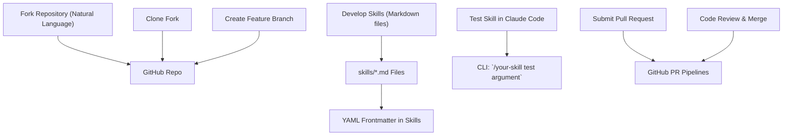
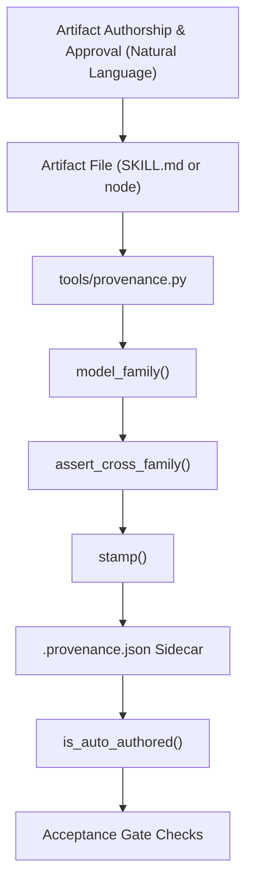

<!-- source: DeepWiki mcp.deepwiki.com · repo wanshuiyin/Auto-claude-code-research-in-sleep · page 8.11 Contributing & Project Governance · fetched 2026-10-26 -->

# 8.11 Contributing & Project Governance

<details>
<summary>Relevant source files</summary>

The following files were used as context for generating this wiki page:

- [CONTRIBUTING.md](CONTRIBUTING.md)
- [CONTRIBUTING_CN.md](CONTRIBUTING_CN.md)
- [docs/ARIS-Code-README_CN.md](docs/ARIS-Code-README_CN.md)
- [docs/ARIS-Code-README_EN.md](docs/ARIS-Code-README_EN.md)
- [skills/shared-references/skill-governance.md](skills/shared-references/skill-governance.md)
- [tests/test_http_reviewer_fallback_contract.py](tests/test_http_reviewer_fallback_contract.py)
- [tests/test_http_reviewer_provenance_alignment.py](tests/test_http_reviewer_provenance_alignment.py)
- [tests/test_http_reviewer_review_gate.py](tests/test_http_reviewer_review_gate.py)
- [tests/test_llm_chat_review_fallback.py](tests/test_llm_chat_review_fallback.py)
- [tests/test_provenance.py](tests/test_provenance.py)
- [tools/provenance.py](tools/provenance.py)

</details>


This page details the contribution guidelines, skill governance mechanisms, licensing, documentation translation conventions, and companion documentation for the ARIS codebase. It serves as a comprehensive reference for anyone looking to contribute to the Auto-claude-code-research-in-sleep (ARIS) project, ensuring code quality, project integrity, and consistent documentation standards.

---

## 1. Purpose and Scope

ARIS is a complex system with 74+ composable skills facilitating automated ML research workflows under a cross-model collaboration architecture. Contributions must adhere to project governance to maintain rigorous quality and cross-model independence guarantees.

This section covers:

- Contribution process and code development guidelines  
- Skill governance based on provenance-as-authorization  
- Licensing and NOTICE file usage  
- Documentation translation conventions for English/Chinese pairs  
- Companion documentation specific to ARIS-Code branch  

---

## 2. Contribution Guidelines

### 2.1 Overview

Contribution to ARIS is open and encouraged, encompassing reporting bugs, suggesting new features/skills, improving documentation, adding translations, and sharing user feedback.

### 2.2 Fork and Branch Workflow

- **Fork the repository** to your own GitHub account  
- **Clone your fork** locally  
- **Create a feature-specific branch** before making changes  

Example commands:
```bash
git clone https://github.com/YOUR_USERNAME/Auto-claude-code-research-in-sleep.git
cd Auto-claude-code-research-in-sleep
git checkout -b your-feature-name
```

### 2.3 Skill Development

- Skills are Markdown files under the `skills/` directory  
- Each skill file contains:
  - YAML frontmatter metadata specifying `name`, `description`, `allowed-tools`, and optional `argument-hint`  
  - The skill instructions detailing its purpose and usage  

Example skill frontmatter snippet:
```markdown
---
name: my-skill
description: What this skill does
argument-hint: "[optional-argument-hint]"
allowed-tools: Read, Write, Bash(*)
---

# Skill Title
Instructions here...
```

### 2.4 Testing Changes

- Copy modified skills to local Claude Code skill directory:  
  ```bash
  cp -r skills/your-skill ~/.claude/skills/
  ```  
- Test skill execution in Claude Code shell:  
  ```
  /your-skill test argument
  ```  
- Verify behavior matches expectations before submitting

### 2.5 Pull Request (PR) Process

- Provide clear documentation updates with your changes  
- Keep PRs focused on a single logical change  
- Write meaningful commit messages  
- Ensure your code conforms to project style and is tested locally

### 2.6 Code of Conduct

- Maintain respectful and inclusive communication  
- Offer constructive, helpful feedback  
- Support learning and growth in the community

### 2.7 Resources and Support

- File issues to report problems or ask questions  
- Join the WeChat group (QR code in README) for community discussions

### 2.8 Licensing

Contributions are licensed under the MIT License by default, ensuring a permissive and open source foundation for all project code.

Sources: [CONTRIBUTING.md:1-83](), [CONTRIBUTING_CN.md:1-83]()

---

## 3. Skill Governance: Provenance-as-Authorization

A cornerstone of ARIS project governance is the **provenance-as-authorization pattern** implemented in `tools/provenance.py`. This enforces strict cross-model independence between the authoring and approval of machine-authored artifacts.

### 3.1 Why Provenance?

When ARIS **auto-writes durable artifacts**—such as patched skills, curated wiki nodes, or auto-generated reviewer prompts—the system must ensure:

- **Who authored vs who acquitted each artifact?**  
- **Are the author and reviewer different model families?**  
- **Is auto-curation authorized to modify that artifact?**

This prevents self-acquittal by a single model, mitigating self-poisoning and ensuring high integrity in automated workflows.

### 3.2 Implementation Details

- The `tools/provenance.py` module records a JSON sidecar file `.provenance.json` alongside each artifact  
- Records include:
  - `created_by`: typically `"aris-auto"` for auto-authored items  
  - `author_model` and `reviewer_model`: names of the LLM models involved  
  - `author_family` and `reviewer_family`: grouped model families determined via token boundary matching of model names  
  - `verdict_id`: unique identifier of the review/acquittal (e.g. thread ID)  
  - `content_hash`: SHA-256 hash of the artifact file for tamper evidence  
  - `stamped_at`: UTC timestamp of the acceptance record

### 3.3 Cross-Family Enforcement

- `assert_cross_family(author_model, reviewer_model)` **raises an error if both models belong to the same family**  
- Valid families include `anthropic`, `openai`, `google`, `deepseek`, `minimax`, `moonshot`, among others  
- Deterministic verifiers (process-based checks) like `deterministic:evidence_check` bypass family restrictions safely  
- Unknown or ambiguous model families cause a fail-closed error, preventing accidental cross-family violations

### 3.4 Auto-Curation Authorization

- Only artifacts with `.provenance.json` having `"created_by": "aris-auto"` are considered **auto-authored** and eligible for automated changes  
- Hand-written canonical skills and user notes have no provenance stamp and are **immune from automated modification**  
- If an artifact is edited by hand, the content hash changes, invalidating prior acceptance and requiring a fresh cross-model approval step

### 3.5 Usage in Skills and Workflow

- The meta-optimize skill applies `stamp()` after successful patch review cycles to record valid provenance  
- The research-wiki auto-curation process stamps machine-merged/pruned nodes but skips user-written data  
- Acceptance gates rely on the cross-family assurance encoded in provenance to filter trustworthy artifacts

### 3.6 Record Schema Example

```json
{
  "created_by": "aris-auto",
  "author_model": "claude-opus-4-8",
  "author_family": "anthropic",
  "reviewer_model": "gpt-6-astra",
  "reviewer_family": "openai",
  "verdict_id": "codex_thread_abc123",
  "content_hash": "<sha256 of the artifact>",
  "stamped_at": "2026-05-30T00:00:00Z"
}
```

### 3.7 Governance Summary

| Governance Requirement              | Description                                         |
|-----------------------------------|-----------------------------------------------------|
| **Cross-model acquittal**          | Author and reviewer must be from different families |
| **Auto-authorship marker**         | `created_by == "aris-auto"` flags modifiable artifacts |
| **Deterministic verifier allowed** | e.g. evidence checks, test suites                    |
| **Fail closed on unknown families**| Unknown models forbid auto-approval                  |
| **Tamper evidence via content hash**| Editing requires re-approval                        |

Sources: [tools/provenance.py:1-156](), [skills/shared-references/skill-governance.md:1-104](), [tests/test_provenance.py:1-162]()

---

## 4. Licensing and NOTICE Files

- The ARIS repository is licensed under the **MIT License**, a permissive open-source license  
- Contributions are automatically licensed under MIT by submitting to the project  
- The `NOTICE.md` file (where applicable) records third-party dependencies, copyrights, and attribution to comply with licenses  
- Licensing metadata is embedded in relevant skill and tooling files to maintain clarity around usage rights

---

## 5. Documentation Translation Conventions

This repository maintains parallel English and Chinese documentation for better accessibility.

### 5.1 Structure

- English docs are primarily under `docs/*.md` or root-level files  
- Chinese docs mirror English versions with `_CN` suffix in filenames, e.g. `CONTRIBUTING.md` vs `CONTRIBUTING_CN.md`  
- ARIS-Code branch docs for core runtime code are mirrored similarly with files like:  
  - `docs/ARIS-Code-README_EN.md`  
  - `docs/ARIS-Code-README_CN.md`  

### 5.2 Linking

- Each language document includes reciprocal links to its counterpart, e.g. English README links to Chinese README and vice versa  
- Standardized messaging encourages users to switch languages as needed (see `docs/ARIS-Code-README_EN.md` and `docs/ARIS-Code-README_CN.md`)  

### 5.3 Guidelines for Translators

- Maintain technical terminology consistency, especially class/function names and code references  
- Keep formatting and code examples aligned between language versions to avoid confusion  
- Prefer literal and precise translations rather than loose paraphrasing to retain meaning  
- Verify updated English versions first before propagating translation updates

Sources: [docs/ARIS-Code-README_EN.md:1-7](), [docs/ARIS-Code-README_CN.md:1-8](), [CONTRIBUTING.md:1-83](), [CONTRIBUTING_CN.md:1-83]()

---

## 6. ARIS-Code Companion Documentation

ARIS-Code is the runtime/code execution companion branch hosting core code logic, external integration code, and runtime support docs.

- The main ARIS-Code docs have been moved to a dedicated branch named `aris-code`  
- Users and contributors are directed to the latest version in that branch for code-level references and usage  
- Companion docs include installation, server setup, integration guides, skill overlay generation, and interaction protocols between executor and reviewer MCP servers

These companion docs provide crucial details complementing the conceptual workflows and skill references in the main branch.

Users should consult the ARIS-Code README files for the most up-to-date code running instructions and environment configuration.

Sources: [docs/ARIS-Code-README_EN.md:1-7](), [docs/ARIS-Code-README_CN.md:1-7]()

---

## 7. Bridging Natural Language Components to Code Entities

Two key mermaid diagrams below illustrate the interplay between high-level concepts or system names found in user and developer discussions with specific code entities such as files, classes, or functions in the codebase.

### 7.1 Diagram: Contribution Workflow — From Natural Language to Code Entities



### 7.2 Diagram: Provenance Governance Flow — From Artifact Authorship to Cross-Model Authorization



---

## 8. Summary

This page captures essential details for contributors and project maintainers to ensure sustainable, trustworthy, and high-quality growth of ARIS. Through the documented contribution workflow, strict skill governance via provenance-as-authorization, clear licensing, and dual-language documentation conventions, the project maintains:

- Safe and auditable automation with cross-model review independence  
- Transparent and easy-to-follow development practices  
- Accessibility to a bilingual developer and researcher community  
- Up-to-date and structured companion runtime docs in the ARIS-Code branch

Consult this page regularly when contributing, reviewing, or extending ARIS capabilities.

---

# Appendix: Relevant File References

- `CONTRIBUTING.md` lines 1-84  
- `CONTRIBUTING_CN.md` lines 1-84  
- `tools/provenance.py` lines 1-156  
- `skills/shared-references/skill-governance.md` lines 1-105  
- `docs/ARIS-Code-README_EN.md` lines 1-7  
- `docs/ARIS-Code-README_CN.md` lines 1-9  
- `tests/test_provenance.py` lines 1-158  

---

Sources:  
[CONTRIBUTING.md:1-83](), [CONTRIBUTING_CN.md:1-83](), [tools/provenance.py:1-156](), [skills/shared-references/skill-governance.md:1-104](), [docs/ARIS-Code-README_EN.md:1-7](), [docs/ARIS-Code-README_CN.md:1-8](), [tests/test_provenance.py:1-158]()

---

