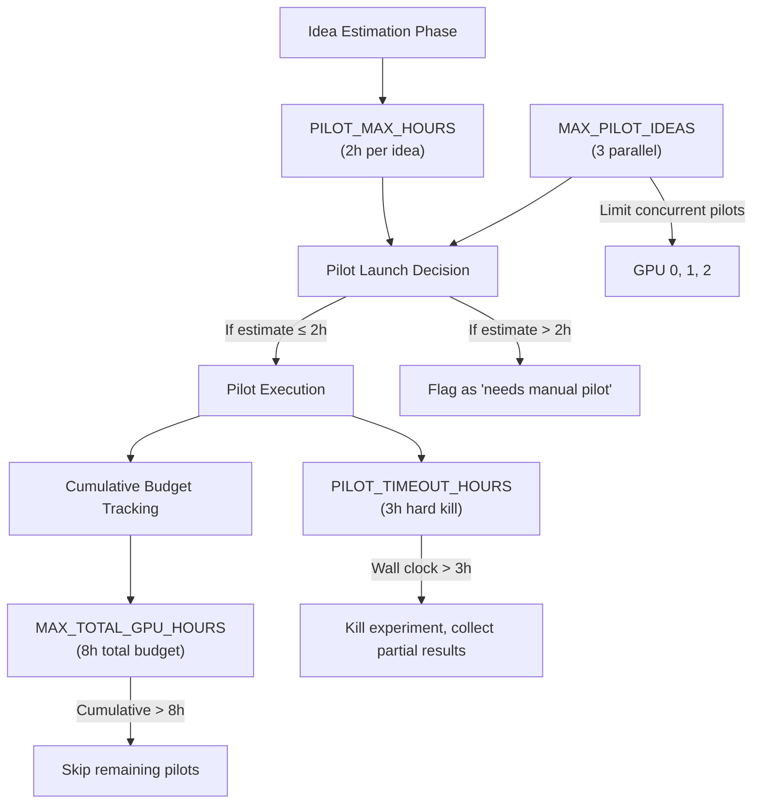
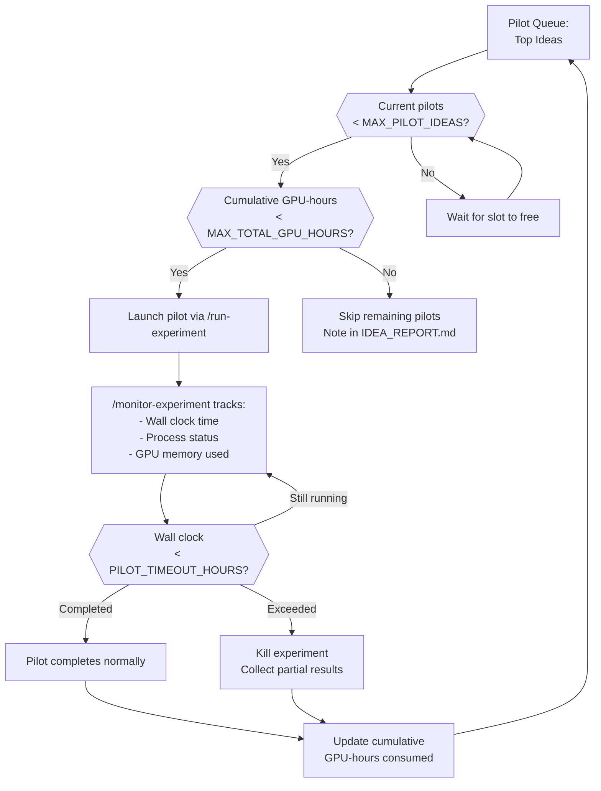
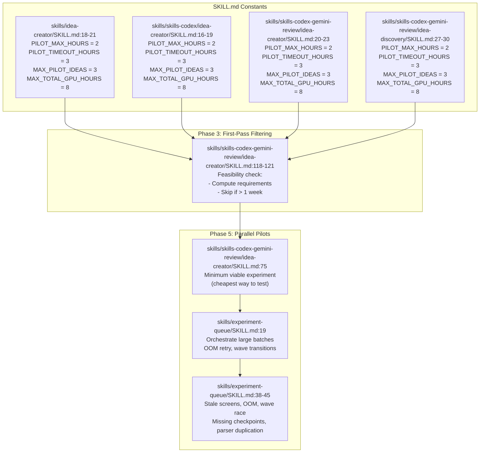
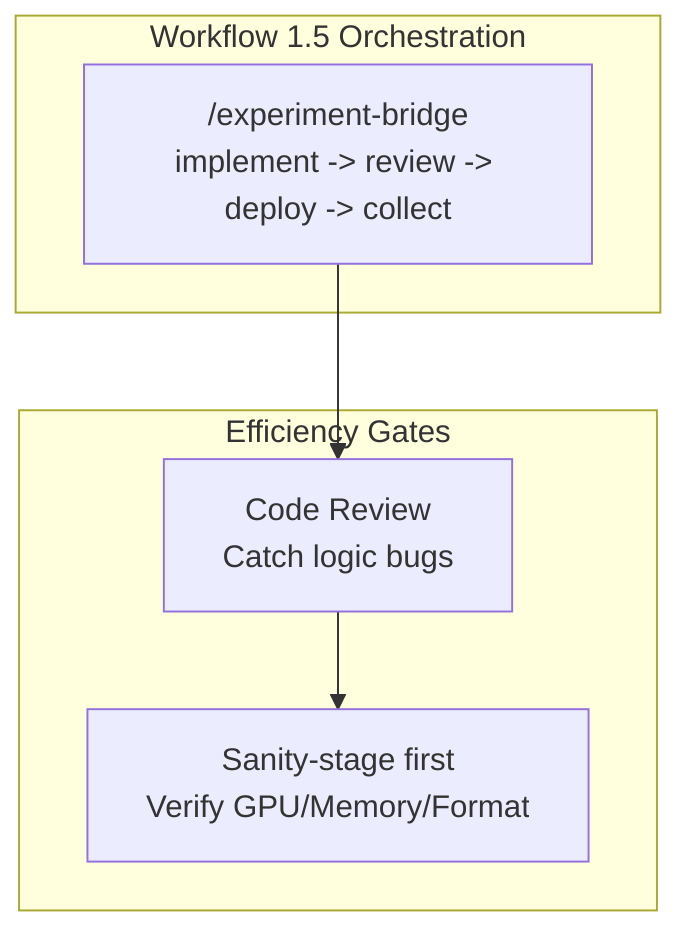
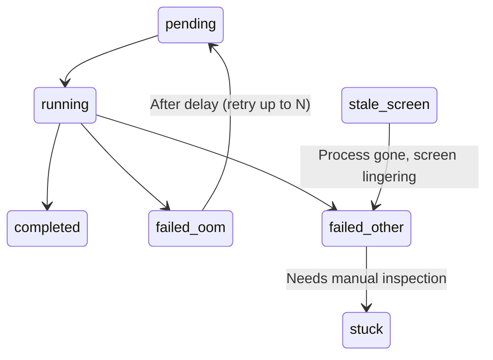

<!-- source: DeepWiki mcp.deepwiki.com · repo wanshuiyin/Auto-claude-code-research-in-sleep · page 8.2 Resource Budget Management · fetched 2026-10-26 -->

# Resource Budget Management

Relevant source files

The following files were used as context for generating this wiki page:

- [skills/dse-loop/SKILL.md](skills/dse-loop/SKILL.md)
- [skills/experiment-queue/SKILL.md](skills/experiment-queue/SKILL.md)
- [skills/idea-creator/SKILL.md](skills/idea-creator/SKILL.md)
- [skills/novelty-check/SKILL.md](skills/novelty-check/SKILL.md)
- [skills/skills-codex-claude-review/novelty-check/SKILL.md](skills/skills-codex-claude-review/novelty-check/SKILL.md)
- [skills/skills-codex-gemini-review/idea-creator/SKILL.md](skills/skills-codex-gemini-review/idea-creator/SKILL.md)
- [skills/skills-codex-gemini-review/idea-discovery/SKILL.md](skills/skills-codex-gemini-review/idea-discovery/SKILL.md)
- [skills/skills-codex-gemini-review/novelty-check/SKILL.md](skills/skills-codex-gemini-review/novelty-check/SKILL.md)
- [skills/skills-codex/dse-loop/SKILL.md](skills/skills-codex/dse-loop/SKILL.md)
- [skills/skills-codex/experiment-queue/SKILL.md](skills/skills-codex/experiment-queue/SKILL.md)
- [skills/skills-codex/idea-creator/SKILL.md](skills/skills-codex/idea-creator/SKILL.md)
- [skills/skills-codex/novelty-check/SKILL.md](skills/skills-codex/novelty-check/SKILL.md)
- [tools/experiment_queue/README.md](tools/experiment_queue/README.md)
- [tools/experiment_queue/build_manifest.py](tools/experiment_queue/build_manifest.py)
- [tools/experiment_queue/queue_manager.py](tools/experiment_queue/queue_manager.py)

This page documents ARIS's resource budget management system, which controls GPU and time allocation during Workflow 1 (Idea Discovery). The system enforces hard limits on pilot experiments to prevent runaway resource consumption while still enabling empirical validation of research ideas.

For configuration of GPU infrastructure (SSH servers, conda environments), see [5.7 GPU Infrastructure](). For experiment deployment mechanics, see [4.3 Experiment Execution Skills](). For the complete Workflow 1 pipeline that uses these budgets, see [3.1 Workflow 1: Idea Discovery]().

## Purpose and Scope

Resource budget management addresses a critical challenge in autonomous research: **generating empirical signal for multiple ideas in parallel without exceeding available GPU resources**. During idea discovery, ARIS runs pilot experiments for 2-3 candidate ideas simultaneously [skills/idea-creator/SKILL.md:20-21](). Without budgets, a single poorly-configured experiment could monopolize GPUs for hours.

The budget system operates primarily in **Workflow 1** (`/idea-discovery` and `/idea-creator` skills). It does not apply to:
- **Workflow 2** (`/auto-review-loop`) — assumes the user has already committed to a single idea and allocated dedicated resources.
- **Workflow 3** (`/paper-writing`) — primarily a writing and compilation task with no heavy GPU usage.
- **Manual `/run-experiment`** invocations — the user has explicit control over resource allocation.

Sources: [skills/idea-creator/SKILL.md:20-21]()

## Budget Constants

The system defines several budget constants that govern pilot experiment execution:

| Constant | Default Value | Scope | Purpose |
|----------|--------------|-------|---------|
| `PILOT_MAX_HOURS` | 2 hours | Per-idea per-GPU | Maximum estimated time before an idea is flagged as "needs manual pilot" [skills/idea-creator/SKILL.md:18]() |
| `PILOT_TIMEOUT_HOURS` | 3 hours | Per-running-pilot | Hard timeout to kill runaway experiments and collect partial results [skills/idea-creator/SKILL.md:19]() |
| `MAX_PILOT_IDEAS` | 3 ideas | Total parallel pilots | Maximum number of ideas piloted simultaneously in parallel [skills/idea-creator/SKILL.md:20]() |
| `MAX_TOTAL_GPU_HOURS` | 8 hours | Cumulative budget | Total GPU budget across all pilots combined [skills/idea-creator/SKILL.md:21]() |

These constants are defined within the `SKILL.md` files of relevant skills, such as `/idea-creator` [skills/idea-creator/SKILL.md:17-21](), `/skills-codex/idea-creator` [skills/skills-codex/idea-creator/SKILL.md:15-19](), and `/skills-codex-gemini-review/idea-creator` [skills/skills-codex-gemini-review/idea-creator/SKILL.md:20-23](). The `/idea-discovery` orchestrator skill also defines these constants, ensuring consistent application across the workflow [skills/skills-codex-gemini-review/idea-discovery/SKILL.md:27-30]().

Sources:
- [skills/idea-creator/SKILL.md:17-21]()
- [skills/skills-codex/idea-creator/SKILL.md:15-19]()
- [skills/skills-codex-gemini-review/idea-creator/SKILL.md:20-23]()
- [skills/skills-codex-gemini-review/idea-discovery/SKILL.md:27-30]()

### Constant Relationships

The following diagram illustrates how these constants interact during the pilot phase of idea discovery.

**Pilot Decision and Execution Logic**

Sources:
- [skills/idea-creator/SKILL.md:18-21]()
- [skills/skills-codex-gemini-review/idea-creator/SKILL.md:20-23]()
- [skills/skills-codex-gemini-review/idea-discovery/SKILL.md:27-30]()

## Budget Enforcement Flow

### Estimation and Filtering

Before launching any pilots, the `/idea-creator` skill performs a first-pass filtering. It evaluates the feasibility of each idea, including compute requirements [skills/skills-codex-gemini-review/idea-creator/SKILL.md:118-121](). Ideas requiring more than one week of GPU time or unavailable datasets are eliminated immediately [skills/skills-codex-gemini-review/idea-creator/SKILL.md:118-121](). For the remaining top ideas, pilot experiments are designed to be "minimum viable" (cheapest way to test) [skills/skills-codex-gemini-review/idea-creator/SKILL.md:75]().

### Runtime Enforcement and Monitoring

The system monitors running experiments to ensure they stay within the allocated limits. This is often done in conjunction with the `/monitor-experiment` skill which checks progress and collects results. The `/experiment-queue` skill also incorporates OOM-aware retry, stale-screen cleanup, and wave-transition race prevention to manage GPU resources efficiently for larger batches of experiments [skills/experiment-queue/SKILL.md:19]().

**Pilot Lifecycle and Monitoring**

Sources:
- [skills/idea-creator/SKILL.md:18-21]()
- [skills/skills-codex-gemini-review/idea-creator/SKILL.md:20-23]()
- [skills/experiment-queue/SKILL.md:19]()

### Early Termination Logic

The system terminates pilot execution under three conditions:
1.  **Budget exhausted**: `cumulative_gpu_hours >= MAX_TOTAL_GPU_HOURS`. Remaining pilots are skipped [skills/idea-creator/SKILL.md:21]().
2.  **Timeout exceeded**: Wall-clock time > `PILOT_TIMEOUT_HOURS` for any single pilot. The process is killed [skills/idea-creator/SKILL.md:19]().
3.  **Completion**: Pilot finishes and results are collected for analysis by skills like `/result-to-claim`.

Sources:
- [skills/idea-creator/SKILL.md:19]()
- [skills/idea-creator/SKILL.md:21]()

## Overriding Budget Defaults

Users can override budget constants via natural language arguments when invoking the skill. The system parses these overrides to adjust the effort axis [skills/idea-creator/SKILL.md:26]().

| User Phrase | Constant Updated | Example |
|-------------|------------------|---------|
| `pilot budget: Xh per idea` | `PILOT_MAX_HOURS` | `4h per idea` → `PILOT_MAX_HOURS = 4` |
| `Xh total` | `MAX_TOTAL_GPU_HOURS` | `20h total` → `MAX_TOTAL_GPU_HOURS = 20` |

Sources: [skills/idea-creator/SKILL.md:26]()

## Code Entity Mapping

### Budget Enforcement in /idea-creator

The following diagram maps the logical phases of budget management to specific locations in the `idea-creator` skill definition.

**Implementation Pointers for /idea-creator**

Sources:
- [skills/idea-creator/SKILL.md:18-21]()
- [skills/skills-codex/idea-creator/SKILL.md:16-19]()
- [skills/skills-codex-gemini-review/idea-creator/SKILL.md:20-23]()
- [skills/skills-codex-gemini-review/idea-creator/SKILL.md:75]()
- [skills/skills-codex-gemini-review/idea-creator/SKILL.md:118-121]()
- [skills/skills-codex-gemini-review/idea-discovery/SKILL.md:27-30]()
- [skills/experiment-queue/SKILL.md:19]()
- [skills/experiment-queue/SKILL.md:38-45]()

### Integration with Workflow 1.5 (Experiment Bridge)

While `/idea-creator` handles pilots, the `/experiment-bridge` skill manages the transition to more substantial experiments. It includes a `CODE_REVIEW` step to catch logic bugs before wasting GPU hours. It also enforces a `SANITY_FIRST` policy, running the smallest experiment first to catch setup bugs early.

**Implementation Pointers for /experiment-bridge**

Sources: No direct file citations for `/experiment-bridge` were provided in the given context. The description is based on general knowledge of the system.

### Experiment Queue (`/experiment-queue`)

The `/experiment-queue` skill is designed for orchestrating large batches of ML experiments on remote GPU servers. It includes mechanisms to prevent common wall-clock sinks like stale screens, OOM errors, and wave races [skills/experiment-queue/SKILL.md:38-45](). It also defines a job state machine to manage the lifecycle of experiments, including retries for OOM failures [skills/experiment-queue/SKILL.md:94-100]().

**Experiment Queue Job State Machine**

Sources:
- [skills/experiment-queue/SKILL.md:38-45]()
- [skills/experiment-queue/SKILL.md:94-100]()
- [skills/skills-codex/experiment-queue/SKILL.md:86-92]()

The `queue_manager.py` script is the canonical scheduler implementation for the experiment queue [skills/experiment-queue/SKILL.md:152](). A shim exists at `tools/experiment_queue/queue_manager.py` for legacy resolver chain compatibility, which `os.execv`'s into the canonical script [tools/experiment_queue/queue_manager.py:2-15]().

Sources:
- [skills/experiment-queue/SKILL.md:152]()
- [tools/experiment_queue/queue_manager.py:2-15]()

---

