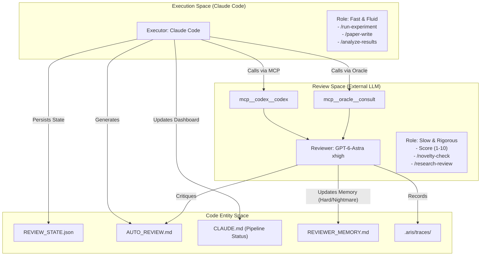
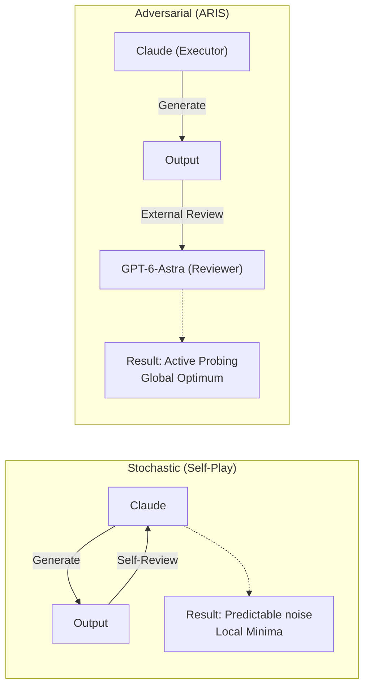
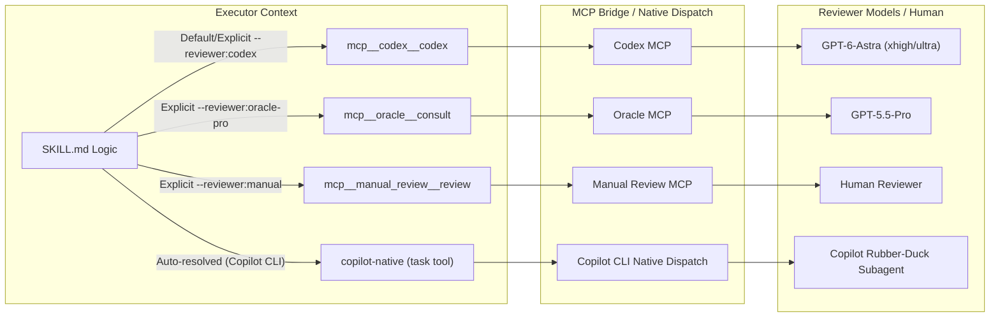

<!-- source: DeepWiki mcp.deepwiki.com · repo wanshuiyin/Auto-claude-code-research-in-sleep · page 8.3 Cross-Model Verification Strategies · fetched 2026-10-26 -->

# Cross-Model Verification Strategies

<details>
<summary>Relevant source files</summary>

The following files were used as context for generating this wiki page:

- [skills/auto-review-loop/SKILL.md](skills/auto-review-loop/SKILL.md)
- [skills/shared-references/injection-hygiene.md](skills/shared-references/injection-hygiene.md)
- [skills/shared-references/integration-contract.md](skills/shared-references/integration-contract.md)
- [skills/shared-references/review-tracing.md](skills/shared-references/review-tracing.md)
- [skills/shared-references/reviewer-routing.md](skills/shared-references/reviewer-routing.md)
- [skills/shared-references/skill-governance.md](skills/shared-references/skill-governance.md)
- [skills/skills-codex/shared-references/external-cadence.md](skills/skills-codex/shared-references/external-cadence.md)
- [skills/skills-codex/shared-references/injection-hygiene.md](skills/skills-codex/shared-references/injection-hygiene.md)
- [skills/skills-codex/shared-references/integration-contract.md](skills/skills-codex/shared-references/integration-contract.md)
- [skills/skills-codex/shared-references/reviewer-routing.md](skills/skills-codex/shared-references/reviewer-routing.md)
- [tests/test_copilot_install.py](tests/test_copilot_install.py)
- [tests/test_http_reviewer_fallback_contract.py](tests/test_http_reviewer_fallback_contract.py)
- [tests/test_http_reviewer_provenance_alignment.py](tests/test_http_reviewer_provenance_alignment.py)
- [tests/test_http_reviewer_review_gate.py](tests/test_http_reviewer_review_gate.py)
- [tests/test_idea_creator_query_pack_scan.py](tests/test_idea_creator_query_pack_scan.py)
- [tests/test_llm_chat_review_fallback.py](tests/test_llm_chat_review_fallback.py)
- [tests/test_provenance.py](tests/test_provenance.py)
- [tests/test_review_gate.py](tests/test_review_gate.py)
- [tests/test_threat_scan.py](tests/test_threat_scan.py)
- [tools/provenance.py](tools/provenance.py)
- [tools/review_gate.py](tools/review_gate.py)
- [tools/save_trace.sh](tools/save_trace.sh)
- [tools/threat_scan.py](tools/threat_scan.py)

</details>


This document explains how ARIS implements cross-model verification to avoid single-model blind spots, the adversarial review pattern that prevents local minima, and why the system uses specific model pairings for execution versus rigorous critique.

---

## Purpose and Scope

ARIS's core architectural principle is **cross-model verification**: Claude Code executes research tasks (code generation, experiment deployment, data analysis) while a separate external LLM reviews the outputs (scoring, critique, weakness identification). This document covers:

- Why cross-model verification outperforms single-model self-play.
- The adversarial bandit vs. stochastic bandit analogy and local minima prevention.
- Specific verification strategies across different skill types.
- Implementation patterns using `mcp__codex__codex` and the Reviewer Independence Protocol.
- Advanced adversarial modes: `hard` (Reviewer Memory) and `nightmare` (Direct Repo Access).

---

## The Executor-Reviewer Separation

### Architecture Overview

The system divides labor between an **Executor** (typically Claude Code) and a **Reviewer** (typically GPT-6-Astra `xhigh` via Codex MCP).

Title: ARIS Executor-Reviewer Architecture


**Key Principle**: The executor and reviewer never swap roles. Claude does not review its own outputs; the external reviewer does not execute code. This creates an adversarial relationship where the reviewer actively probes weaknesses the executor didn't anticipate.

Sources: [skills/auto-review-loop/SKILL.md:3-5](), [skills/auto-review-loop/SKILL.md:19-25](), [skills/shared-references/reviewer-routing.md:3-11]()

---

## Reviewer Independence Protocol

To ensure the effectiveness of cross-model verification, ARIS enforces a strict **Reviewer Independence Protocol**. This prevents "subjective interference" where the executor biases the reviewer.

| Permitted (Structural) | Forbidden (Subjective) |
| :--- | :--- |
| **File paths** to primary artifacts | Executor's summary or paraphrase |
| **Review objective** (e.g., "Check novelty") | Interpretation of results ("I think X is...") |
| **Venue constraints** (ICLR format) | Previous review round feedback |
| **Structural metadata** (8 sections) | Description of what was changed since last round |

**Correct Pattern**: The executor points the reviewer to raw files (`PROPOSAL.md`, `main.tex`) and asks for an independent assessment. This is enforced by the `save_trace.sh` helper which records the prompt and response, allowing for audit of the independence. [skills/shared-references/review-tracing.md:5-7](), [skills/shared-references/review-tracing.md:108-117]()

Sources: [skills/shared-references/review-tracing.md:5-7](), [skills/shared-references/review-tracing.md:108-117]()

---

## Why Not Self-Play?

### The Local Minima Problem

Using a single model for both generation and review creates a "blind spot" where the model is unlikely to criticize its own inherent reasoning patterns.

Title: Stochastic vs Adversarial Verification


**Adversarial Bandit Analogy**:
- **Stochastic Bandit (Self-Review)**: Predictable reward noise; the model knows its own patterns and cannot easily "surprise" itself with a critique it didn't already consider during generation.
- **Adversarial Bandit (Cross-Model)**: The reviewer actively probes for weaknesses the executor missed. This makes the system fundamentally harder to "game" and forces the executor to produce more robust research.

The `provenance.py` tool explicitly enforces this by raising an error if the author and reviewer models are from the same family, unless the review is explicitly marked as provisional. [tools/provenance.py:80-98]()

Sources: [tools/provenance.py:80-98](), [tests/test_provenance.py:56-69]()

---

## Verification Mechanisms by Skill Type

### 1. Multi-Round Research Review: `auto-review-loop`
This skill implements an iterative loop: review → implement fixes → re-review. It uses `REVIEW_STATE.json` to persist progress across rounds (up to `MAX_ROUNDS = 4`).

| Phase | Task | Code Entity |
|-------|------|-------------|
| **Phase A** | Call External Reviewer | `mcp__codex__codex` with `reasoning_effort: xhigh` |
| **Phase B** | Parse Score/Verdict | `POSITIVE_THRESHOLD: score >= 6/10` |
| **Phase C** | Implement Fixes | Claude editing research code or `findings.md` |
| **Phase E** | Document & Persist | Update `AUTO_REVIEW.md` and `REVIEW_STATE.json` |

The `review_gate.py` tool is central to this process, making deterministic decisions about continuing, stopping, or escalating the review based on the score, verdict, and reviewer backend. [tools/review_gate.py:136-148]()

Sources: [skills/auto-review-loop/SKILL.md:25-26](), [skills/auto-review-loop/SKILL.md:31-32](), [tools/review_gate.py:136-148]()

### 2. Idea Discovery Verification: `idea-discovery`
During the idea generation phase, ARIS uses a multi-stage verification pipeline:
1. **Literature Survey**: `/research-lit` maps the landscape.
2. **Novelty Check**: `/novelty-check` uses the external reviewer to verify the uniqueness of generated ideas.
3. **Critical Review**: `/research-review` provides adversarial feedback before any code is written.

Sources: [skills/auto-review-loop/SKILL.md:3-5](), [skills/auto-review-loop/SKILL.md:19-25]()

---

## Adversarial Difficulty Levels

ARIS introduces `REVIEWER_DIFFICULTY` to escalate the verification rigor in skills like `/auto-review-loop`.

- **Medium (Default)**: Standard MCP review where Claude provides file paths to the reviewer.
- **Hard**: Adds **Reviewer Memory** via `REVIEWER_MEMORY.md` and a **Debate Protocol**. The reviewer tracks suspicions across rounds to see if they were sidestepped.
- **Nightmare**: GPT-6-Astra (Reviewer) reads the repository directly via `codex exec`. The executor (Claude) cannot filter or hide files from the reviewer. This mode is incompatible with `manual` reviewer backends. [skills/auto-review-loop/SKILL.md:39-42]()

Sources: [skills/auto-review-loop/SKILL.md:33-36](), [skills/auto-review-loop/SKILL.md:39-42]()

---

## Implementation: The Dual-Layer Configuration

### Tool Invocation Patterns
The system uses MCP servers to bridge the gap between the Executor (Claude) and the Reviewer. By default, it uses `mcp__codex__codex`, but can be overridden with `--reviewer: oracle-pro`. The `reviewer-routing.md` shared reference details the default backend resolution and tiered reasoning-effort policy. [skills/shared-references/reviewer-routing.md:3-11](), [skills/shared-references/reviewer-routing.md:30-38]()

Title: Data Flow from Executor to Reviewer


The `save_trace.sh` helper is crucial for recording the actual model and effort used, including any fallbacks. [tools/save_trace.sh:60-82]()

Sources: [skills/shared-references/reviewer-routing.md:3-11](), [skills/shared-references/reviewer-routing.md:30-38](), [tools/save_trace.sh:60-82]()

### Reasoning Effort Tiers

The Codex MCP backend employs a **two-tier reasoning-effort policy** for `gpt-6-astra` since 2026-07-10: [skills/shared-references/reviewer-routing.md:30-38]()

- **Deep-audit (`ultra`)**: Used for critical, one-shot verdict-bearing audits like `/proof-checker`, `/kill-argument`, `/research-review`, `/experiment-audit`, `/paper-claim-audit`, `/result-to-claim`, and `/meta-apply`. This tier involves the deepest reasoning and automatic task delegation.
- **Regular (`xhigh`)**: Used for all other reviewer calls, including all rounds of `/auto-review-loop` and other multi-round loops. This prevents excessive cost and latency for iterative processes where the model/effort cannot change mid-thread.

It's important to explicitly pin both `model` and `config.model_reasoning_effort` in the first call of every thread, as the catalog default `low` is insufficient for review. [skills/shared-references/reviewer-routing.md:39-40]()

Sources: [skills/shared-references/reviewer-routing.md:30-38](), [skills/shared-references/reviewer-routing.md:39-40]()

### Provenance and Identity Assurance

ARIS uses `tools/provenance.py` to record who authored an artifact and who acquitted it. This is critical for: [tools/provenance.py:4-8]()

1.  **Auto-curation authorization**: Only machine-authored and cross-family acquitted artifacts can be automatically curated by `meta-optimize`. [tools/provenance.py:4-8]()
2.  **Cross-model invariant enforcement**: It is provably true that no single model both wrote and approved an artifact. `assert_cross_family()` raises an error if the author and reviewer are from the same model family, or if either family is unrecognized. [tools/provenance.py:80-98]()
3.  **Traceability**: Each provenance record includes `author_model`, `reviewer_model`, `verdict_id`, and a `content_hash` for tamper-evident anchoring. [tools/provenance.py:122-133]()

The `stamp_provisional()` function allows recording same-family reviews, but these are explicitly marked as `provisional` and do not authorize automatic curation. [tools/provenance.py:137-154]()

Sources: [tools/provenance.py:4-8](), [tools/provenance.py:80-98](), [tools/provenance.py:122-133](), [tools/provenance.py:137-154](), [tests/test_provenance.py:137-157]()

### Review Tracing to `.aris/traces/`

Every cross-model reviewer call is traced and saved to `.aris/traces/` using `save_trace.sh`. This enables: [skills/shared-references/review-tracing.md:5-9]()

-   **Reviewer-independence audit**: Verifying the executor only passed file paths, not summaries.
-   **Reproducibility**: `threadId` preservation allows conversation continuation.
-   **Meta-optimize input**: Richer data for harness improvement analysis.

The trace directory structure is organized by skill name and run ID:
```
.aris/traces/<skill-name>/<YYYY-MM-DD>_run<NN>/
  ├── run.meta.json                      # Run-level metadata
  ├── 001-<purpose>.request.json         # Request snapshot
  ├── 001-<purpose>.response.md          # Full response text
  ├── 001-<purpose>.meta.json            # Response metadata
  ├── 002-<purpose>.request.json         # Second call (e.g., reply)
  └── ...
```
[skills/shared-references/review-tracing.md:23-31]()

The `save_trace.sh` helper handles directory creation, run numbering, file writing, and provenance classification. It also revalidates native Copilot evidence and derives model families from model strings, ignoring contradictory caller claims. [skills/shared-references/review-tracing.md:108-117]()

Sources: [skills/shared-references/review-tracing.md:5-9](), [skills/shared-references/review-tracing.md:23-31](), [skills/shared-references/review-tracing.md:108-117](), [tools/save_trace.sh:1-13]()

---

## State Persistence and Recovery

Verification loops are long-running and can exceed context limits. ARIS uses a **Compact Recovery** mechanism to preserve the adversarial state.

**Resumption Logic**:
1. Check `REVIEW_STATE.json` for existing progress.
2. If `status` is `in_progress` and the timestamp is within 24 hours, resume.
3. Use `threadId` to continue the conversation via `mcp__codex__codex-reply` (or `send_input` in Codex-native skills), ensuring the reviewer maintains its critical stance across session boundaries. [skills/auto-review-loop/SKILL.md:10-14]()

Sources: [skills/auto-review-loop/SKILL.md:10-14](), [skills/skills-codex/shared-references/reviewer-routing.md:60-67]()

---

