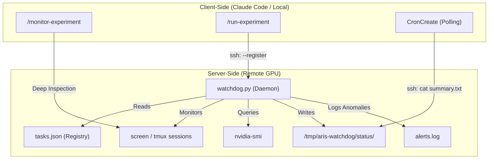
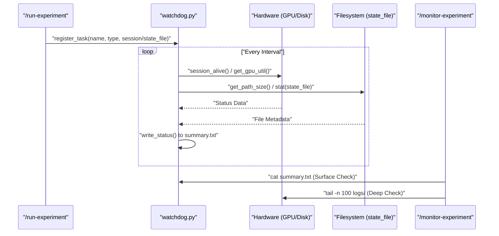

<!-- source: DeepWiki mcp.deepwiki.com · repo wanshuiyin/Auto-claude-code-research-in-sleep · page 8.5 Watchdog & Experiment Monitoring · fetched 2026-10-26 -->

# Watchdog & Experiment Monitoring

<details>
<summary>Relevant source files</summary>

The following files were used as context for generating this wiki page:

- [docs/WATCHDOG_GUIDE.md](docs/WATCHDOG_GUIDE.md)
- [docs/WATCHDOG_GUIDE_CN.md](docs/WATCHDOG_GUIDE_CN.md)
- [skills/monitor-experiment/SKILL.md](skills/monitor-experiment/SKILL.md)
- [skills/qzcli/SKILL.md](skills/qzcli/SKILL.md)
- [skills/run-experiment/SKILL.md](skills/run-experiment/SKILL.md)
- [skills/serverless-modal/SKILL.md](skills/serverless-modal/SKILL.md)
- [skills/shared-references/compute-env-contract.md](skills/shared-references/compute-env-contract.md)
- [skills/skills-codex/qzcli/SKILL.md](skills/skills-codex/qzcli/SKILL.md)
- [skills/skills-codex/run-experiment/SKILL.md](skills/skills-codex/run-experiment/SKILL.md)
- [skills/skills-codex/serverless-modal/SKILL.md](skills/skills-codex/serverless-modal/SKILL.md)
- [skills/skills-codex/shared-references/compute-env-contract.md](skills/skills-codex/shared-references/compute-env-contract.md)
- [skills/skills-codex/vast-gpu/SKILL.md](skills/skills-codex/vast-gpu/SKILL.md)
- [skills/vast-gpu/SKILL.md](skills/vast-gpu/SKILL.md)
- [tests/test_watchdog_loop.py](tests/test_watchdog_loop.py)
- [tools/watchdog.py](tools/watchdog.py)

</details>


The Watchdog system provides persistent, server-side monitoring for ARIS experiments to ensure that long-running research tasks—such as deep learning training or large dataset downloads—do not fail silently. While standard skills like `/monitor-experiment` are on-demand and require manual invocation, `watchdog.py` runs as a background daemon to catch anomalies like crashed sessions, stalled network transfers, or idle GPUs in real-time.

## Overview & Purpose

ARIS experiments typically run in remote `screen` or `tmux` sessions. Without persistent monitoring, several failure modes often go undetected:
*   **Silent Crashes:** A training script hits an Out-Of-Memory (OOM) error or a segmentation fault, causing the session to terminate [docs/WATCHDOG_GUIDE.md:11-11]().
*   **Stalled Downloads:** Network timeouts or authentication failures cause a data transfer to stop progressing without closing the connection [docs/WATCHDOG_GUIDE.md:12-12]().
*   **Idle Resource Waste:** Training finishes or hangs, but the GPU remains allocated while utilization drops to 0%, wasting expensive compute hours [docs/WATCHDOG_GUIDE.md:13-13]().

`watchdog.py` solves this by providing a lightweight, zero-dependency Python daemon that tracks registered tasks and exports their status to a standardized filesystem structure for easy polling by Claude Code or Cron jobs [docs/WATCHDOG_GUIDE.md:17-19]().

### System Architecture & Data Flow

The watchdog operates as a standalone process on the GPU server. It maintains a registry of tasks in `tasks.json` and writes periodic health updates to individual JSON files and a global `summary.txt`.

**Watchdog Entity Mapping**


Sources: [tools/watchdog.py:24-32](), [docs/WATCHDOG_GUIDE.md:116-124]()

## Task Registration & Types

Tasks are registered via a JSON payload sent to the watchdog script. The system supports three primary task types with distinct monitoring logic.

### 1. Training Tasks
Monitors the health of ML training runs by checking session liveness and hardware utilization.
*   **Checks:** Verifies the `screen`/`tmux` session exists and queries `nvidia-smi` for GPU utilization [tools/watchdog.py:220-225]().
*   **Anomalies:** 
    *   `DEAD`: The session is no longer found in the process list [tools/watchdog.py:228-231]().
    *   `IDLE`: GPU utilization falls below `GPU_IDLE_THRESHOLD` (default 5%) [tools/watchdog.py:46-46](), [tools/watchdog.py:245-249]().

### 2. Download Tasks
Monitors data transfers or long-running file processing.
*   **Checks:** Tracks file or directory size growth over time using `du -sb` [tools/watchdog.py:170-179]().
*   **Anomalies:**
    *   `STALLED`: File size remains identical between check intervals [tools/watchdog.py:197-201]().
    *   `SLOW`: Download speed falls below `SLOW_SPEED_THRESHOLD` (default 1 MB/s) [tools/watchdog.py:45-45](), [tools/watchdog.py:205-210]().

### 3. Loop Tasks
Monitors the progress of iterative processes by checking a heartbeat file.
*   **Checks:** Monitors the modification time (`mtime`) of a specified `state_file` [tools/watchdog.py:300-301]().
*   **Anomalies:**
    *   `STALE`: The `state_file` has not been updated within `stale_after_seconds` [tools/watchdog.py:308-312]().
    *   `MISSING`: The `state_file` does not exist after a grace period following registration [tools/watchdog.py:314-318]().
    *   `PENDING`: The task is registered but the `state_file` has not yet been created [tools/watchdog.py:320-322]().
    *   `COMPLETED`: The `state_file` indicates the loop has finished [tools/watchdog.py:324-326]().

### Registration Format
```bash
python3 tools/watchdog.py --register '{
  "name": "exp_v1",
  "type": "training",
  "session": "train_session",
  "session_type": "screen",
  "gpus": [0, 1]
}'
```
Sources: [tools/watchdog.py:12-16](), [docs/WATCHDOG_GUIDE.md:72-88]()

## Implementation Details

### Core Functions & Logic
The watchdog implementation relies on standard Unix utilities to minimize dependencies on the remote server.

| Function | Logic | Source |
|:---|:---|:---|
| `session_alive()` | Uses `tmux has-session` or `screen -list` to check for process presence. | [tools/watchdog.py:138-151]() |
| `get_gpu_util()` | Parses CSV output from `nvidia-smi --query-gpu=utilization.gpu`. | [tools/watchdog.py:156-165]() |
| `get_path_size()` | Uses `du -sb` to get the size of a file or directory. | [tools/watchdog.py:170-179]() |
| `check_download()` | Calculates `(current_size - prev_size) / interval` to determine speed. | [tools/watchdog.py:184-235]() |
| `check_training()` | Checks session liveness and GPU utilization. | [tools/watchdog.py:238-260]() |
| `check_loop()` | Monitors `state_file` modification time and content for status. | [tools/watchdog.py:263-330]() |
| `write_status()` | Atomically updates the JSON status and appends to `alerts.log` if status != `OK`. | [tools/watchdog.py:333-353]()

### Output Structure
The watchdog maintains a state directory (default `/tmp/aris-watchdog/`) containing:
*   `watchdog.pid`: Used for daemon liveness checks [tools/watchdog.py:53-53]().
*   `status/summary.txt`: A single-line-per-task summary designed for high-speed parsing by automated tools [tools/watchdog.py:31-31]().
*   `alerts.log`: A persistent record of all `DEAD`, `IDLE`, or `STALLED` events, useful for cross-session recovery [docs/WATCHDOG_GUIDE.md:163-170]().

## Integration with ARIS Skills

Watchdog monitoring is designed to complement, not replace, existing ARIS skills.

### /run-experiment Integration
When `/run-experiment` deploys a job via SSH and `screen`, it should immediately invoke `watchdog.py --register` to ensure the new session is tracked [docs/WATCHDOG_GUIDE.md:147-153]().

### /monitor-experiment vs. Watchdog
These two systems operate at different layers of the "Observability Stack":

| Feature | Watchdog (Daemon) | /monitor-experiment (Skill) |
|:---|:---|:---|
| **Level** | Process & Hardware Health | Research & Metric Quality |
| **Frequency** | Continuous (every 60s) | On-demand (Manual or Pipeline) |
| **Metrics** | GPU %, PID existence, Disk IO, File mtime | Loss curves, Accuracy, W&B logs |
| **Source** | [tools/watchdog.py]() | [docs/WATCHDOG_GUIDE.md:155-160]() |

**Monitoring Data Flow Logic**


Sources: [tools/watchdog.py:184-330](), [docs/WATCHDOG_GUIDE.md:155-160]()

## Setup on Remote GPU Servers

To deploy the watchdog on a new server:

1.  **Sync the Tool:** Ensure `tools/watchdog.py` is synced to the remote server, typically via the `rsync` logic in `/run-experiment` [docs/WATCHDOG_GUIDE.md:45-50]().
2.  **Start the Daemon:** Launch the watchdog in a persistent session:
    `screen -dmS watchdog python3 tools/watchdog.py` [docs/WATCHDOG_GUIDE.md:55-56]().
3.  **Automate Polling:** Use Claude Code's `CronCreate` to check the summary file every 15-30 minutes:
    `ssh <server> "cat /tmp/aris-watchdog/status/summary.txt"` [docs/WATCHDOG_GUIDE.md:116-124]().

Sources: [docs/WATCHDOG_GUIDE.md:41-65](), [tools/watchdog.py:9-22]()

---

