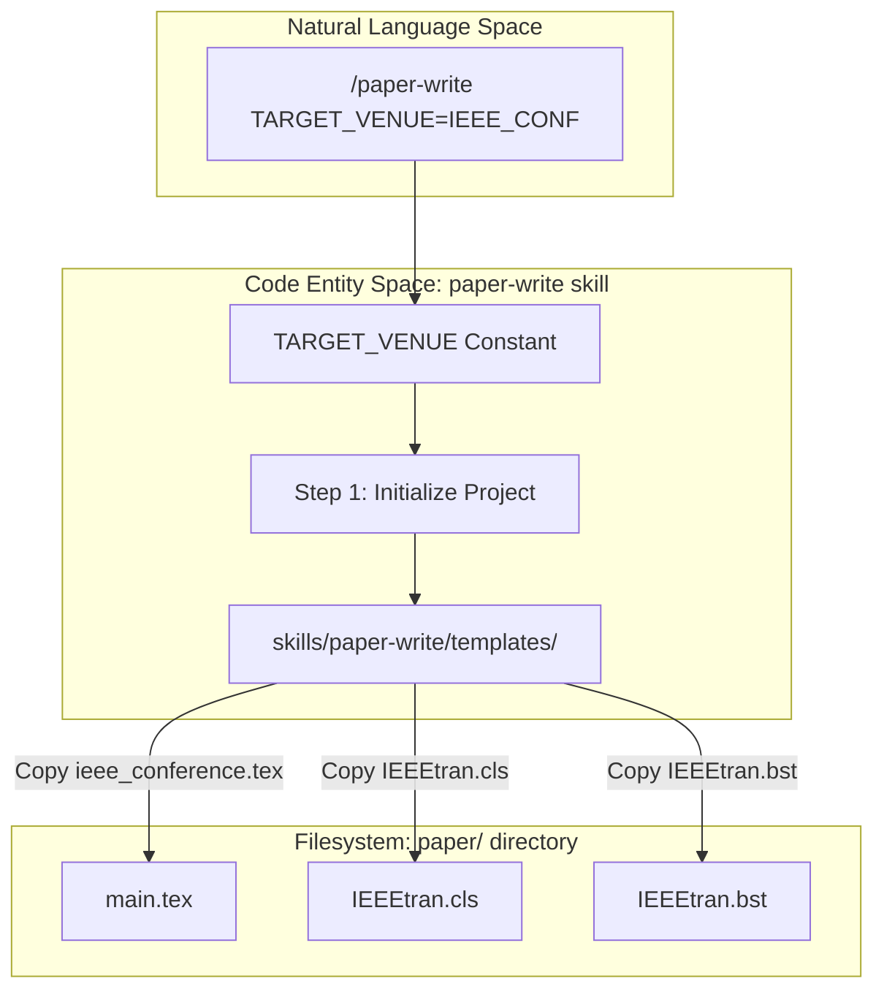
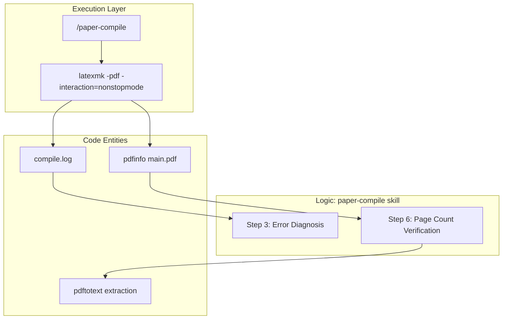

<!-- source: DeepWiki mcp.deepwiki.com · repo wanshuiyin/Auto-claude-code-research-in-sleep · page 8.6 LaTeX Templates & Venue Support · fetched 2026-10-26 -->

# LaTeX Templates & Venue Support

<details>
<summary>Relevant source files</summary>

The following files were used as context for generating this wiki page:

- [skills/paper-compile/SKILL.md](skills/paper-compile/SKILL.md)
- [skills/paper-figure/SKILL.md](skills/paper-figure/SKILL.md)
- [skills/paper-write/templates/IEEEtran.bst](skills/paper-write/templates/IEEEtran.bst)
- [skills/paper-write/templates/IEEEtran.cls](skills/paper-write/templates/IEEEtran.cls)
- [skills/paper-write/templates/iclr2026.tex](skills/paper-write/templates/iclr2026.tex)
- [skills/paper-write/templates/icml2025.tex](skills/paper-write/templates/icml2025.tex)
- [skills/paper-write/templates/ieee_conference.tex](skills/paper-write/templates/ieee_conference.tex)
- [skills/paper-write/templates/ieee_journal.tex](skills/paper-write/templates/ieee_journal.tex)
- [skills/paper-write/templates/math_commands.tex](skills/paper-write/templates/math_commands.tex)
- [skills/paper-write/templates/neurips2025.tex](skills/paper-write/templates/neurips2025.tex)
- [skills/shared-references/citation-discipline.md](skills/shared-references/citation-discipline.md)
- [skills/shared-references/venue-checklists.md](skills/shared-references/venue-checklists.md)
- [skills/skills-codex/paper-figure/SKILL.md](skills/skills-codex/paper-figure/SKILL.md)
- [skills/skills-codex/paper-write/templates/aaai2026.bst](skills/skills-codex/paper-write/templates/aaai2026.bst)
- [skills/skills-codex/paper-write/templates/aaai2026.sty](skills/skills-codex/paper-write/templates/aaai2026.sty)
- [skills/skills-codex/paper-write/templates/aaai2026.tex](skills/skills-codex/paper-write/templates/aaai2026.tex)
- [skills/skills-codex/paper-write/templates/acl.sty](skills/skills-codex/paper-write/templates/acl.sty)
- [skills/skills-codex/paper-write/templates/acl2026.tex](skills/skills-codex/paper-write/templates/acl2026.tex)
- [skills/skills-codex/paper-write/templates/acl_natbib.bst](skills/skills-codex/paper-write/templates/acl_natbib.bst)
- [skills/skills-codex/paper-write/templates/cvpr.bst](skills/skills-codex/paper-write/templates/cvpr.bst)
- [skills/skills-codex/paper-write/templates/cvpr.sty](skills/skills-codex/paper-write/templates/cvpr.sty)
- [skills/skills-codex/paper-write/templates/cvpr2026.tex](skills/skills-codex/paper-write/templates/cvpr2026.tex)
- [skills/skills-codex/shared-references/citation-discipline.md](skills/skills-codex/shared-references/citation-discipline.md)

</details>


This page documents the LaTeX template system within ARIS, specifically focusing on how the `/paper-write` and `/paper-compile` skills manage conference-specific formatting, style files, and bibliography standards for major ML, AI, and Engineering venues.

## Overview

The ARIS paper writing pipeline automates the transition from experimental results to a submission-ready LaTeX project. To ensure compliance with specific conference requirements, the system maintains a library of templates and style files in `skills/paper-write/templates/` and `skills-codex/paper-write/templates/`. The selection of these assets is governed by the `TARGET_VENUE` constant [skills/paper-write/SKILL.md:15-15]().

### Supported Venues

| Venue | Default `TARGET_VENUE` | Style Files | Main Template |
| :--- | :--- | :--- | :--- |
| **ICLR** | `ICLR` | `iclr2026_conference.sty` | `iclr2026.tex` |
| **NeurIPS** | `NeurIPS` | `neurips_2025.sty` | `neurips2025.tex` |
| **ICML** | `ICML` | `icml2025.sty` | `icml2025.tex` |
| **CVPR** | `CVPR` | `cvpr.sty`, `cvpr.bst` | `cvpr2026.tex` |
| **ACL** | `ACL` | `acl.sty`, `acl_natbib.bst` | `acl2026.tex` |
| **AAAI** | `AAAI` | `aaai2026.sty`, `aaai2026.bst` | `aaai2026.tex` |
| **ACM** | `ACM` | `acmart.cls`, `ACM-Reference-Format.bst` | `acm_article.tex` |
| **IEEE Conference** | `IEEE_CONF` | `IEEEtran.cls`, `IEEEtran.bst` | `ieee_conference.tex` |
| **IEEE Journal** | `IEEE_JOURNAL` | `IEEEtran.cls`, `IEEEtran.bst` | `ieee_journal.tex` |

**Sources:** [skills/paper-write/SKILL.md:15-15](), [skills/paper-write/templates/iclr2026.tex:1-6](), [skills/paper-write/templates/neurips2025.tex:1-6](), [skills/paper-write/templates/icml2025.tex:1-5](), [skills/paper-write/templates/ieee_conference.tex:1-6](), [skills/paper-write/templates/ieee_journal.tex:1-6]()

---

## Template Selection Logic

The `/paper-write` skill initializes a project by copying the appropriate template based on the `TARGET_VENUE` argument.

### Data Flow: Venue to Project
The following diagram illustrates how the `TARGET_VENUE` constant determines the file operations during the project initialization phase.

**Template Resolution Diagram**

**Sources:** [skills/paper-write/SKILL.md:15-15](), [skills/paper-write/templates/ieee_conference.tex:1-6](), [skills/paper-write/templates/IEEEtran.cls:1-6]()

---

## Venue-Specific Technical Details

### ICLR, NeurIPS & ICML (ML Core)
These templates are pre-configured with standard ML packages including `amsmath`, `cleveref`, and `booktabs`.
- **ICLR 2026:** Uses `\usepackage{iclr2026_conference,times}` and includes a `\iclrfinalcopy` toggle for camera-ready versions [skills/paper-write/templates/iclr2026.tex:5-51]().
- **NeurIPS 2025:** Uses `\usepackage[preprint]{neurips_2025}` and specifies `\bibliographystyle{plainnat}` [skills/paper-write/templates/neurips2025.tex:6-74]().
- **ICML 2025:** Uses `\documentclass[accepted]{icml2025}` and requires `\icmltitlerunning{...}` [skills/paper-write/templates/icml2025.tex:5-48]().

**Sources:**
[skills/paper-write/templates/iclr2026.tex:5-51]()
[skills/paper-write/templates/neurips2025.tex:6-74]()
[skills/paper-write/templates/icml2025.tex:5-48]()

### IEEE Support (Conference vs. Journal)
IEEE support is handled via the `IEEEtran` class with specific options.
- **IEEE Conference:** Uses `\documentclass[conference]{IEEEtran}`. Critically, references **count toward the page limit** (typically 6 pages) [skills/paper-write/templates/ieee_conference.tex:6-85](), [skills/shared-references/venue-checklists.md:92-92]().
- **IEEE Journal:** Uses `\documentclass[journal]{IEEEtran}`. It includes support for author biographies (`\begin{IEEEbiography}`) and keywords (`\begin{IEEEkeywords}`) [skills/paper-write/templates/ieee_journal.tex:6-89](), [skills/shared-references/venue-checklists.md:72-74]().
- **Citations:** Both use `\bibliographystyle{IEEEtran}` and the `cite` package for numeric `[1]` style citations [skills/paper-write/templates/ieee_conference.tex:25-86](), [skills/paper-write/templates/IEEEtran.bst]().

**Sources:**
[skills/paper-write/templates/ieee_conference.tex:6-85]()
[skills/shared-references/venue-checklists.md:92-92]()
[skills/paper-write/templates/ieee_journal.tex:6-89]()
[skills/shared-references/venue-checklists.md:72-74]()
[skills/paper-write/templates/ieee_conference.tex:25-86]()
[skills/paper-write/templates/IEEEtran.bst]()

### AAAI & CVPR
- **AAAI 2026:** Uses a unified template with style files and bib styles [skills/skills-codex/paper-write/templates/aaai2026.tex:1-5](). It requires specific style files like `aaai2026.sty` and `aaai2026.bst`.
- **CVPR:** Utilizes `cvpr.sty` with options for `review`, `final`, or `rebuttal` [skills/skills-codex/paper-write/templates/cvpr.sty:15-19](). It includes specific `natbib` configurations for CVPR-style numeric citations [skills/skills-codex/paper-write/templates/cvpr.sty:37-38]().

**Sources:**
[skills/skills-codex/paper-write/templates/aaai2026.tex:1-5]()
[skills/skills-codex/paper-write/templates/cvpr.sty:15-19]()
[skills/skills-codex/paper-write/templates/cvpr.sty:37-38]()

---

## Project Structure & Compilation

### Generated File Layout
The system enforces a modular structure to allow Claude to edit sections independently without hitting context limits [skills/paper-compile/SKILL.md:40-46]().

```
paper/
├── main.tex                    # Venue template (e.g., iclr2026.tex)
├── IEEEtran.cls / [venue].sty  # Class/Style files
├── math_commands.tex           # Standard ML math macros [skills/paper-write/templates/math_commands.tex]()
├── references.bib              # BibTeX database
├── sections/                   # Modular LaTeX files
│   ├── 0_abstract.tex          # \input{sections/0_abstract}
│   ├── 1_introduction.tex
│   └── ...
└── figures/                    # PDF/PNG plots from /paper-figure [skills/paper-figure/SKILL.md:32-32]()
```
**Sources:** [skills/paper-write/templates/iclr2026.tex:68-82](), [skills/paper-compile/SKILL.md:40-46](), [skills/paper-figure/SKILL.md:32-32](), [skills/paper-write/templates/math_commands.tex]()

### Compilation & Page Count Verification
The `/paper-compile` skill uses `latexmk` to handle multi-pass compilation [skills/paper-compile/SKILL.md:14-14]().

**Compilation & Error Correction Diagram**

**Sources:** [skills/paper-compile/SKILL.md:57-62](), [skills/paper-compile/SKILL.md:133-133](), [skills/paper-compile/SKILL.md:159-163](), [skills/paper-compile/SKILL.md:173-190]()

### Critical Page Limit Rules
The system distinguishes between ML and IEEE page counting logic:
- **ML Venues (ICLR/NeurIPS/ICML/CVPR/ACL/AAAI):** `MAX_PAGES` (e.g., 9) applies only to the main body (Intro to Conclusion). References and Appendices are excluded [skills/paper-compile/SKILL.md:168-170]().
- **IEEE Venues:** `MAX_PAGES` includes **everything** (References and Biographies). The system uses `pdftotext` to find the "References" header and calculate the split [skills/paper-compile/SKILL.md:171-190](), [skills/shared-references/venue-checklists.md:71-71]().

**Sources:** [skills/paper-compile/SKILL.md:15-18](), [skills/paper-compile/SKILL.md:168-190](), [skills/shared-references/venue-checklists.md:71-71](), [skills/shared-references/venue-checklists.md:92-92]()

---

