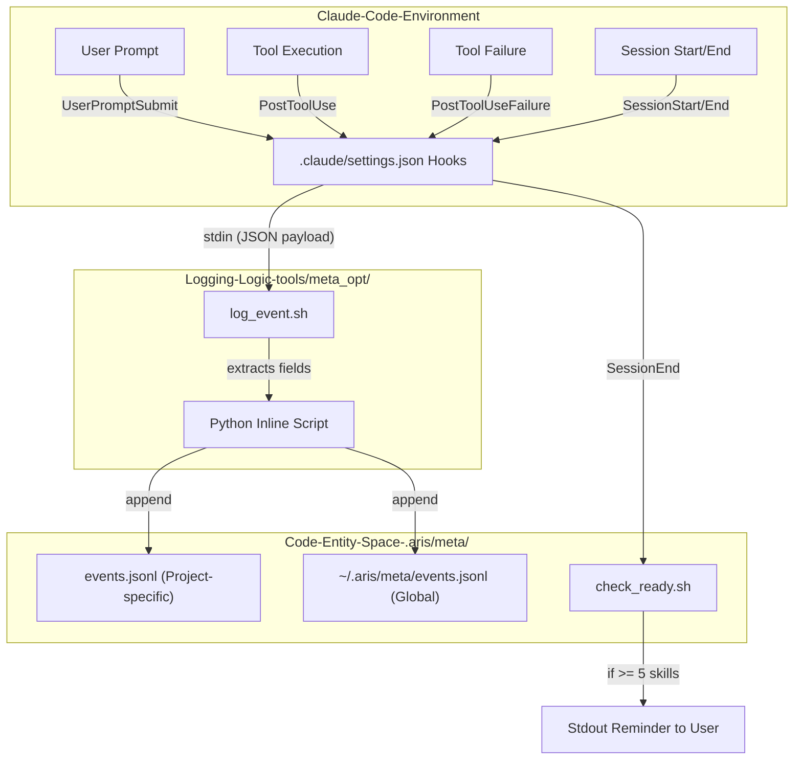
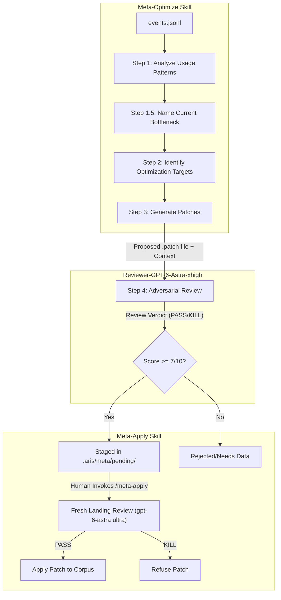

<!-- source: DeepWiki mcp.deepwiki.com · repo wanshuiyin/Auto-claude-code-research-in-sleep · page 8.7 Meta-Optimize & Self-Improvement · fetched 2026-10-26 -->

# Meta-Optimize & Self-Improvement

Relevant source files

The following files were used as context for generating this wiki page:

- [skills/experiment-bridge/SKILL.md](skills/experiment-bridge/SKILL.md)
- [skills/meta-apply/SKILL.md](skills/meta-apply/SKILL.md)
- [skills/meta-optimize/SKILL.md](skills/meta-optimize/SKILL.md)
- [skills/shared-references/review-scope-limits.md](skills/shared-references/review-scope-limits.md)
- [skills/skills-codex-gemini-review/auto-review-loop/SKILL.md](skills/skills-codex-gemini-review/auto-review-loop/SKILL.md)
- [skills/skills-codex/auto-review-loop/SKILL.md](skills/skills-codex/auto-review-loop/SKILL.md)
- [skills/skills-codex/experiment-bridge/SKILL.md](skills/skills-codex/experiment-bridge/SKILL.md)
- [skills/skills-codex/meta-apply/SKILL.md](skills/skills-codex/meta-apply/SKILL.md)
- [skills/skills-codex/meta-optimize/SKILL.md](skills/skills-codex/meta-optimize/SKILL.md)
- [skills/skills-codex/shared-references/review-scope-limits.md](skills/skills-codex/shared-references/review-scope-limits.md)
- [templates/claude-hooks/meta_logging.json](templates/claude-hooks/meta_logging.json)
- [tests/test_codex_skill_mirror.py](tests/test_codex_skill_mirror.py)
- [tests/test_trigger_eval.py](tests/test_trigger_eval.py)
- [tools/meta_opt/check_ready.sh](tools/meta_opt/check_ready.sh)
- [tools/meta_opt/log_event.sh](tools/meta_opt/log_event.sh)
- [tools/meta_opt/trigger_eval.py](tools/meta_opt/trigger_eval.py)
- [tools/meta_opt/trigger_evals.sample.json](tools/meta_opt/trigger_evals.sample.json)

The Meta-Optimize system implements an **outer-loop harness optimization** for ARIS. While standard workflows (Idea Discovery, Auto Review Loop) optimize research artifacts like papers and code, Meta-Optimize focuses on improving the **harness itself**—the skills, prompts, and default parameters that orchestrate the research process [skills/meta-optimize/SKILL.md:14-16](). Inspired by the Meta-Harness concept (Lee et al., 2026), it treats harness design as an engineering task that can be partially automated through execution trace analysis [skills/meta-optimize/SKILL.md:16-17]().

## System Overview

The self-improvement cycle operates by logging passive event data during normal ARIS usage, analyzing patterns of failure or human intervention, and generating verified patches to the system's core configuration files.

### The Optimization Pipeline
The `/meta-optimize` skill follows a six-step pipeline to evolve the system [skills/meta-optimize/SKILL.md:74-183]():
1.  **Data Availability Check**: Verifies that at least 5 skill invocations have been logged [skills/meta-optimize/SKILL.md:92-95]().
2.  **Pattern Analysis**: Computes frequency, failure rates, and human intervention signals from logs [skills/meta-optimize/SKILL.md:109-130]().
3.  **Bottleneck Identification**: Synthesizes analysis into a single sentence naming the most limiting pipeline stage [skills/meta-optimize/SKILL.md:107-112]().
4.  **Target Identification**: Ranks optimization opportunities (e.g., adjusting `SCORE_THRESHOLD`) [skills/meta-optimize/SKILL.md:139-146]().
5.  **Patch Generation**: Creates concrete diffs for `SKILL.md` files or workflow defaults [skills/meta-optimize/SKILL.md:151-171]().
6.  **Adversarial Review**: Submits patches to a high-reasoning model (GPT-6-Astra xhigh) for safety and validity checks [skills/meta-optimize/SKILL.md:172-183]().
7.  **Reporting & Application**: Presents a structured report with recommended changes and an "apply" mechanism [skills/meta-optimize/SKILL.md:185-200]().

## Event Logging Architecture

Passive logging is achieved through Claude Code hooks configured in `templates/claude-hooks/meta_logging.json`. These hooks trigger a specialized bash script, `log_event.sh`, which processes session data into structured JSONL format.

### Data Flow: Hook to Log
The following diagram illustrates how natural language interactions and tool executions are captured into the "Code Entity Space" of the `.aris/meta` directory.

**ARIS Event Logging Pipeline**

Sources: [tools/meta_opt/log_event.sh:1-91](), [templates/claude-hooks/meta_logging.json:1-74](), [tools/meta_opt/check_ready.sh:1-33]()

### Logged Event Types
The system captures specific metadata depending on the hook event [tools/meta_opt/log_event.sh:43-80]():

| Event Name | Key Fields Captured | Purpose |
| :--- | :--- | :--- |
| `PostToolUse` | `tool`, `skill`, `args`, `input_summary` | Track successful skill usage and parameter overrides. |
| `PostToolUseFailure`| `tool`, `error_pattern` | Identify fragile tools or common OOM/timeout issues. |
| `UserPromptSubmit` | `command`, `args`, `prompt_preview` | Detect manual interventions and slash command frequency. |
| `SessionStart` | `model`, `source` | Correlate performance with specific LLM backends. |

## Optimization Targets

Meta-Optimize targets the "Harness Components" rather than the research data. It focuses on the following entities:

| Component | Target File | Example Optimization |
| :--- | :--- | :--- |
| **SKILL.md prompts** | `skills/*/SKILL.md` | Reviewer instructions, quality gates, step descriptions [skills/meta-optimize/SKILL.md:60](). |
| **Default parameters** | `skills/*/SKILL.md` | `difficulty: medium`, `MAX_ROUNDS: 4`, `threshold: 6/10` [skills/meta-optimize/SKILL.md:61](). |
| **Convergence rules** | `skills/auto-review-loop/SKILL.md` | When to stop the review loop, retry counts [skills/meta-optimize/SKILL.md:62](). |
| **Workflow ordering** | `skills/*/SKILL.md` | Skill chain sequence within a workflow [skills/meta-optimize/SKILL.md:63](). |
| **Artifact schemas** | `EXPERIMENT_LOG.md`, `IDEA_REPORT.md` | What fields go in these files (cautious optimization) [skills/meta-optimize/SKILL.md:64](). |

Sources: [skills/meta-optimize/SKILL.md:58-66]()

## Readiness & Triggering

The system does not run continuously to avoid overhead. Instead, it uses a readiness trigger [tools/meta_opt/check_ready.sh:1-33]().

1.  **SessionEnd Hook**: Every time a Claude session ends, `check_ready.sh` is invoked [templates/claude-hooks/meta_logging.json:65-69]().
2.  **Incremental Counting**: The script counts `skill_invoke` events in `events.jsonl` that have occurred since the timestamp stored in `.last_optimize` [tools/meta_opt/check_ready.sh:29-51]().
3.  **Threshold**: If the count is $\ge 5$, a reminder is printed to the terminal, prompting the user to run `/meta-optimize` [tools/meta_opt/check_ready.sh:54-56]().
4.  **Model-Delta Trigger**: If the current session model differs from the model used during the last `/meta-optimize` run, it also triggers a reminder, suggesting a "harness diet" to remove scaffolding that a newer, more capable model might render obsolete [tools/meta_opt/check_ready.sh:60-79]().

## Adversarial Review of Patches

To ensure self-improvement doesn't lead to system degradation, every proposed patch undergoes a review by `gpt-6-astra` with `xhigh` reasoning effort [skills/meta-optimize/SKILL.md:172-177](). This review is performed by a fresh agent, ensuring independence.

**Patch Verification Workflow**

Sources: [skills/meta-optimize/SKILL.md:172-183](), [skills/meta-apply/SKILL.md:37-59]()

The reviewer evaluates three core criteria [skills/meta-optimize/SKILL.md:178-181]():
1.  **Evidence Support**: Does the usage log actually justify this change?
2.  **Side Effects**: Could this change negatively impact other research workflows?
3.  **Safety**: Is the change minimal and non-destructive to the core MCP infrastructure?

## Safety Mechanisms

The `meta-optimize` skill is a **read-only producer** [skills/meta-optimize/SKILL.md:12-13](). It cannot directly modify the codebase. The actual application of patches is handled by a separate, human-invoked skill: `/meta-apply` [skills/meta-apply/SKILL.md:15-16](). This separation enforces a **privilege boundary** to prevent self-acquittal failure modes [skills/meta-optimize/SKILL.md:16-17]().

*   **No `Write`/`Edit` tool for `/meta-optimize`**: The `/meta-optimize` skill is explicitly denied `Write` or `Edit` tools, ensuring it cannot modify corpus files directly [skills/meta-optimize/SKILL.md:19-22](). Its outputs are limited to reports and staged patch files in `.aris/meta/` [skills/meta-optimize/SKILL.md:22-23]().
*   **Human-in-the-Loop for `/meta-apply`**: The `/meta-apply` skill is human-invoked only, requiring explicit user action to land changes [skills/meta-apply/SKILL.md:23-25]().
*   **Fresh Landing Review**: `/meta-apply` performs its own fresh review of the staged diff using `gpt-6-astra` with `ultra` reasoning, ignoring any prior advisory verdicts from the producer [skills/meta-apply/SKILL.md:27-34](). This ensures the verdict is produced where it is consumed, by the privileged skill [skills/meta-apply/SKILL.md:34-35]().
*   **Non-Negotiable Rules**: `/meta-apply` adheres to strict rules, including applying only user-named patches, requiring a fresh landing review `PASS`, and recording the review class honestly [skills/meta-apply/SKILL.md:37-59]().
*   **Backups**: Before applying any patch, `/meta-apply` creates backups of the target file in `.aris/meta/backups/` [skills/meta-apply/SKILL.md:97-99]().
*   **Provenance Stamping**: Applied changes are stamped with provenance information, including `verdict_id` and `content_hash`, to ensure auditability and detect tampering [skills/meta-apply/SKILL.md:101-105]().
*   **Infrastructure Isolation**: The system explicitly forbids the meta-optimizer from changing artifact schemas or MCP bridge configurations to prevent breaking the underlying communication layer [skills/meta-optimize/SKILL.md:64-66]().

Sources: [skills/meta-optimize/SKILL.md:12-43](), [skills/meta-apply/SKILL.md:1-132](), [skills/meta-optimize/SKILL.md:64-66]()

---

