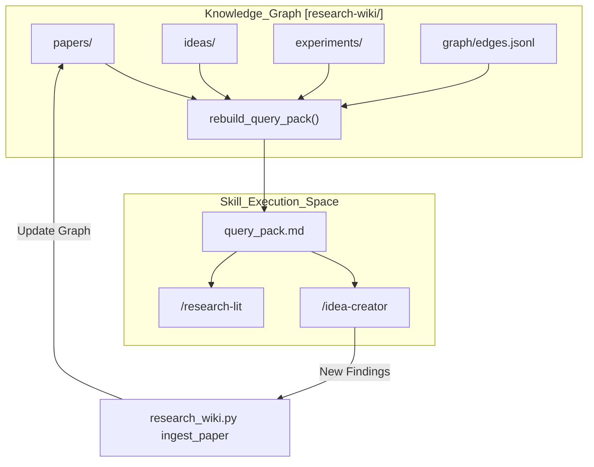
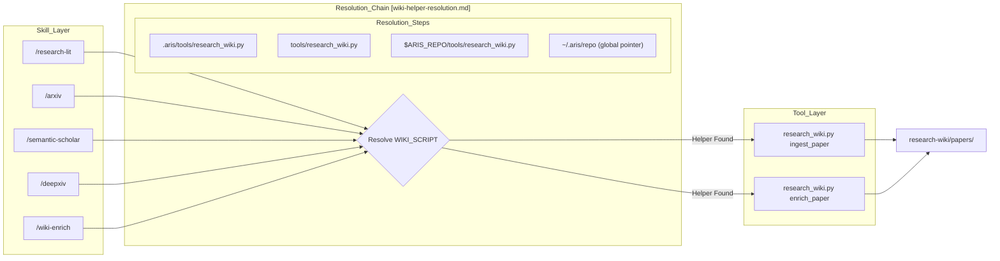

<!-- source: DeepWiki mcp.deepwiki.com · repo wanshuiyin/Auto-claude-code-research-in-sleep · page 8.8 Research Wiki Deep Dive · fetched 2026-10-26 -->

# Research Wiki Deep Dive

Relevant source files

The following files were used as context for generating this wiki page:

- [skills/research-lit/SKILL.md](skills/research-lit/SKILL.md)
- [skills/research-wiki/SKILL.md](skills/research-wiki/SKILL.md)
- [skills/shared-references/capture-antipatterns.md](skills/shared-references/capture-antipatterns.md)
- [skills/shared-references/wiki-helper-resolution.md](skills/shared-references/wiki-helper-resolution.md)
- [skills/skills-codex/research-lit/SKILL.md](skills/skills-codex/research-lit/SKILL.md)
- [skills/skills-codex/shared-references/wiki-helper-resolution.md](skills/skills-codex/shared-references/wiki-helper-resolution.md)
- [skills/wiki-enrich/SKILL.md](skills/wiki-enrich/SKILL.md)
- [tests/test_capture_filter.py](tests/test_capture_filter.py)
- [tests/test_research_wiki_claims.py](tests/test_research_wiki_claims.py)
- [tests/test_research_wiki_encoding.py](tests/test_research_wiki_encoding.py)
- [tests/test_research_wiki_helper_resolution.py](tests/test_research_wiki_helper_resolution.py)
- [tools/capture_filter.py](tools/capture_filter.py)
- [tools/check_skills_inventory.py](tools/check_skills_inventory.py)
- [tools/research_wiki.py](tools/research_wiki.py)
- [tools/verify_papers.py](tools/verify_papers.py)
- [tools/verify_wiki_coverage.sh](tools/verify_wiki_coverage.sh)

The Research Wiki is a persistent, per-project knowledge graph designed to accumulate structured research intelligence across the entire Auto-claude-code-research-in-sleep (ARIS) lifecycle. Unlike transient context that is lost between sessions, the wiki implements a "compounding knowledge" pattern where every paper read, idea tested, and experiment run makes the system progressively smarter. It specifically prevents "circular research" by maintaining a permanent record of failed hypotheses and evidence gaps.

## 1. Core Entity Architecture

The wiki is organized into four primary entity types, each stored in a dedicated subdirectory with a standardized Markdown schema and a unique Node ID.

| Entity | Directory | Node ID Format | Purpose |
| :--- | :--- | :--- | :--- |
| **Paper** | `papers/` | `paper:<slug>` | Published or preprint literature with extracted thesis and reusable ingredients [skills/research-wiki/SKILL.md:24](). |
| **Idea** | `ideas/` | `idea:<id>` | Proposed research directions, including those that were rejected or failed pilots [skills/research-wiki/SKILL.md:25](). |
| **Experiment** | `experiments/` | `exp:<id>` | Concrete execution instances with hardware logs, metrics, and reproducibility notes [skills/research-wiki/SKILL.md:26](). |
| **Claim** | `claims/` | `claim:<id>` | Atomic scientific assertions mapped to specific supporting or invalidating evidence [skills/research-wiki/SKILL.md:27](). |

### Entity Relationship Graph
Relationships are decoupled from page content and stored in a centralized materialized graph `graph/edges.jsonl` [skills/research-wiki/SKILL.md:29-42](). This allows for complex querying without parsing every Markdown file.

**Supported Relationship Types:**
*   `extends`: `paper` → `paper` (Builds on prior work) [skills/research-wiki/SKILL.md:33]().
*   `contradicts`: `paper` → `paper` (Disagrees with findings) [skills/research-wiki/SKILL.md:34]().
*   `inspired_by`: `idea` → `paper` (Source of the hypothesis) [skills/research-wiki/SKILL.md:36]().
*   `tested_by`: `idea|claim` → `exp` (Maps assertions to empirical runs) [skills/research-wiki/SKILL.md:37]().
*   `supports` / `invalidates`: `exp` → `claim|idea` (The empirical verdict) [skills/research-wiki/SKILL.md:38-39]().
*   `addresses_gap`: `paper|idea` → `gap` (Targets a known field limitation) [skills/research-wiki/SKILL.md:35]().

Sources: [skills/research-wiki/SKILL.md:20-44](), [tools/research_wiki.py:100-103]()

## 2. Spiral Learning & The Query Pack

The Research Wiki enables "Spiral Learning"—a process where the agent's starting point for a new task is the distilled essence of all previous tasks. This is implemented via the `query_pack.md` file.

### Data Flow: From Wiki to Context
The `rebuild_query_pack` function in `tools/research_wiki.py` compresses the entire knowledge graph into a context-window-friendly summary (max 8000 characters) [tools/research_wiki.py:139]().

Sources: [tools/research_wiki.py:139-180](), [skills/research-wiki/SKILL.md:51]()

### Anti-Repetition Logic
The `query_pack.md` prioritizes "Failed Ideas" [tools/research_wiki.py:157](). When `rebuild_query_pack` runs, it scans the `ideas/` directory for files containing `outcome: negative` or `outcome: mixed` [tools/research_wiki.py:163](). These are injected into the pack with their failure notes to serve as a **banlist** for future ideation sessions, ensuring the LLM does not regenerate hypotheses that have already been invalidated.

Sources: [tools/research_wiki.py:157-176](), [skills/research-wiki/SKILL.md:14-16]()

## 3. Implementation: research_wiki.py CLI

The `tools/research_wiki.py` script is the canonical helper for the `/research-wiki` skill and integration hooks. It is a pure-stdlib Python script to ensure compatibility across environments [tools/research_wiki.py:32-37]().

### Key Functions
*   `slugify(title, author_last, year)`: Generates canonical IDs like `vaswani2017_attention_all_you` by stripping stop words and joining the first three keywords [tools/research_wiki.py:97-121](). This function is designed to handle non-ASCII characters to prevent collisions for papers in different languages [tools/research_wiki.py:99-103](), a fix implemented after issues with Chinese paper titles [tests/test_research_wiki_encoding.py:43-50]().
*   `init_wiki(wiki_root)`: Bootstraps the directory structure and creates empty index/log files [tools/research_wiki.py:124-151]().
*   `add_edge(wiki_root, from_id, to_id, edge_type, evidence)`: Appends a JSON-L record to the graph with a dedup check [tools/research_wiki.py:19-26]().
*   `ingest_paper(...)`: The primary entry point for all literature skills. It handles arXiv metadata fetching via the Atom API and page creation [tools/research_wiki.py:19-26]().

### CLI Commands
| Command | Action |
| :--- | :--- |
| `init` | Bootstraps the directory structure and base files (`gap_map.md`, `log.md`, `query_pack.md`) [tools/research_wiki.py:124-151](). |
| `slug` | Generates a canonical slug for a paper [tools/research_wiki.py:11-12](). |
| `ingest_paper` | Fetches metadata, generates a slug, and creates `papers/<slug>.md` [tools/research_wiki.py:19-26](). |
| `add_edge` | Manually links nodes with evidence [tools/research_wiki.py:13-13](). |
| `rebuild_query_pack` | Rebuilds the `query_pack.md` for spiral learning [tools/research_wiki.py:14-14](). |
| `rebuild_index` | Rebuilds the wiki index [tools/research_wiki.py:14-14](). |
| `stats` | Reports node counts and graph density [tools/research_wiki.py:15-15](). |
| `log` | Appends a message to the wiki log [tools/research_wiki.py:16-16](). |
| `sync` | Batch backfills papers from arXiv IDs or a file [tools/research_wiki.py:28-29](). |
| `add_claim` | Adds a claim to the wiki, including its status, provenance, and relationships [tools/research_wiki.py:31-36](). |

Sources: [tools/research_wiki.py:1-37](), [skills/research-wiki/SKILL.md:66-100]()

## 4. Integration & Ingest Hooks

ARIS enforces a strict **Integration Contract** where literature-reading skills must invoke the wiki ingest helper if a `research-wiki/` directory exists [skills/shared-references/integration-contract.md:22-30]().

### Canonical Ingest Chain
Skills like `/arxiv`, `/deepxiv`, and `/semantic-scholar` resolve the `WIKI_SCRIPT` path using a strict resolution chain (checking `.aris/tools/`, `tools/`, and `$ARIS_REPO/tools/`) before execution [skills/shared-references/wiki-helper-resolution.md:19-22](). This resolution chain is critical to prevent silent failures when the `tools/` directory is not directly present in the project, a common scenario after `install_aris.sh` creates symlinks [skills/shared-references/wiki-helper-resolution.md:4-7](), [tests/test_research_wiki_helper_resolution.py:4-15]().

Sources: [skills/research-lit/SKILL.md:1-5](), [skills/skills-codex/research-lit/SKILL.md:1-5](), [skills/wiki-enrich/SKILL.md:1-5](), [skills/shared-references/wiki-helper-resolution.md:1-22](), [tests/test_research_wiki_helper_resolution.py:41-56]()

### Capture Hygiene
Before persisting new `idea`, `claim`, or `experiment` notes, the system screens for "operational noise" that could lead to self-cited falsehoods [skills/research-wiki/SKILL.md:45-58](). This is done via the `capture_filter.py` helper [skills/research-wiki/SKILL.md:49](). If the helper flags `env-failure`, `transient-error`, or `negative-tool-claim`, the note is rewritten or dropped to prevent polluting the knowledge base with transient system issues rather than genuine research findings [skills/research-wiki/SKILL.md:52-58]().

Sources: [skills/research-wiki/SKILL.md:45-58](), [tools/capture_filter.py]()

### Automated Coverage Verification
The `tools/verify_wiki_coverage.sh` script is a diagnostic tool that compares arXiv IDs found in session artifacts (like `.aris/traces/` or `references.bib`) against those already in the wiki [tools/verify_wiki_coverage.sh:1-6](). It generates a `missing_ids` list and provides a `sync` command to backfill the wiki [tools/verify_wiki_coverage.sh:117-161](). This is a non-blocking diagnostic, meaning it reports gaps but does not halt execution [tools/verify_wiki_coverage.sh:10-12]().

Sources: [tools/verify_wiki_coverage.sh:1-176]()

## 5. Prevention of Failed Experiment Repetition

The "Failed Ideas" section of the `query_pack.md` is the primary mechanism for cross-session memory. By including the `failure_notes` and `lessons_learned` from previous attempts in the system prompt of the `/idea-creator`, the system achieves "negative constraint optimization."

1.  **Ingestion**: When an idea fails, its Markdown file in `ideas/` is updated with `outcome: negative` [tools/research_wiki.py:163]().
2.  **Compression**: `rebuild_query_pack` extracts the title and first 200 characters of the failure section [tools/research_wiki.py:175]().
3.  **Prevention**: During the next `/idea-creator` run, the agent reads these failures and is explicitly instructed to avoid these paths [skills/research-wiki/SKILL.md:14-16]().

Sources: [tools/research_wiki.py:157-176](), [skills/research-wiki/SKILL.md:14-16]()

---

