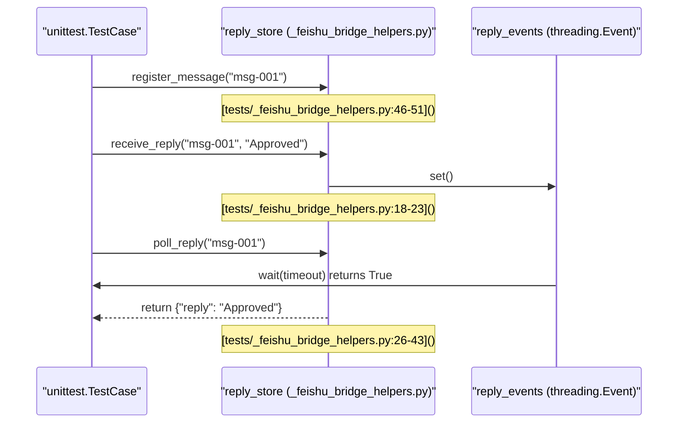
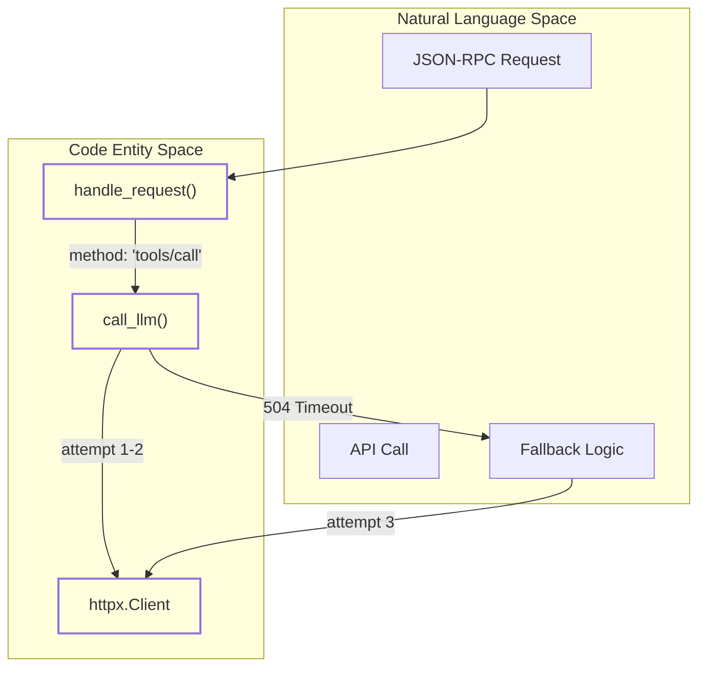
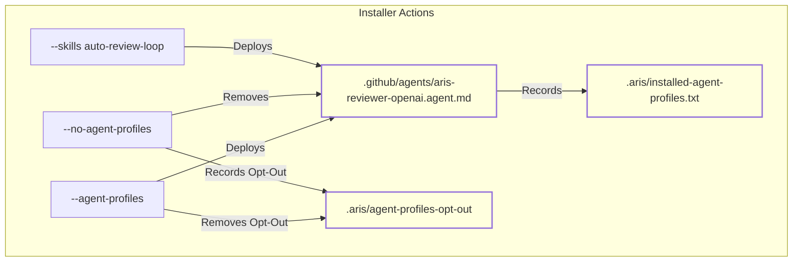
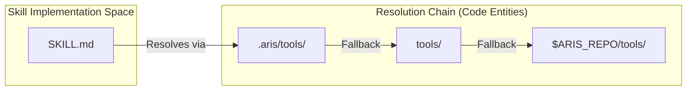

<!-- source: DeepWiki mcp.deepwiki.com · repo wanshuiyin/Auto-claude-code-research-in-sleep · page 8.9 Testing & CI Infrastructure · fetched 2026-10-26 -->

# Testing & CI Infrastructure

<details>
<summary>Relevant source files</summary>

The following files were used as context for generating this wiki page:

- [.gitattributes](.gitattributes)
- [.github/workflows/check-skills-inventory.yml](.github/workflows/check-skills-inventory.yml)
- [.github/workflows/lint-skills-helpers.yml](.github/workflows/lint-skills-helpers.yml)
- [.github/workflows/test-install-aris-ps1.yml](.github/workflows/test-install-aris-ps1.yml)
- [.github/workflows/test-suite.yml](.github/workflows/test-suite.yml)
- [docs/ARIS_INTRO.review.json](docs/ARIS_INTRO.review.json)
- [tests/_llm_chat_helpers.py](tests/_llm_chat_helpers.py)
- [tests/test_argument_hint_lint.py](tests/test_argument_hint_lint.py)
- [tests/test_install_aris_agent_profiles.py](tests/test_install_aris_agent_profiles.py)
- [tests/test_install_aris_replace_link.py](tests/test_install_aris_replace_link.py)
- [tests/test_iteration_log.py](tests/test_iteration_log.py)
- [tests/test_llm_chat_server.py](tests/test_llm_chat_server.py)
- [tools/iteration_log.py](tools/iteration_log.py)
- [tools/lint_skills_helpers.sh](tools/lint_skills_helpers.sh)

</details>


The `tests/` directory provides a comprehensive suite of unit and integration tests for the ARIS (Auto-claude-code-research-in-sleep) ecosystem. It focuses on validating the core infrastructure components: MCP servers, communication bridges, experiment monitoring daemons, and specialized research utility scripts. The `.github/workflows` directory defines the Continuous Integration (CI) pipelines that automate the execution of these tests and various linting checks.

## Testing Philosophy and Helper Modules

Due to the nature of MCP servers (which often manipulate `sys.stdout` and `sys.stdin` for JSON-RPC communication), the testing infrastructure utilizes "helper" modules. These helpers extract pure logic from the server implementations to allow for clean importing and testing without triggering side effects or requiring real hardware/API credentials.

| Helper Module | Purpose | Source File |
| :--- | :--- | :--- |
| `_feishu_bridge_helpers.py` | Logic for Feishu message state and polling. | [tests/_feishu_bridge_helpers.py:1-7]() |
| `_llm_chat_helpers.py` | Logic for JSON-RPC routing and LLM API calling. | [tests/_llm_chat_helpers.py:1-4]() |
| `_minimax_helpers.py` | Logic for MiniMax-specific API constraints and routing. | [tests/test_minimax_chat_server.py:35-163]() |

Sources: [tests/_feishu_bridge_helpers.py:1-7](), [tests/_llm_chat_helpers.py:1-4](), [tests/test_minimax_chat_server.py:35-163]()

---

## Feishu Bridge Integration Tests

The Feishu bridge tests validate the bidirectional communication between Claude Code and the Feishu/Lark messaging platform. It focuses on the `reply_store` mechanism, which handles the asynchronous nature of human-in-the-loop approvals.

### Data Flow: Feishu Reply Polling
"Feishu Bridge Message Lifecycle"


### Key Validations
- **Message Registration**: Ensures `register_message` initializes the necessary event locks [tests/test_feishu_bridge_server.py:42-47]().
- **Polling Logic**: Validates that `poll_reply` correctly handles timeouts, unknown IDs, and successful message consumption [tests/test_feishu_bridge_server.py:37-68]().
- **Card Payloads**: Tests `build_card_payload` to ensure the JSON structure matches Feishu's interactive card schema, including headers and markdown elements [tests/test_feishu_bridge_server.py:104-141]().
- **Query Parsing**: Validates `parse_query_string` for extracting `message_id` and `timeout` from incoming HTTP GET requests [tests/test_feishu_bridge_server.py:143-171]().

Sources: [tests/test_feishu_bridge_server.py:31-171](), [tests/_feishu_bridge_helpers.py:13-82]()

---

## LLM Chat MCP Server Tests

The `test_llm_chat_server.py` suite validates the generic LLM bridge used for alternative reviewer backends. It tests the `llm-chat` server's ability to route JSON-RPC requests and handle API failures gracefully.

### Component Mapping: LLM Chat Routing
"LLM Chat Server Request Handling"


### Key Validations
- **JSON-RPC Protocol**: Confirms the server responds correctly to `initialize`, `ping`, and `tools/list` methods [tests/test_llm_chat_server.py:21-86]().
- **Retry & Fallback**: Tests the logic in `call_llm` that attempts a retry on 504 Gateway Timeouts and eventually switches to `LLM_FALLBACK_MODEL` [tests/_llm_chat_helpers.py:40-70]().
- **Error Handling**: Ensures that missing `LLM_API_KEY` or non-200 API responses return a structured `isError` result to the MCP client [tests/test_llm_chat_server.py:88-101]().

Sources: [tests/test_llm_chat_server.py:18-162](), [tests/_llm_chat_helpers.py:27-176]()

---

## Watchdog Daemon Tests

The `test_watchdog.py` suite validates the `watchdog.py` daemon, which is responsible for monitoring long-running experiments on remote GPU servers.

### Key Functions Tested
- **Task Registration**: Validates `register_task` for training and download tasks, ensuring mandatory fields like `session` and `type` are present [tests/test_watchdog.py:39-126]().
- **Liveness Monitoring**: Tests `session_alive` by mocking `subprocess.run` to simulate `tmux` and `screen` session checks [tests/test_watchdog.py:171-195]().
- **Status Persistence**: Ensures `unregister_task` correctly cleans up the task entry in `tasks.json` and its corresponding status file in the `status/` directory [tests/test_watchdog.py:128-169]().
- **Path Resolution**: Verifies `get_paths` correctly constructs the directory structure for `pid`, `tasks`, `alerts`, and `status` [tests/test_watchdog.py:24-37]().

Sources: [tests/test_watchdog.py:24-195]()

---

## MiniMax Provider Tests

Tests in `test_minimax_chat_server.py` cover the specific constraints of the MiniMax LLM provider.

- **Temperature Clamping**: MiniMax requires temperatures in the range (0, 1]. The `clamp_temperature` function is tested to ensure values like `0.0` are moved to `0.01` and values `> 1.0` are capped at `1.0` [tests/test_minimax_chat_server.py:33-73]().
- **Model Enums**: Validates that the `tools/list` response includes the correct model variants such as `MiniMax-M2.7` and `MiniMax-M2.5-highspeed` [tests/test_minimax_chat_server.py:115-133]().

Sources: [tests/test_minimax_chat_server.py:14-133]()

---

## Installer and Selective Install Tests

The `install_aris.sh` script and its variants are critical for setting up the ARIS environment. The test suite includes specific regression tests to ensure the installer behaves as expected, especially concerning skill profiles and link replacement.

### Agent Profile Deployment
The `test_install_aris_agent_profiles.py` test suite verifies the deployment logic for Copilot reviewer profiles located under `.github/agents/`. These profiles are only deployed when the `auto-review-loop` skill is installed.

"Agent Profile Deployment Logic"


### Key Validations
- **Conditional Deployment**: Profiles are not deployed if `auto-review-loop` is not installed [tests/test_install_aris_agent_profiles.py:48-51]().
- **Deployment with `auto-review-loop`**: When `auto-review-loop` is installed, the correct symlink is created and recorded in `.aris/installed-agent-profiles.txt` [tests/test_install_aris_agent_profiles.py:53-57]().
- **Opt-out and Reversibility**: The `--no-agent-profiles` flag correctly removes profiles and creates an opt-out marker, which can be reversed by `--agent-profiles` [tests/test_install_aris_agent_profiles.py:59-73]().
- **Cleanup of Legacy Links**: The installer correctly cleans up links created by older versions of the installer if the conditions for their deployment no longer hold, without touching user-created files [tests/test_install_aris_agent_profiles.py:75-88]().
- **Dry Run Behavior**: `--dry-run` ensures no changes are written to disk, including the remembered choices [tests/test_install_aris_agent_profiles.py:90-95]().

### `--replace-link` Functionality
The `test_install_aris_replace_link.py` suite specifically addresses a regression in the `--replace-link` functionality of `install_aris.sh`. This flag is crucial for resolving conflicts when a skill directory already exists as a symlink to an incorrect target.

### Key Validations
- **Conflict Abort**: Without `--replace-link`, the installer correctly aborts and prompts the user when a conflicting symlink is found [tests/test_install_aris_replace_link.py:72-85]().
- **Symlink Conversion**: With `--replace-link`, the installer successfully re-points the conflicting symlink to the correct upstream target and records it in the manifest [tests/test_install_aris_replace_link.py:87-101]().
- **Real Path Conflict**: `--replace-link` only affects symlinks; it correctly aborts if the conflict is a real directory or file, preserving user-owned content [tests/test_install_aris_replace_link.py:103-116]().

Sources: [tests/test_install_aris_agent_profiles.py:1-98](), [tests/test_install_aris_replace_link.py:1-119]()

---

## Gate and Contract Tests

ARIS employs various gates and contracts to ensure quality and consistency. The test suite includes checks for these critical components.

### Iteration Log Stall Detection
The `test_iteration_log.py` suite validates the `iteration_log.py` tool, which tracks progress and detects stalls in research iterations. This tool is crucial for triggering structural pivots or human intervention when an agent is stuck.

### Key Validations
- **Stall Detection Ladder**: Tests the progression of `stale_count` and `pivot` states (none -> structural -> human) based on consecutive zero-finding iterations [tests/test_iteration_log.py:28-35]().
- **Progress Reset**: Ensures that new findings reset the `stale_count` and `pivot` state [tests/test_iteration_log.py:37-40]().
- **Append-Only Persistence**: Verifies that the iteration log is append-only and stored in a sidecar file (`.iterations.jsonl`) [tests/test_iteration_log.py:42-49]().
- **Run State Isolation**: Confirms that `iteration_log.py` does not modify the main run state file (`.json`) [tests/test_iteration_log.py:51-54]().
- **Robustness**: Tests tolerance to garbled lines in the log file [tests/test_iteration_log.py:56-61]().
- **Invalid Run ID Handling**: Ensures that invalid run IDs (e.g., containing path separators) are rejected to prevent path traversal vulnerabilities [tests/test_iteration_log.py:69-73]().

Sources: [tests/test_iteration_log.py:1-85](), [tools/iteration_log.py]()

### Review Gate Contract
The `.review.json` files, such as `docs/ARIS_INTRO.review.json`, represent a contract for review gates. These files record the outcome of multi-round reviews, including verdicts, checks, blocking issues, and a full history of runs. While not directly a test script, these files serve as concrete examples of the output and structure expected from review gate processes, which are implicitly tested by the workflows that generate them.

### Key Fields and Their Purpose
- **`skill`**: The skill that generated the output being reviewed.
- **`source` / `output`**: Input and output files of the skill.
- **`reviewer`**: The model and configuration used for the review.
- **`verdict`**: Overall outcome (`PASS`, `WARN`, `FAIL`).
- **`checks`**: Detailed pass/fail status for specific criteria (e.g., `information_fidelity`, `structure`, `safety_escaping`).
- **`blocking_issues` / `warnings`**: Summaries of critical and non-critical issues.
- **`history`**: An array of past review runs, including `thread_id`, `issue`, and `fix` for traceability.
- **`summary`**: A natural language summary of the review process.

Sources: [docs/ARIS_INTRO.review.json:1-79]()

---

## Skill Mirror and Inventory Lint

Maintaining consistency across different skill packages (e.g., `skills/` and `skills-codex/`) and ensuring documentation is up-to-date is crucial.

### Skill Mirror Semantics
The `test_codex_skill_mirror.py` test (run by `check-skills-inventory.yml`) verifies the semantic parity between the main `skills/` directory and its Codex mirror (`skills-codex/`). This ensures that skill overlays and modifications for different LLM backends are correctly applied and reflected.

### Skill Inventory Drift
The `check_skills_inventory.py` script (also run by `check-skills-inventory.yml`) checks for discrepancies between the actual skills present in the `skills/` directory and their documentation in `docs/SKILLS_CATALOG.md`, `README.md`, `README_CN.md`, and `AGENT_GUIDE.md`. This prevents documentation drift and ensures all available skills are properly listed.

Sources: [.github/workflows/check-skills-inventory.yml:31-32]()

---

## Argument-Hint Lint

The `test_argument_hint_lint.py` script enforces a strict format for the `argument-hint` frontmatter field in `SKILL.md` files. This lint is critical because different LLM clients (e.g., Claude Code vs. GitHub Copilot CLI) parse YAML frontmatter differently, and an incorrectly formatted `argument-hint` can lead to skills being silently dropped.

### Enforcement Rule
The `argument-hint` value must be a single-line YAML string. It explicitly disallows:
- Flow sequences (e.g., `[foo]`) or mappings (e.g., `{a: b}`)
- Block collections (multi-line sequences or mappings)
- Anchored, aliased, or tagged nodes (e.g., `&hint value`)
- YAML nulls, booleans, or numbers that are not explicitly quoted.

### Implementation Details
- The lint uses regular expressions (`HINT_RE`, `BLOCK_SCALAR_RE`) to identify `argument-hint` entries and block scalars [tests/test_argument_hint_lint.py:35-38]().
- It parses lines between `---` fences, skipping indented content within block scalars to avoid false positives [tests/test_argument_hint_lint.py:41-52]().
- Violations are reported with a fix-it message suggesting the correct quoted string format [tests/test_argument_hint_lint.py:76-101]().
- The `check_repo` function iterates through all `SKILL.md` files in the `skills/` directory [tests/test_argument_hint_lint.py:105-118]().

Sources: [tests/test_argument_hint_lint.py:1-150]()

---

## Advisory Linting Infrastructure

ARIS includes a CI-integrated advisory linting system to ensure that new skills adhere to the "helper-resolution contract." This contract prevents hardcoding paths to tool scripts, favoring a dynamic resolution chain.

### Helper Resolution Chain
"Canonical Tool Resolution Logic"


### CI Integration
- **`lint_skills_helpers.sh`**: Scans `SKILL.md` files for direct `python3 tools/xxx.py` invocations, which are flagged as anti-patterns [tools/lint_skills_helpers.sh:19-21]().
- **Exemptions**: Certain files like `integration-contract.md` (which contains documentation of the anti-pattern) are explicitly exempted [tools/lint_skills_helpers.sh:28-33]().
- **GitHub Workflow**: `lint-skills-helpers.yml` runs this script on PRs that touch the skills directory [github/workflows/lint-skills-helpers.yml:11-16](). It is configured as "advisory," meaning it reports findings without failing the CI build [github/workflows/lint-skills-helpers.yml:8-9]().

Sources: [tools/lint_skills_helpers.sh:1-83](), [.github/workflows/lint-skills-helpers.yml:1-38]()

---

## CI Workflows

The `.github/workflows` directory defines the GitHub Actions workflows that automate testing and linting.

### `test-suite.yml`
This workflow runs the full `pytest` suite on both Linux and macOS. The macOS run is particularly important due to differences in default shell versions (e.g., bash 3.2 vs. 4.4+), which can expose subtle bugs related to shell scripting.

### Key Features
- **Trigger Conditions**: Runs on `pull_request` and `push` events targeting specific paths (e.g., `tools/`, `tests/`, `mcp-servers/`, `skills/`, documentation files) and on `workflow_dispatch` [github/workflows/test-suite.yml:10-39]().
- **Multi-OS Testing**: Uses a matrix strategy to run tests on `ubuntu-latest` and `macos-latest` [github/workflows/test-suite.yml:45-46]().
- **Dependency Installation**: Installs `pytest` and `httpx` [github/workflows/test-suite.yml:55-56]().
- **Bash Version Check**: Explicitly logs the bash version on macOS to highlight potential differences [github/workflows/test-suite.yml:57-58]().
- **Test Execution**: Executes `python -m pytest tests/ -q` to run all tests in the `tests/` directory [github/workflows/test-suite.yml:59]().

Sources: [.github/workflows/test-suite.yml:1-59]()

### `lint-skills-helpers.yml`
This workflow runs the advisory `lint_skills_helpers.sh` script. As described above, it checks for hardcoded tool paths in `SKILL.md` files.

### Key Features
- **Trigger Conditions**: Runs on `pull_request` events when `skills/**/*.md`, `tools/lint_skills_helpers.sh`, or the workflow file itself are modified [github/workflows/lint-skills-helpers.yml:11-16]().
- **Advisory Nature**: The workflow is designed not to fail the CI build, but to report findings in the GitHub Actions summary, guiding reviewers to address potential contract violations [github/workflows/lint-skills-helpers.yml:8-9]().

Sources: [.github/workflows/lint-skills-helpers.yml:1-38]()

### `check-skills-inventory.yml`
This workflow ensures consistency between the actual skills and their documentation.

### Key Features
- **Trigger Conditions**: Runs on `pull_request` events when `skills/**`, `docs/SKILLS_CATALOG.md`, `README.md`, `AGENT_GUIDE.md`, or related files are modified [github/workflows/check-skills-inventory.yml:4-15]().
- **Skill Inventory Check**: Executes `python tools/check_skills_inventory.py` to detect documentation drift [github/workflows/check-skills-inventory.yml:30]().
- **Codex Skill Mirror Check**: Runs `pytest tests/test_codex_skill_mirror.py` to verify the integrity of the Codex skill mirror [github/workflows/check-skills-inventory.yml:31]().

Sources: [.github/workflows/check-skills-inventory.yml:1-32]()

### `test-install-aris-ps1.yml`
This workflow specifically tests the PowerShell installer script (`install_aris.ps1`) on Windows environments. This is crucial for ensuring cross-platform compatibility for ARIS installations.

Sources: [.github/workflows/test-install-aris-ps1.yml]()

---

## Running the Tests

Tests are written using the standard `unittest` framework and are compatible with `pytest`. They can be executed from the repository root:

```bash
# Run all tests using pytest
python3 -m pytest tests/

# Run a specific test suite using unittest
python3 -m unittest tests/test_watchdog.py
```

Sources: [tests/test_feishu_bridge_server.py:1-11](), [tests/test_watchdog.py:1-8]()

---

