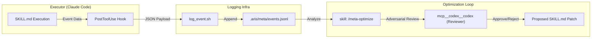

<!-- source: DeepWiki mcp.deepwiki.com · repo wanshuiyin/Auto-claude-code-research-in-sleep · page 9 Glossary · fetched 2026-10-26 -->

# Glossary

Relevant source files

The following files were used as context for generating this wiki page:

- [AGENT_GUIDE.md](AGENT_GUIDE.md)
- [README.md](README.md)
- [README_CN.md](README_CN.md)
- [docs/ARIS_INTRO.html](docs/ARIS_INTRO.html)
- [docs/ARIS_INTRO.md](docs/ARIS_INTRO.md)
- [docs/SKILLS_CATALOG.md](docs/SKILLS_CATALOG.md)
- [skills/auto-paper-improvement-loop/SKILL.md](skills/auto-paper-improvement-loop/SKILL.md)
- [skills/auto-review-loop/SKILL.md](skills/auto-review-loop/SKILL.md)
- [skills/paper-write/SKILL.md](skills/paper-write/SKILL.md)
- [skills/paper-writing/SKILL.md](skills/paper-writing/SKILL.md)
- [skills/shared-references/assurance-contract.md](skills/shared-references/assurance-contract.md)
- [skills/shared-references/effort-contract.md](skills/shared-references/effort-contract.md)
- [skills/shared-references/integration-contract.md](skills/shared-references/integration-contract.md)
- [skills/shared-references/review-tracing.md](skills/shared-references/review-tracing.md)
- [skills/shared-references/reviewer-routing.md](skills/shared-references/reviewer-routing.md)
- [skills/skills-codex/README.md](skills/skills-codex/README.md)
- [skills/skills-codex/README_CN.md](skills/skills-codex/README_CN.md)
- [skills/skills-codex/shared-references/acceptance-gate.md](skills/skills-codex/shared-references/acceptance-gate.md)
- [skills/skills-codex/shared-references/assurance-contract.md](skills/skills-codex/shared-references/assurance-contract.md)
- [skills/skills-codex/shared-references/effort-contract.md](skills/skills-codex/shared-references/effort-contract.md)
- [skills/skills-codex/shared-references/integration-contract.md](skills/skills-codex/shared-references/integration-contract.md)
- [skills/skills-codex/shared-references/review-tracing.md](skills/skills-codex/shared-references/review-tracing.md)
- [skills/skills-codex/shared-references/reviewer-routing.md](skills/skills-codex/shared-references/reviewer-routing.md)
- [tests/test_copilot_install.py](tests/test_copilot_install.py)
- [tests/test_review_gate.py](tests/test_review_gate.py)
- [tests/test_verify_paper_audits.py](tests/test_verify_paper_audits.py)
- [tools/review_gate.py](tools/review_gate.py)
- [tools/save_trace.sh](tools/save_trace.sh)
- [tools/verify_paper_audits.sh](tools/verify_paper_audits.sh)

This page provides a comprehensive reference for terms, jargon, and domain-specific concepts used within the **ARIS (Auto-claude-code-research-in-sleep)** codebase. It is designed to assist onboarding engineers in mapping natural language research concepts to their technical implementations.

## Core Architectural Roles

### Executor vs. Reviewer
The fundamental design pattern of ARIS is the **Cross-Model Collaboration** between two distinct LLM roles to avoid the "local minima" of self-play [README.md:28-29]().
*   **Executor:** Usually **Claude Code**. Responsible for file I/O, writing experiment scripts, executing shell commands, and collecting results [AGENT_GUIDE.md:5]().
*   **Reviewer:** Usually **GPT-6-Astra** (via Codex MCP). Responsible for critical evaluation, scoring, and identifying weaknesses [skills/auto-review-loop/SKILL.md:28]().
*   **Implementation:** Skills invoke the reviewer using `mcp__codex__codex` or `mcp__codex__codex-reply` [skills/auto-review-loop/SKILL.md:5]().

### Research Contract
A document (usually `research_contract.md`) that defines the "ground truth" for a project, including the anchored problem, method thesis, and success metrics. It prevents "scope drift" during autonomous iterations [README.md:24]().

---

## State & Execution Control

### AUTO_PROCEED
A boolean constant (default: `true`) that determines if a workflow should automatically move past a **Human Checkpoint** [skills/paper-writing/SKILL.md:30]().
*   **True:** The loop runs fully autonomously without pausing for approval [skills/paper-writing/SKILL.md:30]().
*   **False:** The system presents the results (e.g., top ideas) and waits for explicit user confirmation before proceeding to expensive implementation stages [AGENT_GUIDE.md:58]().

### Compact Mode
An execution mode (`— compact: true`) designed for short-context models or session recovery. It uses lean summary files like `EXPERIMENT_LOG.md` and `findings.md` instead of full logs to save context window space [skills/auto-review-loop/SKILL.md:32-33]().

### REVIEW_STATE.json
The primary persistence file for the `auto-review-loop`. It stores the current round, `threadId`, and pending experiment statuses to allow recovery after context window compaction or system crashes [skills/auto-review-loop/SKILL.md:10]().

### threadId & jobId
*   **threadId:** A UUID used by MCP servers (like Codex) to maintain conversation context across multiple turns [skills/auto-review-loop/SKILL.md:12]().
*   **jobId:** A unique identifier used in asynchronous task tracking or multi-agent orchestration.

### Pipeline Status
A dashboard-dash section in `CLAUDE.md` that tracks the current state of the end-to-end research pipeline across different sessions [README_CN.md:19]().

---

## Research Domain Concepts

### Claims-Evidence Matrix
A structured mapping used in paper generation that ensures every scientific claim is backed by specific experimental evidence (metrics, figures) [skills/paper-write/SKILL.md:22]().

### Novelty Score
A 1-10 metric generated during the novelty check phase. It involves searching literature and using the Reviewer to determine the "delta" between the proposed idea and existing work.

### Problem Anchor
A fixed definition of the research problem that prevents the LLM from "moving the goalposts" (changing the research question to fit convenient results).

### Pilot Experiment
A "cheap" version of an experiment (e.g., limited GPU hours) run during `idea-discovery` to get empirical signal before committing full resources.

### De-AI Polish
A refinement step in the paper writing pipeline that removes common LLM-isms and "vague-speak" to make the prose more academic.

---

## Advanced Subsystems

### Research Wiki
A persistent knowledge graph (Papers, Ideas, Experiments, Claims) that prevents repeating failed experiments across sessions [README.md:28]().
*   **Spiral Learning:** The process where the wiki compounds knowledge, making the system smarter over time.
*   **Query Pack:** A compressed context file (`query_pack.md`) used to ground the `idea-creator`.

### Meta-Optimize
An "outer-loop" optimization skill that analyzes usage logs and proposes improvements to the SKILL.md files.
*   **Check Ready:** A trigger script (`check_ready.sh`) that notifies the user when enough data has accumulated to perform meta-optimization.

### Rebuttal Workflow
A specialized pipeline for responding to external conference reviews by atomizing concerns and building a grounded strategy.
*   **Atomized Issues:** Breaking down complex reviews into individual, trackable concerns in an `ISSUE_BOARD.md`.
*   **Swing Reviewer:** A reviewer whose stance is borderline; the rebuttal strategy often prioritizes converting these reviewers.
*   **PASTE_READY.txt:** The final, character-count-compliant output of the rebuttal workflow [AGENT_GUIDE.md:92]().

### Watchdog
A daemon (`watchdog.py`) that runs on GPU servers to monitor background training and detect anomalies like `DEAD` or `STALLED` experiments.

---

## Assurance & Audit Chain

ARIS gates submission via a 5-layer cross-model audit chain. Each layer uses **fresh codex threads** [AGENT_GUIDE.md:99]().

### Assurance Axis
Controls audit strictness via `— assurance: <level>` (draft, polished, conference-ready, submission) [AGENT_GUIDE.md:49]().

### Specific Audits
*   **Experiment Audit:** Detects agentic fraud (e.g., fake GT, self-normalized scores) [AGENT_GUIDE.md:104]().
*   **Result-to-Claim:** Judges if the claim scientifically follows from the results.
*   **Paper Claim Audit:** Zero-context verification of numerical reporting [AGENT_GUIDE.md:106]().
*   **Citation Audit:** Verifies every `\cite{}` for existence, metadata, and context-appropriateness [AGENT_GUIDE.md:107]().
*   **Kill-Argument:** An adversarial rejection memo used to stress-test the paper [AGENT_GUIDE.md:108]().

---

## Technical Mapping Diagrams

### Logic Flow: From Research Goal to Code Entities
This diagram maps high-level research objectives to the specific skills and state files that implement them.

Title: Objective to Code Mapping

```mermaid
graph TD
    subgraph "Research Objective"
        direction LR
        OBJ1["Find Novel Idea"] --> OBJ2["Run GPU Experiments"]
        OBJ2 --> OBJ3["Iterative Review"]
    end

    subgraph "Code Entities (ARIS)"
        direction TB
        SK1["skill: /idea-discovery"]
        SK2["skill: /experiment-bridge"]
        SK3["skill: /auto-review-loop"]

        STATE1["query_pack.md"]
        STATE2["EXPERIMENT_LOG.md"]
        STATE3["REVIEW_STATE.json"]

        SK1 -.-> STATE1
        STATE1 --> SK2
        SK2 -.-> STATE2
        STATE2 --> SK3
        SK3 -.-> STATE3
    end

    OBJ1 === SK1
    OBJ2 === SK2
    OBJ3 === SK3
```

**Sources:** [AGENT_GUIDE.md:87-91]()

### System Data Flow: Meta-Optimization Data Flow
This diagram shows how passive logging feeds into the self-improvement (Meta-Optimize) cycle.

Title: Meta-Optimization Data Flow

**Sources:** [skills/shared-references/review-tracing.md:1-10](), [tools/save_trace.sh:1-10]()

---

## Terminology Reference Table

| Term | Code Pointer | Definition |
| :--- | :--- | :--- |
| **SKILL.md** | [AGENT_GUIDE.md:10](), [skills/auto-review-loop/SKILL.md:1-6]() | The Markdown file defining an ARIS skill, including its name, description, arguments, and allowed tools. |
| **MCP** | [AGENT_GUIDE.md:5]() | **Multi-Context Proxy** server. A local server that acts as a bridge between the ARIS executor and external LLM APIs (e.g., Codex, Claude, Gemini). |
| **Executor** | [AGENT_GUIDE.md:5]() | The LLM (e.g., Claude Code, Copilot CLI) responsible for generating code, executing tasks, and driving the workflow. |
| **Reviewer** | [AGENT_GUIDE.md:5]() | The independent LLM (e.g., GPT-6-Astra via Codex MCP) responsible for critically evaluating the Executor's output. |
| **AUTO_PROCEED** | [skills/paper-writing/SKILL.md:30]() | A boolean constant that, when `true`, allows workflows to automatically proceed past human checkpoints. |
| **Positive Threshold** | [skills/auto-review-loop/SKILL.md:26]() | The score and verdict criteria (e.g., `score >= 6/10 AND verdict ∈ {"ready", "almost"}`) that must be met for a review loop to terminate successfully. |
| **Reviewer Memory** | [skills/auto-review-loop/SKILL.md:35]() | A feature in `hard` difficulty where the reviewer tracks its own suspicions across rounds, preventing repeated issues. |
| **Acquittal Log** | | A log of reviews where the reviewer has given a positive assessment, indicating that issues have been resolved. |
| **Evidence Gate** | [AGENT_GUIDE.md:5]() | A mechanism, particularly in `copilot-native` reviews, that requires verifiable evidence (e.g., successful subagent lifecycle, different model families) before accepting a verdict. |
| **Provisional vs. Accepted** | [AGENT_GUIDE.md:24-25]() | `provisional` status is given to reviews by same-family models (e.g., Codex self-review); `accepted` requires cross-model verification. |
| **Problem Anchor** | | A fixed definition of the research problem to prevent scope drift. |
| **Complexity Budget** | | A constraint on the computational or intellectual resources allocated to a task, often managed by the `effort` axis. |
| **Query Pack** | | A compressed context file (`query_pack.md`) used to provide focused information to skills like `idea-creator`. |
| **Spiral Learning** | [README.md:28]() | The process by which the Research Wiki continuously accumulates and refines knowledge, making the system more effective over time. |
| **Edit Whitelist** | [skills/auto-paper-improvement-loop/SKILL.md:36](), [AGENT_GUIDE.md:71]() | A YAML/JSON file that constrains which paths and operations the fix-implementation step is allowed to modify, used for enforcing specific editing policies (e.g., text-only changes). |
| **Soft-Only Mode** | [AGENT_GUIDE.md:72]() | A mode in `/citation-audit` where BibTeX entries are frozen, and any required changes are implemented as body text edits instead of modifying the `.bib` file. |
| **Kill-Argument** | [AGENT_GUIDE.md:108]() | An adversarial audit skill that generates the strongest possible rejection memo for a paper and then adjudicates its points. |
| **Zero-Context Reviewer** | [AGENT_GUIDE.md:106]() | A reviewer that evaluates an artifact (e.g., paper claims) without any prior context from the executor or other parts of the workflow, ensuring independence. |
| **Assurance/Effort Axis** | [AGENT_GUIDE.md:39-49]() | Two independent control axes: `effort` (depth/budget) and `assurance` (audit strictness). |
| **Manifest** | [tests/test_copilot_install.py:98]() | A file (e.g., `.aris/installed-skills-copilot.txt`) that lists installed skills and their properties, used for tracking and reconciliation. |
| **Declined List** | | A list of skills or updates that have been explicitly rejected during installation or update processes. |
| **Safety Rules S1-S14** | | A set of safety rules governing the installation and update process, ensuring system integrity and preventing unintended modifications. |
| **Harness Diet** | | The specific set of tools, skills, and configurations that define a particular ARIS harness setup. |
| **Read-Only Producer** | | A component or skill that generates output but does not modify existing files or state, often used for reporting or analysis. |
| **Run ID** | [skills/shared-references/review-tracing.md:24]() | A unique identifier for a specific execution run of an ARIS workflow, used for tracing and organizing artifacts. |
| **Trace** | [skills/shared-references/review-tracing.md:1-10]() | A record of prompt/response pairs for every cross-model reviewer call, used for auditing, reproducibility, and meta-optimization. |
| **Watchdog** | | A daemon (`watchdog.py`) that monitors background processes (e.g., GPU experiments) and detects anomalies. |
| **SKILLS_CATALOG.md** | [AGENT_GUIDE.md:27]() | A comprehensive list of all available ARIS skills, grouped by role. |
| **HERO** | [README.md:24]() | **H**ashing, **E**dge cases, **R**ubrics, **O**verbuild – a contract to prevent agents from over-defending in their proposals. |
| **ARIS-Monitor** | [README_CN.md:74]() | A macOS desktop widget that provides a read-only view of Claude Code sessions and highlights those requiring human approval. |
| **Reviewer Routing** | [skills/shared-references/reviewer-routing.md:1-11]() | The mechanism that determines which reviewer backend (e.g., `copilot-native`, `codex`, `manual`) is used for a given review task. |
| **Reasoning-Effort Tiers** | [skills/shared-references/reviewer-routing.md:31-44]() | Different levels of computational effort (`ultra`, `xhigh`) applied by the Codex MCP reviewer, depending on the criticality of the task. |
| **Reviewer Independence Protocol** | [skills/auto-paper-improvement-loop/SKILL.md:82]() | A strict rule ensuring that reviewers only see the artifact and the user's prompt, preventing contamination from author-side context. |
| **Integration Contract** | [skills/shared-references/integration-contract.md:1-6]() | A formal document outlining the requirements for robust cross-skill integrations within ARIS, ensuring reliability and observability. |
| **Canonical Helper** | [skills/shared-references/integration-contract.md:48]() | A single, authoritative script (usually in `tools/`) that implements specific business logic, invoked by all callers via a standardized resolution chain. |
| **Run.meta.json** | [skills/shared-references/review-tracing.md:138-143]() | A metadata file within a trace directory that captures run-level information such as the skill, run ID, start time, and executor. |
| **ARIS-Code** | [README.md:11]() | The standalone CLI version of ARIS, offering the full experience outside of specific IDEs. |
| **DeepSeek Harness** | [README.md:13]() | An environment where ARIS can be installed as a plugin, with Codex still serving as the independent reviewer. |
| **ARIS-Movie-Director** | [README.md:27]() | A multimodal ARIS application that generates movies from story briefs, using cross-model checks for each frame. |
| **ARIS-in-AI-Offer** | [README.md:54]() | A project leveraging ARIS to generate bilingual ML/LLM/multimodal/Agent interview cheat sheets. |
| **`--style-ref`** | [skills/paper-writing/SKILL.md:47](), [skills/auto-paper-improvement-loop/SKILL.md:40](), [skills/paper-write/SKILL.md:41]() | An optional argument to writer-side skills that allows the user to steer structural style (e.g., section ordering, sentence cadence) toward a reference paper without copying prose. |
| **`DATA_NEEDED` markers** | [skills/paper-write/SKILL.md:93]() | HTML comment placeholders inserted into LaTeX output when `GAP_REPORT.md` indicates missing content, making it searchable for human triage or follow-up. |

**Sources:** [README.md:1-66](), [README_CN.md:1-81](), [skills/auto-review-loop/SKILL.md:1-80](), [skills/paper-writing/SKILL.md:1-113](), [skills/auto-paper-improvement-loop/SKILL.md:1-91](), [skills/paper-write/SKILL.md:1-100](), [skills/shared-references/reviewer-routing.md:1-89](), [AGENT_GUIDE.md:1-113](), [skills/shared-references/integration-contract.md:1-146](), [tests/test_copilot_install.py:1-189](), [skills/shared-references/review-tracing.md:1-143](), [docs/ARIS_INTRO.html:1-240]()