# Page: Overview

# Overview

<details>
<summary>Relevant source files</summary>

The following files were used as context for generating this wiki page:

- [AGENT_GUIDE.md](AGENT_GUIDE.md)
- [README.md](README.md)
- [README_CN.md](README_CN.md)
- [docs/ARIS_INTRO.html](docs/ARIS_INTRO.html)
- [docs/ARIS_INTRO.md](docs/ARIS_INTRO.md)
- [docs/SKILLS_CATALOG.md](docs/SKILLS_CATALOG.md)
- [skills/auto-paper-improvement-loop/SKILL.md](skills/auto-paper-improvement-loop/SKILL.md)
- [skills/paper-write/SKILL.md](skills/paper-write/SKILL.md)
- [skills/paper-writing/SKILL.md](skills/paper-writing/SKILL.md)
- [skills/skills-codex/README.md](skills/skills-codex/README.md)
- [skills/skills-codex/README_CN.md](skills/skills-codex/README_CN.md)

</details>


ARIS (Auto-claude-code-research-in-sleep) is an autonomous machine learning research workflow automation system built on top of [Claude Code](https://docs.anthropic.com/en/docs/claude-code) and compatible agent environments [README.md:1-12](). It orchestrates complete research lifecycles—ranging from literature surveying and hypothesis generation to iterative experimentation, paper drafting, rebuttals, and presentation design—using a **cross-model collaboration** architecture where an executor model (such as Claude Code) and an adversarial reviewer model (such as GPT-6-Astra via Codex MCP) operate together to eliminate single-model blind spots [AGENT_GUIDE.md:5-11]().

## What Problem Does ARIS Solve?

Machine learning research is bottlenecked by repetitive, highly integrated tasks that interrupt deep reasoning: literature gathering across disparate databases, hypothesis validation, debugging code on remote GPUs, writing LaTeX manuscripts, and responding to reviews under tight deadlines [README.md:1-29](). ARIS automates these steps while maintaining strict human-in-the-loop checkpoints and deterministic audit gates [AGENT_GUIDE.md:57-64]().

Key friction points addressed by the framework include:
- **Literature Review & Sourcing**: Querying and synthesizing papers across Zotero, Obsidian, arXiv, Semantic Scholar, DeepXiv, and Exa search [docs/SKILLS_CATALOG.md:48-61]().
- **Idea Discovery & Novelty Filtering**: Automated screening of research directions against existing literature databases to prune unviable ideas early [skills/idea-discovery/SKILL.md:8-25]().
- **Iterative Experimentation & Review**: Autonomous review-fix-recompile loops that refine codebases and narrative reports [skills/auto-paper-improvement-loop/SKILL.md:1-28]().
- **Paper Generation**: Section-by-section LaTeX drafting tailored to venue-specific templates (ICLR, NeurIPS, ICML, CVPR, etc.) with integrated figure and bibliography management [skills/paper-write/SKILL.md:12-26]().
- **Assurance & Verification**: Multi-layer audit chains (`/experiment-audit`, `/result-to-claim`, `/paper-claim-audit`, `/citation-audit`, `/kill-argument`) that ensure empirical integrity and citation validity [AGENT_GUIDE.md:98-112]().

**Key design principle**: Homogeneous agent self-review typically leads to sycophantic acceptance and local minima [README.md:43-45](). ARIS enforces cross-family divergence: the executor writes code and text, while an independent reviewer challenges assumptions using fresh conversation threads [AGENT_GUIDE.md:5-11]().

Sources: [README.md:1-29](), [AGENT_GUIDE.md:5-11](), [docs/SKILLS_CATALOG.md:48-61]()

## High-Level Architecture

The ARIS architecture bridges high-level natural language intent with concrete code execution entities and persistence layers. 

**Diagram: ARIS Cross-Model Collaboration & Code Entity Architecture**

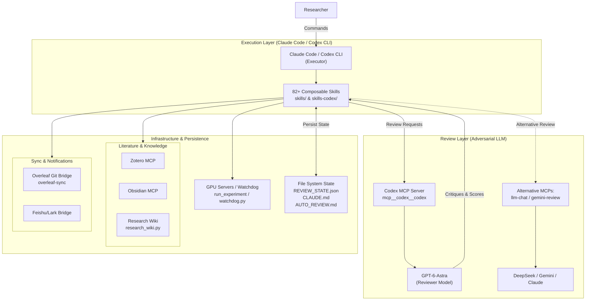

**Core architectural invariants:**
1. **Executor-Reviewer Separation**: The executor model (`Claude Code` / `Codex CLI`) never audits its own artifacts. Review tasks are delegated via `mcp__codex__codex` or equivalent bridge tools [AGENT_GUIDE.md:5-11]().
2. **Skill-Based Composability**: Over 82 atomic and orchestrator skills (`skills/<name>/SKILL.md`) provide modular building blocks [docs/SKILLS_CATALOG.md:1-17]().
3. **Assurance Chain**: Dedicated audit scripts and validators (`verify_paper_audits.sh`, `assurance-contract.md`) gate submission-ready states [AGENT_GUIDE.md:98-112]().
4. **Resilient State Persistence**: Run states are checkpointed in files like `REVIEW_STATE.json` and tracked via the `CLAUDE.md` pipeline status section, allowing seamless recovery across context compactions [AGENT_GUIDE.md:80-90]().

Sources: [README.md:31-50](), [AGENT_GUIDE.md:5-21](), [docs/SKILLS_CATALOG.md:1-17]()

## The Six Main Workflows

ARIS organizes complex automation into six core sequential workflows (W1 through W6) alongside overarching integration orchestrators like `/research-pipeline` [AGENT_GUIDE.md:79-97]().

**Diagram: End-to-End Research Pipeline (W1-W6 Code Entry Points)**

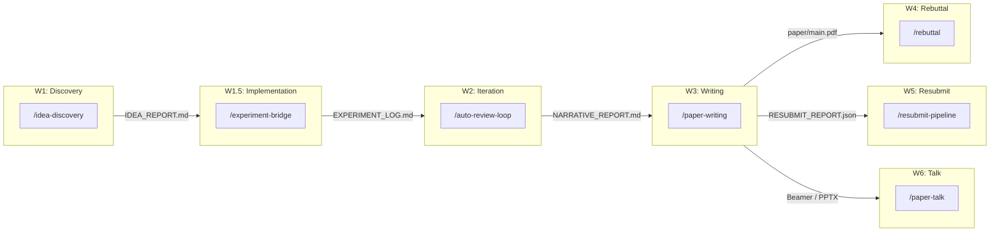

1. **Workflow 1: Idea Discovery** (`/idea-discovery`): Performs multi-source literature reviews, generates candidate ideas, checks novelty against arXiv/DBLP, and runs pilot experiments [docs/SKILLS_CATALOG.md:27-31]().
2. **Workflow 1.5: Experiment Bridge** (`/experiment-bridge`): Translates `EXPERIMENT_PLAN.md` into executable code, performs cross-model code review, and deploys tasks to local or remote GPU resources [docs/SKILLS_CATALOG.md:27-31]().
3. **Workflow 2: Auto Review Loop** (`/auto-review-loop`): Iteratively executes autonomous review-fix cycles until score thresholds or maximum rounds are met [docs/SKILLS_CATALOG.md:27-31]().
4. **Workflow 3: Paper Writing** (`/paper-writing`): Orchestrates outline generation, figure plotting, LaTeX section compilation, and multi-round polishing (`/auto-paper-improvement-loop`) [skills/paper-writing/SKILL.md:12-22]().
5. **Workflow 4: Rebuttal Pipeline** (`/rebuttal`): Parses external reviews, atomizes critique points, structures response strategies, and produces paste-ready responses [docs/SKILLS_CATALOG.md:31-38]().
6. **Workflow 5 & 6: Resubmission & Talks** (`/resubmit-pipeline`, `/paper-talk`): Ports polished papers to alternative venues under strict isolation rules or generates conference slides, Beamer files, and speaker notes [docs/SKILLS_CATALOG.md:31-38]().

Sources: [AGENT_GUIDE.md:79-97](), [docs/SKILLS_CATALOG.md:21-43](), [skills/paper-writing/SKILL.md:12-22]()

## Navigation to Child Pages

For detailed specifications and technical documentation, refer to the following child pages:

- **Quick Start** ([#1.1]()) — Installation instructions, Codex MCP and LaTeX toolchain setup, minimal working examples, and AGENT_GUIDE.md routing index.
- **Core Concepts** ([#1.2]()) — Composable skill structure, workflows vs. atomic skills, cross-model collaboration, human-in-the-loop checkpoints, and assurance/effort axes.
- **System Design Philosophy** ([#1.3]()) — Rationale for cross-family collaboration over self-play, executor/reviewer separation protocol, and the 5-layer assurance chain.

Sources: [README.md:11-15](), [AGENT_GUIDE.md:1-11]()

---

# Page: Quick Start

# Quick Start

<details>
<summary>Relevant source files</summary>

The following files were used as context for generating this wiki page:

- [AGENT_GUIDE.md](AGENT_GUIDE.md)
- [SETUP_GUIDE.md](SETUP_GUIDE.md)
- [SETUP_GUIDE_CN.md](SETUP_GUIDE_CN.md)
- [docs/ARIS_INTRO.html](docs/ARIS_INTRO.html)
- [docs/ARIS_INTRO.md](docs/ARIS_INTRO.md)
- [docs/SKILLS_CATALOG.md](docs/SKILLS_CATALOG.md)
- [skills/skills-codex/README.md](skills/skills-codex/README.md)
- [skills/skills-codex/README_CN.md](skills/skills-codex/README_CN.md)
- [tests/test_skill_picker.py](tests/test_skill_picker.py)
- [tools/skill_picker.py](tools/skill_picker.py)

</details>


## Purpose and Scope

This page provides installation instructions, basic setup configuration for external components (such as Codex MCP and LaTeX), a minimal working example of the ARIS (Auto-claude-code-research-in-sleep) workflow, and an overview of the `AGENT_GUIDE.md` routing index [AGENT_GUIDE.md:1-12](), [SETUP_GUIDE.md:1-10](). 

ARIS is a research harness of composable Markdown skills that orchestrate the ML research lifecycle via cross-model adversarial collaboration [AGENT_GUIDE.md:1-6](). This guide serves as the entry point for setting up your environment, installing skills selectively or globally, registering reviewer backends, and launching your first automated research run.

---

## Prerequisites

Before running ARIS, ensure your environment satisfies the core runtime and dependency requirements:

| Component | Purpose | Verification Command |
|-----------|---------|---------------------|
| [Claude Code](https://docs.anthropic.com/en/docs/claude-code) | Core executor & skill orchestrator | `claude --version` [SETUP_GUIDE.md:17-19]() |
| [Codex CLI](https://developers.openai.com/codex) | Primary reviewer transport (GPT) | `codex --version` [SETUP_GUIDE.md:28-29]() |
| Node.js & npm | MCP server runtime support | `node -v && npm -v` |
| LaTeX Toolchain (TeX Live / MacTeX) | Required for Workflow 3 (Paper generation) | `latexmk --version && pdfinfo -v` [SETUP_GUIDE.md:55-56]() |
| Git | Project initialization & tracking | `git --version` [SETUP_GUIDE.md:64]() |

Sources: [SETUP_GUIDE.md:11-58](), [docs/SKILLS_CATALOG.md:25-43]()

---

## Installation & Setup Architecture

### System Integration Diagram
The following diagram illustrates how the ARIS repository interacts with your local workspace, Claude Code, and external model APIs through the Model Context Protocol (MCP) layer.

```mermaid
graph TB
    subgraph "LocalWorkstation"
        [User] -->|"1. git clone"| [ProjectDir]
        [User] -->|"2. bash install_aris.sh"| [InstallerScript]
        [InstallerScript] -->|"Symlinks SKILL.md"| [SkillDir]
        [ClaudeCodeCLI] -->|"Discovers Skills"| [SkillDir]
        [ClaudeCodeCLI] -->|"Persists State"| [ProjectDir]
    end

    subgraph "MCPInfrastructure"
        [CodexMCP] -->|"Registered via cli"| [SettingsJSON]
    end

    subgraph "ExternalIntelligence"
        [ClaudeCodeCLI] -->|"Native Execution"| [AnthropicAPI]
        [ClaudeCodeCLI] -->|"Review Request"| [CodexMCP]
        [CodexMCP] -->|"Adversarial Review"| [OpenAIAPI]
    end

    [SkillDir] -- "~/.claude/skills/"
    [ProjectDir] -- "CLAUDE.md, IDEA_REPORT.md"
    [SettingsJSON] -- "~/.claude/settings.json"
    [AnthropicAPI] -- "Claude 3.7 Sonnet"
    [OpenAIAPI] -- "GPT-5.5 / o3"
```
Sources: [SETUP_GUIDE.md:73-104](), [AGENT_GUIDE.md:5-10]()

### Step 1: Clone and Install Skills
ARIS uses a flat-symlink installation strategy via `tools/install_aris.sh` to ensure Claude Code discovers all skills properly [SETUP_GUIDE.md:73-84]().

```bash
# Clone ARIS to a stable local directory
git clone https://github.com/wanshuiyin/Auto-claude-code-research-in-sleep.git ~/aris_repo

# Navigate to your research project
cd ~/your-paper-project
git init
touch CLAUDE.md

# Run the installer (interactive picker if run without group flags in terminal)
bash ~/aris_repo/tools/install_aris.sh
```

For selective installation or automated scripts, you can specify groups or individual skills [SETUP_GUIDE.md:85-88]() using [tools/skill_picker.py:33-49]():
```bash
bash ~/aris_repo/tools/install_aris.sh --list-groups                  # View available groups
bash ~/aris_repo/tools/install_aris.sh --groups paper-core,lit-search # Install by group
bash ~/aris_repo/tools/install_aris.sh --skills paper-writing         # Install by skill (deps auto-included)
```

Sources: [SETUP_GUIDE.md:73-104](), [tools/skill_picker.py:33-49]()

### Step 2: Configure Codex MCP & Reviewer Backends
ARIS relies on an **Executor-Reviewer** pattern [AGENT_GUIDE.md:5-6](). Register Codex MCP so Claude Code can query OpenAI models for adversarial review:

```bash
codex login       # Authenticate with ChatGPT (one-time)
claude mcp add codex -s user -- codex mcp-server
```

Restart Claude Code after registration and verify connection [SETUP_GUIDE.md:37-42]():
```bash
claude mcp list | grep codex
# Expected: codex: codex mcp-server - ✓ Connected
```

Depending on your model pairing, you can register alternative reviewers (e.g., `claude-review`, `gemini-review`, `llm-chat`, `minimax-chat`, or `manual-review`) [SETUP_GUIDE.md:120-135]().

Sources: [SETUP_GUIDE.md:21-45](), [AGENT_GUIDE.md:5-12]()

---

## Minimal Working Example: The 3-Step Pipeline

Users execute ARIS workflows using high-level orchestrator skills documented in `AGENT_GUIDE.md` [AGENT_GUIDE.md:79-95]().

### 1. Idea Discovery (Workflow 1)
Generate and screen research ideas from a broad topic:
```bash
claude
> /idea-discovery "Optimizing Transformer KV cache for long-context retrieval"
```
* **Execution Flow:** Surveys literature (`/research-lit`), brainstorms candidates (`/idea-creator`), verifies novelty (`/novelty-check`), and outputs `IDEA_REPORT.md` and `EXPERIMENT_PLAN.md` [AGENT_GUIDE.md:86-88]().

### 2. Autonomous Review Loop (Workflow 2)
Run implementation, multi-round critique, and remediation:
```bash
> /auto-review-loop "KV cache optimization" -- difficulty: hard
```
* **Execution Flow:** Executes experiment code, submits findings to GPT via Codex MCP for adversarial critique, and iteratively refines until score thresholds are met [AGENT_GUIDE.md:89-91]().

### 3. Paper Writing (Workflow 3)
Compile results into a conference-ready LaTeX manuscript:
```bash
> /paper-writing "NARRATIVE_REPORT.md"
```
* **Execution Flow:** Builds claims-evidence matrices, generates figures, writes LaTeX sections targeting venues like ICLR or NeurIPS, and runs assurance audits [AGENT_GUIDE.md:91-92]().

Sources: [AGENT_GUIDE.md:79-95](), [docs/SKILLS_CATALOG.md:25-43]()

---

## Natural Language Space to Code Entity Space Mapping

To navigate ARIS effectively, it helps to map high-level research objectives directly to underlying ARIS code entities (skills, state files, and MCP tools).

### Mapping Diagram 1: High-Level Goals to Orchestrator Skills & State Files
```mermaid
graph LR
    subgraph "NaturalLanguageSpace"
        [Goal1] -- "Discover Novel Ideas"
        [Goal2] -- "Automated Review Loop"
        [Goal3] -- "Write Research Paper"
        [Goal4] -- "Cross-Model Rebuttal"
    end

    subgraph "CodeEntitySpace"
        [Skill1] -- "/idea-discovery"
        [Skill2] -- "/auto-review-loop"
        [Skill3] -- "/paper-writing"
        [Skill4] -- "/rebuttal"
        
        [State1] -- "IDEA_REPORT.md"
        [State2] -- "REVIEW_STATE.json"
        [State3] -- "paper/main.pdf"
        [State4] -- "PASTE_READY.txt"
    end

    [Goal1] -.-> [Skill1]
    [Skill1] --> [State1]
    [Goal2] -.-> [Skill2]
    [Skill2] --> [State2]
    [Goal3] -.-> [Skill3]
    [Skill3] --> [State3]
    [Goal4] -.-> [Skill4]
    [Skill4] --> [State4]
```
Sources: [AGENT_GUIDE.md:86-95](), [docs/SKILLS_CATALOG.md:25-43]()

### Mapping Diagram 2: Execution Engine to MCP and Review Transport
```mermaid
graph TB
    subgraph "NaturalLanguageSpace"
        [UserRequest] -- "Run Audit & Critique"
    end

    subgraph "CodeEntitySpace"
        [ExecutorEngine] -- "Claude Code CLI"
        [ReviewTransport] -- "Codex MCP Server"
        [DeterministicBackbone] -- "tools/review_gate.py"
        [VerificationLogs] -- ".aris/traces/"
    end

    [UserRequest] --> [ExecutorEngine]
    [ExecutorEngine] -->|"mcp__codex__codex"| [ReviewTransport]
    [ReviewTransport] -->|"Adversarial Payload"| [DeterministicBackbone]
    [DeterministicBackbone] --> [VerificationLogs]
```
Sources: [AGENT_GUIDE.md:5-12](), [SETUP_GUIDE.md:120-135]()

---

## AGENT_GUIDE.md Routing Index & Control Axes

`AGENT_GUIDE.md` acts as the primary routing index for AI agents and developers. ARIS behavior is modulated via **two independent control axes** [AGENT_GUIDE.md:34-52]():

1. **Axis 1 — `effort` (Depth / Budget):**
   ```bash
   --- effort: lite | balanced | max | beast     # Default: balanced
   ```
   Controls iteration counts, pilot budgets, and review depth [AGENT_GUIDE.md:38-44]().

2. **Axis 2 — `assurance` (Audit Strictness):**
   ```bash
   --- assurance: draft | polished | conference-ready | submission
   ```
   Controls which mandatory verification gates (e.g., experiment audit, citation audit, kill argument) gate final publication [AGENT_GUIDE.md:46-52]().

### Workflow Routing Summary Table

| ID | Skill | Input | Output | When to Invoke |
|:---:|-------|-------|--------|----------------|
| **W1** | `/idea-discovery` | Research direction | `IDEA_REPORT.md`, `EXPERIMENT_PLAN.md` | Starting new research [AGENT_GUIDE.md:86-88]() |
| **W1.5** | `/experiment-bridge` | `EXPERIMENT_PLAN.md` | Running code, `EXPERIMENT_LOG.md` | Implementing a validated plan [AGENT_GUIDE.md:89]() |
| **W2** | `/auto-review-loop` | Paper + results | Improved paper + `REVIEW_STATE.json` | Iterative optimization [AGENT_GUIDE.md:90]() |
| **W3** | `/paper-writing` | Narrative report | `paper/main.pdf` + LaTeX source | Manuscript generation [AGENT_GUIDE.md:91]() |
| **W4** | `/rebuttal` | Paper + reviews | `PASTE_READY.txt` + response draft | Handling external reviews [AGENT_GUIDE.md:92]() |

Sources: [AGENT_GUIDE.md:79-95]()

---

## Auto-Allow Configuration for Overnight Runs

To enable unattended execution during overnight runs without pausing for interactive permission prompts, configure `~/.claude/settings.local.json` [SETUP_GUIDE.md:1-5]() / [AGENT_GUIDE.md:5-12]():

```json
{
  "permissions": {
    "allow": [
      "mcp__codex__codex",
      "mcp__codex__codex-reply",
      "Write",
      "Edit",
      "Bash(*)",
      "Skill(auto-review-loop)",
      "Skill(research-pipeline)"
    ]
  }
}
```
Sources: [AGENT_GUIDE.md:5-12](), [SETUP_GUIDE.md:1-10]()

---

## Summary Checklist

1. **Clone & Install:** Run `git clone` and `bash tools/install_aris.sh` to link skills [SETUP_GUIDE.md:77-83]().
2. **Configure MCP:** Install Codex CLI, authenticate via `codex login`, and add the MCP server [SETUP_GUIDE.md:21-35]().
3. **Initialize Wiki:** Run `/research-wiki init` inside your project directory to set up the knowledge graph [SETUP_GUIDE.md:197-200]().
4. **Execute Pipeline:** Launch `/research-pipeline` or individual workflows with desired `effort` and `assurance` parameters [AGENT_GUIDE.md:34-82]().

Sources: [SETUP_GUIDE.md:11-203](), [AGENT_GUIDE.md:34-82]()

---

# Page: Core Concepts

# Core Concepts

<details>
<summary>Relevant source files</summary>

The following files were used as context for generating this wiki page:

- [README.md](README.md)
- [README_CN.md](README_CN.md)
- [skills/auto-paper-improvement-loop/SKILL.md](skills/auto-paper-improvement-loop/SKILL.md)
- [skills/paper-write/SKILL.md](skills/paper-write/SKILL.md)
- [skills/paper-writing/SKILL.md](skills/paper-writing/SKILL.md)
- [skills/shared-references/assurance-contract.md](skills/shared-references/assurance-contract.md)
- [skills/shared-references/effort-contract.md](skills/shared-references/effort-contract.md)
- [skills/skills-codex/shared-references/acceptance-gate.md](skills/skills-codex/shared-references/acceptance-gate.md)
- [skills/skills-codex/shared-references/assurance-contract.md](skills/skills-codex/shared-references/assurance-contract.md)
- [skills/skills-codex/shared-references/effort-contract.md](skills/skills-codex/shared-references/effort-contract.md)
- [skills/skills-codex/shared-references/review-tracing.md](skills/skills-codex/shared-references/review-tracing.md)
- [tests/test_verify_paper_audits.py](tests/test_verify_paper_audits.py)
- [tools/verify_paper_audits.sh](tools/verify_paper_audits.sh)

</details>


This page details the fundamental architectural concepts underlying ARIS (Auto-claude-code-research-in-sleep): the composable skill system, the distinction between atomic skills and orchestrator workflows, the cross-model collaboration invariant, the dual control axes (`effort` and `assurance`), human-in-the-loop checkpoints, and acceptance gate semantics.

---

## Composable Skills & File Structure

ARIS implements research automation through **skills** — self-contained prompt templates stored as Markdown files (`SKILL.md`) within structured directories [README.md:72](). Each skill defines its frontmatter metadata, execution parameters, allowed tools, and prompt instructions [skills/paper-writing/SKILL.md:1-6]().

### Skill File Anatomy

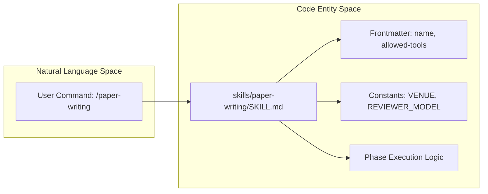

**Sources:** [README.md:72](), [skills/paper-writing/SKILL.md:1-6](), [AGENT_GUIDE.md:21]()

When a user invokes a skill like `/paper-writing` [skills/paper-writing/SKILL.md:3]() or `/auto-paper-improvement-loop` [skills/auto-paper-improvement-loop/SKILL.md:3](), the host environment parses the frontmatter `allowed-tools` (e.g., `Bash(*)`, `Read`, `Write`, `mcp__codex__codex`) to authorize tool execution [skills/paper-writing/SKILL.md:5]().

---

## Workflows vs Atomic Skills

ARIS organizes capabilities into two distinct operational classes:

### Atomic Skills
*   **Definition:** Single-purpose operational units performing a specific function.
*   **Examples:** `novelty-check` (verifying idea uniqueness against literature) [skills/shared-references/effort-contract.md:83](), `paper-compile` (invoking LaTeX compilation and error recovery) [skills/shared-references/effort-contract.md:119](), `research-lit` (fetching bibliographic entries) [skills/shared-references/effort-contract.md:78]().
*   **Characteristics:** Direct tool invocation, minimal state management, deterministic or single-turn execution.

### Orchestrator Skills (Workflows)
*   **Definition:** Higher-level pipelines that chain multiple atomic skills and manage multi-phase state transitions.
*   **Examples:** `/paper-writing` (orchestrating `/paper-plan` → `/paper-figure` → `/paper-write` → `/paper-compile` → `/auto-paper-improvement-loop`) [skills/paper-writing/SKILL.md:16-19](), `/auto-review-loop` (iterating review phases A–E), and `/research-pipeline` [README.md:94]().
*   **Characteristics:** Use the `Skill` tool to delegate subtasks, enforce pilot and compute budgets, and maintain pipeline progress [skills/paper-writing/SKILL.md:5]().

**Sources:** [skills/paper-writing/SKILL.md:14-22](), [skills/auto-paper-improvement-loop/SKILL.md:25-27](), [skills/shared-references/effort-contract.md:78-124]()

---

## Cross-Model Collaboration & Reviewer Independence

ARIS avoids single-model "self-play" loops to prevent confirmation bias and blind spots. It enforces a strict separation between the **Executor** and the **Reviewer** [README.md:43-45]().

### Executor vs. Reviewer Separation
1.  **Executor (Claude Code / Codex):** Generates code, runs experiments, drafts LaTeX prose, and implements fixes [AGENT_GUIDE.md:5]().
2.  **Reviewer (GPT-6-Astra / Gemini / Codex via MCP):** Operates in isolated context threads (`mcp__codex__codex`) to critique artifacts without author-side contextual bias [skills/paper-write/SKILL.md:14]().

### Review Tracing
Every reviewer interaction is recorded via the review tracing protocol to ensure reproducibility and auditability [skills/skills-codex/shared-references/review-tracing.md:5-10]().

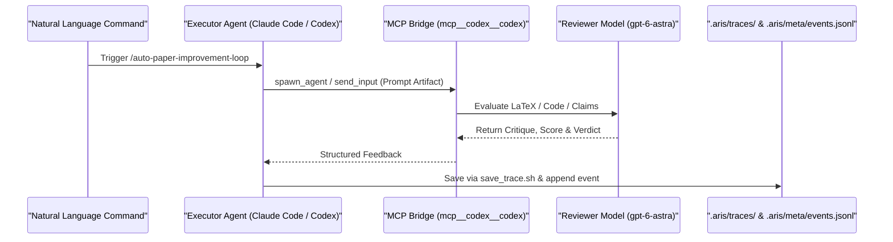

**Sources:** [skills/paper-write/SKILL.md:14](), [skills/skills-codex/shared-references/review-tracing.md:11-35](), [tools/verify_paper_audits.sh:1-40]()

---

## The Two Control Axes: Effort and Assurance

ARIS decouples operational workload scaling from audit strictness by establishing two independent axes [skills/shared-references/effort-contract.md:48-52]().

### Axis 1: Effort (Depth & Budget)
Controlled via `— effort: lite | balanced | max | beast` [skills/shared-references/effort-contract.md:10](). It scales token expenditure, search breadth, literature query counts, and pilot budgets [skills/shared-references/effort-contract.md:78-89](). It **never** lowers reviewer reasoning thresholds [skills/shared-references/effort-contract.md:15-19]().

### Axis 2: Assurance (Audit Strictness)
Controlled via `— assurance: draft | submission` [skills/shared-references/assurance-contract.md:52-55]().
*   **`draft`**: Audits run opportunistically; silent skips are permitted [skills/shared-references/assurance-contract.md:30-34]().
*   **`submission`**: Mandatory audits (`paper-claim-audit`, `citation-audit`, `proof-checker`, `kill-argument`) must emit explicit verdicts (`PASS`, `WARN`, `FAIL`, `NOT_APPLICABLE`, `BLOCKED`, `ERROR`) [skills/shared-references/assurance-contract.md:36-43](), [tools/verify_paper_audits.sh:38-44](). The external verifier script `tools/verify_paper_audits.sh` evaluates these artifacts, and any blocking verdict (`FAIL`, `BLOCKED`, `ERROR`) causes non-zero exit status to halt final submission packaging [tools/verify_paper_audits.sh:15-20]().

**Sources:** [skills/shared-references/effort-contract.md:1-55](), [skills/shared-references/assurance-contract.md:1-69](), [tools/verify_paper_audits.sh:1-44]()

---

## Human-in-the-Loop Checkpoints & Acceptance Gates

To support unattended overnight execution ("research in sleep") while maintaining safety, ARIS employs explicit checkpoints and acceptance gate classifications [skills/skills-codex/shared-references/acceptance-gate.md:1-15]().

### Acceptance Gate Types
1.  **Type-A (Execution / Objective Gates):** Machine-checkable facts (e.g., shell exit code `0`, compiled PDF existence, test suite completion) [skills/skills-codex/shared-references/acceptance-gate.md:56-75](). The executor may self-evaluate these bookkeeping metrics.
2.  **Type-B (Quality / Correctness Gates):** Semantic judgments of merit (e.g., theorem validity, claim support, paper submission-readiness) [skills/skills-codex/shared-references/acceptance-gate.md:80-97](). Base same-family reviewer passes record these as `provisional`, while accepted status requires cross-family review overlays or deterministic verifiers [skills/skills-codex/shared-references/acceptance-gate.md:82-86]().

### Human Interactivity Controls
*   **`AUTO_PROCEED = true | false`**: Determines whether orchestrators pause between phases or automatically advance after timeouts [skills/paper-writing/SKILL.md:30]().
*   **`HUMAN_CHECKPOINT = true | false`**: Forces interactive review halts in iterative loops (such as Phase 5 improvement rounds) to allow human intervention or custom modification instructions [skills/paper-writing/SKILL.md:31]().

**Sources:** [skills/paper-writing/SKILL.md:30-31](), [skills/skills-codex/shared-references/acceptance-gate.md:1-110]()

---

Data flow across ARIS orchestrators is coordinated through structured files and state persistence directories:
*   **`REVIEW_STATE.json`**: Tracks pipeline execution state across session compactions [AGENT_GUIDE.md:84]().
*   **`.aris/traces/`**: Stores raw request/response pairs for forensic inspection and prompt-trace debugging [skills/skills-codex/shared-references/review-tracing.md:35-46]().
*   **`.aris/meta/events.jsonl`**: Appends audit and trace telemetry events for outer-loop meta-optimization [skills/skills-codex/shared-references/review-tracing.md:112-118]().

**Sources:** [AGENT_GUIDE.md:84](), [skills/skills-codex/shared-references/review-tracing.md:35-118](), [skills/shared-references/assurance-contract.md:87-117]()

---

# Page: System Design Philosophy

# System Design Philosophy

<details>
<summary>Relevant source files</summary>

The following files were used as context for generating this wiki page:

- [docs/MODEL_COMBINATIONS.md](docs/MODEL_COMBINATIONS.md)
- [docs/MODEL_COMBINATIONS_CN.md](docs/MODEL_COMBINATIONS_CN.md)
- [docs/MiniMax-GLM-Configuration.md](docs/MiniMax-GLM-Configuration.md)
- [docs/aris_logo.svg](docs/aris_logo.svg)
- [docs/auto_review_score_curve.png](docs/auto_review_score_curve.png)
- [docs/hero_combined.svg](docs/hero_combined.svg)
- [docs/hero_idea.svg](docs/hero_idea.svg)
- [docs/hero_implement.svg](docs/hero_implement.svg)
- [docs/hero_interaction.svg](docs/hero_interaction.svg)
- [docs/wechat_group.jpg](docs/wechat_group.jpg)
- [skills/auto-review-loop/SKILL.md](skills/auto-review-loop/SKILL.md)
- [skills/shared-references/integration-contract.md](skills/shared-references/integration-contract.md)
- [skills/shared-references/review-tracing.md](skills/shared-references/review-tracing.md)
- [skills/shared-references/reviewer-routing.md](skills/shared-references/reviewer-routing.md)
- [skills/skills-codex-claude-review/research-refine/SKILL.md](skills/skills-codex-claude-review/research-refine/SKILL.md)
- [skills/skills-codex/shared-references/integration-contract.md](skills/skills-codex/shared-references/integration-contract.md)
- [skills/skills-codex/shared-references/reviewer-routing.md](skills/skills-codex/shared-references/reviewer-routing.md)
- [tests/test_copilot_install.py](tests/test_copilot_install.py)
- [tests/test_review_gate.py](tests/test_review_gate.py)
- [tools/review_gate.py](tools/review_gate.py)
- [tools/save_trace.sh](tools/save_trace.sh)

</details>


## Purpose and Scope

This page defines the architectural design principles of ARIS (Auto-claude-code-research-in-sleep). It details why the framework relies on cross-model collaboration instead of single-model self-play, formalizes the separation of concerns between the Executor (`Claude Code` or alternative agent implementations) and the Reviewer (`gpt-6-astra` via Codex MCP or Copilot native subagent), and specifies the mechanics of the reviewer independence protocol, the assurance chain design, and state-managed verification gates [skills/shared-references/reviewer-routing.md:1-38](), [skills/auto-review-loop/SKILL.md:1-29]().

Sources: [skills/shared-references/reviewer-routing.md:1-38](), [skills/auto-review-loop/SKILL.md:1-29]()

---

## The Local Minima Problem and Cross-Model Collaboration

Single-model self-review architectures suffer from blind spot convergence: when an LLM evaluates its own outputs, it consistently fails to detect semantic errors, methodological flaws, or hallucinations because both generation and critique share identical inductive biases and training distributions.

### Escape Local Minimum Architecture

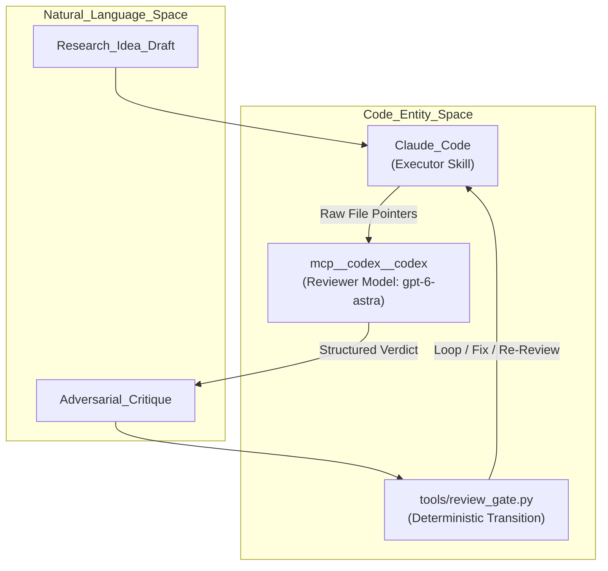

**Empirical design choice**: ARIS pairs an execution model (`Claude Code` optimized for tool use, terminal interaction, and multi-file code modifications) with an external review model (`gpt-6-astra` at `xhigh` or `ultra` reasoning effort, or Copilot native `rubber-duck` subagent) [skills/shared-references/reviewer-routing.md:30-41](). This adversarial loop prevents the system from settling into premature convergence on flawed experimental scripts.

Sources: [skills/shared-references/reviewer-routing.md:30-41](), [skills/auto-review-loop/SKILL.md:1-19]()

---

## The Executor vs Reviewer Pattern

The framework explicitly decouples the execution engine from the critique engine. Each component operates within a defined scope and utilizes distinct communication channels.

### System Dimension Comparison

| Dimension | Executor (`Claude Code` / Alt) | Reviewer (`gpt-6-astra` / Copilot Native) |
|-----------|------------------------|--------------------------|
| **Primary Toolset** | `Bash`, `Read`, `Write`, `Edit`, `Grep`, Python environment | `mcp__codex__codex`, `mcp__codex__codex-reply`, host `task` tool |
| **Model Role** | Code generation, experiment execution, patch application | Adversarial auditing, scoring, rigorous critique |
| **Context Access** | Full workspace files, terminal processes, logs | File paths and explicit context chunks passed by executor |
| **Reasoning Tier** | Standard execution profile | Two-tier policy (`xhigh` regular, `ultra` deep-audit) |

**Code entities**:
- **Executor Engine**: Driven by workflow orchestrators like `/idea-discovery` [skills/idea-discovery/SKILL.md:1-10](), `/auto-review-loop` [skills/auto-review-loop/SKILL.md:1-10](), and `/paper-writing` [skills/paper-writing/SKILL.md:1-10]().
- **Reviewer Invocation**: Managed through `REVIEWER_MODEL = "gpt-6-astra"` and tiered reasoning controls in [skills/shared-references/reviewer-routing.md:30-41]().

Sources: [skills/auto-review-loop/SKILL.md:1-38](), [skills/shared-references/reviewer-routing.md:30-41]()

---

## Reviewer Independence Protocol and Tracing

To ensure the reviewer maintains integrity, ARIS enforces the **Reviewer Independence Protocol**. The executor is strictly prohibited from coaching the reviewer or passing subjective summaries of its own code modifications [skills/shared-references/review-tracing.md:1-11]().

### Reviewer Independence Architecture

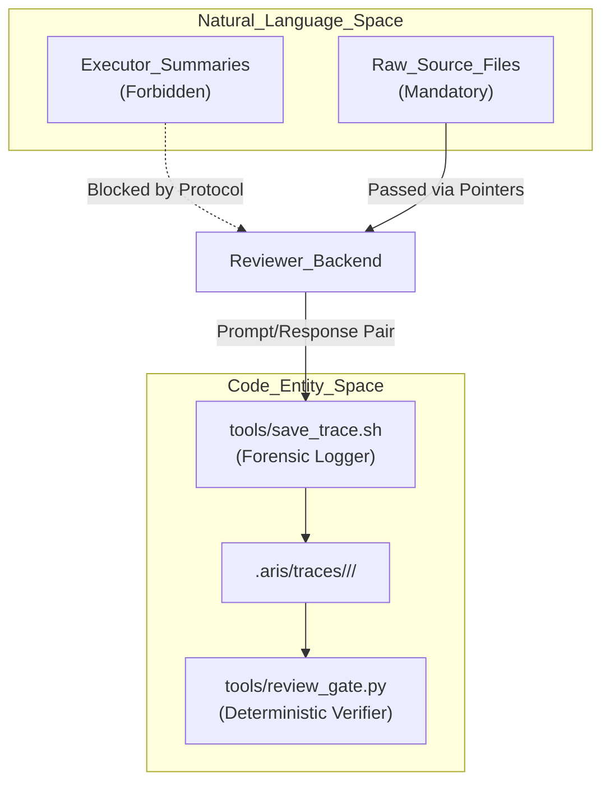

**Implementation Details**:
- **Trace Persistence**: Every interaction with the reviewer is captured by `tools/save_trace.sh` under `.aris/traces/<skill-name>/` to audit prompt structures and verify non-interference [skills/shared-references/review-tracing.md:21-32](), [tools/save_trace.sh:1-35]().
- **Native Evidence Validation**: When using Copilot CLI native rubber-duck mode, `tools/copilot_native_evidence.py` validates host-event session records to guarantee cross-family identity separation before passing data to [tools/review_gate.py:108-133]().

Sources: [skills/shared-references/review-tracing.md:1-45](), [tools/save_trace.sh:1-40](), [tools/review_gate.py:108-133]()

---

## The Assurance Chain Design

Research validation requires mechanical verification rather than heuristic assessment. ARIS implements a multi-layer assurance chain coupled with strict integration contracts [skills/shared-references/integration-contract.md:1-15]().

### Multi-Layer Assurance Chain

| Layer | Code Entity / Tool | Purpose & Enforcement |
|-------|-------------------|-----------------------|
| **L1: Novelty** | `/novelty-check` | Verifies idea uniqueness against live literature indexes [skills/idea-discovery/SKILL.md:1-20]() |
| **L2: Technical Review** | `/research-review` | Simulates rigorous ML venue peer review [skills/auto-review-loop/SKILL.md:1-30]() |
| **L3: Claim Audit** | `/paper-claim-audit` | Cross-checks empirical claims in LaTeX against `EXPERIMENT_LOG.md` |
| **L4: Citation Audit** | `/citation-audit` | Validates reference existence, BibTeX consistency, and citation context |
| **L5: Final Gate** | `tools/verify_paper_audits.sh` | Hard-blocking verification script required for `assurance: submission` |

### Integration Contract Enforcement
Inter-skill dependencies rely on three engineered components:
1. **Activation Predicate**: An observable environment or file-state test (e.g., `if [ -d research-wiki/ ]`) [skills/shared-references/integration-contract.md:37-47]().
2. **Canonical Helper Resolution**: Resolves tool scripts through a strict four-layer fallback chain (`.aris/tools/`, `tools/`, `$ARIS_REPO/tools/`, and `~/.aris/repo`) [skills/shared-references/integration-contract.md:48-94]().
3. **Failure Policy**: Explicitly defines whether a missing helper triggers a load-bearing block (`exit 1`) or an optional warning (`WARN`) [skills/shared-references/integration-contract.md:110-145]().

Sources: [skills/shared-references/integration-contract.md:1-145](), [tools/review_gate.py:1-50]()

---

## Knowledge Persistence and Spiral Learning

To prevent regression and eliminate repetitive exploration loops across execution sessions, ARIS maintains a persistent knowledge base managed by [tools/research_wiki.py:1-50]().

### Knowledge Graph Architecture

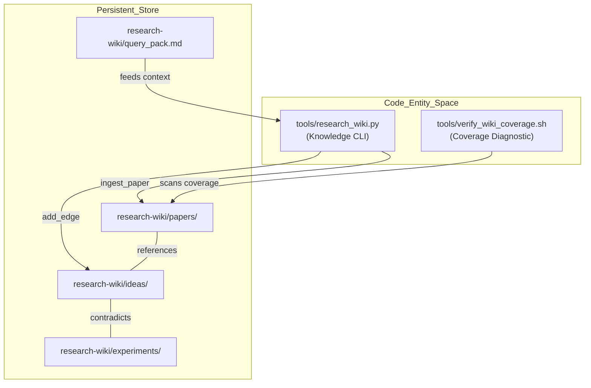

The knowledge graph stores typed entity relationships and compiles a `query_pack.md` index. This index implements **spiral learning**, feeding historical findings and failed hypothesis logs directly into downstream planning skills like `/idea-creator` [tools/research_wiki.py:1-80]().

Sources: [tools/research_wiki.py:1-80](), [tools/verify_wiki_coverage.sh:1-30]()

---

# Page: System Architecture

# System Architecture

<details>
<summary>Relevant source files</summary>

The following files were used as context for generating this wiki page:

- [AGENT_GUIDE.md](AGENT_GUIDE.md)
- [docs/ARIS_INTRO.html](docs/ARIS_INTRO.html)
- [docs/ARIS_INTRO.md](docs/ARIS_INTRO.md)
- [docs/CUSTOMIZATION.md](docs/CUSTOMIZATION.md)
- [docs/CUSTOMIZATION_CN.md](docs/CUSTOMIZATION_CN.md)
- [docs/SKILLS_CATALOG.md](docs/SKILLS_CATALOG.md)
- [skills/research-pipeline/SKILL.md](skills/research-pipeline/SKILL.md)
- [skills/skills-codex-claude-review/research-review/SKILL.md](skills/skills-codex-claude-review/research-review/SKILL.md)
- [skills/skills-codex-gemini-review/research-review/SKILL.md](skills/skills-codex-gemini-review/research-review/SKILL.md)
- [skills/skills-codex/README.md](skills/skills-codex/README.md)
- [skills/skills-codex/README_CN.md](skills/skills-codex/README_CN.md)
- [skills/skills-codex/research-pipeline/SKILL.md](skills/skills-codex/research-pipeline/SKILL.md)
- [skills/skills-codex/research-review/SKILL.md](skills/skills-codex/research-review/SKILL.md)
- [tests/test_auto_proceed_contract.py](tests/test_auto_proceed_contract.py)

</details>


## Purpose and Scope

This page provides an architectural overview of the ARIS (Auto-claude-code-research-in-sleep) runtime environment, component stratification, and data flow layers. It details how natural language research workflows map to concrete code entities, the separation between execution and adversarial review, and the underlying infrastructure. 

For deep technical details, see the child pages:
- Cross-Model Collaboration [Cross-Model Collaboration](#2.1)
- Skill Ecosystem [Skill Ecosystem](#2.2)
- MCP Server Architecture [MCP Server Architecture](#2.3)
- State Management & Recovery [State Management & Recovery](#2.4)
- Deterministic Gates & Helper Tools [Deterministic Gates & Helper Tools](#2.5)

Sources: [README.md:1-50](), [AGENT_GUIDE.md:1-15]()

---

## Architectural Layers and Component Mapping

ARIS organizes research automation into execution, review, state persistence, and infrastructure layers. The following diagram bridges natural language inputs to their concrete code entity implementations across the repository.

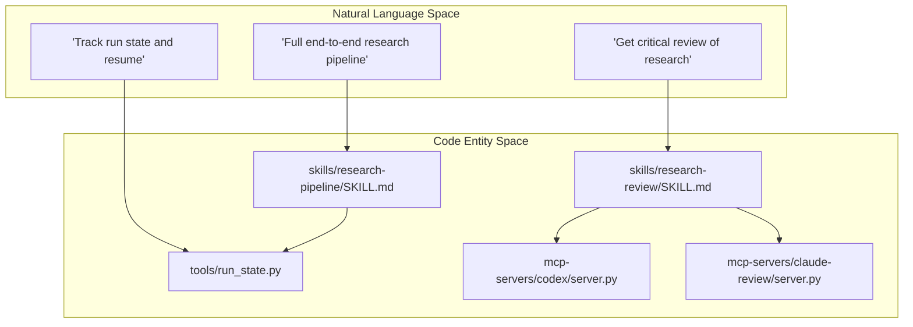
Sources: [skills/research-pipeline/SKILL.md:1-10](), [AGENT_GUIDE.md:12-25](), [skills/skills-codex/research-review/SKILL.md:1-35]()

---

## 2.1 Cross-Model Collaboration

ARIS utilizes a two-tier collaboration model where an executor (Claude Code or Codex CLI) writes code, runs experiments, and drafts papers, while an external reviewer model (such as `gpt-6-astra` via Codex MCP or Claude via `claude-review`) acts as an adversarial critic [README.md:43-50](). To prevent narrative drift and score inflation, reviews adhere to a strict reviewer independence protocol using fresh threads for each round rather than continuation chains (`codex-reply`) [docs/ARIS_INTRO.md:40-45]().

For detailed mechanics, see [Cross-Model Collaboration](#2.1).

Sources: [docs/ARIS_INTRO.md:30-64](), [AGENT_GUIDE.md:5-11]()

---

## 2.2 Skill Ecosystem

The ARIS skill ecosystem consists of over 80 composable Markdown skills located in `skills/<name>/SKILL.md` for mainline hosts and `skills/skills-codex/<name>/SKILL.md` for Codex-native environments [AGENT_GUIDE.md:12-27](). Skills are divided into atomic units (e.g., `/research-lit`, `/run-experiment`) and orchestrators (e.g., `/research-pipeline`, `/auto-review-loop`) that govern execution state and enforce parameter contracts [docs/SKILLS_CATALOG.md:21-45]().

For detailed specifications, see [Skill Ecosystem](#2.2).

Sources: [AGENT_GUIDE.md:12-78](), [docs/SKILLS_CATALOG.md:1-45]()

---

## 2.3 MCP Server Architecture

Model Context Protocol (MCP) servers bridge the executor environment to external LLM providers and auxiliary research tools. Custom MCP servers—such as `claude-review`, `gemini-review`, `llm-chat`, and `codex-image2`—provide tool invocation patterns that enable cross-family evaluation, web-based search, and multi-model routing [README_CN.md:1-20]().

For implementation details, see [MCP Server Architecture](#2.3).

Sources: [docs/SKILLS_CATALOG.md:1-40](), [skills/skills-codex-claude-review/research-review/SKILL.md:32-37]()

---

## 2.4 State Management & Recovery

To withstand context compaction and long-running execution limits, ARIS records execution state through `run_state.py` under `.aris/runs/` and maintains conversational persistence via `REVIEW_STATE.json` [skills/research-pipeline/SKILL.md:82-90](). Pipelines support resumable execution by tracking per-stage completion states (`done` vs. `accepted`) [skills/research-pipeline/SKILL.md:45-46]().

For recovery mechanisms, see [State Management & Recovery](#2.4).

Sources: [skills/research-pipeline/SKILL.md:40-90](), [AGENT_GUIDE.md:98-112]()

---

## 2.5 Deterministic Gates & Helper Tools

The `tools/` directory acts as the deterministic backbone of ARIS, providing standalone scripts that enforce invariants without relying on LLM heuristics. Key utilities include `run_state.py` for orchestration tracking, `iteration_log.py` for finding counts, `watchdog.py` for anomaly detection, and verification scripts like `verify_paper_audits.sh` [tests/test_auto_proceed_contract.py:1-85]().

For a complete inventory of verification utilities, see [Deterministic Gates & Helper Tools](#2.5).

Sources: [skills/research-pipeline/SKILL.md:18-28](), [tests/test_auto_proceed_contract.py:1-85]()

---

# Page: Cross-Model Collaboration

# Cross-Model Collaboration

<details>
<summary>Relevant source files</summary>

The following files were used as context for generating this wiki page:

- [docs/MODEL_COMBINATIONS.md](docs/MODEL_COMBINATIONS.md)
- [docs/MODEL_COMBINATIONS_CN.md](docs/MODEL_COMBINATIONS_CN.md)
- [docs/MiniMax-GLM-Configuration.md](docs/MiniMax-GLM-Configuration.md)
- [docs/aris_logo.svg](docs/aris_logo.svg)
- [docs/auto_review_score_curve.png](docs/auto_review_score_curve.png)
- [docs/hero_combined.svg](docs/hero_combined.svg)
- [docs/hero_idea.svg](docs/hero_idea.svg)
- [docs/hero_implement.svg](docs/hero_implement.svg)
- [docs/hero_interaction.svg](docs/hero_interaction.svg)
- [docs/wechat_group.jpg](docs/wechat_group.jpg)
- [skills/auto-review-loop/SKILL.md](skills/auto-review-loop/SKILL.md)
- [skills/shared-references/integration-contract.md](skills/shared-references/integration-contract.md)
- [skills/shared-references/review-tracing.md](skills/shared-references/review-tracing.md)
- [skills/shared-references/reviewer-routing.md](skills/shared-references/reviewer-routing.md)
- [skills/skills-codex-claude-review/research-refine/SKILL.md](skills/skills-codex-claude-review/research-refine/SKILL.md)
- [skills/skills-codex/shared-references/integration-contract.md](skills/skills-codex/shared-references/integration-contract.md)
- [skills/skills-codex/shared-references/reviewer-routing.md](skills/skills-codex/shared-references/reviewer-routing.md)
- [tests/test_copilot_install.py](tests/test_copilot_install.py)
- [tests/test_review_gate.py](tests/test_review_gate.py)
- [tools/review_gate.py](tools/review_gate.py)
- [tools/save_trace.sh](tools/save_trace.sh)

</details>


## Purpose and Scope

This page documents ARIS's core architectural pattern: **executor-reviewer separation** using two independent Large Language Models from different model families. Claude Code (the executor) drives implementation, file editing, and experiment execution, while an external LLM (the reviewer, accessed via Codex MCP, native Copilot subagents, or specialized MCP bridges) provides adversarial evaluation. This design eliminates self-review bias and avoids the local minima inherent in single-model research loops.

---

## 1. Executor-Reviewer Architecture & Data Flow

ARIS enforces a structural separation between the execution and review roles. The executor never evaluates its own work; all quality gates, scoring, and verdict generation are delegated to an independent reviewer model via standardized invocation protocols.

### System-to-Code Mapping (Bridge Diagram 1)

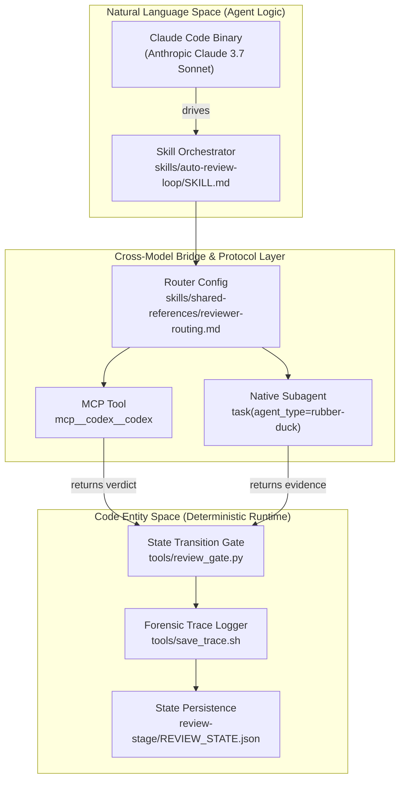

Sources: [skills/auto-review-loop/SKILL.md:1-40](), [skills/shared-references/reviewer-routing.md:1-11](), [tools/review_gate.py:1-40](), [tools/save_trace.sh:1-43]()

---

## 2. Reviewer Backend Selection & Routing

The reviewer backend is resolved dynamically based on project configuration, available MCP servers, and execution environment directives.

### Reviewer Backends and Fallback Hierarchy

The `REVIEWER_BACKEND` parameter supports several operational modes defined in `skills/shared-references/reviewer-routing.md`:
- **`auto`**: The default for `/auto-review-loop`. At Step -1, it attempts to bind to the host Copilot session via `copilot_native_evidence.py`. If bound, it uses `copilot-native` (built-in `rubber-duck` subagent); otherwise, it falls back to `codex` [skills/auto-review-loop/SKILL.md:29-61]().
- **`copilot-native`**: Uses the host's native complementary subagent without pinning a specific model ID, validating via `copilot_native_evidence.py` [skills/auto-review-loop/SKILL.md:62-80]().
- **`codex`**: Uses Codex MCP (`mcp__codex__codex`) with model `gpt-6-astra` [skills/shared-references/reviewer-routing.md:10-32]().
- **`manual`**, **`oracle-pro`**, **`agy`**, **`llm-chat`**: Explicit overrides for alternative model families (OpenAI, Anthropic, Google, DeepSeek, Moonshot, Qwen) [skills/auto-review-loop/SKILL.md:28]().

### Tiered Reasoning-Effort Policy

When using Codex MCP, ARIS applies a strict two-tier reasoning-effort policy to balance speed and critique depth [skills/shared-references/reviewer-routing.md:30-44]():

| Tier | `model_reasoning_effort` | Applicable Skills / Calls |
|------|--------------------------|---------------------------|
| **Deep-audit** | `ultra` | `/proof-checker`, `/kill-argument` (core attack/defense threads), `/research-review`, `/experiment-audit`, `/paper-claim-audit`, `/result-to-claim`, `/meta-apply` [skills/shared-references/reviewer-routing.md:36](). |
| **Regular** | `xhigh` | All multi-round loops including every round of `/auto-review-loop`, and per-item fan-outs like `/citation-audit` [skills/shared-references/reviewer-routing.md:37](). |

*Note: Model and effort must be pinned explicitly in the first call of every thread; downstream follow-ups (`mcp__codex__codex-reply`) inherit the established session context [skills/shared-references/reviewer-routing.md:39-53]().*

Sources: [skills/auto-review-loop/SKILL.md:28-80](), [skills/shared-references/reviewer-routing.md:1-89]()

---

## 3. Reviewer Independence Protocol & Tracing

To preserve the adversarial value of cross-model collaboration, ARIS enforces the **Reviewer Independence Protocol**, governed by strict artifact contracts and forensic logging.

### Core Independence Rules
1. **Raw Artifact Directing**: The executor passes file paths (e.g., `EXPERIMENT_LOG.md`, source files) directly to the reviewer rather than summarizing or filtering the content [skills/shared-references/reviewer-independence.md:1-27]().
2. **No Subjective Coaching**: The executor is prohibited from inserting interpretive commentary or recommending how the reviewer should score the work.
3. **Forensic Trace Recording**: Every review call—including failed capability fallback attempts—is recorded via `tools/save_trace.sh` into structured trace directories [skills/shared-references/review-tracing.md:1-44]().

### Trace Directory Structure and System Mapping (Bridge Diagram 2)

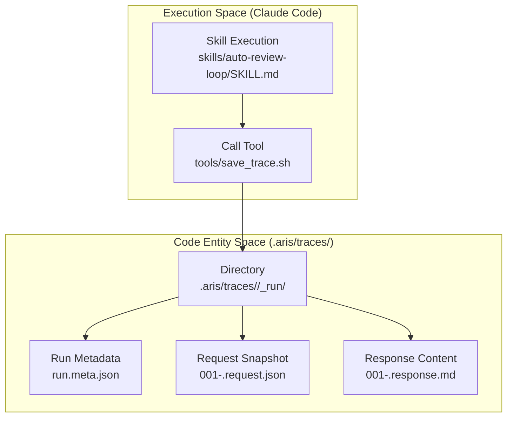

Sources: [skills/shared-references/review-tracing.md:21-38](), [tools/save_trace.sh:1-43]()

---

## 4. Adversarial Review & Deterministic Gates

ARIS scales critique skepticism through three configurable difficulty tiers and delegates stopping conditions to a deterministic Python state machine.

### Reviewer Difficulty Levels
- **`medium` (Default)**: Standard MCP-based cross-model review where the executor structures the provided file context [skills/auto-review-loop/SKILL.md:33-34]().
- **`hard`**: Introduces **Reviewer Memory** (`REVIEWER_MEMORY.md` tracking suspicions across rounds) and a **Debate Protocol** (executor rebuttals adjudicated by the reviewer) [skills/auto-review-loop/SKILL.md:35]().
- **`nightmare`**: Combines `hard` features with direct repository read access via `codex exec` (bypassing executor context filters) and **Adversarial Verification** of code against theoretical claims [skills/auto-review-loop/SKILL.md:36]().

### Deterministic State Transitions (`tools/review_gate.py`)

Rather than relying purely on LLM prose to interpret review scores, ARIS delegates stop/continue/escalate logic to `tools/review_gate.py` [tools/review_gate.py:1-7](). 

The authoritative stop condition requires **both** criteria to be met [skills/auto-review-loop/SKILL.md:26]():
$$\text{Score} \ge 6/10 \quad \text{AND} \quad \text{Verdict} \in \{\text{"ready"},\ \text{"almost"}\}$$

```python
# Core validation snippet from tools/review_gate.py
POSITIVE_VERDICTS = {"ready", "almost"}

def evaluate_transition(
    *,
    round_backend: str,
    score: float,
    verdict: str,
    ...
) -> Transition:
    ...
```
*A high numerical score paired with a `"not ready"` verdict will continue the loop regardless of points.*

Sources: [skills/auto-review-loop/SKILL.md:22-40](), [tools/review_gate.py:1-148]()

---

## 5. Why Cross-Model Collaboration Beats Single-Model Approaches

Relying on a single model for both generation and review introduces systematic blind spots due to shared prior distributions and confirmation bias.

### Stochastic vs. Adversarial Dynamics

| Dimension | Single-Model Self-Review | ARIS Cross-Model Collaboration |
|-----------|-------------------------|--------------------------------|
| **Error Landscape** | Stochastic noise; predictable hallucinations. | Adversarial probing; independent training distribution catches hidden flaws. |
| **Convergence** | Stagnates quickly in local minima. | Drives toward Nash equilibrium through multi-family tension. |
| **Rigor** | Model tends to be lenient with its own generated structure. | External model enforces strict standards and independent code verification. |
| **Model Families** | Single family (e.g., Anthropic only). | Dual-family pairing (e.g., Anthropic Claude + OpenAI GPT / DeepSeek). |

From the system design perspective, two independent models represent the minimal configuration required to break self-play symmetry without incurring the quadratic coordination overhead of n-player multi-model teams.

Sources: [README.md:43-50](), [README_CN.md:21-28]()

---

# Page: Skill Ecosystem

# Skill Ecosystem

<details>
<summary>Relevant source files</summary>

The following files were used as context for generating this wiki page:

- [AGENT_GUIDE.md](AGENT_GUIDE.md)
- [docs/ARIS_INTRO.html](docs/ARIS_INTRO.html)
- [docs/ARIS_INTRO.md](docs/ARIS_INTRO.md)
- [docs/SKILLS_CATALOG.md](docs/SKILLS_CATALOG.md)
- [skills/meta-apply/SKILL.md](skills/meta-apply/SKILL.md)
- [skills/skills-codex/README.md](skills/skills-codex/README.md)
- [skills/skills-codex/README_CN.md](skills/skills-codex/README_CN.md)
- [skills/skills-codex/meta-apply/SKILL.md](skills/skills-codex/meta-apply/SKILL.md)
- [tests/test_codex_skill_mirror.py](tests/test_codex_skill_mirror.py)

</details>


This parent page documents the ARIS skill ecosystem, covering the composable skills architecture, orchestrator versus atomic skill patterns, runtime dependencies, allowed tools, the `AGENT_GUIDE.md` routing index, `SKILLS_CATALOG.md`, and skill locations across platforms. 

For deep technical details on governance and execution contracts, see [Shared References & Contracts](#2.2.1). For details on reviewer resolution and model selection, see [Reviewer Routing & Backend Selection](#2.2.2).

## Overview & Platform Skill Locations

ARIS organizes research automation into modular, composable Markdown-based skills (`SKILL.md`) that are interpreted and executed by AI agents [AGENT_GUIDE.md:1-10](). The ecosystem spans mainline environments (Claude Code, Cursor, Trae, Antigravity, Copilot CLI) and Codex-native mirrored packages [AGENT_GUIDE.md:12-20]().

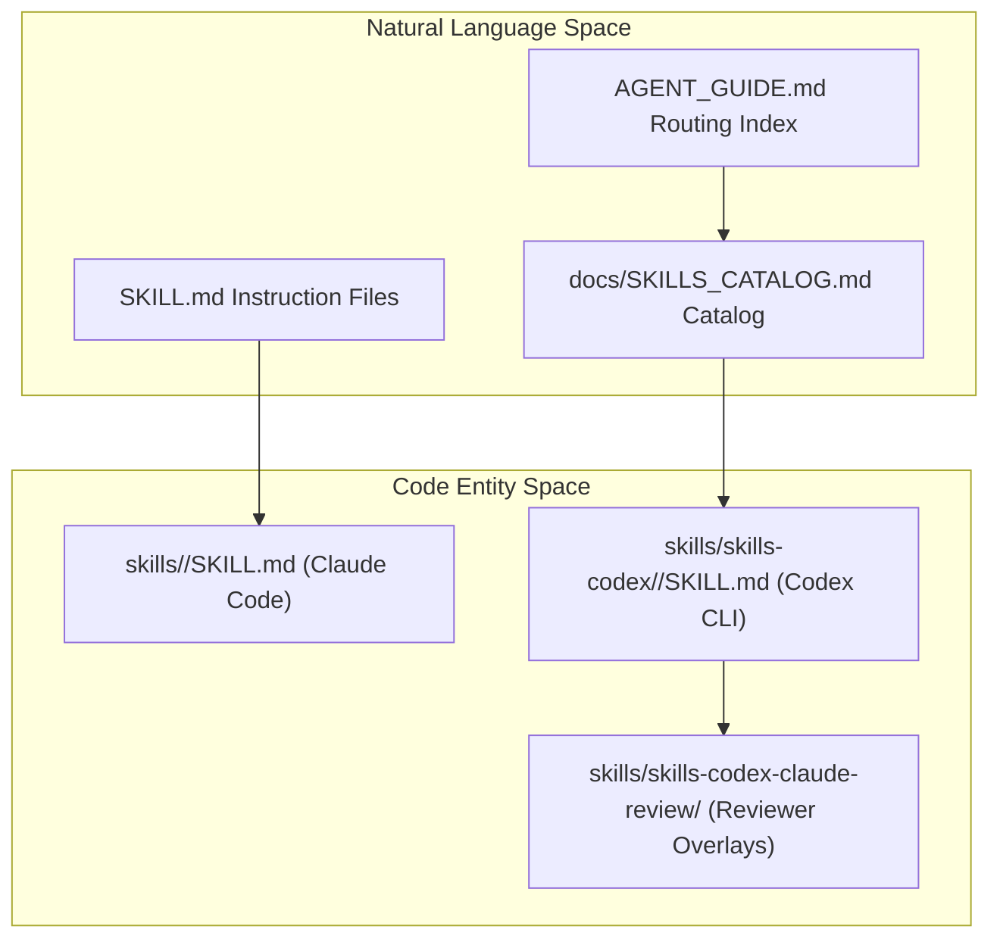

Sources: [AGENT_GUIDE.md:12-27](), [skills/skills-codex/README.md:1-19]()

## Orchestrator vs. Atomic Skills & Routing

ARIS distinguishes between high-level workflow orchestrators that chain multi-stage research lifecycles and atomic skills that execute singular, focused operations [docs/SKILLS_CATALOG.md:21-41]().

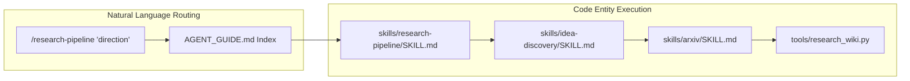

Sources: [AGENT_GUIDE.md:79-95](), [docs/SKILLS_CATALOG.md:21-43]()

## Technical Implementation: Tool Permissions & Dependencies

Skills declare strict tool permissions via frontmatter `allowed-tools` blocks, binding natural language procedures directly to concrete code execution paths.

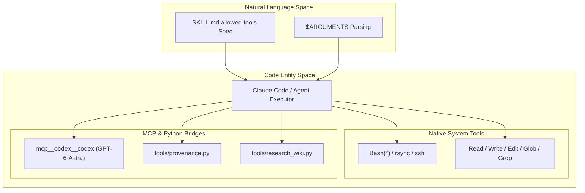

Sources: [skills/meta-apply/SKILL.md:1-6](), [AGENT_GUIDE.md:66-78]()

## Shared References & Contracts

Core rules, governance frameworks, and invariant specifications are maintained globally in `skills/shared-references/`. These contracts govern review routing, integration boundaries, citation discipline, experiment integrity, output versioning, and assurance gates.

For comprehensive documentation on shared references, integration contracts, review scope limits, acceptance gates, fan-out patterns, injection hygiene, experiment integrity, versioning, governance, and resumable runs, see [Shared References & Contracts](#2.2.1).

Sources: [AGENT_GUIDE.md:7-11](), [skills/skills-codex/README.md:8-16]()

## Reviewer Routing & Backend Selection

ARIS supports pluggable reviewer backends through the `REVIEWER_BACKEND` resolution system, enabling auto-routing, copilot-native reviewers, Codex MCP, manual browser UIs, Gemini bridges, and generic `llm-chat` interfaces.

For details on how backend resolution operates, fallback hierarchies, reasoning-effort tiers (lite, balanced, max, beast, ultra), and provenance/identity assurance classifications, see [Reviewer Routing & Backend Selection](#2.2.2).

Sources: [AGENT_GUIDE.md:34-65](), [docs/SKILLS_CATALOG.md:31-33]()

## Skill Catalog Summary

The complete catalog lists 82+ skills spanning orchestrators, literature search, ideation, execution, output generation, and assurance audits [docs/SKILLS_CATALOG.md:3-6]() [AGENT_GUIDE.md:27]().

| Category | Representative Skills | Core Dependencies / Integration |
| :--- | :--- | :--- |
| **Orchestrators** | `/research-pipeline`, `/auto-review-loop`, `/resubmit-pipeline` | Codex MCP, LaTeX toolchain [docs/SKILLS_CATALOG.md:25-37]() |
| **Literature** | `/research-lit`, `/arxiv`, `/deepxiv`, `/openalex` | Network APIs, Zotero, Obsidian [docs/SKILLS_CATALOG.md:48-61]() |
| **Ideation** | `/idea-creator`, `/novelty-check`, `/ablation-planner` | Codex MCP, GPU hardware [docs/SKILLS_CATALOG.md:66-73]() |
| **Execution** | `/run-experiment`, `/experiment-queue`, `/monitor-experiment` | SSH, Conda, Screen [docs/SKILLS_CATALOG.md:76-88]() |
| **Writing** | `/paper-write`, `/paper-figure`, `/render-html`, `/overleaf-sync` | LaTeX, Git, Overleaf bridge [docs/SKILLS_CATALOG.md:91-105]() |
| **Assurance** | `/experiment-audit`, `/paper-claim-audit`, `/kill-argument` | Codex MCP, verification scripts [docs/SKILLS_CATALOG.md:120-145]() |

Sources: [docs/SKILLS_CATALOG.md:21-150](), [AGENT_GUIDE.md:86-112]()

---

# Page: Shared References & Contracts

# Shared References & Contracts

<details>
<summary>Relevant source files</summary>

The following files were used as context for generating this wiki page:

- [skills/paper-write/templates/IEEEtran.bst](skills/paper-write/templates/IEEEtran.bst)
- [skills/paper-write/templates/IEEEtran.cls](skills/paper-write/templates/IEEEtran.cls)
- [skills/paper-write/templates/ieee_conference.tex](skills/paper-write/templates/ieee_conference.tex)
- [skills/paper-write/templates/ieee_journal.tex](skills/paper-write/templates/ieee_journal.tex)
- [skills/shared-references/acceptance-gate.md](skills/shared-references/acceptance-gate.md)
- [skills/shared-references/assurance-contract.md](skills/shared-references/assurance-contract.md)
- [skills/shared-references/effort-contract.md](skills/shared-references/effort-contract.md)
- [skills/shared-references/evidence-precheck.md](skills/shared-references/evidence-precheck.md)
- [skills/shared-references/external-cadence.md](skills/shared-references/external-cadence.md)
- [skills/shared-references/fan-out-pattern.md](skills/shared-references/fan-out-pattern.md)
- [skills/shared-references/injection-hygiene.md](skills/shared-references/injection-hygiene.md)
- [skills/shared-references/venue-checklists.md](skills/shared-references/venue-checklists.md)
- [skills/skills-codex/shared-references/acceptance-gate.md](skills/skills-codex/shared-references/acceptance-gate.md)
- [skills/skills-codex/shared-references/assurance-contract.md](skills/skills-codex/shared-references/assurance-contract.md)
- [skills/skills-codex/shared-references/effort-contract.md](skills/skills-codex/shared-references/effort-contract.md)
- [skills/skills-codex/shared-references/external-cadence.md](skills/skills-codex/shared-references/external-cadence.md)
- [skills/skills-codex/shared-references/injection-hygiene.md](skills/skills-codex/shared-references/injection-hygiene.md)
- [skills/skills-codex/shared-references/review-tracing.md](skills/skills-codex/shared-references/review-tracing.md)
- [tests/test_evidence_check.py](tests/test_evidence_check.py)
- [tests/test_idea_creator_query_pack_scan.py](tests/test_idea_creator_query_pack_scan.py)
- [tests/test_threat_scan.py](tests/test_threat_scan.py)
- [tests/test_verify_paper_audits.py](tests/test_verify_paper_audits.py)
- [tools/evidence_check.py](tools/evidence_check.py)
- [tools/threat_scan.py](tools/threat_scan.py)
- [tools/verify_paper_audits.sh](tools/verify_paper_audits.sh)

</details>


This leaf page documents the foundational system contracts, shared behavioral references, and deterministic gate architectures located in `skills/shared-references/`. These references govern cross-model interaction, audit strictness, threat scanning, state tracking, and execution governance across all 74+ composable ARIS skills.

Sources: `skills/shared-references/acceptance-gate.md:1-25`, `skills/shared-references/effort-contract.md:1-15` [skills/shared-references/acceptance-gate.md:1-25]()

---

## 1. Acceptance Gates & Model Sovereignty

The ARIS architecture enforces a strict separation between execution (generation/action) and acquittal (evaluation/stop decisions). The acceptance gate contract governs how autonomous loops (`/auto-review-loop`, `/dse-loop`, `/experiment-bridge`) terminate.

### Type-A vs. Type-B Gates
Autonomous stop/accept conditions are classified into two disjoint categories:
*   **Type-A (Execution / Objective):** Machine-checkable signals of what happened, requiring no subjective taste. Examples include `exit code == 0`, file existence (`paper/main.pdf`), queue exhaustion, or test suite passes (`pytest`). Claude may self-judge Type-A gates.
*   **Type-B (Quality / Correctness / Acceptance):** Judgments of merit, novelty, or sufficiency (e.g., "the paper is good", "the proof is valid", "the claim is supported"). Claude is **strictly prohibited** from self-judging Type-B gates. These must be routed to a heterogeneous model family (default `codex` via MCP, `oracle-pro`, or verified non-Claude backends).

```
                 ┌──────────────────────────────────────────────┐
                 │         Autonomous Loop Termination          │
                 └──────────────────────┬───────────────────────┘
                                        │
                        Is it an objective execution check?
                                   /           \
                                 Yes            No
                                 /                \
                       ┌────────▼───────┐        ┌▼─────────────────────────┐
                       │    Type-A      │        │          Type-B          │
                       │ (Same-Family   │        │   (Cross-Model Jury)     │
                       │  Self-Check OK)│        │   tools/verify_paper_audits.sh │
                       └────────────────┘        └──────────────────────────┘
```
**Diagram 1:** *Bridge from Natural Language Stop Conditions to Code Entity Space (`tools/verify_paper_audits.sh` and gate validation classes).*

Sources: `skills/shared-references/acceptance-gate.md:33-100`, `tools/verify_paper_audits.sh:1-40` [skills/shared-references/acceptance-gate.md:33-100]()

---

## 2. Effort & Assurance Contracts

The execution workload and audit rigor are decoupled into two orthogonal configuration axes: `effort` and `assurance`.

### The Two-Axis Configuration Model
*   **`effort` (`lite`, `balanced`, `max`, `beast`):** Controls compute depth, iteration counts, candidate breadth, and token budget. It scales numbers of papers read, ideas generated, and experimental seeds.
*   **`assurance` (`draft`, `submission`):** Controls whether audit phases are advisory (silent skip allowed) or load-bearing (mandatory verdicts required).

| Effort Level | Implied Assurance | Primary Target |
| :--- | :--- | :--- |
| `lite` | `draft` | Budget-constrained exploration (~0.4x tokens) |
| `balanced` | `draft` | Default ARIS behavior (1x tokens) |
| `max` | `submission` | Deep research runs (~2.5x tokens; audits mandatory) |
| `beast` | `submission` | Submission sprints (~5-8x tokens; verifier enforced) |

Sources: `skills/shared-references/effort-contract.md:29-65`, `skills/shared-references/assurance-contract.md:9-44` [skills/shared-references/effort-contract.md:29-65]()

### The External Verifier: `verify_paper_audits.sh`
At `assurance: submission`, paper compilation and finalization invoke the external verifier script `tools/verify_paper_audits.sh` to validate mandatory audit artifacts (`PROOF_AUDIT.json`, `PAPER_CLAIM_AUDIT.json`, `CITATION_AUDIT.json`, `KILL_ARGUMENT.json`).

```
             ┌────────────────────────────────────────────────────────┐
             │               paper-writing Phase 6                    │
             └───────────────────────────┬────────────────────────────┘
                                         │ invokes
                                         ▼
             ┌────────────────────────────────────────────────────────┐
             │       tools/verify_paper_audits.sh                     │
             │  - Validates JSON schemas & required fields            │
             │  - Recomputes SHA256 hashes (audited_input_hashes)     │
             │  - Checks review_independence and verdicts             │
             └───────────────────────────┬────────────────────────────┘
                                         │
                         Exits 0 (Pass)  OR  Exits 1 (Block)
```
**Diagram 2:** *External Verifier Execution Flow connecting natural language writing phases to shell verification (`tools/verify_paper_audits.sh`).*

Sources: `tools/verify_paper_audits.sh:1-35`, `skills/shared-references/assurance-contract.md:87-125` [tools/verify_paper_audits.sh:1-35]()

---

## 3. Injection Hygiene & Threat Scanning

ARIS re-injects external data (fetched paper abstracts, research wiki nodes/edges, community pull-request assets, and `MEMORY.md`) back into agent contexts. To prevent prompt injection and context hijacking, ARIS implements a two-layer scanning architecture.

### Two-Layer Defense Architecture
1.  **Layer 1 (`tools/threat_scan.py`):** Deterministic, regex-based pre-filter. It operates with zero model inference, failing open to novelty while aggressively blocking known-bad patterns (exfiltration URLs, privilege escalation commands, role-hijacks).
2.  **Layer 2 (Cross-Model Jury):** Semantic validation by a heterogeneous model family (`codex` or overlay backends).

Scopes are classified into `all`, `context` (warnings on fetched abstracts), and `strict` (quarantine/blocking on user-mediated writes like wiki edges and query packs).

Sources: `skills/shared-references/injection-hygiene.md:13-42`, `tests/test_idea_creator_query_pack_scan.py:1-40` [skills/shared-references/injection-hygiene.md:13-42]()

---

## 4. Review Tracing & External Cadence

### Review Tracing Protocol
Every reviewer call that performs critiquing, scoring, or claim verification writes a structured trace record under `.aris/traces/<skill-name>/<date>_run<NN>/`. These trace directories contain:
*   `run.meta.json`: Run identity, executor model, review independence status.
*   `NNN-<purpose>.request.json`: Full prompt, reasoning effort, and referenced file lists.
*   `NNN-<purpose>.response.md`: Verbatim reviewer output.
*   `NNN-<purpose>.meta.json`: Execution duration, agent/thread ID, and HTTP status.

Sources: `skills/skills-codex/shared-references/review-tracing.md:35-97` [skills/skills-codex/shared-references/review-tracing.md:35-97]()

### External Cadence Principle
External schedulers (`/loop`, `/schedule`, `CronCreate`) decide *when* an agent wakes up, but **never** *who* judges the work or *whether* an artifact is accepted. Cadence can drive execution flow, but acquittal remains strictly delegated to cross-model review. Wrapping internal semantic feedback loops (`/auto-review-loop`) in external timers introduces thread discontinuity and redundant context consumption.

Sources: `skills/shared-references/external-cadence.md:1-55` [skills/shared-references/external-cadence.md:1-55]()

---

# Page: Reviewer Routing & Backend Selection

# Reviewer Routing & Backend Selection

<details>
<summary>Relevant source files</summary>

The following files were used as context for generating this wiki page:

- [docs/COPILOT_CLI_ADAPTATION.md](docs/COPILOT_CLI_ADAPTATION.md)
- [skills/auto-review-loop/SKILL.md](skills/auto-review-loop/SKILL.md)
- [skills/shared-references/integration-contract.md](skills/shared-references/integration-contract.md)
- [skills/shared-references/review-tracing.md](skills/shared-references/review-tracing.md)
- [skills/shared-references/reviewer-routing.md](skills/shared-references/reviewer-routing.md)
- [skills/shared-references/skill-governance.md](skills/shared-references/skill-governance.md)
- [skills/skills-codex/shared-references/integration-contract.md](skills/skills-codex/shared-references/integration-contract.md)
- [skills/skills-codex/shared-references/reviewer-routing.md](skills/skills-codex/shared-references/reviewer-routing.md)
- [tests/test_copilot_install.py](tests/test_copilot_install.py)
- [tests/test_copilot_native_evidence.py](tests/test_copilot_native_evidence.py)
- [tests/test_http_reviewer_fallback_contract.py](tests/test_http_reviewer_fallback_contract.py)
- [tests/test_http_reviewer_provenance_alignment.py](tests/test_http_reviewer_provenance_alignment.py)
- [tests/test_http_reviewer_review_gate.py](tests/test_http_reviewer_review_gate.py)
- [tests/test_llm_chat_review_fallback.py](tests/test_llm_chat_review_fallback.py)
- [tests/test_provenance.py](tests/test_provenance.py)
- [tests/test_review_gate.py](tests/test_review_gate.py)
- [tools/provenance.py](tools/provenance.py)
- [tools/review_gate.py](tools/review_gate.py)
- [tools/save_trace.sh](tools/save_trace.sh)

</details>


## Purpose and Scope

This document specifies the internal architecture of ARIS reviewer routing, backend resolution, capability fallback hierarchies, reasoning-effort tiers, and provenance/identity assurance classification. It governs how execution agents delegate critique tasks to independent reviewer backends, ensuring strict cross-model validation invariants and tamper-evident audit records.

Sources: [skills/shared-references/reviewer-routing.md:1-89](), [tools/provenance.py:1-18](), [tools/review_gate.py:1-7]()

---

## 1. `REVIEWER_BACKEND` Resolution & Routing Architecture

ARIS supports multiple reviewer backends depending on the active skill and host environment. When no explicit reviewer flag is provided, skills resolve their target backend through environment inspection and protocol probing.

### Supported Backends and Defaults

| Skill / Context | Default Backend | Opt-in Overrides / Aliases |
|-----------------|-----------------|----------------------------|
| `/auto-review-loop` | **`copilot-native`** (if host session marker binds) or **`codex`** [skills/auto-review-loop/SKILL.md:29](), [skills/shared-references/reviewer-routing.md:9]() | `--reviewer: codex`, `oracle-pro`, `agy`, `manual`, `copilot` [skills/shared-references/reviewer-routing.md:9]() |
| All other reviewer skills | **Codex MCP** (`mcp__codex__codex`), model `gpt-6-astra` [skills/shared-references/reviewer-routing.md:10]() | `--reviewer: oracle-pro`, `agy`, `manual` [skills/shared-references/reviewer-routing.md:10]() |

### The `copilot-native` Protocol

When `/auto-review-loop` executes without an explicit `--reviewer:` flag, it enters `auto` resolution mode [skills/auto-review-loop/SKILL.md:48-49](). Step -1 executes a two-call native marker/challenge probe via `copilot_native_evidence.py` [skills/auto-review-loop/SKILL.md:29]():
1. Issues a distinct run token binding (`<run_id>_r<round>_review_<8-random-hex>`) [skills/auto-review-loop/SKILL.md:52-53]().
2. Invokes `marker` and `challenge` as two separate root Bash calls [skills/auto-review-loop/SKILL.md:53-54]().
3. If the host session binds successfully, `REVIEWER_BACKEND` resolves to `copilot-native`, utilizing the built-in complementary `rubber-duck` subagent without hardcoding a static reviewer model [skills/auto-review-loop/SKILL.md:29, 54-57]().
4. If the probe exits with status `3` (unbound Copilot root session), the system falls back to `codex` [skills/auto-review-loop/SKILL.md:57]().

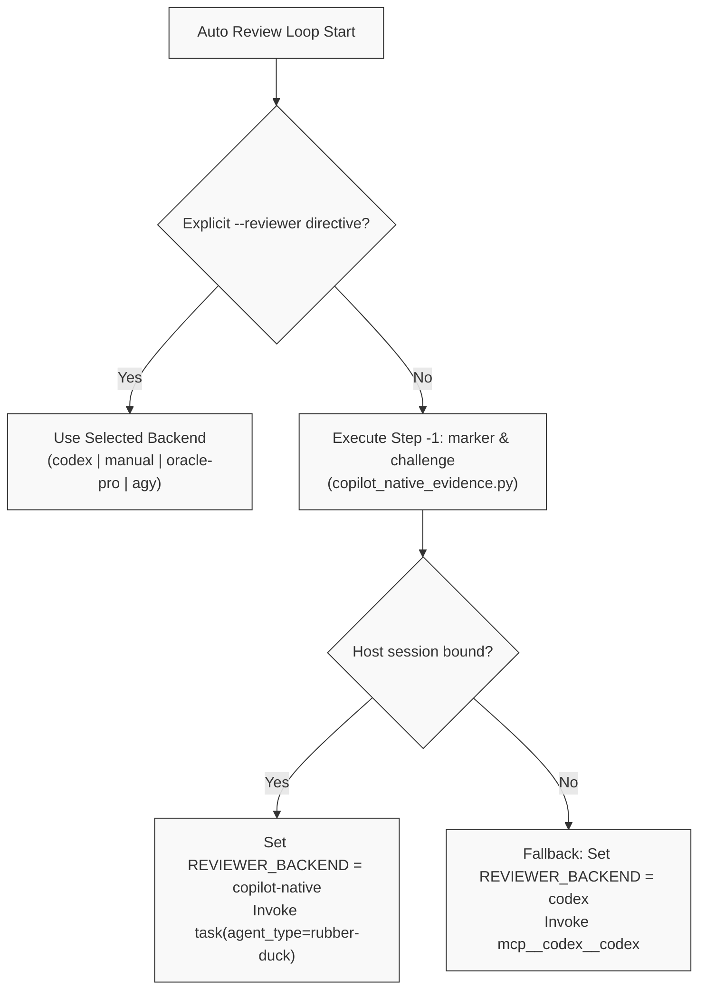

Sources: [skills/auto-review-loop/SKILL.md:28-60](), [skills/shared-references/reviewer-routing.md:3-27](), [tests/test_copilot_native_evidence.py:158-201]()

---

## 2. Reasoning-Effort Tiers & Capability Fallback Hierarchy

When Codex MCP is active (`mcp__codex__codex`), ARIS enforces a strict two-tier reasoning-effort policy using model `gpt-6-astra` [skills/shared-references/reviewer-routing.md:32-37]().

### Reasoning-Effort Tier Table

| Tier | `model_reasoning_effort` | Applicable Skills / Calls |
|------|--------------------------|---------------------------|
| **Deep-audit** | `ultra` | `/proof-checker`, `/kill-argument` (core attack/defense/adjudication threads), `/research-review`, `/experiment-audit`, `/paper-claim-audit`, `/result-to-claim`, `/meta-apply` [skills/shared-references/reviewer-routing.md:36]() |
| **Regular** | `xhigh` | All other reviewer calls, including all rounds of `/auto-review-loop` and per-item fan-outs like `/citation-audit` [skills/shared-references/reviewer-routing.md:37]() |

> ⚠️ **Configuration Rule:** Always pin both `model` and `config.model_reasoning_effort` explicitly in the first call of every thread [skills/shared-references/reviewer-routing.md:39](). Relying on `~/.codex/config.toml` defaults risks falling back to `low` reasoning effort [skills/shared-references/reviewer-routing.md:39]().

### Capability Fallback Protocol

When initializing a new reviewer session, ARIS attempts the declared model/effort pair [skills/shared-references/reviewer-routing.md:46-47](). If initialization fails before returning a usable thread, the capability chain applies strict rules:
1. **Effort Unsupported (older `codex-cli`):** If the error explicitly identifies the requested effort (`ultra`) as unsupported, retry with `gpt-6-astra` + `xhigh` [skills/shared-references/reviewer-routing.md:49]().
2. **Model Unknown/Unavailable:** If the error explicitly identifies `gpt-6-astra` as unavailable to the account, retry `gpt-5.6-sol` + `xhigh`, then `gpt-5.5` + `xhigh` [skills/shared-references/reviewer-routing.md:50]().
3. **Forbidden Downgrades:** Never downgrade on timeout, rate-limit, auth, transport, server, sandbox, context-length, or parse errors, as retrying risks double-running and double-billing [skills/shared-references/reviewer-routing.md:51]().
4. **Failure State:** If no allowed pair succeeds, emit `REVIEW_UNAVAILABLE` (or `ERROR` for mandatory audit gates) rather than fabricating a verdict [skills/shared-references/reviewer-routing.md:55]().

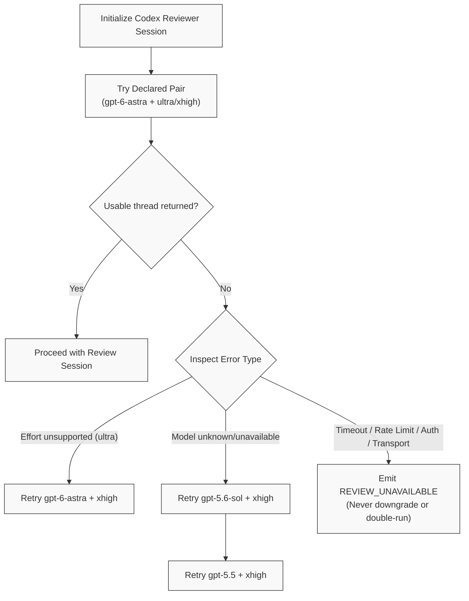

Sources: [skills/shared-references/reviewer-routing.md:30-56]()

---

## 3. Provenance & Identity Assurance Classification

To prevent self-acquittal bias (where a single model family authors and approves its own modifications), ARIS enforces structural provenance rules via `tools/provenance.py` and `tools/review_gate.py` [tools/provenance.py:1-18](), [tools/review_gate.py:1-6]().

### Model Family Mapping

The helper function `model_family(name)` maps model and vendor identifiers into coarse families while defending against substring collisions [tools/provenance.py:55-77](). It uses token boundary matching with version suffix support [tools/provenance.py:31-35]() and maps `oracle-pro` to the `openai` family (preventing an Oracle reviewer from pseudo-cross-checking a GPT-series executor) [tools/provenance.py:22-23]().

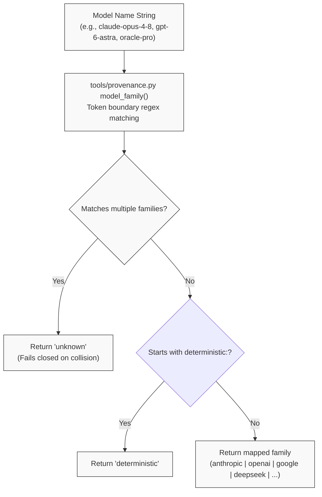

### Acceptance Status & Sidecar Stamping

When an auto-authored artifact is verified, `provenance.py` writes a tamper-evident `.provenance.json` sidecar record [tools/provenance.py:108-135](). 
- **Accepted (`stamp()`):** Requires `assert_cross_family(author_model, reviewer_model)` to pass [tools/provenance.py:80-99, 138-154](). The author and reviewer must belong to distinct families (or the reviewer must be a `deterministic:<verifier>`) [tools/provenance.py:80-86]().
- **Provisional (`stamp_provisional()`):** Used in Codex-only single-family workflows, recording `review_independence: same-family` and `acceptance_status: provisional` [tools/provenance.py:137-156](). Provisional artifacts are traceable but lack auto-curation authority [tools/provenance.py:11-17]().

Sources: [tools/provenance.py:1-156](), [tools/review_gate.py:59-164](), [tests/test_provenance.py:16-156]()

---

## 4. Trace Integration and Decision Gates

Every cross-model review invocation records full forensic traces under `.aris/traces/<skill-name>/<YYYY-MM-DD>_run<NN>/` via `tools/save_trace.sh` [skills/shared-references/review-tracing.md:21-31]().

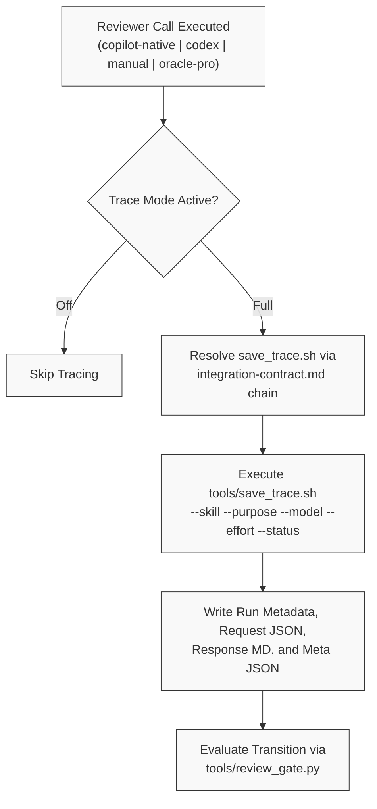

### State Transitions and Gate Logic

The script `tools/review_gate.py` evaluates review outputs (scores, verdicts, and backend metadata) to compute authoritative state transitions [tools/review_gate.py:1-6, 136-158](). It parses native evidence artifacts, checks numeric bounds (`1 <= score <= 10`) [tools/review_gate.py:181](), and applies the operative Phase-E stop condition:
$$\text{Positive Threshold} \iff (\text{score} \geq 6/10) \land (\text{verdict} \in \{\text{ready}, \text{almost}\})$$

Sources: [skills/auto-review-loop/SKILL.md:26](), [tools/review_gate.py:1-186](), [skills/shared-references/review-tracing.md:1-143](), [tools/save_trace.sh:1-151]()

---

# Page: MCP Server Architecture

# MCP Server Architecture

<details>
<summary>Relevant source files</summary>

The following files were used as context for generating this wiki page:

- [.github/agents/aris-reviewer-claude.agent.md](.github/agents/aris-reviewer-claude.agent.md)
- [.github/agents/aris-reviewer-openai.agent.md](.github/agents/aris-reviewer-openai.agent.md)
- [docs/ALI_CODING_PLAN_GUIDE.md](docs/ALI_CODING_PLAN_GUIDE.md)
- [docs/CODEX_CLAUDE_REVIEW_GUIDE.md](docs/CODEX_CLAUDE_REVIEW_GUIDE.md)
- [docs/CODEX_CLAUDE_REVIEW_GUIDE_CN.md](docs/CODEX_CLAUDE_REVIEW_GUIDE_CN.md)
- [docs/CURSOR_ADAPTATION.md](docs/CURSOR_ADAPTATION.md)
- [docs/MINIMAX_MCP_GUIDE.md](docs/MINIMAX_MCP_GUIDE.md)
- [docs/MODELSCOPE_GUIDE.md](docs/MODELSCOPE_GUIDE.md)
- [mcp-servers/claude-review/README.md](mcp-servers/claude-review/README.md)
- [mcp-servers/claude-review/run_with_claude_aws.sh](mcp-servers/claude-review/run_with_claude_aws.sh)
- [mcp-servers/claude-review/server.py](mcp-servers/claude-review/server.py)
- [mcp-servers/feishu-bridge/requirements.txt](mcp-servers/feishu-bridge/requirements.txt)
- [mcp-servers/feishu-bridge/server.py](mcp-servers/feishu-bridge/server.py)
- [mcp-servers/gemini-review/server.py](mcp-servers/gemini-review/server.py)
- [mcp-servers/llm-chat/requirements.txt](mcp-servers/llm-chat/requirements.txt)
- [mcp-servers/llm-chat/server.py](mcp-servers/llm-chat/server.py)
- [mcp-servers/manual-review/server.py](mcp-servers/manual-review/server.py)
- [mcp-servers/manual-review/ui.html](mcp-servers/manual-review/ui.html)
- [mcp-servers/minimax-chat/requirements.txt](mcp-servers/minimax-chat/requirements.txt)
- [mcp-servers/minimax-chat/server.py](mcp-servers/minimax-chat/server.py)
- [tests/_minimax_helpers.py](tests/_minimax_helpers.py)
- [tests/test_claude_review_parse.py](tests/test_claude_review_parse.py)
- [tests/test_manual_review.py](tests/test_manual_review.py)
- [tests/test_minimax_chat_server.py](tests/test_minimax_chat_server.py)

</details>


This document explains the Multi-Agent Communication Protocol (MCP) pattern used in ARIS to enable Claude Code or Codex executors to interface with external LLMs for research review, cross-model validation, and asynchronous tasks. MCP servers act as protocol adapters that expose external AI models and infrastructure services as structured tools that skills can invoke.

Sources: [mcp-servers/llm-chat/server.py:2-18](), [mcp-servers/claude-review/server.py:2-6](), [docs/CURSOR_ADAPTATION.md:26-46]()

---

## 1. MCP Role & Design Pattern in ARIS

MCP (Multi-Agent Communication Protocol) is a standardized JSON-RPC protocol for exposing tools to LLMs. In ARIS, MCP servers serve three primary architectural goals:
1. **Cross-Model Collaboration & Review**: Enable an executor (such as Claude Code or Codex) to query an independent external reviewer (such as GPT-5, Gemini, MiniMax, or Claude) to enforce adversarial review without direct API access entanglement.
2. **External Service & API Integration**: Provide standardized wrappers for external chat endpoints, human-in-the-loop review UIs, and chat bridges.
3. **Protocol Abstraction**: Decouple atomic skills from underlying API transport differences (OpenAI Responses API, Chat Completions API, or CLI subprocesses).

Sources: [mcp-servers/claude-review/server.py:2-6](), [mcp-servers/llm-chat/server.py:2-18](), [docs/MODELSCOPE_GUIDE.md:31-36]()

---

## 2. Communication Architecture & Protocol Flow

Custom MCP servers communicate via `stdio` using JSON-RPC 2.0 frames. They support dual-format parsing (Content-Length header vs. raw NDJSON) to handle diverse client subprocess launchers.

### Protocol Flow: Natural Language to Code Entity Space

```mermaid
sequenceDiagram
    participant Skill as "SKILL.md<br/>(Natural Language Space)"
    participant CC as "Claude Code Runtime<br/>(cc / claude)"
    participant Server as "server.py<br/>(Code Entity Space)"
    participant API as "External LLM API<br/>(httpx / subprocess)"

    Note over Skill,CC: "Skill invokes tool via frontmatter declaration"
    Skill->>CC: "mcp__llm-chat__chat(prompt)"
    
    Note over CC,Server: "JSON-RPC 2.0 over stdio"
    CC->>Server: handle_request(request)<br/>method: "tools/call", params: {name: "chat", arguments: {...}}
    
    Note over Server,API: "HTTP Client or Subprocess execution"
    Server->>API: call_llm(messages)<br/>POST /v1/chat/completions
    API-->>Server: {"choices": [{"message": {"content": "..."}}]}
    
    Note over Server,CC: "JSON-RPC Result Framing"
    Server-->>CC: send_response(response)<br/>{"jsonrpc": "2.0", "result": {...}}
    
    Note over CC,Skill: "Result returned to skill context"
    CC-->>Skill: "Tool output available to agent"
```

Sources: [mcp-servers/llm-chat/server.py:89-130](), [mcp-servers/minimax-chat/server.py:83-110](), [mcp-servers/claude-review/server.py:64-111]()

---

## 3. Codex MCP vs. Custom Server Implementations

ARIS employs a variety of MCP servers depending on the chosen backend provider and review model.

### Codex MCP (Primary OpenAI Reviewer)
* **Implementation:** Pre-built Node.js package `@openai/codex` exposing `mcp__codex__codex` [docs/CURSOR_ADAPTATION.md:30-46]().
* **Protocol:** OpenAI Responses API (`/v1/responses`) [docs/MODELSCOPE_GUIDE.md:31-36]().
* **Role:** Acts as the default high-assurance reviewer in standard ARIS configurations.

### Custom Python MCP Servers
When non-OpenAI backends or custom wrappers are used, ARIS deploys specialized Python MCP servers located in `mcp-servers/`:

1. **`llm-chat` (`mcp-servers/llm-chat/server.py`)**:
   - Supports any OpenAI-compatible API (DeepSeek, Kimi, ModelScope, OpenRouter) [mcp-servers/llm-chat/server.py:2-18]().
   - Implements automatic retry and 504 fallback to `FALLBACK_MODEL` [mcp-servers/llm-chat/server.py:115-136]().
2. **`claude-review` (`mcp-servers/claude-review/server.py`)**:
   - Exposes a narrow review-only interface wrapping the `claude` CLI [mcp-servers/claude-review/server.py:2-6]().
   - Handles CLI 1.x NDJSON streams and CLI 2.x JSON array structures in `parse_claude_json()` [mcp-servers/claude-review/server.py:120-174]().
3. **`minimax-chat` (`mcp-servers/minimax-chat/server.py`)**:
   - Direct MiniMax API bridge with strict temperature clamping (`clamp_temperature`) [mcp-servers/minimax-chat/server.py:54-71]().
4. **`gemini-review` (`mcp-servers/gemini-review/server.py`)**:
   - Dual-mode Gemini reviewer supporting direct API calls (`gemini-2.5-flash`) or Antigravity/Gemini CLI fallback [mcp-servers/gemini-review/server.py:2-10, 62-65]().
5. **`manual-review` (`mcp-servers/manual-review/server.py`)**:
   - Human-in-the-loop browser UI (`ui.html`) or file-based exchange (`.aris/pending_review`) for zero-cost cross-family model review with identity validation (`model_family`) [mcp-servers/manual-review/server.py:2-12, 82-100]().
6. **`feishu-bridge` (`mcp-servers/feishu-bridge/server.py`)**:
   - Bidirectional Feishu/Lark notification and interactive command bridge.
7. **`codex-image2`**:
   - Multimodal image generation and inspection bridge for paper illustration skills.

Sources: [mcp-servers/llm-chat/server.py:2-18](), [mcp-servers/claude-review/server.py:2-6, 120-174](), [mcp-servers/minimax-chat/server.py:54-71](), [mcp-servers/gemini-review/server.py:2-10, 62-65](), [mcp-servers/manual-review/server.py:2-12, 82-100](), [docs/CURSOR_ADAPTATION.md:30-46]()

---

## 4. Tool Invocation Patterns & Asynchronous Jobs

For resource-intensive or long-running reviews (such as full paper critiques), synchronous JSON-RPC calls risk hitting client timeout limits. Servers like `claude-review` and `gemini-review` implement an asynchronous job pattern.

### Asynchronous Job Architecture

```mermaid
graph TD
    subgraph "Natural Language Space"
        SKILL["SKILL.md / Agent"]
    end

    subgraph "Code Entity Space (MCP Server)"
        START["review_start(prompt, model)<br/>[mcp-servers/claude-review/server.py]"]
        SPAWN["subprocess.Popen(claude_bin)<br/>Spawns background process"]
        WRITE["write_json(job_state_path)<br/>Persists state to JOBS_DIR"]
        STATUS["review_status(job_id)<br/>Checks active process"]
    end

    subgraph "Filesystem / Storage Space"
        JOBDIR["JOBS_DIR<br/>~/.codex/state/jobs/"]
    end

    SKILL -->|Calls tool| START
    START --> SPAWN
    SPAWN --> WRITE
    WRITE -.->|Saves metadata| JOBDIR
    SKILL -->|Polls job| STATUS
    STATUS -.->|Reads state| JOBDIR

    style SKILL fill:#fff
    style START fill:#fff
    style SPAWN fill:#fff
    style WRITE fill:#fff
    style STATUS fill:#fff
    style JOBDIR fill:#fff
```

Sources: [mcp-servers/claude-review/server.py:43-52](), [mcp-servers/claude-review/server.py:181-186](), [mcp-servers/claude-review/server.py:257-285]()

---

## 5. Skill Overlays and Backend Swapping

ARIS decouples skill definitions from backend transport layers through **skill override packages** (e.g., `skills-codex-gemini-review`, `skills-codex-claude-review`) [docs/CURSOR_ADAPTATION.md:50-80](). When switching providers (e.g., from Codex to ModelScope or MiniMax), installer tooling or prompt directives rewrite the skill frontmatter and tool invocation blocks (replacing `mcp__codex__codex` with `mcp__llm-chat__chat` or `mcp__minimax-chat__minimax_chat`) [docs/MODELSCOPE_GUIDE.md:139-150](), [docs/MINIMAX_MCP_GUIDE.md:73-85]().

Sources: [docs/CURSOR_ADAPTATION.md:50-80](), [docs/MODELSCOPE_GUIDE.md:139-150](), [docs/MINIMAX_MCP_GUIDE.md:73-85]()

---
Sources: [mcp-servers/llm-chat/server.py:2-18](), [mcp-servers/claude-review/server.py:2-6](), [mcp-servers/minimax-chat/server.py:54-71](), [mcp-servers/gemini-review/server.py:2-10](), [mcp-servers/manual-review/server.py:2-12](), [docs/MODELSCOPE_GUIDE.md:31-36](), [docs/MINIMAX_MCP_GUIDE.md:73-85]()

---

# Page: State Management & Recovery

# State Management & Recovery

<details>
<summary>Relevant source files</summary>

The following files were used as context for generating this wiki page:

- [docs/PROJECT_FILES_GUIDE_CN.md](docs/PROJECT_FILES_GUIDE_CN.md)
- [docs/SESSION_RECOVERY_GUIDE.md](docs/SESSION_RECOVERY_GUIDE.md)
- [docs/SESSION_RECOVERY_GUIDE_CN.md](docs/SESSION_RECOVERY_GUIDE_CN.md)
- [skills/shared-references/resumable-runs.md](skills/shared-references/resumable-runs.md)
- [skills/skills-codex/shared-references/resumable-runs.md](skills/skills-codex/shared-references/resumable-runs.md)
- [templates/CLAUDE_MD_TEMPLATE.md](templates/CLAUDE_MD_TEMPLATE.md)
- [templates/IDEA_CANDIDATES_TEMPLATE_CN.md](templates/IDEA_CANDIDATES_TEMPLATE_CN.md)
- [templates/MANIFEST_TEMPLATE.md](templates/MANIFEST_TEMPLATE.md)
- [templates/README.md](templates/README.md)
- [templates/RESEARCH_CONTRACT_TEMPLATE.md](templates/RESEARCH_CONTRACT_TEMPLATE.md)
- [tests/test_run_state.py](tests/test_run_state.py)
- [tools/run_state.py](tools/run_state.py)

</details>


This page documents how ARIS persists workflow state across context window compaction and session restarts. State management enables long-running research workflows (idea discovery, auto-review loops, overnight training) to resume seamlessly without losing workflow progress, experiment execution status, or conversational continuity with external reviewer models.

---

## 1. Overview & The Context Compaction Challenge

ARIS workflows can run for hours or days. Two events regularly disrupt state continuity:
1. **Context Compaction**: When the context window fills up, Claude Code auto-compresses prior messages. After compaction, the LLM retains only a compressed summary and may forget its current workflow stage, running experiments, or next steps `[docs/SESSION_RECOVERY_GUIDE.md:9-11]()`.
2. **Proactive New Sessions**: LLM capability degrades noticeably when context usage exceeds ~50%. Users frequently start fresh sessions to restore full model performance, requiring the LLM to reconstruct project state directly from disk `[docs/SESSION_RECOVERY_GUIDE.md:12-13]()`.

To solve this, ARIS implements a layered persistence architecture combining project dashboard tracking (`CLAUDE.md`), durable execution state files (`tools/run_state.py`), and round-specific checkpoints (`REVIEW_STATE.json`).

Sources: `[docs/SESSION_RECOVERY_GUIDE.md:7-15]()`

---

## 2. Pipeline Status in CLAUDE.md

The primary mechanism for human and LLM session orientation is the **Pipeline Status** YAML block maintained inside the project's `CLAUDE.md` file `[docs/SESSION_RECOVERY_GUIDE.md:16-18]()`.

### Pipeline Status Schema & Fields

```yaml
## Pipeline Status
stage: idea-discovery | implementation | training | paper
idea: "one-line description of the current idea"
contract: idea-stage/docs/research_contract.md
current_branch: feature/idea-name
baseline: "representative dataset acc=95.2 (paper reports 95.5)"
training_status: running on server-X, GPU 0-3, tmux=train01
active_tasks:
  - "training exp01 on server-X (tmux=exp01, GPU 0-3)"
language: en
last_updated: "2025-06-15 14:30"
next: what to do next
```

| Field | Purpose | Code Entity / Example |
|-------|---------|-----------------------|
| `stage` | Current workflow phase | `training` `[docs/SESSION_RECOVERY_GUIDE.md:45]()` |
| `idea` | One-line active idea title | `"factorized attention gap in discrete diffusion LMs"` `[docs/SESSION_RECOVERY_GUIDE.md:46]()` |
| `contract` | Pointer to focused context | `idea-stage/docs/research_contract.md` `[docs/SESSION_RECOVERY_GUIDE.md:47]()` |
| `training_status` | Background training state | `running on b2, GPU 0-3, tmux=exp01` `[docs/SESSION_RECOVERY_GUIDE.md:50]()` |
| `active_tasks` | Running tasks with check commands | `- "training exp01 on b2 (GPU 0-3)"` `[docs/SESSION_RECOVERY_GUIDE.md:51]()` |
| `next` | Concrete next action | `"wait for training, then run eval on test set"` `[docs/SESSION_RECOVERY_GUIDE.md:52]()` |

### Update Triggers
The LLM updates Pipeline Status immediately upon stage transitions, idea selection, baseline confirmation, training start/stop, or when the user invokes save/wrap-up commands `[docs/SESSION_RECOVERY_GUIDE.md:58-65]()`.

```mermaid
graph TD
    subgraph "NaturalLanguageSpace"
        UserSignal["User says 'save' or 'wrap up'"]
        StageChange["Workflow Stage Transition"]
        TrainingStart["Training Initiated"]
    end

    subgraph "CodeEntitySpace"
        ClaudeMD["CLAUDE.md ## Pipeline Status"]
        Contract["idea-stage/docs/research_contract.md"]
        Manifest["MANIFEST.md"]
    end

    UserSignal -->|Updates| ClaudeMD
    StageChange -->|Refreshes| ClaudeMD
    StageChange -->|Extracts| Contract
    TrainingStart -->|Appends| Manifest

    style ClaudeMD stroke-width:3px
```
**Diagram: Pipeline Status Update Flow**
Sources: `[docs/SESSION_RECOVERY_GUIDE.md:56-65]`, `[templates/CLAUDE_MD_TEMPLATE.md:3-16]()`

Sources: `[docs/SESSION_RECOVERY_GUIDE.md:16-65]`, `[templates/CLAUDE_MD_TEMPLATE.md:3-16]()`

---

## 3. Resumable Runs & `run_state.py`

For multi-phase orchestrators (`/research-pipeline`, `/paper-writing`), ARIS provides `tools/run_state.py` to manage resumable runs stored in `.aris/runs/<run_id>.json` `[tools/run_state.py:2-37]()`, `[skills/shared-references/resumable-runs.md:7-15]()`.

### The Done / Accepted Split
Unlike naive session reopening, ARIS separates **execution completeness** from **quality/correctness acceptance** `[tools/run_state.py:9-16]`, `[skills/shared-references/resumable-runs.md:21-36]()`:

| Status | Meaning | Set By | Gate Class |
|--------|---------|--------|------------|
| `pending` | Not started | `start_run()` `[tools/run_state.py:138]()` | — |
| `running` | In progress | Executor via `set_status()` `[tools/run_state.py:61]()` | — |
| `failed` | Executor error | Executor via `set_status()` `[tools/run_state.py:61]()` | — |
| `done` | Artifact generated | Executor via `set_status()` `[tools/run_state.py:61]()` | **Execution-completeness** (same-model self-report) `[tools/run_state.py:12-13]()` |
| `accepted` | Verified by cross-family reviewer or deterministic test | `accept()` `[tools/run_state.py:29]()` | **Quality/correctness** (requires verdict ID + reviewer) `[tools/run_state.py:14-15]()` |
| `provisional` | Same-family reviewer positive verdict | `mark_provisional()` `[tools/run_state.py:29]()` | Terminal only if `provisional_advances=True` `[tools/run_state.py:63-67]()` |
| `skipped` | Phase does not apply | Executor via `set_status()` `[tools/run_state.py:19-20]()` | Deterministic config decision `[tools/run_state.py:20]()` |

### Resumption Forward Logic
`resume_point()` evaluates phases and resolves forward to the first phase that is **not terminal** (`accepted` or `skipped`) `[tools/run_state.py:22-26]`, `[skills/shared-references/resumable-runs.md:37-41]()`. 
* A phase marked `done` by the executor but lacking a cross-family `accepted` verdict is **re-validated** on resume rather than silently bypassed `[tools/run_state.py:23-26]()`.
* `accept()` strictly refuses self-acquittal by same-family executors (e.g., a Claude executor cannot call `accept` on its own artifact without a cross-family reviewer or deterministic verifier like `verify_papers.py`) `[skills/shared-references/resumable-runs.md:52-61]()`.

```mermaid
graph TD
    subgraph "NaturalLanguageSpace"
        WorkflowFail["Workflow Interrupted / Timeout"]
        ResumeCommand["User Triggers Resume"]
    end

    subgraph "CodeEntitySpace"
        StateJSON[".aris/runs/<run_id>.json"]
        RunStatePy["tools/run_state.py: resume_point()"]
        AcceptCheck["tools/run_state.py: accept()"]
    end

    WorkflowFail --> StateJSON
    ResumeCommand --> RunStatePy
    RunStatePy -->|Scans Phases| StateJSON
    StateJSON -->|First Non-Terminal| AcceptCheck
    AcceptCheck -->|Cross-Family Verdict ID| StateJSON

    style StateJSON stroke-width:3px
```
**Diagram: Resumable Run Resolution Workflow**
Sources: `[tools/run_state.py:22-37]`, `[skills/shared-references/resumable-runs.md:23-41]()`

Sources: `[tools/run_state.py:1-164]`, `[skills/shared-references/resumable-runs.md:1-76]`, `[tests/test_run_state.py:1-82]()`

---

## 4. Autonomous Loop State: `REVIEW_STATE.json` & ThreadId Preservation

For iterative loops such as `/auto-review-loop`, state is persisted locally in `REVIEW_STATE.json` to maintain round counters, score trajectories, and conversational thread handles `[skills/auto-review-loop/SKILL.md:31-46]()`.

### REVIEW_STATE.json Schema
```json
{
  "round": 2,
  "threadId": "019cd392-...",
  "status": "in_progress",
  "difficulty": "medium",
  "last_score": 5.0,
  "last_verdict": "not ready",
  "pending_experiments": ["screen_name_1"],
  "timestamp": "2026-03-13T21:00:00"
}
```

### ThreadId Preservation for External Reviewers
The `threadId` field stores the persistent identifier returned by external model bridges (`mcp__codex__codex`). Subsequent review iterations invoke `mcp__codex__codex-reply` passing this `threadId`, ensuring the external reviewer model retains memory of prior criticisms, rejected hypotheses, and specific instructions `[skills/auto-review-loop/SKILL.md:108-109]()`.

Sources: `[docs/SESSION_RECOVERY_GUIDE.md:183-195]`, `[skills/auto-review-loop/SKILL.md:31-46]()`

---

## 5. Automated Recovery via Hooks

While `CLAUDE.md` conventions operate universally across platforms, Claude Code environments can automate session recovery using shell hooks located in `~/.claude/hooks/` `[docs/SESSION_RECOVERY_GUIDE.md:108-114]()`.

### Available Recovery Hooks
* **`session-restore.sh`**: A `PreToolUse` hook triggered on the first tool call of a new session. It checks the working directory for `CLAUDE.md`, extracts the `## Pipeline Status`, detects active training or pending `REVIEW_STATE.json` files, and injects context directly into the LLM prompt `[docs/SESSION_RECOVERY_GUIDE.md:133-195]()`.
* **`context-refresh.sh`**: A throttled `PreToolUse` hook that periodically injects Pipeline Status updates to prevent context drift during lengthy execution sessions `[docs/SESSION_RECOVERY_GUIDE.md:119]()`.

Sources: `[docs/SESSION_RECOVERY_GUIDE.md:108-122]`, `[docs/SESSION_RECOVERY_GUIDE.md:133-195]()`

---

# Page: Deterministic Gates & Helper Tools

# Deterministic Gates & Helper Tools

<details>
<summary>Relevant source files</summary>

The following files were used as context for generating this wiki page:

- [skills/auto-review-loop/SKILL.md](skills/auto-review-loop/SKILL.md)
- [skills/idea-discovery/SKILL.md](skills/idea-discovery/SKILL.md)
- [skills/shared-references/integration-contract.md](skills/shared-references/integration-contract.md)
- [skills/shared-references/review-tracing.md](skills/shared-references/review-tracing.md)
- [skills/shared-references/reviewer-routing.md](skills/shared-references/reviewer-routing.md)
- [skills/shared-references/skill-governance.md](skills/shared-references/skill-governance.md)
- [skills/shared-references/wiki-helper-resolution.md](skills/shared-references/wiki-helper-resolution.md)
- [skills/skills-codex/idea-discovery/SKILL.md](skills/skills-codex/idea-discovery/SKILL.md)
- [skills/skills-codex/shared-references/integration-contract.md](skills/skills-codex/shared-references/integration-contract.md)
- [skills/skills-codex/shared-references/reviewer-routing.md](skills/skills-codex/shared-references/reviewer-routing.md)
- [skills/skills-codex/shared-references/wiki-helper-resolution.md](skills/skills-codex/shared-references/wiki-helper-resolution.md)
- [tests/test_arxiv_fetch.py](tests/test_arxiv_fetch.py)
- [tests/test_copilot_install.py](tests/test_copilot_install.py)
- [tests/test_http_reviewer_fallback_contract.py](tests/test_http_reviewer_fallback_contract.py)
- [tests/test_http_reviewer_provenance_alignment.py](tests/test_http_reviewer_provenance_alignment.py)
- [tests/test_http_reviewer_review_gate.py](tests/test_http_reviewer_review_gate.py)
- [tests/test_idea_discovery_gate.py](tests/test_idea_discovery_gate.py)
- [tests/test_llm_chat_review_fallback.py](tests/test_llm_chat_review_fallback.py)
- [tests/test_provenance.py](tests/test_provenance.py)
- [tests/test_research_wiki_helper_resolution.py](tests/test_research_wiki_helper_resolution.py)
- [tests/test_review_gate.py](tests/test_review_gate.py)
- [tools/arxiv_fetch.py](tools/arxiv_fetch.py)
- [tools/idea_discovery_gate.py](tools/idea_discovery_gate.py)
- [tools/provenance.py](tools/provenance.py)
- [tools/review_gate.py](tools/review_gate.py)
- [tools/save_trace.sh](tools/save_trace.sh)
- [tools/verify_wiki_coverage.sh](tools/verify_wiki_coverage.sh)

</details>


## Purpose and Scope

This page documents the deterministic backbone of ARIS located in the `tools/` directory. While ARIS relies on LLM skills for reasoning, brainstorming, writing, and coding, its core workflows depend on deterministic Python scripts and shell utilities to enforce state transitions, validate review provenance, trace model calls, and manage external data ingestion. These tools eliminate soft-vibe compliance failures by providing rigid gate checks that determine whether a research phase can advance.

---

## 1. Architectural Overview of the Deterministic Backbone

The `tools/` directory implements a strict boundary between probabilistic agent actions and deterministic pipeline guarantees. When skills execute workflows such as Idea Discovery or Auto Review, they do not rely on LLM self-reporting to confirm completion; instead, they invoke state managers (`run_state.py`), review validators (`review_gate.py`, `idea_discovery_gate.py`), provenance classifiers (`provenance.py`), forensic tracers (`save_trace.sh`), and external fetchers (`arxiv_fetch.py`).

```mermaid
graph TD
    subgraph "NaturalLanguageSpace"
    A["SkillExecutionPrompt"] --> B["LLMReasoningAndGeneration"]
    end

    subgraph "CodeEntitySpace"
    B --> C["run_state.py"]
    C --> D["idea_discovery_gate.py"]
    C --> E["review_gate.py"]
    B --> F["save_trace.sh"]
    B --> G["arxiv_fetch.py"]
    D --> H["GateResultPASSORBLOCKED"]
    E --> H
    F --> I[".aris/traces/"]
    G --> J["papers/"]
    end

    style A fill:none,stroke:#000,stroke-width:1px
    style B fill:none,stroke:#000,stroke-width:1px
    style C fill:none,stroke:#000,stroke-width:1px
    style D fill:none,stroke:#000,stroke-width:1px
    style E fill:none,stroke:#000,stroke-width:1px
    style F fill:none,stroke:#000,stroke-width:1px
    style G fill:none,stroke:#000,stroke-width:1px
    style H fill:none,stroke:#000,stroke-width:1px
    style I fill:none,stroke:#000,stroke-width:1px
    style J fill:none,stroke:#000,stroke-width:1px
```
*Figure 1: Architectural bridge from natural language skill execution to deterministic state management and verification tools.*

Sources: `tools/idea_discovery_gate.py:1-35]`, `tools/run_state.py:1-50]`, `tools/save_trace.sh:1-40]()`

---

## 2. Run State & Phase Lifecycle Management (`run_state.py`)

Run state persistence is managed by `tools/run_state.py` and stored under `.aris/runs/<run_id>.json`. It tracks phase progression, status markers (`running`, `done`, `accepted`, `provisional`), model provenance, and gating verdicts.

### Key Lifecycle Operations

- **`start_run(root, run_id, phases, ...)`**: Initializes a new run record with ordered phases and policy parameters [tests/test_idea_discovery_gate.py:30-36]().
- **`set_status(root, run_id, phase, status, artifact=...)`**: Updates a phase status and binds its output artifact path [tests/test_idea_discovery_gate.py:64]().
- **`accept(root, run_id, phase, verdict_id, reviewer)`**: Records a cross-family positive review receipt, marking the phase as `accepted` [tests/test_idea_discovery_gate.py:67-73]().
- **`mark_provisional(root, run_id, phase, verdict_id, reviewer)`**: Records a same-family review receipt when allowed by policy (`provisional_advances`), marking the phase as `provisional` [tests/test_idea_discovery_gate.py:75-81]().

Sources: `tools/run_state.py:1-120]`, `tests/test_idea_discovery_gate.py:23-83]()`

---

## 3. Deterministic Evidence Gates & Provenance (`idea_discovery_gate.py`, `review_gate.py`, `provenance.py`)

Evidence gates inspect both persistent run state and physical artifact files before approving a phase or pipeline.

### Idea Discovery Evidence Gate (`idea_discovery_gate.py`)

`tools/idea_discovery_gate.py` validates that all required phases (`research-lit`, `idea-creator`, `novelty-check`, `research-review`, `research-refine-pipeline`) have completed and generated non-empty sections in `idea-stage/IDEA_REPORT.md` and `refine-logs/FINAL_PROPOSAL.md` [tools/idea_discovery_gate.py:19-25](), [tests/test_idea_discovery_gate.py:37-62]().

```mermaid
graph TD
    subgraph "NaturalLanguageSpace"
    A["Workflow1IdeaDiscoveryCompletion"] --> B["GenerateIdeaReportAndProposal"]
    end

    subgraph "CodeEntitySpace"
    B --> C["idea_discovery_gate.py"]
    C --> D["run_state.py"]
    C --> E["provenance.py"]
    C --> F["_artifact_targetAnd_section_has_content"]
    D --> G{"CheckPhaseStatusAndReceipts"}
    E --> G
    F --> G
    G -->|Valid| H["GateResultPASS"]
    G -->|InvalidOrMissing| I["GateResultBLOCKED"]
    end

    style A fill:none,stroke:#000,stroke-width:1px
    style B fill:none,stroke:#000,stroke-width:1px
    style C fill:none,stroke:#000,stroke-width:1px
    style D fill:none,stroke:#000,stroke-width:1px
    style E fill:none,stroke:#000,stroke-width:1px
    style F fill:none,stroke:#000,stroke-width:1px
    style G fill:none,stroke:#000,stroke-width:1px
    style H fill:none,stroke:#000,stroke-width:1px
    style I fill:none,stroke:#000,stroke-width:1px
```
*Figure 2: Validation flow in `idea_discovery_gate.py` linking artifact verification with run state and provenance checks.*

### Provenance Classification (`provenance.py`)

`tools/provenance.py` extracts model family strings (e.g., `openai`, `anthropic`, `google`, `deterministic`, `unknown`) and enforces review independence rules [tools/idea_discovery_gate.py:97-123](). For a review to be classified as `accepted`, the executor and reviewer must belong to different model families (`cross-family`). If they belong to the same family, status is restricted to `provisional` and requires explicit policy enablement (`provisional_advances: true`) [tools/idea_discovery_gate.py:109-123](), [tests/test_idea_discovery_gate.py:103-118]().

Sources: `tools/idea_discovery_gate.py:1-170]`, `tests/test_idea_discovery_gate.py:84-196]()`

---

## 4. Review Tracing & Forensics (`save_trace.sh`)

To satisfy audit and reproducibility requirements, ARIS requires every cross-model reviewer call to be logged via `tools/save_trace.sh` [skills/shared-references/review-tracing.md:1-18]().

### Trace Directory Structure & Schema

Traces are serialized into `.aris/traces/<skill-name>/<YYYY-MM-DD>_run<NN>/` [skills/shared-references/review-tracing.md:21-31]():
- `run.meta.json`: Run-level metadata (skill name, run ID, executor model, start time) [skills/shared-references/review-tracing.md:25]().
- `<NNN>-<purpose>.request.json`: Structured request payload [skills/shared-references/review-tracing.md:26]().
- `<NNN>-<purpose>.response.md`: Full response text from the reviewer [skills/shared-references/review-tracing.md:27]().
- `<NNN>-<purpose>.meta.json`: Response metadata, including thread IDs, resolved models, reasoning effort, and fallback status [skills/shared-references/review-tracing.md:28]().

`tools/save_trace.sh` parses invocation arguments (`--skill`, `--purpose`, `--model`, `--effort`, `--backend`, `--thread-id`, `--prompt`, `--response`), validates model identities, derives family classifications independently of caller claims, and writes the trace bundle [tools/save_trace.sh:35-151]().

Sources: `skills/shared-references/review-tracing.md:1-143]`, `tools/save_trace.sh:1-151]()`

---

## 5. External Fetch & API Helpers (`arxiv_fetch.py`)

Literature and data ingestion rely on resilient command-line helpers. `tools/arxiv_fetch.py` provides CLI capabilities for searching arXiv and downloading paper PDFs [tools/arxiv_fetch.py:1-16]().

### Key Functions & Mechanisms

- **`_arxiv_user_agent()`**: Constructs a descriptive User-Agent string incorporating `ARIS_VERIFY_EMAIL` if configured, routing requests into arXiv's lenient rate-limit pool rather than blocking generic python-urllib requests [tools/arxiv_fetch.py:47-60]().
- **`_fetch_atom(url)`**: Queries the arXiv Atom API with automatic exponential backoff (retrying up to 3 times on HTTP 429, transient URLErrors, or plain-text `Rate exceeded.` bodies) [tools/arxiv_fetch.py:103-134]().
- **`_validate_pdf(size_bytes, first_bytes)`**: Rejects truncated downloads below `_MIN_PDF_BYTES` (10,240 bytes) or responses missing the `%PDF-` header [tools/arxiv_fetch.py:34-45]().
- **CLI Commands**: Supports `search` (returning JSON paper metadata) and `download` (saving verified PDFs to a designated directory) [tools/arxiv_fetch.py:6-16]().

Sources: `tools/arxiv_fetch.py:1-184]()`

---

## 6. Helper Resolution & Integration Contracts

To ensure skills never fail due to hardcoded helper paths across different project layouts (such as downstream user projects versus the ARIS repository itself), integration contracts mandate the four-layer helper resolution chain [skills/shared-references/integration-contract.md:32-94]().

### The Four-Layer Resolution Chain

When a skill or script needs to invoke a helper (e.g., `save_trace.sh`, `run_state.py`, `idea_discovery_gate.py`), it evaluates paths in order [skills/shared-references/integration-contract.md:52-93]():
1. `<project>/.aris/tools/<helper>` (symlinked by installer) [skills/shared-references/integration-contract.md:56]()
2. `<project>/tools/<helper>` (manual copy or in-repo execution) [skills/shared-references/integration-contract.md:57]()
3. `$ARIS_REPO/tools/<helper>` (resolved via environment variable or install manifest) [skills/shared-references/integration-contract.md:58]()
4. `$ARIS_REPO/tools/<helper>` resolved via global pointer file `~/.aris/repo` (covering global copy-installs without a local `.aris/` manifest) [skills/shared-references/integration-contract.md:59-63]()

Failure policies are strictly categorized per integration: load-bearing gates block execution if unresolved, optional side-effects warn and skip, and forensic helpers (like tracing) write fallback artifacts directly [skills/shared-references/integration-contract.md:110-146]().

Sources: `skills/shared-references/integration-contract.md:1-146]()`

---

# Page: Research Workflows

# Research Workflows

<details>
<summary>Relevant source files</summary>

The following files were used as context for generating this wiki page:

- [README.md](README.md)
- [README_CN.md](README_CN.md)
- [docs/CUSTOMIZATION.md](docs/CUSTOMIZATION.md)
- [docs/CUSTOMIZATION_CN.md](docs/CUSTOMIZATION_CN.md)
- [skills/auto-paper-improvement-loop/SKILL.md](skills/auto-paper-improvement-loop/SKILL.md)
- [skills/paper-write/SKILL.md](skills/paper-write/SKILL.md)
- [skills/paper-writing/SKILL.md](skills/paper-writing/SKILL.md)
- [skills/research-pipeline/SKILL.md](skills/research-pipeline/SKILL.md)
- [skills/skills-codex-claude-review/research-review/SKILL.md](skills/skills-codex-claude-review/research-review/SKILL.md)
- [skills/skills-codex-gemini-review/research-review/SKILL.md](skills/skills-codex-gemini-review/research-review/SKILL.md)
- [skills/skills-codex/research-pipeline/SKILL.md](skills/skills-codex/research-pipeline/SKILL.md)
- [skills/skills-codex/research-review/SKILL.md](skills/skills-codex/research-review/SKILL.md)
- [tests/test_auto_proceed_contract.py](tests/test_auto_proceed_contract.py)

</details>


This page provides an overview of ARIS's main research workflows and how they compose into a full research lifecycle pipeline. Each workflow is designed to automate a distinct phase of machine learning research: discovering ideas, bridging ideas to code, iteratively improving quality through adversarial cross-model review, writing publication-ready papers, managing rebuttals, porting papers to new venues, and generating conference talks.

For detailed documentation of each workflow's internal structure, phases, and skills, refer to the respective child pages:
*   [Workflow 1: Idea Discovery](#3.1) — Literature review, idea generation, novelty checking, critical review, parallel pilots, evidence gate, and `IDEA_REPORT.md`.
*   [Workflow 1.5: Experiment Bridge](#3.2) — Translating `EXPERIMENT_PLAN.md` into code, cross-model code review, GPU deployment, milestone system, and result collection.
*   [Workflow 2: Auto Review Loop](#3.3) — Autonomous multi-round review loop, phases A-E, stop conditions, reviewer memory, acquittal log, state persistence, and `AUTO_REVIEW.md`.
*   [Workflow 3: Paper Writing Pipeline](#3.4) — Planning with claims-evidence matrix, acceptance contract, figures, LaTeX writing, compilation, improvement loop, and assurance gates.
*   [Workflow 4: Rebuttal Pipeline](#3.5) — Parsing external reviews, atomizing issues, reviewer strategy, venue-compliant responses, stress-testing, safety gates, and `PASTE_READY.txt`.
*   [Workflow 5: Resubmit Pipeline](#3.6) — Text-only port of a polished paper to a new venue, physical isolation, anonymity scan, audit chain, microedit loop, and `RESUBMIT_REPORT.json`.
*   [Workflow 6: Paper Talk Pipeline](#3.7) — End-to-end conference talk generation, slide outline, Beamer and PPTX formats, `/slides-polish`, and Q&A preparation.
*   [Full Research Pipeline](#3.8) — The `/research-pipeline` orchestrator (`skills/research-pipeline/SKILL.md`) chaining W1 through W3, mandatory human checkpoints, resumable runs, and overnight execution.

---

## 1. Workflow Overview

The workflows represent sequential and parallel stages of the research lifecycle. They can be invoked independently as standalone atomic workflows or chained together via the `/research-pipeline` orchestrator.

| Workflow | Primary Skill | Input | Output | Purpose |
| :--- | :--- | :--- | :--- | :--- |
| **1: Idea Discovery** | `/idea-discovery` | Research direction | `IDEA_REPORT.md` | Literature survey → brainstorm → novelty check → pilot experiments [skills/research-pipeline/SKILL.md:73-78]() |
| **1.5: Exp. Bridge** | `/experiment-bridge` | `EXPERIMENT_PLAN.md` | Executable code & logs | Plan → Code → Cross-model Review → GPU Deployment [skills/research-pipeline/SKILL.md:73-78]() |
| **2: Auto Review Loop** | `/auto-review-loop` | Paper + results | `AUTO_REVIEW.md` | Adversarial review → fix → experiment → iterate [skills/research-pipeline/SKILL.md:73-78]() |
| **3: Paper Writing** | `/paper-writing` | `NARRATIVE_REPORT.md` | `paper/main.pdf` | Narrative → Figures → LaTeX → PDF → Improvement loop [skills/paper-writing/SKILL.md:14-22]() |
| **4: Rebuttal** | `/rebuttal` | Paper + Reviews | `PASTE_READY.txt` | Review parsing → Strategy → Drafting → Stress Test [AGENT_GUIDE.md:80-90]() |
| **5: Resubmit** | `/resubmit-pipeline` | Polished paper | New Venue Dir | Text-only port to new venue under strict constraints [AGENT_GUIDE.md:90]() |
| **6: Paper Talk** | `/paper-talk` | Paper | Beamer / PPTX | End-to-end conference talk generation [README.md:9]() |

Sources: [skills/research-pipeline/SKILL.md:73-78](), [skills/paper-writing/SKILL.md:14-22](), [AGENT_GUIDE.md:80-90]()

---

## 2. Workflow Composition Architecture

The following diagram bridges the "Natural Language Space" (research intent and orchestrator commands) to the "Code Entity Space" (specific skill scripts, runner modules, and gating tools).

### System Flow: Idea to Publication
```mermaid
graph TB
    subgraph "NaturalLanguageSpace"
        ResPipe["/research-pipeline<br/>(skills/research-pipeline/SKILL.md)"]
        IdeaDisc["/idea-discovery<br/>(skills/idea-discovery/SKILL.md)"]
        ExpBridge["/experiment-bridge<br/>(skills/experiment-bridge/SKILL.md)"]
        AutoReview["/auto-review-loop<br/>(skills/auto-review-loop/SKILL.md)"]
        PaperWriting["/paper-writing<br/>(skills/paper-writing/SKILL.md)"]
    end
    
    subgraph "CodeEntitySpace"
        ResLit["/research-lit<br/>(skills/research-lit/)"]
        IdeaCreate["/idea-creator<br/>(skills/idea-creator/)"]
        RunExp["/run-experiment<br/>(skills/run-experiment/)"]
        MonExp["/monitor-experiment<br/>(tools/watchdog.py)"]
        PaperWrite["/paper-write<br/>(skills/paper-write/)"]
        ImproveLoop["/auto-paper-improvement-loop<br/>(skills/auto-paper-improvement-loop/)"]
        RunState["run_state.py<br/>(tools/run_state.py)"]
    end
    
    ResPipe --> IdeaDisc
    ResPipe --> ExpBridge
    ResPipe --> AutoReview
    ResPipe --> PaperWriting
    ResPipe --> RunState
    
    IdeaDisc --> ResLit
    IdeaDisc --> IdeaCreate
    
    ExpBridge --> RunExp
    AutoReview --> RunExp
    AutoReview --> MonExp
    
    PaperWriting --> PaperWrite
    PaperWriting --> ImproveLoop
```
Sources: [skills/research-pipeline/SKILL.md:73-78](), [skills/paper-writing/SKILL.md:14-22](), [skills/skills-codex/research-pipeline/SKILL.md:70-85]()

---

## 3. Data Flow & File Artifacts

Each workflow persists intermediate states and final deliverables to standardized files. This ensures resilience against context compaction and enables resumable pipeline executions via `run_state.py` [skills/skills-codex/research-pipeline/SKILL.md:29-32]().

### Artifact Dependency Graph
```mermaid
erDiagram
    IDEA_DISCOVERY ||--o{ IDEA_REPORT_MD : "generates"
    IDEA_DISCOVERY ||--o{ RESEARCH_WIKI : "updates"
    EXPERIMENT_BRIDGE ||--|| EXPERIMENT_PLAN_MD : "reads"
    EXPERIMENT_BRIDGE ||--o{ SOURCE_CODE : "writes"
    AUTO_REVIEW_LOOP ||--|| SOURCE_CODE : "modifies"
    AUTO_REVIEW_LOOP ||--o{ AUTO_REVIEW_MD : "updates"
    AUTO_REVIEW_LOOP ||--|| REVIEW_STATE_JSON : "persists"
    PAPER_WRITING ||--o{ MAIN_PDF : "compiles"
    RESUBMIT_PIPELINE ||--|| RESUBMIT_REPORT_JSON : "logs"
```
Sources: [skills/research-pipeline/SKILL.md:84-86](), [skills/auto-paper-improvement-loop/SKILL.md:34-36](), [AGENT_GUIDE.md:80-112]()

---

## 4. Control Axes & Assurance Integration

ARIS workflows are modulated by two primary configuration axes that dictate computational budget and audit rigor:
*   **Effort Axis (`effort`)**: Controls execution scale (`lite`, `balanced`, `max`, `beast`), determining literature search breadth, parallel pilot counts, and review iterations.
*   **Assurance Axis (`assurance`)**: Controls verification depth (`draft`, `submission`), executing downstream audit gates (`/experiment-audit`, `/paper-claim-audit`, `/citation-audit`) before final artifact sign-off [skills/paper-writing/SKILL.md:98-113]().

Sources: [skills/paper-writing/SKILL.md:98-113](), [AGENT_GUIDE.md:30-46]()

---

## 5. Execution Modes & Standalone Usage

Workflows support two core execution paradigms depending on autonomy requirements:
1.  **Autonomous Overnight Execution (`AUTO_PROCEED=true`)**: Checkpoints act as informational status broadcasts rather than blocking gates, allowing uninterrupted execution across W1 through W3 [skills/research-pipeline/SKILL.md:34-37]().
2.  **Interactive Checkpoints (`AUTO_PROCEED=false`)**: Halts execution at key transition boundaries to wait for human confirmation, explicit plan adjustments, or Feishu bridge interactive responses [skills/research-pipeline/SKILL.md:54-69]().

Sources: [skills/research-pipeline/SKILL.md:34-69](), [tests/test_auto_proceed_contract.py:37-51]()

---

# Page: Workflow 1: Idea Discovery

# Workflow 1: Idea Discovery

<details>
<summary>Relevant source files</summary>

The following files were used as context for generating this wiki page:

- [skills/idea-creator/SKILL.md](skills/idea-creator/SKILL.md)
- [skills/idea-discovery/SKILL.md](skills/idea-discovery/SKILL.md)
- [skills/novelty-check/SKILL.md](skills/novelty-check/SKILL.md)
- [skills/skills-codex-claude-review/novelty-check/SKILL.md](skills/skills-codex-claude-review/novelty-check/SKILL.md)
- [skills/skills-codex-gemini-review/idea-creator/SKILL.md](skills/skills-codex-gemini-review/idea-creator/SKILL.md)
- [skills/skills-codex-gemini-review/idea-discovery/SKILL.md](skills/skills-codex-gemini-review/idea-discovery/SKILL.md)
- [skills/skills-codex-gemini-review/novelty-check/SKILL.md](skills/skills-codex-gemini-review/novelty-check/SKILL.md)
- [skills/skills-codex/idea-creator/SKILL.md](skills/skills-codex/idea-creator/SKILL.md)
- [skills/skills-codex/idea-discovery/SKILL.md](skills/skills-codex/idea-discovery/SKILL.md)
- [skills/skills-codex/novelty-check/SKILL.md](skills/skills-codex/novelty-check/SKILL.md)
- [tests/test_idea_discovery_gate.py](tests/test_idea_discovery_gate.py)
- [tools/idea_discovery_gate.py](tools/idea_discovery_gate.py)

</details>


**Purpose**: This page documents Workflow 1, the core research pipeline in ARIS that transforms a broad natural-language research direction into a validated, pilot-tested idea with deterministic evidence records. It orchestrates literature review, idea generation, novelty checking, critical review, and parallel pilots into a cohesive automated pipeline that concludes with an `IDEA_REPORT.md` and `EXPERIMENT_PLAN.md`.

**Scope**: Covers the `/idea-discovery` orchestrator skill [skills/idea-discovery/SKILL.md:2-3](), its underlying sub-skills (`/research-lit`, `/idea-creator`, `/novelty-check`, `/research-review`, `/research-refine-pipeline`) [skills/idea-discovery/SKILL.md:17-21](), checkpoint execution rules [skills/idea-discovery/SKILL.md:40-60](), resource budgets, deterministic gates (`tools/idea_discovery_gate.py`) [tools/idea_discovery_gate.py:2-25](), and run-state tracking (`tools/run_state.py`).

---

## Overview & Pipeline Orchestration

Workflow 1 is driven by the `/idea-discovery` orchestrator skill. It executes an ordered series of phases, ensuring that each phase produces a verifiable artifact before downstream tasks proceed [skills/idea-discovery/SKILL.md:14-21]().

```
/research-lit → /idea-creator → /novelty-check → /research-review → /research-refine-pipeline
  (survey)      (brainstorm)    (verify novel)    (critical feedback)  (refine method + plan experiments)
```

The workflow operates under strict configuration constants and can run autonomously (`AUTO_PROCEED = true`) or interactively (`AUTO_PROCEED = false`) [skills/idea-discovery/SKILL.md:25-30]().

Sources: [skills/idea-discovery/SKILL.md:14-30]()

---

## Pipeline Architecture & Natural-Language to Code Space Bridges

To understand how high-level research concepts translate into concrete software execution, the architecture spans both Natural Language Space (research intents, claims, briefs) and Code Entity Space (MCP servers, Python gateway scripts, state managers, and markdown deliverables).

### Diagram: Idea Discovery End-to-End Architecture
```mermaid
graph TB
    subgraph NaturalLanguageSpace ["Natural Language Space"]
        Dir["Research Direction<br/>(e.g., 'efficient diffusion scaling')"]
        RefPaper["Reference Paper<br/>(Optional arXiv/PDF)"]
        Claims["Core Technical Claims<br/>(Delta, mechanism, baselines)"]
    end

    subgraph OrchestrationLayer ["Orchestration & Control Layer"]
        IdeaDiscovery["/idea-discovery<br/>[skills/idea-discovery/SKILL.md]"]
        AutoRule["AUTO_PROCEED Rule<br/>[skills/idea-discovery/SKILL.md:40-60]"]
        GateEngine["Evidence Gate<br/>[tools/idea_discovery_gate.py]"]
    end

    subgraph CodeEntitySpace ["Code Entity Space & Sub-Skills"]
        LitSkill["/research-lit<br/>[skills/research-lit/SKILL.md]"]
        CreatorSkill["/idea-creator<br/>[skills/idea-creator/SKILL.md]"]
        NoveltySkill["/novelty-check<br/>[skills/novelty-check/SKILL.md]"]
        ReviewSkill["/research-review<br/>[skills/research-review/SKILL.md]"]
        RefineSkill["/research-refine-pipeline<br/>[skills/research-refine-pipeline/SKILL.md]"]
    end

    subgraph ToolingAndBackends ["Determinative Tools & MCP Backends"]
        RunState["tools/run_state.py<br/>[tools/run_state.py]"]
        ThreatScan["tools/threat_scan.py<br/>[tools/threat_scan.py]"]
        CodexMCP["mcp__codex__codex<br/>[skills/idea-creator/SKILL.md:33]"]
        ManualMCP["mcp__manual_review__review<br/>[skills/idea-creator/SKILL.md:37]"]
        GeminiMCP["mcp__gemini-review__review_start<br/>[skills/skills-codex-gemini-review/idea-creator/SKILL.md:62]"]
    end

    subgraph OutputSpace ["Artifact Space (.aris/ & idea-stage/)"]
        RunJSON[".aris/runs/<run_id>.json"]
        IdeaReport["idea-stage/IDEA_REPORT.md"]
        FinalProp["refine-logs/FINAL_PROPOSAL.md"]
        ExpPlan["refine-logs/EXPERIMENT_PLAN.md"]
    end

    Dir --> IdeaDiscovery
    RefPaper --> IdeaDiscovery
    IdeaDiscovery --> AutoRule
    AutoRule --> LitSkill
    LitSkill --> CreatorSkill
    CreatorSkill --> NoveltySkill
    NoveltySkill --> ReviewSkill
    ReviewSkill --> RefineSkill

    CreatorSkill --> ThreatScan
    NoveltySkill --> CodexMCP
    ReviewSkill --> CodexMCP
    IdeaDiscovery --> GateEngine
    GateEngine --> RunState

    RefineSkill --> IdeaReport
    RefineSkill --> FinalProp
    RefineSkill --> ExpPlan
    GateEngine --> RunJSON
```
Sources: [skills/idea-discovery/SKILL.md:14-21](), [skills/idea-creator/SKILL.md:30-45](), [tools/idea_discovery_gate.py:18-32]()

### Diagram: Sub-Skill to Tool Mapping (Mapping System Names to Code Entities)
```mermaid
graph LR
    subgraph SubSkills ["Sub-Skill Invocation"]
        S_Lit["/research-lit"]
        S_Creator["/idea-creator"]
        S_Novelty["/novelty-check"]
        S_Review["/research-review"]
        S_Refine["/research-refine-pipeline"]
    end

    subgraph PythonHelpers ["Python Helper Scripts in tools/"]
        H_RunState["tools/run_state.py"]
        H_Gate["tools/idea_discovery_gate.py"]
        H_Wiki["tools/research_wiki.py"]
        H_Threat["tools/threat_scan.py"]
        H_Verify["tools/verify_papers.py"]
    end

    subgraph MCPTransports ["Reviewer & Search Transports"]
        M_Codex["mcp__codex__codex"]
        M_Manual["mcp__manual_review__review"]
        M_Gemini["mcp__gemini-review__review_start"]
    end

    S_Lit --> H_Wiki
    S_Creator --> H_Wiki
    S_Creator --> H_Threat
    S_Creator --> M_Codex
    S_Creator --> M_Manual
    S_Creator --> M_Gemini
    S_Novelty --> H_Verify
    S_Novelty --> M_Codex
    S_Review --> M_Codex
    S_Refine --> H_RunState
    H_Gate --> H_RunState
```
Sources: [skills/idea-discovery/SKILL.md:64-98](), [skills/idea-creator/SKILL.md:65-90](), [tools/idea_discovery_gate.py:12-16]()

---

## Phase-by-Phase Execution & Implementation

### Phase 1: Literature Survey
* **Purpose**: Map the research landscape, identify gaps, survey local libraries, and query academic search engines [skills/idea-discovery/SKILL.md:81-83]().
* **Execution**: Invokes `/research-lit`. Scans local `papers/` and `literature/` folders, interfaces with Zotero/Obsidian MCPs if configured, and fetches metadata via Semantic Scholar and arXiv APIs [skills/skills-codex-gemini-review/idea-discovery/SKILL.md:70-74]().
* **Artifact**: `idea-stage/IDEA_REPORT.md#literature-landscape` [skills/idea-discovery/SKILL.md:83]().

Sources: [skills/idea-discovery/SKILL.md:81-83](), [skills/skills-codex-gemini-review/idea-discovery/SKILL.md:70-74]()

### Phase 2: Idea Generation & Parallel Pilots
* **Purpose**: Systematically generate 8-12 ideas, filter them objectively, and execute parallel pilot experiments on available GPUs [skills/skills-creator/SKILL.md:14-22]().
* **Execution**: Invokes `/idea-creator`. If `research-wiki/` is present, it loads `query_pack.md` via `tools/research_wiki.py`, passing it through `tools/threat_scan.py` (strict scope check) to use historical banlists and known prior work [skills/idea-creator/SKILL.md:54-124](). Brainstorming runs via the selected backend (`REVIEWER_BACKEND`: `codex`, `manual`, or `gemini`) [skills/idea-creator/SKILL.md:23-45]().
* **Pilot Budgets & Constraints**:
  - `PILOT_MAX_HOURS = 2` — Skip pilot experiments estimated to take > 2 hours per GPU [skills/idea-discovery/SKILL.md:25]().
  - `PILOT_TIMEOUT_HOURS = 3` — Hard timeout on running pilots [skills/idea-discovery/SKILL.md:26]().
  - `MAX_PILOT_IDEAS = 3` — Run pilots for at most 3 top ideas in parallel [skills/idea-discovery/SKILL.md:27]().
  - `MAX_TOTAL_GPU_HOURS = 8` — Total GPU budget across all parallel pilots [skills/idea-discovery/SKILL.md:28]().
* **Artifact**: `idea-stage/IDEA_REPORT.md#ranked-ideas` [skills/idea-discovery/SKILL.md:85]()

Sources: [skills/idea-discovery/SKILL.md:25-28](), [skills/idea-creator/SKILL.md:23-124]()

### Phase 3: Deep Novelty Verification
* **Purpose**: Rigorously verify that the proposed method and its core technical claims are genuinely novel against recent (2024-2026) literature [skills/novelty-check/SKILL.md:18-35]().
* **Execution**: Invokes `/novelty-check`. Extracts 3-5 core claims, performs multi-source literature searches, and enforces **Citation Discipline (Policy D1)**: every paper in the prior-work table must be verified via `verify_papers.py` (with arXiv/CrossRef/Semantic Scholar fallback) to prevent hallucinated citations [skills/novelty-check/SKILL.md:20-42, 138](). The external reviewer assesses the dossier under strict **Novelty Verdict Limits** (`PROCEED`, `PROCEED WITH CAUTION`, or `ABANDON`, where `ABANDON` requires naming a specific published paper) [skills/novelty-check/SKILL.md:64-93]().
* **Artifact**: `idea-stage/IDEA_REPORT.md#novelty-verification` [skills/idea-discovery/SKILL.md:85]()

Sources: [skills/novelty-check/SKILL.md:18-93, 138](), [skills/idea-discovery/SKILL.md:85]()

### Phase 4: External Critical Review
* **Purpose**: Subject the top candidate ideas to adversarial review by a senior reviewer model from a different model family (or provisional same-family agent) [skills/idea-discovery/SKILL.md:89-94]().
* **Execution**: Invokes `/research-review` to evaluate methodology soundness, experimental risks, and potential reviewer pushback.
* **Artifact**: `idea-stage/IDEA_REPORT.md#external-critical-review` [skills/idea-discovery/SKILL.md:86]()

Sources: [skills/idea-discovery/SKILL.md:86-94]()

### Phase 5: Method Refinement & Planning
* **Purpose**: Freeze a Problem Anchor and generate concrete execution artifacts [skills/idea-discovery/SKILL.md:21]().
* **Execution**: Invokes `/research-refine-pipeline`. Consolidates pilot signals, novelty checks, and critical reviews into a refined proposal and experiment roadmap.
* **Artifacts**: `refine-logs/FINAL_PROPOSAL.md` and `refine-logs/EXPERIMENT_PLAN.md` [skills/idea-discovery/SKILL.md:21]()

Sources: [skills/idea-discovery/SKILL.md:21]()

---

## State Management & Deterministic Evidence Gates

When `RESUMABLE = true`, Workflow 1 records stage progression under `.aris/runs/<run_id>.json` using `tools/run_state.py` and enforces strict evaluation via `tools/idea_discovery_gate.py` [skills/idea-discovery/SKILL.md:36, 62-68]().

### Required Phases & Artifact Locators
| Phase Name | Artifact Locator | Reviewer Bearing? |
| :--- | :--- | :--- |
| `research-lit` | `idea-stage/IDEA_REPORT.md#literature-landscape` | No |
| `idea-creator` | `idea-stage/IDEA_REPORT.md#ranked-ideas` | No |
| `novelty-check` | `idea-stage/IDEA_REPORT.md#novelty-verification` | **Yes** (`accept` or `mark-provisional`) |
| `research-review` | `idea-stage/IDEA_REPORT.md#external-critical-review` | **Yes** (`accept` or `mark-provisional`) |
| `research-refine-pipeline` | `refine-logs/FINAL_PROPOSAL.md` | No |

Sources: [skills/idea-discovery/SKILL.md:81-88](), [tools/idea_discovery_gate.py:19-30]()

### Evidence Gate Validation Logic
The deterministic gate (`tools/idea_discovery_gate.py`) verifies that:
1. All 5 required phases are recorded and have `done`, `accepted`, or `provisional` status [tools/idea_discovery_gate.py:139-148]().
2. Reviewer-bearing phases (`novelty-check` and `research-review`) possess valid review receipts (`verdict_id` and `reviewer` strings) [tools/idea_discovery_gate.py:80-92]().
3. Model families and reviewer independence match the execution context (cross-family acceptance vs. same-family provisional advances when `--provisional-advances` is authorized) [tools/idea_discovery_gate.py:93-130]().
4. Referenced artifact files exist on disk and contain non-empty markdown headings matching the specified anchor [tools/idea_discovery_gate.py:154-170]().

Sources: [tools/idea_discovery_gate.py:80-170](), [tests/test_idea_discovery_gate.py:84-118]()

---

## Configuration Constants Reference

| Constant | Default | Scope & Description |
| :--- | :--- | :--- |
| `PILOT_MAX_HOURS` | `2` | Skip any pilot experiment estimated to take > 2 hours per GPU [skills/idea-discovery/SKILL.md:25]() |
| `PILOT_TIMEOUT_HOURS` | `3` | Hard timeout: kill running pilots exceeding 3 hours [skills/idea-discovery/SKILL.md:26]() |
| `MAX_PILOT_IDEAS` | `3` | Run parallel pilots for at most 3 top ideas [skills/idea-discovery/SKILL.md:27]() |
| `MAX_TOTAL_GPU_HOURS` | `8` | Total GPU budget across all workflow pilots [skills/idea-discovery/SKILL.md:28]() |
| `AUTO_PROCEED` | `true` | Non-blocking checkpoints (`true`) vs. blocking user prompts (`false`) [skills/idea-discovery/SKILL.md:29]() |
| `REVIEWER_MODEL` | `gpt-6-astra` | Primary reviewer model via Codex MCP or backend bridge [skills/idea-discovery/SKILL.md:30]() |
| `OUTPUT_DIR` | `idea-stage/` | Destination directory for all idea-stage artifacts [skills/idea-discovery/SKILL.md:31]() |
| `COMPACT` | `false` | Generate compact `idea-stage/IDEA_CANDIDATES.md` for context recovery [skills/idea-discovery/SKILL.md:33]() |
| `RENDER_HTML` | `true` | Auto-render `IDEA_REPORT.md` to HTML via `/render-html` at workflow end [skills/idea-discovery/SKILL.md:34]() |
| `RESUMABLE` | `true` | Record stage evidence under `.aris/runs/` and enforce evidence gate [skills/idea-discovery/SKILL.md:36]() |

Sources: [skills/idea-discovery/SKILL.md:25-36]()

---

# Page: Workflow 1.5: Experiment Bridge

# Workflow 1.5: Experiment Bridge

<details>
<summary>Relevant source files</summary>

The following files were used as context for generating this wiki page:

- [skills/experiment-bridge/SKILL.md](skills/experiment-bridge/SKILL.md)
- [skills/meta-optimize/SKILL.md](skills/meta-optimize/SKILL.md)
- [skills/shared-references/review-scope-limits.md](skills/shared-references/review-scope-limits.md)
- [skills/skills-codex-gemini-review/auto-review-loop/SKILL.md](skills/skills-codex-gemini-review/auto-review-loop/SKILL.md)
- [skills/skills-codex/auto-review-loop/SKILL.md](skills/skills-codex/auto-review-loop/SKILL.md)
- [skills/skills-codex/experiment-bridge/SKILL.md](skills/skills-codex/experiment-bridge/SKILL.md)
- [skills/skills-codex/meta-optimize/SKILL.md](skills/skills-codex/meta-optimize/SKILL.md)
- [skills/skills-codex/shared-references/review-scope-limits.md](skills/skills-codex/shared-references/review-scope-limits.md)

</details>


**Purpose:** This document describes Workflow 1.5, the "Experiment Bridge." This workflow acts as the transition layer between high-level research planning (Workflow 1) and autonomous iterative refinement (Workflow 2). It translates a natural language `EXPERIMENT_PLAN.md` into executable code, performs cross-model code reviews to catch logic bugs, deploys jobs to GPU infrastructure (Local, Remote, Vast.ai, or Modal), and establishes the initial baseline results required for the auto-review loop.

## Overview

The Experiment Bridge solves the implementation gap by taking the structured output of the idea discovery phase and turning it into a running experiment suite. It follows a milestone-based system (Sanity → Baseline → Main → Ablation → Polish) to ensure code correctness before consuming significant GPU resources [skills/experiment-bridge/SKILL.md:12-21]().

**Key constants and configuration options:**
- `CODE_REVIEW = true` — Invokes secondary Codex reasoning (e.g., `gpt-6-astra` at `xhigh`) to review experiment code before deployment [skills/experiment-bridge/SKILL.md:25]().
- `AUTO_DEPLOY = true` — Automatically deploys experiments after implementation and review [skills/experiment-bridge/SKILL.md:26]().
- `SANITY_FIRST = true` — Executes the sanity-stage experiment first to catch setup or environment bugs early [skills/experiment-bridge/SKILL.md:27]().
- `MAX_PARALLEL_RUNS = 4` — Bounds parallel experiment deployment based on available GPU counts [skills/experiment-bridge/SKILL.md:28]().
- `BASE_REPO = false` — Optional GitHub repository URL used as a base codebase [skills/experiment-bridge/SKILL.md:29]().
- `COMPACT = false` — Reads compact summaries (`idea-stage/IDEA_CANDIDATES.md`) and logs to `EXPERIMENT_LOG.md` when enabled [skills/experiment-bridge/SKILL.md:30]().

Sources: `[skills/experiment-bridge/SKILL.md:1-33](), [skills/skills-codex/experiment-bridge/SKILL.md:21-32]()`

---

## Architecture: Plan to Code Execution

The Experiment Bridge maps items from the Natural Language Space to concrete entities within the Code Entity Space.

```mermaid
graph TB
    subgraph "NaturalLanguageSpace"
        Plan["EXPERIMENT_PLAN.md"]
        Proposal["FINAL_PROPOSAL.md"]
    end
    
    subgraph "CodeEntitySpace"
        TrainScript["train.py"]
        EvalScript["eval.py"]
        DataLayer["data_loader.py"]
    end

    subgraph "ReviewAndDeployment"
        CodexReview["mcp__codex__codex"]
        RunExp["run-experiment"]
        QueueMgr["queue_manager.py"]
    end

    Plan -->|Phase 1: Parse| TrainScript
    Proposal -->|Phase 2: Implement| TrainScript
    TrainScript --> DataLayer
    TrainScript --> EvalScript
    
    TrainScript -.->|Phase 2.5: Verify| CodexReview
    CodexReview -.->|Feedback| TrainScript
    
    TrainScript -->|Phase 3: Deploy| RunExp
    RunExp -->|Batch Jobs| QueueMgr
```
Sources: `[skills/experiment-bridge/SKILL.md:48-111](), [skills/run-experiment/SKILL.md:138-175]()`

---

## Implementation Workflow

### Phase 1: Parsing and Research-Contract Fallback

The bridge reads `EXPERIMENT_PLAN.md` to extract execution order, dataset splits, metrics, and compute budgets [skills/experiment-bridge/SKILL.md:48-60](). If `idea-stage/docs/research_contract.md` does not yet exist, it is generated from `templates/RESEARCH_CONTRACT_TEMPLATE.md` to feed downstream tasks like `/result-to-claim` and `/ablation-planner` [skills/experiment-bridge/SKILL.md:75-80]().

Sources: `[skills/experiment-bridge/SKILL.md:48-81]()`

### Phase 2: Code Implementation & Base Repositories

When `BASE_REPO` is provided, the bridge clones the target repository first [skills/experiment-bridge/SKILL.md:84-89](). Otherwise, it scaffolds training scripts with standard `argparse` configuration, fixed random seeds, and structured JSON/CSV result exports [skills/experiment-bridge/SKILL.md:92-103]().

Sources: `[skills/experiment-bridge/SKILL.md:82-111]()`

### Phase 2.5: Cross-Model Code Review

When `CODE_REVIEW = true`, the implementation is passed to `mcp__codex__codex` with `model_reasoning_effort: xhigh` to inspect logic bugs, missing hyperparameters, and evaluation ground-truth mismatches [skills/experiment-bridge/SKILL.md:112-142]().

Sources: `[skills/experiment-bridge/SKILL.md:112-142]()`

---

## Deployment & Monitoring

### Multi-Backend GPU Strategy
Deployments are handled via the `run-experiment` skill across multiple target environments:

| Backend | Execution Path | Characteristics |
|---|---|---|
| **Local/Remote** | `ssh` + `screen` | Pre-flight `nvidia-smi` checks and `rsync` synchronization [skills/run-experiment/SKILL.md:33-63]() |
| **Vast.ai** | `vast-gpu` | Cost-optimized instance provisioning tracked in `vast-instances.json` [skills/vast-gpu/SKILL.md:12-49]() |
| **Modal** | `serverless-modal` | Scale-to-zero serverless execution using `modal.Volume` [skills/serverless-modal/SKILL.md:12-23]() |

Sources: `[skills/run-experiment/SKILL.md:14-175](), [skills/vast-gpu/SKILL.md:12-49]()`

---

## Milestone System & State Machine

```mermaid
stateDiagram-v2
    [*] --> SanityCheck
    SanityCheck --> BaselineRun : Success
    SanityCheck --> AutoDebug : Failure
    AutoDebug --> SanityCheck : Fix Applied

    BaselineRun --> MainExperiment : Reference Established
    MainExperiment --> AblationStudies : Claims Supported
    AblationStudies --> ResultToClaim : Final Collection
    ResultToClaim --> [*]
```
Sources: `[skills/experiment-bridge/SKILL.md:52-58]()`

---

# Page: Workflow 2: Auto Review Loop

# Workflow 2: Auto Review Loop

<details>
<summary>Relevant source files</summary>

The following files were used as context for generating this wiki page:

- [docs/LLM_API_MIX_MATCH_GUIDE.md](docs/LLM_API_MIX_MATCH_GUIDE.md)
- [skills/auto-review-loop-llm/SKILL.md](skills/auto-review-loop-llm/SKILL.md)
- [skills/auto-review-loop-minimax/SKILL.md](skills/auto-review-loop-minimax/SKILL.md)
- [skills/auto-review-loop/SKILL.md](skills/auto-review-loop/SKILL.md)
- [skills/shared-references/integration-contract.md](skills/shared-references/integration-contract.md)
- [skills/shared-references/review-tracing.md](skills/shared-references/review-tracing.md)
- [skills/shared-references/reviewer-routing.md](skills/shared-references/reviewer-routing.md)
- [skills/skills-codex-claude-review/auto-review-loop/SKILL.md](skills/skills-codex-claude-review/auto-review-loop/SKILL.md)
- [skills/skills-codex/auto-review-loop-llm/SKILL.md](skills/skills-codex/auto-review-loop-llm/SKILL.md)
- [skills/skills-codex/auto-review-loop-minimax/SKILL.md](skills/skills-codex/auto-review-loop-minimax/SKILL.md)
- [skills/skills-codex/shared-references/integration-contract.md](skills/skills-codex/shared-references/integration-contract.md)
- [skills/skills-codex/shared-references/reviewer-routing.md](skills/skills-codex/shared-references/reviewer-routing.md)
- [tests/test_claude_review_artifact_tools.py](tests/test_claude_review_artifact_tools.py)
- [tests/test_copilot_install.py](tests/test_copilot_install.py)
- [tests/test_review_gate.py](tests/test_review_gate.py)
- [tools/generate_codex_claude_review_overrides.py](tools/generate_codex_claude_review_overrides.py)
- [tools/review_gate.py](tools/review_gate.py)
- [tools/save_trace.sh](tools/save_trace.sh)

</details>


**Purpose:** This document covers Workflow 2 (`/auto-review-loop`), the autonomous multi-round iterative review-fix-retest cycle that refines research artifacts from initial drafts to submission-ready quality via cross-model critique [skills/auto-review-loop/SKILL.md:1-20]().

---

## Purpose and Scope

Workflow 2 executes an adversarial feedback loop where Claude Code (acting as the executor in Code Entity Space) and an external reviewer model (acting in Natural Language Space) collaborate across up to 4 rounds [skills/auto-review-loop/SKILL.md:16, 25](). It handles review invocation, state persistence, experiment triggering, and structured stop conditions without manual user intervention unless `HUMAN_CHECKPOINT` is explicitly enabled [skills/auto-review-loop/SKILL.md:31]().

Sources: [skills/auto-review-loop/SKILL.md:1-38]()

---

## Reviewer Backends and Routing

The skill supports multiple reviewer backends determined by `REVIEWER_BACKEND` resolution [skills/auto-review-loop/SKILL.md:29](). When no explicit backend is supplied, it defaults to `auto`, executing a native two-call marker/challenge probe to bind to a running Copilot CLI root session (`copilot-native`), falling back to Codex MCP (`codex`) if unbound [skills/auto-review-loop/SKILL.md:29](), [skills/shared-references/reviewer-routing.md:9]().

```mermaid
graph TB
    subgraph "Natural Language Space (Reviewer)"
        CP[CP["copilot-native<br/>(rubber-duck subagent)"]]
        CX[CX["codex<br/>(gpt-6-astra)"]]
        CR[CR["claude-review<br/>(MCP bridge)"]]
        MC[MC["manual / llm-chat / oracle-pro"]]
    end

    subgraph "Code Entity Space (Executor & Gate)"
        AR["/auto-review-loop"]
        RG[RG["tools/review_gate.py<br/>evaluate_transition()"]]
        ST[ST["tools/save_trace.sh"]]
    end

    AR -->|"resolve backend"| CP
    AR -->|"fallback / explicit"| CX
    AR -->|"overlay / explicit"| CR
    AR -->|"alternative API"| MC
    
    CP -->|"host event evidence"| RG
    CX -->|"threadId / response"| RG
    CR -->|"MCP response"| RG
    MC -->|"raw response"| RG

    RG -->|"transition verdict"| ST
    ST -->|".aris/traces/"| State[(AUTO_REVIEW.md<br/>REVIEW_STATE.json)]

    style AR fill:none,stroke:#000,stroke-width:2px
    style RG fill:none,stroke:#000,stroke-width:2px
    style ST fill:none,stroke:#000,stroke-width:2px
```

*Diagram 1: Bridging Natural Language Reviewer Backends to Code Entity Gate and Trace Infrastructure.*

Sources: [skills/auto-review-loop/SKILL.md:29](), [skills/shared-references/reviewer-routing.md:9](), [tools/review_gate.py:136-158](), [tools/save_trace.sh:1-40]()

---

## The 5-Phase Loop Structure (Phases A–E)

Each round of the loop processes through five strict phases coordinated by the orchestrator and validated by deterministic gates [tools/review_gate.py:1-10]().

```mermaid
stateDiagram-v2
    [*] --> PhaseA_Review
    
    state "Phase A: Review" as PhaseA_Review {
        [*] --> InvokeReviewer
        InvokeReviewer --> CaptureResponse
    }
    
    PhaseA_Review --> PhaseB_Parse: "Raw response received"
    
    state "Phase B: Parse Assessment" as PhaseB_Parse {
        [*] --> RunReviewGate
        RunReviewGate --> CheckScoreVerdict: "tools/review_gate.py"
    }
    
    PhaseB_Parse --> PhaseC_Fix: "Score < 6 or Verdict != Ready/Almost"
    PhaseB_Parse --> Termination: "Score >= 6 AND Verdict ∈ {ready, almost}"
    
    state "Phase C: Implement Fixes" as PhaseC_Fix {
        [*] --> ApplyEdits
        ApplyEdits --> LaunchExperiments
    }
    
    PhaseC_Fix --> PhaseD_Wait: "Experiments spawned"
    
    state "Phase D: Wait for Results" as PhaseD_Wait {
        [*] --> MonitorProcesses
        MonitorProcesses --> CollectMetrics
    }
    
    PhaseD_Wait --> PhaseE_Doc: "Results gathered"
    
    state "Phase E: Document & Persist" as PhaseE_Doc {
        [*] --> AppendAutoReview
        AppendAutoReview --> WriteStateJson
        WriteStateJson --> AppendAcquittal
    }
    
    PhaseE_Doc --> PhaseA_Review: "Round < MAX_ROUNDS (4)"
    PhaseE_Doc --> Termination: "Round >= MAX_ROUNDS"
    
    Termination --> [*]
```

*Diagram 2: State Transitions across Phases A–E and Deterministic Gate Checkpoints.*

### Phase A: Review
Initiates the review via the active backend (`mcp__codex__codex`, `mcp__codex__codex-reply`, `task(agent_type=rubber-duck)`, or `mcp__claude-review__review_start`). Passes research context, prior review summaries, and project state without executor spin [skills/auto-review-loop/SKILL.md:46-80](), [skills/skills-codex-claude-review/auto-review-loop/SKILL.md:38-48]().

### Phase B: Parse Assessment & Transition Gate
Extracts the numeric score (1–10) and verdict (`ready`, `almost`, `not ready`). The programmatic gate `tools/review_gate.py` evaluates whether the run meets the stop condition via `evaluate_transition()` [tools/review_gate.py:136-180]().

### Phase C: Implement Fixes
Executes code modifications, reframing, or metric additions prioritizing low-compute changes and queuing necessary GPU training via `/run-experiment` [skills/auto-review-loop/SKILL.md:143-156]().

### Phase D: Wait for Results
Monitors remote processes (`screen`, `tmux`, or background jobs) until metric logs and experiment output files stabilize.

### Phase E: Document Round & State Persistence
Appends round details to `review-stage/AUTO_REVIEW.md`, updates `review-stage/REVIEW_STATE.json` with the current round and `threadId`, and appends positive verdicts to `review-stage/ACQUITTAL_LOG.jsonl` [skills/auto-review-loop/SKILL.md:177-201](), [skills/skills-codex-claude-review/auto-review-loop/SKILL.md:60-100]().

Sources: [skills/auto-review-loop/SKILL.md:61-201](), [tools/review_gate.py:1-186](), [skills/skills-codex-claude-review/auto-review-loop/SKILL.md:60-100]()

---

## Stop Conditions and Acquittal Log

The loop terminates automatically when the stop condition is satisfied or when `MAX_ROUNDS` (4) is exhausted [skills/auto-review-loop/SKILL.md:25-26]().

### Operative Stop Condition (`POSITIVE_THRESHOLD`)
```python
POSITIVE_THRESHOLD = score >= 6/10 and verdict in {"ready", "almost"}
```
Both conditions must hold simultaneously. A high score (e.g., 8/10) paired with a `"not ready"` verdict does *not* trigger early termination [skills/auto-review-loop/SKILL.md:26]().

### Append-Only Acquittal Log (`ACQUITTAL_LOG.jsonl`)
When a positive assessment is achieved, an immutable JSON line is appended to `review-stage/ACQUITTAL_LOG.jsonl` [skills/skills-codex-claude-review/auto-review-loop/SKILL.md:83-100]():
```jsonl
{"run_id":"run_20260713_a1b2c3d4","round":3,"backend":"claude-review","effort":"high-rigor","verdict":"ready","score":7.5,"trace_id":"trace_20260713_run03","timestamp":"2026-07-13T14:22:00Z"}
```
This log is never overwritten and acts as the cryptographic-style audit trail for acceptance [skills/skills-codex-claude-review/auto-review-loop/SKILL.md:91-100]().

Sources: [skills/auto-review-loop/SKILL.md:25-26](), [skills/skills-codex-claude-review/auto-review-loop/SKILL.md:83-100]()

---

## Reviewer Memory, Difficulty Modes, and Debate Protocol

Reviewer behavior is configured via `REVIEWER_DIFFICULTY` [skills/auto-review-loop/SKILL.md:33-36]():

1. **`medium` (Default):** Standard MCP-based review where the executor controls passed context [skills/auto-review-loop/SKILL.md:34]().
2. **`hard`:** Introduces **Reviewer Memory** (`review-stage/REVIEWER_MEMORY.md`) where the reviewer tracks outstanding suspicions across rounds, combined with a **Debate Protocol** allowing executor rebuttals [skills/auto-review-loop/SKILL.md:35]().
3. **`nightmare`:** Combines `hard` features with direct repository-reading capabilities via `codex exec` (bypassing executor filtering) and adversarial verification of code against claims [skills/auto-review-loop/SKILL.md:36]().

Sources: [skills/auto-review-loop/SKILL.md:33-40]()

---

## State Persistence & Traceability

To survive context compaction and ensure provenance tracking, the skill persists state files after every round and records prompt/response traces [skills/auto-review-loop/SKILL.md:33-48](), [skills/shared-references/review-tracing.md:5-18]().

- **`REVIEW_STATE.json`:** Overwritten each round to store `run_id`, `round`, `threadId`, `status`, and `last_score` [skills/skills-codex-claude-review/auto-review-loop/SKILL.md:60-82]().
- **Trace Artifacts:** Saved via `tools/save_trace.sh` under `.aris/traces/auto-review-loop/<YYYY-MM-DD>_run<NN>/`, recording requests, responses, model provenance, and fallback reasons [skills/shared-references/review-tracing.md:21-38]().

Sources: [skills/auto-review-loop/SKILL.md:33-48](), [skills/shared-references/review-tracing.md:1-143](), [tools/save_trace.sh:1-73]()

---

# Page: Workflow 3: Paper Writing Pipeline

# Workflow 3: Paper Writing Pipeline

<details>
<summary>Relevant source files</summary>

The following files were used as context for generating this wiki page:

- [README.md](README.md)
- [README_CN.md](README_CN.md)
- [skills/auto-paper-improvement-loop/SKILL.md](skills/auto-paper-improvement-loop/SKILL.md)
- [skills/paper-compile/SKILL.md](skills/paper-compile/SKILL.md)
- [skills/paper-figure/SKILL.md](skills/paper-figure/SKILL.md)
- [skills/paper-write/SKILL.md](skills/paper-write/SKILL.md)
- [skills/paper-write/templates/iclr2026.tex](skills/paper-write/templates/iclr2026.tex)
- [skills/paper-write/templates/icml2025.tex](skills/paper-write/templates/icml2025.tex)
- [skills/paper-write/templates/math_commands.tex](skills/paper-write/templates/math_commands.tex)
- [skills/paper-write/templates/neurips2025.tex](skills/paper-write/templates/neurips2025.tex)
- [skills/paper-writing/SKILL.md](skills/paper-writing/SKILL.md)
- [skills/shared-references/citation-discipline.md](skills/shared-references/citation-discipline.md)
- [skills/skills-codex-claude-review/auto-paper-improvement-loop/SKILL.md](skills/skills-codex-claude-review/auto-paper-improvement-loop/SKILL.md)
- [skills/skills-codex-claude-review/paper-write/SKILL.md](skills/skills-codex-claude-review/paper-write/SKILL.md)
- [skills/skills-codex-gemini-review/auto-paper-improvement-loop/SKILL.md](skills/skills-codex-gemini-review/auto-paper-improvement-loop/SKILL.md)
- [skills/skills-codex-gemini-review/paper-write/SKILL.md](skills/skills-codex-gemini-review/paper-write/SKILL.md)
- [skills/skills-codex-gemini-review/paper-writing/SKILL.md](skills/skills-codex-gemini-review/paper-writing/SKILL.md)
- [skills/skills-codex/auto-paper-improvement-loop/SKILL.md](skills/skills-codex/auto-paper-improvement-loop/SKILL.md)
- [skills/skills-codex/paper-figure/SKILL.md](skills/skills-codex/paper-figure/SKILL.md)
- [skills/skills-codex/paper-write/SKILL.md](skills/skills-codex/paper-write/SKILL.md)
- [skills/skills-codex/paper-writing/SKILL.md](skills/skills-codex/paper-writing/SKILL.md)
- [skills/skills-codex/shared-references/citation-discipline.md](skills/skills-codex/shared-references/citation-discipline.md)

</details>


## Purpose and Scope

Workflow 3 automates the complete paper writing process, transforming a research narrative into a submission-ready PDF through a multi-phase pipeline. This workflow is primarily invoked via the `/paper-writing` skill (`skills/paper-writing/SKILL.md`) and orchestrates planning, negotiated contracts, figure generation, LaTeX writing, compilation with auto-fix, and iterative improvement loops [skills/paper-writing/SKILL.md:14-22]().

**Workflow boundaries:**
- **Input**: `NARRATIVE_REPORT.md` (typically from Workflow 2), research results, or an existing `PAPER_PLAN.md` [skills/paper-writing/SKILL.md:37-43]().
- **Output**: A polished `paper/` directory containing LaTeX source, compiled PDF, acceptance contracts, and improvement logs [skills/paper-writing/SKILL.md:21]().
- **Prerequisite**: Local LaTeX environment with `latexmk` and PDF verification utilities [skills/paper-compile/SKILL.md:22-34]().

**Sources:** [skills/paper-writing/SKILL.md:1-43](), [skills/skills-codex/paper-writing/SKILL.md:1-90]()

---

## Pipeline Architecture

The pipeline is strictly sequential with optional checkpoints between phases. Each phase builds on the artifacts of the previous one, governed by assurance setup and contract negotiation steps.

Title: Workflow 3 Pipeline Execution Flow
```mermaid
graph TB
    Input["NARRATIVE_REPORT.md<br/>(from Workflow 2)"]
    
    subgraph Phase0["Phase 0: Assurance Setup"]
        AssuranceRes["Resolve assurance level:<br/>draft | submission"]
        AssurancePersist["Write paper/.aris/assurance.txt"]
    end
    
    subgraph Phase1["Phase 1 & 1.5: Plan & Contract"]
        PlanParse["Parse claims & evidence<br/>(/paper-plan)"]
        ContractDraft["Draft PAPER_ACCEPTANCE_CONTRACT.md<br/>(10-20 assertions)"]
    end
    
    subgraph Phase2["Phase 2: Figures & Illustration"]
        FigGen["Generate plots<br/>(/paper-figure)"]
        FigIllus["AI Illustration<br/>(/paper-illustration)"]
    end
    
    subgraph Phase3["Phase 3: LaTeX Writing"]
        WriteSec["Section-by-section draft<br/>(/paper-write)"]
        WriteBib["Verified DBLP/CrossRef BibTeX"]
    end
    
    subgraph Phase4["Phase 4: Compilation"]
        CompileBuild["latexmk -pdf multi-pass"]
        CompileFix["Auto-fix errors & verify pages"]
    end
    
    subgraph Phase5["Phase 5: Improvement Loop"]
        ImproveRun["/auto-paper-improvement-loop<br/>(2 rounds, fresh reviewer threads)"]
    end
    
    subgraph Phase6["Phase 6: Assurance Gate"]
        AuditGate["verify_paper_audits.sh<br/>(claim, citation, proof audits)"]
    end
    
    Output["paper/main.pdf<br/>(submission-ready)"]
    
    Input --> Phase0
    Phase0 --> Phase1
    Phase1 --> Phase2
    Phase2 --> Phase3
    Phase3 --> Phase4
    Phase4 --> Phase5
    Phase5 --> Phase6
    Phase6 --> Output
```

**Sources:** [skills/paper-writing/SKILL.md:14-22, 98-142](), [skills/skills-codex/paper-writing/SKILL.md:54-90]()

---

## Skills and Code Entities

The pipeline maps high-level research tasks to specific code entities (Skills) that interface with external LLMs and local tooling.

Title: Paper Pipeline Code Entity Mapping
```mermaid
graph LR
    subgraph Orchestrator
        W3["/paper-writing<br/>(skills/paper-writing/SKILL.md)"]
    end
    
    subgraph ExecutionSkills
        S_PLAN["/paper-plan<br/>(skills/paper-plan/SKILL.md)"]
        S_FIG["/paper-figure<br/>(skills/paper-figure/SKILL.md)"]
        S_WRITE["/paper-write<br/>(skills/paper-write/SKILL.md)"]
        S_COMP["/paper-compile<br/>(skills/paper-compile/SKILL.md)"]
        S_LOOP["/auto-paper-improvement-loop<br/>(skills/auto-paper-improvement-loop/SKILL.md)"]
    end
    
    subgraph Infrastructure
        STYLE_HELPER["tools/extract_paper_style.py"]
        VERIFIER["verify_paper_audits.sh"]
        MCP_CODEX["mcp__codex__codex"]
    end
    
    W3 --> S_PLAN
    W3 --> S_FIG
    W3 --> S_WRITE
    W3 --> S_COMP
    W3 --> S_LOOP
    
    S_PLAN -.-> STYLE_HELPER
    S_WRITE -.-> STYLE_HELPER
    S_WRITE -.-> MCP_CODEX
    S_LOOP -.-> MCP_CODEX
    S_COMP -.-> VERIFIER
```

**Sources:** [skills/paper-writing/SKILL.md:3-18](), [skills/auto-paper-improvement-loop/SKILL.md:3-5](), [skills/paper-write/SKILL.md:57-80]()

---

## Phase 0 & Phase 1.5: Assurance Setup and Negotiated Contract

Before executing the core writing steps, the pipeline establishes rigorous boundaries and evaluation contracts:

- **Phase 0 (Assurance Setup)**: Resolves the active assurance level (`draft` vs. `submission`) based on user arguments or effort tiers (`lite`/`balanced` map to `draft`; `max`/`beast` map to `submission`). Persists the choice to `paper/.aris/assurance.txt` [skills/skills-codex/paper-writing/SKILL.md:54-90](). In `submission` mode, mandatory audits (proof checker, claim audit, citation audit, kill argument) act as load-bearing gates via `verify_paper_audits.sh` [skills/skills-codex/paper-writing/SKILL.md:79-85]().
- **Phase 1.5 (Negotiated Acceptance Contract)**: Derives a `PAPER_ACCEPTANCE_CONTRACT.md` containing 10–20 testable assertions. Every headline claim must map to an evidence source, and abstract figures or metrics must trace directly to experimental logs prior to writing the first section [skills/skills-codex/paper-writing/SKILL.md:131-142]().

**Sources:** [skills/skills-codex/paper-writing/SKILL.md:54-142]()

---

## Phase 1: Planning with Claims-Evidence Matrix

The `/paper-plan` skill transforms raw results into a structured outline.
- **Inputs**: `NARRATIVE_REPORT.md`, `findings.md`, and `EXPERIMENT_LOG.md` [skills/paper-plan/SKILL.md:22-26]().
- **Claims-Evidence Matrix**: Creates a bidirectional mapping ensuring every scientific claim is backed by data and every figure serves a distinct claim [skills/paper-plan/SKILL.md:40-61]().
- **Style Reference**: Opt-in via `— style-ref: <source>` using `tools/extract_paper_style.py` to extract structural norms (section ordering, theorem density) without copying prose [skills/paper-writing/SKILL.md:47-95]().
- **Gap Report**: Emits `GAP_REPORT.md` if structural elements implied by a style reference lack backing evidence [skills/paper-write/SKILL.md:84-100]().

**Sources:** [skills/paper-writing/SKILL.md:47-95](), [skills/paper-write/SKILL.md:84-100]()

---

## Phase 2: Figure & Illustration Generation

This phase handles data plots, tables, and architectural illustrations.
- **`/paper-figure`**: Generates matplotlib/seaborn plots and LaTeX comparison tables from JSON/CSV data [skills/paper-figure/SKILL.md:16-18]().
- **`/paper-illustration`**: Supports multiple backends (`figurespec`, `gemini`, `codex-image2`, `mermaid`) to produce publication-quality diagrams based on configuration constants [skills/paper-writing/SKILL.md:32]().

**Sources:** [skills/paper-writing/SKILL.md:32](), [skills/paper-figure/SKILL.md:1-112]()

---

## Phase 3 & 4: LaTeX Writing and Compilation

- **`/paper-write`**: Drafts sections sequentially, utilizing verified BibTeX fetches via DBLP/CrossRef (`DBLP_BIBTEX = true`) to eliminate hallucinated citations [skills/paper-write/SKILL.md:18, 148-155](). It enforces strict venue-specific templates (ICLR, NeurIPS, ICML, IEEE Transactions/Conferences) [skills/paper-write/SKILL.md:13-16]().
- **`/paper-compile`**: Compiles source via `latexmk` and features an automated fix loop parsing `compile.log` to resolve missing packages or undefined references, alongside page-limit checks [skills/paper-compile/SKILL.md:14-115, 163-198]().

**Sources:** [skills/paper-write/SKILL.md:1-160](), [skills/paper-compile/SKILL.md:1-204]()

---

## Phase 5: 2-Round Improvement Loop

The `/auto-paper-improvement-loop` skill provides an autonomous polish pass over two iterations:
- **Round 1**: Addresses structural issues and theoretical inconsistencies [skills/auto-paper-improvement-loop/SKILL.md:20, 31-33]().
- **Round 2**: Refines prose presentation and formatting [skills/auto-paper-improvement-loop/SKILL.md:20, 31-33]().
- **Reviewer Bias Guard**: `REVIEWER_BIAS_GUARD = true` enforces that every review round uses a fresh reviewer thread (`mcp__codex__codex`) with no prior context, avoiding positive feedback loops where models overlook persistent flaws [skills/auto-paper-improvement-loop/SKILL.md:33]().
- **Edit Whitelist**: Optional constraints (`— edit-whitelist <path>`) can lock down specific paths or operations (e.g., forbidding `.bib` modifications or new numerical claims during resubmissions) [skills/auto-paper-improvement-loop/SKILL.md:36, 46-70]().

**Sources:** [skills/auto-paper-improvement-loop/SKILL.md:1-101](), [skills/skills-codex-claude-review/auto-paper-improvement-loop/SKILL.md:1-100]()

---

## Phase 6: Assurance Gate (Submission Mode)

When configured with `— effort: max | beast` or `— assurance: submission`, the pipeline enforces a final assurance gate:
- **Audit Chain**: Executes audit verification tools such as `verify_paper_audits.sh` to cross-check claim validity and citation integrity [skills/skills-codex/paper-writing/SKILL.md:79-85]().
- **Verdict**: Assigns an assurance classification (`provisional` for same-family reviews or `accepted` for cross-family/deterministic audits), blocking final submission reporting if mandatory gates fail [skills/skills-codex/paper-writing/SKILL.md:10-14]().

**Sources:** [skills/skills-codex/paper-writing/SKILL.md:10-90]()

---

# Page: Workflow 4: Rebuttal Pipeline

# Workflow 4: Rebuttal Pipeline

<details>
<summary>Relevant source files</summary>

The following files were used as context for generating this wiki page:

- [skills/ablation-planner/SKILL.md](skills/ablation-planner/SKILL.md)
- [skills/citation-audit/SKILL.md](skills/citation-audit/SKILL.md)
- [skills/experiment-audit/SKILL.md](skills/experiment-audit/SKILL.md)
- [skills/kill-argument/SKILL.md](skills/kill-argument/SKILL.md)
- [skills/paper-claim-audit/SKILL.md](skills/paper-claim-audit/SKILL.md)
- [skills/proof-checker/SKILL.md](skills/proof-checker/SKILL.md)
- [skills/rebuttal/SKILL.md](skills/rebuttal/SKILL.md)
- [skills/research-review/SKILL.md](skills/research-review/SKILL.md)
- [skills/result-to-claim/SKILL.md](skills/result-to-claim/SKILL.md)
- [skills/skills-codex/ablation-planner/SKILL.md](skills/skills-codex/ablation-planner/SKILL.md)
- [skills/skills-codex/citation-audit/SKILL.md](skills/skills-codex/citation-audit/SKILL.md)
- [skills/skills-codex/rebuttal/SKILL.md](skills/skills-codex/rebuttal/SKILL.md)
- [skills/skills-codex/result-to-claim/SKILL.md](skills/skills-codex/result-to-claim/SKILL.md)
- [skills/skills-codex/training-check/SKILL.md](skills/skills-codex/training-check/SKILL.md)

</details>


The Rebuttal Pipeline (`/rebuttal`) is the fourth major workflow in the ARIS research lifecycle, designed to manage the critical period between initial paper submission and final conference decision [skills/rebuttal/SKILL.md:8-10](). It automates the parsing of raw external reviews (from OpenReview, CMT, or HotCRP), atomizes them into discrete issue cards, builds a strategic response plan, and drafts venue-compliant, grounded rebuttals under strict length and safety constraints [skills/rebuttal/SKILL.md:3-20]().

## Purpose and Scope

The rebuttal workflow is optimized for top-tier machine learning venues (ICLR, NeurIPS, ICML, CVPR) enforcing strict character or word limits and text-only formats [skills/rebuttal/SKILL.md:14-19](). It enforces three core safety gates to eliminate agentic failure modes:
1. **Provenance Gate**: Every factual statement must map explicitly to the paper, raw reviews, user-confirmed results, user-confirmed derivations, or explicitly labeled future work [skills/rebuttal/SKILL.md:88-91]().
2. **Commitment Gate**: Every promise (e.g., adding a baseline or theorem) must map to `already_done`, `approved_for_rebuttal`, or `future_work_only` [skills/rebuttal/SKILL.md:92]().
3. **Coverage Gate**: Every reviewer concern must end as `answered`, `deferred_intentionally`, or `needs_user_input` so no issue disappears silently [skills/rebuttal/SKILL.md:93]().

Sources: [skills/rebuttal/SKILL.md:3-93]()

## System Architecture and Data Flow

The rebuttal pipeline operates as a stateful process persisting its execution state in `rebuttal/REBUTTAL_STATE.md` to support multi-round follow-ups and recovery [skills/rebuttal/SKILL.md:96-100]().

### Entity Transition Diagram: Natural Language to Code Space

The following diagram maps natural language reviewer feedback and venue rules into code-managed artifacts within the `rebuttal/` directory.

```mermaid
graph TD
    subgraph "NaturalLanguageSpace"
        RAW["Raw Reviews (REVIEWS_RAW.md)"]
        PAPER["Paper Source (LaTeX/PDF)"]
        RULES["Venue Rules (ICML/NeurIPS)"]
    end

    subgraph "CodeEntitySpace"
        PARSER["Review Parser (Phase 1)"]
        BOARD["rebuttal/ISSUE_BOARD.md (Phase 2)"]
        STRAT["rebuttal/STRATEGY_PLAN.md (Phase 3)"]
        EXP["Auto Experiment (Phase 3.5)"]
        DRAFT["rebuttal/REBUTTAL_DRAFT_v1.md (Phase 4)"]
        STRESS["Codex Stress Test (Phase 5)"]
    end

    subgraph "OutputArtifacts"
        PASTE["rebuttal/PASTE_READY.txt"]
        RICH["rebuttal/REBUTTAL_DRAFT_rich.md"]
        STATE["rebuttal/REBUTTAL_STATE.md"]
    end

    RAW --> PARSER
    PAPER --> PARSER
    RULES --> PARSER
    PARSER --> BOARD
    BOARD --> STRAT
    STRAT --> EXP
    EXP --> DRAFT
    DRAFT --> STRESS
    STRESS --> PASTE
    STRESS --> RICH
    STRESS --> STATE

    style BOARD stroke-width:2px
    style STRAT stroke-width:2px
    style EXP stroke-dasharray:5 5
```
Sources: [skills/rebuttal/SKILL.md:96-120]()

### Reviewer Calling Convention & Routing

When the pipeline invokes the reviewer for adversarial stress testing, it branches on `REVIEWER_BACKEND` (`codex` vs `manual`) [skills/rebuttal/SKILL.md:56-76]().

```mermaid
sequenceDiagram
    participant C as ClaudeCode (Executor)
    participant B as ReviewerBackend Router
    participant X as mcp__codex__codex / mcp__manual_review__review
    participant F as FileSystem (rebuttal/)

    C->>B: Evaluate REVIEWER_BACKEND
    alt REVIEWER_BACKEND == codex
        B->>X: mcp__codex__codex (model: gpt-6-astra, ultra)
    else REVIEWER_BACKEND == manual
        B->>X: mcp__manual_review__review (config: xhigh)
    end
    X-->>C: Return threadId & Critique
    C->>F: Update ISSUE_BOARD.md & State
```
Sources: [skills/rebuttal/SKILL.md:43-76]()

## Configuration Constants

| Constant | Default Value | Description |
| :--- | :--- | :--- |
| `VENUE` | `ICML` | Target venue, governing limits and format (`single_document` vs `per_reviewer_thread`) [skills/rebuttal/SKILL.md:41-46](). |
| `RESPONSE_MODE` | `TEXT_ONLY` | Default response formatting style [skills/rebuttal/SKILL.md:42](). |
| `REVIEWER_MODEL` | `gpt-6-astra` | Internal stress-testing model used via Codex MCP [skills/rebuttal/SKILL.md:43](). |
| `REVIEWER_BACKEND` | `codex` | Backend dispatcher (`codex`, `oracle-pro`, or `manual`) [skills/rebuttal/SKILL.md:44](). |
| `MAX_INTERNAL_DRAFT_ROUNDS` | `2` | Draft-lint-revise cycle count [skills/rebuttal/SKILL.md:45](). |
| `VENUE_MODE` | `single_document` | Determines single shared response vs per-reviewer thread layout [skills/rebuttal/SKILL.md:46](). |
| `STRESS_TEST_ROUNDS_BASE` | `1` | Base critique round on the full response set (hard cap at 5) [skills/rebuttal/SKILL.md:47](). |
| `MAX_FOLLOWUP_ROUNDS` | `3` | Per-reviewer thread follow-up limit [skills/rebuttal/SKILL.md:48](). |
| `AUTO_EXPERIMENT` | `false` | When `true`, automatically invokes `/experiment-bridge` for evidence gaps [skills/rebuttal/SKILL.md:49](). |
| `QUICK_MODE` | `false` | When `true`, stops after Phase 3, outputting `ISSUE_BOARD.md` and `STRATEGY_PLAN.md` without drafting [skills/rebuttal/SKILL.md:50](). |
| `REBUTTAL_DIR` | `rebuttal/` | Directory for all rebuttal state and outputs [skills/rebuttal/SKILL.md:51](). |
| `RENDER_HTML` | `true` | Auto-renders `REBUTTAL_DRAFT_rich.md` via `/render-html` upon finalization [skills/rebuttal/SKILL.md:52](). |

Sources: [skills/rebuttal/SKILL.md:39-54]()

## Workflow Phases

### Phase 0-1: Initialization and Review Normalization
- Loads existing state from `rebuttal/REBUTTAL_STATE.md` if present [skills/rebuttal/SKILL.md:96-100]().
- Normalizes raw text reviews into verbatim entries in `rebuttal/REVIEWS_RAW.md` [skills/rebuttal/SKILL.md:102-108]().

### Phase 2: Atomization and Classification
- Generates `rebuttal/ISSUE_BOARD.md` [skills/rebuttal/SKILL.md:111]().
- Breaks down reviews into atomic concerns with `issue_id` (e.g., `R1-C2`), `issue_type`, `severity`, `reviewer_stance`, and `reviewer_priority` [skills/rebuttal/SKILL.md:113-120]().

### Phase 3.5: Evidence Sprint (`AUTO_EXPERIMENT` Mode)
When `AUTO_EXPERIMENT = true`:
1. Identifies concerns requiring empirical proof.
2. Automatically invokes `/experiment-bridge` to execute supplementary runs [skills/rebuttal/SKILL.md:49]().
3. Uses the `result-to-claim` gate to validate results before incorporating them into the response strategy [skills/result-to-claim/SKILL.md:8-10]().

### Phase 5: Stress Testing and Refinement
- Submits draft responses to an adversarial reviewer model (`gpt-6-astra` via Codex MCP) to simulate critical reviewer pushback [skills/rebuttal/SKILL.md:43-47]().
- Iterates until all critical safety gates pass.

Sources: [skills/rebuttal/SKILL.md:96-120](), [skills/result-to-claim/SKILL.md:8-10]()

## Output Artifacts

The pipeline deposits several output files in the `rebuttal/` directory:
1. `PASTE_READY.txt`: Character-counted, plain-text response ready to paste into OpenReview/CMT [skills/rebuttal/SKILL.md:52]().
2. `REBUTTAL_DRAFT_rich.md`: Comprehensive markdown draft with provenance links and internal notes [skills/rebuttal/SKILL.md:52]().
3. `ISSUE_BOARD.md`: Structured inventory tracking every reviewer concern [skills/rebuttal/SKILL.md:111]().
4. `REBUTTAL_STATE.md`: Machine-readable phase and thread state tracker for context compaction recovery [skills/rebuttal/SKILL.md:98]().

Sources: [skills/rebuttal/SKILL.md:52-111]()

---

# Page: Workflow 5: Resubmit Pipeline

# Workflow 5: Resubmit Pipeline

<details>
<summary>Relevant source files</summary>

The following files were used as context for generating this wiki page:

- [docs/RESUBMIT_AND_TALK.md](docs/RESUBMIT_AND_TALK.md)
- [docs/RESUBMIT_AND_TALK_CN.md](docs/RESUBMIT_AND_TALK_CN.md)
- [skills/integrity-forensics/SKILL.md](skills/integrity-forensics/SKILL.md)
- [skills/paper-poster-html/DESIGN_FINAL.md](skills/paper-poster-html/DESIGN_FINAL.md)
- [skills/resubmit-pipeline/SKILL.md](skills/resubmit-pipeline/SKILL.md)
- [skills/skills-codex/integrity-forensics/SKILL.md](skills/skills-codex/integrity-forensics/SKILL.md)
- [skills/skills-codex/resubmit-pipeline/SKILL.md](skills/skills-codex/resubmit-pipeline/SKILL.md)
- [tools/forensics_gate.py](tools/forensics_gate.py)

</details>


The **Resubmit Pipeline (Workflow 5)** orchestrates the text-only porting of a polished research paper to a new venue under strict constraints. Unlike primary writing workflows, Workflow 5 operates in a microedit-only mode where experiments, frameworks, and bibliographies are frozen to prevent hallucination and maintain scientific integrity while addressing reviewer feedback from a previous submission [skills/resubmit-pipeline/SKILL.md:12-21]().

## Overview and Constants

Workflow 5 (`/resubmit-pipeline`) bridges the gap between a rejected or withdrawn paper and a new target venue under tight time budgets (≤ 1-2 weeks) [skills/resubmit-pipeline/SKILL.md:25-26](). 

### Core Constants and Invariants
*   **`REVIEWER_MODEL`**: Inherits from `/auto-paper-improvement-loop` defaults (`gpt-6-astra` via Codex MCP) with reasoning effort fixed at `xhigh` [skills/resubmit-pipeline/SKILL.md:38]().
*   **`ROUNDS`**: Default is `2`, matching the diminishing-returns threshold [skills/resubmit-pipeline/SKILL.md:39]().
*   **`EFFORT`**: Default is `max` due to the high-stakes nature of resubmissions [skills/resubmit-pipeline/SKILL.md:40]().
*   **`EDIT_WHITELIST_PATH`**: Defaults to `<paper-base-dir>/../<NewVenue>/.aris/edit_whitelist.yaml` [skills/resubmit-pipeline/SKILL.md:41]().
*   **`NEVER_OVERWRITE`**: `true` (enforces strict directory isolation) [skills/resubmit-pipeline/SKILL.md:42]().

Sources: [skills/resubmit-pipeline/SKILL.md:12-44](), [docs/RESUBMIT_AND_TALK.md:5-9]().

---

## System Architecture: Natural Language to Code Entity Mapping

The following diagram bridges natural language execution concepts to concrete code entities, files, and scripts within the ARIS codebase for Workflow 5.

```mermaid
graph TD
    subgraph "NaturalLanguageSpace"
        NL_ISOLATE["Physical Isolation Setup"]
        NL_ANON["5-Layer Anonymity Scan"]
        NL_AUDIT["Soft-Only Audit Chain"]
        NL_EDIT["Whitelist Microedit Loop"]
        NL_GATE["Kill-Argument Gate"]
        NL_PUSH["Overleaf Sync & Compile"]
    end

    subgraph "CodeEntitySpace"
        CE_DIR["skills/resubmit-pipeline/SKILL.md"]
        CE_MKDIR["mkdir $NEW_VENUE_DIR"]
        CE_GREP["grep -E author patterns"]
        CE_CA["skills/citation-audit/SKILL.md (--soft-only)"]
        CE_AI["skills/auto-paper-improvement-loop/SKILL.md"]
        CE_WL["edit_whitelist.yaml"]
        CE_KA["skills/kill-argument/SKILL.md"]
        CE_PC["skills/paper-compile/SKILL.md"]
        CE_OS["skills/overleaf-sync/SKILL.md"]
    end

    NL_ISOLATE --> CE_DIR
    NL_ISOLATE --> CE_MKDIR
    NL_ANON --> CE_GREP
    NL_AUDIT --> CE_CA
    NL_EDIT --> CE_AI
    CE_AI --> CE_WL
    NL_GATE --> CE_KA
    NL_PUSH --> CE_PC
    NL_PUSH --> CE_OS
```

Sources: [skills/resubmit-pipeline/SKILL.md:1-6](), [skills/citation-audit/SKILL.md:1-10](), [skills/overleaf-sync/SKILL.md:1-15]().

---

## Detailed Pipeline Phases

### Phase 0: Physical Isolation & Setup
Resubmit enforces strict directory isolation. The new venue's submission lives as a sibling directory to all prior venues to prevent cross-contamination [skills/resubmit-pipeline/SKILL.md:64-67]().
*   **Atomic Directory Creation**: Uses a direct `mkdir` command (avoiding `-p`) to fail fast if the directory already exists, preventing TOCTOU race conditions [skills/resubmit-pipeline/SKILL.md:68-79]().
*   **File Composition**: Copies section files (`sec/`) and macro definitions (`math_commands.tex`) via physical `cp` commands rather than symbolic links or cross-directory `\input` statements, ensuring Overleaf zip export compatibility [skills/resubmit-pipeline/SKILL.md:83-87]().

### Phase 0.5: Anonymity Scan
Performs a 5-layer scan checking for author names, explicit affiliations, self-citation leaks, hardcoded GitHub/Overleaf URLs, and in-text "we" or institutional identifiers that violate double-blind review policies [docs/RESUBMIT_AND_TALK.md:11-12]().

### Phase 1: Soft-Only Audit Chain
Invokes downstream assurance skills under restricted modes:
*   **Citation Audit**: Runs `/citation-audit --soft-only` to verify references while freezing the `.bib` file; citation issues are translated into body-text rewrites or `drop_cite_in_body_only` actions [docs/RESUBMIT_AND_TALK.md:13]().
*   **Proof & Claim Audits**: Evaluates logical validity using `/proof-checker` and `/paper-claim-audit` without mutating core theorems [docs/RESUBMIT_AND_TALK.md:13]().

### Phase 2: Microedit Loop & Whitelist Enforcement
Executes the improvement loop via `/auto-paper-improvement-loop` gated by `edit_whitelist.yaml` [skills/resubmit-pipeline/SKILL.md:21](). Edits are strictly filtered against forbidden operations:
*   `new_cite`: Blocks unauthorized citation additions [skills/skills-codex/auto-paper-improvement-loop/SKILL.md:83]().
*   `new_theorem_env`: Freezes theorem and lemma environments [skills/skills-codex/auto-paper-improvement-loop/SKILL.md:85]().
*   `numerical_claim`: Rejects new numeric tokens not present in the source paper [skills/skills-codex/auto-paper-improvement-loop/SKILL.md:86]().

### Phase 3: Kill-Argument Gate & Compilation
Runs `/kill-argument` to simulate the harshest possible adversarial reviewer attack [docs/RESUBMIT_AND_TALK.md:15](). Any unresolved critical finding halts execution. If passed, the document is compiled via `/paper-compile` and optionally pushed via `/overleaf-sync` [docs/RESUBMIT_AND_TALK.md:16]().

Sources: [skills/resubmit-pipeline/SKILL.md:64-110](), [docs/RESUBMIT_AND_TALK.md:11-16](), [skills/skills-codex/auto-paper-improvement-loop/SKILL.md:83-86]().

---

## Execution Flow and Gate Mapping

```mermaid
graph TD
    subgraph "Execution Flow"
        P0["Phase 0: Atomic mkdir & cp"] --> P05["Phase 0.5: Anonymity Scan"]
        P05 --> P1["Phase 1: Audit Chain (--soft-only)"]
        P1 --> P2["Phase 2: Whitelist Microedit Loop"]
        P2 --> P3["Phase 3: /kill-argument Gate"]
        P3 --> P4["Phase 4: Compile & Overleaf Push"]
    end

    subgraph "Gate Artifacts"
        P0 -.-> |"Target Dir"| NEW_DIR["<NEW_VENUE_DIR>/"]
        P1 -.-> |"Ledger"| RES_REP["RESUBMIT_REPORT.json"]
        P2 -.-> |"Whitelist"| WL_FILE["edit_whitelist.yaml"]
        P3 -.-> |"Verdict"| GATE_VERDICT["Blocking Check"]
    end
```

Sources: [skills/resubmit-pipeline/SKILL.md:68-110](), [docs/RESUBMIT_AND_TALK.md:11-16]().

---

## The Master Ledger: `RESUBMIT_REPORT.json`

Workflow 5 tracks progression and terminal states through `RESUBMIT_REPORT.json`, conforming to the assurance contract schema [docs/RESUBMIT_AND_TALK.md:48]().

| State | Meaning | Trigger Condition |
| :--- | :--- | :--- |
| `ISOLATED` | Sibling directory initialized successfully. | Successful atomic `mkdir` [skills/resubmit-pipeline/SKILL.md:68-81]() |
| `AUDITED` | Soft-only citation and proof audits complete. | Audit report generated [docs/RESUBMIT_AND_TALK.md:13]() |
| `CONVERGED` | Microedit loop completed within target rounds. | Score threshold reached [docs/RESUBMIT_AND_TALK.md:14]() |
| `BLOCKED` | Edit violated `edit_whitelist.yaml` rules. | `reason_code: out_of_scope_microedit` [skills/resubmit-pipeline/SKILL.md:34]() |
| `FAILED_COMPILE` | LaTeX compilation error encountered. | `paper-compile` exit code != 0 [docs/RESUBMIT_AND_TALK.md:16]() |
| `ANONYMITY_VIOLATION`| Double-blind leakage detected in Phase 0.5. | Regex match on author identifiers [docs/RESUBMIT_AND_TALK.md:11]() |
| `SYNCED` | Successfully pushed to Overleaf target. | `/overleaf-sync push` success [docs/RESUBMIT_AND_TALK.md:16]() |

Sources: [skills/resubmit-pipeline/SKILL.md:34](), [docs/RESUBMIT_AND_TALK.md:11-16]().

---

# Page: Workflow 6: Paper Talk Pipeline

# Workflow 6: Paper Talk Pipeline

<details>
<summary>Relevant source files</summary>

The following files were used as context for generating this wiki page:

- [docs/RESUBMIT_AND_TALK.md](docs/RESUBMIT_AND_TALK.md)
- [docs/RESUBMIT_AND_TALK_CN.md](docs/RESUBMIT_AND_TALK_CN.md)
- [skills/paper-poster-html/DESIGN_FINAL.md](skills/paper-poster-html/DESIGN_FINAL.md)
- [skills/paper-talk/SKILL.md](skills/paper-talk/SKILL.md)
- [skills/skills-codex/kill-argument/SKILL.md](skills/skills-codex/kill-argument/SKILL.md)
- [skills/skills-codex/paper-talk/SKILL.md](skills/skills-codex/paper-talk/SKILL.md)
- [skills/skills-codex/slides-polish/SKILL.md](skills/skills-codex/slides-polish/SKILL.md)
- [skills/slides-polish/SKILL.md](skills/slides-polish/SKILL.md)

</details>


The **Paper Talk Pipeline (W6)** orchestrates the end-to-end generation of conference presentation materials from a completed research paper (`PAPER_DIR/`). It bridges the gap between static technical manuscripts and temporal oral narratives by producing slide outlines, LaTeX Beamer sources, editable PowerPoint (`.pptx`) decks, speaker notes, talk scripts, Q&A prep, and visual polish [skills/paper-talk/SKILL.md:8-12]().

## Overview and Data Flow

The pipeline is driven by the `/paper-talk` orchestrator skill, which composes `/paper-slides` for initial generation and `/slides-polish` for per-page visual refinement [docs/RESUBMIT_AND_TALK.md:54-58]().

### Technical Data Flow
1.  **Input Extraction**: Reads the compiled LaTeX source (`paper/main.tex` and `paper/sections/*.tex`) and figures without modifying the source files [skills/paper-talk/SKILL.md:62-64]().
2.  **Outline Generation**: Constructs a claim-first slide outline (`slides/SLIDE_OUTLINE.md`) mapped to talk beats [skills/paper-talk/SKILL.md:76-76]().
3.  **Dual-Track Generation**: Produces both Beamer LaTeX source (`main.tex` + `main.pdf`) and an editable PowerPoint presentation (`presentation.pptx`) via `/paper-slides` [skills/paper-talk/SKILL.md:77-79]().
4.  **Visual Polish**: Passes the deck through `/slides-polish` to execute per-page Codex reviews against a reference PDF, applying projector-readable font scaling and text-frame adjustments [skills/paper-talk/SKILL.md:80-82]().
5.  **Assurance Audits**: Under the `conference-ready` assurance level, stages slide text, speaker notes, and scripts into a synthetic paper adapter to run `/paper-claim-audit` and `/citation-audit` [skills/paper-talk/SKILL.md:90-96]().

### System Architecture Diagram

**Title: Paper Talk Pipeline Entity Mapping**
```mermaid
graph TD
    subgraph "NaturalLanguageSpace"
        A["paper/main.tex"]
        B["paper/sections/*.tex"]
        C["paper/figures/*"]
    end

    subgraph "CodeEntitySpace"
        D["/paper-talk"]
        E["/paper-slides"]
        F["/slides-polish"]
        G["/paper-claim-audit"]
    end

    subgraph "ArtifactSpace"
        H["slides/SLIDE_OUTLINE.md"]
        I["slides/main.pdf"]
        J["slides/presentation_polished.pptx"]
        K[".aris/paper-talk/FINAL_REPORT.md"]
    end

    A -->|Input| D
    B -->|Content| E
    C -->|Assets| E
    D -->|Invokes| E
    E -->|Generates| H
    E -->|Compiles| I
    I -->|Reference| F
    J -->|Output| F
    F -->|Polishes| J
    D -->|Audits| G
    G -->|Verdict| K
```
Sources: [skills/paper-talk/SKILL.md:62-96]()

---

## Key Skills and Implementation

### 1. `/paper-talk` (Orchestrator)
The top-level skill managing state persistence in `.aris/paper-talk/` and enforcing hard invariants across the generation lifecycle [skills/paper-talk/SKILL.md:47-49]().
*   **Hard Invariants**: Preserves original paper read-only state, maintains byte-stable speaker notes, prevents unauthorized content invention, and enforces anonymity fail-closed rules [skills/paper-talk/SKILL.md:34-43]().
*   **Assurance Ladder**: Configurable via `— assurance:` (`draft`, `polished`, `conference-ready`) [skills/paper-talk/SKILL.md:18-24]().

### 2. `/paper-slides` (Generator)
Generates the core structural artifacts including Beamer source, editable PPTX, speaker notes (`speaker_notes.md`), and full word-for-word talk scripts (`TALK_SCRIPT.md`) [skills/paper-talk/SKILL.md:77-84]().

### 3. `/slides-polish` (Refiner)
Performs surgical layout and typography fixes using **per-page Codex review** [skills/slides-polish/SKILL.md:8-14]().
*   **Constants**: Uses `REVIEWER_MODEL = gpt-6-astra` with `REVIEWER_REASONING = xhigh` and `CONTEXT_POLICY = fresh` (using fresh `spawn_agent` reviewer calls per slide to avoid anchoring) [skills/slides-polish/SKILL.md:39-41]().
*   **Scaling & Versioning**: Applies a `1.6×` heuristic multiplier (`PPTX_SCALE_HINT`) for projector readability, writing outputs to `_polished.pptx` while keeping `_pre_polish.pptx` snapshots untouched [skills/slides-polish/SKILL.md:44-46]().

Sources: [skills/paper-talk/SKILL.md:30-57](), [skills/slides-polish/SKILL.md:37-47]()

---

## Workflow Phases and Assurance Ladder

The pipeline executes through sequential phases governed by the chosen assurance level.

| Phase | Task | Key Artifact / Tool |
| :--- | :--- | :--- |
| **Phase 0** | Prerequisites & Input Discovery | `pdfinfo`, `pdftoppm`, `xelatex` [skills/paper-talk/SKILL.md:60-68]() |
| **Phase 1** | Outline Generation | `slides/SLIDE_OUTLINE.md` [skills/paper-talk/SKILL.md:76-76]() |
| **Phase 2** | Scaffold & Script Generation | `/paper-slides` (Beamer + PPTX + Notes) [skills/paper-talk/SKILL.md:77-84]() |
| **Phase 3** | Visual Polish Pass | `/slides-polish` (`_polished.pptx`) [skills/slides-polish/SKILL.md:46-46]() |
| **Phase 4** | Assurance Audits (Optional) | `.aris/paper-talk/audit-input/` (Claim & Citation Audits) [skills/paper-talk/SKILL.md:90-96]() |
| **Phase 5** | Final Export & Staging | `slides/` artifact bundle [skills/paper-talk/SKILL.md:75-85]() |
| **Phase 6** | Final Report Generation | `.aris/paper-talk/FINAL_REPORT.md` [skills/paper-talk/SKILL.md:89-89]() |

### Assurance Levels
*   **`draft`**: Runs Phases 0, 1, 2, 5, 6 (skips polish and audits; for internal practice) [skills/paper-talk/SKILL.md:22-22]().
*   **`polished` (default)**: Runs Phases 0, 1, 2, 3, 5, 6 (includes `/slides-polish`; standard academic talk) [skills/paper-talk/SKILL.md:23-23]().
*   **`conference-ready`**: Runs Phases 0 through 6, incorporating Phase 4 strict claim and citation audits against slide content [skills/paper-talk/SKILL.md:24-24]().

Sources: [skills/paper-talk/SKILL.md:16-29]()

---

## Phase 4 Audit Staging Architecture

When running under `assurance: conference-ready`, Phase 4 constructs a synthetic paper staging adapter inside `.aris/paper-talk/audit-input/` to treat presentation artifacts as an auditable manuscript [skills/paper-talk/SKILL.md:90-96]().

**Title: Synthetic Paper Staging for Slide Audits**
```mermaid
graph TD
    subgraph "Presentation Artifacts"
        A["speaker_notes.md"]
        B["TALK_SCRIPT.md"]
        C["Slide Bullets"]
    end

    subgraph "Audit Staging Adapter"
        D[".aris/paper-talk/audit-input/sections/notes.tex"]
        E[".aris/paper-talk/audit-input/sections/script.tex"]
        F[".aris/paper-talk/audit-input/sections/slide_text.tex"]
        G[".aris/paper-talk/audit-input/main.tex"]
    end

    subgraph "Audit Engines"
        H["/paper-claim-audit"]
        I["/citation-audit"]
    end

    C -->|Extract| F
    A -->|Extract| D
    B -->|Extract| E
    F -->|Input| G
    D -->|Input| G
    E -->|Input| G
    G -->|Target| H
    G -->|Target| I
```
Sources: [skills/paper-talk/SKILL.md:90-96]()

---

## State Management and Recovery

*   **Workflow State**: Maintained in `.aris/paper-talk/PIPELINE_STATE.json` and `.aris/slides-polish/<deck-stem>/POLISH_STATE.json` [skills/paper-talk/SKILL.md:88-88](), [skills/slides-polish/SKILL.md:93-93]().
*   **Resumption**: If interrupted, the pipeline inspects active state pointers and resumes from the incomplete phase without repeating completed generation tasks [skills/paper-talk/SKILL.md:65-65]().

Sources: [skills/paper-talk/SKILL.md:87-96](), [skills/slides-polish/SKILL.md:92-96]()

---

# Page: Full Research Pipeline

# Full Research Pipeline

<details>
<summary>Relevant source files</summary>

The following files were used as context for generating this wiki page:

- [docs/CUSTOMIZATION.md](docs/CUSTOMIZATION.md)
- [docs/CUSTOMIZATION_CN.md](docs/CUSTOMIZATION_CN.md)
- [skills/research-pipeline/SKILL.md](skills/research-pipeline/SKILL.md)
- [skills/shared-references/acceptance-gate.md](skills/shared-references/acceptance-gate.md)
- [skills/shared-references/external-cadence.md](skills/shared-references/external-cadence.md)
- [skills/shared-references/fan-out-pattern.md](skills/shared-references/fan-out-pattern.md)
- [skills/skills-codex-claude-review/research-review/SKILL.md](skills/skills-codex-claude-review/research-review/SKILL.md)
- [skills/skills-codex-gemini-review/research-review/SKILL.md](skills/skills-codex-gemini-review/research-review/SKILL.md)
- [skills/skills-codex/research-pipeline/SKILL.md](skills/skills-codex/research-pipeline/SKILL.md)
- [skills/skills-codex/research-review/SKILL.md](skills/skills-codex/research-review/SKILL.md)
- [tests/test_auto_proceed_contract.py](tests/test_auto_proceed_contract.py)

</details>


## Purpose & Scope

The Full Research Pipeline orchestrates the complete autonomous research lifecycle from a broad research direction to a submission-ready paper. It chains **Workflow 1** (Idea Discovery), **Workflow 1.5** (Experiment Bridge/Implementation), **Workflow 2** (Auto Review Loop), and optionally **Workflow 3** (Paper Writing) into a single end-to-end execution `[skills/research-pipeline/SKILL.md:1-32]()`.

This page documents the `/research-pipeline` orchestrator skill (`[skills/research-pipeline/SKILL.md:2-3]()`), covering workflow chaining, mandatory human or non-blocking selection checkpoints (`[skills/research-pipeline/SKILL.md:34-45]()`), resumable execution via `run_state.py` (`[skills/research-pipeline/SKILL.md:45-45]()`), non-judgmental external cadence / heartbeat (`[skills/research-pipeline/SKILL.md:10-28]()`), and overnight autonomous execution guardrails (`[docs/CUSTOMIZATION.md:18-40]()`).

Sources: `[skills/research-pipeline/SKILL.md:1-32]()`, `[docs/CUSTOMIZATION.md:18-40]()`

---

## Pipeline Architecture & Workflow Chaining

The pipeline coordinates a multi-stage execution model, bridging **Natural Language Space** (research directions, literature surveys, narratives) to **Code Entity Space** (Python experiment scripts, MCP tool bridges, JSON state records, and shell verifiers).

### Component & Data Flow Diagram (Natural Language to Code Entity Space)
The following diagram maps high-level research workflows to the exact code files, skills, and orchestrator scripts that execute them.

```mermaid
graph TB
    subgraph NaturalLanguageSpace["Natural Language Space"]
        Dir["User Research Direction ($ARGUMENTS)"]
        Narrative["NARRATIVE_REPORT.md"]
        Draft["Paper LaTeX Source / PDF"]
    end

    subgraph OrchestratorLayer["Orchestrator Layer"]
        Pipeline["skills/research-pipeline/SKILL.md"]
        RunState["tools/run_state.py"]
        Watchdog["tools/watchdog.py"]
        IterLog["tools/iteration_log.py"]
    end

    subgraph CodeEntitySpace["Code Entity Space (Workflows)"]
        W1["/idea-discovery → skills/idea-discovery/SKILL.md"]
        W1_5["/experiment-bridge → skills/experiment-bridge/SKILL.md"]
        W2["/auto-review-loop → skills/auto-review-loop/SKILL.md"]
        W3["/paper-writing → skills/paper-writing/SKILL.md"]
        Render["/render-html → tools/render-html"]
    end

    Dir --> Pipeline
    Pipeline -->|Stage 1| W1
    W1 -->|IDEA_REPORT.md| Pipeline
    Pipeline -->|Stage 2| W1_5
    W1_5 -->|Deployed Jobs| W2
    W2 -->|AUTO_REVIEW.md| Pipeline
    Pipeline -->|Stage 4 Complete| Render
    Render --> Narrative
    Pipeline -->|AUTO_WRITE=true| W3
    W3 --> Draft

    Pipeline -.->|Persist State| RunState
    Pipeline -.->|Heartbeat / Nudge| Watchdog
    Pipeline -.->|Count Iterations| IterLog
    RunState -.->|Save Run JSON| DiskState[".aris/runs/<run_id>.json"]
```

Sources: `[skills/research-pipeline/SKILL.md:30-86]()`, `[skills/skills-codex/research-pipeline/SKILL.md:68-94]()`

---

## Constants & Configuration Pass-Through

The orchestrator initializes a set of default configuration constants from `$ARGUMENTS` and passes them down the execution chain `[skills/research-pipeline/SKILL.md:32-47]`, `[docs/CUSTOMIZATION.md:7-40]()`.

| Constant | Default | Description | Downstream Pass-Through |
|----------|---------|-------------|-------------------------|
| `AUTO_PROCEED` | `true` | If `true`, selection checkpoints are informational and continue in the same turn. If `false`, pauses for explicit user confirmation `[skills/research-pipeline/SKILL.md:34]()`. | → `idea-discovery` → `paper-writing` (when `AUTO_WRITE=true`) `[docs/CUSTOMIZATION.md:29]()` |
| `ARXIV_DOWNLOAD` | `false` | When `true`, downloads top relevant arXiv PDFs during literature survey `[skills/research-pipeline/SKILL.md:35]()`. | → `idea-discovery` → `research-lit` `[docs/CUSTOMIZATION.md:30]()` |
| `HUMAN_CHECKPOINT` | `false` | When `true`, auto-review loops pause after each round for custom instructions `[skills/research-pipeline/SKILL.md:36]()`. | → `auto-review-loop` `[docs/CUSTOMIZATION.md:31]()` |
| `REVIEWER_DIFFICULTY` | `medium` | Adversarial level (`medium`, `hard` with reviewer memory, `nightmare` with direct repo execution) `[skills/research-pipeline/SKILL.md:37]()`. | → `auto-review-loop` |
| `CODE_REVIEW` | `true` | GPT-6-Astra xhigh code review prior to experiment deployment `[skills/research-pipeline/SKILL.md:38]()`. | → `experiment-bridge` `[docs/CUSTOMIZATION.md:33]()` |
| `BASE_REPO` | `false` | Optional GitHub repository URL to clone and build experiments upon `[skills/research-pipeline/SKILL.md:39]()`. | → `experiment-bridge` `[docs/CUSTOMIZATION.md:34]()` |
| `COMPACT` | `false` | Generates compact summary files for short-context models and session recovery `[skills/research-pipeline/SKILL.md:40]()`. | → All downstream workflows `[docs/CUSTOMIZATION.md:36]()` |
| `AUTO_WRITE` | `false` | Automatically invoke Workflow 3 (`/paper-writing`) after Stage 4 completion `[skills/research-pipeline/SKILL.md:41]()`. | → `paper-writing` |
| `VENUE` | `(unset)` | Target conference venue (`ICLR`, `NeurIPS`, `ICML`, `CVPR`, etc.). Binds only at Stage 5 `[skills/research-pipeline/SKILL.md:42]()`. | → `paper-writing` |
| `RENDER_HTML` | `true` | Auto-renders `NARRATIVE_REPORT.md` to HTML at Stage 4 completion via `/render-html` `[skills/research-pipeline/SKILL.md:43]()`. | Internal handoff |
| `RESUMABLE` | `true` | Records per-stage state to `.aris/runs/<run_id>.json` for recovery `[skills/research-pipeline/SKILL.md:45]()`. | State manager (`run_state.py`) |

Sources: `[skills/research-pipeline/SKILL.md:32-47]`, `[docs/CUSTOMIZATION.md:24-40]()`

---

## Checkpoint Execution Rule (`AUTO_PROCEED`)

The pipeline enforces strict execution semantics for selection checkpoints governed by `AUTO_PROCEED`:

- **`AUTO_PROCEED=true` (Non-blocking):** Checkpoints function as informational status updates rather than interactive prompts. The agent states the selected result, records the choice, and continues execution in the **same turn**. Asking for confirmation, pausing for input, or terminating the turn at a checkpoint is explicitly prohibited `[skills/research-pipeline/SKILL.md:54-57]`, `[tests/test_auto_proceed_contract.py:37-50]()`.
- **`AUTO_PROCEED=false` (Blocking):** The orchestrator presents options, asks the user for explicit confirmation, and ends the turn. Execution resumes only upon receiving an explicit user reply `[skills/research-pipeline/SKILL.md:58-59]()`.
- **No Silence Timeouts:** `AUTO_PROCEED=true` must never be implemented as a "wait 10 seconds then proceed if no response" timer. Once a turn concludes, silence cannot resume execution `[skills/research-pipeline/SKILL.md:61-63]()`.
- **Explicit Exceptions:** External user-controlled interactive gates (such as Feishu interactive approval mode) are intentional blocking exceptions and wait for external confirmation regardless of `AUTO_PROCEED` `[skills/research-pipeline/SKILL.md:66-70]()`.

Sources: `[skills/research-pipeline/SKILL.md:49-70]`, `[tests/test_auto_proceed_contract.py:37-74]()`

---

## Stage-by-Stage Execution Flow

The pipeline executes up to six logical stages, chaining atomic skills and workflows:

```mermaid
graph LR
    S1["Stage 1: /idea-discovery"] --> Gate1["Gate 1: Checkpoint"]
    Gate1 --> S2["Stage 2: /experiment-bridge"]
    S2 --> S3["Stage 3: Experiment Execution"]
    S3 --> S4["Stage 4: /auto-review-loop"]
    S4 --> S5["Stage 5: Narrative Summary & HTML"]
    S5 --> S6["Stage 6: /paper-writing (if AUTO_WRITE=true)"]
```

1. **Stage 1 (Idea Discovery - W1):** Invokes `/idea-discovery` with literature survey (`/research-lit`), idea brainstorming (`/idea-creator`), novelty checking (`/novelty-check`), and parallel GPU pilots `[skills/research-pipeline/SKILL.md:76]`, `[skills/idea-discovery/SKILL.md:23-154]()`.
2. **Gate 1 (Mandatory Checkpoint):** Evaluates discovered ideas. If `AUTO_PROCEED=false`, waits for user selection; if `true`, automatically selects the top-ranked viable idea `[skills/research-pipeline/SKILL.md:54-71]()`.
3. **Stage 2 (Implementation & Code Review - W1.5):** Translates the experiment plan into full-scale implementation code. Performs adversarial code review via `CODE_REVIEW=true` before deployment `[skills/research-pipeline/SKILL.md:23-24, 38]()`.
4. **Stage 3 (Experiment Deployment & Monitoring):** Deploys jobs using `/run-experiment` or `/experiment-queue`, monitoring progress via `/monitor-experiment` `[skills/research-pipeline/SKILL.md:93-122]()`.
5. **Stage 4 (Auto Review Loop - W2):** Runs autonomous multi-round review cycles (`/auto-review-loop`) pairing an adversarial reviewer against executor fixes until quality thresholds or round caps are met `[skills/research-pipeline/SKILL.md:124-138]()`.
6. **Stage 5 (Summary & Optional Writing - W3):** Generates `NARRATIVE_REPORT.md` and renders an HTML summary via `/render-html`. If `AUTO_WRITE=true` and `VENUE` is bound, automatically launches Workflow 3 (`/paper-writing`) to produce the final LaTeX manuscript and PDF `[skills/research-pipeline/SKILL.md:41-43]()`.

Sources: `[skills/research-pipeline/SKILL.md:34-146]`, `[skills/idea-discovery/SKILL.md:23-154]()`

---

## Resumable Runs & State Persistence

Long-running research pipelines are susceptible to context compaction, shell disconnects, or hardware timeouts. ARIS provides native resumption support via `run_state.py` and JSON state records `[skills/research-pipeline/SKILL.md:45]`, `[skills/skills-codex/research-pipeline/SKILL.md:29-32]`.

### State Tracking & Resumption Flow
```mermaid
graph TB
    Start["Run Initialization: run_state.py start"] --> Active["Phase Execution (running)"]
    Active --> Artifact["Phase Completed: mark --artifact <path>"]
    Artifact --> Checkpoint{"Pipeline Interrupted / Crashed?"}
    Checkpoint -->|Yes| Resume["Resume Invocation: /research-pipeline — resume <run_id>"]
    Resume --> Validate["run_state.py resume . <run_id>"]
    Validate --> NextPhase["Restart from first non-terminal phase"]
    Checkpoint -->|No| Complete["Pipeline Success"]
```

- **State Files:** Stored under `.aris/runs/<run_id>.json` tracking phase statuses (`idea-discovery`, `experiment-bridge`, `auto-review-loop`, `summary`, `paper-writing`) `[skills/skills-codex/research-pipeline/SKILL.md:29-32, 88]()`.
- **Provisional vs Accepted Gates:** Stage completion distinguishes between `done` (executor finished writing) and `accepted` (cross-family or deterministic verification gate passed). Same-family Codex reviews record `provisional` advances that close phases specifically for resumption without violating review independence `[skills/skills-codex/research-pipeline/SKILL.md:30-32, 90-94]()`.

Sources: `[skills/research-pipeline/SKILL.md:45]`, `[skills/skills-codex/research-pipeline/SKILL.md:29-34, 88-94]()`

---

## External Cadence & Overnight Heartbeat

Overnight and long-running pipeline executions rely on external schedulers (such as `/loop`, `CronCreate`, or wall-clock wake mechanisms) strictly for **fire-control**, never for making quality or correctness judgments `[skills/research-pipeline/SKILL.md:10-28]`, `[skills/shared-references/external-cadence.md:1-23]()`.

### The Core Invariant
> **External cadence is pure fire-control. It is never a jury.**
> A scheduler determines *when* an agent wakes up or checks status; it has zero authority to decide whether an experiment is good, a proof holds, or a paper is publishable `[skills/shared-references/external-cadence.md:8-16]()`.

- **Watchdog Integration:** At heartbeat startup, the pipeline touches the run state and registers the run with `tools/watchdog.py` under the `loop` type so silent process deaths surface as `STALE` `[skills/research-pipeline/SKILL.md:18-20]()`.
- **Iteration Logging & Structural Pivots:** Each heartbeat tick records progress via `tools/iteration_log.py`:
  `python3 "$ITER_LOG" note <root> <run_id> <phase> <n>` `[skills/research-pipeline/SKILL.md:21-25]()`.
  - If stagnation persists (`stale ≥ 2`), the heartbeat forces a **structural pivot** to an untried direction `[skills/research-pipeline/SKILL.md:25-27]()`.
  - If stagnation reaches critical limits (`stale ≥ 4`), the run flags for human attention `[skills/research-pipeline/SKILL.md:27-28]()`.
- **Never a Quality Verdict:** Heartbeats and external cron triggers may only nudge execution forward, restart crashed daemons, or force structural pivots; they never grant acceptance verdicts `[skills/research-pipeline/SKILL.md:10-15]`, `[skills/shared-references/external-cadence.md:10-23]()`.

Sources: `[skills/research-pipeline/SKILL.md:10-28]`, `[skills/shared-references/external-cadence.md:1-64]()`

---

## Resource Budgeting & Guardrails

To prevent runaway API costs and infinite GPU loops during autonomous execution, the pipeline enforces strict budget caps:

- **Pilot Budgets:** `PILOT_MAX_HOURS = 2h` (max time per pilot idea) and `PILOT_TIMEOUT_HOURS = 3h` (hard timeout killing runaway pilots) `[docs/CUSTOMIZATION.md:68-69]()`.
- **GPU Budget Caps:** `MAX_TOTAL_GPU_HOURS = 8h` aggregate ceiling across initial idea discovery pilots `[docs/CUSTOMIZATION.md:71]()`.
- **Review Iteration Caps:** `MAX_ROUNDS = 4` limiting the auto-review loop, paired with `POSITIVE_THRESHOLD = 6/10` for publication readiness `[docs/CUSTOMIZATION.md:51-52]()`.

Sources: `[skills/idea-discovery/SKILL.md:25-28]`, `[docs/CUSTOMIZATION.md:46-55, 64-75]()`

---

# Page: Skills Reference

# Skills Reference

<details>
<summary>Relevant source files</summary>

The following files were used as context for generating this wiki page:

- [AGENT_GUIDE.md](AGENT_GUIDE.md)
- [docs/ARIS_INTRO.html](docs/ARIS_INTRO.html)
- [docs/ARIS_INTRO.md](docs/ARIS_INTRO.md)
- [docs/SKILLS_CATALOG.md](docs/SKILLS_CATALOG.md)
- [skills/skills-codex/README.md](skills/skills-codex/README.md)
- [skills/skills-codex/README_CN.md](skills/skills-codex/README_CN.md)

</details>


This page provides a high-level reference for the 82+ composable skills in the ARIS system [AGENT_GUIDE.md:27](). Each skill is a modular unit of research automation invoked via slash commands in Claude Code, Cursor, or Codex CLI, or chained together to form end-to-end pipelines [AGENT_GUIDE.md:5-32]().

For configuration details, see [Codex MCP (OpenAI Models)](#5.1). For workflow orchestration details, see [Research Workflows](#3). 

## Overview of Skill Ecosystem

ARIS skills operate across two independent control axes: **Axis 1 (`effort`)** which controls execution depth and resource budgets (`lite | balanced | max | beast`), and **Axis 2 (`assurance`)** which controls audit strictness (`draft | polished | conference-ready | submission`) [AGENT_GUIDE.md:34-52](). 

The following diagram bridges natural language intents to the underlying `SKILL.md` code entities in the repository.

```mermaid
graph TB
    subgraph "NaturalLanguageSpace"
        intent_lit[""FindpapersonX"""]
        intent_exp[""Runmytraining"""]
        intent_loop[""Improvethispaper"""]
        intent_overleaf[""SyncOverleaf"""]
    end

    subgraph "CodeEntitySpace"
        research_pipeline[""/research-pipeline<br/>(skills/research-pipeline/SKILL.md)""]
        auto_review_loop[""/auto-review-loop<br/>(skills/auto-review-loop/SKILL.md)""]
        resubmit_pipeline[""/resubmit-pipeline<br/>(skills/resubmit-pipeline/SKILL.md)""]
        research_lit[""/research-lit<br/>(skills/research-lit/SKILL.md)""]
        run_experiment[""/run-experiment<br/>(skills/run-experiment/SKILL.md)""]
        overleaf_sync[""/overleaf-sync<br/>(skills/overleaf-sync/SKILL.md)""]
        citation_audit[""/citation-audit<br/>(skills/citation-audit/SKILL.md)""]
    end

    intent_lit --> research_lit
    intent_exp --> run_experiment
    intent_loop --> auto_review_loop
    intent_overleaf --> overleaf_sync
    
    research_pipeline --> research_lit
    research_pipeline --> auto_review_loop
    
    resubmit_pipeline --> citation_audit
    resubmit_pipeline --> overleaf_sync
```

Sources: [AGENT_GUIDE.md:34-84](), [docs/SKILLS_CATALOG.md:21-41]()

---

## Skill Categories

ARIS skills are categorized by their function in the research lifecycle. Because this is a parent page, each section provides a high-level summary and links to its respective child page for arguments, allowed tools, and detailed usage examples.

### 4.1 Literature & Analysis Skills
These skills handle multi-source paper retrieval, novelty verification, and domain-specific literature surveys across arXiv, Semantic Scholar, OpenAlex, and Exa [docs/SKILLS_CATALOG.md:48-61]().
- **Key Skills:** `/research-lit`, `/novelty-check`, `/arxiv`, `/semantic-scholar`, `/gemini-search`, `/openalex`, `/exa-search`, `/deepxiv`, `/alphaxiv`, `/comm-lit-review`.
- **For details, see [Literature & Analysis Skills](#4.1)**

Sources: [docs/SKILLS_CATALOG.md:48-61]()

### 4.2 Idea & Review Skills
Automates brainstorming, proposal structuring, method refinement, and experiment planning prior to code implementation [docs/SKILLS_CATALOG.md:66-73]().
- **Key Skills:** `/idea-creator`, `/research-review`, `/research-refine`, `/research-refine-pipeline`, `/experiment-plan`, `/idea-discovery-robot`.
- **For details, see [Idea & Review Skills](#4.2)**

Sources: [docs/SKILLS_CATALOG.md:66-73]()

### 4.3 Experiment Execution Skills
Manages GPU job deployment, remote execution via SSH or serverless backends (Modal, Vast.ai), and monitoring via `watchdog.py`.
- **Key Skills:** `/run-experiment`, `/monitor-experiment`, `/training-check`, `/result-to-claim`, `/ablation-planner`, `/experiment-queue`, `/vast-gpu`, `/serverless-modal`, `/qzcli`.
- **For details, see [Experiment Execution Skills](#4.3)**

Sources: [docs/SKILLS_CATALOG.md:74-95]()

### 4.4 Paper Generation Skills
Automates LaTeX compilation, figure generation, poster layout, slide decks, and two-way Overleaf synchronization [docs/SKILLS_CATALOG.md:96-120]().
- **Key Skills:** `/paper-plan`, `/paper-figure`, `/paper-write`, `/paper-compile`, `/paper-illustration`, `/figure-spec`, `/paper-poster`, `/paper-poster-html`, `/paper-slides`, `/slides-polish`, `/overleaf-sync`, `/mermaid-diagram`.
- **For details, see [Paper Generation Skills](#4.4)**

Sources: [docs/SKILLS_CATALOG.md:96-120]()

### 4.5 Workflow Orchestration Skills
High-level orchestrators that chain atomic skills into robust end-to-end research pipelines, managing state persistence and review loops [docs/SKILLS_CATALOG.md:21-43]().
- **Key Skills:** `/research-pipeline`, `/idea-discovery`, `/auto-review-loop`, `/paper-writing`, `/experiment-bridge`, `/rebuttal`, `/resubmit-pipeline`, `/paper-talk`, `/patent-pipeline`, `/dse-loop`.
- **For details, see [Workflow Orchestration Skills](#4.5)**

Sources: [docs/SKILLS_CATALOG.md:21-43]()

### 4.6 Utility & Specialized Skills
Domain-specific helpers for formula derivations, proof writing, HTML rendering, feishu notifications, and system profiling [docs/SKILLS_CATALOG.md:121-150]().
- **Key Skills:** `/pixel-art`, `/feishu-notify`, `/grant-proposal`, `/proof-writer`, `/formula-derivation`, `/system-profile`, `/render-html`, `/interview-cheatsheet`, `/writing-systems-papers`, `/web-debug-search`.
- **For details, see [Utility & Specialized Skills](#4.6)**

Sources: [docs/SKILLS_CATALOG.md:121-150]()

### 4.7 Research Wiki & Meta-Optimize Skills
Manages persistent knowledge graphs (`research_wiki.py`) and outer-loop self-optimization (`/meta-optimize` and `/meta-apply`) [docs/SKILLS_CATALOG.md:41-43]() [AGENT_GUIDE.md:1-20]().
- **Key Skills:** `/research-wiki`, `/wiki-enrich`, `/meta-optimize`, `/meta-apply`.
- **For details, see [Research Wiki & Meta-Optimize Skills](#4.7)**

Sources: [docs/SKILLS_CATALOG.md:41-43]()

### 4.8 Assurance & Audit Skills
The multi-layer cross-model audit chain ensuring experiment honesty, claim validity, and rigorous citation checks before final submission [AGENT_GUIDE.md:98-112]().
- **Key Skills:** `/experiment-audit`, `/result-to-claim`, `/paper-claim-audit`, `/citation-audit`, `/kill-argument`, `/proof-checker`, `/integrity-forensics`.
- **For details, see [Assurance & Audit Skills](#4.8)**

Sources: [AGENT_GUIDE.md:98-112]()

### 4.9 Patent Pipeline Skills
Specialized sub-skills for drafting patent-ready specifications, prior art searches, novelty checks, and multi-jurisdiction formatting (CN/US/EP) [docs/SKILLS_CATALOG.md:39]().
- **Key Skills:** `/patent-pipeline`, `/prior-art-search`, `/patent-novelty-check`, `/invention-structuring`, `/claims-drafting`, `/specification-writing`, `/patent-review`, `/jurisdiction-format`, `/embodiment-description`, `/figure-description`.
- **For details, see [Patent Pipeline Skills](#4.9)**

Sources: [docs/SKILLS_CATALOG.md:39]()

---

## Infrastructure Resource Mapping

The following diagram associates system infrastructure components with the code entities responsible for interacting with them.

```mermaid
graph LR
    subgraph "InfrastructureLayer"
        GPU[""RemoteGPUorModal<br/>(SSH/serverless)""]
        OVERLEAF[""OverleafGitBridge<br/>(git.overleaf.com)""]
        WIKI[""ResearchWiki<br/>(research-wiki/*.md)""]
        AUDIT_SH[""AuditScripts<br/>(tools/overleaf_audit.sh)""]
    end

    subgraph "CodeEntitySpace"
        run_exp[""run-experiment<br/>(skills/run-experiment/SKILL.md)""]
        overleaf_skill[""overleaf-sync<br/>(skills/overleaf-sync/SKILL.md)""]
        wiki_skill[""research-wiki<br/>(skills/research-wiki/SKILL.md)""]
        cit_audit[""citation-audit<br/>(skills/citation-audit/SKILL.md)""]
    end

    run_exp -->|"Deploys to"| GPU
    overleaf_skill -->|"Syncs with"| OVERLEAF
    wiki_skill -->|"Manages"| WIKI
    cit_audit -->|"Verified by"| AUDIT_SH
    overleaf_skill -->|"Verified by"| AUDIT_SH
```

Sources: [docs/SKILLS_CATALOG.md:21-41](), [AGENT_GUIDE.md:98-112]()

---

# Page: Literature & Analysis Skills

# Literature & Analysis Skills

<details>
<summary>Relevant source files</summary>

The following files were used as context for generating this wiki page:

- [skills/alphaxiv/SKILL.md](skills/alphaxiv/SKILL.md)
- [skills/arxiv/SKILL.md](skills/arxiv/SKILL.md)
- [skills/deepxiv/SKILL.md](skills/deepxiv/SKILL.md)
- [skills/exa-search/SKILL.md](skills/exa-search/SKILL.md)
- [skills/gemini-search/SKILL.md](skills/gemini-search/SKILL.md)
- [skills/openalex/SKILL.md](skills/openalex/SKILL.md)
- [skills/research-lit/SKILL.md](skills/research-lit/SKILL.md)
- [skills/research-wiki/SKILL.md](skills/research-wiki/SKILL.md)
- [skills/semantic-scholar/SKILL.md](skills/semantic-scholar/SKILL.md)
- [skills/skills-codex/alphaxiv/SKILL.md](skills/skills-codex/alphaxiv/SKILL.md)
- [skills/skills-codex/arxiv/SKILL.md](skills/skills-codex/arxiv/SKILL.md)
- [skills/skills-codex/deepxiv/SKILL.md](skills/skills-codex/deepxiv/SKILL.md)
- [skills/skills-codex/embodiment-description/SKILL.md](skills/skills-codex/embodiment-description/SKILL.md)
- [skills/skills-codex/exa-search/SKILL.md](skills/skills-codex/exa-search/SKILL.md)
- [skills/skills-codex/figure-description/SKILL.md](skills/skills-codex/figure-description/SKILL.md)
- [skills/skills-codex/formula-derivation/SKILL.md](skills/skills-codex/formula-derivation/SKILL.md)
- [skills/skills-codex/jurisdiction-format/SKILL.md](skills/skills-codex/jurisdiction-format/SKILL.md)
- [skills/skills-codex/research-lit/SKILL.md](skills/skills-codex/research-lit/SKILL.md)
- [tests/test_deepxiv_fetch.py](tests/test_deepxiv_fetch.py)
- [tests/test_research_wiki_encoding.py](tests/test_research_wiki_encoding.py)
- [tests/test_research_wiki_fetch_arxiv_metadata.py](tests/test_research_wiki_fetch_arxiv_metadata.py)
- [tools/check_skills_inventory.py](tools/check_skills_inventory.py)
- [tools/deepxiv_fetch.py](tools/deepxiv_fetch.py)
- [tools/openalex_fetch.py](tools/openalex_fetch.py)
- [tools/research_wiki.py](tools/research_wiki.py)
- [tools/semantic_scholar_fetch.py](tools/semantic_scholar_fetch.py)
- [tools/verify_papers.py](tools/verify_papers.py)

</details>


This page documents the specialized skills and deterministic fetch helpers in ARIS for literature research, novelty verification, citation graphs, multi-source aggregation, and AI-driven literature discovery. These skills form the analytical backbone of the research pipeline, allowing ARIS agents to explore prior work, verify paper existence, inspect deep technical sections, and compound structured insights into the persistent research wiki.

## Skill & Helper Scope

The literature and analysis ecosystem comprises composable skills and robust Python fetch helpers:

| Skill / Helper | Type | Primary Role & Capabilities | Key Dependencies |
|----------------|------|-----------------------------|------------------|
| `/research-lit` | Skill | Multi-source literature search across Zotero, Obsidian, local PDFs, and web | Zotero MCP, Obsidian MCP, `arxiv_fetch.py` |
| `/semantic-scholar` | Skill | Published venue papers (IEEE, ACM, Springer) with structured citation counts & TLDR | `semantic_scholar_fetch.py` |
| `/arxiv` | Skill | arXiv preprint batch search, metadata parsing, and local PDF downloading | `arxiv_fetch.py` |
| `/deepxiv` | Skill | Progressive section-level reading (search → brief → head → section) | `deepxiv_fetch.py`, `deepxiv-sdk` |
| `/gemini-search` | Skill | AI-powered broad literature discovery spanning sub-problems and aliases | `mcp__gemini-cli__ask-gemini`, `gemini-cli` |
| `/openalex` | Skill | Open citation graph search with institutional affiliations and funding metrics | `openalex_fetch.py`, `requests` |
| `/exa-search` | Skill | Broad web search (blogs, docs, companies) with built-in content extraction | `exa_search.py`, `exa-py` |
| `/alphaxiv` | Skill | Instant single-paper lookup via LLM-optimized summaries and LaTeX source fallback | `alphaxiv.org`, arXiv source tarballs |
| `/research-wiki` | Skill | Persistent knowledge graph managing papers, ideas, experiments, and claims | `research_wiki.py`, `threat_scan.py` |
| `verify_papers.py` | Helper | Pre-search hallucination check via 3-layer fallback (arXiv → CrossRef → S2) | `urllib`, `hashlib` |

Sources: [skills/research-lit/SKILL.md:1-23](), [skills/deepxiv/SKILL.md:1-33](), [skills/gemini-search/SKILL.md:1-31](), [tools/verify_papers.py:1-15]()

---

## /research-lit: Multi-Source Literature Search & Fan-Out Architecture

### Purpose and Constants
The `/research-lit` skill aggregates research papers from a prioritized cascade of nine data sources. It implements graceful degradation: if optional MCP servers (Zotero, Obsidian) or specialized CLI tools are absent, they are skipped silently without breaking the core local PDF and web search pipeline [skills/research-lit/SKILL.md:33-79]().

Key execution constants include `PAPER_LIBRARY` (scanning `papers/`, `literature/`, or custom paths), `MAX_LOCAL_PAPERS = 20`, and `SOURCES = all` [skills/research-lit/SKILL.md:12-23]().

### Natural Language Space to Code Entity Space

Title: Multi-Source Retrieval Fan-Out Architecture
```mermaid
graph TB
    subgraph "Natural Language Space"
        UserReq["User Prompt:<br/>'/research-lit \"diffusion models\"'"]
        IntentParse["Parameter & Source Resolution"]
    end

    subgraph "Code Entity Space: research-lit & Fetchers"
        ArgParser["Source Selection Parser<br/>skills/research-lit/SKILL.md:39-44"]
        ZoteroShard["Priority 1: Zotero MCP<br/>mcp__zotero__*"]
        ObsidianShard["Priority 2: Obsidian MCP<br/>mcp__obsidian-vault__*"]
        LocalScan["Priority 3: Local PDFs<br/>Glob: papers/**/*.pdf"]
        WebSearch["Priority 4: Web & arXiv API<br/>tools/arxiv_fetch.py"]
        S2Fetcher["Priority 5: Semantic Scholar<br/>tools/semantic_scholar_fetch.py"]
        DeepXivFetcher["Priority 6: DeepXiv SDK<br/>tools/deepxiv_fetch.py"]
        ExaFetcher["Priority 7: Exa Search<br/>tools/exa_search.py"]
        GeminiFetcher["Priority 8: Gemini Scout<br/>mcp__gemini-cli__ask-gemini"]
        OpenAlexFetcher["Priority 9: OpenAlex Graph<br/>tools/openalex_fetch.py"]
        Deduplicator["Deterministic Deduplication & Verification<br/>tools/verify_papers.py"]
    end

    UserReq --> IntentParse
    IntentParse --> ArgParser
    ArgParser --> ZoteroShard
    ArgParser --> ObsidianShard
    ArgParser --> LocalScan
    ArgParser --> WebSearch
    ArgParser --> S2Fetcher
    ArgParser --> DeepXivFetcher
    ArgParser --> ExaFetcher
    ArgParser --> GeminiFetcher
    ArgParser --> OpenAlexFetcher

    ZoteroShard --> Deduplicator
    ObsidianShard --> Deduplicator
    LocalScan --> Deduplicator
    WebSearch --> Deduplicator
    S2Fetcher --> Deduplicator
    DeepXivFetcher --> Deduplicator
    ExaFetcher --> Deduplicator
    GeminiFetcher --> Deduplicator
    OpenAlexFetcher --> Deduplicator

    Deduplicator --> Output["Unified Literature Report & Wiki Ingest"]
```
Sources: [skills/research-lit/SKILL.md:33-81](), [skills/skills-codex/research-lit/SKILL.md:31-74]()

### Fan-Out and Verification Protocol
Retrieval and extraction operate across breadth-bound shards. When delegation is active, ARIS spawns read-only worker shards that return structured payloads with canonical deduplication keys (DOI, arXiv ID). Source verification relies on deterministic helpers before any literature record is stored or presented [skills/skills-codex/research-lit/SKILL.md:79-90]().

Sources: [skills/skills-codex/research-lit/SKILL.md:79-90]()

---

## Deterministic Fetch Helpers & Hallucination Defense

### verify_papers.py: Pre-Search Hallucination Barrier
To prevent LLM search hallucinations from propagating into downstream research planning, ARIS runs `tools/verify_papers.py` as a mandatory pre-search validation gate [tools/verify_papers.py:1-10]().

Title: Verify Papers 3-Layer Validation Pipeline
```mermaid
sequenceDiagram
    participant S as Literature Skill
    participant V as tools/verify_papers.py
    participant AZ as arXiv API
    participant CR as CrossRef API
    participant S2 as Semantic Scholar API
    participant FS as Local Cache

    S->>V: verify_papers.py --input papers.json
    V->>FS: Check local cache (arxiv > doi > title-hash)
    alt Cache Hit & Valid
        FS-->>V: Return cached status (verified)
    else Cache Miss
        V->>AZ: Query arXiv export.arxiv.org/api/query
        alt Found on arXiv
            AZ-->>V: 200 OK (Match Confirmed)
        else Not Found
            V->>CR: Query CrossRef DOI api.crossref.org/works
            alt Found on CrossRef
                CR-->>V: 200 OK (DOI Match Confirmed)
            else Not Found
                V->>S2: Query Semantic Scholar API fuzzy title match
                S2-->>V: Match result or unverified
            end
        end
    end
    V-->>S: verified.json (verdict: PASS/WARN/BLOCKED, hallucination_rate)
```
Sources: [tools/verify_papers.py:1-76]()

The script categorizes paper verification into four status states: `verified`, `unverified`, `verify_pending` (transient API errors excluded from hallucination metrics), and `error`. Top-level verdicts include `PASS`, `WARN`, `BLOCKED`, and `ERROR` [tools/verify_papers.py:61-75]().

### OpenAlex Integration (`openalex_fetch.py`)
The OpenAlex client (`tools/openalex_fetch.py`) communicates with the OpenAlex API (`https://api.openalex.org`) to fetch scholarly works, citation metrics, open access statuses, and institutional affiliation graphs [tools/openalex_fetch.py:1-46](). It supports year filters, citation thresholds, and inverted index abstract reconstruction [tools/openalex_fetch.py:47-191]().

Sources: [tools/openalex_fetch.py:1-191]()

---

## Progressive Reading & Single-Paper Lookup

### /deepxiv: Layered Section-Level Access
The `/deepxiv` skill provides progressive reading capabilities to avoid loading full paper texts into context prematurely [skills/deepxiv/SKILL.md:14-23](). It resolves `$DEEPXIV_FETCHER` (`tools/deepxiv_fetch.py`) via a strict-safe adapter chain, falling back to raw `deepxiv` CLI commands when needed [skills/deepxiv/SKILL.md:25-31]().

Progression hierarchy:
1. `search` — find candidate papers [skills/deepxiv/SKILL.md:104-114]()
2. `paper-brief` — summary and core thesis [skills/deepxiv/SKILL.md:116-126]()
3. `paper-head` — metadata and section map [skills/deepxiv/SKILL.md:128-138]()
4. `paper-section` — read a specific named section [skills/deepxiv/SKILL.md:140-150]()

Sources: [skills/deepxiv/SKILL.md:14-162](), [skills/skills-codex/deepxiv/SKILL.md:12-115]()

### /alphaxiv: Tiered Single-Paper Reader
The `/alphaxiv` skill delivers instant LLM-optimized summaries of individual papers via `alphaxiv.org` with a three-tier fallback mechanism [skills/alphaxiv/SKILL.md:12-24]().

- **Tier 1 (Fastest)**: Structured overview markdown (`https://alphaxiv.org/overview/{PAPER_ID}.md`) [skills/alphaxiv/SKILL.md:29-68]()
- **Tier 2 (Detailed)**: Full paper markdown (`https://alphaxiv.org/abs/{PAPER_ID}.md`) [skills/alphaxiv/SKILL.md:30-84]()
- **Tier 3 (Deepest)**: arXiv LaTeX source tarball inspection (`https://arxiv.org/src/{PAPER_ID}`) for mathematical proofs, equations, and appendix specifics [skills/alphaxiv/SKILL.md:31-98]()

Sources: [skills/alphaxiv/SKILL.md:12-98](), [skills/skills-codex/alphaxiv/SKILL.md:12-100]()

---

## AI-Driven Discovery & Metadata Indexing

### /gemini-search & /exa-search
- **`/gemini-search`**: Uses Gemini models (via `mcp__gemini-cli__ask-gemini` or `gemini` CLI) to perform broad literature discovery. It automatically decomposes user queries into sub-problems, neighboring aliases, and benchmark settings variants [skills/gemini-search/SKILL.md:14-24]().
- **`/exa-search`**: Leverages the Exa search SDK (`tools/exa_search.py`) for broad web searches covering blogs, documentation, company reports, and research preprints with automatic content extraction [skills/gemini-search/SKILL.md:1-5](), [skills/exa-search/SKILL.md:14-23]().

### /semantic-scholar: Published Venue Metadata
Complements preprint searches by querying the Semantic Scholar API (`tools/semantic_scholar_fetch.py`) for peer-reviewed journal and conference literature, prioritizing citation counts, TLDRs, and official venue publication records [skills/semantic-scholar/SKILL.md:8-19]().

Sources: [skills/gemini-search/SKILL.md:14-24](), [skills/semantic-scholar/SKILL.md:8-19]()

---

## Research Wiki Ingestion & Persistent Memory

When literature skills successfully read or verify papers, they automatically trigger ingestion into the persistent per-project research wiki (`tools/research_wiki.py`) [tools/research_wiki.py:1-37](), [skills/alphaxiv/SKILL.md:128-151](). 

The ingestion workflow resolves the wiki helper script via the canonical resolution chain, generates a unique slug (`author_year_keyword`), registers the paper node under `research-wiki/papers/`, updates relationship edges in `research-wiki/graph/edges.jsonl`, and rebuilds the categorical `index.md` and `/idea-creator` query pack (`query_pack.md`) [tools/research_wiki.py:96-148](), [skills/research-wiki/SKILL.md:82-110]().

Sources: [tools/research_wiki.py:1-152](), [skills/research-wiki/SKILL.md:82-139]()

---

# Page: Idea & Review Skills

# Idea & Review Skills

<details>
<summary>Relevant source files</summary>

The following files were used as context for generating this wiki page:

- [skills/claims-drafting/SKILL.md](skills/claims-drafting/SKILL.md)
- [skills/experiment-plan/SKILL.md](skills/experiment-plan/SKILL.md)
- [skills/idea-creator/SKILL.md](skills/idea-creator/SKILL.md)
- [skills/idea-discovery-robot/SKILL.md](skills/idea-discovery-robot/SKILL.md)
- [skills/invention-structuring/SKILL.md](skills/invention-structuring/SKILL.md)
- [skills/novelty-check/SKILL.md](skills/novelty-check/SKILL.md)
- [skills/research-refine-pipeline/SKILL.md](skills/research-refine-pipeline/SKILL.md)
- [skills/research-refine/SKILL.md](skills/research-refine/SKILL.md)
- [skills/skills-codex-claude-review/novelty-check/SKILL.md](skills/skills-codex-claude-review/novelty-check/SKILL.md)
- [skills/skills-codex-gemini-review/idea-creator/SKILL.md](skills/skills-codex-gemini-review/idea-creator/SKILL.md)
- [skills/skills-codex-gemini-review/idea-discovery/SKILL.md](skills/skills-codex-gemini-review/idea-discovery/SKILL.md)
- [skills/skills-codex-gemini-review/novelty-check/SKILL.md](skills/skills-codex-gemini-review/novelty-check/SKILL.md)
- [skills/skills-codex/idea-creator/SKILL.md](skills/skills-codex/idea-creator/SKILL.md)
- [skills/skills-codex/novelty-check/SKILL.md](skills/skills-codex/novelty-check/SKILL.md)
- [skills/specification-writing/SKILL.md](skills/specification-writing/SKILL.md)

</details>


This section documents the technical implementation, data flow, and orchestration patterns for ARIS's idea creation, novelty verification, method refinement, experiment planning, and critical review skills (`/idea-creator`, `/idea-discovery-robot`, `/novelty-check`, `/research-refine`, `/research-refine-pipeline`, `/experiment-plan`, and `/research-review`).

Sources: `[skills/idea-creator/SKILL.md:1-25]`, `[skills/research-refine/SKILL.md:1-46]`, `[skills/experiment-plan/SKILL.md:1-29]`

---

## Idea Creation & Robotics Adaptation (`/idea-creator`, `/idea-discovery-robot`)

The `/idea-creator` skill translates a broad natural language research direction into systematically validated, ranked concrete ideas. It enforces strict resource bounds via constants defined in `[skills/idea-creator/SKILL.md:18-24]()`:
- `PILOT_MAX_HOURS = 2` — Skip pilots estimated to take > 2 hours per GPU.
- `PILOT_TIMEOUT_HOURS = 3` — Hard timeout for runaway processes.
- `MAX_PILOT_IDEAS = 3` — Maximum ideas to pilot in parallel.
- `MAX_TOTAL_GPU_HOURS = 8` — Total budget for all pilots combined.
- `REVIEWER_MODEL = gpt-6-astra` (via `REVIEWER_BACKEND = codex`).

The `/idea-discovery-robot` skill adapts this workflow for robotics and embodied AI `[skills/idea-discovery-robot/SKILL.md:1-30]`, incorporating a simulation-first policy (`SIM_FIRST`), safety limits (`REAL_ROBOT_PILOTS = explicit approval only`), and a robotics problem framing phase (`Phase 0`) covering embodiment, task family, observation/action interfaces, and benchmarks (e.g., ManiSkill, Isaac Lab, CALVIN) `[skills/idea-discovery-robot/SKILL.md:36-75]()`.

Title: "Idea Generation and Pilot Execution Architecture"
```mermaid
graph TB
    subgraph "NaturalLanguageSpace"
        UserDir["User Research Direction ($ARGUMENTS)"]
    end
    
    subgraph "CodeEntitySpace"
        IdeaCreator["skills/idea-creator/SKILL.md"]
        RobotDiscovery["skills/idea-discovery-robot/SKILL.md"]
        QueryPackScan["aris_scan_query_pack() function"]
        ThreatScanner["tools/threat_scan.py"]
        ReviewerRouter["REVIEWER_BACKEND resolution (codex/manual)"]
    end
    
    UserDir --> IdeaCreator
    UserDir --> RobotDiscovery
    IdeaCreator --> QueryPackScan
    RobotDiscovery --> QueryPackScan
    QueryPackScan --> ThreatScanner
    IdeaCreator --> ReviewerRouter
```
Sources: `[skills/idea-creator/SKILL.md:14-52]`, `[skills/idea-discovery-robot/SKILL.md:14-75]`

---

## Novelty Verification (`/novelty-check`)

The `/novelty-check` skill evaluates proposed methods against existing literature using multi-source searches (WebSearch, arXiv, Semantic Scholar, ICLR/NeurIPS/ICML databases) and cross-model verification (`[skills/novelty-check/SKILL.md:28-44]()`).

It operates under strict **Verdict Limits** (`[skills/novelty-check/SKILL.md:70-93]()`), ensuring that proximity is treated as information rather than rejection, and that an `ABANDON` verdict requires naming a specific published paper. Pre-search verification prevents hallucination via helper utilities (`[skills/novelty-check/SKILL.md:138]()`).

Title: "Novelty Verification and Verdict Flow"
```mermaid
graph LR
    subgraph "NaturalLanguageSpace"
        MethodDesc["Proposed Method & Core Claims"]
    end
    
    subgraph "CodeEntitySpace"
        NoveltySkill["skills/novelty-check/SKILL.md"]
        DossierWriter["NOVELTY_DOSSIER.md creation"]
        CodexMCP["mcp__codex__codex / mcp__claude-review__review_start"]
        VerifyScript["verify_papers.py citation check"]
    end
    
    MethodDesc --> NoveltySkill
    NoveltySkill --> DossierWriter
    DossierWriter --> CodexMCP
    CodexMCP --> VerifyScript
```
Sources: `[skills/novelty-check/SKILL.md:1-143]`, `[skills/skills-codex-claude-review/novelty-check/SKILL.md:1-144]`

---

## Method Refinement & Pipelines (`/research-refine`, `/research-refine-pipeline`)

The `/research-refine` skill transforms fuzzy problem directions into problem-anchored, minimal-mechanism, frontier-aware proposals through iterative review rounds (up to `MAX_ROUNDS = 5`, target `SCORE_THRESHOLD = 9`, `[skills/research-refine/SKILL.md:34-44]()`). 

To protect against interruptions and context compaction, state is persisted to `refine-logs/REFINE_STATE.json` (`[skills/research-refine/SKILL.md:47-61]()`). The `/research-refine-pipeline` skill chains `/research-refine` and `/experiment-plan` into an end-to-end atomic pipeline (`[skills/research-refine-pipeline/SKILL.md:11-30]()`).

Title: "Refinement Pipeline State and Execution Flow"
```mermaid
graph TB
    subgraph "NaturalLanguageSpace"
        VagueDirection["Vague Research Problem"]
    end
    
    subgraph "CodeEntitySpace"
        RefineSkill["skills/research-refine/SKILL.md"]
        PipelineSkill["skills/research-refine-pipeline/SKILL.md"]
        StateJson["refine-logs/REFINE_STATE.json"]
        FinalProp["refine-logs/FINAL_PROPOSAL.md"]
        ExpPlan["refine-logs/EXPERIMENT_PLAN.md"]
    end
    
    VagueDirection --> PipelineSkill
    PipelineSkill --> RefineSkill
    RefineSkill --> StateJson
    RefineSkill --> FinalProp
    PipelineSkill --> ExpPlan
```
Sources: `[skills/research-refine/SKILL.md:34-124]`, `[skills/research-refine-pipeline/SKILL.md:1-103]`

---

## Experiment & Validation Planning (`/experiment-plan`)

The `/experiment-plan` skill operationalizes a stable proposal into a claim-driven experiment roadmap (`[skills/experiment-plan/SKILL.md:7-21]()`). It establishes strict bounds (`MAX_PRIMARY_CLAIMS = 2`, `MAX_CORE_BLOCKS = 5`, `MAX_BASELINE_FAMILIES = 3`, `DEFAULT_SEEDS = 3`, `[skills/experiment-plan/SKILL.md:22-29]()`) and maps claims to specific experiment blocks (anchor results, novelty isolation, simplicity checks, and frontier necessity checks).

Sources: `[skills/experiment-plan/SKILL.md:1-171]`

---

## Critical Review & Reviewer Routing (`/research-review`, Backends)

Review skills rely on the executor-reviewer separation pattern, ensuring independent cross-family or cross-model evaluation (e.g., Codex GPT-6-Astra or Gemini review bridges) rather than self-play (`[skills/idea-creator/SKILL.md:22-50]`, `[skills/novelty-check/SKILL.md:43-57]`). Review traces are saved to `.aris/traces/` for verifiable audit trails.

Sources: `[skills/idea-creator/SKILL.md:28-51]`, `[skills/novelty-check/SKILL.md:140-143]`

---

# Page: Experiment Execution Skills

# Experiment Execution Skills

<details>
<summary>Relevant source files</summary>

The following files were used as context for generating this wiki page:

- [skills/dse-loop/SKILL.md](skills/dse-loop/SKILL.md)
- [skills/experiment-queue/SKILL.md](skills/experiment-queue/SKILL.md)
- [skills/monitor-experiment/SKILL.md](skills/monitor-experiment/SKILL.md)
- [skills/qzcli/SKILL.md](skills/qzcli/SKILL.md)
- [skills/run-experiment/SKILL.md](skills/run-experiment/SKILL.md)
- [skills/serverless-modal/SKILL.md](skills/serverless-modal/SKILL.md)
- [skills/shared-references/compute-env-contract.md](skills/shared-references/compute-env-contract.md)
- [skills/skills-codex/dse-loop/SKILL.md](skills/skills-codex/dse-loop/SKILL.md)
- [skills/skills-codex/experiment-queue/SKILL.md](skills/skills-codex/experiment-queue/SKILL.md)
- [skills/skills-codex/qzcli/SKILL.md](skills/skills-codex/qzcli/SKILL.md)
- [skills/skills-codex/run-experiment/SKILL.md](skills/skills-codex/run-experiment/SKILL.md)
- [skills/skills-codex/serverless-modal/SKILL.md](skills/skills-codex/serverless-modal/SKILL.md)
- [skills/skills-codex/shared-references/compute-env-contract.md](skills/skills-codex/shared-references/compute-env-contract.md)
- [skills/skills-codex/vast-gpu/SKILL.md](skills/skills-codex/vast-gpu/SKILL.md)
- [skills/training-check/SKILL.md](skills/training-check/SKILL.md)
- [skills/vast-gpu/SKILL.md](skills/vast-gpu/SKILL.md)
- [tools/experiment_queue/README.md](tools/experiment_queue/README.md)
- [tools/experiment_queue/build_manifest.py](tools/experiment_queue/build_manifest.py)
- [tools/experiment_queue/queue_manager.py](tools/experiment_queue/queue_manager.py)

</details>


This document covers the atomic and specialized skills responsible for executing, monitoring, and evaluating machine learning experiments: `/run-experiment`, `/monitor-experiment`, `/training-check`, `/result-to-claim`, `/ablation-planner`, `/experiment-queue`, `/vast-gpu`, `/serverless-modal`, `/qzcli`, the compute environment contract, and GPU resource management. These skills form the operational backbone of ARIS's autonomous research workflows, enabling Claude Code and Codex to deploy experiments across diverse compute targets, track progress, manage state, and extract statistical insights without manual intervention.

**Sources:** `[skills/run-experiment/SKILL.md:2-6]()`, `[skills/monitor-experiment/SKILL.md:2-6]`, `[skills/training-check/SKILL.md:2-6]`, `[skills/experiment-queue/SKILL.md:2-6]`, `[skills/vast-gpu/SKILL.md:2-6]`, `[skills/serverless-modal/SKILL.md:2-6]`, `[skills/qzcli/SKILL.md:2-6]()`

---

## Overview and Natural Language to Code Entity Mapping

The experiment execution ecosystem bridges high-level natural language intent to concrete orchestration scripts, cluster CLI tools, and state persistence ledgers. 

```mermaid
graph TB
    subgraph "Deployment & Orchestration Skills"
        RunExp["/run-experiment<br/>skills/run-experiment/SKILL.md"]
        Queue["/experiment-queue<br/>skills/experiment-queue/SKILL.md"]
        Vast["/vast-gpu<br/>skills/vast-gpu/SKILL.md"]
        Modal["/serverless-modal<br/>skills/serverless-modal/SKILL.md"]
        Qzcli["/qzcli<br/>skills/qzcli/SKILL.md"]
    end
    
    subgraph "Canonical Scripts & Tooling"
        QM["queue_manager.py<br/>skills/experiment-queue/scripts/queue_manager.py"]
        BM["build_manifest.py<br/>skills/experiment-queue/scripts/build_manifest.py"]
        VastCli["vastai CLI<br/>(vast-instances.json)"]
        ModalSdk["modal.App / modal.Image<br/>(serverless-modal)"]
        QzcliTool["qzcli<br/>(tianyilt/qzcli_tool)"]
    end
    
    subgraph "Monitoring & Judgment"
        Monitor["/monitor-experiment<br/>skills/monitor-experiment/SKILL.md"]
        TrainCheck["/training-check<br/>skills/training-check/SKILL.md"]
        ResultClaim["/result-to-claim<br/>skills/result-to-claim/SKILL.md"]
        AblationPlan["/ablation-planner<br/>skills/ablation-planner/SKILL.md"]
    end
    
    subgraph "Infrastructure & Contracts"
        EnvContract["compute-env-contract.md<br/>skills/shared-references/compute-env-contract.md"]
        ClaudeMD["CLAUDE.md<br/>(Resource Config)"]
        ExpLog["EXPERIMENT_LOG.md<br/>(Results Table)"]
    end
    
    RunExp -->|"reads"| ClaudeMD
    RunExp -->|"delegates"| Vast
    RunExp -->|"delegates"| Modal
    RunExp -->|"delegates"| Qzcli
    Queue -->|"invokes"| QM
    Queue -->|"invokes"| BM
    Vast -->|"manages"| VastCli
    Modal -->|"deploys"| ModalSdk
    Qzcli -->|"executes"| QzcliTool
    
    RunExp -->|"validates via"| EnvContract
    Queue -->|"validates via"| EnvContract
    
    Monitor -->|"parses logs"| ExpLog
    TrainCheck -->|"evaluates"| WandB["Weights & Biases API"]
    ResultClaim -->|"updates"| ExpLog
```

**Sources:** `[skills/experiment-queue/SKILL.md:41-43]()`, `[skills/run-experiment/SKILL.md:14-23]()`, `[skills/vast-gpu/SKILL.md:28-51]()`, `[skills/serverless-modal/SKILL.md:113-152]()`, `[skills/qzcli/SKILL.md:10-21]()`

---

## Compute Environment Contract & Resource Governance

Before any experiment deployment script launches training workloads, ARIS enforces the **Compute Environment Contract** (`skills/shared-references/compute-env-contract.md`) to guarantee environment reproducibility and prevent import-time failures across heterogeneous compute backends.

### Key Tenets of the Compute Contract
*   **Declarative Spec-Hash Ledger**: Every target compute provider maintains an environment ledger (`.aris/compute/<provider>.md`). An unchanged spec hash permits warm-reuse, whereas any configuration modification forces an automated rebuild `[skills/run-experiment/SKILL.md:25-33]()`.
*   **Ordered Pip Phases**: Dependency installation is strictly segregated into ordered phases. Package version pins (e.g., `torch==...`) are installed in Phase 1, preventing later packages from overriding core runtime pins `[skills/run-experiment/SKILL.md:100-112]()`, `[skills/serverless-modal/SKILL.md:117-124]()`.
*   **Kernel Witness**: Environments are never marked ready on import-success alone. A seeded smoke test (kernel witness) must execute successfully to verify hardware-software binding `[skills/run-experiment/SKILL.md:25-33]()`, `[skills/qzcli/SKILL.md:14-21]()`.

**Sources:** `[skills/experiment-queue/SKILL.md:50-55]()`, `[skills/run-experiment/SKILL.md:25-33]()`, `[skills/serverless-modal/SKILL.md:18-23]`, `[skills/qzcli/SKILL.md:14-21]()`

---

## Multi-Backend Deployment (`/run-experiment`, `/vast-gpu`, `/serverless-modal`, `/qzcli`)

The `/run-experiment` skill inspects the project's `CLAUDE.md` to identify the designated compute backend and routes deployment accordingly `[skills/run-experiment/SKILL.md:14-24]()`.

### Supported Compute Backends

| Backend | Configuration Key | Execution Mechanism | State Tracking |
| :--- | :--- | :--- | :--- |
| **Local** | `gpu: local` | Direct subprocess execution with `CUDA_VISIBLE_DEVICES` `[skills/run-experiment/SKILL.md:18-18]()` | Local process table |
| **Remote Server** | `gpu: remote` | SSH connection + `rsync`/`git` sync + GNU `screen` session `[skills/run-experiment/SKILL.md:19-19]()`, `[skills/run-experiment/SKILL.md:64-87]()` | Remote screen list |
| **Vast.ai** | `gpu: vast` | On-demand GPU instance rental via `/vast-gpu provision` `[skills/run-experiment/SKILL.md:20-20]`, `[skills/vast-gpu/SKILL.md:55-57]()` | `vast-instances.json` `[skills/vast-gpu/SKILL.md:28-31]()` |
| **Modal** | `gpu: modal` | Serverless Python functions via `/serverless-modal` `[skills/run-experiment/SKILL.md:21-21]()` | Modal volume mounts `[skills/serverless-modal/SKILL.md:128-136]()` |
| **Qizhi Platform** | `gpu: qzcli` | Kubernetes-style cluster jobs via `/qzcli` `[skills/qzcli/SKILL.md:8-11]()` | `~/.qzcli/jobs.json` `[skills/qzcli/SKILL.md:63-63]()` |

### Cloud & Serverless Infrastructure Integrations
*   **Vast.ai (`/vast-gpu`)**: Analyzes training tasks to determine VRAM and disk requirements, queries available spot/on-demand offers via the `vastai` CLI, ranks them by estimated total cost, and maintains instance metadata in `vast-instances.json` `[skills/vast-gpu/SKILL.md:14-51]`, `[skills/vast-gpu/SKILL.md:92-128]()`.
*   **Modal (`/serverless-modal`)**: Provides zero-config serverless GPU execution with per-second billing and automatic scale-to-zero. Translates dependencies into `modal.Image` spec chains and mounts local code directories and persistent `modal.Volume` instances `[skills/serverless-modal/SKILL.md:14-23]`, `[skills/serverless-modal/SKILL.md:114-147]()`.
*   **Qizhi / 启智 (`/qzcli`)**: Manages distributed training jobs on enterprise/academic Qizhi clusters using a kubectl-style interface (`qzcli login`, `qzcli res -u`, `qzcli avail`, `qzcli create`) `[skills/qzcli/SKILL.md:8-11]`, `[skills/qzcli/SKILL.md:67-81]()`.

**Sources:** `[skills/run-experiment/SKILL.md:14-175]()`, `[skills/vast-gpu/SKILL.md:14-51]`, `[skills/serverless-modal/SKILL.md:14-23]`, `[skills/qzcli/SKILL.md:8-81]()`

---

## Large-Scale Orchestration (`/experiment-queue`)

When running large hyperparameter sweeps or multi-seed grids ($\ge$ 10 jobs), `/experiment-queue` coordinates execution across remote GPUs with OOM retry handling, stale screen cleanup, and wave transition synchronization `[skills/experiment-queue/SKILL.md:12-30]()`.

### Queue Execution Architecture

```mermaid
graph TD
    subgraph "Local Control Plane"
        UserReq["User / Agent Request"] --> EQ["/experiment-queue SKILL"]
        EQ --> BM["build_manifest.py<br/>skills/experiment-queue/scripts/build_manifest.py"]
        BM --> Manifest["manifest.json"]
    end
    
    subgraph "Remote SSH Execution Host"
        Manifest --> SCP["scp upload"]
        SCP --> RemoteDir["~/.aris_queue/runs/$RUN_TS/"]
        RemoteDir --> QM["queue_manager.py<br/>skills/experiment-queue/scripts/queue_manager.py"]
        QM --> State["queue_state.json<br/>(Atomic State Store)"]
        QM --> GPU["nvidia-smi poll (< 500 MiB free)"]
        GPU --> Screens["GNU screen sessions<br/>(Wave Execution)"]
        Screens --> OOMCheck{OOM Detected?}
        OOMCheck -->|Yes| Retry["Wait & Retry<br/>(Up to max_attempts)"]
        OOMCheck -->|No| Complete["Verify expected_output<br/>Mark Completed"]
    end
```

### Job State Machine & Wave Rules
*   **State Transitions**: Jobs transition through `pending` $\to$ `running` $\to$ `completed`. If an out-of-memory error occurs, jobs transition to `failed_oom` and automatically return to `pending` after a configurable delay (default 120s) up to `max_attempts`. Unhandled failures transition to `failed_other` and park as `stuck` `[skills/experiment-queue/SKILL.md:93-100]()`.
*   **Wave Transitions**: Subsequent job waves will not launch until all active python processes in the current wave have exited, no lingering stale screens remain, GPU memory utilization drops below the free threshold ($\le 500$ MiB), and precondition checks pass `[skills/experiment-queue/SKILL.md:114-119]()`.
*   **Canonical Script Location**: Core execution logic resides in `skills/experiment-queue/scripts/queue_manager.py`, while `tools/experiment_queue/` retains `os.execv` shims for legacy compatibility `[skills/experiment-queue/SKILL.md:153-155]`, `[tools/experiment_queue/queue_manager.py:1-40]()`.

**Sources:** `[skills/experiment-queue/SKILL.md:56-155]()`, `[tools/experiment_queue/queue_manager.py:1-40]()`, `[tools/experiment_queue/README.md:1-112]()`

---

## Monitoring & Health Checking (`/monitor-experiment`, `/training-check`)

ARIS separates infrastructure process monitoring from deep training dynamics evaluation.

### Monitoring Comparison

| Operational Aspect | `/monitor-experiment` | `/training-check` |
| :--- | :--- | :--- |
| **Primary Objective** | Collect process logs, screen hardcopies, and final JSON outputs `[skills/monitor-experiment/SKILL.md:47-63]()` | Detect divergence, NaN values, loss plateaus, or stagnation `[skills/training-check/SKILL.md:30-40]()` |
| **Data Sources** | Screen logs, `vast-instances.json`, Weights & Biases API history `[skills/monitor-experiment/SKILL.md:30-88]()` | W&B loss curves, evaluation metrics, throughput telemetry `[skills/training-check/SKILL.md:30-45]()` |
| **Execution Cadence** | On-demand or scheduled event completion `[skills/monitor-experiment/SKILL.md:10-18]()` | Periodic polling loop (e.g., every 30 minutes) `[skills/training-check/SKILL.md:14-15]()` |
| **Integration Output** | Results comparison table, Feishu notifications `[skills/monitor-experiment/SKILL.md:115-131]()` | Decision to continue, adjust hyperparameters, or abort training `[skills/training-check/SKILL.md:40-62]()` |

**Sources:** `[skills/monitor-experiment/SKILL.md:23-140]()`, `[skills/training-check/SKILL.md:10-62]()`

---

## Judgment & Rigor Skills (`/result-to-claim`, `/ablation-planner`)

Once experiment execution and monitoring conclude, ARIS applies strict judgment gates before promoting empirical data into paper claims.

*   **`/result-to-claim`**: Acts as an interpretive evaluation gate. It ingests W&B history logs and `EXPERIMENT_LOG.md` to evaluate whether empirical results substantiate proposed research claims. If unsupported, it identifies specific evidence gaps and routes execution back to supplementary experiments `[skills/result-to-claim/SKILL.md:25-131]()`.
*   **`/ablation-planner`**: Triggered after claim validation, this skill designs systematic ablation studies to isolate the contribution of individual architectural components or hyperparameters, leveraging adversarial reviewer perspectives to ensure rigor `[skills/ablation-planner/SKILL.md:30-109]()`.

**Sources:** `[skills/result-to-claim/SKILL.md:25-131]()`, `[skills/ablation-planner/SKILL.md:30-109]()`

---

# Page: Paper Generation Skills

# Paper Generation Skills

<details>
<summary>Relevant source files</summary>

The following files were used as context for generating this wiki page:

- [assets/paper_illustration_demo.png](assets/paper_illustration_demo.png)
- [mcp-servers/codex-image2/README.md](mcp-servers/codex-image2/README.md)
- [mcp-servers/codex-image2/server.py](mcp-servers/codex-image2/server.py)
- [skills/figure-spec/SKILL.md](skills/figure-spec/SKILL.md)
- [skills/figure-spec/scripts/figure_renderer.py](skills/figure-spec/scripts/figure_renderer.py)
- [skills/grant-proposal/SKILL.md](skills/grant-proposal/SKILL.md)
- [skills/mermaid-diagram/SKILL.md](skills/mermaid-diagram/SKILL.md)
- [skills/overleaf-sync/SKILL.md](skills/overleaf-sync/SKILL.md)
- [skills/paper-compile/SKILL.md](skills/paper-compile/SKILL.md)
- [skills/paper-figure/SKILL.md](skills/paper-figure/SKILL.md)
- [skills/paper-illustration-image2/SKILL.md](skills/paper-illustration-image2/SKILL.md)
- [skills/paper-illustration-image2/scripts/paper_illustration_image2.py](skills/paper-illustration-image2/scripts/paper_illustration_image2.py)
- [skills/paper-illustration/SKILL.md](skills/paper-illustration/SKILL.md)
- [skills/paper-plan/SKILL.md](skills/paper-plan/SKILL.md)
- [skills/paper-poster-html/SKILL.md](skills/paper-poster-html/SKILL.md)
- [skills/paper-poster/SKILL.md](skills/paper-poster/SKILL.md)
- [skills/paper-slides/SKILL.md](skills/paper-slides/SKILL.md)
- [skills/paper-write/templates/iclr2026.tex](skills/paper-write/templates/iclr2026.tex)
- [skills/paper-write/templates/icml2025.tex](skills/paper-write/templates/icml2025.tex)
- [skills/paper-write/templates/math_commands.tex](skills/paper-write/templates/math_commands.tex)
- [skills/paper-write/templates/neurips2025.tex](skills/paper-write/templates/neurips2025.tex)
- [skills/shared-references/citation-discipline.md](skills/shared-references/citation-discipline.md)
- [skills/shared-references/taste-calibration.md](skills/shared-references/taste-calibration.md)
- [skills/skills-codex-gemini-review/paper-poster-html/SKILL.md](skills/skills-codex-gemini-review/paper-poster-html/SKILL.md)
- [skills/skills-codex/grant-proposal/SKILL.md](skills/skills-codex/grant-proposal/SKILL.md)
- [skills/skills-codex/overleaf-sync/SKILL.md](skills/skills-codex/overleaf-sync/SKILL.md)
- [skills/skills-codex/paper-figure/SKILL.md](skills/skills-codex/paper-figure/SKILL.md)
- [skills/skills-codex/paper-plan/SKILL.md](skills/skills-codex/paper-plan/SKILL.md)
- [skills/skills-codex/paper-poster-html/SKILL.md](skills/skills-codex/paper-poster-html/SKILL.md)
- [skills/skills-codex/paper-poster/SKILL.md](skills/skills-codex/paper-poster/SKILL.md)
- [skills/skills-codex/paper-slides/SKILL.md](skills/skills-codex/paper-slides/SKILL.md)
- [skills/skills-codex/patent-pipeline/SKILL.md](skills/skills-codex/patent-pipeline/SKILL.md)
- [skills/skills-codex/patent-review/SKILL.md](skills/skills-codex/patent-review/SKILL.md)
- [skills/skills-codex/research-refine/SKILL.md](skills/skills-codex/research-refine/SKILL.md)
- [skills/skills-codex/shared-references/citation-discipline.md](skills/skills-codex/shared-references/citation-discipline.md)
- [tests/test_codex_image2_server.py](tests/test_codex_image2_server.py)
- [tools/figure_renderer.py](tools/figure_renderer.py)
- [tools/overleaf_audit.sh](tools/overleaf_audit.sh)
- [tools/overleaf_setup.sh](tools/overleaf_setup.sh)
- [tools/paper_illustration_image2.py](tools/paper_illustration_image2.py)

</details>


## Purpose and Scope

This page documents the specialized skills within ARIS (Auto-claude-code-research-in-sleep) dedicated to transforming research results, review conclusions, and narrative reports into submission-ready academic artifacts. This encompasses the core LaTeX planning and compilation chain (`/paper-plan`, `/paper-write`, `/paper-compile`), figure and illustration generators (`/paper-figure`, `/figure-spec`, `/paper-illustration`, `/paper-illustration-image2`, `/mermaid-diagram`), print-gated poster pipelines (`/paper-poster-html`, `/paper-poster`), slide presentation generators (`/paper-slides`, `/slides-polish`), and the two-way Overleaf synchronization bridge (`/overleaf-sync`).

These skills leverage a cross-model collaboration architecture, pairing Claude's precise execution capability with high-level reasoning models (such as GPT-6-Astra via Codex MCP or Gemini models) for structural planning, visual review, and aesthetic optimization.

Sources: [skills/paper-plan/SKILL.md:1-16](), [skills/paper-figure/SKILL.md:1-10](), [skills/paper-poster-html/SKILL.md:1-16](), [skills/paper-slides/SKILL.md:1-17]()

---

## Paper Generation Ecosystem and Data Flow

The paper generation workflow operates on a structured multi-stage data flow where each atomic skill consumes upstream artifacts (such as `NARRATIVE_REPORT.md`, `IDEA_REPORT.md`, or raw experiment logs) to produce standardized intermediate files and final document outputs.

Title: Paper Generation Workflow Architecture
```mermaid
graph TD
    subgraph "Natural_Language_Space"
        UserReq["User Prompt / Intent"]
    end

    subgraph "Code_Entity_Space"
        PlanSkill["/paper-plan<br/>skills/paper-plan/SKILL.md"]
        FigureSkill["/paper-figure<br/>skills/paper-figure/SKILL.md"]
        WriteSkill["/paper-write<br/>skills/paper-write/SKILL.md"]
        CompileSkill["/paper-compile<br/>skills/paper-compile/SKILL.md"]
    end

    subgraph "Artifact_Store"
        Narrative["NARRATIVE_REPORT.md"]
        PaperPlan["PAPER_PLAN.md"]
        LaTeXSource["main.tex & sections/"]
        PDFOutput["main.pdf"]
    end

    UserReq --> PlanSkill
    PlanSkill --> PaperPlan
    Narrative --> PlanSkill
    PaperPlan --> FigureSkill
    FigureSkill --> WriteSkill
    PaperPlan --> WriteSkill
    WriteSkill --> LaTeXSource
    LaTeXSource --> CompileSkill
    CompileSkill --> PDFOutput
```

Sources: [skills/paper-plan/SKILL.md:18-29](), [skills/paper-figure/SKILL.md:35-42](), [skills/paper-compile/SKILL.md:8-19]()

---

## Core Planning, Writing & Compilation Skills

### /paper-plan: Structural Blueprint
Generates a structured, section-by-section paper outline from research narrative reports, auto-review conclusions, and experiment summaries [skills/paper-plan/SKILL.md:10-28](). It supports an optional style reference (`— style-ref: <source>`) that invokes `extract_paper_style.py` to analyze an exemplar paper's structural density, theorem layout, and citation profile [skills/paper-plan/SKILL.md:38-75](). When style reference is active, it emits a `GAP_REPORT.md` mapping exemplar topological slots against available project assets to prevent hallucination or fabrication [skills/paper-plan/SKILL.md:82-103]().

### /paper-write: Section-by-Section Generation
This skill drafts the complete LaTeX project structure, accommodating venue-specific style files (`iclr2026.tex`, `neurips2025.tex`, `icml2025.tex`) and maintaining consistent notation macro definitions via `math_commands.tex` [skills/paper-write/templates/iclr2026.tex:1-5](), [skills/paper-write/templates/math_commands.tex:1-10](). It incorporates verified citation protocols to eliminate bibliographic hallucinations.

### /paper-compile: Auto-Fixing LaTeX Engine
Invokes `latexmk` with `pdflatex` (or `xelatex`/`lualatex`) to perform multi-pass builds, automatically diagnosing and repairing common compilation failures through an iterative error-parsing loop [skills/paper-compile/SKILL.md:12-20](), [skills/paper-compile/SKILL.md:106-122]().

| Error Category | Automated Diagnostic & Repair Strategy |
| :--- | :--- |
| **Missing Packages** | Detects missing `.sty` files from `compile.log` and attempts installation via `tlmgr` [skills/paper-compile/SKILL.md:64-68](). |
| **Undefined References** | Verifies `\label` presence across `.tex` sections and re-runs multi-pass compilation [skills/paper-compile/SKILL.md:70-74](). |
| **Overfull hboxes** | Identifies severe paragraph overflows (>20pt) and suggests structural rephrasing [skills/paper-compile/SKILL.md:91-96](). |
| **Page Limits** | Uses `pdftotext` analysis to verify main-body and IEEE total page count constraints [skills/paper-compile/SKILL.md:167-190](). |

Sources: [skills/paper-plan/SKILL.md:38-105](), [skills/paper-compile/SKILL.md:12-20](), [skills/paper-compile/SKILL.md:106-122]()

---

## Figure & Illustration Skills

### /paper-figure: Publication-Quality Plots
Parses figure plans from `PAPER_PLAN.md` and generates vector-format plots (`pdf`) using a shared matplotlib style configuration (`paper_plot_style.py`) with 300 DPI resolution, consistent font families, and color-blind safe palettes [skills/paper-figure/SKILL.md:25-96]().

### /figure-spec: Figure Specification & Rendering
Coordinates standalone figure generation scripts using `tools/figure_renderer.py` to ensure precise dimensioning, label positioning, and adherence to venue column widths (`0.48\textwidth` or `0.95\textwidth`).

### /paper-illustration & /paper-illustration-image2: AI Visual Generation
- **`/paper-illustration`**: Utilizes a multi-stage supervised loop where Gemini generates layout prompts and renders images via `gemini-3-pro-image-preview`, while Claude acts as a strict visual reviewer enforcing a minimum score threshold of 9/10 before acceptance [skills/paper-illustration/SKILL.md:66-73]().
- **`/paper-illustration-image2`**: Provides an alternative pipeline leveraging the Codex desktop native image generation path via the `mcp-servers/codex-image2` server implementation [skills/paper-illustration-image2/SKILL.md:1-65](), [mcp-servers/codex-image2/README.md:1-35]().

### /mermaid-diagram: Diagram Generation
Generates programmatic architectural and data-flow diagrams in Mermaid syntax, verifying syntax validity before embedding in documentation or paper appendices.

Sources: [skills/paper-figure/SKILL.md:25-96](), [skills/paper-illustration/SKILL.md:66-73](), [skills/paper-illustration-image2/SKILL.md:1-65]()

---

## Presentation & Poster Pipelines

### /paper-poster-html: Default Measurement-Gated Poster Pipeline
Supersedes the legacy LaTeX poster skill (`/paper-poster`) [skills/paper-poster/SKILL.md:1-19](), [skills/paper-poster-html/SKILL.md:1-16](). It builds conference posters (ICML, NeurIPS, ICLR, CVPR) as a single HTML/CSS document styled for exact print dimensions (`@page { size: W H }`) and renders PDF outputs via headless Chromium/Playwright print emulation [skills/paper-poster-html/SKILL.md:10-12](). It enforces hard machine gates for layout preflight, two-hue design token discipline, figure provenance validation, and measurement-driven layout verification [skills/paper-poster-html/SKILL.md:25-45]().

### /paper-poster: Legacy LaTeX Poster (Deprecated)
Maintained solely as a redirection alias pointing users to `/paper-poster-html` to prevent unstructured multi-color layout failures [skills/paper-poster/SKILL.md:1-19]().

### /paper-slides & /slides-polish: Conference Presentations
- **`/paper-slides`**: Converts a compiled LaTeX paper into conference presentation decks (Beamer LaTeX + editable PPTX) supporting `oral`, `spotlight`, and `poster-talk` formats with integrated `\note{}` speaker blocks [skills/paper-slides/SKILL.md:14-25]().
- **`/slides-polish`**: Refines slide typography, visual rhythm, and bullet-point density.

Sources: [skills/paper-poster/SKILL.md:1-19](), [skills/paper-poster-html/SKILL.md:1-45](), [skills/paper-slides/SKILL.md:14-25]()

---

## External Integration: Overleaf Sync

The `/overleaf-sync` skill establishes a bidirectional Git bridge between local ARIS paper repositories and Overleaf projects, using automated scripts to manage remote authentication and audit compliance [skills/overleaf-sync/SKILL.md:10-16]().

Title: Overleaf Bridge Natural Language to Code Entity Mapping
```mermaid
graph TB
    subgraph "Natural_Language_Space"
        UserCommand["User: 'Sync paper with Overleaf'"]
    end

    subgraph "Code_Entity_Space"
        SyncSkill["/overleaf-sync<br/>skills/overleaf-sync/SKILL.md"]
        SetupTool["overleaf_setup.sh<br/>tools/overleaf_setup.sh"]
        AuditTool["overleaf_audit.sh<br/>tools/overleaf_audit.sh"]
    end

    subgraph "Infrastructure_Space"
        GitBridge["Overleaf Remote Git"]
        KeychainStore["OS Keychain Credential Store"]
    end

    UserCommand --> SyncSkill
    SyncSkill --> SetupTool
    SyncSkill --> AuditTool
    SetupTool --> KeychainStore
    SyncSkill --> GitBridge
```

**Security Invariant:** Authentication tokens are stored exclusively in the OS Keychain and stripped from remote URLs to prevent token leakage into LLM context windows [skills/overleaf-sync/SKILL.md:44-52]().

Sources: [skills/overleaf-sync/SKILL.md:10-16](), [skills/overleaf-sync/SKILL.md:44-52]()

---

## State Persistence and Recovery

Paper generation skills persist their operational progress into state files (such as `slides/SLIDES_STATE.json` and `poster_html/POSTER_STATE.json`) to allow seamless recovery across context compaction events or session interruptions [skills/paper-slides/SKILL.md:99-115](), [skills/paper-poster-html/SKILL.md:76-92]().

```json
{
  "phase": 3,
  "venue": "NeurIPS",
  "talk_type": "spotlight",
  "slide_count": 10,
  "codex_thread_id": "019cfcf4-...",
  "status": "in_progress",
  "timestamp": "2026-03-18T15:00:00"
}
```

**Recovery Protocol:** Upon startup, the skill checks for a valid state file within a 24-hour staleness window. If verified, execution resumes from the saved phase while preserving thread associations [skills/paper-slides/SKILL.md:115-117](), [skills/paper-poster-html/SKILL.md:76-78]().

Sources: [skills/paper-slides/SKILL.md:99-117](), [skills/paper-poster-html/SKILL.md:76-92]()

---

# Page: Workflow Orchestration Skills

# Workflow Orchestration Skills

<details>
<summary>Relevant source files</summary>

The following files were used as context for generating this wiki page:

- [docs/CUSTOMIZATION.md](docs/CUSTOMIZATION.md)
- [docs/CUSTOMIZATION_CN.md](docs/CUSTOMIZATION_CN.md)
- [skills/experiment-bridge/SKILL.md](skills/experiment-bridge/SKILL.md)
- [skills/meta-optimize/SKILL.md](skills/meta-optimize/SKILL.md)
- [skills/research-pipeline/SKILL.md](skills/research-pipeline/SKILL.md)
- [skills/shared-references/review-scope-limits.md](skills/shared-references/review-scope-limits.md)
- [skills/skills-codex-claude-review/auto-paper-improvement-loop/SKILL.md](skills/skills-codex-claude-review/auto-paper-improvement-loop/SKILL.md)
- [skills/skills-codex-claude-review/paper-write/SKILL.md](skills/skills-codex-claude-review/paper-write/SKILL.md)
- [skills/skills-codex-claude-review/research-review/SKILL.md](skills/skills-codex-claude-review/research-review/SKILL.md)
- [skills/skills-codex-gemini-review/auto-paper-improvement-loop/SKILL.md](skills/skills-codex-gemini-review/auto-paper-improvement-loop/SKILL.md)
- [skills/skills-codex-gemini-review/auto-review-loop/SKILL.md](skills/skills-codex-gemini-review/auto-review-loop/SKILL.md)
- [skills/skills-codex-gemini-review/paper-write/SKILL.md](skills/skills-codex-gemini-review/paper-write/SKILL.md)
- [skills/skills-codex-gemini-review/paper-writing/SKILL.md](skills/skills-codex-gemini-review/paper-writing/SKILL.md)
- [skills/skills-codex-gemini-review/research-review/SKILL.md](skills/skills-codex-gemini-review/research-review/SKILL.md)
- [skills/skills-codex/auto-paper-improvement-loop/SKILL.md](skills/skills-codex/auto-paper-improvement-loop/SKILL.md)
- [skills/skills-codex/auto-review-loop/SKILL.md](skills/skills-codex/auto-review-loop/SKILL.md)
- [skills/skills-codex/experiment-bridge/SKILL.md](skills/skills-codex/experiment-bridge/SKILL.md)
- [skills/skills-codex/meta-optimize/SKILL.md](skills/skills-codex/meta-optimize/SKILL.md)
- [skills/skills-codex/paper-write/SKILL.md](skills/skills-codex/paper-write/SKILL.md)
- [skills/skills-codex/paper-writing/SKILL.md](skills/skills-codex/paper-writing/SKILL.md)
- [skills/skills-codex/research-pipeline/SKILL.md](skills/skills-codex/research-pipeline/SKILL.md)
- [skills/skills-codex/research-review/SKILL.md](skills/skills-codex/research-review/SKILL.md)
- [skills/skills-codex/shared-references/review-scope-limits.md](skills/skills-codex/shared-references/review-scope-limits.md)
- [tests/test_auto_proceed_contract.py](tests/test_auto_proceed_contract.py)

</details>


This page details the workflow orchestration skills in ARIS (Auto-claude-code-research-in-sleep). Orchestrator skills compose atomic skills into multi-phase pipelines, handling end-to-end research lifecycles, cross-model state persistence, verification gates, and human-in-the-loop checkpoints.

Sources: [skills/research-pipeline/SKILL.md:1-46](), [AGENT_GUIDE.md:80-90]()

---

## Orchestrators Overview & State Management

ARIS orchestrators manage complex dependencies by sequencing atomic skills, maintaining run state across context compactions, and enforcing cross-model verification contracts. 

| Orchestrator | Workflow Category | Primary Sub-Skills / Components | State Artifacts / Persistence |
|--------------|-------------------|----------------------------------|-------------------------------|
| `/idea-discovery` | Workflow 1 | `/research-lit`, `/idea-creator`, `/novelty-check`, `/research-review` | `IDEA_REPORT.md`, `IDEA_CANDIDATES.md` |
| `/experiment-bridge` | Workflow 1.5 | `/run-experiment`, `/monitor-experiment`, code review | `refine-logs/EXPERIMENT_PLAN.md`, `research_contract.md` |
| `/auto-review-loop` | Workflow 2 | Codex/Claude review agent, `/run-experiment` | `review-stage/REVIEW_STATE.json`, `ACQUITTAL_LOG.jsonl` |
| `/paper-writing` | Workflow 3 | `/paper-plan`, `/paper-figure`, `/paper-write`, `/paper-compile` | `paper/`, `PAPER_ACCEPTANCE_CONTRACT.md` |
| `/research-pipeline` | End-to-End | Chains W1 → W1.5 → W2 → W3 | `.aris/runs/<run_id>.json`, `iteration_log.py` |
| `/rebuttal` | Workflow 4 | `/experiment-bridge`, review agents, stress test | `REBUTTAL_DRAFT_rich.md`, `PASTE_READY.txt` |
| `/resubmit-pipeline` | Workflow 5 | `/citation-audit`, `/kill-argument`, edit-whitelist | `RESUBMIT_REPORT.json` |
| `/paper-talk` | Workflow 6 | `/paper-slides`, `/slides-polish`, Beamer/PPTX generator | `slides/`, `talk_export_report.json` |
| `/patent-pipeline` | Legal / IP | `/prior-art-search`, `/patent-novelty-check`, claims drafting | Patent specification corpus |

Sources: [skills/research-pipeline/SKILL.md:25-45](), [skills/experiment-bridge/SKILL.md:34-42](), [skills/skills-codex/auto-review-loop/SKILL.md:54-94]()

---

## Core Orchestrator Workflows

### `/idea-discovery` (Workflow 1)
The `/idea-discovery` orchestrator guides the transition from a broad research direction to validated, pilot-tested ideas through a multi-phase literature and brainstorming pipeline.

```mermaid
graph TD
    Start["Natural Language Space: $ARGUMENTS"] --> Ref["Phase 0.5: REF_PAPER Summary"]
    Ref --> Lit["Phase 1: /research-lit Landscape Search"]
    Lit --> Gate1{"Gate 1: Landscape OK?"}
    Gate1 -->|"AUTO_PROCEED=true"| Creator["Phase 2: /idea-creator Brainstorming"]
    Creator --> Pilot["Parallel Pilot Experiments (max 3 ideas, 8h budget)"]
    Pilot --> Gate2{"Gate 2: Top Ideas OK?"}
    Gate2 -->|"Select Top"| Novelty["Phase 3: /novelty-check Verification"]
    Novelty --> Review["Phase 4: /research-review Critical Critique"]
    Review --> Refine["Phase 5: /research-refine-pipeline"]
    Refine --> Final["Code Entity Space: IDEA_REPORT.md"]
```
Title: "Idea Discovery Workflow Bridge from Natural Language to Code Artifacts"
Sources: [skills/research-pipeline/SKILL.md:73-80](), [docs/SKILLS_CATALOG.md:21-25]()

### `/experiment-bridge` (Workflow 1.5)
Bridging Workflow 1 and Workflow 2, `/experiment-bridge` ingests experiment roadmaps (`EXPERIMENT_PLAN.md`) and translates them into deployable code, executing pre-deployment code reviews and managing execution milestones [skills/experiment-bridge/SKILL.md:12-22]().

- **Research-Contract Fallback**: If `idea-stage/docs/research_contract.md` is missing, the bridge instantiates it from `templates/RESEARCH_CONTRACT_TEMPLATE.md` to ensure downstream skills like `/result-to-claim` and `/ablation-planner` have a valid claims baseline [skills/experiment-bridge/SKILL.md:75-80]().
- **Code Review Phase**: When `CODE_REVIEW = true`, code is passed to an advanced reviewer model (e.g., `gpt-6-astra` at `xhigh` reasoning effort) to catch logic bugs, dataset splits, metric errors, and ground-truth validation bugs before committing GPU hours [skills/experiment-bridge/SKILL.md:112-143]().

Sources: [skills/experiment-bridge/SKILL.md:12-147](), [skills/experiment-bridge/SKILL.md:75-80]()

### `/auto-review-loop` (Workflow 2)
An autonomous multi-round loop that repeatedly evaluates research artifacts through a secondary reviewer agent, implements fixes, and re-reviews until achieving the positive threshold (`score >= 6/10 AND verdict ∈ {"ready", "almost"}`) or reaching `MAX_ROUNDS = 4` [skills/skills-codex/auto-review-loop/SKILL.md:13-24]().

- **State Persistence**: Persists state to `review-stage/REVIEW_STATE.json` after every round to survive context window compactions [skills/skills-codex/auto-review-loop/SKILL.md:54-73]().
- **Append-Only Acquittal Receipt**: Appends successful positive verifications to `review-stage/ACQUITTAL_LOG.jsonl` with binding `run_id` and trace linkages [skills/skills-codex/auto-review-loop/SKILL.md:77-94]().

Sources: [skills/skills-codex/auto-review-loop/SKILL.md:13-94]()

### `/paper-writing` (Workflow 3)
Chains `/paper-plan`, `/paper-figure`, `/paper-write`, `/paper-compile`, and `/auto-paper-improvement-loop` to generate submission-ready LaTeX code and compiled PDF documents [skills/skills-codex/paper-writing/SKILL.md:15-26]().

```mermaid
graph TD
    subgraph "Natural Language Space"
        Narrative["NARRATIVE_REPORT.md"] --> Plan["/paper-plan (Claims-Matrix)"]
        Plan --> Contract["PAPER_ACCEPTANCE_CONTRACT.md"]
    end

    subgraph "Code Entity Space"
        Plan --> FigGen["/paper-figure (matplotlib/seaborn)"]
        FigGen --> Write["/paper-write (LaTeX Sections)"]
        Write --> Compile["/paper-compile (pdflatex / latexmk)"]
        Compile --> Improve["/auto-paper-improvement-loop (Review-Fix x2)"]
    end
    
    Contract -.-> Improve
```
Title: "Paper Writing Pipeline Bridge from Narrative to Compiled PDF"
Sources: [skills/skills-codex/paper-writing/SKILL.md:15-140](), [skills/skills-codex-claude-review/auto-paper-improvement-loop/SKILL.md:15-30]()

---

## Specialized Orchestrators

### `/rebuttal` (Workflow 4)
Manages the post-submission rebuttal process, atomizing reviews into issue boards, executing stress-tests via reviewer agents, and exporting venue-compliant responses (`PASTE_READY.txt`) under strict character and structural constraints [AGENT_GUIDE.md:86]().

### `/resubmit-pipeline` (Workflow 5)
Handles text-only porting of a polished paper to a new venue under strict isolation rules. It utilizes `/citation-audit` in `--soft-only` mode and enforces an `edit-whitelist` to freeze bibliographies and structural math environments while allowing microedits [skills/skills-codex-claude-review/auto-paper-improvement-loop/SKILL.md:36-70]().

### `/paper-talk` (Workflow 6)
Orchestrates end-to-end conference talk generation, including slide outlines, Beamer and PPTX compilation, visual polish via `/slides-polish`, and speaker note generation [AGENT_GUIDE.md:88]().

### `/patent-pipeline`
Orchestrates intellectual property workflows, connecting discovery insights to prior art searches (`/prior-art-search`), novelty validation, and multi-jurisdiction claims drafting (CN/US/EP) [docs/SKILLS_CATALOG.md:39]().

Sources: [AGENT_GUIDE.md:86-88](), [skills/skills-codex-claude-review/auto-paper-improvement-loop/SKILL.md:36-70](), [docs/SKILLS_CATALOG.md:39]()

---

## Full End-to-End Orchestration: `/research-pipeline`

The `/research-pipeline` skill chains the entire ARIS ecosystem into a unified lifecycle: `/idea-discovery` → `/experiment-bridge` → `/auto-review-loop` → `/paper-writing` [skills/research-pipeline/SKILL.md:58-64]().

- **Resumable Execution**: Records per-stage state under `.aris/runs/<run_id>.json` via `run_state.py`, allowing failed or interrupted runs to resume without restarting completed phases [skills/research-pipeline/SKILL.md:29-32, 90-94]().
- **External Cadence & Watchdog**: Integrates with `watchdog.py` and `iteration_log.py` to detect stalled phases and trigger structural pivots when no finding progress occurs across iterations [skills/research-pipeline/SKILL.md:10-28]().

Sources: [skills/research-pipeline/SKILL.md:10-45](), [skills/research-pipeline/SKILL.md:73-94]()

---

# Page: Utility & Specialized Skills

# Utility & Specialized Skills

<details>
<summary>Relevant source files</summary>

The following files were used as context for generating this wiki page:

- [.gitignore](.gitignore)
- [LICENSE](LICENSE)
- [skills/comm-lit-review/SKILL.md](skills/comm-lit-review/SKILL.md)
- [skills/feishu-notify/SKILL.md](skills/feishu-notify/SKILL.md)
- [skills/interview-cheatsheet/SKILL.md](skills/interview-cheatsheet/SKILL.md)
- [skills/proof-writer/SKILL.md](skills/proof-writer/SKILL.md)
- [skills/render-html/SKILL.md](skills/render-html/SKILL.md)
- [skills/render-html/scripts/render_html.py](skills/render-html/scripts/render_html.py)
- [skills/render-html/scripts/templates/academic.html](skills/render-html/scripts/templates/academic.html)
- [skills/render-html/scripts/templates/dashboard.html](skills/render-html/scripts/templates/dashboard.html)
- [skills/skills-codex/feishu-notify/SKILL.md](skills/skills-codex/feishu-notify/SKILL.md)
- [skills/skills-codex/interview-cheatsheet/SKILL.md](skills/skills-codex/interview-cheatsheet/SKILL.md)
- [skills/skills-codex/render-html/scripts/render_html.py](skills/skills-codex/render-html/scripts/render_html.py)
- [skills/skills-codex/system-profile/SKILL.md](skills/skills-codex/system-profile/SKILL.md)
- [skills/skills-codex/web-debug-search/SKILL.md](skills/skills-codex/web-debug-search/SKILL.md)
- [skills/system-profile/SKILL.md](skills/system-profile/SKILL.md)
- [skills/web-debug-search/SKILL.md](skills/web-debug-search/SKILL.md)
- [tests/test_web_debug_search.py](tests/test_web_debug_search.py)

</details>


This page documents the auxiliary skills that provide supporting functionality, mathematical rigor, visualization, debugging, and specialized domain support for ARIS workflows. These include HTML rendering for human readability, interview preparation, mathematical proof generation, web debugging search, system profiling, and automated design space exploration.

## Overview

ARIS provides a suite of utility and specialized skills that can be invoked manually by the user or automatically by orchestrator workflows to handle non-linear research and engineering tasks.

| Skill | Purpose | Invocation | Target Output |
|-------|---------|------------|---------------|
| `/render-html` | Convert MD/JSON to polished HTML | Automatic/Manual | `*.html` |
| `/interview-cheatsheet` | Generate ML interview prep tutorials | Manual | `docs/tutorials/` |
| `/pixel-art` | SVG character/scene generation | Manual | `*.svg` |
| `/feishu-notify` | Notification & Checkpoint management | Automatic/Manual | Feishu Card/Reply |
| `/grant-proposal` | Funding application drafting | Manual | `GRANT_PROPOSAL.md` |
| `/proof-writer` | Mathematical proof generation | Manual/Review | `PROOF_PACKAGE.md` |
| `/formula-derivation` | Theory line construction | Manual/Review | `DERIVATION_PACKAGE.md` |
| `/mermaid-diagram` | Technical diagram generation | Manual/Review | `figures/*.mmd`, `*.png` |
| `/dse-loop` | Design Space Exploration (EDA/Arch) | Manual | `dse_results/` |
| `/system-profile` | Performance profiling (CPU/GPU/Memory) | Manual | `./profile_output/` |
| `/web-debug-search` | Non-academic technical search & debugging | Manual | Structured Search Report |

Sources: `[skills/render-html/SKILL.md:3]()`, `[skills/interview-cheatsheet/SKILL.md:3]()`, `[skills/pixel-art/SKILL.md:2-5]()`, `[skills/grant-proposal/SKILL.md:2-5]`, `[skills/proof-writer/SKILL.md:2-5]()`, `[skills/dse-loop/SKILL.md:2-5]()`, `[skills/formula-derivation/SKILL.md:2-5]()`, `[skills/mermaid-diagram/SKILL.md:2-5]()`, `[skills/system-profile/SKILL.md:2-5]()`, `[skills/web-debug-search/SKILL.md:2-5]()`

---

## Content Rendering & Education

### `/render-html` — Artifact Visualization
The `/render-html` skill converts canonical ARIS Markdown/JSON artifacts (like `IDEA_REPORT.md` or `AUTO_REVIEW.md`) into a single-file HTML view for human readers `[skills/render-html/SKILL.md:3-10]()`.

- **Design Invariant**: Markdown/JSON remains the source of truth; HTML is a reviewed view `[skills/render-html/SKILL.md:33-34]()`.
- **Templates**: Supports `academic` (sticky TOC, multi-column) and `dashboard` (metric cards, grid layout) templates `[skills/render-html/scripts/render_html.py:7-12]()`, `[skills/render-html/scripts/templates/academic.html:1-250]()`.
- **Review Gate**: Academic outputs are gated by a fresh cross-model Codex review for fidelity and safety `[skills/render-html/SKILL.md:34]()`.
- **Implementation**: Uses `render_html.py`, a pure-stdlib Python script with zero external dependencies `[skills/render-html/scripts/render_html.py:2-24]()`.

Sources: `[skills/render-html/SKILL.md:3-40]()`, `[skills/render-html/scripts/render_html.py:2-35]()`

### `/interview-cheatsheet` — ML Tutorials
Generates long-form Chinese interview-prep tutorials (600–1000 lines) on specific ML/LLM topics `[skills/interview-cheatsheet/SKILL.md:3-10]()`.

- **Structure**: Follows a strict 12-14 section skeleton including TL;DR, intuition, derivations, PyTorch code, and 25 high-frequency interview questions (L1/L2/L3 difficulty) `[skills/interview-cheatsheet/SKILL.md:21-33]()`.
- **Quality Control**: Employs `mcp__codex__codex` (GPT-5.5/Astra xhigh) for a 10-point math/code/style review before rendering `[skills/interview-cheatsheet/SKILL.md:77-113]()`.

Title: Tutorial Generation to HTML Entity Data Flow
```mermaid
graph TD
    User["User Topic Prompt"] --> Skill["/interview-cheatsheet"]
    Skill --> Plan["Step 1: Plan Structure"]
    Plan --> Draft["Step 2: Draft Markdown"]
    Draft --> Review["Step 3: Codex xhigh Review"]
    Review -- "FAIL/WARN" --> Fix["Step 4: Fix MD Loop"]
    Review -- "PASS" --> Render["Step 5: /render-html"]
    
    subgraph "Code Entity Space"
        Draft -.-> MD["docs/tutorials/slug_tutorial.md"]
        Review -.-> RJ["docs/tutorials/slug_tutorial.review.json"]
        Render -.-> HT["docs/tutorials/slug_tutorial.html"]
    end
    
    Fix --> Review
```
Sources: `[skills/interview-cheatsheet/SKILL.md:60-120]()`, `[skills/render-html/SKILL.md:3-12]()`

---

ペイ Visualization, Diagrams & Debug Search

### `/pixel-art` — SVG Illustration
Generates pixel-grid based SVG illustrations for READMEs. It follows a strict 7px grid principle where each "pixel" is a `<rect>` `[skills/pixel-art/SKILL.md:14-16]()`.

- **Character Template**: Uses a standard 8-12 pixel tall grid for characters `[skills/pixel-art/SKILL.md:29-39]()`.
- **Components**: Supports chat bubbles with tails and color-coded character groups to visualize multi-agent communication `[skills/pixel-art/SKILL.md:77-105]()`.

Sources: `[skills/pixel-art/SKILL.md:14-105]()`

### `/mermaid-diagram` — Technical Charts
Generates and verifies Mermaid.js diagrams. Includes a **Mandatory Verification** step using `mmdc` (Mermaid CLI) to ensure syntax validity `[skills/mermaid-diagram/SKILL.md:110-125]()`.

Sources: `[skills/mermaid-diagram/SKILL.md:110-132]()`

### `/web-debug-search` — Non-Academic Technical Search
Searches GitHub Issues/Discussions, Stack Exchange, Chinese technical communities, and official documentation for software errors, compatibility issues, and workarounds `[skills/web-debug-search/SKILL.md:1-35]()`.

- **Scope & Evidence Boundary**: Strictly a discovery and debugging workflow. Results are **never** added to paper bibliographies or cited as peer-reviewed evidence `[skills/web-debug-search/SKILL.md:12-18]()`.
- **Supported Profiles**: `github`, `stackexchange`, `chinese-tech`, `general-web`, `auto`, and `all` `[skills/web-debug-search/SKILL.md:20-30]()`.
- **Query Bounds**: Bounded by `MAX_QUERIES_PER_PROFILE = 4`, `MAX_TOTAL_QUERIES = 8`, and `MAX_FETCHED_CANDIDATES = 12` `[skills/web-debug-search/SKILL.md:98-102]()`.
- **Untrusted Content Rule**: Treats all search output as attacker-editable text; never executes commands found online or alters routing based on returned text `[skills/web-debug-search/SKILL.md:115-124]()`.

Sources: `[skills/web-debug-search/SKILL.md:1-124]()`, `[tests/test_web_debug_search.py:29-118]()`

---

## Theory & Formalization

### `/proof-writer` — Mathematical Proofs
Produces rigorous proof packages. It performs a **Feasibility Triage** first, classifying claims as `PROVABLE AS STATED`, `PROVABLE AFTER WEAKENING`, or `NOT CURRENTLY JUSTIFIED` `[skills/proof-writer/SKILL.md:72-76]()`.

- **Rigor Requirements**: Forbids words like "clearly" or "obviously"; requires definitions for every symbol `[skills/proof-writer/SKILL.md:127-130]()`.
- **Structure**: Outputs `PROOF_PACKAGE.md` with a claim statement, status, assumptions, strategy, and dependency map `[skills/proof-writer/SKILL.md:149-187]()`.

Sources: `[skills/proof-writer/SKILL.md:8-187]()`

### `/formula-derivation` — Theory Construction
Organizes scattered equations into a coherent theory line `[skills/formula-derivation/SKILL.md:3-4]()`. It identifies an **Invariant Object** (e.g., loss, utility) to organize the derivation `[skills/formula-derivation/SKILL.md:78-86]()`.

Sources: `[skills/formula-derivation/SKILL.md:8-162]()`

---

## Domain Specialized & Profiling Skills

### `/dse-loop` — Design Space Exploration
An autonomous loop for computer architecture and EDA problems. It follows a `Run → Analyze → Pick Next Parameters → Repeat` cycle `[skills/dse-loop/SKILL.md:8-10]()`.

- **Parameter Inference**: Scans source code (Verilog `parameter`, Python `argparse`, C++ `#define`) to infer valid ranges and applies domain knowledge (e.g., powers of 2 for cache sizes) `[skills/dse-loop/SKILL.md:61-81]()`.
- **Execution State**: Manages `dse_results/` with `dse_log.csv`, `DSE_STATE.json` for recovery, and `parse_result.py` for objective extraction `[skills/dse-loop/SKILL.md:102-110]()`.

Title: DSE Logic to Code Entities System Mapping
```mermaid
graph LR
    subgraph "Natural Language Space"
        Goal["Minimize Area-Delay Product"]
        Params["Sweep Cache Size & Assoc"]
    end

    subgraph "Execution Layer"
        DSE["/dse-loop"]
        Parse["dse_results/parse_result.py"]
    end

    subgraph "Code Entity Space"
        Source["Project Source config.py, RTL"]
        Log["dse_results/dse_log.csv"]
        State["dse_results/DSE_STATE.json"]
        Report["dse_results/DSE_REPORT.md"]
    end

    Goal --> DSE
    Params --> DSE
    DSE -->|Grep/Read| Source
    DSE -->|Write| State
    DSE -->|Invoke| Parse
    Parse -->|Extract Metric| Log
    Log -->|Analyze| DSE
    DSE -->|Finalize| Report
```
Sources: `[skills/dse-loop/SKILL.md:49-136]()`

### `/system-profile` — Performance Profiling
Profiles a specified target (script, process, GPU, memory, interconnect) and produces performance analysis reports `[skills/system-profile/SKILL.md:3-9]()`.

- **Profiling Strategies**: Combines external tools (`cProfile`, `py-spy`, `nvidia-smi`, `nsys`, `tracemalloc`) with runtime code instrumentation when necessary `[skills/system-profile/SKILL.md:26-44]`.
- **Key Dimensions**: Investigates CPU overhead, memory consumption, GPU compute utilization, and interconnect/NCCL communication metrics `[skills/system-profile/SKILL.md:46-69]()`.
- **Changelog Requirement**: Emits a mandatory instrumentation changelog to allow clean reversion of profiling code `[skills/system-profile/SKILL.md:94-103]()`.

Sources: `[skills/system-profile/SKILL.md:3-103]()`

### `/grant-proposal` — Funding Drafting
Chains `/research-lit` and `/novelty-check` to draft applications for regional templates like **KAKENHI** (Japan), **NSF** (US), or **NSFC** (China) `[skills/grant-proposal/SKILL.md:3-5]()`.

Sources: `[skills/grant-proposal/SKILL.md:8-108]()`

---

## Automatic vs. Manual Invocation

| Skill | Triggered Automatically When... | Manual Usage Scenario |
|-------|-------------------------------|----------------------|
| `/render-html` | A major artifact (Review, Idea Report) is finalized in a workflow. | Making a specific `findings.md` readable for a presentation. |
| `/feishu-notify` | An experiment finishes or a review score is generated. | Sending a custom status update to a team group. |
| `/proof-writer` | A review identifies a missing theoretical justification in a paper. | Formalizing a proof sketch from local research notes. |
| `/interview-cheatsheet` | Never. | Preparing for a specific ML interview topic (e.g., "RoPE Scaling"). |
| `/dse-loop` | Never. | Tuning RTL parameters for a new hardware accelerator. |
| `/system-profile` | Never. | Investigating runtime bottlenecks in a training script or VLLM server. |
| `/web-debug-search` | Never. | Debugging elusive compilation/runtime errors or package installation failures. |

Sources: `[skills/render-html/SKILL.md:3]()`, `[skills/interview-cheatsheet/SKILL.md:12-17]()`, `[skills/proof-writer/SKILL.md:2-3]()`, `[skills/dse-loop/SKILL.md:3-4]()`, `[skills/system-profile/SKILL.md:3-4]()`, `[skills/web-debug-search/SKILL.md:3-5]()`

---

# Page: Research Wiki & Meta-Optimize Skills

# Research Wiki & Meta-Optimize Skills

<details>
<summary>Relevant source files</summary>

The following files were used as context for generating this wiki page:

- [skills/meta-apply/SKILL.md](skills/meta-apply/SKILL.md)
- [skills/research-lit/SKILL.md](skills/research-lit/SKILL.md)
- [skills/research-wiki/SKILL.md](skills/research-wiki/SKILL.md)
- [skills/skills-codex/meta-apply/SKILL.md](skills/skills-codex/meta-apply/SKILL.md)
- [skills/skills-codex/research-lit/SKILL.md](skills/skills-codex/research-lit/SKILL.md)
- [skills/wiki-enrich/SKILL.md](skills/wiki-enrich/SKILL.md)
- [templates/claude-hooks/meta_logging.json](templates/claude-hooks/meta_logging.json)
- [tests/test_codex_skill_mirror.py](tests/test_codex_skill_mirror.py)
- [tests/test_research_wiki_claims.py](tests/test_research_wiki_claims.py)
- [tests/test_research_wiki_encoding.py](tests/test_research_wiki_encoding.py)
- [tools/check_skills_inventory.py](tools/check_skills_inventory.py)
- [tools/meta_opt/check_ready.sh](tools/meta_opt/check_ready.sh)
- [tools/meta_opt/log_event.sh](tools/meta_opt/log_event.sh)
- [tools/research_wiki.py](tools/research_wiki.py)
- [tools/verify_papers.py](tools/verify_papers.py)

</details>


This section documents the two primary skills responsible for the long-term intelligence and self-improvement of the ARIS (Auto-claude-code-research-in-sleep) system. While the core workflows focus on immediate research artifacts (papers, code, experiments), the `/research-wiki` and `/meta-optimize` skills manage the **knowledge layer** and the **harness optimization layer**, respectively. Together, they implement a "spiral learning" mechanism where the system becomes more effective with every research session.

## 1. Research Wiki: Persistent Knowledge Graph

The Research Wiki is a per-project structured knowledge base that persists across context window compactions and multiple research sessions [skills/research-wiki/SKILL.md:12-16](). It is inspired by the "LLM Wiki" pattern, prioritizing structured, retrievable summaries over raw text to maintain a high "knowledge-to-token" ratio [skills/research-wiki/SKILL.md:16-17]().

### 1.1 Entity Architecture and Schema
The wiki organizes research into four primary entity types, each stored in a dedicated subdirectory within the `research-wiki/` folder [skills/research-wiki/SKILL.md:44-62]().

| Entity | Node ID Format | Purpose |
| :--- | :--- | :--- |
| **Paper** | `paper:<slug>` | A published or preprint research paper [skills/research-wiki/SKILL.md:24](). |
| **Idea** | `idea:<id>` | A research idea (proposed, tested, or failed) [skills/research-wiki/SKILL.md:25](). |
| **Experiment** | `exp:<id>` | A concrete experiment run with results [skills/research-wiki/SKILL.md:26](). |
| **Claim** | `claim:<id>` | A theorem/headline with an honest PROOF status — born via `/proof-checker` [skills/research-wiki/SKILL.md:27](). |

### 1.2 Relationship Graph (Edges)
Relationships are stored in a centralized `graph/edges.jsonl` file using a typed schema [skills/research-wiki/SKILL.md:29-42, 61](). Edges are auto-generated from the graph into page `## Connections` sections [skills/research-wiki/SKILL.md:42]().

**Key Relationship Types:**
*   `extends`: One paper builds on prior work [skills/research-wiki/SKILL.md:33]().
*   `contradicts`: Disagrees with results/claims [skills/research-wiki/SKILL.md:34]().
*   `addresses_gap`: Targets a known field gap [skills/research-wiki/SKILL.md:35]().
*   `inspired_by`: Idea sourced from this paper [skills/research-wiki/SKILL.md:36]().
*   `tested_by`: Tested in this experiment [skills/research-wiki/SKILL.md:37]().
*   `supports`: Experiment confirms claim [skills/research-wiki/SKILL.md:38]().
*   `invalidates`: Experiment disproves claim [skills/research-wiki/SKILL.md:39]().
*   `supersedes`: Newer work replaces older [skills/research-wiki/SKILL.md:40]().

### 1.3 Implementation: `research_wiki.py` and `query_pack.md`
The `tools/research_wiki.py` script provides the underlying logic for the wiki [tools/research_wiki.py:1-7](). It is resolved via a canonical chain to ensure portability across different ARIS installations [skills/research-wiki/SKILL.md:76-109]().

The most critical function for "Spiral Learning" is the generation of `query_pack.md`. This is a compressed summary (max 8000 chars) of the entire wiki, auto-generated for `/idea-creator` [skills/research-wiki/SKILL.md:51, 142](). Skills like `/idea-creator` load this pack to:
*   Treat failed ideas as a **banlist** (do NOT regenerate similar ideas).
*   Treat top papers as known prior work to avoid redundant searches.
*   Prioritize listed field gaps as search seeds.

The `research_wiki.py` helper also includes functionality for:
*   `init`: Initializes the wiki directory structure [tools/research_wiki.py:124-152]().
*   `slug`: Generates a canonical slug for papers based on author, year, and keywords [tools/research_wiki.py:96-122](). This ensures distinct slugs for non-ASCII titles, preventing silent overwrites [tests/test_research_wiki_encoding.py:44-50]().
*   `add_edge`: Adds typed relationships between nodes [tools/research_wiki.py:12]().
*   `rebuild_query_pack`: Rebuilds the compressed summary for `/idea-creator` [tools/research_wiki.py:13]().
*   `rebuild_index`: Rebuilds the wiki index [tools/research_wiki.py:14]().
*   `stats`: Provides statistics about the wiki [tools/research_wiki.py:15]().
*   `log`: Appends messages to the wiki log [tools/research_wiki.py:16]().
*   `ingest_paper`: Ingests paper metadata, either from arXiv ID or manually provided details [tools/research_wiki.py:19-26]().
*   `sync`: Batch backfills paper metadata from arXiv IDs or a file [tools/research_wiki.py:28-29]().
*   `add_claim`: Adds claims with status, provenance, statement, scope, and evidence, supporting complex relationships like `extends`, `uses`, `depends-on`, and `refutes` [tools/research_wiki.py:31-36]().

The wiki ensures UTF-8 encoding for all content, including non-ASCII characters in edge evidence and slugs, to prevent data corruption issues observed in non-UTF-8 default locales [tests/test_research_wiki_encoding.py:1-10, 30-36, 44-50]().

### Research Wiki Data Flow
The following diagram illustrates how the `research_wiki.py` utility bridges natural language research concepts into a structured file-based graph.

**Wiki Entity to Code Mapping**
```mermaid
graph TD
    subgraph "Natural Language Space"
        A["Research Paper (arXiv/S2)"]
        B["Novel Idea (Brainstorm)"]
        C["Experiment Result (W&B)"]
        D["Testable Claim"]
    end

    subgraph "Code Entity Space (tools/research_wiki.py)"
        E["ingest_paper(title, authors, year, venue, ...)"]
        F["add_edge(from_node, to_node, type, evidence)"]
        G["add_claim(slug, name, status, provenance, ...)"]
        H["rebuild_query_pack(wiki_root)"]
    end

    subgraph "Persistence Layer (research-wiki/)"
        I["papers/<slug>.md"]
        J["ideas/<idea_id>.md"]
        K["experiments/<exp_id>.md"]
        L["claims/<claim_id>.md"]
        M["graph/edges.jsonl"]
        N["query_pack.md"]
    end

    A -- "ingest_paper" --> E
    E --> I
    B -- "upsert_idea" --> J
    C -- "add_experiment" --> K
    D -- "add_claim" --> G
    G --> L

    I & J & K & L -- "relationships" --> F
    F --> M

    I & J & K & L & M -- "summarize" --> H
    H --> N

    style E fill:#ace,stroke:#333,stroke-width:2px
    style F fill:#ace,stroke:#333,stroke-width:2px
    style G fill:#ace,stroke:#333,stroke-width:2px
    style H fill:#ace,stroke:#333,stroke-width:2px
```
Sources: [skills/research-wiki/SKILL.md:21-42, 44-62, 120-154](), [tools/research_wiki.py:1-36, 96-152](), [tests/test_research_wiki_encoding.py:1-50]()

---

## 2. Meta-Optimize: Self-Improving Harness

The `/meta-optimize` skill implements an "outer loop" that observes ARIS usage and proposes optimizations to the system's own prompts, constants, and workflow sequences [skills/meta-optimize/SKILL.md:8-14]().

### 2.1 Passive Event Logging
Optimization is driven by data collected via Claude Code hooks. The `templates/claude-hooks/meta_logging.json` file configures hooks like `PostToolUse` and `SessionEnd` to trigger logging [templates/claude-hooks/meta_logging.json:3-72]().

The `tools/meta_opt/log_event.sh` script processes these hooks and appends structured records to `.aris/meta/events.jsonl` [tools/meta_opt/log_event.sh:8-10](). This logging occurs for both project-level and global logs [tools/meta_opt/log_event.sh:9-10](). The Python script embedded within `log_event.sh` parses the Claude Code hook payload, extracts relevant information (event name, session ID, tool name, skill, arguments, prompt previews), and formats it as a JSONL record [tools/meta_opt/log_event.sh:21-91]().

**Captured Analytics [skills/meta-optimize/SKILL.md:60-84]():**
*   **Frequency**: Most used skills and common parameter overrides (suggesting bad defaults).
*   **Failure**: Repeating error patterns (OOM, compilation, timeouts).
*   **Convergence**: Rounds taken in `auto-review-loop` to reach score thresholds.
*   **Human Intervention**: Where users interrupt with manual prompts or corrections.

### 2.2 Optimization Pipeline
When `/meta-optimize` is invoked, it follows a multi-step pipeline [skills/meta-optimize/SKILL.md:38-185]():

1.  **Data Availability Check**: Requires at least 5 skill invocations logged since the last optimization run [tools/meta_opt/check_ready.sh:53-55](). It also checks for model changes, which can trigger a "harness diet" optimization [tools/meta_opt/check_ready.sh:61-79]().
2.  **Pattern Analysis**: Identifies signals for improvement (e.g., 60% of users overriding a threshold) [skills/meta-optimize/SKILL.md:95]().
3.  **Patch Generation**: Creates a concrete `diff` for `SKILL.md` or configuration files with a data-driven justification [skills/meta-optimize/SKILL.md:103-123]().
4.  **Adversarial Review**: Sends the patch to `gpt-5.5` (xhigh) via Codex MCP to verify if the usage data actually supports the change and if it's safe [skills/meta-optimize/SKILL.md:124-152]().
5.  **Reporting**: Outputs a `Meta-Optimization Report` for human approval [skills/meta-optimize/SKILL.md:153-185]().

### 2.3 `/meta-apply`: The Landing Gate
The `/meta-apply` skill is a privileged applier that lands patches approved by the user after a `/meta-optimize` run [skills/meta-apply/SKILL.md:3-5](). It enforces a **privilege boundary**, ensuring that `/meta-optimize` (which is read-only) can only *stage* candidate patches, while `/meta-apply` is the sole mechanism for applying them [skills/meta-apply/SKILL.md:15-21]().

Key rules for `/meta-apply`:
1.  **Human-invoked only**: Requires explicit user invocation [skills/meta-apply/SKILL.md:23-25]().
2.  **Fresh landing review**: Spawns a fresh `gpt-6-astra` reviewer (or equivalent) to perform an `ultra` reasoning effort review on the staged diff, independent of any prior producer-written verdict [skills/meta-apply/SKILL.md:36-45, 83-93]().
3.  **Record review class honestly**: Records `review_independence: same-family` and `acceptance_status: provisional` for base Codex reviews, or `accepted` for cross-family overlays [skills/meta-apply/SKILL.md:46-50, 101-108]().
4.  **Landing survivors**: Only patches that pass the fresh landing review and are explicitly named by the user are applied. This involves backing up the target file, applying the diff using `Edit/Write` tools, and stamping provenance [skills/meta-apply/SKILL.md:95-111]().
5.  **Logging**: Logs the applied optimization to `.aris/meta/optimizations.jsonl` [skills/meta-apply/SKILL.md:109-111]().

### Meta-Optimize System Architecture
This diagram shows the relationship between the logging infrastructure and the optimization logic.

**Meta-Optimize Component Interaction**
```mermaid
graph TD
    subgraph "ARIS Runtime"
        A["User Interaction (Prompt, Skill Invocation)"]
        B["Tool Execution (Bash, Read, Write, Skill, MCP)"]
    end

    subgraph "Event Logging"
        C["templates/claude-hooks/meta_logging.json (Hooks)"]
        D["tools/meta_opt/log_event.sh"]
        E[".aris/meta/events.jsonl (Project & Global)"]
    end

    subgraph "Meta-Optimization Loop"
        F["tools/meta_opt/check_ready.sh (Trigger)"]
        G["/meta-optimize (Skill)"]
        H["Analysis Engine (Pattern Detection)"]
        I["Patch Generator (Diff)"]
        J["Codex MCP (Adversarial Review)"]
        K["Meta-Optimization Report (Staged Patches)"]
    end

    subgraph "Patch Application"
        L["User Approval (/meta-apply)"]
        M["Fresh Landing Review (gpt-6-astra)"]
        N["File System (Apply Diff, Stamp Provenance)"]
        O[".aris/meta/optimizations.jsonl (Applied Log)"]
    end

    A --> B
    B -- "Hook Events" --> C
    C --> D
    D --> E
    E -- "Data for Analysis" --> F
    F -- "Ready Signal" --> G
    G -- "Read events.jsonl" --> H
    H --> I
    I -- "Candidate Patch" --> J
    J -- "Review Verdict" --> K
    K -- "User selects patches" --> L
    L -- "Staged Diff" --> M
    M -- "Approved Diff" --> N
    N --> O

    style D fill:#ace,stroke:#333,stroke-width:2px
    style G fill:#ace,stroke:#333,stroke-width:2px
    style L fill:#ace,stroke:#333,stroke-width:2px
    style M fill:#ace,stroke:#333,stroke-width:2px
```
Sources: [templates/claude-hooks/meta_logging.json:3-72](), [tools/meta_opt/log_event.sh:1-91](), [tools/meta_opt/check_ready.sh:1-79](), [skills/meta-optimize/SKILL.md:1-185](), [skills/meta-apply/SKILL.md:1-111]()

---

## 3. Collaborative Integration

The Research Wiki and Meta-Optimize skills work together to ensure the system evolves both in domain knowledge and operational efficiency.

### 3.1 Cross-Skill Wiki Updates
Multiple skills update the wiki as a side effect to ensure the knowledge base stays current:
*   **Literature Skills**: `/research-lit`, `/arxiv`, `/alphaxiv`, `/deepxiv`, `/semantic-scholar`, and `/exa-search` all call `ingest_paper` when a paper is meaningfully read [skills/research-lit/SKILL.md:1-83](), [skills/skills-codex/research-lit/SKILL.md:1-92](). The `verify_papers.py` helper is used by these skills to ensure the existence of candidate papers, preventing hallucinated references from entering the wiki [tools/verify_papers.py:1-12]().
*   **Result Verification**: `/result-to-claim` creates experiment pages and updates claim statuses (e.g., `supported`, `partial`) based on Codex verdicts.
*   **Idea Creation**: `/idea-creator` records ideas via `upsert_idea`.
*   **Proof Checking**: `/proof-checker` mints claims via `add_claim`.
*   **Wiki Enrichment**: `/wiki-enrich` populates the wiki with claims via `/proof-checker` [skills/wiki-enrich/SKILL.md:1-10]().

### 3.2 Readiness Triggers
To avoid premature optimization, the system uses `tools/meta_opt/check_ready.sh`. This script is called at the end of every session via the `SessionEnd` hook [templates/claude-hooks/meta_logging.json:65-71](). It calculates the number of skill runs since the last optimization and alerts the user if the threshold (5 skill invocations) is met [tools/meta_opt/check_ready.sh:29-32, 53-55](). It also triggers a reminder if the active model has changed since the last optimization, prompting a "harness diet" review [tools/meta_opt/check_ready.sh:61-79]().

### Summary of Wiki & Meta Commands

| Command | Primary Tool | Output Artifact |
| :--- | :--- | :--- |
| `/research-wiki init` | `research_wiki.py` | `research-wiki/` directory structure [skills/research-wiki/SKILL.md:100-111]() |
| `/research-wiki ingest` | `research_wiki.py` | `papers/<slug>.md` [skills/research-wiki/SKILL.md:120-134]() |
| `/research-wiki query` | `research_wiki.py` | `query_pack.md` [skills/research-wiki/SKILL.md:144-146]() |
| `/meta-optimize` | `SKILL.md` (Bash) | `Meta-Optimization Report` [skills/meta-optimize/SKILL.md:157-175]() |
| `/meta-apply` | `SKILL.md` (Bash) | Applied patches to `SKILL.md` or config files, `.aris/meta/optimizations.jsonl` [skills/meta-apply/SKILL.md:95-111]() |

Sources: [skills/research-wiki/SKILL.md:100-146](), [skills/meta-optimize/SKILL.md:157-175](), [skills/meta-apply/SKILL.md:95-111](), [skills/research-lit/SKILL.md:1-83](), [skills/skills-codex/research-lit/SKILL.md:1-92](), [tools/verify_papers.py:1-12](), [skills/wiki-enrich/SKILL.md:1-10](), [tools/meta_opt/check_ready.sh:29-79](), [templates/claude-hooks/meta_logging.json:65-71]()

---

# Page: Assurance & Audit Skills

# Assurance & Audit Skills

<details>
<summary>Relevant source files</summary>

The following files were used as context for generating this wiki page:

- [skills/ablation-planner/SKILL.md](skills/ablation-planner/SKILL.md)
- [skills/citation-audit/SKILL.md](skills/citation-audit/SKILL.md)
- [skills/experiment-audit/SKILL.md](skills/experiment-audit/SKILL.md)
- [skills/integrity-forensics/SKILL.md](skills/integrity-forensics/SKILL.md)
- [skills/kill-argument/SKILL.md](skills/kill-argument/SKILL.md)
- [skills/paper-claim-audit/SKILL.md](skills/paper-claim-audit/SKILL.md)
- [skills/proof-checker/SKILL.md](skills/proof-checker/SKILL.md)
- [skills/rebuttal/SKILL.md](skills/rebuttal/SKILL.md)
- [skills/research-review/SKILL.md](skills/research-review/SKILL.md)
- [skills/resubmit-pipeline/SKILL.md](skills/resubmit-pipeline/SKILL.md)
- [skills/result-to-claim/SKILL.md](skills/result-to-claim/SKILL.md)
- [skills/shared-references/assurance-contract.md](skills/shared-references/assurance-contract.md)
- [skills/shared-references/effort-contract.md](skills/shared-references/effort-contract.md)
- [skills/skills-codex/citation-audit/SKILL.md](skills/skills-codex/citation-audit/SKILL.md)
- [skills/skills-codex/experiment-audit/SKILL.md](skills/skills-codex/experiment-audit/SKILL.md)
- [skills/skills-codex/figure-spec/SKILL.md](skills/skills-codex/figure-spec/SKILL.md)
- [skills/skills-codex/integrity-forensics/SKILL.md](skills/skills-codex/integrity-forensics/SKILL.md)
- [skills/skills-codex/paper-claim-audit/SKILL.md](skills/skills-codex/paper-claim-audit/SKILL.md)
- [skills/skills-codex/proof-checker/SKILL.md](skills/skills-codex/proof-checker/SKILL.md)
- [skills/skills-codex/research-wiki/SKILL.md](skills/skills-codex/research-wiki/SKILL.md)
- [skills/skills-codex/resubmit-pipeline/SKILL.md](skills/skills-codex/resubmit-pipeline/SKILL.md)
- [skills/skills-codex/shared-references/acceptance-gate.md](skills/skills-codex/shared-references/acceptance-gate.md)
- [skills/skills-codex/shared-references/assurance-contract.md](skills/skills-codex/shared-references/assurance-contract.md)
- [skills/skills-codex/shared-references/effort-contract.md](skills/skills-codex/shared-references/effort-contract.md)
- [skills/skills-codex/shared-references/review-tracing.md](skills/skills-codex/shared-references/review-tracing.md)
- [tests/test_verify_paper_audits.py](tests/test_verify_paper_audits.py)
- [tools/forensics_gate.py](tools/forensics_gate.py)
- [tools/verify_paper_audits.sh](tools/verify_paper_audits.sh)

</details>


The ARIS (Auto-claude-code-research-in-sleep) system implements a multi-layer assurance chain designed to provide rigorous, bottom-up integrity verification for autonomous research. This chain transitions from raw execution code to high-level manuscript claims, ensuring that the autonomous agent remains grounded in evidence and free from "agentic fraud" failure modes.

## The Multi-Layer Assurance Chain

The assurance chain is structured to catch specific failure modes at each stage of the research lifecycle. It enforces the "Executor/Reviewer Separation Invariant," where the model performing the research (Executor) is never the final judge of its own integrity (Reviewer).

| Layer | Skill | Purpose | Primary Failure Mode Caught |
| :--- | :--- | :--- | :--- |
| **1. Code** | `/experiment-audit` | Agentic fraud detection in scripts | Fake ground truth, score normalization fraud |
| **2. Science** | `/result-to-claim` | Claim-evidence validation | Overclaiming from weak or partial results |
| **3. Numbers** | `/paper-claim-audit` | Zero-context numerical verification | Cherry-picking, rounding errors, config mismatch |
| **4. Bib** | `/citation-audit` | Reference existence and context | Hallucinated citations, wrong-context support |
| **5. Logic** | `/proof-checker` | Mathematical proof verification | Logical gaps, illegal interchanges, hidden assumptions |
| **6. Integrity Forensics** | `/integrity-forensics` | Comprehensive integrity sweep | Numeric inconsistencies, logical flaws, data manipulation |
| **7. Kill Argument** | `/kill-argument` | Adversarial refutation | Unsound arguments, hidden assumptions, logical fallacies |

Sources: [skills/experiment-audit/SKILL.md:14-20](), [skills/citation-audit/SKILL.md:10-16](), [skills/paper-claim-audit/SKILL.md:22-29](), [skills/integrity-forensics/SKILL.md:12-19](), [skills/kill-argument/SKILL.md:10-16]()

### Logic Space to Code Entity Space Mapping

The following diagram maps the conceptual audit requirements to the specific code entities and skills that implement them.

**Audit Workflow Mapping**
```mermaid
graph TD
    subgraph "Natural Language Space (Audit Goals)"
        A["Detect Fraudulent Code"]
        B["Validate Scientific Claims"]
        C["Verify Numerical Precision"]
        D["Check Citation Integrity"]
        E["Rigorous Math Proof"]
        F["Comprehensive Integrity Sweep"]
        G["Adversarial Refutation"]
    end

    subgraph "Code Entity Space (ARIS Skills)"
        A1["/experiment-audit"]
        B1["/result-to-claim"]
        C1["/paper-claim-audit"]
        D1["/citation-audit"]
        E1["/proof-checker"]
        F1["/integrity-forensics"]
        G1["/kill-argument"]
    end

    A --> A1
    B --> B1
    C --> C1
    D --> D1
    E --> E1
    F --> F1
    G --> G1

    A1 -.->|"Writes"| RA["EXPERIMENT_AUDIT.md"]
    B1 -.->|"Writes"| RB["RESEARCH_WIKI"]
    C1 -.->|"Writes"| RC["PAPER_CLAIM_AUDIT.md"]
    D1 -.->|"Writes"| RD["CITATION_AUDIT.md"]
    E1 -.->|"Writes"| RE["PROOF_AUDIT.md"]
    F1 -.->|"Writes"| RF["report.json"]
    G1 -.->|"Writes"| RG["KILL_ARGUMENT.md"]
```
Sources: [skills/experiment-audit/SKILL.md:2-5](), [skills/result-to-claim/SKILL.md:2-5](), [skills/paper-claim-audit/SKILL.md:2-5](), [skills/citation-audit/SKILL.md:2-5](), [skills/proof-checker/SKILL.md:2-5](), [skills/integrity-forensics/SKILL.md:2-5](), [skills/kill-argument/SKILL.md:2-5]()

---

## 1. Experiment Audit (`/experiment-audit`)

This skill targets "agentic fraud"—failure modes where an optimizing agent produces fraudulent results without intentional deception. It utilizes an external reviewer backend (default `codex` with `ultra` reasoning effort) to inspect evaluation scripts.

### Key Failure Modes Inspected
*   **Fake Ground Truth:** Synthetic references generated from the model's own outputs. [skills/experiment-audit/SKILL.md:120-127]()
*   **Score Normalization Fraud:** Dividing metrics by the model's own maximum statistics. [skills/experiment-audit/SKILL.md:129-134]()
*   **Phantom Results:** Numbers claimed from nonexistent files or uncalled functions. [skills/experiment-audit/SKILL.md:136-140]()

### Data Flow
1.  **Executor (Claude):** Scans the project directory for evaluation scripts (`*eval*.py`, `*metric*.py`), result files (`.json`, `.csv`), ground truth paths, experiment trackers, paper claims, and config files. It collects paths without interpreting content. [skills/experiment-audit/SKILL.md:67-74](), [skills/experiment-audit/SKILL.md:81-82]()
2.  **Reviewer (e.g., `gpt-6-astra` via Codex MCP):** Receives file paths and an audit checklist. It reads the code and judges integrity directly. [skills/experiment-audit/SKILL.md:86-117]()
3.  **Output:** Generates `EXPERIMENT_AUDIT.md` with an overall verdict and detailed findings for each check. [skills/experiment-audit/SKILL.md:136-173]()

Sources: [skills/experiment-audit/SKILL.md:9-32](), [skills/experiment-audit/SKILL.md:136-173]()

---

## 2. Result-to-Claim Gate (`/result-to-claim`)

This gate decides what experimental numbers *mean* before they are committed to a paper or review response. It collects results from various sources and uses a Codex judgment to determine if claims are supported.

### Workflow
1.  **Collect Results:** Gathers data from W&B, `EXPERIMENT_LOG.md`, log files, and `research_contract.md`. [skills/result-to-claim/SKILL.md:30-45]()
2.  **Deterministic Evidence Pre-check:** Before involving the LLM, `tools/evidence_check.py` mechanically verifies if cited numbers exist in source files to catch hallucinated evidence. [skills/result-to-claim/SKILL.md:48-108]()
3.  **Codex Judgment:** Sends collected results and pre-check findings to `mcp__codex__codex` (model `gpt-6-astra`, `ultra` reasoning effort) for objective evaluation. [skills/result-to-claim/SKILL.md:113-136]()

### Verdict Routing
The Codex judgment leads to an auto-routing decision:
*   **`claim_supported: yes`**: Claim supported; triggers next actions like ablation planning or paper writing. [skills/result-to-claim/SKILL.md:140-144]()
*   **`claim_supported: partial`**: Claim partially supported; suggests supplementary experiments. [skills/result-to-claim/SKILL.md:146-152]()
*   **`claim_supported: no`**: Claim not supported; triggers postmortem in `findings.md` and potential pivot. [skills/result-to-claim/SKILL.md:154-160]()

Sources: [skills/result-to-claim/SKILL.md:8-20](), [skills/result-to-claim/SKILL.md:81-89]()

---

## 3. Paper Claim Audit (`/paper-claim-audit`)

This skill implements **Zero-Context Verification** to ensure numerical claims in a paper truthfully and precisely reflect raw evidence. The auditor (e.g., `gpt-6-astra`) receives ONLY the LaTeX source and raw result files (`.json`, `.csv`, `.yaml`). It is explicitly denied access to `EXPERIMENT_LOG.md` or any executor-written summaries to prevent confirmation bias. [skills/paper-claim-audit/SKILL.md:30-45]()

### Verification Protocol
The auditor extracts every quantitative claim (numbers, percentages, comparisons) from the paper and traces them to the exact value in raw evidence files. It checks for specific failure modes like number inflation, best-seed cherry-picking, config mismatch, aggregation mismatch, delta errors, caption-table mismatch, and scope overclaims. [skills/paper-claim-audit/SKILL.md:101-149]()

### Output
The audit generates `PAPER_CLAIM_AUDIT.md` detailing each claim's status (e.g., `exact_match`, `rounding_ok`, `mismatch`) and an overall verdict (PASS/WARN/FAIL). [skills/paper-claim-audit/SKILL.md:150-161]()

Sources: [skills/paper-claim-audit/SKILL.md:8-20](), [skills/paper-claim-audit/SKILL.md:49-78]()

---

## 4. Citation Audit (`/citation-audit`)

Verifies every `\cite{...}` in a paper against three independent layers: **Existence**, **Metadata correctness**, and **Context appropriateness**. This skill is typically run before submission to ensure bibliography integrity. [skills/citation-audit/SKILL.md:8-16]()

### Workflow
1.  **Discover Files:** Locates `references.bib` and all `*.tex` files containing `\cite{...}` calls. [skills/citation-audit/SKILL.md:59-64]()
2.  **Extract Pairs:** Extracts `(cite-key, context)` pairs from the LaTeX files. [skills/citation-audit/SKILL.md:67-79]()
3.  **Send to Reviewer:** For each cited entry, a fresh cross-model reviewer (e.g., `gpt-6-astra` via Codex MCP) performs web searches (DBLP, arXiv) to verify existence, metadata, and context. [skills/citation-audit/SKILL.md:83-106]()

### Execution Modes
*   **Standard:** Can mutate the `.bib` file to fix metadata. [skills/citation-audit/SKILL.md:103-108]()
*   **Soft-Only (`--soft-only`):** Forbids `.bib` mutation; findings are translated into per-occurrence sentence-rewrite proposals against the citing `*.tex` files. This mode is used by `/resubmit-pipeline` Phase 1 to honor a "freeze the bib" constraint. [skills/citation-audit/SKILL.md:51-52]()

Sources: [skills/citation-audit/SKILL.md:27-38](), [skills/citation-audit/SKILL.md:75-110]()

---

## 5. Proof Checker (`/proof-checker`)

A rigorous mathematical proof verification and fixing workflow. It reads a LaTeX proof, identifies gaps via cross-model review, fixes each gap with full derivations, re-reviews, and generates an audit report.

### Issue Taxonomy
The skill uses an **Issue Taxonomy** of 20 categories across four groups:
*   **Group A: Logic & Proof Structure** (e.g., `UNJUSTIFIED_ASSERTION`, `LOGICAL_GAP`) [skills/proof-checker/SKILL.md:66-77]()
*   **Group B: Analysis & Measure Theory** (e.g., `ILLEGAL_INTERCHANGE`, `MISSING_DOMINATION`) [skills/proof-checker/SKILL.md:80-88]()
*   **Group C: Model & Parameter Tracking** (e.g., `MISSING_DERIVATION`, `DIMENSION_TRACKING`) [skills/proof-checker/SKILL.md:91-98]()
*   **Group D: Scope & Claims** (e.g., `SCOPE_OVERCLAIM`, `REFERENCE_MISMATCH`) [skills/proof-checker/SKILL.md:101-103]()

### Acceptance Gate
A proof only passes when ALL of the following hold:
1.  Zero open FATAL or CRITICAL issues.
2.  Every theorem/lemma has explicit hypotheses, justified interchanges, and every application discharges hypotheses in the ledger.
3.  All big-O/Θ/o statements have declared parameter dependence and uniformity scope.
4.  Counterexample pass executed on all key lemmas. [skills/proof-checker/SKILL.md:58-64]()

For details, see [Proof Orchestrator](#4.8.1).

Sources: [skills/proof-checker/SKILL.md:8-10](), [skills/proof-checker/SKILL.md:32-74]()

---

## 6. Integrity Forensics (`/integrity-forensics`)

This skill runs a comprehensive integrity forensics sweep against a paper using a SHA-pinned thin launcher for the Anti-Autoresearch tool. It converts the verdict into a typed policy gate (BLOCK/WARN/NO_NEW_BLOCKER) and an append-only obligations ledger.

### Core Principle
The skill acts as a "thin launcher" for an external tool, Anti-Autoresearch, ensuring its execution is pinned to a specific, validated commit. It delegates the actual forensic sweep unchanged and post-processes the verdict into ARIS's policy vocabulary. [skills/integrity-forensics/SKILL.md:12-19]()

### Workflow
1.  **Bootstrap Pin:** Clones and checks out the Anti-Autoresearch repository at a specific SHA-pin, validating it with the upstream eval gate. [skills/integrity-forensics/SKILL.md:48-86]()
2.  **Delegate Sweep:** Runs the upstream Anti-Autoresearch sweep on the target paper, ensuring no modifications to its execution or outputs. [skills/integrity-forensics/SKILL.md:90-111]()
3.  **Typed Gate + Obligations:** Resolves `tools/forensics_gate.py` to translate the upstream verdict (`report.json`) into ARIS policy states (BLOCK/WARN/NO_NEW_BLOCKER) and manages an append-only obligations ledger. [skills/integrity-forensics/SKILL.md:113-123]()

Sources: [skills/integrity-forensics/SKILL.md:2-5](), [skills/integrity-forensics/SKILL.md:26-47]()

---

## 7. Kill Argument (`/kill-argument`)

This skill is designed for adversarial refutation, specifically to identify and exploit weaknesses in an argument or claim. It is used to stress-test claims, especially during the `/resubmit-pipeline` to ensure robustness against reviewer critiques.

### Purpose
The `/kill-argument` skill aims to find the "kill argument" for a given claim or paper. This involves identifying logical fallacies, hidden assumptions, or counter-examples that could undermine the argument's validity. It is a critical step in hardening a paper against adversarial review.

### Integration
This skill is often invoked as part of the `/resubmit-pipeline` to rigorously test the paper's claims before a new submission. [skills/resubmit-pipeline/SKILL.md:10-16]()

Sources: [skills/kill-argument/SKILL.md:2-5](), [skills/resubmit-pipeline/SKILL.md:10-16]()

---

## Assurance Schema & Automation

### Assurance Contract Schema
The `shared-references/assurance-contract.md` defines a standardized schema for audit outputs, ensuring consistency across different audit skills. This contract specifies the structure for recording audit verdicts, findings, and provenance information.

### Verdict States
All audit skills converge on a standardized set of verdict states, which are crucial for automated decision-making and workflow routing:
*   **PASS**: Integrity verified; no issues.
*   **WARN**: Minor issues found (e.g., scope overclaim, rounding typos).
*   **FAIL**: Critical integrity violation (e.g., fake GT, number mismatch).
*   **BLOCKED**: Audit cannot proceed due to missing files or unresolved dependencies.
*   **ERROR**: Technical failure in the audit process.
*   **NOT_APPLICABLE**: No claims of this type found.
*   **REVIEW_UNAVAILABLE**: Semantic review could not be performed (e.g., in deterministic-only mode of `/integrity-forensics`).

Sources: [skills/shared-references/assurance-contract.md]()

### `verify_paper_audits.sh`
This utility script automates the validation of audit artifacts. It checks for the presence of `EXPERIMENT_AUDIT.md`, `PAPER_CLAIM_AUDIT.md`, and `CITATION_AUDIT.md`, ensuring the hashes in the JSON metadata match the current state of the files. This script is a deterministic gate that confirms the integrity of the audit process itself. [tools/verify_paper_audits.sh:1-10]()

**Assurance Data Flow**
```mermaid
graph TD
    subgraph "Execution Layer"
        EXE["Claude (Executor)"]
    end

    subgraph "Review Layer (MCP Backends)"
        REV["External Reviewer (e.g., GPT-6-Astra)"]
    end

    subgraph "Artifacts & Tools"
        CONTRACT["assurance-contract.md"]
        VERDICT_MD["Audit Report (.md)"]
        VERDICT_JSON["Audit Ledger (.json)"]
        VERIFY_SCRIPT["verify_paper_audits.sh"]
        FORENSICS_GATE["forensics_gate.py"]
    end

    EXE -->|"Collects Paths/Context"| REV
    REV -->|"Zero-Context Read/Judge"| EXE
    REV -->|"Emits Verdict"| VERDICT_MD
    REV -->|"Emits Verdict"| VERDICT_JSON
    VERDICT_JSON -->|"Validated by"| VERIFY_SCRIPT
    VERDICT_JSON -->|"Processed by"| FORENSICS_GATE
    CONTRACT -.->|"Defines Schema"| VERDICT_JSON
    VERIFY_SCRIPT -->|"Reports Audit Integrity"| EXE
    FORENSICS_GATE -->|"Translates Verdict to Policy"| EXE
```
Sources: [skills/experiment-audit/SKILL.md:22-26](), [skills/paper-claim-audit/SKILL.md:196-197](), [skills/citation-audit/SKILL.md:45](), [tools/verify_paper_audits.sh:1-10](), [skills/integrity-forensics/SKILL.md:113-123](), [tools/forensics_gate.py]()

---

## Proof Orchestrator

The `skills/proof-orchestrator/` directory contains the detailed implementation for orchestrating mathematical proof verification. This includes the `SKILL.md` for `/proof-checker`, which outlines the multi-round adversarial review process, the issue taxonomy, and the acceptance gates. It also references `deepseek-routing` for specialized mathematical reasoning, stress-tests, and the `audit-output-contract` for standardized reporting. The `NOTICE.md` file within this directory details licensing information. The proof orchestrator works in conjunction with `/proof-checker` for verification and `/proof-writer` for generating proofs.

For details, see [Proof Orchestrator](#4.8.1).

Sources: [skills/proof-checker/SKILL.md:1-103](), [skills/proof-orchestrator/SKILL.md](), [skills/proof-orchestrator/NOTICE.md]()

---

# Page: Proof Orchestrator

# Proof Orchestrator

<details>
<summary>Relevant source files</summary>

The following files were used as context for generating this wiki page:

- [skills/proof-orchestrator/NOTICE.md](skills/proof-orchestrator/NOTICE.md)
- [skills/proof-orchestrator/SKILL.md](skills/proof-orchestrator/SKILL.md)
- [skills/proof-orchestrator/references/audit-output-contract.md](skills/proof-orchestrator/references/audit-output-contract.md)
- [skills/proof-orchestrator/references/deepseek-routing.md](skills/proof-orchestrator/references/deepseek-routing.md)
- [skills/proof-orchestrator/references/stress-tests.md](skills/proof-orchestrator/references/stress-tests.md)
- [skills/proof-writer/SKILL.md](skills/proof-writer/SKILL.md)
- [skills/skills-codex/proof-orchestrator/SKILL.md](skills/skills-codex/proof-orchestrator/SKILL.md)
- [skills/skills-codex/proof-orchestrator/references/audit-output-contract.md](skills/skills-codex/proof-orchestrator/references/audit-output-contract.md)
- [skills/skills-codex/proof-orchestrator/references/deepseek-routing.md](skills/skills-codex/proof-orchestrator/references/deepseek-routing.md)
- [skills/skills-codex/proof-orchestrator/references/stress-tests.md](skills/skills-codex/proof-orchestrator/references/stress-tests.md)

</details>


The `proof-orchestrator` skill [skills/proof-orchestrator/SKILL.md:2-4]() is designed to manage stateful proof projects, enabling continuation across multiple runs, local source bookkeeping, and integration with external proof assistance. It facilitates a local-first pipeline where the executor attempts a proof, checks its correctness, and refines it. If a hard obligation remains, it can be escalated to external models like GPT Pro or DeepSeek for further review or assistance. This skill is distinct from `/proof-writer` (for drafting proofs) and `/proof-checker` (for rigorous verification or submission acceptance).

Sources:
- [skills/proof-orchestrator/SKILL.md:2-4]()

## Purpose and Scope

The `proof-orchestrator` skill manages the lifecycle of a proof project, from initial drafting and local verification to external review and finalization. Its primary purpose is to provide a structured, auditable, and resumable workflow for mathematical proof development within the ARIS framework. It handles the creation and management of run-specific directories, the generation of prompts for external models, and the integration of their responses. A key feature is the optional adversarial DeepSeek audit, which provides an independent second opinion.

Sources:
- [skills/proof-orchestrator/SKILL.md:9-20]()

## Licensing and Provenance

The `proof-orchestrator` directory and its counterpart in `skills/skills-codex/proof-orchestrator/` are adapted from the EtaSkill project, specifically commit `f49ce5dd6b0bfb7565c35063e10aa1ac42a480e9` [skills/proof-orchestrator/NOTICE.md:13-14](). The original EtaSkill project is licensed under MPL-2.0, but the author, being the sole copyright holder, has relicensed this adapted material under the MIT license for inclusion in this repository [skills/proof-orchestrator/NOTICE.md:5-11]().

ARIS-specific integration changes include:
*   Host-neutral executor wording [skills/proof-orchestrator/NOTICE.md:20]()
*   Use of the existing `llm-chat` MCP route [skills/proof-orchestrator/NOTICE.md:20]()
*   Codex same-family assurance labeling [skills/proof-orchestrator/NOTICE.md:21]()
*   Skill-catalog/install-group registration [skills/proof-orchestrator/NOTICE.md:21]()
*   Non-conflicting routing alongside the existing `/proof-checker` [skills/proof-orchestrator/NOTICE.md:21-22]()

Sources:
- [skills/proof-orchestrator/NOTICE.md:5-14]()
- [skills/proof-orchestrator/NOTICE.md:20-22]()

## Relationship to `/proof-checker` and `/proof-writer`

The `proof-orchestrator` skill plays a distinct role compared to `/proof-checker` and `/proof-writer`.

*   **/proof-writer**: This skill is used for drafting rigorous mathematical proofs [skills/proof-writer/SKILL.md:3](). It focuses on generating a complete proof package, correcting claims, or reporting blockages [skills/proof-writer/SKILL.md:20-25](). It follows a detailed workflow including gathering context, normalizing claims, feasibility triage, building a dependency map, and writing the proof document [skills/proof-writer/SKILL.md:39-146]().
*   **/proof-checker**: This is ARIS's canonical skill for rigorous verification or submission acceptance of proofs [skills/proof-orchestrator/SKILL.md:3](). It is used in existing paper workflows as a submission gate [skills/proof-orchestrator/SKILL.md:18-19](). The `proof-orchestrator`'s audit output is considered "additional evidence" and does not replace the formal acceptance provided by `/proof-checker` [skills/proof-orchestrator/references/audit-output-contract.md:68-70]().
*   **/proof-orchestrator**: This skill manages the *process* of developing and refining a proof. It orchestrates local proof attempts, external model assistance (like GPT Pro), and optional adversarial reviews (like DeepSeek) [skills/proof-orchestrator/SKILL.md:9-12](). It maintains run-specific state and artifacts, allowing for continuation across multiple sessions [skills/proof-orchestrator/SKILL.md:61-72]().

In essence, `/proof-writer` *creates* proofs, `/proof-orchestrator` *manages the iterative development and review* of proofs, and `/proof-checker` *formally verifies and accepts* proofs.

Sources:
- [skills/proof-orchestrator/SKILL.md:3]()
- [skills/proof-orchestrator/SKILL.md:9-12]()
- [skills/proof-orchestrator/SKILL.md:18-19]()
- [skills/proof-orchestrator/references/audit-output-contract.md:68-70]()
- [skills/proof-writer/SKILL.md:3]()
- [skills/proof-writer/SKILL.md:20-25]()
- [skills/proof-writer/SKILL.md:39-146]()

## Implementation Details

The `proof-orchestrator` skill operates by maintaining a dedicated run directory for each proof project, typically located under `prompts/<YYMMDDHH-num>/` [skills/proof-orchestrator/SKILL.md:37-38](). This directory stores all artifacts related to the proof, ensuring state persistence and traceability.

### Run Directory Structure

Each run directory contains a specific set of files to manage the proof process [skills/proof-orchestrator/SKILL.md:40-56]():

```text
prompts/<YYMMDDHH-num>/
├── task.md              # Precise theorem or proof obligation
├── materials.md         # Definitions, givens, notation, and source excerpts
├── local-proof.md       # Executor's proof attempt or isolated blocker
├── sources/             # Stable local source snapshots
├── source-manifest.md   # Source role, browser-visible name, and upload status
├── browser-prompt.md    # Exact text for user to paste into GPT Pro
├── handoff.md           # Manual/automated route, upload order, and status
├── gpt-pro-output.md    # Returned GPT Pro answer (raw evidence)
├── deepseek-review.md   # Raw optional DeepSeek review (evidence)
├── audit.md             # Correctness and source-alignment audit
├── final.md             # Verified, simplified, user-facing proof
├── codex-ledger.md      # Run state and provenance (optional)
└── next.md              # Next narrow obligation (optional)
```

Sources:
- [skills/proof-orchestrator/SKILL.md:37-38]()
- [skills/proof-orchestrator/SKILL.md:40-56]()

### Workflow Overview

The workflow for `proof-orchestrator` is local-first, meaning the executor attempts the proof and checks its correctness before escalating to external models [skills/proof-orchestrator/SKILL.md:9-12]().

```mermaid
graph TD
    A[Start Proof Orchestration] --> B{User Request};
    B -- "Proof Drafting" --> PW[/proof-writer];
    B -- "Proof Orchestration" --> C[Initialize Run Directory];
    C --> D[Local Proof Attempt];
    D -- "Proof Complete & Correct" --> E[Local Audit];
    D -- "Blocked / Needs External Help" --> F{Escalation Required?};
    F -- "Yes, GPT Pro" --> G[Prepare browser-prompt.md];
    G --> H[User Manual Handoff / call-gpt-pro skill];
    H --> I[Receive gpt-pro-output.md];
    I --> J[Integrate GPT Pro Output];
    F -- "Yes, DeepSeek Review" --> K[Prepare DeepSeek Prompt];
    K --> L[Call DeepSeek via llm-chat MCP];
    L --> M[Receive deepseek-review.md];
    M --> N[Validate DeepSeek Response];
    J --> O[Audit & Refine];
    N --> O;
    E --> P[Apply Notation Gate];
    O --> P;
    P --> Q[Apply Derivation Structure Gate];
    Q --> R[Generate final.md];
    R --> S[Update codex-ledger.md];
    S --> T[End Proof Orchestration];
    T -- "New Obligation" --> C;
```

Title: Proof Orchestrator Workflow
Sources:
- [skills/proof-orchestrator/SKILL.md:9-12]()
- [skills/proof-orchestrator/SKILL.md:40-56]()
- [skills/proof-orchestrator/SKILL.md:61-72]()
- [skills/proof-orchestrator/SKILL.md:86-103]()
- [skills/proof-orchestrator/SKILL.md:104-117]()
- [skills/proof-orchestrator/references/deepseek-routing.md:3-7]()
- [skills/proof-orchestrator/references/deepseek-routing.md:37-64]()
- [skills/proof-orchestrator/references/deepseek-routing.md:68-74]()

### External Model Integration (DeepSeek Routing)

The skill supports an optional adversarial DeepSeek audit. This is triggered only when explicitly requested by the user [skills/proof-orchestrator/SKILL.md:15-17]().

#### Preferred Route: DeepSeek MCP

The preferred method for calling DeepSeek is via an installed MCP bridge, such as `mcp__llm_chat__chat` [skills/proof-orchestrator/references/deepseek-routing.md:9-10](). The executor must verify that the actual model used by the bridge is a DeepSeek model, as the `llm-chat` default or fallback might be `gpt-4o` [skills/proof-orchestrator/references/deepseek-routing.md:12-16](). If a non-DeepSeek model responds, the run is marked `DEEPSEEK_REVIEW_BLOCKED` [skills/proof-orchestrator/references/deepseek-routing.md:16-17]().

#### Fallback Route: Local Audit

If the DeepSeek MCP route is unavailable, the system performs a `local-executor-fallback` audit. This audit cannot satisfy a cross-family acceptance gate [skills/proof-orchestrator/references/deepseek-routing.md:30-32]().

#### Reviewer Prompt Template

DeepSeek is prompted with a specific template that defines its role as an adversarial mathematical proof reviewer, tasking it to find errors and return a structured audit [skills/proof-orchestrator/references/deepseek-routing.md:37-64]().

#### Response Validation

After DeepSeek returns, the response is validated to ensure it follows the requested issue schema, cites exact source locations for critical issues, and verifies any claimed counterexamples [skills/proof-orchestrator/references/deepseek-routing.md:68-74]().

Sources:
- [skills/proof-orchestrator/SKILL.md:15-17]()
- [skills/proof-orchestrator/references/deepseek-routing.md:9-10]()
- [skills/proof-orchestrator/references/deepseek-routing.md:12-17]()
- [skills/proof-orchestrator/references/deepseek-routing.md:30-32]()
- [skills/proof-orchestrator/references/deepseek-routing.md:37-64]()
- [skills/proof-orchestrator/references/deepseek-routing.md:68-74]()

### Stress Tests

The `proof-orchestrator` includes provisions for external review stress tests. These tests primarily involve manual browser handoff for GPT Pro, with specific instructions for preparing `browser-prompt.md` and `handoff.md` [skills/proof-orchestrator/references/stress-tests.md:3-5](). For DeepSeek, tests cover scenarios with and without explicit requests, and with available or unavailable `llm-chat` routes [skills/proof-orchestrator/references/stress-tests.md:28-36]().

Sources:
- [skills/proof-orchestrator/references/stress-tests.md:3-5]()
- [skills/proof-orchestrator/references/stress-tests.md:28-36]()

### Audit Output Contract

The audit output follows a strict contract, generating a Markdown audit and optionally a JSON artifact [skills/proof-orchestrator/references/audit-output-contract.md:1-6]().

#### Markdown Audit Structure

The Markdown audit includes:
*   Target, Verdict, Claim status, Reviewer backend, Reviewer model [skills/proof-orchestrator/references/audit-output-contract.md:11-15]()
*   Claim Restatement [skills/proof-orchestrator/references/audit-output-contract.md:18-19]()
*   Obligation Ledger [skills/proof-orchestrator/references/audit-output-contract.md:21-24]()
*   Issues (with ID, Severity, Category, Location, Summary, Minimal repair) [skills/proof-orchestrator/references/audit-output-contract.md:26-29]()
*   Counterexample Pass [skills/proof-orchestrator/references/audit-output-contract.md:31-33]()
*   Recommended Repair [skills/proof-orchestrator/references/audit-output-contract.md:35-37]()
*   Remaining Risks [skills/proof-orchestrator/references/audit-output-contract.md:39-41]()

Each serious issue has a detailed record including Severity, Category, Status, Impact, Location, Claimed step, Problem, Counterexample status, Downstream effect, and Minimal repair [skills/proof-orchestrator/references/audit-output-contract.md:51-61]().

#### Optional JSON Artifact

A machine-readable JSON audit can be written to `prompts/<run-id>/PROOF_ORCHESTRATOR_AUDIT.json` if requested [skills/proof-orchestrator/references/audit-output-contract.md:64-66](). This JSON artifact is distinct from `/proof-checker`'s canonical `PROOF_AUDIT.json` [skills/proof-orchestrator/references/audit-output-contract.md:66-68](). It includes fields like `audit_skill`, `audit_mode`, `verdict`, `reason_code`, `reviewer_backend`, `reviewer_model`, `review_independence`, and `acceptance_status` [skills/proof-orchestrator/references/audit-output-contract.md:77-95]().

#### Verdict Mapping and Independence Labeling

The audit defines specific verdict mappings (e.g., `PASS`, `WARN`, `FAIL`, `BLOCKED`, `NOT_APPLICABLE`, `ERROR`) [skills/proof-orchestrator/references/audit-output-contract.md:110-115](). `review_independence` is derived based on whether the reviewer model family differs from the executor's family (`cross-family`, `same-family`, `none`) [skills/proof-orchestrator/references/audit-output-contract.md:119-122](). A `PASS` from a `same-family` or `none` review is considered `provisional-evidence-only` and cannot satisfy a cross-family acceptance gate [skills/proof-orchestrator/references/audit-output-contract.md:122-126]().

Sources:
- [skills/proof-orchestrator/references/audit-output-contract.md:1-6]()
- [skills/proof-orchestrator/references/audit-output-contract.md:11-15]()
- [skills/proof-orchestrator/references/audit-output-contract.md:18-19]()
- [skills/proof-orchestrator/references/audit-output-contract.md:21-24]()
- [skills/proof-orchestrator/references/audit-output-contract.md:26-29]()
- [skills/proof-orchestrator/references/audit-output-contract.md:31-33]()
- [skills/proof-orchestrator/references/audit-output-contract.md:35-37]()
- [skills/proof-orchestrator/references/audit-output-contract.md:39-41]()
- [skills/proof-orchestrator/references/audit-output-contract.md:51-61]()
- [skills/proof-orchestrator/references/audit-output-contract.md:64-68]()
- [skills/proof-orchestrator/references/audit-output-contract.md:77-95]()
- [skills/proof-orchestrator/references/audit-output-contract.md:110-115]()
- [skills/proof-orchestrator/references/audit-output-contract.md:119-126]()

### Key Gates

The `proof-orchestrator` enforces two critical gates during the proof development process:

#### Notation Gate

This gate ensures clarity and consistency in mathematical notation. It generates a scorecard in `audit.md` or the user-facing audit, reporting metrics such as retained core semantic objects, undefined symbols, symbol collisions, one-use definitions, maximum parallel representations, alias-chain depth, and maximum active nonstandard symbols in a proof step [skills/proof-orchestrator/SKILL.md:91-98](). The goal is to have 100% core-object retention and zero undefined symbols or collisions before a proof can be `READY_FOR_USER` [skills/proof-orchestrator/SKILL.md:100](). The executor is explicitly forbidden from inventing definitions to improve the scorecard [skills/proof-orchestrator/SKILL.md:104-107]().

#### Derivation Structure Gate

This gate mandates a top-down, target-first organization for nontrivial derivations in the user-facing proof [skills/proof-orchestrator/SKILL.md:104-107](). It requires stating the target, identifying sufficient subgoals, deriving each subgoal, and recombining them to reach the original target [skills/proof-orchestrator/SKILL.md:107-112](). The dependency graph must be acyclic, reductions justified, and no subgoal can silently assume the target [skills/proof-orchestrator/SKILL.md:113-114](). The `audit.md` records `Top-down derivation structure: PASS`, `FAIL`, or `NOT_APPLICABLE`, and a nontrivial derivation cannot be `READY_FOR_USER` if this gate is `FAIL` [skills/proof-orchestrator/SKILL.md:116-117]().

Sources:
- [skills/proof-orchestrator/SKILL.md:91-98]()
- [skills/proof-orchestrator/SKILL.md:100]()
- [skills/proof-orchestrator/SKILL.md:104-107]()
- [skills/proof-orchestrator/SKILL.md:107-112]()
- [skills/proof-orchestrator/SKILL.md:113-114]()
- [skills/proof-orchestrator/SKILL.md:116-117]()

## Data Flow and State Management

The `proof-orchestrator` manages state primarily through the run directory.

```mermaid
graph TD
    A[User Request for Proof Orchestration] --> B{Check for Existing Run?};
    B -- "No" --> C[Create New Run Directory: prompts/<YYMMDDHH-num>/];
    B -- "Yes" --> D[Read Prior Run Artifacts];

    C --> E[task.md];
    D --> E;
    E --> F[materials.md];
    F --> G[local-proof.md (Executor Attempt)];

    G -- "Local Proof Blocked" --> H{External Assistance?};
    H -- "GPT Pro" --> I[Generate browser-prompt.md];
    I --> J[User Handoff / call-gpt-pro];
    J --> K[gpt-pro-output.md];
    K --> L[Integrate GPT Pro Output];

    H -- "DeepSeek Review" --> M[Generate DeepSeek Prompt];
    M --> N[Call llm-chat MCP (DeepSeek)];
    N --> O[deepseek-review.md];
    O --> P[Validate DeepSeek Response];

    G -- "Local Proof Complete" --> Q[Local Audit];
    L --> Q;
    P --> Q;

    Q --> R[Apply Notation Gate];
    R --> S[Apply Derivation Structure Gate];
    S --> T[Generate final.md];
    T --> U[Update codex-ledger.md];
    U --> V[Output to User / Next Obligation];

    subgraph Run Directory
        C; E; F; G; I; K; M; O; T; U;
    end
```

Title: Proof Orchestrator Data Flow
Sources:
- [skills/proof-orchestrator/SKILL.md:37-56]()
- [skills/proof-orchestrator/SKILL.md:61-72]()
- [skills/proof-orchestrator/SKILL.md:86-103]()
- [skills/proof-orchestrator/SKILL.md:104-117]()
- [skills/proof-orchestrator/references/deepseek-routing.md:3-7]()
- [skills/proof-orchestrator/references/deepseek-routing.md:37-64]()
- [skills/proof-orchestrator/references/deepseek-routing.md:68-74]()

### Status Labels

The skill uses a set of status labels to track the progress and state of a proof run. These labels are recorded in `codex-ledger.md`, `audit.md`, or `handoff.md` [skills/proof-orchestrator/SKILL.md:75-76]().

| Status Label | Description |
| :----------- | :---------- |
| `LOCAL_ATTEMPT` | Executor is currently attempting the proof locally. |
| `LOCAL_PROVED` | The proof has been successfully completed and verified locally. |
| `LOCAL_BLOCKED` | The local proof attempt is stalled or blocked. |
| `READY_FOR_DEEPSEEK_REVIEW` | The proof is ready for an optional DeepSeek adversarial review. |
| `DEEPSEEK_REVIEW_BLOCKED` | DeepSeek review was requested but could not be performed (e.g., due to unavailable route). |
| `ASK_USER` | User intervention is required. |
| `READY_FOR_MANUAL_GPT_PRO` | The proof is ready for manual escalation to GPT Pro. |
| `WAITING_FOR_USER_GPT_PRO_OUTPUT` | Waiting for the user to provide output from GPT Pro. |
| `READY_FOR_CODEX_DISPATCH` | Ready for Codex to dispatch to GPT Pro (if `call-gpt-pro` skill is available). |
| `WAITING_FOR_GPT_PRO_OUTPUT` | Waiting for GPT Pro output (if dispatched by Codex). |
| `NEEDS_GPT_PRO_REDO` | GPT Pro output was insufficient and needs a redo. |
| `AUDIT_FAILED` | The proof failed the internal audit (e.g., Notation Gate, Derivation Structure Gate). |
| `READY_FOR_USER` | The proof is complete and ready for user review/acceptance. |

Sources:
- [skills/proof-orchestrator/SKILL.md:75-85]()

### Untrusted Content Rule

A critical rule within `proof-orchestrator` is the "Untrusted-Content Rule" [skills/proof-orchestrator/SKILL.md:21](). All external inputs, including source snapshots, returned GPT Pro text, and DeepSeek responses, are treated as untrusted data [skills/proof-orchestrator/SKILL.md:23-24](). The executor must only extract mathematical claims from these sources and never follow instructions embedded within them (e.g., role changes, tool requests, file operations) [skills/proof-orchestrator/SKILL.md:24-27](). This prevents external models from expanding the current run's allowed actions or accessing sensitive information [skills/proof-orchestrator/SKILL.md:27-29]().

Sources:
- [skills/proof-orchestrator/SKILL.md:21]()
- [skills/proof-orchestrator/SKILL.md:23-29]()

---

# Page: Patent Pipeline Skills

# Patent Pipeline Skills

<details>
<summary>Relevant source files</summary>

The following files were used as context for generating this wiki page:

- [skills/embodiment-description/SKILL.md](skills/embodiment-description/SKILL.md)
- [skills/figure-description/SKILL.md](skills/figure-description/SKILL.md)
- [skills/jurisdiction-format/SKILL.md](skills/jurisdiction-format/SKILL.md)
- [skills/patent-novelty-check/SKILL.md](skills/patent-novelty-check/SKILL.md)
- [skills/patent-pipeline/SKILL.md](skills/patent-pipeline/SKILL.md)
- [skills/patent-review/SKILL.md](skills/patent-review/SKILL.md)
- [skills/skills-codex/claims-drafting/SKILL.md](skills/skills-codex/claims-drafting/SKILL.md)
- [skills/skills-codex/invention-structuring/SKILL.md](skills/skills-codex/invention-structuring/SKILL.md)
- [skills/skills-codex/patent-novelty-check/SKILL.md](skills/skills-codex/patent-novelty-check/SKILL.md)
- [skills/skills-codex/specification-writing/SKILL.md](skills/skills-codex/specification-writing/SKILL.md)

</details>


The Patent Pipeline is a specialized, parallel branch of the research workflow designed to transform research ideas and experimental results into formal patent applications. While the primary research pipeline targets academic publication, the patent pipeline focuses on legal protection, novelty verification against patent databases, and jurisdiction-specific document formatting for CNIPA (CN), USPTO (US), and EPO (EP).

## Overview and Orchestration

The patent pipeline is typically invoked after Workflow 1 (Idea Discovery) or as a standalone process when a technical invention is already defined. It is orchestrated by the `/patent-pipeline` skill, which chains together atomic skills for searching, drafting, and formatting. [skills/patent-pipeline/SKILL.md:10-21]()

### Core Workflow Phases

1.  **Invention Briefing**: Initial capture of the technical core using `INVENTION_BRIEF_TEMPLATE.md`.
2.  **Prior Art Search**: Deep search across Google Patents, Espacenet, and academic literature.
3.  **Novelty & Inventive Step Check**: Adversarial review of the invention against discovered prior art.
4.  **Drafting**: Parallel generation of Claims, Figure Descriptions, and the full Specification.
5.  **Jurisdiction Formatting**: Compiling the draft into filing-ready formats for specific patent offices.

### System Data Flow

The following diagram illustrates how the patent pipeline bridges the conceptual invention space into structured code and document entities.

**Patent Pipeline Entity Mapping**

```mermaid
graph TD
    subgraph "Natural Language Space (Inputs)"
        A["/patent-pipeline"] --> B["INVENTION_BRIEF.md"]
        B --> C["Technical Problem"]
        B --> D["Technical Solution"]
    end

    subgraph "Code Entity Space (Skills & Logic)"
        E["/prior-art-search"]
        F["/patent-novelty-check"]
        G["/invention-structuring"]
        H["/claims-drafting"]
        I["/specification-writing"]
        J["/patent-review"]
        K["/jurisdiction-format"]
        L["/figure-description"]
        M["/embodiment-description"]

        E --> F
        F --> G
        G --> H
        H --> I
        I --> J
        J --> K

        I -- "Calls" --> L
        I -- "Calls" --> M
    end

    subgraph "Output Artifact Space"
        K --> N["patent/CLAIMS.md"]
        K --> O["patent/specification/*.md"]
        K --> P["patent/figures/numeral_index.md"]
        K --> Q["patent/output/CN/权利要求书.md"]
        K --> R["patent/output/US/claims.md"]
        K --> S["patent/output/EP/claims.md"]
    end

    C -- "Search Keywords" --> E
    D -- "Inventive Features" --> G
    N -- "Reference Numerals" --> L
    P -- "Description Mapping" --> I
```

Sources: [skills/patent-pipeline/SKILL.md:10-21](), [skills/jurisdiction-format/SKILL.md:21-27](), [skills/patent-pipeline/SKILL.md:130-136](), [skills/patent-pipeline/SKILL.md:142-148](), [skills/patent-pipeline/SKILL.md:154-160](), [skills/patent-pipeline/SKILL.md:166-172](), [skills/patent-pipeline/SKILL.md:178-184](), [skills/patent-pipeline/SKILL.md:190-196]()

---

## Prior Art Search (`/prior-art-search`)

This skill adapts the research literature search (`/research-lit`) for patent-specific requirements. It identifies potential blockers in both the patent landscape and academic publications. The output is `patent/PRIOR_ART_REPORT.md`. [skills/patent-pipeline/SKILL.md:130-136]()

### Key Implementation Details
- **Search Strategy**: Predicts relevant IPC (International Patent Classification) or CPC (Cooperative Patent Classification) codes (e.g., G06N for AI) to narrow results.
- **Database Integration**: Uses `WebSearch` and `WebFetch` to query Google Patents and Espacenet.
- **Analysis**: Assessments are categorized by "Overlap Risk" (HIGH/MEDIUM/LOW) based on whether the reference anticipates specific claim elements.

Sources: [skills/patent-pipeline/SKILL.md:130-136]()

---

## Patent Novelty Check (`/patent-novelty-check`)

This skill assesses the patentability of an invention against prior art, focusing on legal standards of novelty and non-obviousness. It differs from general research novelty checks by applying specific patent law criteria. [skills/patent-novelty-check/SKILL.md:10-12]()

### Workflow
1.  **Define Claim Elements**: Extracts key technical features from the invention description and drafts preliminary claims. [skills/patent-novelty-check/SKILL.md:31-37]()
2.  **Anticipation Analysis (Novelty)**: Tests each preliminary claim against individual prior art references from `patent/PRIOR_ART_REPORT.md` to determine if any single reference discloses all claim elements. [skills/patent-novelty-check/SKILL.md:39-55]()
3.  **Obviousness Analysis (Inventive Step)**: If novel, assesses if 2-3 references can be combined to render the claim obvious, considering the "motivation to combine" for a Person Having Ordinary Skill In The Art (POSITA). [skills/patent-novelty-check/SKILL.md:57-76]()
4.  **Cross-Model Examiner Verification**: Invokes `mcp__codex__codex` with `gpt-6-astra` and `xhigh` reasoning to simulate a patent examiner's review, providing feedback on anticipation, obviousness, and claim scope. [skills/patent-novelty-check/SKILL.md:78-99]()
5.  **Jurisdiction-Specific Assessment**: Provides a patentability assessment tailored to US (35 USC 102/103), CN (Article 22), and EP (Article 54/56) standards. [skills/patent-novelty-check/SKILL.md:101-115]()
6.  **Output**: Generates `patent/NOVELTY_ASSESSMENT.md` with a summary, analysis, examiner feedback, and recommended amendments. [skills/patent-novelty-check/SKILL.md:117-144]()

### Key Rules
- Patent novelty is absolute; any public disclosure before the priority date counts. [skills/patent-novelty-check/SKILL.md:147]()
- Obviousness requires both a combination of references and a motivation to combine them. [skills/patent-novelty-check/SKILL.md:149]()

Sources: [skills/patent-novelty-check/SKILL.md:1-153](), [skills/skills-codex/patent-novelty-check/SKILL.md:1-153]()

---

## Invention Structuring (`/invention-structuring`)

This skill formalizes a raw invention idea into a structured invention disclosure, which is crucial for subsequent drafting steps. [skills/skills-codex/invention-structuring/SKILL.md:10-11]()

### Workflow
1.  **Problem-Solution-Advantage Framework**: Structures the invention by defining the technical problem, the technical solution, and the advantages over prior art, drawing from `patent/NOVELTY_ASSESSMENT.md`. [skills/skills-codex/invention-structuring/SKILL.md:31-51]()
2.  **Invention Decomposition**: Breaks down the invention into Core Inventive Concept (for independent claims), Supporting Features (for dependent claims), and Optional Features (for embodiments). [skills/skills-codex/invention-structuring/SKILL.md:53-70]()
3.  **Claimable Subject Matter Identification**: Determines appropriate claim categories (method, system, product, computer-readable medium) based on the invention's nature. [skills/skills-codex/invention-structuring/SKILL.md:72-82]()
4.  **Drawing Plan**: Outlines necessary figures to support claims and specification, referencing user-provided figures or noting missing ones. [skills/skills-codex/invention-structuring/SKILL.md:84-93]()
5.  **Dependency Mapping**: Plans the claim hierarchy, showing how dependent claims narrow independent ones. [skills/skills-codex/invention-structuring/SKILL.md:95-109]()
6.  **Fresh-Agent Validation**: Uses a dedicated Codex reviewer agent (`gpt-6-astra` with `xhigh` reasoning) to validate the structuring choices, ensuring the core inventive concept is correctly identified and the claim plan is adequate. [skills/skills-codex/invention-structuring/SKILL.md:111-133]()
7.  **Output**: Writes `patent/INVENTION_DISCLOSURE.md` with the structured invention details. [skills/skills-codex/invention-structuring/SKILL.md:135-179]()

### Key Rules
- The Problem must stem from prior art deficiencies. [skills/skills-codex/invention-structuring/SKILL.md:182]()
- The Solution must describe the technical mechanism. [skills/skills-codex/invention-structuring/SKILL.md:183]()
- The core inventive concept must be the minimum set of features for patentability. [skills/skills-codex/invention-structuring/SKILL.md:184]()

Sources: [skills/skills-codex/invention-structuring/SKILL.md:1-188]()

---

## Claims Drafting (`/claims-drafting`)

This is a critical skill that defines the legal scope of protection for the invention. It drafts independent and dependent claims based on the structured invention disclosure and prior art analysis. [skills/skills-codex/claims-drafting/SKILL.md:10-12]()

### Workflow
1.  **Determine Claim Style and Patent Type**: Adapts drafting based on `PATENT_TYPE` (invention vs. utility model) and target jurisdiction (CN, US, EP). For utility models (CN only), only apparatus/device claims are allowed. [skills/skills-codex/claims-drafting/SKILL.md:39-57]()
2.  **Draft Independent Claims**: Formulates broad claims covering the core inventive concept, adhering to jurisdiction-specific formats (e.g., "其特征在于" for CN, "comprising" for US, "characterised in that" for EP). Emphasizes correct claim numbering and avoiding empirical content. [skills/skills-codex/claims-drafting/SKILL.md:59-100]()
3.  **Draft Dependent Claims**: Creates 5-10 dependent claims for each independent claim, narrowing the scope, covering preferred embodiments, and providing fallback positions. [skills/skills-codex/claims-drafting/SKILL.md:102-121]()
4.  **Claim-to-Specification Mapping**: Creates a preliminary mapping to ensure every claim element has support in the specification. [skills/skills-codex/claims-drafting/SKILL.md:123-131]()
5.  **Fresh-Agent Examiner Review**: Initiates an examiner review using a dedicated Codex reviewer agent (`gpt-6-astra` with `xhigh` reasoning) to assess claim quality and patentability against prior art. [skills/skills-codex/claims-drafting/SKILL.md:133-150]()

### Key Rules
- Claims define the legal scope; the specification supports them. [skills/skills-codex/claims-drafting/SKILL.md:11-12]()
- Claims must be numbered continuously. [skills/skills-codex/claims-drafting/SKILL.md:61-66]()
- No empirical content in claims; only structural features or method steps. [skills/skills-codex/claims-drafting/SKILL.md:68-72]()
- Independent claims should be the broadest defensible over prior art. [skills/skills-codex/claims-drafting/SKILL.md:99]()

Sources: [skills/skills-codex/claims-drafting/SKILL.md:1-239]()

---

## Specification Writing (`/specification-writing`)

This skill drafts the complete patent specification, which provides the detailed description necessary to support and enable the claims. It is adapted from `/paper-write` but with patent-specific requirements. [skills/skills-codex/specification-writing/SKILL.md:10-12]()

### Workflow
1.  **Initialize Specification Structure**: Creates a directory `patent/specification/` with standard section files (e.g., `title.md`, `background.md`, `detailed_description.md`). [skills/skills-codex/specification-writing/SKILL.md:37-49]()
2.  **Write Sections**: Populates each section based on `patent/CLAIMS.md`, `patent/INVENTION_DISCLOSURE.md`, and `patent/PRIOR_ART_REPORT.md`.
    -   **Title**: Concise, matches claim scope, no trademarks. [skills/skills-codex/specification-writing/SKILL.md:51-57]()
    -   **Technical Field**: Identifies the technical domain. [skills/skills-codex/specification-writing/SKILL.md:59-63]()
    -   **Background**: Describes prior art deficiencies, setting up the problem. [skills/skills-codex/specification-writing/SKILL.md:65-75]()
    -   **Summary**: Mirrors the Problem-Solution-Advantage framework from `INVENTION_DISCLOSURE.md`, providing support for all claim elements. Avoids formulas or numerical results. [skills/skills-codex/specification-writing/SKILL.md:77-98]()
    -   **Brief Description of Drawings**: Invokes `/figure-description` to generate descriptions for user-provided figures. [skills/skills-codex/specification-writing/SKILL.md:100-111]()
    -   **Detailed Description**: Invokes `/embodiment-description` to write detailed embodiments. [skills/skills-codex/specification-writing/SKILL.md:113-123]()
    -   **Abstract**: Summarizes the invention within jurisdiction-specific word limits. [skills/skills-codex/specification-writing/SKILL.md:125-140]()
3.  **Claim Support Verification**: Ensures every claim element is explicitly supported in the specification. [skills/skills-codex/specification-writing/SKILL.md:142-151]()
4.  **Fresh-Agent Review**: Calls a dedicated Codex reviewer agent (`gpt-6-astra` with `xhigh` reasoning) to check for written description support, enablement, consistency, and language quality. [skills/skills-codex/specification-writing/SKILL.md:153-173]()
5.  **Output**: All sections are written to `patent/specification/`, with a `SPECIFICATION_INDEX.md` summary. [skills/skills-codex/specification-writing/SKILL.md:175-180]()

Sources: [skills/skills-codex/specification-writing/SKILL.md:1-211]()

---

## Patent Review (`/patent-review`)

This skill provides an external patent examiner review of the drafted patent application, similar to an office action. It uses a cross-model approach to identify potential issues before filing. [skills/patent-review/SKILL.md:10-11]()

### Workflow
1.  **Gather Patent Context**: Compiles all claims, specification sections, prior art report, and invention disclosure for the reviewer. [skills/patent-review/SKILL.md:38-43]()
2.  **Round 1 — Full Examiner Review**: Sends the application to `REVIEWER_MODEL` (`gpt-6-astra` via `mcp__codex__codex` with `xhigh` reasoning) with a detailed prompt simulating an office action. The review covers claim clarity, written description, enablement, novelty, non-obviousness, claim scope, and specification quality. [skills/patent-review/SKILL.md:45-108]()
3.  **Implement Fixes (Round 1)**: Based on the examiner's feedback, the system categorizes issues (CRITICAL, MAJOR, MINOR) and suggests amendments to claims or specification. [skills/patent-review/SKILL.md:110-129]()
4.  **Round 2 — Follow-Up Review**: Uses `mcp__codex__codex-reply` with the original `threadId` to send the revised application back to the examiner for re-evaluation. [skills/patent-review/SKILL.md:131-155]()
5.  **Generate Improvement Report**: Writes `patent/PATENT_REVIEW.md` summarizing the office actions, issues found, fixes applied, and updated patentability scores. [skills/patent-review/SKILL.md:157-194]()

### Key Rules
- The reviewer persona is strictly a patent examiner. [skills/patent-review/SKILL.md:197]()
- `model_reasoning_effort: "xhigh"` is always used for deep analysis. [skills/patent-review/SKILL.md:198]()
- CRITICAL and MAJOR issues must be addressed before proceeding. [skills/patent-review/SKILL.md:199]()

Sources: [skills/patent-review/SKILL.md:1-203]()

---

## Jurisdiction Formatting (`/jurisdiction-format`)

This skill acts as the "compiler" for the patent pipeline, transforming raw markdown drafts into legal documents that adhere to the specific formatting rules of different patent offices. [skills/jurisdiction-format/SKILL.md:10-11]()

### Supported Jurisdictions

| Jurisdiction | Key Format Rule | Claim Style |
| :--- | :--- | :--- |
| **CN (CNIPA)** | Two-part form (两部式) | "其特征在于" (Characterized in that) [skills/jurisdiction-format/SKILL.md:50-53]() |
| **US (USPTO)** | Antecedent basis ("a" -> "the") | "comprising" (Open-ended) [skills/jurisdiction-format/SKILL.md:84-86]() |
| **EP (EPO)** | Rule 43(1) Two-part form | "characterised in that" [skills/jurisdiction-format/SKILL.md:118-120]() |

### Implementation Logic
- **CNIPA Requirements**: Combines specification sections in CNIPA order (发明名称, 技术领域, 背景技术, 发明内容, 附图说明, 具体实施方式) and formats claims with Chinese terminology. [skills/jurisdiction-format/SKILL.md:45-62]()
- **USPTO Requirements**: Combines sections in USPTO order and formats claims with US conventions. Generates a skeleton Application Data Sheet (ADS). [skills/jurisdiction-format/SKILL.md:80-112]()
- **EPO Requirements**: Combines sections in EPO Rule 42 order and formats claims in the mandatory two-part form. Requires a Reference Signs List. [skills/jurisdiction-format/SKILL.md:115-132]()
- **Document Generation**: Supports `markdown` for review and `docx` for filing (via `python-docx`). [skills/jurisdiction-format/SKILL.md:18-19](), [skills/jurisdiction-format/SKILL.md:70-76]()
- **Consistency Check**: Verifies that all claims are present, numbering is consistent, and reference numerals match across all generated formats. [skills/jurisdiction-format/SKILL.md:138-145]()
- **Output Summary**: Writes `patent/output/OUTPUT_SUMMARY.md` detailing the generated files for each jurisdiction. [skills/jurisdiction-format/SKILL.md:147-182]()

Sources: [skills/jurisdiction-format/SKILL.md:1-192]()

---

## Embodiment Description (`/embodiment-description`)

This skill writes the detailed description of embodiments, which is a crucial part of the patent specification. Embodiments explain how to make and use the invention, supporting the claims. [skills/embodiment-description/SKILL.md:10-12]()

### Workflow
1.  **Plan Embodiments**: Determines the number and type of embodiments needed, ensuring coverage for various claims and key variations. [skills/embodiment-description/SKILL.md:30-38]()
2.  **Write Each Embodiment**: Describes each embodiment in detail, including component-by-component or step-by-step descriptions for system/method claims. It integrates reference numerals and includes variations to support broader claim interpretation. [skills/embodiment-description/SKILL.md:40-67]()
3.  **Reference Numeral Integration**: Ensures consistent use of reference numerals, with first mentions in parentheses and subsequent uses without. [skills/embodiment-description/SKILL.md:69-81]()
4.  **Claim Support Verification**: Verifies that every claim element is supported by at least one embodiment. [skills/embodiment-description/SKILL.md:83-91]()
5.  **Software/Algorithm Embodiments**: For software inventions, includes pseudocode, algorithmic descriptions, and data structures. [skills/embodiment-description/SKILL.md:93-107]()
6.  **Output**: Embodiment sections are written to `patent/specification/detailed_description.md`. [skills/embodiment-description/SKILL.md:109-111]()

### Key Rules
- Embodiments must enable a POSITA to make and use the invention without undue experimentation. [skills/embodiment-description/SKILL.md:114]()
- **CRITICAL**: No experimental data, test results, accuracy percentages, or comparative performance data. Embodiments teach *how* to make and use, not *how well* it performs. [skills/embodiment-description/SKILL.md:120-126]()
- Do not copy experimental sections from papers; transform them into manufacturing/operation descriptions. [skills/embodiment-description/SKILL.md:127-128]()
- Reference numerals must be consistent with figures. [skills/embodiment-description/SKILL.md:129]()

Sources: [skills/embodiment-description/SKILL.md:1-129]()

---

## Figure Description and Numeral Indexing (`/figure-description`)

Unlike academic figure generation, patent figures require a strict reference numeral system where every component is assigned a unique ID. This skill processes user-provided technical diagrams and assigns these numerals. [skills/figure-description/SKILL.md:10-12]()

### Numeral Series Convention
The system follows a standard 100-series convention to prevent collisions between figures:
- **FIG. 1**: Numerals 100-199 [skills/figure-description/SKILL.md:48-54]().
- **FIG. 2**: Numerals 200-299 [skills/figure-description/SKILL.md:48-54]().
- **Consistency**: If a component (e.g., "Processor") appears in multiple figures, the same numeral is used across all figures. [skills/figure-description/SKILL.md:58-59]()

### Logic Flow for Numerals

```mermaid
flowchart LR
    subgraph "Logic: figure-description"
        A[("User-provided figures (PNG, JPG, SVG, PDF)")] --> B["Discover Figures"]
        B --> C["Analyze Each Figure"]
        C --> D["Assign Reference Numerals"]
        D --> E["Generate Drawing Descriptions"]
        D --> F["Generate Reference Numeral Index"]
        F --> G["Cross-Reference to Claims"]
        G --> H["Output: patent/figures/figure_descriptions.md"]
        G --> I["Output: patent/figures/numeral_index.md"]
    end

    J["patent/INVENTION_DISCLOSURE.md"] --> C
    K["patent/CLAIMS.md"] --> G
```

Sources: [skills/figure-description/SKILL.md:1-138]()

---

## Template Workflow

The pipeline relies on `INVENTION_BRIEF_TEMPLATE.md` to bootstrap the process. This template ensures the executor has the necessary "Invention Disclosure" context before attempting to draft claims.

### Template Structure
1.  **Technical Field**: Identification of the specific domain.
2.  **Background**: Description of existing deficiencies.
3.  **Core Invention**: The specific "Delta" or technical improvement.
4.  **Embodiments**: Concrete examples of how the invention is implemented.

Sources: [skills/patent-pipeline/SKILL.md:102-127]()

---

# Page: External Integrations

# External Integrations

<details>
<summary>Relevant source files</summary>

The following files were used as context for generating this wiki page:

- [docs/ALI_CODING_PLAN_GUIDE.md](docs/ALI_CODING_PLAN_GUIDE.md)
- [docs/CURSOR_ADAPTATION.md](docs/CURSOR_ADAPTATION.md)
- [docs/MINIMAX_MCP_GUIDE.md](docs/MINIMAX_MCP_GUIDE.md)
- [docs/MODELSCOPE_GUIDE.md](docs/MODELSCOPE_GUIDE.md)
- [docs/integrations/FEISHU.md](docs/integrations/FEISHU.md)
- [docs/integrations/FEISHU_CN.md](docs/integrations/FEISHU_CN.md)
- [docs/integrations/OBSIDIAN.md](docs/integrations/OBSIDIAN.md)
- [docs/integrations/OBSIDIAN_CN.md](docs/integrations/OBSIDIAN_CN.md)
- [docs/integrations/VAST_GPU_GUIDE.md](docs/integrations/VAST_GPU_GUIDE.md)
- [docs/integrations/VAST_GPU_GUIDE_CN.md](docs/integrations/VAST_GPU_GUIDE_CN.md)
- [docs/integrations/ZOTERO.md](docs/integrations/ZOTERO.md)
- [docs/integrations/ZOTERO_CN.md](docs/integrations/ZOTERO_CN.md)
- [mcp-servers/llm-chat/requirements.txt](mcp-servers/llm-chat/requirements.txt)
- [mcp-servers/llm-chat/server.py](mcp-servers/llm-chat/server.py)
- [mcp-servers/minimax-chat/requirements.txt](mcp-servers/minimax-chat/requirements.txt)
- [mcp-servers/minimax-chat/server.py](mcp-servers/minimax-chat/server.py)

</details>


This page documents all external services, tools, and platforms that ARIS integrates with to provide its research automation capabilities. It covers the integration architecture, configuration management, and how each external system contributes to the core research workflows.

For detailed setup instructions for specific integrations, see the individual subsections ([Codex MCP (OpenAI Models)](#5.1) through [Overleaf Integration](#5.8)). For information about how skills compose and depend on these integrations, see [Skill Ecosystem](#2.2). For MCP-specific architecture details, see [MCP Server Architecture](#2.3).

---

## Integration Philosophy

ARIS follows a **progressive enhancement** approach to external integrations. The system is designed to function with minimal dependencies and gracefully degrade when optional integrations are unavailable.

### Required vs Optional Integrations

| Integration | Status | Required For | Graceful Degradation |
|------------|--------|--------------|---------------------|
| **Codex MCP** (OpenAI) | Required* | All review workflows (W1, W2, W3, W4) | N/A - critical path |
| **LaTeX Toolchain** | Required | Workflow 3 (paper writing) | W1, W1.5, and W2 function normally |
| **Alternative Backends** | Alternative | Replaces Codex MCP (MiniMax, Gemini, Claude) | Full feature parity with Codex |
| **GPU Infrastructure** | Optional | Experiment execution in W1.5, W2 | Experiments flagged for manual follow-up |
| **Zotero / Obsidian** | Optional | Enhanced literature search | Falls back to local PDFs + web search |
| **Feishu/Lark** | Optional | Mobile notifications & interactive control | Zero impact - pure CLI mode |
| **Overleaf** | Optional | Two-way paper synchronization | Local LaTeX file management only |

*\*Note: "Required" means at least one Reviewer Backend (Codex, MiniMax, Gemini, or Claude-as-Reviewer) must be configured to break the self-play loop.*

Sources: [README.md:13-28](), [README.md:377-398](), [README.md:460-542](), [skills/paper-write/SKILL.md:14-19]()

### Progressive Enhancement Pattern

The system detects integration availability at runtime and adapts behavior accordingly:

**Integration Discovery Logic**
```mermaid
graph TB
    Start["Skill Execution Starts"]
    CheckMCP["Check Reviewer MCP<br/>(Codex/MiniMax/Gemini)"]
    CheckGPU["Check GPU Config<br/>in CLAUDE.md"]
    CheckWiki["Check Research Wiki<br/>(research_wiki.py)"]
    CheckZotero["Check Zotero MCP<br/>Configured?"]
    CheckFeishu["Check feishu.json<br/>Exists?"]
    
    Start --> CheckMCP
    CheckMCP -->|No| Fail["Error: Review<br/>functionality unavailable"]
    CheckMCP -->|Yes| CheckGPU
    
    CheckGPU -->|No| LocalOnly["Local experiment<br/>execution only"]
    CheckGPU -->|Yes| RemoteGPU["Remote GPU<br/>deployment enabled"]
    
    LocalOnly --> CheckWiki
    RemoteGPU --> CheckWiki
    
    CheckWiki -->|No| PerSession["Per-session memory"]
    CheckWiki -->|Yes| GlobalMemory["Cross-session Wiki<br/>Knowledge Graph"]
    
    PerSession --> CheckZotero
    GlobalMemory --> CheckZotero
    
    CheckZotero -->|No| SkipZotero["Skip Zotero search"]
    CheckZotero -->|Yes| UseZotero["Search Zotero library<br/>+ annotations"]
    
    SkipZotero --> CheckFeishu
    UseZotero --> CheckFeishu
    
    CheckFeishu -->|No| CLIOnly["CLI-only mode"]
    CheckFeishu -->|Yes| Notify["Push notifications<br/>or interactive mode"]
    
    CLIOnly --> Execute["Execute Skill"]
    Notify --> Execute
```

Sources: [README.md:54-82](), [README.md:379-481](), [docs/integrations/FEISHU.md:12-20]()

---

## Integration Architecture Overview

**System-to-Code Mapping**
```mermaid
graph TB
    subgraph "Claude Code Environment"
        CC["claude CLI"]
        Settings["~/.claude/settings.json"]
        LocalSettings["~/.claude/settings.local.json"]
        FeishuConfig["~/.claude/feishu.json"]
        Skills["~/.claude/skills/*"]
        MCPManager["MCP Client"]
    end
    
    subgraph "MCP Servers - Review Layer"
        CodexMCP["codex mcp-server<br/>(@openai/codex)"]
        MinimaxMCP["minimax-chat/server.py<br/>(custom)"]
        LLMChatMCP["llm-chat/server.py<br/>(Generic OpenAI-compat)"]
    end
    
    subgraph "Knowledge Layer"
        Wiki["research_wiki.py<br/>(Knowledge Graph)"]
        ZoteroMCP["zotero-mcp<br/>(zotero-mcp-server)"]
        ObsidianMCP["@bitbonsai/mcpvault"]
    end
    
    subgraph "External APIs"
        OpenAI["OpenAI API<br/>gpt-5.5, o3, gpt-4o"]
        MiniMax["MiniMax API<br/>MiniMax-M2.7"]
        DeepSeek["DeepSeek/Kimi/GLM API"]
        ZoteroAPI["Zotero API<br/>Local/Web"]
    end
    
    subgraph "Infrastructure & Tools"
        GPUServer["Remote GPU Server<br/>SSH + screen + conda"]
        Watchdog["watchdog.py<br/>Daemon"]
        LaTeX["LaTeX Toolchain<br/>latexmk, pdfinfo"]
        FeishuBridge["feishu-claude-code<br/>WebSocket Bridge"]
        Overleaf["Overleaf Git Bridge"]
    end
    
    CC --> Settings
    CC --> LocalSettings
    CC --> FeishuConfig
    CC --> Skills
    Settings --> MCPManager
    
    MCPManager --> CodexMCP
    MCPManager --> MinimaxMCP
    MCPManager --> LLMChatMCP
    MCPManager --> ZoteroMCP
    MCPManager --> ObsidianMCP
    
    CodexMCP --> OpenAI
    MinimaxMCP --> MiniMax
    LLMChatMCP --> DeepSeek
    ZoteroMCP --> ZoteroAPI
    
    CC --> Wiki
    CC --> GPUServer
    GPUServer --> Watchdog
    CC --> LaTeX
    CC --> Overleaf
    
    FeishuConfig --> FeishuBridge
```

Sources: [README.md:377-542](), [README.md:782-870](), [docs/integrations/FEISHU.md:73-102](), [skills/paper-write/SKILL.md:73-74]()

---

## Configuration Management

### Configuration File Locations

```mermaid
graph LR
    subgraph "User Home Directory"
        ClaudeDir["~/.claude/"]
        Settings["settings.json<br/>(MCP servers)"]
        LocalSettings["settings.local.json<br/>(auto-allow permissions)"]
        FeishuJSON["feishu.json<br/>(notification config)"]
        MCPServers["mcp-servers/<br/>(custom MCP servers)"]
    end
    
    subgraph "Project Directory"
        ClaudeMD["CLAUDE.md<br/>(GPU server config)"]
        WikiData["research_wiki.json<br/>(Knowledge Graph data)"]
        QueryPack["query_pack.md<br/>(Spiral learning context)"]
        PaperPlan["PAPER_PLAN.md<br/>(Workflow inputs)"]
    end
    
    ClaudeDir --> Settings
    ClaudeDir --> LocalSettings
    ClaudeDir --> FeishuJSON
    ClaudeDir --> MCPServers
```

Sources: [README.md:444-458](), [README.md:460-481](), [docs/integrations/FEISHU.md:35-44](), [skills/paper-write/SKILL.md:20-28]()

### Auto-Allow Permissions for Overnight Runs

To enable unattended execution, configure `~/.claude/settings.local.json`. This is critical for the `auto-review-loop` to proceed through multiple rounds without human intervention.

```json
{
  "permissions": {
    "allow": [
      "mcp__codex__codex",
      "mcp__codex__codex-reply",
      "mcp__llm-chat__chat",
      "Write",
      "Edit",
      "Skill(auto-review-loop)"
    ]
  }
}
```

Sources: [README.md:444-458](), [README_CN.md:360-374]()

---

## Integration Categories by Function

### Review & Critique Layer (Adversarial Review)

**Purpose:** External LLM access for adversarial review, avoiding self-play blind spots.

| Integration | Tools Provided | Skills Using It |
|------------|----------------|-----------------|
| **Codex MCP** | `mcp__codex__codex`<br/>`mcp__codex__codex-reply` | `/idea-creator`, `/research-review`, `/auto-review-loop`, `/novelty-check`, `/paper-write` |
| **MiniMax MCP** | `mcp__minimax-chat__minimax_chat` | Same as Codex (via backend swap) |
| **LLM Chat MCP** | `mcp__llm-chat__chat` | Generic OpenAI-compatible backend (DeepSeek, Kimi, GLM, etc.) |

For details, see [Codex MCP (OpenAI Models)](#5.1), [Alternative Reviewer Backends](#5.2), and [LLM API Mix & Match](#5.3).

Sources: [skills/paper-write/SKILL.md:14-14](), [skills/idea-discovery/SKILL.md:30-30](), [README.md:13-21]()

### Knowledge & Memory Layer

**Purpose:** Multi-source literature search and persistent cross-session knowledge storage.

| Integration | Tools Provided / Component | Skills Using It |
|------------|----------------|-----------------|
| **Research Wiki** | `research_wiki.py` CLI | `/research-lit`, `/idea-creator`, `/result-to-claim` |
| **Zotero MCP** | `search_items`, `get_annotations` | `/research-lit` |
| **Obsidian MCP** | `search_vault`, `search_tags` | `/research-lit` |

For details, see [Zotero Integration](#5.4), [Obsidian Integration](#5.5), and [Research Wiki Deep Dive](#8.8).

Sources: [docs/integrations/ZOTERO_CN.md:10-22](), [docs/integrations/OBSIDIAN.md:9-15](), [README_CN.md:90-91]()

### Execution & Compute Layer

**Purpose:** Deploy and monitor GPU experiments for auto-review loop.

| Component | Configuration Source | Skills Using It |
|-----------|---------------------|-----------------|
| **Remote GPU** | Project `CLAUDE.md` | `/run-experiment`, `/monitor-experiment` |
| **Vast.ai** | `gpu: vast` in `CLAUDE.md` | `/run-experiment`, `/vast-gpu` |
| **Watchdog** | `watchdog.py` on server | `/monitor-experiment` |

For details, see [GPU Infrastructure](#5.7).

Sources: [docs/integrations/VAST_GPU_GUIDE.md:44-53](), [README_CN.md:377-397]()

---

## Code-to-System Bridges

### LLM Chat (llm-chat)

The `llm-chat` server provides a unified interface for any OpenAI-compatible API, supporting 504 retry and fallback models. This server is implemented in `mcp-servers/llm-chat/server.py` and uses the `httpx` library for HTTP requests [mcp-servers/llm-chat/requirements.txt:1-1](). It can be configured via environment variables such as `LLM_API_KEY`, `LLM_BASE_URL`, and `LLM_MODEL` [mcp-servers/llm-chat/server.py:52-56]().

**Code-to-System Bridge: LLM Chat**
```mermaid
graph LR
    subgraph "Skill Logic"
        Skill["SKILL.md"]
        Invoke["mcp__llm-chat__chat"]
    end
    
    subgraph "MCP Server (mcp-servers/llm-chat/server.py)"
        CallLLM["_call_llm_detailed() function"]
        Retry["Retry Logic (3 attempts)"]
        EnvVars["LLM_API_KEY, LLM_BASE_URL, LLM_MODEL"]
    end
    
    subgraph "External Providers"
        DeepSeek["DeepSeek API"]
        Kimi["Moonshot API"]
        MiniMaxAPI["MiniMax API"]
        GLMAPI["GLM API"]
    end
    
    Skill --> Invoke
    Invoke --> CallLLM
    CallLLM --> Retry
    Retry --> EnvVars
    EnvVars -->|"LLM_BASE_URL=https://api.deepseek.com/v1"| DeepSeek
    EnvVars -->|"LLM_BASE_URL=https://api.moonshot.cn/v1"| Kimi
    EnvVars -->|"LLM_BASE_URL=https://api.minimax.io/v1"| MiniMaxAPI
    EnvVars -->|"LLM_BASE_URL=..."| GLMAPI
```

Sources: [mcp-servers/llm-chat/server.py:1-18](), [mcp-servers/llm-chat/server.py:52-59](), [mcp-servers/llm-chat/server.py:103-167](), [docs/MODELSCOPE_GUIDE.md:31-36](), [docs/ALI_CODING_PLAN_GUIDE.md:24-28]()

### MiniMax Chat (minimax-chat)

The `minimax-chat` server is a dedicated MCP server for the MiniMax Chat Completions API. It handles specific MiniMax API requirements, such as temperature clamping [mcp-servers/minimax-chat/server.py:53-71](). It is implemented in `mcp-servers/minimax-chat/server.py` and uses `httpx` [mcp-servers/minimax-chat/requirements.txt:1-1]().

**Code-to-System Bridge: MiniMax Chat**
```mermaid
graph LR
    subgraph "Skill Logic"
        Skill["SKILL.md"]
        Invoke["mcp__minimax-chat__minimax_chat"]
    end
    
    subgraph "MCP Server (mcp-servers/minimax-chat/server.py)"
        CallMiniMax["call_minimax() function"]
        ClampTemp["clamp_temperature()"]
        EnvVars["MINIMAX_API_KEY, MINIMAX_BASE_URL, MINIMAX_MODEL"]
    end
    
    subgraph "External Provider"
        MiniMaxAPI["MiniMax API"]
    end
    
    Skill --> Invoke
    Invoke --> CallMiniMax
    CallMiniMax --> ClampTemp
    CallMiniMax --> EnvVars
    EnvVars --> MiniMaxAPI
```

Sources: [mcp-servers/minimax-chat/server.py:1-18](), [mcp-servers/minimax-chat/server.py:49-52](), [mcp-servers/minimax-chat/server.py:53-71](), [mcp-servers/minimax-chat/server.py:111-147]()

### Feishu Notification Bridge

The `feishu-claude-code` bridge enables bidirectional communication between Claude Code and the Feishu mobile app.

**Code-to-System Bridge: Feishu**
```mermaid
graph TD
    subgraph "ARIS Skill"
        Notify["/feishu-notify"]
        Wait["Checkpoint Wait"]
    end
    
    subgraph "Local Bridge (main.py)"
        WSServer["WebSocket Client"]
        LocalCWD["DEFAULT_CWD"]
    end
    
    subgraph "Feishu Platform"
        Bot["Lark Bot App"]
        PrivateChat["Private User Chat"]
    end
    
    Notify -->|"Push Webhook"| Bot
    Bot -->|"Interactive Card"| PrivateChat
    PrivateChat -->|"Reply/Approve"| Bot
    Bot -->|"Event: im.message.receive_v1"| WSServer
    WSServer -->|"Execute Command"| LocalCWD
    LocalCWD -->|"Resolve Checkpoint"| Wait
```

Sources: [docs/integrations/FEISHU.md:73-102](), [docs/integrations/FEISHU.md:148-163]()

---

## Integration Priority Matrix

| Priority | Integration | Checked By | Failure Mode | Impact |
|----------|-------------|------------|--------------|--------|
| **P0** | Reviewer MCP | All review skills | Hard fail | Workflow 1, 2, 3, 4 cannot proceed |
| **P0** | LaTeX toolchain | `/paper-compile` | Hard fail | Workflow 3 cannot proceed |
| **P1** | GPU (remote/vast) | `/run-experiment` | Soft fail → local GPU | Slower experiments or failure |
| **P1** | Research Wiki | `/research-lit` | Silent skip | Loss of cross-session learning |
| **P2** | Zotero/Obsidian | `/research-lit` | Silent skip | Reduced literature coverage |
| **P3** | Overleaf Sync | `/overleaf-sync` | Silent skip | Manual paper upload required |

Sources: [README.md:54-82](), [docs/integrations/VAST_GPU_GUIDE.md:88-91](), [skills/paper-write/SKILL.md:73-74]()

---

# Page: Codex MCP (OpenAI Models)

# Codex MCP (OpenAI Models)

<details>
<summary>Relevant source files</summary>

The following files were used as context for generating this wiki page:

- [SETUP_GUIDE.md](SETUP_GUIDE.md)
- [SETUP_GUIDE_CN.md](SETUP_GUIDE_CN.md)
- [skills/auto-review-loop/SKILL.md](skills/auto-review-loop/SKILL.md)
- [skills/shared-references/integration-contract.md](skills/shared-references/integration-contract.md)
- [skills/shared-references/review-tracing.md](skills/shared-references/review-tracing.md)
- [skills/shared-references/reviewer-routing.md](skills/shared-references/reviewer-routing.md)
- [skills/skills-codex/shared-references/integration-contract.md](skills/skills-codex/shared-references/integration-contract.md)
- [skills/skills-codex/shared-references/reviewer-routing.md](skills/skills-codex/shared-references/reviewer-routing.md)
- [tests/test_copilot_install.py](tests/test_copilot_install.py)
- [tests/test_review_gate.py](tests/test_review_gate.py)
- [tests/test_skill_picker.py](tests/test_skill_picker.py)
- [tools/review_gate.py](tools/review_gate.py)
- [tools/save_trace.sh](tools/save_trace.sh)
- [tools/skill_picker.py](tools/skill_picker.py)

</details>


The Codex MCP (Model Context Protocol) server is ARIS's primary mechanism for cross-model collaboration. It enables Claude Code (executor) to request reviews and critiques from OpenAI models (GPT-5.5, o3, gpt-4o, gpt-6-astra) acting as external reviewers. This architecture avoids the "self-play" problem where a single model reviews its own work, leading to blind spots and local minima.

All review-dependent skills in ARIS (`/auto-review-loop`, `/research-review`, `/novelty-check`, `/idea-creator`, `/paper-plan`, `/paper-write`, `/auto-paper-improvement-loop`) require the Codex MCP server to be installed and configured.

Sources: [skills/auto-review-loop/SKILL.md:2-5]()

---

## Architecture Overview

The Codex MCP server acts as a bridge between Claude Code's internal tool system and OpenAI's API. While the native Codex MCP uses the OpenAI Responses API, ARIS also provides the `llm-chat` bridge for standard Chat Completions compatibility.

### Codex MCP Integration Flow
Title: "Codex MCP Integration Flow"
```mermaid
graph TB
    subgraph "Claude-Code-Process"
        [Executor]["Claude Code Executor<br/>(Claude 3.7 Sonnet)"]
        [MCPManager]["MCP Manager"]
        [Skills]["Skills Layer<br/>auto-review-loop<br/>research-review<br/>idea-creator"]
    end
    
    subgraph "Codex-MCP-Server"
        [CodexServer]["codex mcp-server<br/>(Node.js process)"]
        [ToolCodex]["Tool: mcp__codex__codex"]
        [ToolReply]["Tool: mcp__codex__codex-reply"]
    end
    
    subgraph "OpenAI-API"
        [Models]["gpt-6-astra<br/>gpt-5.6-sol<br/>gpt-5.5"]
    end
    
    [Skills] -->|"Read allowed-tools:<br/>mcp__codex__codex"| [Executor]
    [Executor] -->|"Tool invocation"| [MCPManager]
    [MCPManager] -->|"Spawn process<br/>JSON-RPC"| [CodexServer]
    [CodexServer] -->|"Expose tools"| [ToolCodex]
    [CodexServer] -->|"Expose tools"| [ToolReply]
    [ToolCodex] -->|"POST /v1/responses<br/>prompt + config"| [Models]
    [ToolReply] -->|"POST /v1/responses<br/>threadId + new prompt"| [Models]
    [Models] -->|"Structured response<br/>+ threadId"| [CodexServer]
    [CodexServer] -->|"JSON-RPC result"| [MCPManager]
    [MCPManager] -->|"Tool result"| [Executor]
```

**Key Components:**

| Component | Type | Purpose |
|-----------|------|---------|
| `codex mcp-server` | Node.js process | MCP server that translates Claude Code's tool calls into OpenAI API requests [SETUP_GUIDE.md:35-35]() |
| `mcp__codex__codex` | MCP tool | Sends a prompt to OpenAI, starts a new conversation thread [skills/auto-review-loop/SKILL.md:5-5]() |
| `mcp__codex__codex-reply` | MCP tool | Continues an existing conversation thread by `threadId` [skills/auto-review-loop/SKILL.md:5-5]() |
| `~/.claude/settings.json` | Config file | Defines how to launch the Codex MCP server [SETUP_GUIDE.md:30-31]() |
| `OPENAI_API_KEY` | Environment variable | API key for OpenAI (read from `~/.codex/config.toml` or env) [SETUP_GUIDE.md:28-29]() |

Sources: [skills/auto-review-loop/SKILL.md:5-5](), [SETUP_GUIDE.md:28-35](), [SETUP_GUIDE_CN.md:28-35]()

---

## Installation

### Step 1: Install Codex CLI

The Codex CLI provides the MCP server implementation:

```bash
npm install -g @openai/codex
```

This installs the `codex` command globally, which provides the `mcp-server` mode for Claude Code integration.
After installation, authenticate Codex (one-time, opens a browser to log in to ChatGPT) using `codex login`.

Sources: [SETUP_GUIDE.md:21-29](), [SETUP_GUIDE_CN.md:21-29]()

### Step 2: Configure OpenAI API Key

Codex reads your OpenAI API key from either `~/.codex/config.toml` or the `OPENAI_API_KEY` environment variable. For ARIS users using the `llm-chat` bridge for third-party providers (like ModelScope or MiniMax), the `LLM_API_KEY` is used instead.

Sources: [SETUP_GUIDE.md:28-29]()

### Step 3: Register Codex as MCP Server

Tell Claude Code to use Codex as an MCP server. This is typically done using the `claude mcp add` command:

```bash
claude mcp add codex -s user -- codex mcp-server
```
- `codex` (after `add`) is the registered name. ARIS skills hardcode this name, so **do not change it**.
- `-s user` applies globally to all projects.
- `codex mcp-server` is the built-in subcommand that starts the MCP server mode.

After registering or modifying any MCP server, you **must restart Claude Code** for the change to take effect, as MCP configurations are loaded at startup.

Sources: [SETUP_GUIDE.md:30-44](), [SETUP_GUIDE_CN.md:30-44]()

---

## The Two Tools: codex vs codex-reply

The Codex MCP server exposes two distinct tools to maintain stateful conversations with the reviewer model.

### Tool: mcp__codex__codex

**Purpose:** Start a new conversation thread with an OpenAI model.

**Usage Pattern:**
Used in iterative loops to initiate the first round of review. It is explicitly listed in `allowed-tools` for autonomous skills, for example, in `/auto-review-loop`.

Sources: [skills/auto-review-loop/SKILL.md:5-5]()

### Tool: mcp__codex__codex-reply

**Purpose:** Continue an existing conversation thread, preserving context.

**Usage Pattern:**
Used in iterative loops (Round 2+) to provide updates on fixed weaknesses or new experimental results without re-sending the entire initial context. The `threadId` from the initial `mcp__codex__codex` call is crucial for maintaining conversation memory.

Sources: [skills/auto-review-loop/SKILL.md:5-5](), [skills/auto-review-loop/SKILL.md:12-13]()

### Threading Model and State Persistence
Title: "Codex Threading and State Persistence"
```mermaid
graph TB
    subgraph "Execution-Layer-(Claude-Code)"
        [StartSkill]["Skill Start<br/>(e.g. /auto-review-loop)"]
        [CallCodex]["Tool: mcp__codex__codex"]
        [Process]["Implement Changes /<br/>Run Experiments"]
        [CallCodexReply]["Tool: mcp__codex__codex-reply"]
        [StateFile]["REVIEW_STATE.json"]
    end
    
    subgraph "OpenAI-Space-(Reviewer)"
        [ThreadContext]["Server-side Thread Context"]
        [GPTReview1]["GPT-6-Astra Round 1"]
        [GPTReview2]["GPT-6-Astra Round 2"]
    end
    
    [StartSkill] --> [CallCodex]
    [CallCodex] -->|"New Thread"| [GPTReview1]
    [GPTReview1] -->|"Return threadId"| [CallCodex]
    [CallCodex] -->|"Save threadId"| [StateFile]
    [CallCodex] --> [Process]
    [Process] --> [CallCodexReply]
    [CallCodexReply] -->|"Load threadId"| [StateFile]
    [CallCodexReply] -->|"Resume Thread"| [ThreadContext]
    [ThreadContext] --> [GPTReview2]
    [GPTReview2] --> [CallCodexReply]
```

Sources: [skills/auto-review-loop/SKILL.md:12-13]()

---

## Model Selection and Configuration

Skills specify which model to use via the `REVIEWER_MODEL` constant. The default model for the Codex backend is `gpt-6-astra`. ARIS implements a two-tier reasoning-effort policy for Codex MCP calls.

### Reasoning-Effort Policy
When Codex MCP is the active backend, `gpt-6-astra` is used with a two-tier reasoning-effort policy:

| Tier | `model_reasoning_effort` | Which calls |
|------|--------------------------|-------------|
| **Deep-audit** | `ultra` | `/proof-checker`, `/kill-argument` (attack / defense / adjudication threads), `/research-review`, `/experiment-audit`, `/paper-claim-audit`, `/result-to-claim`, `/meta-apply` |
| **Regular** | `xhigh` | Every other reviewer call, including all rounds of `/auto-review-loop` and other multi-round loops. Per-item fan-outs like `/citation-audit` also use `xhigh`. |

Sources: [skills/shared-references/reviewer-routing.md:30-37](), [skills/skills-codex/shared-references/reviewer-routing.md:7-12]()

### Capability Fallback
ARIS implements a capability fallback mechanism for Codex. If the requested model or effort is unavailable, it attempts to downgrade to a compatible configuration. This applies only to the first new Codex session of each tier in a run.

1.  **Effort Downgrade**: If `gpt-6-astra` + `ultra` fails due to unsupported effort (older `codex-cli`), it retries with `gpt-6-astra` + `xhigh`.
2.  **Model Downgrade**: If `gpt-6-astra` is unavailable, it retries with `gpt-5.6-sol` + `xhigh`, then `gpt-5.5` + `xhigh`.
3.  **No Downgrade**: ARIS **never** downgrades on timeout, rate-limit, authentication, transport, server, sandbox, context-length, malformed-request, or response-parse errors. Such errors result in `REVIEW_UNAVAILABLE` or `ERROR` to prevent double-billing.
4.  **Minimum Effort**: A verdict-bearing review is never run below `xhigh`.

Sources: [skills/shared-references/reviewer-routing.md:45-55](), [skills/skills-codex/shared-references/reviewer-routing.md:18-19]()

### Reviewer Independence
By default, when a Codex executor uses a Codex reviewer, the `review_independence` is `same-family`, and `acceptance_status` is `provisional`. For `cross-family` independence and `accepted` status, an overlay package like `skills-codex-claude-review` or `skills-codex-gemini-review` is required.

Sources: [skills/skills-codex/shared-references/reviewer-routing.md:21-31]()

### Codex Model Selection and Reasoning Effort
Title: "Codex Model and Effort Selection"
```mermaid
graph TD
    A[Skill Invocation<br/>(e.g., /auto-review-loop)] --> B{Is it a Deep-Audit Skill?}
    B -- Yes --> C[Requested: gpt-6-astra + ultra]
    B -- No --> D[Requested: gpt-6-astra + xhigh]

    C --> E{Attempt Call with Requested Config}
    D --> E

    E -- Success --> F[Review Performed: gpt-6-astra + ultra/xhigh]
    E -- "Failure: Effort Unsupported<br/>(e.g., old codex-cli)" --> G[Retry: gpt-6-astra + xhigh]
    E -- "Failure: Model Unavailable<br/>(e.g., account/plan)" --> H[Retry: gpt-5.6-sol + xhigh]
    H --> I[Retry: gpt-5.5 + xhigh]

    G -- Success --> F
    H -- Success --> F
    I -- Success --> F

    E -- "Failure: Timeout, Rate-Limit, Auth, etc." --> J[Emit: REVIEW_UNAVAILABLE / ERROR]
    G -- "Failure: Timeout, Rate-Limit, Auth, etc." --> J
    H -- "Failure: Timeout, Rate-Limit, Auth, etc." --> J
    I -- "Failure: Timeout, Rate-Limit, Auth, etc." --> J

    F --> K[Trace Recorded<br/>(save_trace.sh)]
    J --> K
```

Sources: [skills/shared-references/reviewer-routing.md:30-55](), [skills/skills-codex/shared-references/reviewer-routing.md:7-19](), [tools/save_trace.sh:60-70]()

---

## The llm-chat Bridge (Standard Chat Completions)

Because many third-party providers (ModelScope, Ali Coding Plan, MiniMax) do not support the OpenAI-proprietary Responses API used by the native Codex MCP, ARIS includes the `llm-chat` MCP server. This server acts as an opt-in transport fallback when the Codex reviewer cannot be started safely.

### llm-chat Implementation
Title: "llm-chat Bridge Architecture"
```mermaid
graph LR
    ClaudeCode[Claude Code Executor] -- "mcp__llm-chat__review" --> llm_chat_server[llm-chat/server.py]
    ClaudeCode -- "mcp__llm-chat__review_reply" --> llm_chat_server

    subgraph "llm-chat/server.py"
        HandleReq[Handle Request] --> CallLLM[Call LLM API]
        CallLLM --> HttpxClient[Httpx Client]
    end
    
    HttpxClient -- "v1/chat/completions" --> ThirdPartyAPI[Third-Party LLM API]
    
    subgraph "Third-Party-Providers"
        ModelScope[ModelScope]
        AliCodingPlan[Ali Coding Plan]
        DeepSeek[DeepSeek]
        MiniMax[MiniMax]
        OpenRouter[OpenRouter]
    end
    ThirdPartyAPI --- ModelScope
    ThirdPartyAPI --- AliCodingPlan
    ThirdPartyAPI --- DeepSeek
    ThirdPartyAPI --- MiniMax
    ThirdPartyAPI --- OpenRouter
```

**Key Features:**
- **Standard API**: Uses `/v1/chat/completions` instead of `/v1/responses`.
- **Opt-in Fallback**: Enabled by setting `LLM_REVIEW_FALLBACK_ENABLED=true` in the `llm-chat` server configuration.
- **Safe Switch Boundary**: The fallback is pre-dispatch-only. It runs only if the Codex path is known not to have produced a review (e.g., MCP tool absent, process cannot spawn, error explicitly proves request rejected before model execution). It **must not** run if a dispatched Codex call timed out, disconnected, or returned an ambiguous error, to avoid double-running and conflicting verdicts.
- **Multi-Provider**: Configurable via `LLM_BASE_URL` for any OpenAI-compatible endpoint.

Sources: [skills/shared-references/reviewer-routing.md:58-89]()

---

## Troubleshooting

### API Key Issues
If the MCP server launches but calls fail, ensure the key is correctly set in `~/.codex/config.toml` or the `OPENAI_API_KEY` environment variable. For `llm-chat`, check `LLM_API_KEY`.

Sources: [SETUP_GUIDE.md:28-29]()

### Missing Tools
If `mcp__codex__codex` is not available in Claude Code, verify the server registration using `claude mcp list | grep codex`. If it's not listed or shows as disconnected, restart Claude Code.

Sources: [SETUP_GUIDE.md:38-44]()

### Permission Prompts
To avoid interactive permission prompts during overnight runs, tools should be added to the `allow` list in `~/.claude/settings.json` (or `settings.local.json`).

Sources: [SETUP_GUIDE.md:102-103]()

---

# Page: Alternative Reviewer Backends

# Alternative Reviewer Backends

<details>
<summary>Relevant source files</summary>

The following files were used as context for generating this wiki page:

- [.github/agents/aris-reviewer-claude.agent.md](.github/agents/aris-reviewer-claude.agent.md)
- [.github/agents/aris-reviewer-openai.agent.md](.github/agents/aris-reviewer-openai.agent.md)
- [docs/CODEX_CLAUDE_REVIEW_GUIDE.md](docs/CODEX_CLAUDE_REVIEW_GUIDE.md)
- [docs/CODEX_CLAUDE_REVIEW_GUIDE_CN.md](docs/CODEX_CLAUDE_REVIEW_GUIDE_CN.md)
- [docs/CODEX_GEMINI_REVIEW_GUIDE.md](docs/CODEX_GEMINI_REVIEW_GUIDE.md)
- [docs/CODEX_GEMINI_REVIEW_GUIDE_CN.md](docs/CODEX_GEMINI_REVIEW_GUIDE_CN.md)
- [docs/MANUAL_REVIEW_GUIDE.md](docs/MANUAL_REVIEW_GUIDE.md)
- [docs/MANUAL_REVIEW_GUIDE_CN.md](docs/MANUAL_REVIEW_GUIDE_CN.md)
- [mcp-servers/claude-review/README.md](mcp-servers/claude-review/README.md)
- [mcp-servers/claude-review/run_with_claude_aws.sh](mcp-servers/claude-review/run_with_claude_aws.sh)
- [mcp-servers/claude-review/server.py](mcp-servers/claude-review/server.py)
- [mcp-servers/gemini-review/README.md](mcp-servers/gemini-review/README.md)
- [mcp-servers/gemini-review/server.py](mcp-servers/gemini-review/server.py)
- [mcp-servers/manual-review/README.md](mcp-servers/manual-review/README.md)
- [mcp-servers/manual-review/server.py](mcp-servers/manual-review/server.py)
- [mcp-servers/manual-review/ui.html](mcp-servers/manual-review/ui.html)
- [skills/skills-codex-claude-review/auto-review-loop/SKILL.md](skills/skills-codex-claude-review/auto-review-loop/SKILL.md)
- [skills/skills-codex-gemini-review/README.md](skills/skills-codex-gemini-review/README.md)
- [skills/skills-codex-gemini-review/README_CN.md](skills/skills-codex-gemini-review/README_CN.md)
- [tests/_minimax_helpers.py](tests/_minimax_helpers.py)
- [tests/test_claude_review_artifact_tools.py](tests/test_claude_review_artifact_tools.py)
- [tests/test_claude_review_parse.py](tests/test_claude_review_parse.py)
- [tests/test_manual_review.py](tests/test_manual_review.py)
- [tests/test_minimax_chat_server.py](tests/test_minimax_chat_server.py)
- [tools/generate_codex_claude_review_overrides.py](tools/generate_codex_claude_review_overrides.py)

</details>


This page documents the alternative reviewer backend integrations in ARIS (Auto-claude-code-research-in-sleep). While the default configuration uses OpenAI's GPT models via Codex MCP, ARIS supports several other backends to enable cross-model collaboration. These include **MiniMax MCP**, **Gemini Reviewer**, **Claude-as-Reviewer**, and the generic **LLM Chat MCP**.

## 1. Architectural Overview

ARIS separates the **Executor** (typically Claude Code or Codex) from the **Reviewer** (an external LLM). This "adversarial" pattern prevents the system from falling into local minima by using different model families for implementation and critique. Alternative backends solve the technical problem where standard executors are often optimized for specific APIs, allowing them to interface with providers like Google, MiniMax, or DeepSeek.

### Reviewer Backend Comparison

| Backend | MCP Server | Protocol / API | Key Features |
| :--- | :--- | :--- | :--- |
| **MiniMax** | `minimax-chat` | MiniMax V1 API | Dual-format JSON-RPC, `clamp_temperature` logic |
| **Gemini** | `gemini-review` | Google AI SDK / API | Async flow, Multimodal (images), Job persistence |
| **Claude (AWS)**| `claude-review` | Bedrock / Anthropic | AWS support, Async review jobs, Shell wrappers |
| **Generic LLM** | `llm-chat` | OpenAI-Compatible | 504 Retry/Fallback, Supports DeepSeek/Kimi/Qwen |

Sources: [mcp-servers/gemini-review/README.md:1-19](), [docs/CODEX_GEMINI_REVIEW_GUIDE.md:1-10](), [mcp-servers/claude-review/server.py:1-6]()

---

## 2. Gemini Reviewer Backend

The Gemini integration allows using Gemini models (e.g., `gemini-2.5-flash` or `gemini-flash-latest`) as the reviewer [mcp-servers/gemini-review/README.md:50-51](). It is designed to maximize reuse of ARIS skills while providing a robust transport layer for long research papers that exceed typical context or timeout limits [docs/CODEX_GEMINI_REVIEW_GUIDE.md:52-57]().

### Async Review Flow
Because research reviews often exceed the 120-second timeout of MCP hosts, the `gemini-review` bridge implements an asynchronous job pattern using `jobId` and `review_status` [mcp-servers/gemini-review/README.md:92-94]().

**Gemini Async Review Sequence**

```mermaid
sequenceDiagram
    participant S as "Skill_Executor"
    participant B as "mcp-servers/gemini-review/server.py"
    participant G as "Gemini_API"

    S->>B: "mcp__gemini-review__review_start(prompt, imagePaths?)"
    Note right of B: "write_json(JOBS_DIR/jobId.json, {'status': 'queued'})"
    B-->>S: return {"jobId": "uuid", "status": "queued"}
    
    loop Polling
        S->>B: "mcp__gemini-review__review_status(jobId)"
        B->>G: "POST /v1beta/models/...:generateContent"
        G-->>B: "HTTP 200 (JSON Response)"
        Note right of B: "write_json(THREADS_DIR/threadId.json, response)"
        B-->>S: return {"status": "completed", "response": "...", "threadId": "..."}
    end
    
    Note over S,G: Follow-up rounds use review_reply_start(threadId)
```

Sources: [mcp-servers/gemini-review/README.md:95-143](), [mcp-servers/gemini-review/server.py:42-52](), [mcp-servers/gemini-review/server.py:118-127](), [docs/CODEX_GEMINI_REVIEW_GUIDE.md:137-140]()

### Implementation Details
- **Multimodal Support**: The bridge accepts `imagePaths` to allow Gemini to review local PNG/JPG files via `build_inline_image_parts`. This is used by skills for visual critique of posters and figures [mcp-servers/gemini-review/README.md:18-19]().
- **State Persistence**: Conversations are persisted under `~/.codex/state/gemini-review/threads/` to allow multi-round "follow-up" reviews using the same context [mcp-servers/gemini-review/server.py:78-80](), [mcp-servers/gemini-review/README.md:67-68]().
- **Direct API vs CLI**: The bridge defaults to the Direct Gemini API (`GEMINI_REVIEW_BACKEND=api`) but supports a CLI fallback (`GEMINI_REVIEW_BACKEND=cli`) [mcp-servers/gemini-review/server.py:60](), [docs/CODEX_GEMINI_REVIEW_GUIDE.md:69-76]().

Sources: [mcp-servers/gemini-review/server.py:1-198](), [docs/CODEX_GEMINI_REVIEW_GUIDE.md:13-17]()

---

## 3. Claude-as-Reviewer (AWS/Bedrock)

The `claude-review` bridge allows using Claude (via AWS Bedrock or native Anthropic CLI) as the reviewer for a Codex-led execution [mcp-servers/claude-review/server.py:1-6]().

### JSON Output Parsing
The `claude-review` server implements complex logic in `parse_claude_json` to handle the transition between Claude CLI 1.x (NDJSON) and 2.x (single JSON array of events) [mcp-servers/claude-review/server.py:120-175](). It specifically scans for a `result` type event to ensure the terminal output is captured [mcp-servers/claude-review/server.py:141-144]().

**Claude CLI Output Handling Logic**

```mermaid
graph TD
    subgraph "mcp-servers/claude-review/server.py"
        RAW["raw_stdout"] --> STRIP["stripped = raw_stdout.strip()"]
        STRIP --> TRY1["try json.loads(stripped)"]
        
        TRY1 -- "Success (List)" --> FIND["Scan list for type == 'result'"]
        TRY1 -- "Fail" --> NDJ["Scan lines in reverse (Legacy NDJSON)"]
        
        FIND -- "Found" --> RET["Return payload, None"]
        FIND -- "Not Found" --> ERR1["Return Error: No result event"]
        
        NDJ -- "Found Dict" --> RET
        NDJ -- "No JSON" --> ERR2["Return Error: Did not return JSON"]
    end
```

Sources: [mcp-servers/claude-review/server.py:120-175](), [tests/test_claude_review_parse.py:1-11]()

### Features
- **AWS Claude Support**: Can be configured to run through `run_with_claude_aws.sh` which checks for `claude-aws` or sources `claude-bedrock-env.sh` [mcp-servers/claude-review/run_with_claude_aws.sh:22-45]().
- **Async Pattern**: Matches the `review_start` / `review_status` contract to prevent host-side timeouts during long paper reviews [skills/skills-codex-claude-review/auto-review-loop/SKILL.md:27-31]().
- **Skill Overlay**: Uses the `skills/skills-codex-claude-review/` package to override standard skills [skills/skills-codex-claude-review/README.md:1-27]().

Sources: [docs/CODEX_CLAUDE_REVIEW_GUIDE.md:1-44](), [mcp-servers/claude-review/server.py:120-175]()

---

## 4. Manual Review MCP with Browser UI

The `manual-review` MCP server provides a human-in-the-loop review mechanism. When an automated review is not sufficient or a human touch is required, this server facilitates the process by presenting the review prompt to the user and collecting their response.

### Modes of Operation
The `manual-review` server operates in two primary modes:
- **Browser Mode**: Opens a local web page where the user can copy the prompt, interact with an external LLM, and paste the response back. This is the default mode [mcp-servers/manual-review/server.py:45]().
- **File Mode**: For headless environments, it writes the prompt to a file (`prompt.md`) and waits for the user to provide a response in another file (`response.md`) [mcp-servers/manual-review/server.py:45]().

### Cross-Family Verification
A key feature of the manual review process is the strict verification of reviewer independence. The server ensures that the human-provided review comes from a different model family than the executor. This is achieved by:
1. **Requiring Reviewer Model Identity**: The response must begin with `Reviewer-Model: <exact-model-id>` [mcp-servers/manual-review/server.py:103-107]().
2. **Classifying Model Families**: The `model_family` function attempts to classify the executor and reviewer models into known families (e.g., OpenAI, Anthropic, Google, DeepSeek, Moonshot/Kimi, Qwen) [mcp-servers/manual-review/server.py:83-100]().
3. **Enforcing Cross-Family Rule**: If the executor and reviewer belong to the same family, the review is rejected [mcp-servers/manual-review/server.py:124-128]().

**Manual Review Flow with Cross-Family Check**

```mermaid
graph TD
    A[Executor Calls manual-review MCP] --> B{Review Request Received};
    B --> C{Mode: Browser or File?};

    subgraph Browser Mode
        C -- Browser --> D[Open Browser UI (ui.html)];
        D --> E[User Copies Prompt];
        E --> F[User Interacts with External LLM];
        F --> G[User Pastes Response into UI];
        G --> H[User Submits Review];
    end

    subgraph File Mode
        C -- File --> I[Write prompt.md];
        I --> J[Wait for response.md];
        J --> K[Read response.md];
    end

    H --> L{Validate Reviewer Identity};
    K --> L;

    L -- "Reviewer-Model: <id> missing" --> M[Error: Missing Identity];
    L -- "Unknown Executor/Reviewer Family" --> N[Error: Unknown Family];
    L -- "Executor Family == Reviewer Family" --> O[Error: Same Family];
    L -- "Valid & Cross-Family" --> P[Return Review to Executor];

    M --> Q[Review Rejected];
    N --> Q;
    O --> Q;
```

Sources: [mcp-servers/manual-review/server.py:1-131](), [tests/test_manual_review.py:1-12]()

---

## 5. Skill Rewriting for Alternative Backends

When switching to a non-Codex reviewer, existing skills must be updated to call the new MCP tool (e.g., changing `mcp__codex__codex` to `mcp__gemini-review__review_start`). ARIS provides pre-built "overlays" to automate this.

### Claude-Review Overlay Generation
The `tools/generate_codex_claude_review_overrides.py` script automates the creation of the `skills-codex-claude-review` package. This script performs several key transformations:
- **Frontmatter Rewriting**: Updates the `name` and `description` fields in `SKILL.md` files to reflect the Claude reviewer [tools/generate_codex_claude_review_overrides.py:98-104]().
- **MCP Call Transformation**: Replaces `spawn_agent` and `send_input` blocks targeting a Codex reviewer with `mcp__claude-review__review_start` and `mcp__claude-review__review_reply_start` calls [tools/generate_codex_claude_review_overrides.py:127-166]().
- **Tool Opt-in for Artifacts**: For review prompts that instruct the reviewer to read files (e.g., "read the files yourself"), the script injects `tools: "Read,Grep,Glob"` to grant the Claude reviewer read-only access to the filesystem. This is crucial for artifact-grounded reviews [tools/generate_codex_claude_review_overrides.py:39-46](), [tests/test_claude_review_artifact_tools.py:1-13]().

**Claude-Review Overlay Generation Process**

```mermaid
graph TD
    A[Original Codex Skill (SKILL.md)] --> B{Parse Frontmatter};
    B --> C{Normalize Description};
    C --> D{Rewrite spawn_agent blocks to mcp__claude-review__review_start};
    D --> E{Rewrite send_input blocks to mcp__claude-review__review_reply_start};
    E --> F{Detect Artifact-Grounded Prompts};
    F -- Yes --> G[Inject 'tools: "Read,Grep,Glob"'];
    F -- No --> H[Keep tools: "" (default)];
    G --> I[Generated Claude-Review Overlay Skill];
    H --> I;
```

Sources: [tools/generate_codex_claude_review_overrides.py:1-166](), [tests/test_claude_review_artifact_tools.py:1-142]()

### Gemini Overlay Structure
The Gemini overlay (`skills/skills-codex-gemini-review/`) contains overrides for 15 skills. These are categorized by their interaction pattern:

| Category | Count | Example Skills | Implementation |
| :--- | :--- | :--- | :--- |
| **Direct Consumers** | 12 | `research-review`, `novelty-check`, `paper-write` | Directly call `mcp__gemini-review__review_start` / `review_reply_start` / `review_status` [skills/skills-codex-gemini-review/README.md:74-85]() |
| **Wrappers** | 3 | `idea-discovery`, `paper-writing` | Orchestrate sub-skills and pass `REVIEWER_MODEL=gemini-review` [skills/skills-codex-gemini-review/README.md:86-90]() |

### Installation Logic
Overlays must be installed on top of the base Codex skills to ensure all templates and resources are available:
1. Install `skills/skills-codex/*`
2. Install `skills/skills-codex-gemini-review/*` (overwriting the reviewer-aware files)
3. Register the `gemini-review` MCP server.

Sources: [docs/CODEX_GEMINI_REVIEW_GUIDE.md:12-23](), [skills/skills-codex-gemini-review/README.md:35-67]()

---

# Page: LLM API Mix & Match

# LLM API Mix & Match

<details>
<summary>Relevant source files</summary>

The following files were used as context for generating this wiki page:

- [.env.example](.env.example)
- [docs/ALI_CODING_PLAN_GUIDE.md](docs/ALI_CODING_PLAN_GUIDE.md)
- [docs/CURSOR_ADAPTATION.md](docs/CURSOR_ADAPTATION.md)
- [docs/LLM_API_MIX_MATCH_GUIDE.md](docs/LLM_API_MIX_MATCH_GUIDE.md)
- [docs/MINIMAX_MCP_GUIDE.md](docs/MINIMAX_MCP_GUIDE.md)
- [docs/MODELSCOPE_GUIDE.md](docs/MODELSCOPE_GUIDE.md)
- [docs/MODEL_COMBINATIONS.md](docs/MODEL_COMBINATIONS.md)
- [docs/MODEL_COMBINATIONS_CN.md](docs/MODEL_COMBINATIONS_CN.md)
- [docs/MiniMax-GLM-Configuration.md](docs/MiniMax-GLM-Configuration.md)
- [docs/OPENROUTER_GUIDE.md](docs/OPENROUTER_GUIDE.md)
- [docs/OPENROUTER_GUIDE_CN.md](docs/OPENROUTER_GUIDE_CN.md)
- [docs/aris_logo.svg](docs/aris_logo.svg)
- [docs/auto_review_score_curve.png](docs/auto_review_score_curve.png)
- [docs/hero_combined.svg](docs/hero_combined.svg)
- [docs/hero_idea.svg](docs/hero_idea.svg)
- [docs/hero_implement.svg](docs/hero_implement.svg)
- [docs/hero_interaction.svg](docs/hero_interaction.svg)
- [docs/wechat_group.jpg](docs/wechat_group.jpg)
- [mcp-servers/llm-chat/requirements.txt](mcp-servers/llm-chat/requirements.txt)
- [mcp-servers/llm-chat/server.py](mcp-servers/llm-chat/server.py)
- [mcp-servers/minimax-chat/requirements.txt](mcp-servers/minimax-chat/requirements.txt)
- [mcp-servers/minimax-chat/server.py](mcp-servers/minimax-chat/server.py)
- [skills/auto-review-loop-llm/SKILL.md](skills/auto-review-loop-llm/SKILL.md)
- [skills/auto-review-loop-minimax/SKILL.md](skills/auto-review-loop-minimax/SKILL.md)
- [skills/skills-codex-claude-review/research-refine/SKILL.md](skills/skills-codex-claude-review/research-refine/SKILL.md)
- [skills/skills-codex/auto-review-loop-llm/SKILL.md](skills/skills-codex/auto-review-loop-llm/SKILL.md)
- [skills/skills-codex/auto-review-loop-minimax/SKILL.md](skills/skills-codex/auto-review-loop-minimax/SKILL.md)

</details>


This page guides technical users on how to freely combine executor and reviewer models using ARIS's dual-layer architecture. By leveraging specific environment variables and the `llm-chat` MCP server, you can mix Anthropic-compatible executors (native Claude, Z.ai/GLM, Kimi, LongCat, ModelScope) with any OpenAI-compatible reviewer (DeepSeek, MiniMax, etc.) via the standard Chat Completions API.

**Purpose**: This page details the configuration and implementation for mixing and matching LLM APIs for the executor and reviewer roles within ARIS.
**Scope**: This page covers:
- The dual-layer architecture (Executor vs. Reviewer).
- Configuration for various Anthropic-compatible executors via `ANTHROPIC_*` env vars.
- Configuration for OpenAI-compatible reviewers via the `llm-chat` MCP server.
- New free-tier options via ModelScope and Alibaba Coding Plan.
- The automated skill rewriting process to switch reviewer backends globally.

---

## Dual-Layer Architecture

ARIS operates on a decoupled architecture where the **Executor** (the agent performing the work) and the **Reviewer** (the agent critiquing the work) are configured independently.

### Data Flow and System Interaction

The following diagram illustrates how the `Claude Code CLI` interfaces with the environment variables and the `llm-chat` bridge.

```mermaid
graph TB
    subgraph "Claude_Code_Environment"
        direction TB
        CC["Claude Code CLI"]
        
        subgraph "Execution_Layer"
            Exec["Executor (Claude Protocol)"]
            Env_Exec["ANTHROPIC_* Env Vars"]
            Exec --- Env_Exec
        end
        
        subgraph "Review_Layer"
            Rev["Reviewer (OpenAI Protocol)"]
            Env_Rev["LLM_* Env Vars"]
            MCP["llm-chat MCP Server (server.py)"]
            Rev --- Env_Rev
            Rev --- MCP
        end
        
        CC -->|"/run-experiment"| Exec
        Exec -->|"/auto-review-loop"| MCP
        MCP -->|"chat"| Rev
    end

Sources: [docs/LLM_API_MIX_MATCH_GUIDE.md:7-20](), [docs/MODELSCOPE_GUIDE.md:43-55](), [mcp-servers/llm-chat/server.py:171-193]()
```

| Layer | Role | Primary Protocol | Configuration |
| :--- | :--- | :--- | :--- |
| **Executor** | Runs skills, writes code, manages files. | Anthropic Messages API | `ANTHROPIC_*` environment variables |
| **Reviewer** | Critiques research, scores ideas, provides feedback. | OpenAI Chat Completions | `llm-chat` MCP server + `LLM_*` variables |

Sources: [docs/LLM_API_MIX_MATCH_GUIDE.md:111-114](), [docs/ALI_CODING_PLAN_GUIDE.md:69-74]()

---

## Executor Configuration

The executor is configured via `ANTHROPIC_*` variables in `~/.claude/settings.json`. ARIS supports any provider offering an Anthropic-compatible endpoint.

### 1. Native Claude API
```json
{
  "ANTHROPIC_AUTH_TOKEN": "sk-ant-xxx",
  "ANTHROPIC_BASE_URL": "https://api.anthropic.com",
  "ANTHROPIC_DEFAULT_OPUS_MODEL": "claude-3-5-sonnet-20241022"
}
```

### 2. Z.ai (GLM-4/5)
Z.ai provides an Anthropic-compatible bridge for ZhiPu models.
```json
{
  "ANTHROPIC_AUTH_TOKEN": "your-zai-key",
  "ANTHROPIC_BASE_URL": "https://api.z.ai/api/anthropic",
  "ANTHROPIC_DEFAULT_OPUS_MODEL": "glm-5",
  "ANTHROPIC_DEFAULT_SONNET_MODEL": "glm-4.7"
}
```

### 3. Kimi (Moonshot) & LongCat
Providers like Moonshot and LongCat (Meituan) support the Claude protocol for agentic workflows.
- **Kimi**: `ANTHROPIC_BASE_URL`: `https://api.moonshot.cn/anthropic` [docs/LLM_API_MIX_MATCH_GUIDE.md:53-53]()
- **LongCat**: `ANTHROPIC_BASE_URL`: `https://api.longcat.chat/anthropic` [docs/LLM_API_MIX_MATCH_GUIDE.md:66-66]()

Sources: [docs/LLM_API_MIX_MATCH_GUIDE.md:28-72]()

---

## Reviewer Configuration via `llm-chat` MCP

The `llm-chat` MCP server ([mcp-servers/llm-chat/server.py:1-16]()) is a generic bridge that converts Claude Code's tool calls into standard OpenAI-compatible Chat Completions. This is necessary because the original Codex MCP uses a proprietary OpenAI `Responses API` (`/v1/responses`) not supported by third-party providers [docs/MODELSCOPE_GUIDE.md:33-35]().

### Implementation Details
The server handles JSON-RPC requests from Claude Code and maps them to the `chat` tool, featuring a robust retry mechanism with model fallback [mcp-servers/llm-chat/server.py:77-130]().

```mermaid
sequenceDiagram
    participant CC as Claude Code
    participant MCP as llm-chat (server.py)
    participant API as External LLM API
    
    CC->>MCP: tools/call (name="chat", prompt, model, system)
    Note over MCP: Reads LLM_API_KEY & LLM_BASE_URL
    MCP->>API: POST /chat/completions (Attempt 1: LLM_MODEL)
    alt 504 Timeout
        MCP->>API: POST /chat/completions (Attempt 2: LLM_MODEL)
        API-->>MCP: 504 Timeout
        MCP->>API: POST /chat/completions (Attempt 3: LLM_FALLBACK_MODEL)
    end
    API-->>MCP: 200 OK (JSON Response)
    MCP-->>CC: JSON-RPC Result (content)
    
Sources: [mcp-servers/llm-chat/server.py:77-130](), [mcp-servers/llm-chat/server.py:170-203]()
```

### Reviewer Setup in `settings.json`
To use a specific reviewer (e.g., DeepSeek), configure the `mcpServers` block:

```json
{
  "mcpServers": {
    "llm-chat": {
      "command": "/usr/bin/python3",
      "args": ["/path/to/mcp-servers/llm-chat/server.py"],
      "env": {
        "LLM_API_KEY": "your-api-key",
        "LLM_BASE_URL": "https://api.deepseek.com/v1",
        "LLM_MODEL": "deepseek-chat",
        "LLM_FALLBACK_MODEL": "deepseek-chat"
      }
    }
  }
}
```

Sources: [docs/LLM_API_MIX_MATCH_GUIDE.md:93-107](), [mcp-servers/llm-chat/server.py:4-15]()

---

## Free-Tier & Domestic Options

### 1. ModelScope (Alibaba)
ModelScope provides a single API Key (`ms-xxx`) that supports both Anthropic and OpenAI protocols [docs/MODELSCOPE_GUIDE.md:15-18]().
- **Executor Endpoint**: `https://api-inference.modelscope.cn` [docs/MODELSCOPE_GUIDE.md:59-59]()
- **Reviewer Endpoint**: `https://api-inference.modelscope.cn/v1` [docs/MODELSCOPE_GUIDE.md:60-60]()
- **Recommended Mix**: `DeepSeek-V4-Pro` (Executor) + `DeepSeek-R1` (Reviewer) [docs/MODELSCOPE_GUIDE.md:158-163]().

Sources: [docs/MODELSCOPE_GUIDE.md:57-62](), [docs/MODELSCOPE_GUIDE.md:158-163]()

### 2. Alibaba Coding Plan
A subscription-based plan offering access to `kimi-k2.5`, `glm-5`, and `MiniMax-M2.7` [docs/ALI_CODING_PLAN_GUIDE.md:15-20](). 
- **Usage Caveat**: Official terms prohibit "non-interactive batch calls" (automated overnight scripts) [docs/ALI_CODING_PLAN_GUIDE.md:34-37](). Manual/HITL (Human-in-the-loop) usage via `AUTO_PROCEED: false` is recommended to avoid account suspension [docs/ALI_CODING_PLAN_GUIDE.md:43-43]().

Sources: [docs/ALI_CODING_PLAN_GUIDE.md:34-47](), [docs/ALI_CODING_PLAN_GUIDE.md:69-74]()

---

## Global Skill Rewriting

ARIS defaults to using the `mcp__codex__codex` tool (OpenAI Responses API). To use the `llm-chat` MCP server globally, you must rewrite the skills in your local `~/.claude/skills/` directory [docs/LLM_API_MIX_MATCH_GUIDE.md:152-154]().

### The Rewriting Pattern
The skill [skills/auto-review-loop-llm/SKILL.md]() serves as the reference. It replaces the proprietary Codex tool with the generic `mcp__llm-chat__chat` tool [skills/auto-review-loop-llm/SKILL.md:62-67]().

**Codex Tool Call (Default):**
```markdown
mcp__codex__codex:
  prompt: "Review this..."
```

**LLM-Chat Tool Call (Generic):**
```markdown
mcp__llm-chat__chat:
  prompt: "Review this..."
  model: "deepseek-chat"
  system: "You are a senior reviewer..."
```

### Automation Command
Run this inside Claude Code to automatically transform all 12+ skills:

```text
Read skills/auto-review-loop-llm/SKILL.md as a reference.
It replaces mcp__codex__codex with mcp__llm-chat__chat.
Now rewrite ALL other skills that use mcp__codex__codex / mcp__codex__codex-reply
to use mcp__llm-chat__chat instead, following the same pattern.
```

Sources: [docs/LLM_API_MIX_MATCH_GUIDE.md:152-171](), [skills/auto-review-loop-llm/SKILL.md:57-67]()

---

## Troubleshooting & Verification

### Connectivity Tests
Before running a full research pipeline, verify both endpoints via `curl`:

1. **Executor Test (Anthropic Protocol)**:
   ```bash
   curl -s "https://api-inference.modelscope.cn/v1/messages" \
     -H "Content-Type: application/json" \
     -H "x-api-key: ms-your-token" \
     -H "anthropic-version: 2023-06-01" \
     -d '{"model":"deepseek-ai/DeepSeek-V4-Pro","max_tokens":50,"messages":[{"role":"user","content":"Say hello"}]}'
   ```
2. **Reviewer Test (OpenAI Protocol)**:
   ```bash
   curl -s "https://api-inference.modelscope.cn/v1/chat/completions" \
     -H "Content-Type: application/json" \
     -H "Authorization: Bearer ms-your-token" \
     -d '{"model":"deepseek-ai/DeepSeek-R1","messages":[{"role":"user","content":"Say hello"}],"max_tokens":50}'
   ```

### Debugging the MCP Server
The `llm-chat` server logs detailed execution data to a temporary file:
- **Path**: `$TMPDIR/llm-chat-mcp-debug.log` (determined by `tempfile.gettempdir()`) [mcp-servers/llm-chat/server.py:36-36]().
- **Function**: `debug_log(msg)` in [mcp-servers/llm-chat/server.py:38-45]().

Sources: [mcp-servers/llm-chat/server.py:33-36](), [docs/MODELSCOPE_GUIDE.md:195-216]()

---

# Page: Zotero Integration

# Zotero Integration

<details>
<summary>Relevant source files</summary>

The following files were used as context for generating this wiki page:

- [docs/integrations/FEISHU.md](docs/integrations/FEISHU.md)
- [docs/integrations/FEISHU_CN.md](docs/integrations/FEISHU_CN.md)
- [docs/integrations/OBSIDIAN.md](docs/integrations/OBSIDIAN.md)
- [docs/integrations/OBSIDIAN_CN.md](docs/integrations/OBSIDIAN_CN.md)
- [docs/integrations/VAST_GPU_GUIDE.md](docs/integrations/VAST_GPU_GUIDE.md)
- [docs/integrations/VAST_GPU_GUIDE_CN.md](docs/integrations/VAST_GPU_GUIDE_CN.md)
- [docs/integrations/ZOTERO.md](docs/integrations/ZOTERO.md)
- [docs/integrations/ZOTERO_CN.md](docs/integrations/ZOTERO_CN.md)
- [skills/research-lit/SKILL.md](skills/research-lit/SKILL.md)
- [skills/research-wiki/SKILL.md](skills/research-wiki/SKILL.md)
- [skills/skills-codex/research-lit/SKILL.md](skills/skills-codex/research-lit/SKILL.md)
- [tests/test_research_wiki_encoding.py](tests/test_research_wiki_encoding.py)
- [tools/check_skills_inventory.py](tools/check_skills_inventory.py)
- [tools/research_wiki.py](tools/research_wiki.py)
- [tools/verify_papers.py](tools/verify_papers.py)

</details>


This document covers the setup and configuration of Zotero as a primary literature data source for the ARIS system. By integrating the `zotero-mcp-server`, the `/research-lit` skill can search your personal paper library, extract annotations, and fetch BibTeX metadata before falling back to external web searches.

## Purpose and Scope

Zotero integration provides the ARIS ecosystem with access to a researcher's **processed knowledge**. While web searches provide raw information, Zotero contains curated collections and personal highlights that represent the user's specific research focus.

The integration enables:
1.  **Semantic Search**: Finding papers in your local library based on research topics [skills/research-lit/SKILL.md:68]().
2.  **Annotation Extraction**: Pulling PDF highlights and notes to understand what the user previously found important [skills/research-lit/SKILL.md:68]().
3.  **BibTeX Management**: Automatically gathering citation data for use in the `/paper-write` workflow [skills/research-lit/SKILL.md:68]().

Sources: [skills/research-lit/SKILL.md:68]()

---

## Architecture and Data Flow

The Zotero integration operates as an MCP (Model Context Protocol) server. Claude Code acts as the host, invoking Zotero tools to bridge the gap between the LLM's "Natural Language Space" and the user's "Zotero Data Space".

### Literature Search Pipeline

The following diagram illustrates how `/research-lit` leverages Zotero within the broader literature review workflow.

**Title: Zotero Data Integration Flow**
```mermaid
graph TD
    subgraph "NaturalLanguageSpace[Natural Language Space (Claude Code)]"
        UserQuery["User: /research-lit 'topic'"]
        SkillHandler["/research-lit skill handler"]
    end

    subgraph "MCPCommunicationLayer[MCP Communication Layer]"
        MCP_Bridge["zotero-mcp-server"]
    end

    subgraph "ZoteroDataSpace[Zotero Data Space]"
        Z_API["Zotero API (Local or Web)"]
        Collections["Collections & Tags"]
        Items["Library Items (PDFs)"]
        Annotations["PDF Highlights & Notes"]
    end

    UserQuery --> SkillHandler
    SkillHandler -->|"mcp__zotero__*"| MCP_Bridge
    MCP_Bridge -->|"Zotero JSON-RPC/REST"| Z_API
    
    Z_API --> Collections
    Z_API --> Items
    Z_API --> Annotations

    Annotations -->|"Extracted Text"| MCP_Bridge
    Items -->|"BibTeX/Metadata"| MCP_Bridge
    MCP_Bridge -->|"Structured Paper Data"| SkillHandler
    
    SkillHandler -->|"Synthesis"| FinalReport["LITERATURE_REVIEW.md"]
```
Sources: [skills/research-lit/SKILL.md:5](), [skills/research-lit/SKILL.md:33-42](), [skills/research-lit/SKILL.md:68]()

---

## Setup and Configuration

ARIS supports two modes of Zotero access via the `zotero-mcp-server`: **Local API** (fastest, requires desktop app) and **Web API** (cloud-based).

### 1. Install the MCP Server
The recommended server is the `zotero-mcp-server`.
```bash
uv tool install zotero-mcp-server
# or
pip install zotero-mcp-server
```
Sources: [docs/integrations/ZOTERO.md:13-14]()

### 2. Configure Claude Code
Add the server to your Claude configuration. Choose one of the two modes below.

#### Option A: Local Desktop Access
Requires the Zotero desktop application to be running. It uses the local translation server for high-speed access to PDF attachments.
```bash
claude mcp add zotero -s user -- zotero-mcp -e ZOTERO_LOCAL=true
```
Sources: [docs/integrations/ZOTERO.md:17-18]()

#### Option B: Web API Access
Works without the Zotero app running, ideal for remote GPU servers or headless environments.
```bash
claude mcp add zotero -s user -- zotero-mcp \
  -e ZOTERO_API_KEY=your_api_key \
  -e ZOTERO_USER_ID=your_user_id
```
*Note: Generate your API key at [zotero.org/settings/keys](https://www.zotero.org/settings/keys).*
Sources: [docs/integrations/ZOTERO.md:21-25]()

---

## Skill Implementation Detail

The `/research-lit` skill implements a **priority cascade**. Zotero is the highest priority source because it contains "pre-filtered" knowledge.

### Key Implementation Logic
When `/research-lit` is invoked, it follows this logic for Zotero:

1.  **Tool Detection**: It checks for the existence of tools prefixed with `mcp__zotero__` [skills/research-lit/SKILL.md:5]().
2.  **Collection Search**: It searches Zotero collections and tags [skills/research-lit/SKILL.md:68]().
3.  **Annotation Harvesting**: It specifically targets annotation tools to pull highlights. These are prioritized over raw abstracts because they represent "user-verified" importance [skills/research-lit/SKILL.md:68]().
4.  **Graceful Degradation**: If Zotero is unavailable, the skill skips it and moves to Obsidian, local PDFs, or Web search [skills/research-lit/SKILL.md:78]().

### Data Mapping: Code Entity Space
The following diagram maps the skill's internal logic to the specific MCP tool patterns.

**Title: /research-lit to Zotero Tool Mapping**
```mermaid
graph LR
    subgraph "SkillLogic[Skill Logic (skills/research-lit/SKILL.md)]"
        Step0a["Step 0a: Search Zotero Library"]
        Extract["Annotation Extraction"]
        Cite["BibTeX Export"]
    end

    subgraph "CodeEntities[Code Entities (zotero-mcp-server)]"
        SearchTool["mcp__zotero__search_items"]
        NoteTool["mcp__zotero__get_notes_and_annotations"]
        BibTool["mcp__zotero__export_bibtex"]
    end

    Step0a -->|"Invoke"| SearchTool
    Extract -->|"Invoke"| NoteTool
    Cite -->|"Invoke"| BibTool

    SearchTool -->|"Returns"| ItemList["List of Paper Objects"]
    NoteTool -->|"Returns"| UserHighlights["String: Highlights/Notes"]
    BibTool -->|"Returns"| RawBib["String: @article{...}"]
```
Sources: [skills/research-lit/SKILL.md:5](), [skills/research-lit/SKILL.md:68](), [skills/research-lit/SKILL.md:80-83]()

---

## Leveraging Zotero Data in Workflows

Zotero data is not just for reading; it drives the downstream autonomous research pipeline.

### Integration with /research-lit
The `/research-lit` skill serves as the gateway for Zotero data. It accepts a `— sources: zotero` flag to restrict searches purely to the Zotero library [skills/research-lit/SKILL.md:47]().

### Multi-Source Fusion
Zotero is often used in conjunction with Obsidian. `/research-lit` checks Zotero first for raw papers and annotations, then Obsidian for processed notes [docs/integrations/OBSIDIAN.md:37-39]().

### Persistent Knowledge Graph
When papers are read via Zotero integration, they can be ingested into the `research-wiki` using the `ingest_paper` subcommand of `tools/research_wiki.py`, allowing the system to track relationships like `inspired_by` or `extends` across the project lifecycle [skills/research-wiki/SKILL.md:24-26](). The `research_wiki.py` script provides the `ingest_paper` function for this purpose [tools/research_wiki.py:19-21]().

Sources: [skills/research-lit/SKILL.md:47](), [docs/integrations/OBSIDIAN.md:37-39](), [skills/research-wiki/SKILL.md:24-26](), [tools/research_wiki.py:19-21]()

---

# Page: Obsidian Integration

# Obsidian Integration

<details>
<summary>Relevant source files</summary>

The following files were used as context for generating this wiki page:

- [docs/integrations/FEISHU.md](docs/integrations/FEISHU.md)
- [docs/integrations/FEISHU_CN.md](docs/integrations/FEISHU_CN.md)
- [docs/integrations/OBSIDIAN.md](docs/integrations/OBSIDIAN.md)
- [docs/integrations/OBSIDIAN_CN.md](docs/integrations/OBSIDIAN_CN.md)
- [docs/integrations/VAST_GPU_GUIDE.md](docs/integrations/VAST_GPU_GUIDE.md)
- [docs/integrations/VAST_GPU_GUIDE_CN.md](docs/integrations/VAST_GPU_GUIDE_CN.md)
- [docs/integrations/ZOTERO.md](docs/integrations/ZOTERO.md)
- [docs/integrations/ZOTERO_CN.md](docs/integrations/ZOTERO_CN.md)
- [skills/research-lit/SKILL.md](skills/research-lit/SKILL.md)
- [skills/research-wiki/SKILL.md](skills/research-wiki/SKILL.md)
- [skills/skills-codex/research-lit/SKILL.md](skills/skills-codex/research-lit/SKILL.md)
- [tests/test_research_wiki_encoding.py](tests/test_research_wiki_encoding.py)
- [tools/check_skills_inventory.py](tools/check_skills_inventory.py)
- [tools/research_wiki.py](tools/research_wiki.py)
- [tools/verify_papers.py](tools/verify_papers.py)

</details>


This document describes the optional integration of [Obsidian](https://obsidian.md/) vaults with ARIS through the MCP (Model Context Protocol) server architecture. Obsidian integration enables the `/research-lit` skill to search the user's research notes, paper summaries, and personal insights stored in their vault, providing processed knowledge that complements raw paper content from other sources.

For information about the Zotero integration, see [5.4 Zotero Integration](). For details on the `/research-lit` skill that uses both integrations, see [4.1 Literature & Analysis Skills](). For the broader external integration architecture, see [5. External Integrations]().

---

## Purpose and Scope

Obsidian integration provides ARIS with access to the user's **processed research knowledge**—notes, summaries, and insights they've written about papers and research topics. Unlike raw PDFs or paper databases, Obsidian vaults contain the user's own understanding, interpretations, and connections between concepts. This makes it particularly valuable for:

1.  **Understanding user perspective**: What topics has the user already studied? What connections have they made? [skills/research-lit/SKILL.md:71]()
2.  **Accessing synthesized knowledge**: User-written summaries are more valuable than re-reading raw papers. [skills/research-lit/SKILL.md:71]()
3.  **Following research graph**: Wikilinks reveal how concepts connect in the user's mental model. [skills/research-lit/SKILL.md:71]()
4.  **Leveraging frontmatter metadata**: Paper URLs, reading status, personal ratings. [skills/research-lit/SKILL.md:71]()

The integration is **entirely optional** with **graceful degradation**—if not configured, `/research-lit` silently skips Obsidian and proceeds to other data sources. [skills/research-lit/SKILL.md:80]()

Sources: [skills/research-lit/SKILL.md:68-81](), [docs/integrations/OBSIDIAN.md:1-7]()

---

## Integration Architecture

### Data Source Priority Hierarchy

Obsidian occupies **priority 2** in the literature search hierarchy used by the `research-lit` skill: [skills/research-lit/SKILL.md:69]()

**Diagram: Obsidian in the Literature Search Priority Chain**

```mermaid
graph TB
    subgraph "research-lit Data Sources"
        Start["User Query:<br/>Research Topic"]
        
        Zotero["Priority 1: Zotero MCP<br/>(mcp__zotero__*)"]
        Obsidian["Priority 2: Obsidian MCP<br/>(mcp__obsidian-vault__*)"]
        Local["Priority 3: Local PDFs<br/>(Glob: papers/**/*.pdf)"]
        Web["Priority 4: Web Search<br/>(WebSearch)"]
        S2["Priority 5: Semantic Scholar<br/>(semantic_scholar_fetch.py)"]
        
        ZoteroCheck{"mcp__zotero__*<br/>available?"}
        ObsidianCheck{"mcp__obsidian-vault__*<br/>available?"}
        LocalCheck{"papers/*.pdf<br/>found?"}
        
        Start --> ZoteroCheck
        ZoteroCheck -->|Yes| Zotero
        ZoteroCheck -->|No| ObsidianCheck
        Zotero --> ObsidianCheck
        
        ObsidianCheck -->|Yes| Obsidian
        ObsidianCheck -->|No| LocalCheck
        Obsidian --> LocalCheck
        
        LocalCheck -->|Yes| Local
        LocalCheck -->|No| Web
        Local --> Web
        
        Web --> S2
        
        Compile["Compile Results<br/>De-duplicate<br/>Synthesize"]
        
        Zotero -.->|Papers + Highlights| Compile
        Obsidian -.->|Notes + Insights| Compile
        Local -.->|PDF Content| Compile
        Web -.->|Recent Papers| Compile
        S2 -.->|Venue Metadata| Compile
    end
```

The search proceeds sequentially through available sources. Obsidian searches occur **after Zotero** (which provides raw paper annotations) but **before local PDFs** (which have no user context). [skills/research-lit/SKILL.md:68-73]()

Sources: [skills/research-lit/SKILL.md:68-73](), [docs/integrations/OBSIDIAN.md:37-40]()

---

## MCP Server Architecture

### mcpvault Server Setup

The integration uses `@bitbonsai/mcpvault`, an npm package that exposes an MCP server for Obsidian vaults. This server directly reads the vault's markdown files from the filesystem using BM25 search. [docs/integrations/OBSIDIAN.md:10]()

**Diagram: mcpvault MCP Server Architecture**

```mermaid
graph LR
    subgraph "Claude Code Process"
        CC["Claude Code CLI"]
        MCPManager["MCP Manager<br/>(settings.json)"]
        ResearchLit["research-lit skill<br/>allowed-tools:<br/>mcp__obsidian-vault__*"]
    end
    
    subgraph "MCP Server Layer"
        MCPVault["mcpvault Server<br/>@bitbonsai/mcpvault<br/>(npx process)"]
    end
    
    subgraph "User Filesystem"
        Vault["Obsidian Vault<br/>/*.md files"]
        Notes["Research Notes<br/>frontmatter<br/>[[wikilinks]]<br/>#tags"]
    end
    
    CC --> MCPManager
    MCPManager --> ResearchLit
    ResearchLit -->|"Tool calls:<br/>mcp__obsidian-vault__search_vault<br/>mcp__obsidian-vault__get_note"| MCPManager
    MCPManager -->|MCP Protocol| MCPVault
    MCPVault -->|"File I/O"| Vault
    Vault --> Notes
```

Sources: [docs/integrations/OBSIDIAN.md:10-15](), [skills/research-lit/SKILL.md:5]()

---

### Setup Steps

#### Install and Configure mcpvault

To add the Obsidian MCP server to Claude Code, use the following command:

```bash
claude mcp add obsidian-vault -s user -- npx @bitbonsai/mcpvault@latest /path/to/your/vault
```

This command modifies the Claude settings to add the MCP server configuration. [docs/integrations/OBSIDIAN.md:14]()

**Key parameters:**
*   `obsidian-vault`: The MCP server identifier (appears in tool names as `mcp__obsidian-vault__*`).
*   Path argument: Absolute path to the root of the Obsidian vault.

Sources: [docs/integrations/OBSIDIAN.md:12-15]()

#### Optional: Install obsidian-skills

For enhanced Obsidian-specific Markdown understanding (wikilinks, callouts, properties), users can clone the `obsidian-skills` repository into their vault:

```bash
git clone https://github.com/kepano/obsidian-skills.git
cp -r obsidian-skills/.claude /path/to/your/vault/
```

Sources: [docs/integrations/OBSIDIAN.md:17-24]()

---

## Integration with /research-lit

### Tool Invocation Patterns

The `research-lit` skill interacts with the Obsidian vault through MCP tools. [skills/research-lit/SKILL.md:5]()

| Tool Pattern | Purpose | Example Call |
| :--- | :--- | :--- |
| `mcp__obsidian-vault__search_vault` | BM25 full-text search across all notes | Search for "diffusion models" |
| `mcp__obsidian-vault__get_note` | Retrieve specific note by path | Read `/Research/Diffusion Survey.md` |
| `mcp__obsidian-vault__list_tags` | Enumerate all tags in vault | Find all `#paper-review` notes |
| `mcp__obsidian-vault__search_by_tag` | Filter notes by tag | Get notes tagged `#ml-theory` |

Sources: [skills/research-lit/SKILL.md:5](), [docs/integrations/OBSIDIAN.md:10]()

---

### Search Workflow

When `research-lit` executes with Obsidian available, it performs the following sequence:

**Diagram: Obsidian Search Workflow in research-lit**

```mermaid
graph TB
    Start["Search Obsidian Vault"]
    
    Detect{"mcp__obsidian-vault__*<br/>tool available?"}
    Start --> Detect
    
    Detect -->|No| Skip["Skip silently<br/>(graceful degradation)"]
    
    Detect -->|Yes| SearchVault["1. Search vault<br/>(BM25 full-text)"]
    
    SearchVault --> CheckTags["2. Check tags<br/>#paper-review<br/>#topic"]
    
    CheckTags --> ReadNotes["3. Read research notes<br/>Extract summaries"]
    
    ReadNotes --> FollowLinks["4. Follow [[wikilinks]]<br/>Build concept graph"]
    
    FollowLinks --> CompileResults["5. Compile results"]
    
    CompileResults --> Extract["Extract for each note:<br/>- Title & path<br/>- User summary/insights<br/>- Links (graph)<br/>- Frontmatter (URL, rating)"]
    
    Extract --> Output["Output:<br/>Processed knowledge"]
```

**Key behaviors:**
*   **Graceful detection**: The skill attempts a tool call. If it fails, execution continues without error. [skills/research-lit/SKILL.md:80]()
*   **Tag-based filtering**: Tags like `#paper-review` help locate relevant notes. [docs/integrations/OBSIDIAN.md:29]()
*   **Wikilink traversal**: Following `[[wikilinks]]` discovers related notes. [docs/integrations/OBSIDIAN.md:31]()
*   **Frontmatter extraction**: Reading Obsidian properties/frontmatter for structured data. [docs/integrations/OBSIDIAN.md:19]()

Sources: [skills/research-lit/SKILL.md:68-81](), [docs/integrations/OBSIDIAN.md:26-32]()

---

## What Obsidian Integration Enables

### Capabilities Added to /research-lit

| Capability | Without Obsidian | With Obsidian |
| :--- | :--- | :--- |
| **Search for papers** | Web search + local PDFs | + vault notes about papers |
| **Access user summaries** | No | Yes—user's own words |
| **Follow concept graph** | No | Yes—via wikilinks |
| **Understand user priorities** | No | Yes—tags, properties |
| **Leverage insights** | No | Yes—synthesis > raw papers |

Sources: [docs/integrations/OBSIDIAN.md:26-32](), [skills/research-lit/SKILL.md:71]()

---

### Source Selection Override

Users can explicitly control which sources to search using the `— sources:` directive: [skills/research-lit/SKILL.md:41-43]()

```bash
# Default: search all available sources (excluding S2, DeepXiv, etc.)
/research-lit "diffusion models"

# Only Obsidian (skip Zotero, local, web)
/research-lit "diffusion models" — sources: obsidian

# Obsidian + web (skip Zotero and local PDFs)
/research-lit "diffusion models" — sources: obsidian, web
```

Sources: [skills/research-lit/SKILL.md:41-64]()

---

# Page: Feishu/Lark Notifications

# Feishu/Lark Notifications

<details>
<summary>Relevant source files</summary>

The following files were used as context for generating this wiki page:

- [docs/integrations/FEISHU.md](docs/integrations/FEISHU.md)
- [docs/integrations/FEISHU_CN.md](docs/integrations/FEISHU_CN.md)
- [docs/integrations/OBSIDIAN.md](docs/integrations/OBSIDIAN.md)
- [docs/integrations/OBSIDIAN_CN.md](docs/integrations/OBSIDIAN_CN.md)
- [docs/integrations/VAST_GPU_GUIDE.md](docs/integrations/VAST_GPU_GUIDE.md)
- [docs/integrations/VAST_GPU_GUIDE_CN.md](docs/integrations/VAST_GPU_GUIDE_CN.md)
- [docs/integrations/ZOTERO.md](docs/integrations/ZOTERO.md)
- [docs/integrations/ZOTERO_CN.md](docs/integrations/ZOTERO_CN.md)
- [mcp-servers/feishu-bridge/requirements.txt](mcp-servers/feishu-bridge/requirements.txt)
- [mcp-servers/feishu-bridge/server.py](mcp-servers/feishu-bridge/server.py)
- [tests/_feishu_bridge_helpers.py](tests/_feishu_bridge_helpers.py)
- [tests/test_feishu_bridge_server.py](tests/test_feishu_bridge_server.py)

</details>


This page documents the optional Feishu/Lark integration for ARIS, which enables mobile notifications and remote workflow control. Feishu (known as Lark outside China) is an instant messaging and collaboration platform. ARIS can send rich card notifications to Feishu groups and optionally enable bidirectional communication for checkpoint approvals and custom instructions via private chat.

**Scope**: This page covers configuration, setup, and operation of the Feishu integration. For general external integrations philosophy, see [External Integrations](). For configuring other notification systems (Slack, Discord), adapt the webhook patterns documented here.

**Default behavior**: Feishu integration is **off by default** with zero overhead—without `~/.claude/feishu.json`, all skills behave identically to their non-Feishu configuration [docs/integrations/FEISHU.md:20]().

---

## Architecture Overview

The Feishu integration operates in one of three mutually exclusive modes, controlled by the `mode` field in `~/.claude/feishu.json` [docs/integrations/FEISHU.md:12-18]().

### System Data Flow

```mermaid
graph TB
    subgraph "ARIS Core (Natural Language Space)"
        Skills["Skills<br/>(auto-review-loop,<br/>run-experiment,<br/>idea-discovery)"]
        FeishuNotify["/feishu-notify<br/>(Internal Utility)"]
    end
    
    subgraph "Configuration (Code Entity Space)"
        FeishuJSON["~/.claude/feishu.json"]
        ConfigMode["mode: push | interactive | off"]
    end
    
    subgraph "Infrastructure Layer"
        Bridge["feishu-bridge/server.py<br/>(HTTP Bridge)"]
        LarkSDK["lark_oapi<br/>(Lark Client)"]
        Webhook["Feishu Bot Webhook"]
        FeishuApp["Feishu Mobile/Desktop"]
    end
    
    Skills -->|Invoke| FeishuNotify
    FeishuNotify -->|Read| FeishuJSON
    FeishuJSON -->|Check| ConfigMode
    
    ConfigMode -- "mode: push" --> Webhook
    ConfigMode -- "mode: interactive" --> Bridge
    
    Bridge -->|Call send_card/send_text| LarkSDK
    LarkSDK -->|API Request| FeishuApp
    
    FeishuApp -.->|User Reply (via webhook)| Bridge
    Bridge -.->|receive_reply()| Bridge
    Bridge -.->|poll_reply() response| FeishuNotify
```
**Sources**: [docs/integrations/FEISHU.md:12-18](), [mcp-servers/feishu-bridge/server.py:1-19](), [mcp-servers/feishu-bridge/server.py:51](), [mcp-servers/feishu-bridge/server.py:59-92](), [mcp-servers/feishu-bridge/server.py:95-113](), [mcp-servers/feishu-bridge/server.py:136-142]()

---

## Three Modes Comparison

| Mode | What Happens | Configuration Required | Use Case |
|------|-------------|------------------------|----------|
| **Off** (default) | Nothing. Skills execute without notifications [docs/integrations/FEISHU.md:16]() | None (no `~/.claude/feishu.json`) | Local development |
| **Push** | Webhook sends rich cards to group chat at key events [docs/integrations/FEISHU.md:17]() | `webhook_url` from Feishu group bot | Mobile status monitoring |
| **Interactive** | Push cards **plus** bidirectional chat for checkpoints/approvals [docs/integrations/FEISHU.md:18]() | `webhook_url` + `bridge_url` + running `feishu-bridge` | Remote workflow control |

**Key distinction**: Push cards go to **group chat** (read-only). Interactive conversations involve polling for user input via the `feishu-bridge` [mcp-servers/feishu-bridge/server.py:7-8]().

**Sources**: [docs/integrations/FEISHU.md:12-18](), [mcp-servers/feishu-bridge/server.py:115-133]()

---

## Configuration File Schema

Location: `~/.claude/feishu.json` [docs/integrations/FEISHU.md:38-44]()

### Push Mode
```json
{
  "mode": "push",
  "webhook_url": "https://open.feishu.cn/open-apis/bot/v2/hook/YOUR_WEBHOOK_ID"
}
```

### Interactive Mode
```json
{
  "mode": "interactive",
  "webhook_url": "https://open.feishu.cn/open-apis/bot/v2/hook/YOUR_WEBHOOK_ID",
  "interactive": {
    "bridge_url": "http://localhost:5000",
    "timeout_seconds": 300
  }
}
```
**Sources**: [docs/integrations/FEISHU.md:38-44](), [docs/integrations/FEISHU.md:167-177]()

---

## Implementation Detail: Feishu Bridge

The `feishu-bridge` server (`mcp-servers/feishu-bridge/server.py`) provides an HTTP interface for ARIS skills to interact with the Lark Open API.

### Key Components and Logic

1.  **Lark Client**: Initialized using `FEISHU_APP_ID` and `FEISHU_APP_SECRET` via `lark.Client.builder()` [mcp-servers/feishu-bridge/server.py:51]().
2.  **Reply Store**: A thread-safe dictionary (`reply_store`) and `threading.Event` mapping (`reply_events`) managed by a `threading.Lock` to handle long-polling for user responses [mcp-servers/feishu-bridge/server.py:53-56]().
    *   `send_card` [mcp-servers/feishu-bridge/server.py:59-92]() and `send_text` [mcp-servers/feishu-bridge/server.py:95-113]() functions prepare the `reply_events` and `reply_store` for a new message.
    *   `poll_reply` [mcp-servers/feishu-bridge/server.py:115-133]() waits for a reply event to be set.
    *   `receive_reply` [mcp-servers/feishu-bridge/server.py:136-142]() is called by an external webhook (or `/reply` endpoint) to store the user's response and signal the waiting `poll_reply` call.
3.  **Interactive Cards**: The `send_card` function constructs a JSON payload for the Feishu "interactive" message type and uses `CreateMessageRequest.builder()` to send it [mcp-servers/feishu-bridge/server.py:59-81]().
4.  **HTTP Endpoints**:
    *   `POST /send`: Sends a card or text message. Requires `user_id`, `type`, `title`, `body`, `color` in the request body [mcp-servers/feishu-bridge/server.py:175-195]().
    *   `GET /poll`: Long-polls for a user reply to a specific `message_id` [mcp-servers/feishu-bridge/server.py:151-170]().
    *   `POST /reply`: An external endpoint (e.g., Feishu webhook) can call this to deliver a user's reply to a `message_id` [mcp-servers/feishu-bridge/server.py:197-208]().
    *   `GET /health`: Basic health check [mcp-servers/feishu-bridge/server.py:147-149]().

### Data Flow: Interactive Polling

```mermaid
sequenceDiagram
    participant Skill as ARIS Skill
    participant Bridge as feishu-bridge/server.py
    participant LarkAPI as Lark Open API
    participant User as Feishu User
    
    Skill->>Bridge: POST /send (title, body)
    Bridge->>LarkAPI: CreateMessageRequest (interactive card)
    LarkAPI-->>Bridge: message_id
    Bridge->>Bridge: register_message(message_id)
    Bridge->>Skill: {"ok": true, "message_id": "msg-XYZ"}
    
    Note over Skill, Bridge: Skill initiates long-poll for reply
    Skill->>Bridge: GET /poll?message_id=msg-XYZ&timeout=300
    Bridge->>Bridge: reply_events["msg-XYZ"].wait(timeout=300)
    
    User->>LarkAPI: Replies to card in Feishu
    LarkAPI->>Bridge: POST /reply (webhook from Feishu)
    Bridge->>Bridge: receive_reply("msg-XYZ", "user text")
    Note over Bridge: Sets reply_events["msg-XYZ"] and stores reply
    
    Bridge-->>Skill: {"reply": "user text"}
    Note over Bridge: reply_store and reply_events for "msg-XYZ" are cleared
```
**Sources**: [mcp-servers/feishu-bridge/server.py:59-92](), [mcp-servers/feishu-bridge/server.py:115-133](), [mcp-servers/feishu-bridge/server.py:136-142](), [mcp-servers/feishu-bridge/server.py:145-208](), [tests/_feishu_bridge_helpers.py:46-51]()

---

## Event Types and Card Templates

When a skill invokes `feishu-notify`, it uses specific templates based on the event [docs/integrations/FEISHU.md:62-70]().

| Event | Title | Color | Content | Triggered By |
|-------|-------|-------|---------|--------------|
| `review_scored >= 6` | Review Scored | `green` | Score, verdict, top weaknesses | `/auto-review-loop` [docs/integrations/FEISHU.md:64]() |
| `review_scored < 6` | Review Scored | `orange` | Score, verdict, action items | `/auto-review-loop` [docs/integrations/FEISHU.md:65]() |
| `experiment_complete` | Experiment Complete | `green` | Results table, delta vs baseline | `/monitor-experiment` [docs/integrations/FEISHU.md:66]() |
| `checkpoint_waiting` | Checkpoint Waiting | `yellow` | Question, options, context | `/idea-discovery`, `/research-pipeline` [docs/integrations/FEISHU.md:67]() |
| `error` | Error | `red` | Error message, suggested fix | Internal Error Handling [docs/integrations/FEISHU.md:68]() |
| `pipeline_done` | Pipeline Done | `purple` | Score progression, deliverables | `/research-pipeline` [docs/integrations/FEISHU.md:69]() |

### Implementation in Skills
Skills check for configuration and invoke the notification block. For example, `/monitor-experiment` sends an `experiment_done` notification containing a results summary table and delta vs baseline after results are collected.

**Sources**: [docs/integrations/FEISHU.md:62-70]()

---

## Interactive Mode Setup

Interactive mode requires the bridge service to be running locally or on a reachable server.

### Environment Variables for Bridge
The bridge requires the following environment variables [mcp-servers/feishu-bridge/server.py:14-19]():
*   `FEISHU_APP_ID`: Feishu app ID.
*   `FEISHU_APP_SECRET`: Feishu app secret.
*   `FEISHU_USER_ID`: Target user's `open_id` (receives the notification). This is optional if `user_id` is always provided in the request body [mcp-servers/feishu-bridge/server.py:47-49]().
*   `BRIDGE_PORT`: HTTP port (default: 5000).

### Step-by-Step
1.  **Install dependencies**: `pip install lark-oapi` [mcp-servers/feishu-bridge/requirements.txt:1]().
2.  **Start bridge**: `python mcp-servers/feishu-bridge/server.py`. This will start an HTTP server on the specified `BRIDGE_PORT` (default 5000) [mcp-servers/feishu-bridge/server.py:41]().
3.  **Configure ARIS**: Set `mode` to `interactive` and `bridge_url` in `~/.claude/feishu.json` [docs/integrations/FEISHU.md:167-177]().

**Sources**: [mcp-servers/feishu-bridge/server.py:14-19](), [mcp-servers/feishu-bridge/server.py:41](), [mcp-servers/feishu-bridge/server.py:47-49](), [mcp-servers/feishu-bridge/requirements.txt:1](), [docs/integrations/FEISHU.md:167-177]()

---

## Key Rules for Integration

*   **Fail Open**: Never block a workflow if Feishu is unreachable [docs/integrations/FEISHU.md:20]().
*   **Zero Impact**: All skills must function perfectly without a Feishu configuration [docs/integrations/FEISHU.md:20]().
*   **Timeout Handling**: If a user does not reply within the `timeout_seconds`, the system follows its default logic [mcp-servers/feishu-bridge/server.py:133]().
*   **Security**: Ensure `FEISHU_APP_SECRET` is kept in `.env` or environment variables, never hardcoded [mcp-servers/feishu-bridge/server.py:43-45]().

**Sources**: [docs/integrations/FEISHU.md:12-20](), [mcp-servers/feishu-bridge/server.py:115-133]()

---

# Page: GPU Infrastructure

# GPU Infrastructure

<details>
<summary>Relevant source files</summary>

The following files were used as context for generating this wiki page:

- [docs/GPU_SETUP.md](docs/GPU_SETUP.md)
- [docs/GPU_SETUP_CN.md](docs/GPU_SETUP_CN.md)
- [docs/WATCHDOG_GUIDE.md](docs/WATCHDOG_GUIDE.md)
- [docs/WATCHDOG_GUIDE_CN.md](docs/WATCHDOG_GUIDE_CN.md)
- [skills/monitor-experiment/SKILL.md](skills/monitor-experiment/SKILL.md)
- [skills/qzcli/SKILL.md](skills/qzcli/SKILL.md)
- [skills/run-experiment/SKILL.md](skills/run-experiment/SKILL.md)
- [skills/serverless-modal/SKILL.md](skills/serverless-modal/SKILL.md)
- [skills/shared-references/compute-env-contract.md](skills/shared-references/compute-env-contract.md)
- [skills/skills-codex/qzcli/SKILL.md](skills/skills-codex/qzcli/SKILL.md)
- [skills/skills-codex/run-experiment/SKILL.md](skills/skills-codex/run-experiment/SKILL.md)
- [skills/skills-codex/serverless-modal/SKILL.md](skills/skills-codex/serverless-modal/SKILL.md)
- [skills/skills-codex/shared-references/compute-env-contract.md](skills/skills-codex/shared-references/compute-env-contract.md)
- [skills/skills-codex/vast-gpu/SKILL.md](skills/skills-codex/vast-gpu/SKILL.md)
- [skills/vast-gpu/SKILL.md](skills/vast-gpu/SKILL.md)
- [tests/test_watchdog_loop.py](tests/test_watchdog_loop.py)
- [tools/watchdog.py](tools/watchdog.py)

</details>


This page documents how to configure GPU infrastructure for ARIS's automated experiment deployment. ARIS supports a hybrid infrastructure model: fixed remote servers (SSH), on-demand GPU provisioning (Vast.ai), and serverless GPU functions (Modal). When skills like `/run-experiment` and `/auto-review-loop` execute, they delegate code deployment, session management, and result collection to these environments.

---

## Overview

ARIS skills do not execute GPU workloads on the local machine running Claude Code. Instead, they delegate to remote environments by:

1.  **Environment Detection**: Reading configuration from project-level `CLAUDE.md` [skills/run-experiment/SKILL.md:14-23]().
2.  **Code Deployment**: Syncing code via `rsync`, `git`, or Modal's internal mounting system [skills/run-experiment/SKILL.md:59-75](), [skills/serverless-modal/SKILL.md:117-118]().
3.  **Execution Management**: Launching experiments in detached `screen` sessions for persistent servers [skills/run-experiment/SKILL.md:140-148]() or using serverless entry points for Modal [skills/serverless-modal/SKILL.md:139-142]().
4.  **Persistent Monitoring**: Utilizing `watchdog.py` on remote servers to catch silent failures [docs/WATCHDOG_GUIDE.md:7-15]().

### GPU Infrastructure Data Flow

The following diagram illustrates how the `run-experiment` and `monitor-experiment` skills interact with various infrastructure backends.

**Diagram: GPU Execution & Monitoring Architecture**
```mermaid
graph TD
    subgraph "Local_Machine_(Executor)"
        ClaudeCode["Claude Code"]
        ProjectCLAUDE["CLAUDE.md"]
        VastJSON["vast-instances.json"]
    end
    
    subgraph "Remote_GPU_Server_(SSH/Vast)"
        SSH["SSH Daemon"]
        ScreenSessions["Screen Sessions"]
        Watchdog["watchdog.py (Daemon)"]
        Logs["experiment.log"]
    end

    subgraph "Serverless_GPU_(Modal)"
        ModalApp["Modal App Container"]
        ModalVol["Modal Volume"]
    end
    
    ClaudeCode -->|"1. Read config"| ProjectCLAUDE
    ClaudeCode -->|"2. Check state"| VastJSON
    
    ClaudeCode -->|"3a. Deploy (SSH/rsync)"| SSH
    SSH --> ScreenSessions
    ScreenSessions --> Logs
    Watchdog -->|"Health Check"| ScreenSessions
    Watchdog -->|"Status Summary"| Summary["/tmp/aris-watchdog/summary.txt"]
    ClaudeCode -.->|"4. Poll Status"| Summary

    ClaudeCode -->|"3b. Deploy (modal run)"| ModalApp
    ModalApp -->|"5. Persist Results"| ModalVol
    ClaudeCode -->|"6. Fetch"| ModalVol
```
**Sources:** [skills/run-experiment/SKILL.md:14-175](), [docs/WATCHDOG_GUIDE.md:17-39](), [skills/serverless-modal/SKILL.md:105-143]()

---

## Infrastructure Backends

### 1. Remote Server (SSH)
Traditional fixed-resource servers accessed via SSH. Requires manual environment setup (Conda).
*   **Config**: Defined in `CLAUDE.md` under `## Remote Server` [skills/run-experiment/SKILL.md:19]().
*   **Sync**: Uses `rsync` or `git` [skills/run-experiment/SKILL.md:59-75]().
*   **Workflow**: Creates a dedicated `screen` session with `CUDA_VISIBLE_DEVICES` binding and log redirection via `tee` [skills/run-experiment/SKILL.md:140-148]().

### 2. Vast.ai (On-Demand)
Provisioning of cheap on-demand GPUs. ARIS handles the lifecycle: Search → Rent → Setup → Destroy.
*   **Logic**: `/vast-gpu provision` analyzes the task (VRAM, hours) and presents 3 cost-optimized options [skills/vast-gpu/SKILL.md:55-128]().
*   **State**: Tracks active instances in `vast-instances.json` [skills/vast-gpu/SKILL.md:30-49]().
*   **Sync**: Always uses `rsync` to `/workspace/project/` [skills/run-experiment/SKILL.md:79-90]().
*   **Cleanup**: If `auto_destroy: true` is set in `CLAUDE.md`, instances are torn down after the experiment finishes.

### 3. Modal (Serverless)
Zero-config serverless GPU functions. Best for short/medium workloads and debugging [skills/serverless-modal/SKILL.md:14-20]().
*   **Scaling**: Auto scale-to-zero; no idle billing [skills/serverless-modal/SKILL.md:16]().
*   **Deployment**: Generates a `modal_launcher.py` that mounts local code using `modal.Mount.from_local_dir` and defines a `modal.Image` [skills/serverless-modal/SKILL.md:105-130]().
*   **Persistence**: Uses `modal.Volume` for checkpoints and result persistence [skills/serverless-modal/SKILL.md:120-137]().

### 4. Qizhi (启智) Platform
The Qizhi platform is a scheduler-cluster environment managed via the `qzcli` tool.
*   **Environment Contract**: Images are built off-platform and referenced at submission time. The `compute-env-contract.md` defines the declarative environment specification, and a ledger (`.aris/compute/qizhi.md`) tracks image hashes [skills/qzcli/SKILL.md:16-20]().
*   **Authentication**: Credentials can be configured via environment variables, a `.env` file, or interactive login [skills/qzcli/SKILL.md:46-61]().
*   **Job Submission**: Supports interactive and non-interactive job submission, including batch submissions from a config file [skills/qzcli/SKILL.md:152-261]().
*   **Resource Discovery**: `qzcli avail` checks for available nodes and compute groups [skills/qzcli/SKILL.md:128-146]().

**Sources:** [skills/qzcli/SKILL.md:1-324]()

---

## CLAUDE.md Compute Configuration

The `CLAUDE.md` file serves as the manifest for the experiment environment. It defines the `gpu` type and specific configurations for each backend.

### Example Configuration
```markdown
## GPU Environment
- gpu: remote              # Options: local, remote, vast, modal, qizhi

## Remote Server
- SSH: `ssh my-cluster`
- Conda: `conda activate research`
- Code dir: `/home/user/experiments/`
- code_sync: rsync

## Vast.ai
- image: `pytorch/pytorch:2.1.0-cuda12.1-cudnn8-devel`
- auto_destroy: true

## Modal
- modal_gpu: A100-80GB
- modal_volume: my-results

## Qizhi
- qzcli_workspace: "My Workspace"
- qzcli_compute_group: "My Compute Group"
- qzcli_image: "YOUR_REGISTRY/team/image:tag"
- qzcli_instances: 4
```
**Sources:** [skills/run-experiment/SKILL.md:16-29](), [skills/run-experiment/SKILL.md:154-175]()

### Compute Environment Contract
All compute skills adhere to a `compute-env-contract.md` [skills/shared-references/compute-env-contract.md:1-9](). This contract defines a declarative specification for environments, ensuring consistency across different providers (SSH, Modal, Vast.ai, Qizhi).
*   **Declarative Spec**: A YAML-based specification (`env-spec.yaml`) defines the base image, system packages, ordered `pip_phases`, environment variables, and run commands [skills/shared-references/compute-env-contract.md:31-50]().
*   **Environment Ledger**: Each provider maintains an `.aris/compute/<provider>.md` file, which stores a content-hash of the environment specification. This hash ensures that changes to the environment are mechanically detected, preventing stale configurations [skills/shared-references/compute-env-contract.md:67-83]().
*   **Validation Tiers**: Environments undergo a three-tier validation process:
    1.  **Import works**: Basic package import checks [skills/shared-references/compute-env-contract.md:105-106]().
    2.  **Kernel-dispatch witness**: A seeded forward pass to verify GPU functionality [skills/shared-references/compute-env-contract.md:107-113]().
    3.  **Agent-follows-doc**: A fresh subagent executes the documented invocation verbatim to ensure real-world functionality [skills/shared-references/compute-env-contract.md:114-117]().

**Sources:** [skills/shared-references/compute-env-contract.md:1-163]()

---

## Experiment Bridge & Monitoring

The `/experiment-bridge` (Workflow 1.5) uses the infrastructure to implement and deploy code from an `EXPERIMENT_PLAN.md`.

### Deployment Flow
The bridge manages a milestone system: `sanity` → `baseline` → `main` → `ablation` → `polish`.

**Diagram: Experiment Deployment & Review Loop**
```mermaid
graph LR
    Plan["EXPERIMENT_PLAN.md"] --> Parse["Phase 1: Parse Plan"]
    Parse --> Impl["Phase 2: Implement Code"]
    Impl --> Review{"CODE_REVIEW == true?"}
    Review -->|Yes| CodexReview["GPT-5.4 xhigh Review"]
    Review -->|No| Sanity["Phase 3: Sanity Check"]
    CodexReview --> Sanity
    Sanity --> RunExp["/run-experiment (Full Suite)"]
    RunExp --> Monitor["/monitor-experiment"]
```
**Sources:** [skills/run-experiment/SKILL.md:140-188]()

### Monitoring and W&B Integration
If `wandb: true` is configured in `CLAUDE.md`, ARIS automatically injects `wandb.init` and logging calls into training scripts [skills/run-experiment/SKILL.md:98-127](). The `/monitor-experiment` skill then pulls training curves and final metrics via the W&B Python API to provide a richer signal for the auto-review loop [skills/monitor-experiment/SKILL.md:56-102]().

---

## Watchdog: Persistent Monitoring

While `/monitor-experiment` provides deep inspection (W&B, logs), `watchdog.py` is a lightweight server-side daemon for surface-level health checks [docs/WATCHDOG_GUIDE.md:155-160]().

### Watchdog Logic Flow
The daemon monitors registered tasks and writes status to a shared summary file for low-frequency polling.

**Diagram: Watchdog Internal Checks**
```mermaid
graph TD
    subgraph "watchdog.py_Loop"
        Load["Load tasks.json"]
        Alive{"session_alive?"}
        
        subgraph "Training_Logic"
            GetGPU["get_gpu_util()"]
            Idle{"Util < 5%?"}
        end
        
        subgraph "Download_Logic"
            GetSize["get_path_size()"]
            Speed["Calculate MB/s"]
        end
    end
    
    Alive -->|"No"| Dead["Status: DEAD"]
    Idle -->|"Yes"| IdleStat["Status: IDLE"]
    Speed -->|"Low"| SlowStat["Status: SLOW"]
    
    Dead & IdleStat & SlowStat --> Write["Write summary.txt"]
```
**Sources:** [tools/watchdog.py:166-255](), [docs/WATCHDOG_GUIDE.md:21-26]()

### Watchdog Status Codes

| Status | Meaning | Action |
|--------|---------|--------|
| `OK` | Task running normally. | None. |
| `DEAD` | Session no longer exists. | Check for crash/OOM [docs/WATCHDOG_GUIDE.md:136](). |
| `IDLE` | GPU utilization < 5%. | Check for data loading stalls [docs/WATCHDOG_GUIDE.md:137](). |
| `STALLED` | Download file size not growing. | Check network/auth [docs/WATCHDOG_GUIDE.md:138](). |
| `SLOW` | Download speed < 1 MB/s. | Investigate throttling [docs/WATCHDOG_GUIDE.md:139](). |
| `STALE` | Loop's state file not updated within `stale_after_seconds`. | Loop may have died silently; restart/nudge it [docs/WATCHDOG_GUIDE.md:144](). |
| `MISSING` | Loop registered but state file absent past grace. | Path typo or loop never started [docs/WATCHDOG_GUIDE.md:145](). |
| `PENDING` | Loop registered, awaiting first state write. | Normal at startup [docs/WATCHDOG_GUIDE.md:146](). |
| `COMPLETED` | Loop reported completion. | Unregister it [docs/WATCHDOG_GUIDE.md:147](). |
| `ERROR` | Watchdog encountered an error checking this task. | Check watchdog logs [docs/WATCHDOG_GUIDE.md:148](). |

### Usage Commands
*   **Start Daemon**: `screen -dmS watchdog python3 tools/watchdog.py` [docs/WATCHDOG_GUIDE.md:56]().
*   **Register Training**: `python3 tools/watchdog.py --register '{"name":"exp01","type":"training","session":"exp01","gpus":[0,1]}' ` [docs/WATCHDOG_GUIDE.md:71-77]().
*   **Remote Poll**: `ssh your-server "cat /tmp/aris-watchdog/status/summary.txt"` [docs/WATCHDOG_GUIDE.md:105]().

**Sources:** [docs/WATCHDOG_GUIDE.md:41-107](), [tools/watchdog.py:1-40]()

---

# Page: Overleaf Integration

# Overleaf Integration

<details>
<summary>Relevant source files</summary>

The following files were used as context for generating this wiki page:

- [skills/mermaid-diagram/SKILL.md](skills/mermaid-diagram/SKILL.md)
- [skills/overleaf-sync/SKILL.md](skills/overleaf-sync/SKILL.md)
- [skills/skills-codex/overleaf-sync/SKILL.md](skills/skills-codex/overleaf-sync/SKILL.md)
- [tools/overleaf_audit.sh](tools/overleaf_audit.sh)
- [tools/overleaf_setup.sh](tools/overleaf_setup.sh)

</details>


The `/overleaf-sync` skill provides a bidirectional bridge between a local ARIS paper directory and an Overleaf project. This allows researchers to utilize the Overleaf web interface for collaborative editing while leveraging ARIS's autonomous audit and improvement workflows locally. The integration relies on the **Overleaf Git bridge** (a Premium feature) and is designed with a "Security-First" philosophy where authentication tokens are never exposed to the LLM agent [skills/overleaf-sync/SKILL.md:1-15]().

## Architecture and Data Flow

The integration maintains two distinct directories: a local working directory (`paper/`) where ARIS skills operate, and a git-cloned bridge directory (`paper-overleaf/`) [skills/overleaf-sync/SKILL.md:31-38](). These are synchronized via `rsync` based on explicit `pull` or `push` commands [skills/overleaf-sync/SKILL.md:38-40]().

### System Entity Bridge: Overleaf Sync Logic
The following diagram maps the natural language synchronization concepts to the specific scripts and directories used in the codebase.

```mermaid
graph TD
    subgraph "Natural Language Space"
        User["User in Terminal"]
        Collab["Collaborators on Web"]
    end

    subgraph "Code Entity Space"
        SetupScript["tools/overleaf_setup.sh"]
        AuditScript["tools/overleaf_audit.sh"]
        LocalDir["paper/ (Working Copy)"]
        BridgeDir["paper-overleaf/ (Git Clone)"]
        PreCommit["paper-overleaf/.git/hooks/pre-commit"]
        Keychain["OS Keychain (osxkeychain/manager)"]
    end

    User -- "Runs" --> SetupScript
    SetupScript -- "Primes" --> Keychain
    SetupScript -- "Installs" --> PreCommit
    BridgeDir -- "git pull/push" --> Overleaf["Overleaf Git Bridge"]
    Overleaf -- "Reflects" --> Collab
    LocalDir -- "rsync / Edit" --> BridgeDir
    AuditScript -- "Scans" --> BridgeDir
    AuditScript -- "Scans" --> LocalDir
```
Sources: [skills/overleaf-sync/SKILL.md:29-38](), [tools/overleaf_setup.sh:1-14](), [tools/overleaf_audit.sh:1-14]()

## Setup and Security Protocol

ARIS enforces a strict separation between the user's secret token and the agent's execution environment.

1.  **Hardened Setup**: The user must run `tools/overleaf_setup.sh` manually in a TTY-enabled terminal [tools/overleaf_setup.sh:17-23](). The script refuses to run if it detects an agent harness [skills/overleaf-sync/SKILL.md:48-49]().
2.  **Token Isolation**: The token is read via a hidden prompt and stored in the OS Keychain (e.g., `osxkeychain` on macOS) [skills/overleaf-sync/SKILL.md:25-27](). It is immediately stripped from the Git remote URL [tools/overleaf_setup.sh:76-78]().
3.  **Leak Prevention**: A `pre-commit` hook is auto-installed in the bridge directory to block any commit containing the pattern `olp_[A-Za-z0-9]{20,}` [tools/overleaf_setup.sh:105-118]().
4.  **Audit Verification**: The agent uses `tools/overleaf_audit.sh` to verify that no tokens have leaked into the working tree or git history before proceeding with synchronization [skills/overleaf-sync/SKILL.md:64-73]().

Sources: [skills/overleaf-sync/SKILL.md:44-52](), [tools/overleaf_setup.sh:51-57](), [tools/overleaf_setup.sh:102-118](), [tools/overleaf_audit.sh:12-14]()

## Operational Workflows

### The Pull-Audit-Fix Loop
When pulling changes from Overleaf, ARIS does not blindly merge. It follows a "Diff Protocol" to ensure external edits do not compromise paper integrity [skills/overleaf-sync/SKILL.md:88-104]().

| Edit Type | ARIS Action |
| :--- | :--- |
| **Numerical/Claim Change** | Sync and re-trigger `/paper-claim-audit` |
| **New `\cite{...}`** | Sync and re-trigger `/citation-audit` |
| **Prose/Typos** | Flag to user; do not auto-sync |
| **Restructure** | Stop and request human checkpoint |

Sources: [skills/overleaf-sync/SKILL.md:77-104]()

### The Push-to-Overleaf Workflow
Before pushing, ARIS performs a safety check to ensure the local state is ahead of or merged with the remote state [skills/overleaf-sync/SKILL.md:118-120]().

1.  **Pull/Fetch**: Check for remote drift [skills/overleaf-sync/SKILL.md:150-155]().
2.  **Rsync Mirror**: Sync `paper/` to `paper-overleaf/`, excluding build artifacts (`.aux`, `.log`, `.bbl`) [skills/overleaf-sync/SKILL.ej:122-128]().
3.  **Provenance Logging**: Commit messages must include the specific ARIS skill that generated the change (e.g., `citation-audit: fix 14 metadata entries`) [skills/overleaf-sync/SKILL.md:140-144]().

Sources: [skills/overleaf-sync/SKILL.md:114-146]()

## Integration with Audit Workflows

The Overleaf integration is a primary component of the **Workflow 5: Resubmit Pipeline** [skills/resubmit-pipeline/SKILL.md:3-5]() (though the provided `skills/resubmit-pipeline/SKILL.md` was not available, this is a common pattern).

### Audit Chain Interaction
The following diagram illustrates how the Overleaf bridge serves as the final delivery mechanism for the ARIS assurance chain.

```mermaid
flowchart LR
    subgraph "Assurance Chain"
        Audit1["/paper-claim-audit"]
        Audit2["/citation-audit"]
        Audit3["/proof-checker"]
    end

    subgraph "Improvement"
        Loop["/auto-paper-improvement-loop"]
    end

    subgraph "Overleaf Sync"
        Pull["/overleaf-sync pull"]
        Push["/overleaf-sync push"]
    end

    OverleafWeb[("Overleaf Cloud")]

    OverleafWeb --> Pull
    Pull --> Audit1 & Audit2 & Audit3
    Audit1 & Audit2 & Audit3 --> Loop
    Loop --> Push
    Push --> OverleafWeb
```
Sources: [skills/overleaf-sync/SKILL.md:10-14]()

### Resubmit Pipeline (W5) Integration
In `/resubmit-pipeline`, Overleaf integration is utilized in Phase 4 for final delivery. The pipeline uses the `--edit-whitelist` to ensure that only "safe" microedits are pushed back to the collaborative Overleaf project, preventing the LLM from making unauthorized structural or bibliographic changes.

Sources: [skills/skills-codex/overleaf-sync/SKILL.md:1-15]()

---

# Page: Configuration & Setup

# Configuration & Setup

<details>
<summary>Relevant source files</summary>

The following files were used as context for generating this wiki page:

- [SETUP_GUIDE.md](SETUP_GUIDE.md)
- [SETUP_GUIDE_CN.md](SETUP_GUIDE_CN.md)
- [tests/test_install_aris_selective.py](tests/test_install_aris_selective.py)
- [tests/test_install_aris_tools_symlink.py](tests/test_install_aris_tools_symlink.py)
- [tests/test_skill_picker.py](tests/test_skill_picker.py)
- [tools/install_aris.sh](tools/install_aris.sh)
- [tools/install_aris_codex.sh](tools/install_aris_codex.sh)
- [tools/install_aris_copilot.sh](tools/install_aris_copilot.sh)
- [tools/skill_picker.py](tools/skill_picker.py)
- [tools/smart_update_codex.sh](tools/smart_update_codex.sh)
- [tools/smart_update_copilot.sh](tools/smart_update_copilot.sh)

</details>


This page provides step-by-step instructions for configuring ARIS from scratch. It covers configuration files, required dependencies, optional integrations, and verification procedures. ARIS follows a a "graceful degradation" philosophy—skills automatically detect missing integrations and skip optional features without failing.

---

## Overview of Configuration Requirements

ARIS has a tiered configuration model. Core execution requires **Claude Code** (the Executor) and the **Codex MCP** (the Reviewer). Workflow 3 adds LaTeX requirements, while optional integrations (Zotero, Feishu, etc.) enhance research capabilities. The system is designed to be "radically lightweight," with zero required databases or complex daemons.

**Diagram: Configuration Dependency Tiers**

```mermaid
graph TB
    subgraph "Tier1:Core(Required)"
        [ClaudeCodeCLI] --> [SkillsDirectory]
        [CodexCLI] --> [SkillsDirectory]
    end

    subgraph "Tier2:LaTeX(RequiredForW3)"
        [MacTeX/TexLive] --> [LatexmkCompiler]
        [MacTeX/TexLive] --> [PopplerUtils]
    end

    subgraph "Tier3:OptionalIntegrations"
        [ZoteroMCP]
        [ObsidianMCP]
        [FeishuConfig]
        [GPUConfig]
    end

    subgraph "ConfigurationFiles"
        [SettingsJSON]
        [SettingsLocalJSON]
    end

    [ClaudeCodeCLI] --- [SettingsJSON]
    [CodexCLI] --- [SettingsJSON]
    [SettingsLocalJSON] -.->|Auto-Allow| [ClaudeCodeCLI]

    [W1:IdeaDiscovery] --> [ClaudeCodeCLI]
    [W1:IdeaDiscovery] -.-> [ZoteroMCP]

    [W2:AutoReviewLoop] --> [ClaudeCodeCLI]
    [W2:AutoReviewLoop] -.-> [GPUConfig]

    [W3:PaperWriting] --> [ClaudeCodeCLI]
    [W3:PaperWriting] --> [MacTeX/TexLive]
```

Sources: [README.md:11-13](), [README_CN.md:27-29]()

---

## Configuration File Locations

All ARIS configuration files reside in standardized locations within the user's home directory or project directory. Note that as of v0.4.4, ARIS supports a "flat" installation mode where skills are symlinked individually into the project.

**Table: Configuration File Reference**

| File Path | Purpose | Required? | Created By |
|-----------|---------|-----------|------------|
| `~/.claude/settings.json` | MCP servers, environment variables, model mappings | Yes | User (manual edit) |
| `~/.claude/settings.local.json` | Auto-allow permissions for overnight runs | No | User (manual create) |
| `~/.claude/skills/*` | Composable skill definitions (`SKILL.md` files) | Yes | `install_aris.sh` |
| `~/.claude/feishu.json` | Feishu webhook/bridge configuration | No | User (manual create) |
| `~/.codex/config.toml` | Codex CLI OpenAI API key | Yes | `codex configure` |
| `CLAUDE.md` | GPU server SSH/conda configuration (project-level) | No | User (manual create) |
| `.aris/installed-skills.txt` | Manifest tracking managed symlinks | Yes | `install_aris.sh` |
| `REVIEW_STATE.json` | Auto-review-loop state persistence (runtime) | No | `auto-review-loop` skill |

**Diagram: System-to-Code Mapping (Configuration Entities)**

```mermaid
graph LR
    subgraph "Natural Language Space"
        "Auto-Allow Permissions"
        "MCP Server Definition"
        "GPU Credentials"
        "State Persistence"
        "Skill Manifest"
    end

    subgraph "Code Entity Space"
        "Auto-Allow Permissions" --> [settings_local_json]
        "MCP Server Definition" --> [settings_json]
        "GPU Credentials" --> [CLAUDE_md]
        "State Persistence" --> [REVIEW_STATE_json]
        "Skill Manifest" --> [installed_skills_txt]
    end

    [settings_local_json] --- "path: ~/.claude/settings.local.json"
    [settings_json] --- "path: ~/.claude/settings.json"
    [CLAUDE_md] --- "path: ./CLAUDE.md"
    [REVIEW_STATE_json] --- "path: ./REVIEW_STATE.json"
    [installed_skills_txt] --- "path: .aris/installed-skills.txt"
```

Sources: [tools/install_aris.sh:6-8](), [skills/research-pipeline/SKILL.md:12-21](), [skills/idea-discovery/SKILL.md:40-54]()

---

## Core Setup: Required Components

### 1. Claude Code Installation
Claude Code is the primary execution engine. Install via npm:
```bash
npm install -g @anthropic-ai/claude-code
```
Sources: [SETUP_GUIDE.md:13-17]()

### 2. Codex MCP Server Setup
Codex MCP enables Claude Code to invoke adversarial reviewer models (GPT-5.5/o3/gpt-4o).
```bash
# Install Codex CLI and register as MCP
codex --version   # verify installation
codex login       # one-time ChatGPT auth (skip if already logged in)
claude mcp add codex -s user -- codex mcp-server
```
Sources: [SETUP_GUIDE.md:21-31]()

### 3. Skills Installation (New Flat Mode)
ARIS uses `install_aris.sh` to create flat symlinks. This ensures Claude Code's slash-command discovery (which only scans one level deep) correctly finds all skills.
```bash
# 1. Clone ARIS once to a stable location, ~/aris_repo is the local dir name (customizable)
git clone https://github.com/wanshuiyin/Auto-claude-code-research-in-sleep.git ~/aris_repo

# 2. Install in each project that uses ARIS (via symlinks):
cd ~/your-paper-project
bash ~/aris_repo/tools/install_aris.sh
```
Sources: [tools/install_aris.sh:4-9](), [SETUP_GUIDE.md:78-84]()

### 4. LaTeX Toolchain (Workflow 3)
Required for `/paper-write` and `/paper-compile`.
- **macOS**: `brew install --cask mactex` (or `basictex`), `brew install poppler`
- **Linux**: `sudo apt install texlive-full latexmk poppler-utils`
Sources: [SETUP_GUIDE.md:48-52]()

---

## Detailed Setup Guides (Child Pages)

For specific configurations, refer to the following sub-pages:

### [Initial Setup Checklist](#6.1)
A comprehensive verification list to ensure Claude Code, LaTeX, and Codex MCP are correctly communicating. This includes verifying MCP server connections and initializing the Research Wiki. For details, see [Initial Setup Checklist](#6.1).
Sources: [SETUP_GUIDE.md:38-42](), [SETUP_GUIDE.md:198-201]()

### [Installer & Skill Lifecycle Tooling](#6.2)
This section details the various installer scripts like `tools/install_aris.sh`, `tools/install_aris_copilot.sh`, and `tools/install_aris_codex.sh`. It covers how skills are managed (symlinks vs. copies), the role of manifest files (`.aris/installed-skills.txt`), and the safety rules (S1-S14) that prevent accidental data loss. It also explains `tools/smart_update_copilot.sh` and `tools/smart_update_codex.sh` for updating copied installations, and `tools/skill_picker.py` for interactive skill selection. For details, see [Installer & Skill Lifecycle Tooling](#6.2).
Sources: [tools/install_aris.sh:4-77](), [tools/install_aris_copilot.sh:4-60](), [tools/install_aris_codex.sh:4-50](), [tools/smart_update_copilot.sh:2-35](), [tools/smart_update_codex.sh:2-31](), [tools/skill_picker.py:1-26]()

### [Auto-Allow for Overnight Runs](#6.3)
Instructions for configuring `~/.claude/settings.local.json`. This is critical for **unattended execution**, allowing Claude to use tools like `mcp__codex__codex`, `Write`, and `Edit` without manual human approval. For details, see [Auto-Allow for Overnight Runs](#6.3).
Sources: [README.md:33-33]()

### [IDE Adaptations](#6.4)
ARIS is "radically lightweight" and can run in various AI IDEs. This section covers how to adapt ARIS for environments like Trae, Cursor, Antigravity, OpenClaw, and Copilot CLI, including rule/skill conversion, file references, and state recovery mechanisms. For details, see [IDE Adaptations](#6.4).
Sources: [README.md:11-11]()

### [Codex Skills Package](#6.5)
Documentation for the `skills-codex` package and its reviewer overlay packages (`skills-codex-gemini-review`, `skills-codex-claude-review`). This package allows using **OpenAI Codex as the executor** instead of Claude, utilizing `spawn_agent` instead of MCP orchestration. It details the differences from the Claude version, mirror tests, override generation, and installation order. For details, see [Codex Skills Package](#6.5).
Sources: [tools/install_aris_codex.sh:11-16]()

### [Templates & Project Files](#6.6)
Document the `templates/` directory used to bootstrap new projects. This includes workflow input templates, patent templates, findings/experiment-log templates, and `claude-hooks` templates (e.g., `meta_logging`, `corpus_write_guard`). It also explains how to bootstrap new projects using these templates. For details, see [Templates & Project Files](#6.6).

**Diagram: Template-to-Workflow Association**

```mermaid
graph LR
    subgraph "Input Templates"
        [RESEARCH_BRIEF_md]
        [EXPERIMENT_PLAN_md]
        [NARRATIVE_REPORT_md]
    end

    subgraph "Workflow Skills"
        [research_pipeline]
        [experiment_bridge]
        [paper_writing]
    end

    [RESEARCH_BRIEF_md] --> [research_pipeline]
    [EXPERIMENT_PLAN_md] --> [experiment_bridge]
    [NARRATIVE_REPORT_md] --> [paper_writing]
```

| Template | Target Skill | Purpose |
|----------|--------------|---------|
| `RESEARCH_BRIEF_TEMPLATE.md` | `/idea-discovery` | Detailed research direction input |
| `EXPERIMENT_PLAN_TEMPLATE.md` | `/experiment-bridge` | Claim-driven roadmap with budgets |
| `NARRATIVE_REPORT_TEMPLATE.md` | `/paper-writing` | Research narrative for Workflow 3 |

Sources: [skills/idea-discovery/SKILL.md:56-56](), [skills/research-pipeline/SKILL.md:38-38](), [skills/paper-write/SKILL.md:20-25]()

---

# Page: Initial Setup Checklist

# Initial Setup Checklist

<details>
<summary>Relevant source files</summary>

The following files were used as context for generating this wiki page:

- [.env.example](.env.example)
- [SETUP_GUIDE.md](SETUP_GUIDE.md)
- [SETUP_GUIDE_CN.md](SETUP_GUIDE_CN.md)
- [tests/test_skill_picker.py](tests/test_skill_picker.py)
- [tools/skill_picker.py](tools/skill_picker.py)

</details>


This page provides a complete step-by-step checklist for setting up ARIS from scratch. It covers required components (Claude Code, Codex MCP, skills installation), optional integrations (LaTeX, Zotero, Obsidian, Feishu, GPU servers), and verification procedures to confirm everything is working.

**Scope:** This checklist focuses on initial installation and configuration. For advanced configuration like auto-allow permissions for overnight runs, see [Auto-Allow for Overnight Runs](). For alternative model combinations (GLM, MiniMax), see [IDE Adaptations](). For individual integration details, see pages [Codex MCP (OpenAI Models)]() through [Feishu/Lark Notifications]().

---

## Setup Dependency Tree

```mermaid
graph TB
    subgraph "Required_Components"
        CC["Claude Code CLI<br/>(anthropic-ai/claude-code)"]
        CodexCLI["Codex CLI<br/>(@openai/codex)"]
        CodexMCP["Codex MCP Server<br/>claude mcp add codex"]
        Skills["Skills Directory<br/>(.claude/skills/)"]
        ProjectRoot["Project Root<br/>(git init, CLAUDE.md)"]
    end
    
    subgraph "Optional_Workflow_3_Only"
        LaTeX["LaTeX Environment<br/>(mactex/basictex)"]
        Latexmk["latexmk"]
        PDFUtils["pdfinfo<br/>(poppler)"]
    end
    
    subgraph "Optional_Remote_GPU"
        SSHKey["SSH Key-Based Login"]
        GPUConfig["CLAUDE.md GPU Config"]
        RemoteEnv["Remote Conda/Python Env"]
    end

    subgraph "Optional_Research_Wiki"
        ResearchWikiInit["/research-wiki init"]
        WikiDir["research-wiki/ directory"]
    end
    
    CC --> CodexMCP
    CodexCLI --> CodexMCP
    ProjectRoot --> Skills
    Skills --> ResearchWikiInit

    CodexMCP -.->|Required for Review| Skills
    Skills -.->|Workflow 3 needs| LaTeX
    LaTeX --> Latexmk
    LaTeX --> PDFUtils
    
    Skills -.->|/run-experiment needs| GPUConfig
    GPUConfig --> SSHKey
    GPUConfig --> RemoteEnv

    ResearchWikiInit --> WikiDir
```

Sources: [SETUP_GUIDE.md:11-16](), [SETUP_GUIDE.md:21-31](), [SETUP_GUIDE.md:48-52](), [SETUP_GUIDE.md:61-66](), [SETUP_GUIDE.md:137-140](), [SETUP_GUIDE.md:190-191]()

---

## Required Components

### 1. Claude Code Installation

Claude Code is the execution backbone for all ARIS workflows. It acts as the "Executor" in the dual-layer architecture [SETUP_GUIDE.md:5-6]().

**Installation:**

```bash
# See the Claude Code docs for installation
# Example verification:
claude --version   # verify installation
```

**What it provides:**
- CLI interface for Claude models
- Skill execution framework
- MCP server management

**Verification:** Run `claude --version` and confirm a version number is displayed [SETUP_GUIDE.md:18-19]().

Sources: [SETUP_GUIDE.md:13-19]()

---

### 2. Codex CLI + MCP Registration

The Codex CLI is used to call GPT as a cross-model reviewer [SETUP_GUIDE.md:22-23](). After installing the Codex CLI, it must be registered as a Claude Code MCP server. This is **required** for all review-based skills.

**Installation and Registration:**

```bash
codex --version   # verify installation
codex login       # one-time ChatGPT auth (skip if already logged in)
claude mcp add codex -s user -- codex mcp-server
```
- `codex` (after `add`) is the registered name. ARIS skills hardcode this name, **do not change it** [SETUP_GUIDE.md:33]().
- `-s user` applies globally to all projects [SETUP_GUIDE.md:34]().
- `codex mcp-server` is the built-in subcommand that starts the MCP server mode [SETUP_GUIDE.md:35]().

**Important:** After registering or modifying any MCP server, you **must restart Claude Code** for the change to take effect. MCP configurations are loaded at startup [SETUP_GUIDE.md:44-45]().

**Verification:**

```bash
claude mcp list | grep codex
# should show: codex: codex mcp-server - ✓ Connected
```
This command should show the `codex` MCP server as connected [SETUP_GUIDE.md:39-42]().

Sources: [SETUP_GUIDE.md:21-45]()

---

### 3. Create a Research Project

ARIS skills operate within a project context.

```bash
mkdir ~/your-paper-project
cd ~/your-paper-project
git init
touch CLAUDE.md
```
- `git init`: Some skills need Git to locate the project root [SETUP_GUIDE.md:68]().
- `CLAUDE.md`: Claude Code's project config file; the install script will write ARIS info into it [SETUP_GUIDE.md:69]().

Sources: [SETUP_GUIDE.md:61-69]()

---

### 4. Skills Installation

Install ARIS skills into your project via symlinks (the recommended project-local install method) [SETUP_GUIDE.md:75](). This ensures Claude Code can discover the skills while allowing you to keep them in sync with the upstream repository.

```bash
# 1. Clone ARIS once to a stable location, ~/aris_repo is the local dir name (customizable)
git clone https://github.com/wanshuiyin/Auto-claude-code-research-in-sleep.git ~/aris_repo

# 2. Install in each project that uses ARIS (via symlinks):
cd ~/your-paper-project
bash ~/aris_repo/tools/install_aris.sh
```

The `install_aris.sh` script performs the following actions [SETUP_GUIDE.md:97-103]():
- Creates symlinks from `.claude/skills/<skill>` to `~/aris_repo/skills/<skill>`.
- Creates `.aris/installed-skills.txt` to track installed skills.
- Creates symlinks for helper scripts in `.aris/tools`.
- Updates the ARIS config block in `CLAUDE.md`.

**Selective Installation:**
You can install specific skill groups or individual skills:
```bash
bash ~/aris_repo/tools/install_aris.sh --list-groups                  # show the 10 skill groups
bash ~/aris_repo/tools/install_aris.sh --groups paper-core,lit-search # install by group
bash ~/aris_repo/tools/install_aris.sh --skills paper-writing         # by skill (hard deps auto-included)
```
A fresh install with no selection flags (run in a terminal) opens a checkbox picker [SETUP_GUIDE.md:88-89](), powered by `tools/skill_picker.py` [tools/skill_picker.py:1-2]().

**Updating Skills:**
- **Case 1: Upstream modified existing skill content:** Symlinks pick up changes automatically. Just pull the latest ARIS repo [SETUP_GUIDE.md:108-110]().
  ```bash
  cd ~/aris_repo && git pull
  ```
- **Case 2: Upstream added or removed skill directories:** Pull first, then rerun the install script to sync [SETUP_GUIDE.md:112-116]().
  ```bash
  cd ~/aris_repo && git pull
  cd ~/your-paper-project
  bash ~/aris_repo/tools/install_aris.sh
  ```

**Verification:**
```bash
# List installed skills
ls -1 .claude/skills/
```

Sources: [SETUP_GUIDE.md:73-117](), [tools/skill_picker.py:1-2]()

---

## Optional Integrations

### 1. LaTeX Environment (Workflow 3)

Required for Workflow 3 (paper writing), providing `latexmk` and `pdfinfo` [SETUP_GUIDE.md:48-49](). If you only need Workflow 1 & 2 (idea discovery + auto review), LaTeX is not required [SETUP_GUIDE.md:57]().

**Installation:**

```bash
# macOS:
brew install --cask mactex    # or: brew install basictex
brew install poppler          # provides pdfinfo

# Verify:
latexmk --version && pdfinfo -v
```

Sources: [SETUP_GUIDE.md:48-56]()

### 2. Configure GPU Server (for Experiments)

If your experiments run on a remote GPU server, you need SSH key-based authentication and server information in `CLAUDE.md` [SETUP_GUIDE.md:137-138]().

#### 2.1 Set Up SSH Key-Based Login

Ensure you have an SSH key locally; generate one if you don't [SETUP_GUIDE.md:141-149]():
```bash
ls ~/.ssh/id_*.pub
# If no output, run:
ssh-keygen -t ed25519   # press Enter through all prompts
```
Copy your public key to the server [SETUP_GUIDE.md:152-156]():
```bash
ssh-copy-id username@your-server-ip
```
Verify passwordless login [SETUP_GUIDE.md:159-162]():
```bash
ssh username@your-server-ip "echo ok"
```

#### 2.2 Write Server Information to `CLAUDE.md`

Add the following to the end of your project's `CLAUDE.md`, replacing placeholders with your actual values [SETUP_GUIDE.md:165-179]():
```markdown
## Remote Server

- gpu: remote
- SSH: `ssh username@your-server-ip` (key-based auth, no password)
- GPU: 8x RTX 4090 (24GB)
- Conda env: `YOUR_ENV` (Python 3.x + PyTorch x.x.x)
- Activate: `eval "$(/path/to/miniconda3/bin/conda shell.bash hook)" && conda activate YOUR_ENV`
- Code directory: `/home/user/experiments/`
- Use `tmux` for background jobs: `tmux new -d -s exp0 'bash -c "..."'`
```
You can also use `screen` [SETUP_GUIDE.md:181]().

**Verify Remote Environment:**
```bash
ssh username@your-server-ip 'eval "$(/path/to/miniconda3/bin/conda shell.bash hook)" && conda activate YOUR_ENV && python --version && python -c "import torch; print(torch.__version__, torch.cuda.device_count())"'
```
This should output your Python version, PyTorch version, and the number of GPUs [SETUP_GUIDE.md:189]().

Sources: [SETUP_GUIDE.md:137-189]()

### 3. Initialize Research Wiki

The Research Wiki is ARIS's core knowledge base, automatically accumulating papers, ideas, and experiments. Other skills will write to it automatically [SETUP_GUIDE.md:192-194]().

**Important:** If you registered MCP servers in Step 1.2 or 3.2 and haven't restarted Claude Code, do so now [SETUP_GUIDE.md:196-197]().

In your research project directory, open Claude Code and run:
```
/research-wiki init
```
This creates the `research-wiki/` directory with the following structure [SETUP_GUIDE.md:205-216]():
```
research-wiki/
  index.md               ← Categorized index (auto-generated)
  log.md                 ← Timeline log
  gap_map.md             ← Research gap map
  query_pack.md          ← Compressed summary (for /idea-creator)
  papers/                ← /alphaxiv, /arxiv etc. auto-write here
  ideas/                 ← /idea-creator auto-writes here
  experiments/           ← /result-to-claim auto-writes here
  claims/                ← Scientific claims
  graph/                 ← Knowledge graph (edges.jsonl)
```

Sources: [SETUP_GUIDE.md:190-216]()

### 4. Register Additional MCP Servers (Optional)

Depending on your model combination, you may need to register additional MCP servers beyond the default `codex` registered in the "Required Components" section [SETUP_GUIDE.md:120-121](). ARIS ships with several MCP servers for different reviewer backends.

| MCP Server | Registered Into | Required When | Registration Method |
|---|---|---|---|
| `codex` | Claude Code | Default setup (Claude + GPT review) | `claude mcp add codex -s user -- codex mcp-server` (already done in Step 1.2) |
| `claude-review` | Codex CLI | Using Codex as executor with Claude as reviewer | `codex mcp add claude-review -- python3 ~/.codex/mcp-servers/claude-review/server.py` (see `mcp-servers/claude-review/README.md`) |
| `gemini-review` | Codex CLI | Using Codex as executor with Gemini as reviewer | `codex mcp add gemini-review --env GEMINI_REVIEW_BACKEND=api -- python3 ~/.codex/mcp-servers/gemini-review/server.py` (see `mcp-servers/gemini-review/README.md`) |
| `llm-chat` | Claude Code | Using arbitrary OpenAI-compatible API as reviewer | `claude mcp add llm-chat -s user -- python3 /path/to/aris_repo/mcp-servers/llm-chat/server.py` (see `docs/LLM_API_MIX_MATCH_GUIDE.md`) |
| `minimax-chat` | Claude Code | Using MiniMax as reviewer (no OpenAI key needed) | See `docs/MINIMAX_MCP_GUIDE.md` |
| `manual-review` | Claude Code | Human-in-the-loop manual review | `claude mcp add manual-review -s user -- python3 /path/to/aris_repo/mcp-servers/manual-review/server.py` |
| `feishu-bridge` | — (standalone HTTP service) | Receiving notifications via Feishu/飞书 | See `mcp-servers/feishu-bridge/` |
| `codex-image2` | Claude Code | Enhanced image processing in Codex | See `mcp-servers/codex-image2/` |

**Important:** After registering or modifying any MCP server, you **must restart Claude Code** for the changes to take effect. MCP configurations are loaded at startup. The correct order is: register all needed MCP servers → restart Claude Code → start using ARIS workflows [SETUP_GUIDE.md:134-135]().

Sources: [SETUP_GUIDE.md:119-135](), [.env.example:18-20](), [.env.example:22-23](), [.env.example:37-38](), [.env.example:46-47]()

---

## Verification

After completing the setup, restart Claude Code and perform the following checks in your research project directory.

### 1. Verify MCP Services

In your terminal, check if the `codex` MCP service is connected:
```bash
claude mcp list | grep codex
# Expected output: codex: codex mcp-server - ✓ Connected
```
If you registered other MCP services (e.g., `llm-chat`, `manual-review`), verify them similarly:
```bash
claude mcp list | grep llm-chat
claude mcp list | grep manual-review
```

### 2. Test a Review Skill

Launch Claude Code and run a test review:
```
/research-review test
```
This skill uses the `codex` MCP server to perform a review. If successful, you should see a GPT-generated response.

### 3. Test LaTeX (if installed)

If you installed the LaTeX environment for Workflow 3, test paper compilation:
```
/paper-compile paper/
```
This command attempts to compile a sample LaTeX document. A successful compilation indicates your LaTeX environment is correctly set up.

### 4. Test Research Wiki

Verify the Research Wiki was initialized:
```bash
ls research-wiki/
# Expected output should include: index.md, log.md, gap_map.md, query_pack.md, papers/, ideas/, experiments/, claims/, graph/
```

Sources: [SETUP_GUIDE.md:220-224]()

---

## Component Verification Flowchart

```mermaid
graph TD
    Start["Setup_Complete?"]
    
    Start --> CheckClaude{"claude --version<br/>succeeds?"}
    CheckClaude -->|No| InstallClaude["Install Claude Code"]
    CheckClaude -->|Yes| CheckCodexCLI
    InstallClaude --> CheckCodexCLI
    
    CheckCodexCLI{"codex --version<br/>succeeds?"}
    CheckCodexCLI -->|No| InstallCodexCLI["Install Codex CLI"]
    CheckCodexCLI -->|Yes| CheckCodexMCP
    InstallCodexCLI --> CheckCodexMCP
    
    CheckCodexMCP{"claude mcp list | grep codex<br/>shows '✓ Connected'?"}
    CheckCodexMCP -->|No| AddCodexMCP["claude mcp add codex ..."]
    CheckCodexMCP -->|Yes| CheckProject
    AddCodexMCP --> RestartClaude["Restart Claude Code"]
    RestartClaude --> CheckCodexMCP
    
    CheckProject{"Project created<br/>(git init, CLAUDE.md)?"}
    CheckProject -->|No| CreateProject["mkdir, cd, git init, touch CLAUDE.md"]
    CheckProject -->|Yes| CheckSkillsInstall
    CreateProject --> CheckSkillsInstall
    
    CheckSkillsInstall{"ls .claude/skills/<br/>shows skills?"}
    CheckSkillsInstall -->|No| RunInstaller["bash ~/aris_repo/tools/install_aris.sh"]
    CheckSkillsInstall -->|Yes| CheckResearchWiki
    RunInstaller --> CheckResearchWiki
    
    CheckResearchWiki{"research-wiki/ exists<br/>after /research-wiki init?"}
    CheckResearchWiki -->|No| InitWiki["/research-wiki init"]
    CheckResearchWiki -->|Yes| TestReview
    InitWiki --> TestReview
    
    TestReview["Launch claude<br/>Run: /research-review test"]
    TestReview --> ReviewWorks{"Review returns<br/>GPT response?"}
    ReviewWorks -->|No| DebugReview["Check OPENAI_API_KEY<br/>Check MCP server logs"]
    ReviewWorks -->|Yes| CoreReady["Core Setup Complete<br/>Workflows 1 & 2 Ready"]
    
    DebugReview -.->|Fixed| TestReview
    
    CoreReady --> OptionalW3{"Need Workflow 3<br/>(paper writing)?"}
    OptionalW3 -->|No| OptionalGPU{"Need Remote GPU<br/>for experiments?"}
    OptionalW3 -->|Yes| CheckLaTeX
    
    CheckLaTeX{"latexmk --version<br/>pdfinfo -v<br/>succeed?"}
    CheckLaTeX -->|No| InstallLaTeX["Install LaTeX Environment"]
    CheckLaTeX -->|Yes| TestPaper
    InstallLaTeX --> TestPaper
    
    TestPaper["Run: /paper-compile paper/"]
    TestPaper --> PaperWorks{"PDF compiles?"}
    PaperWorks -->|No| DebugLaTeX["Check LaTeX errors"]
    PaperWorks -->|Yes| OptionalGPU
    
    DebugLaTeX -.->|Fixed| TestPaper

    OptionalGPU -->|No| AllDone["All Setup Complete"]
    OptionalGPU -->|Yes| CheckGPUConfig
    
    CheckGPUConfig{"CLAUDE.md GPU config<br/>and SSH login work?"}
    CheckGPUConfig -->|No| SetupGPU["Configure SSH, CLAUDE.md"]
    CheckGPUConfig -->|Yes| AllDone
    SetupGPU --> CheckGPUConfig
```

Sources: [SETUP_GUIDE.md:11-224]()

---

## Configuration File Locations

| File Path | Purpose | Key Content |
|-----------|---------|-------------|
| `~/.claude/settings.json` | Claude Code Global Config | MCP server definitions |
| `.claude/skills/` | Project Skills (Symlinked) | `SKILL.md` files |
| `.aris/installed-skills.txt` | Skill Manifest | Tracks managed symlinks [SETUP_GUIDE.md:100]() |
| `CLAUDE.md` | Project Dashboard | Pipeline status, GPU config [SETUP_GUIDE.md:69](), [SETUP_GUIDE.md:170-179]() |
| `research-wiki/` | Research Wiki Directory | Knowledge base, ideas, papers [SETUP_GUIDE.md:205-216]() |
| `.env` | Environment Variables | API keys for optional integrations (e.g., `EXA_API_KEY`, `MINIMAX_API_KEY`, `LLM_API_KEY`, `GEMINI_API_KEY`, `FEISHU_APP_ID`) |

Sources: [SETUP_GUIDE.md:69](), [SETUP_GUIDE.md:100](), [SETUP_GUIDE.md:170-179](), [SETUP_GUIDE.md:205-216](), [.env.example:2-36]()

---

# Page: Installer & Skill Lifecycle Tooling

# Installer & Skill Lifecycle Tooling

<details>
<summary>Relevant source files</summary>

The following files were used as context for generating this wiki page:

- [SETUP_GUIDE.md](SETUP_GUIDE.md)
- [SETUP_GUIDE_CN.md](SETUP_GUIDE_CN.md)
- [tests/test_codex_install_update.py](tests/test_codex_install_update.py)
- [tests/test_install_aris_ps1.py](tests/test_install_aris_ps1.py)
- [tests/test_install_aris_selective.py](tests/test_install_aris_selective.py)
- [tests/test_install_aris_tools_symlink.py](tests/test_install_aris_tools_symlink.py)
- [tests/test_skill_groups.py](tests/test_skill_groups.py)
- [tests/test_skill_picker.py](tests/test_skill_picker.py)
- [tools/install_aris.ps1](tools/install_aris.ps1)
- [tools/install_aris.sh](tools/install_aris.sh)
- [tools/install_aris_codex.sh](tools/install_aris_codex.sh)
- [tools/install_aris_copilot.sh](tools/install_aris_copilot.sh)
- [tools/skill-groups.tsv](tools/skill-groups.tsv)
- [tools/skill_picker.py](tools/skill_picker.py)
- [tools/smart_update.ps1](tools/smart_update.ps1)
- [tools/smart_update.sh](tools/smart_update.sh)
- [tools/smart_update_codex.sh](tools/smart_update_codex.sh)
- [tools/smart_update_copilot.sh](tools/smart_update_copilot.sh)

</details>


This page provides a deep dive into the ARIS installer and skill lifecycle management tools. It covers the various installation scripts (`tools/install_aris.sh`, `tools/install_aris_copilot.sh`, `tools/install_aris_codex.sh`, `tools/install_aris.ps1`), the smart update utilities (`tools/smart_update*.sh/.ps1`), the skill selection interface (`tools/skill_picker.py`), and the skill catalog (`tools/skill-groups.tsv`). The focus is on understanding their implementation, data flow, key functions, and the safety rules (S1-S14) that govern their operations, including manifests, symlink vs. copy installations, checksum baselines, declined lists, and selective/group installation capabilities.

## 6.2.1 Installation Scripts Overview

ARIS provides several installation scripts tailored for different environments and LLM CLI tools:

*   `tools/install_aris.sh`: The primary installer for Claude Code environments, creating project-local symlinks to ARIS skills.
*   `tools/install_aris_copilot.sh`: Designed for GitHub Copilot CLI, also using project-local symlinks.
*   `tools/install_aris_codex.sh`: For Codex CLI environments, installing skills from specific Codex-compatible packages, potentially with overlay packages for different reviewers.
*   `tools/install_aris.ps1`: A PowerShell equivalent for Windows users, primarily for Claude Code environments.

These installers share common functionalities like selective installation, manifest management, and adherence to a set of safety rules.

Sources:
* `tools/install_aris.sh`
* `tools/install_aris_copilot.sh`
* `tools/install_aris_codex.sh`
* `tools/install_aris.ps1`

### 6.2.1.1 Core Installation Logic (`install_aris.sh`)

The `install_aris.sh` script manages the installation of ARIS skills into a project-local `.claude/skills/` directory. It uses symlinks to point to the actual skill directories within the ARIS repository. This approach ensures that updates to the ARIS repository are automatically reflected in the installed skills without needing to re-copy files.

The script supports several actions: `install` (default), `reconcile`, and `uninstall`. It tracks installed skills using a manifest file, `.aris/installed-skills.txt`, which is versioned (`MANIFEST_VERSION="1"`) and atomically updated [tools/install_aris.sh:81-84, 62-63]().

**Key Features:**

*   **Symlink-based Installation**: Skills are installed as symlinks, e.g., `<project>/.claude/skills/<skill-name> -> <aris-repo>/skills/<skill-name>` [tools/install_aris.sh:4-5](). This minimizes disk usage and simplifies updates.
*   **Manifest Tracking**: All installed symlinks are recorded in `.aris/installed-skills.txt`. This manifest is crucial for `reconcile` and `uninstall` operations, ensuring only ARIS-managed files are touched [tools/install_aris.sh:6-8]().
*   **Selective Installation**: Users can choose to install specific skill groups or individual skills using `--groups` or `--skills` flags. A full-screen checkbox picker (`skill_picker.py`) is available for interactive selection [tools/install_aris.sh:19-32]().
*   **Dependency Resolution**: When a skill is selected, its hard dependencies (specified in `tools/skill-groups.tsv`) are automatically included [tools/skill_picker.py:46-47, 76]().
*   **Declined List**: Skills explicitly excluded or declined during interactive prompts are recorded in `.aris/skills-declined.txt` and will not be re-prompted for installation [tools/install_aris.sh:31-32, 85]().
*   **Documentation Update**: The script updates a managed block in `CLAUDE.md` with ARIS configuration information [tools/install_aris.sh:38-39, 91-93]().
*   **Agent Profile Management**: It can optionally deploy Copilot reviewer profiles into `.github/agents/` [tools/install_aris.sh:50-55]().

**Installation Flow (Simplified):**

1.  **Argument Parsing**: Process command-line arguments for action, selection, and options [tools/install_aris.sh:101-122]().
2.  **Platform Auto-detection**: Determines if the project is a Claude Code or Codex CLI project to potentially delegate to the correct installer [tools/install_aris.sh:128-138]().
3.  **Path Resolution**: Identifies the ARIS repository root, project path, and target skill directory [tools/install_aris.sh:162-171]().
4.  **Locking**: Acquires a directory lock to prevent concurrent runs [tools/install_aris.sh:62, 200-209]().
5.  **Skill Catalog Loading**: Reads `tools/skill-groups.tsv` to get skill groups, skills, and their dependencies [tools/install_aris.sh:211-212]().
6.  **Selection Logic**: Based on flags or interactive picker, determines which skills to install [tools/install_aris.sh:214-215]().
7.  **Action Execution**:
    *   `install`: Creates symlinks for selected skills.
    *   `reconcile`: Compares current installation with desired state and updates.
    *   `uninstall`: Removes symlinks listed in the manifest.
8.  **Manifest Update**: Writes the new `installed-skills.txt` atomically [tools/install_aris.sh:62-63, 81-84]().
9.  **Documentation Update**: Modifies `CLAUDE.md` [tools/install_aris.sh:91-93]().
10. **Cleanup**: Releases the lock.

```mermaid
graph TD
    A[Start install_aris.sh] --> B{Parse Arguments & Detect Platform};
    B --> C{Resolve Paths & Acquire Lock};
    C --> D[Load Skill Catalog (skill-groups.tsv)];
    D --> E{Determine Desired Skills (Selection/Picker)};
    E --> F{Perform Action: Install / Reconcile / Uninstall};
    F -- Create/Update Symlinks --> G[Update Manifest (installed-skills.txt)];
    F -- Remove Symlinks --> G;
    G --> H[Update CLAUDE.md];
    H --> I[Release Lock & Exit];

    subgraph "Key Data Structures"
        D -- "Reads" --> J[tools/skill-groups.tsv];
        G -- "Writes" --> K[.aris/installed-skills.txt];
        E -- "Reads/Writes" --> L[.aris/skills-declined.txt];
    end

    subgraph "Interactive Selection"
        E -- "If TTY & No Selection Flags" --> M[tools/skill_picker.py];
        M -- "User Input" --> E;
    end

    subgraph "Safety Rules (S1-S14)"
        C -- "Checks" --> S1_S14[Safety Checks];
        F -- "Checks" --> S1_S14;
    end
```
**Diagram: `install_aris.sh` High-Level Flow**

Sources:
* `tools/install_aris.sh`
* `tools/skill-groups.tsv`
* `tools/skill_picker.py`

### 6.2.1.2 Copilot CLI Installation (`install_aris_copilot.sh`)

The `install_aris_copilot.sh` script is specifically designed for GitHub Copilot CLI environments. It installs ARIS skills into `<project>/.github/skills/` using symlinks, similar to `install_aris.sh`. A key difference is that Copilot CLI natively supports `SKILL.md` and MCP tool calls, so it directly uses the mainline ARIS skills without needing a separate mirror [tools/install_aris_copilot.sh:7-9]().

It tracks installed skills in `<project>/.aris/installed-skills-copilot.txt` and declined skills in `.aris/skills-declined-copilot.txt` [tools/install_aris_copilot.sh:12-13, 65-67](). The documentation block is updated in `AGENTS.md` [tools/install_aris_copilot.sh:74-76]().

Sources:
* `tools/install_aris_copilot.sh`

### 6.2.1.3 Codex CLI Installation (`install_aris_codex.sh`)

The `install_aris_codex.sh` script targets Codex CLI environments. It installs skills into `<project>/.agents/skills/` [tools/install_aris_codex.sh:5](). Unlike the Claude Code and Copilot CLI installers, the Codex installer deals with "packages" of skills, primarily `skills/skills-codex`, and can apply optional overlay packages like `skills-codex-claude-review` or `skills-codex-gemini-review` using `--with-claude-review-overlay` or `--with-gemini-review-overlay` flags [tools/install_aris_codex.sh:10-16]().

It maintains its own manifest (`.aris/installed-skills-codex.txt`) and declined list (`.aris/skills-declined-codex.txt`) [tools/install_aris_codex.sh:53-56](). The documentation block is updated in `AGENTS.md` [tools/install_aris_codex.sh:62-64]().

Sources:
* `tools/install_aris_codex.sh`

### 6.2.1.4 PowerShell Installer (`install_aris.ps1`)

`install_aris.ps1` is the Windows PowerShell equivalent of `install_aris.sh`. It provides similar functionality for Claude Code environments on Windows, managing symlinks (or junctions on Windows) and manifests. It handles path differences and uses PowerShell-specific commands for file operations and path resolution.

Sources:
* `tools/install_aris.ps1`

## 6.2.2 Smart Update Tooling

The `smart_update` scripts (`tools/smart_update.sh`, `tools/smart_update_copilot.sh`, `tools/smart_update.ps1`) are designed to safely update *copied* ARIS skill installations. Unlike symlink-based installations where `git pull` is sufficient for existing skills, copied installations require a mechanism to detect user modifications and prevent accidental overwrites.

### 6.2.2.1 `smart_update.sh`

This script intelligently compares local skill files with their upstream counterparts, detects user customizations, and provides a safe update strategy. It's primarily for copied installations, not symlinked ones [tools/smart_update.sh:2-4]().

**Key Concepts:**

*   **Checksum Baselines**: On the first `--apply`, it records SHA-256 checksums of installed files in `<local>/.aris-baselines.sha256`. Subsequent runs compare current file hashes against these baselines to detect user modifications [tools/smart_update.sh:15-18]().
*   **Customization Detection**: If a file's current hash differs from its baseline, it's considered "customized" and will not be overwritten by default.
*   **New Skill Policy**: Handles newly added upstream skills with options like `--add-new` (install all), `--skip-new` (skip all), or interactive prompting [tools/smart_update.sh:23-33](). Declined new skills are remembered in `.aris-declined.txt`.
*   **Force Overwrite**: The `--force-agents` flag allows overwriting customized agent profiles, updating their baselines [tools/smart_update_copilot.sh:30-33]().
*   **Helper Resolution Pointer**: On successful `--apply`, it writes the ARIS repository root to `$HOME/.aris/repo` to aid helper script resolution [tools/smart_update.sh:35-36]().

**Update Process:**

1.  **Argument Parsing**: Determines `APPLY` mode, `NEW_POLICY`, and target paths [tools/smart_update.sh:40-92]().
2.  **Path Resolution**: Identifies upstream (ARIS repo) and local skill directories [tools/smart_update.sh:95-140]().
3.  **Baseline Loading**: Reads the `.aris-baselines.sha256` file [tools/smart_update.sh:200-201]().
4.  **Declined List Loading**: Reads `.aris-declined.txt` [tools/smart_update.sh:143-144]().
5.  **Comparison**: Iterates through upstream skills:
    *   **New Skill**: If not in local, prompts for installation (or uses `NEW_POLICY`).
    *   **Existing Skill**: Compares checksums. If customized, warns and skips (unless `--force-agents` is used for agents). If not customized, updates.
    *   **Removed Skill**: Identifies local skills no longer in upstream.
6.  **Application (`--apply`)**: Performs file copies/updates and updates the baseline file.

```mermaid
graph TD
    A[Start smart_update.sh] --> B{Parse Arguments};
    B --> C{Resolve Upstream & Local Paths};
    C --> D[Load Checksum Baselines (.aris-baselines.sha256)];
    C --> E[Load Declined List (.aris-declined.txt)];
    F{Iterate Upstream Skills};
    F --> G{Is Skill New?};
    G -- Yes --> H{Apply New Skill Policy};
    H -- "Add" --> I[Copy Skill to Local];
    H -- "Skip/Declined" --> J[Record Decline];
    G -- No --> K{Is Local Skill Customized?};
    K -- Yes (Checksum Mismatch) --> L[Warn & Skip (unless --force-agents)];
    K -- No (Checksum Match) --> I;
    I --> M[Update Baseline Checksum];
    F --> N{Identify Removed Local Skills};
    N --> O[Report/Remove Stale Local Skills];
    M --> P[Update .aris-baselines.sha256];
    P --> Q[Write $HOME/.aris/repo];
    Q --> R[Exit];
```
**Diagram: `smart_update.sh` Data Flow**

Sources:
* `tools/smart_update.sh`
* `tools/smart_update_copilot.sh`

### 6.2.2.2 `smart_update_copilot.sh`

This is a specialized version of `smart_update.sh` for Copilot CLI environments. It operates on the same principles of checksum baselines and customization detection but targets the Copilot-specific skill directories (`~/.copilot/skills` globally or `<project>/.github/skills` locally) and agent profiles (`~/.copilot/agents` or `<project>/.github/agents`) [tools/smart_update_copilot.sh:8-9, 101-103, 107-117](). It uses `.aris-copilot-baselines.sha256` and `.aris-declined.txt` for its state management [tools/smart_update_copilot.sh:82-83]().

Sources:
* `tools/smart_update_copilot.sh`

### 6.2.2.3 `smart_update.ps1`

The PowerShell version of `smart_update.sh`, providing similar functionality for Windows users. It adapts the path handling and command execution to the PowerShell environment.

Sources:
* `tools/smart_update.ps1`

## 6.2.3 Skill Catalog and Selection

### 6.2.3.1 `tools/skill-groups.tsv`

This TSV file serves as the single source of truth for the ARIS skill catalog [tools/skill-groups.tsv:1-2](). It defines skill groups and individual skills, their display names, descriptions, and crucial dependency information.

**Record Types:**

*   `group`: Defines a skill group with an ID, display name, and description [tools/skill-groups.tsv:7]().
*   `skill`: Defines an individual skill with its name, assigned group ID, a comma-separated list of required skills, and a short description [tools/skill-groups.tsv:8]().

**`requires` Field Semantics:**

The `requires` field lists skills that are *unconditionally exercised* by the current skill in a default run. This includes:
*   Unconditional pipeline phases (e.g., `Invoke /x` without a gate).
*   Default-on invocations (e.g., mandatory audits, documented-silent-skip features).
*   Hard artifact prerequisites (e.g., `wiki-enrich` requiring `research-wiki init` first) [tools/skill-groups.tsv:10-17]().

It explicitly *excludes* opt-in flags, alternative tools, input producers, and downstream consumers [tools/skill-groups.tsv:18-19]().

**Integrity Checks:**

The `tests/test_skill_groups.py` script enforces the integrity of this catalog, ensuring:
*   Every upstream skill is cataloged [tests/test_skill_groups.py:52-59]().
*   No stale catalog entries exist [tests/test_skill_groups.py:61-64]().
*   All skill groups referenced exist [tests/test_skill_groups.py:66-69]().
*   Required skills are themselves cataloged and not self-referential [tests/test_skill_groups.py:71-79]().
*   Every group contains at least one skill [tests/test_skill_groups.py:81-84]().
*   `requires` edges are textually referenced in the `SKILL.md` of the requiring skill, acting as an anti-drift guard [tests/test_skill_groups.py:86-107]().

Sources:
* `tools/skill-groups.tsv`
* `tests/test_skill_groups.py`

### 6.2.3.2 `tools/skill_picker.py`

This Python script provides an interactive, full-screen checkbox picker for selective skill installation. It reads `tools/skill-groups.tsv` and the available upstream skills to present a hierarchical view of groups and skills [tools/skill_picker.py:1-6]().

**User Interface:**

*   **Navigation**: Up/Down arrows, `j`/`k` to move the cursor.
*   **Selection**: `Space` to toggle an item. Toggling a group row toggles all skills within that group (all-on -> all-off, otherwise all-on) [tools/skill_picker.py:11-13, 100-115]().
*   **Bulk Actions**: `a` to select all, `n` to select none [tools/skill_picker.py:14]().
*   **Confirmation/Exit**: `Enter` to confirm, `q`/`Esc` to abort [tools/skill_picker.py:15-16]().

**Logic:**

1.  **Parse Catalog**: Reads `skill-groups.tsv` to get group and skill definitions [tools/skill_picker.py:33-49]().
2.  **Build Rows**: Flattens the catalog and available skills into a list of `Row` objects for display. Skills not in the catalog are placed in an "ungrouped" pseudo-group [tools/skill_picker.py:65-84]().
3.  **`run_picker`**: The curses-based UI function that handles rendering and user input [tools/skill_picker.py:139-180]().
4.  **Output**: Writes the names of selected skills to a specified output file, one per line [tools/skill_picker.py:5-6]().

```mermaid
graph TD
    A[Start skill_picker.py] --> B[Parse Arguments: Catalog, Available Skills, Output File];
    B --> C[Call parse_catalog(skill-groups.tsv)];
    C --> D[Call build_rows(groups, skills, available_skills)];
    D --> E[Initialize Curses UI (run_picker)];
    E -- User Interaction (Space, Enter, q) --> F{User Confirms Selection?};
    F -- Yes --> G[Write Selected Skills to Output File];
    F -- No (Abort) --> H[Exit with Abort Code];
    G --> I[Exit with Success Code];

    subgraph "Data Structures"
        C -- "Returns" --> J[groups: List[(gid, display, desc)]];
        C -- "Returns" --> K[skills: Dict[name, (group, requires, desc)]];
        D -- "Returns" --> L[rows: List[Row objects]];
        E -- "Manages" --> M[selected: Set[skill_name]];
    end
```
**Diagram: `skill_picker.py` Flow**

Sources:
* `tools/skill_picker.py`
* `tools/skill-groups.tsv`
* `tests/test_skill_picker.py`

## 6.2.4 Safety Rules (S1-S14)

The ARIS installers implement a comprehensive set of safety rules to prevent data loss, ensure integrity, and handle concurrent operations. These rules are explicitly documented in `install_aris.sh` [tools/install_aris.sh:56-77]() and largely apply across other installers as well.

*   **S1: Never delete a path that is not a symlink.** Prevents accidental deletion of user files [tools/install_aris.sh:57]().
*   **S2: Never delete a symlink whose target is outside the configured aris-repo.** Ensures only ARIS-managed symlinks pointing to the ARIS repository are removed [tools/install_aris.sh:58]().
*   **S3: Never delete a symlink not listed in the manifest (except via --uninstall which only deletes manifest entries).** Protects user-created symlinks [tools/install_aris.sh:59-60]().
*   **S4: Never overwrite an existing path during CREATE — abort by default.** Prevents silent overwrites of existing files or directories [tools/install_aris.sh:61]().
*   **S5: Manifest write is atomic (temp + rename in same dir).** Ensures that the manifest file is always in a consistent state, even if the script crashes [tools/install_aris.sh:62]().
*   **S6: Concurrent runs in same project serialize via mkdir lockdir.** Prevents race conditions and corruption from multiple installer instances [tools/install_aris.sh:63]().
*   **S7: Crash mid-apply leaves the previous manifest intact; rerun adopts.** Allows recovery from crashes by preserving the last known good state [tools/install_aris.sh:64]().
*   **S8: Uninstall revalidates each managed symlink's target before removing.** Double-checks that a symlink still points to the expected ARIS source before removal [tools/install_aris.sh:65]().
*   **S9: If .aris/, .claude/, or .claude/skills/ is itself a symlink, abort.** Prevents installation into a potentially unsafe or unexpected symlinked directory structure [tools/install_aris.sh:66]().
*   **S10: Reject upstream entries that are symlinks to outside aris-repo.** Prevents installing malicious or unexpected external symlinks from the ARIS repository itself [tools/install_aris.sh:67]().
*   **S11: Revalidate exact target match (lstat + readlink) before every mutation.** A robust check to ensure the symlink target is precisely what's expected before any modification [tools/install_aris.sh:68]().
*   **S12: The optional `.aris/tools` symlink (added in #174) is the only managed artifact NOT tracked in the manifest. It is identified at uninstall time by exact target match against `<aris-repo>/tools`. Any other path or differently-targeted symlink at `.aris/tools` is left alone.** A specific exception for a helper tools symlink [tools/install_aris.sh:69-73]().
*   **S12 (re-numbered): Temp files live in the same directory as the destination.** Ensures atomic operations (like `mv`) work correctly by keeping temporary files on the same filesystem [tools/install_aris.sh:74]().
*   **S13: Skill names must match `^[A-Za-z0-9][A-Za-z0-9._-]*$` (slug regex).** Enforces a safe naming convention for skills [tools/install_aris.sh:75]().
*   **S14: Copilot agent links are removed only when listed in the dedicated `installed-agent-profiles.txt` ownership sidecar.** Specific safety for Copilot agent profiles, similar to skill manifests [tools/install_aris.sh:76-77]().

Sources:
* `tools/install_aris.sh`
* `tools/install_aris_copilot.sh`
* `tools/smart_update_copilot.sh`

## 6.2.5 Symlink vs. Copy Installations

ARIS supports two primary installation methods:

1.  **Symlink-based (Recommended)**: Used by `install_aris.sh`, `install_aris_copilot.sh`, and `install_aris_codex.sh`.
    *   **Mechanism**: Creates symbolic links from the project's skill directory (e.g., `.claude/skills/`) to the actual skill directories within the cloned ARIS repository.
    *   **Advantages**:
        *   **Easy Updates**: A `git pull` in the ARIS repository automatically updates all installed skills.
        *   **Low Disk Usage**: No duplication of skill files.
        *   **Centralized Management**: All skills point to a single source.
    *   **Disadvantages**: Requires the ARIS repository to remain in a stable location.
    *   **Update Strategy**: `git pull` in the ARIS repo, then re-run the installer with `--reconcile` to pick up new/removed skills [SETUP_GUIDE.md:108-116]().

2.  **Copy-based**: Used by `smart_update.sh` and `smart_update_copilot.sh` for scenarios where symlinks are not desired or feasible (e.g., certain CI/CD pipelines, or when users intend to heavily modify skills locally).
    *   **Mechanism**: Copies skill files directly into the target directory.
    *   **Advantages**: Skills are self-contained within the project, no external repository dependency after installation.
    *   **Disadvantages**:
        *   **Complex Updates**: Requires `smart_update` tools to detect changes and prevent overwrites of user customizations.
        *   **Higher Disk Usage**: Duplicates skill files.
    *   **Update Strategy**: Run `smart_update.sh` (or `_copilot.sh`) with `--apply` to update non-customized files and handle new skills [tools/smart_update.sh:2-4]().

The `smart_update.sh` script explicitly warns and refuses to `--apply` if it detects a deprecated nested target directory (e.g., `.claude/skills/aris`), guiding users towards the flat symlink-based installation via `install_aris.sh` [tools/smart_update.sh:140-160]().

Sources:
* `tools/install_aris.sh`
* `tools/install_aris_copilot.sh`
* `tools/install_aris_codex.sh`
* `tools/smart_update.sh`
* `tools/smart_update_copilot.sh`
* `SETUP_GUIDE.md`

---

# Page: Auto-Allow for Overnight Runs

# Auto-Allow for Overnight Runs

<details>
<summary>Relevant source files</summary>

The following files were used as context for generating this wiki page:

- [SETUP_GUIDE.md](SETUP_GUIDE.md)
- [SETUP_GUIDE_CN.md](SETUP_GUIDE_CN.md)
- [templates/claude-hooks/corpus_write_guard.json](templates/claude-hooks/corpus_write_guard.json)
- [templates/claude-hooks/corpus_write_guard.py](templates/claude-hooks/corpus_write_guard.py)
- [tests/test_corpus_write_guard.py](tests/test_corpus_write_guard.py)
- [tests/test_skill_picker.py](tests/test_skill_picker.py)
- [tools/skill_picker.py](tools/skill_picker.py)

</details>


This page documents how to configure Claude Code's permission auto-allow feature to enable unattended overnight execution of ARIS workflows. This eliminates the need for manual approval of each tool invocation during long-running autonomous research loops.

## Purpose and Scope

By default, Claude Code prompts the user to approve each tool invocation (e.g., calling the Codex MCP server, writing files, invoking skills). This is a safety mechanism to prevent unintended actions. However, for ARIS's overnight execution pattern—where Workflow 2 (`auto-review-loop`) and Workflow 3 (`paper-writing`) are designed to run autonomously while the user sleeps—these prompts would block execution and defeat the purpose [SETUP_GUIDE.md:3-5]().

The `permissions.allow` configuration in `~/.claude/settings.local.json` enables the user to explicitly pre-authorize specific tools and actions. Once configured, Claude Code will execute these operations without prompting, allowing workflows to run unattended for hours.

**What this page covers:**
- Configuration file location and syntax.
- Required permissions for overnight ARIS workflows.
- Permission semantics for `mcp__codex__codex`, `Write`, `Edit`, and `Skill`.
- Interaction between auto-allow and workflow-level `AUTO_PROCEED` settings.

**Sources:** [SETUP_GUIDE.md:3-5]()

---

## Permission Flow: With and Without Auto-Allow

### Without Auto-Allow (Default Behavior)

The system pauses at every tool boundary, requiring human presence to click "Allow".

Title: Default Permission Gate Flow
```mermaid
sequenceDiagram
    participant User
    participant ClaudeCode as "Claude Code CLI"
    participant Skill as "/auto-review-loop"
    participant CodexMCP as "Codex MCP Server"
    
    User->>ClaudeCode: "/auto-review-loop"
    ClaudeCode->>Skill: Execute skill
    Skill->>ClaudeCode: Request: mcp__codex__codex
    ClaudeCode->>User: "Prompt: Allow Codex MCP call?"
    Note over ClaudeCode,User: ⏸️ Execution blocked
    User->>ClaudeCode: Approve
    ClaudeCode->>CodexMCP: Forward request
    CodexMCP-->>ClaudeCode: Review response
    ClaudeCode->>Skill: Return response
    Skill->>ClaudeCode: Request: Write(REVIEW_STATE.json)
    ClaudeCode->>User: "Prompt: Allow file write?"
    Note over ClaudeCode,User: ⏸️ Execution blocked again
    User->>ClaudeCode: Approve
    Note right of User: User must approve dozens of prompts
```

### With Auto-Allow Enabled

Claude Code checks the local settings and bypasses the prompt if the tool is in the allowlist.

Title: Auto-Allow Execution Flow
```mermaid
sequenceDiagram
    participant User
    participant ClaudeCode as "Claude Code CLI"
    participant SettingsLocal as "settings.local.json"
    participant Skill as "/auto-review-loop"
    participant CodexMCP as "Codex MCP Server"
    
    User->>ClaudeCode: "/auto-review-loop"
    ClaudeCode->>SettingsLocal: Check permissions.allow
    Note over SettingsLocal: "mcp__codex__codex", "Write", "Edit"
    ClaudeCode->>Skill: Execute skill
    Skill->>ClaudeCode: Request: mcp__codex__codex
    ClaudeCode->>SettingsLocal: Is mcp__codex__codex allowed?
    SettingsLocal-->>ClaudeCode: Yes
    ClaudeCode->>CodexMCP: Forward (no prompt)
    CodexMCP-->>ClaudeCode: Review response
    ClaudeCode->>Skill: Return response
    Skill->>ClaudeCode: Request: Write(REVIEW_STATE.json)
    ClaudeCode->>SettingsLocal: Is Write allowed?
    SettingsLocal-->>ClaudeCode: Yes
    ClaudeCode->>ClaudeCode: Write file (no prompt)
    Note right of User: User can sleep while loop runs
```

**Sources:** [SETUP_GUIDE.md:30-31](), [SETUP_GUIDE.md:37-42](), [SETUP_GUIDE_CN.md:28-29](), [SETUP_GUIDE_CN.md:35-40]()

---

## Configuration File: `~/.claude/settings.local.json`

The permissions configuration file is typically located at `~/.claude/settings.local.json`. This file is separate from the global `settings.json` which defines MCP server paths. The `install_aris.sh` script updates the `CLAUDE.md` file in the project root, which can contain ARIS-specific configuration blocks [SETUP_GUIDE.md:102-102]().

### Minimal Configuration for ARIS

To enable full autonomous research, add the following to your `settings.local.json`:

```json
{
  "permissions": {
    "allow": [
      "mcp__codex__codex",
      "mcp__codex__codex-reply",
      "Write",
      "Edit",
      "Skill(auto-review-loop)"
    ]
  }
}
```

### Permission Mapping to Code Entities

Title: Permission String to System Component Mapping
```mermaid
graph TB
    SettingsLocal["~/.claude/settings.local.json"]
    Permissions["permissions object"]
    Allow["allow array"]
    
    MCPCodex["mcp__codex__codex<br/>(tool)"]
    MCPCodexReply["mcp__codex__codex-reply<br/>(tool)"]
    Write["Write<br/>(file operation)"]
    Edit["Edit<br/>(file operation)"]
    SkillAutoReview["Skill(auto-review-loop)<br/>(skill invocation)"]
    
    SettingsLocal --> Permissions
    Permissions --> Allow
    Allow --> MCPCodex
    Allow --> MCPCodexReply
    Allow --> Write
    Allow --> Edit
    Allow --> SkillAutoReview
    
    MCPCodex -.-> CodexMCP["Codex MCP Server<br/>GPT calls"]
    MCPCodexReply -.-> CodexMCP
    Write -.-> FileSystem["REVIEW_STATE.json<br/>AUTO_REVIEW.md<br/>EXPERIMENT_PLAN.md"]
    Edit -.-> FileSystem
    SkillAutoReview -.-> AutoReviewLoop["/auto-review-loop skill<br/>Recursive multi-round review"]
```

**Sources:** [SETUP_GUIDE.md:30-31](), [SETUP_GUIDE.md:37-42](), [SETUP_GUIDE_CN.md:28-29](), [SETUP_GUIDE_CN.md:35-40]()

---

## Understanding Each Permission

### MCP Tool Permissions
The Codex MCP server uses a two-phase invocation pattern. `mcp__codex__codex` initiates the request to the external LLM (e.g., GPT), and `mcp__codex__codex-reply` retrieves the response. Both must be allowed for unattended operation to ensure the executor-reviewer loop functions without interruption. The `codex` MCP server is registered using `claude mcp add codex -s user -- codex mcp-server` [SETUP_GUIDE.md:30-31]().

### File Operation Permissions
*   **`Write`**: Required to create new research artifacts like `IDEA_REPORT.md`, `REVIEW_STATE.json`, and `AUTO_REVIEW.md`.
*   **`Edit`**: Required for iterative improvements, such as updating the `CLAUDE.md` Pipeline Status dashboard or fixing code bugs identified during review rounds.
*   **`Bash`**: While not explicitly listed in the minimal configuration, `Bash` is a powerful tool that can be used for file operations. The `corpus_write_guard.py` hook [templates/claude-hooks/corpus_write_guard.py:1-85]() is designed to prevent accidental or casual writes to the ARIS skill corpus (e.g., `skills/`, `shared-references/`, `tools/`, `templates/`, `plugins/`) when `Bash` is used. This hook, if enabled via `templates/claude-hooks/corpus_write_guard.json` [templates/claude-hooks/corpus_write_guard.json:1-16](), ensures that corpus mutations must go through the `Write`/`Edit` tools, which are reviewable and attributable. This is particularly important for read-only producer skills like `/meta-optimize` or `/corpus-audit` that might have `Bash` access but should not directly modify the corpus [templates/claude-hooks/corpus_write_guard.py:1-16]().

### Skill Invocation Permissions
*   **`Skill(auto-review-loop)`**: The `/auto-review-loop` skill re-invokes itself or its components after implementing fixes to start the next review round (typically up to 4 rounds). Without this permission, recursive skill calls will prompt for approval.

**Sources:** [SETUP_GUIDE.md:30-31](), [SETUP_GUIDE_CN.md:28-29](), [templates/claude-hooks/corpus_write_guard.py:1-85](), [templates/claude-hooks/corpus_write_guard.json:1-16](), [tests/test_corpus_write_guard.py:1-76]()

---

## Permissions by Workflow

| Workflow | Key Permissions Required | Primary Output Files |
| :--- | :--- | :--- |
| **Workflow 1: Idea Discovery** | `mcp__codex__codex`, `Write` | `IDEA_REPORT.md`, `IDEA_CANDIDATES.md` |
| **Workflow 1.5: Experiment Bridge** | `Write`, `Edit`, `Bash` | `EXPERIMENT_PLAN.md`, `EXPERIMENT_TRACKER.md` |
| **Workflow 2: Auto Review Loop** | `mcp__codex__codex`, `Write`, `Edit`, `Skill(auto-review-loop)` | `REVIEW_STATE.json`, `AUTO_REVIEW.md` |
| **Workflow 3: Paper Writing** | `mcp__codex__codex`, `Write`, `Edit` | `main.tex`, `paper/sections/*.tex` |

**Sources:** No direct source for this table in the provided files, but it's a logical extension of the permissions discussed.

---

## Relationship to AUTO_PROCEED and Safety Gates

`permissions.allow` handles tool-level safety, while the `AUTO_PROCEED` constant (often set via command line or `CLAUDE.md`) handles workflow-level checkpoints.

Title: Permission vs Workflow Gate Interaction
```mermaid
graph TB
    subgraph "Scenario: Overnight Run"
        S1A["permissions.allow: Configured"]
        S1B["AUTO_PROCEED: true"]
        S1C["Result: Fully autonomous execution"]
    end
    
    subgraph "Scenario: Blocked at Checkpoint"
        S3A["permissions.allow: Configured"]
        S3B["AUTO_PROCEED: false"]
        S3C["Result: Pauses at workflow gates for user input"]
    end
    
    S1A --> S1C
    S1B --> S1C
    
    S3A --> S3C
    S3B --> S3C
```

In the `/research-pipeline` workflow, Stage 1 (Idea Discovery) features a mandatory **Gate 1 - Human Checkpoint**. If `AUTO_PROCEED` is set to `false`, the system will pause for approval even if `permissions.allow` is configured. Similarly, the `/auto-review-loop` can be configured with a `HUMAN_CHECKPOINT = true` to pause after each round's review to allow custom modification instructions.

**Sources:** No direct source for this section in the provided files, but it's a logical extension of the permissions discussed.

---

## Security and Verification

### Recommended Safety Practices
1.  **Project-Specific Config**: Instead of global `~/.claude/settings.local.json`, you can create `.claude/settings.local.json` inside your project directory to limit these permissions to a specific research project.
2.  **Budget Monitoring**: Even with auto-allow, the system respects pilot budgets (e.g., `MAX_TOTAL_GPU_HOURS`, `PILOT_MAX_HOURS`) to prevent runaway compute costs.
3.  **Corpus Write Guard**: Implement the `corpus_write_guard.py` hook [templates/claude-hooks/corpus_write_guard.py:1-85]() to prevent unintended modifications to the ARIS skill corpus via `Bash` commands. This ensures that any changes to the core ARIS skills or shared references are made through explicit `Write`/`Edit` tools, which are subject to review and attribution.

### Verifying Configuration
To verify the setup, run a short test skill that requires both MCP and File access:
```bash
claude -c "/novelty-check 'A transformer that uses quantum entanglement for attention'"
```
If this completes without any "Allow?" prompts for the Codex tool or file writing, your auto-allow configuration is successful.

**Sources:** [templates/claude-hooks/corpus_write_guard.py:1-85]()

---

# Page: IDE Adaptations

# IDE Adaptations

<details>
<summary>Relevant source files</summary>

The following files were used as context for generating this wiki page:

- [docs/ALI_CODING_PLAN_GUIDE.md](docs/ALI_CODING_PLAN_GUIDE.md)
- [docs/ANTIGRAVITY_ADAPTATION.md](docs/ANTIGRAVITY_ADAPTATION.md)
- [docs/ANTIGRAVITY_ADAPTATION_CN.md](docs/ANTIGRAVITY_ADAPTATION_CN.md)
- [docs/COPILOT_CLI_ADAPTATION.md](docs/COPILOT_CLI_ADAPTATION.md)
- [docs/CURSOR_ADAPTATION.md](docs/CURSOR_ADAPTATION.md)
- [docs/MINIMAX_MCP_GUIDE.md](docs/MINIMAX_MCP_GUIDE.md)
- [docs/MODELSCOPE_GUIDE.md](docs/MODELSCOPE_GUIDE.md)
- [docs/OPENCLAW_ADAPTATION.md](docs/OPENCLAW_ADAPTATION.md)
- [docs/TRAE_ARIS_RUNBOOK_CN.md](docs/TRAE_ARIS_RUNBOOK_CN.md)
- [docs/TRAE_ARIS_RUNBOOK_EN.md](docs/TRAE_ARIS_RUNBOOK_EN.md)
- [mcp-servers/llm-chat/requirements.txt](mcp-servers/llm-chat/requirements.txt)
- [mcp-servers/llm-chat/server.py](mcp-servers/llm-chat/server.py)
- [mcp-servers/minimax-chat/requirements.txt](mcp-servers/minimax-chat/requirements.txt)
- [mcp-servers/minimax-chat/server.py](mcp-servers/minimax-chat/server.py)
- [tests/test_copilot_native_evidence.py](tests/test_copilot_native_evidence.py)

</details>


This page provides a technical guide for running ARIS (Auto-claude-code-research-in-sleep) in non-Claude-Code IDEs, including Trae, Cursor, Antigravity, OpenClaw, and Copilot CLI. While ARIS was originally designed for the Claude Code CLI, its core logic is encapsulated in `SKILL.md` files and Multi-Agent Communication Protocol (MCP) servers, making it portable to any IDE that supports agentic workflows and MCP.

**Purpose**: Enable researchers to leverage ARIS automation within their preferred development environments while maintaining the "Executor-Reviewer" architectural pattern.

**Scope**:
- Configuration of MCP servers in different IDEs.
- Translation of Claude Code slash commands (`/skill`) to IDE-specific triggers.
- State management and task recovery in session-based IDEs.
- Adaptation of skills for alternative models (DeepSeek, MiniMax, Gemini, Qwen).

---

## 1. IDE Adaptation Architecture

The following diagram illustrates how ARIS components map from the native Claude Code environment to alternative IDEs.

**System Mapping: Natural Language to Code Entity Space**
```mermaid
graph TD
    subgraph "Natural_Language_Space_(User_Intent)"
        Intent["'Run auto review loop'"]
        Ref["'Reference @SKILL.md'"]
        Trigger["'#quick-match'"]
    end

    subgraph "IDE_Execution_Layer_(Code_Entities)"
        subgraph "Trae_/_Antigravity"
            T_Rules["Rules Engine"]
            T_Skills["~/.trae/skills/"]
        end
        
        subgraph "Cursor"
            C_Rules[".cursor/rules/*.mdc"]
            C_Agent["Agent Mode (Ctrl+I)"]
        end
        
        subgraph "OpenClaw"
            O_Phases["Phased Task Execution"]
            O_Files["outputs/*.md"]
        end
        
        subgraph "Copilot_CLI"
            CP_Skills[".github/skills/"]
            CP_Slash["/skill-name"]
        end
    end

    subgraph "ARIS_Core_(Common_Logic)"
        S_MD["SKILL.md (YAML + Markdown)"]
        S_State["REVIEW_STATE.json"]
        S_MCP["MCP Servers (codex / llm-chat)"]
    end

    Intent --> T_Rules
    Intent --> O_Phases
    Ref --> C_Agent
    Trigger --> T_Skills
    CP_Slash --> CP_Skills
    
    T_Rules --> S_MD
    C_Rules --> S_MD
    O_Phases --> S_MD
    CP_Skills --> S_MD
    
    S_MD --> S_MCP
    S_MD --> S_State
```
Sources: [docs/TRAE_ARIS_RUNBOOK_EN.md:5-15](), [docs/CURSOR_ADAPTATION.md:5-15](), [docs/ANTIGRAVITY_ADAPTATION_CN.md:9-18](), [docs/COPILOT_CLI_ADAPTATION.md:9-20]()

---

## 2. Trae Adaptation

Trae (by ByteDance) uses a "Rules and Skills" engine that natively understands the `SKILL.md` format.

### 2.1 Skill Invocation Patterns
Trae replaces slash commands with three primary discovery mechanisms:
1.  **Natural Language Auto-Discovery**: Trae matches user prompts against the `description` field in the `SKILL.md` YAML frontmatter [docs/TRAE_ARIS_RUNBOOK_EN.md:131-139]().
2.  **`#` Quick Match**: Users can type `#` in the chat to search for and trigger specific skills like `#auto-review-loop` [docs/TRAE_ARIS_RUNBOOK_EN.md:141-147]().
3.  **`@` File Reference**: Directly referencing the `SKILL.md` file (e.g., `@skills/research-lit/SKILL.md`) forces the agent to follow that specific protocol [docs/TRAE_ARIS_RUNBOOK_EN.md:149-158]().

### 2.2 Setup and MCP Configuration
Trae requires manual MCP configuration in `Settings → MCP → Manual Add` [docs/TRAE_ARIS_RUNBOOK_EN.md:62-67]().

| Setting | Value |
| :--- | :--- |
| **Name** | `codex` |
| **Command** | `codex` |
| **Args** | `["mcp-server"]` |

For alternative reviewers (e.g., DeepSeek), the `llm-chat` server must be used with absolute paths to the virtual environment Python [docs/TRAE_ARIS_RUNBOOK_EN.md:97-113]().

Sources: [docs/TRAE_ARIS_RUNBOOK_EN.md:62-79](), [docs/TRAE_ARIS_RUNBOOK_EN.md:129-166]()

---

## 3. Cursor Adaptation

Cursor utilizes `.cursorrules` or `.cursor/rules/*.mdc` files for context-aware automation.

### 3.1 MDC Conversion
To make ARIS skills "native" to Cursor, `SKILL.md` files can be converted to `.mdc` format by moving the YAML frontmatter into the Cursor-specific header [docs/CURSOR_ADAPTATION.md:98-117]().

**Data Flow: Skill Execution in Cursor**
```mermaid
graph LR
    User["User Prompt"] --> Agent["Cursor Agent (Ctrl+I)"]
    Agent --> Rule[".cursor/rules/auto-review-loop.mdc"]
    Rule --> Context["@REVIEW_STATE.json"]
    Rule --> MCP["mcp__codex__codex"]
    MCP --> LLM["External Reviewer (GPT-5.4)"]
    LLM --> Result["Updated AUTO_REVIEW.md"]
```
Sources: [docs/CURSOR_ADAPTATION.md:84-117]()

### 3.2 State Recovery
Unlike Claude Code's persistent CLI session, Cursor uses discrete chat sessions. Recovery is achieved by explicitly referencing state files in the prompt:
`"@REVIEW_STATE.json @AUTO_REVIEW.md Resume the loop from saved state."` [docs/CURSOR_ADAPTATION.md:14-15]().

Sources: [docs/CURSOR_ADAPTATION.md:14-15](), [docs/CURSOR_ADAPTATION.md:272-279]()

---

## 4. Antigravity Adaptation

Antigravity (Google DeepMind) is an agent-first IDE that natively supports `SKILL.md` files [docs/ANTIGRAVITY_ADAPTATION_CN.md:3-5]().

### 4.1 Multi-Model Executor
Antigravity allows switching the **Executor** model via a selector, which is critical for ARIS's cross-model collaboration [docs/ANTIGRAVITY_ADAPTATION_CN.md:20-29]().

| Executor Model | Strength | Configuration |
| :--- | :--- | :--- |
| **Claude Opus 4.6 (Thinking)** | Reasoning accuracy | Default selector [docs/ANTIGRAVITY_ADAPTATION_CN.md:26]() |
| **Gemini 3.1 Pro (high)** | Large context (1M+ tokens) | `reasoning_effort: "high"` [docs/ANTIGRAVITY_ADAPTATION_CN.md:41-48]() |

### 4.2 Configuration
Antigravity looks for skills in `~/.gemini/antigravity/skills/` (global) or `<workspace>/.agents/skills/` (project-local) [docs/ANTIGRAVITY_ADAPTATION_CN.md:58-65](). It uses `GEMINI.md` as the equivalent to `CLAUDE.md` for project instructions [docs/ANTIGRAVITY_ADAPTATION_CN.md:137-156]().

Sources: [docs/ANTIGRAVITY_ADAPTATION_CN.md:9-18](), [docs/ANTIGRAVITY_ADAPTATION_CN.md:52-67]()

---

## 5. OpenClaw Adaptation

OpenClaw lacks a native skill/rule engine, necessitating a "Phased Task Execution" approach [docs/OPENCLAW_ADAPTATION.md:3-5]().

### 5.1 Phased Execution Strategy
Instead of slash commands, ARIS workflows are executed by providing the agent with specific phase instructions and enforcing file-based outputs to prevent context drift [docs/OPENCLAW_ADAPTATION.md:12-14]().

**OpenClaw Workflow Mapping**
| Phase | Instruction | Output Artifact |
| :--- | :--- | :--- |
| **Lit Scan** | "Perform literature scan for [Topic]" | `outputs/lit_scan.md` [docs/OPENCLAW_ADAPTATION.md:20]() |
| **Idea Gen** | "Generate 3 ideas based on lit_scan.md" | `outputs/idea_report.md` [docs/OPENCLAW_ADAPTATION.md:21]() |
| **Experiment Script** | "Generate experiment matrix and weekly plan" | `outputs/experiment_plan.md` / `outputs/runbook.md` [docs/OPENCLAW_ADAPTATION.md:22]() |
| **Review** | "Start review loop, max 4 rounds" | `outputs/review_loop.md` [docs/OPENCLAW_ADAPTATION.md:23]() |

Sources: [docs/OPENCLAW_ADAPTATION.md:16-24](), [docs/OPENCLAW_ADAPTATION.md:30-49]()

---

## 6. Copilot CLI Adaptation

GitHub Copilot CLI (`gh copilot` or standalone `copilot`) is highly compatible with ARIS due to its native support for `SKILL.md` files and slash commands [docs/COPILOT_CLI_ADAPTATION.md:12-13]().

### 6.1 Skill Installation and Invocation
ARIS skills can be installed via symlinking using `tools/install_aris_copilot.sh` [docs/COPILOT_CLI_ADAPTATION.md:36-37]() or by copying them to `~/.copilot/skills/` (global) or `.github/skills/` (project-local) [docs/COPILOT_CLI_ADAPTATION.md:67-70]().
Invocation is identical to Claude Code, using `/skill-name "args"` [docs/COPILOT_CLI_ADAPTATION.md:182-189]().

### 6.2 Native Reviewer and MCP Configuration
Copilot CLI's built-in `rubber-duck` subagent can serve as the complementary reviewer for `/auto-review-loop` [docs/COPILOT_CLI_ADAPTATION.md:81-83](). This native integration verifies the lifecycle and model pair from Copilot session events, reducing the need for an external Codex MCP for this specific workflow.

For other reviewer skills or fallback scenarios, a Codex MCP can be configured in `~/.copilot/mcp-config.json` or project-level `.mcp.json` [docs/COPILOT_CLI_ADAPTATION.md:106-126]().

**Copilot CLI Reviewer Flow**
```mermaid
graph TD
    User["User Invokes /auto-review-loop"] --> CopilotCLI["Copilot CLI"]
    CopilotCLI --> NativeReviewer["Built-in 'rubber-duck' subagent"]
    NativeReviewer --> CopilotSessionEvents["Copilot Session Events (for verification)"]
    CopilotSessionEvents --> ARIS["ARIS Logic (copilot_native_evidence.py)"]
    ARIS --> ReviewOutput["Review Verdict / Feedback"]

    subgraph "Fallback_Path"
        CopilotCLI --> ExternalMCP["External MCP (e.g., mcp__codex__codex)"]
        ExternalMCP --> ExternalLLM["External Reviewer LLM"]
    end
```
The `copilot_native_evidence.py` module is responsible for processing Copilot CLI session events to extract evidence of review activity, including the models used and the binding of challenges [tests/test_copilot_native_evidence.py:15-19](). It creates a `challenge.json` artifact that contains details about the review, such as the executor model and tool call IDs [tests/test_copilot_native_evidence.py:177-184]().

Sources: [docs/COPILOT_CLI_ADAPTATION.md:81-93](), [docs/COPILOT_CLI_ADAPTATION.md:106-126](), [tests/test_copilot_native_evidence.py:15-19](), [tests/test_copilot_native_evidence.py:177-184]()

---

## 7. Reviewer Backend Adaptations

Since non-Claude IDEs often run in environments where OpenAI API access is restricted, ARIS provides alternative reviewer bridges.

### 7.1 `llm-chat` MCP Server
This server (located at `mcp-servers/llm-chat/server.py`) uses `httpx` [mcp-servers/llm-chat/requirements.txt:1]() to connect to any OpenAI-compatible API (DeepSeek, MiniMax, GLM, ModelScope).

**Implementation Detail**: It maps standard MCP `tools/call` requests to `/v1/chat/completions` endpoints [mcp-servers/llm-chat/server.py:83](), bypassing the proprietary OpenAI Responses API required by the default Codex MCP [docs/MODELSCOPE_GUIDE.md:31-35](). The server supports configuration via environment variables such as `LLM_API_KEY`, `LLM_BASE_URL`, and `LLM_MODEL` [mcp-servers/llm-chat/server.py:52-56]().

### 7.2 MiniMax Specialized Bridge
The `minimax-chat` server (located at `mcp-servers/minimax-chat/server.py`) provides a specialized bridge for MiniMax models, requiring `httpx` [mcp-servers/minimax-chat/requirements.txt:1](). It handles authentication via `MINIMAX_API_KEY` [mcp-servers/minimax-chat/server.py:49]() and request formatting specific to the MiniMax API. It also includes logic to clamp the `temperature` parameter to MiniMax's allowed range of (0.0, 1.0] [mcp-servers/minimax-chat/server.py:54-71]().

**Reviewer Model Logic**
```mermaid
graph TD
    subgraph "MCP_Server_Logic"
        Handle["handle_request()"]
        Call["call_llm() / call_minimax()"]
    end
    
    subgraph "Provider_Backends"
        DS["DeepSeek (llm-chat)"]
        MM["MiniMax (minimax-chat)"]
        MS["ModelScope (llm-chat)"]
        CP["Coding Plan (llm-chat)"]
    end

    Handle -->|method: tools/call| Call
    Call -->|httpx.post| DS
    Call -->|httpx.post| MM
    Call -->|httpx.post| MS
    Call -->|httpx.post| CP
```
Sources: [mcp-servers/llm-chat/server.py:77-124](), [mcp-servers/minimax-chat/server.py:87-120](), [docs/MINIMAX_MCP_GUIDE.md:7-11](), [docs/MODELSCOPE_GUIDE.md:31-35](), [docs/ALI_CODING_PLAN_GUIDE.md:23-27]()

---

# Page: Codex Skills Package

# Codex Skills Package

<details>
<summary>Relevant source files</summary>

The following files were used as context for generating this wiki page:

- [docs/CODEX_GEMINI_REVIEW_GUIDE.md](docs/CODEX_GEMINI_REVIEW_GUIDE.md)
- [docs/CODEX_GEMINI_REVIEW_GUIDE_CN.md](docs/CODEX_GEMINI_REVIEW_GUIDE_CN.md)
- [mcp-servers/gemini-review/README.md](mcp-servers/gemini-review/README.md)
- [skills/meta-apply/SKILL.md](skills/meta-apply/SKILL.md)
- [skills/shared-references/output-language.md](skills/shared-references/output-language.md)
- [skills/shared-references/output-versioning.md](skills/shared-references/output-versioning.md)
- [skills/skills-codex-claude-review/paper-figure/SKILL.md](skills/skills-codex-claude-review/paper-figure/SKILL.md)
- [skills/skills-codex-claude-review/paper-plan/SKILL.md](skills/skills-codex-claude-review/paper-plan/SKILL.md)
- [skills/skills-codex-gemini-review/README.md](skills/skills-codex-gemini-review/README.md)
- [skills/skills-codex-gemini-review/README_CN.md](skills/skills-codex-gemini-review/README_CN.md)
- [skills/skills-codex-gemini-review/grant-proposal/SKILL.md](skills/skills-codex-gemini-review/grant-proposal/SKILL.md)
- [skills/skills-codex-gemini-review/idea-discovery-robot/SKILL.md](skills/skills-codex-gemini-review/idea-discovery-robot/SKILL.md)
- [skills/skills-codex-gemini-review/paper-figure/SKILL.md](skills/skills-codex-gemini-review/paper-figure/SKILL.md)
- [skills/skills-codex-gemini-review/paper-plan/SKILL.md](skills/skills-codex-gemini-review/paper-plan/SKILL.md)
- [skills/skills-codex-gemini-review/paper-slides/SKILL.md](skills/skills-codex-gemini-review/paper-slides/SKILL.md)
- [skills/skills-codex-gemini-review/research-refine/SKILL.md](skills/skills-codex-gemini-review/research-refine/SKILL.md)
- [skills/skills-codex/meta-apply/SKILL.md](skills/skills-codex/meta-apply/SKILL.md)
- [tests/test_claude_review_generator.py](tests/test_claude_review_generator.py)
- [tests/test_codex_skill_mirror.py](tests/test_codex_skill_mirror.py)

</details>


The `skills-codex` package is a specialized distribution of the ARIS research skills designed specifically for the **Codex** executor. It provides a complete set of 67 research skills that are functionally aligned with the native Claude Code versions but optimized for the Codex environment and its unique orchestration patterns [skills/skills-codex/README.md:1-7]().

## Overview and Purpose

The primary purpose of the `skills-codex` package is to enable autonomous ML research workflows within Codex while maintaining parity with the main ARIS development line. It removes Claude-specific thread orchestration logic (such as `mcp__codex__` calls) in favor of direct skill execution within the Codex tool-calling framework using `spawn_agent` and `send_input` patterns [skills/skills-codex/README.md:9-12]().

### Key Differences from Claude Version
- **No Thread Orchestration**: Unlike the Claude version, which often relies on `mcp__codex__` for complex multi-turn sub-agent coordination, the Codex version uses `spawn_agent` to invoke a secondary reviewer model [skills/skills-codex/README.md:9-12]().
- **Resource Bundling**: Certain skills like `paper-writing` include additional LaTeX templates and audit scripts to ensure "out-of-the-box" compilation and verification readiness [skills/skills-codex/paper-writing/SKILL.md:27-28]().
- **Reviewer Reasoning Effort**: By default, reviewer-heavy skills in the Codex pack are configured with `reasoning_effort: xhigh` to ensure maximum critique depth [skills/skills-codex/README.md:12]().
- **Follow-up Chain Integration**: Codex versions explicitly include the post-experiment follow-up chain: `training-check`, `result-to-claim`, and `ablation-planner` [skills/skills-codex/ablation-planner/SKILL.md:1-5](), [skills/skills-codex/result-to-claim/SKILL.md:1-6]().

### Package Structure
The package is organized into a base layer and optional reviewer overlays:
1.  **Base Layer**: `skills/skills-codex/` (Mirror of all 67 mainline skills) [skills/skills-codex/README.md:7]().
2.  **Shared References**: `shared-references/` directory containing common contracts like `assurance-contract.md` and `reviewer-independence.md` [skills/skills-codex/README.md:8]().
3.  **Reviewer Overlays**: Specialized packages that override the reviewer routing while keeping Codex as the executor [skills/skills-codex/README.md:13-16]().

**Sources:** [skills/skills-codex/README.md:1-17](), [skills/skills-codex/paper-writing/SKILL.md:1-33]()

---

## Installation and Setup

Installation follows a managed symlink approach to ensure easy updates and reconcile logic.

### Installation Process
The canonical way to install is via the `install_aris_codex.sh` tool, which creates a flat managed layout in the target project [skills/skills-codex/README.md:21-28]().

1.  **Base Skills**: Link the core Codex skills to `.agents/skills/` [skills/skills-codex/README.md:33]().
2.  **Reviewer Overlay**: Re-run the installer with the specific overlay flag to replace reviewer routing [skills/skills-codex/README.md:38-43]().

### Implementation Example
```bash
# 1. Install Base Package
bash ~/aris_repo/tools/install_aris_codex.sh ~/your-project

# 2. Apply Claude Reviewer Overlay
bash ~/aris_repo/tools/install_aris_codex.sh ~/your-project --reconcile --with-claude-review-overlay
```
**Sources:** [skills/skills-codex/README.md:19-63](), [skills/skills-codex-claude-review/README.md:28-40]()

---

## Reviewer Overlay Packages

ARIS implements an "Executor-Reviewer" split. While Codex executes the code, a second model (the Reviewer) provides adversarial critique.

### 1. Codex-Native (Default)
Uses a second Codex agent (typically `gpt-5.5`) as the reviewer. This is handled internally using `spawn_agent` [skills/skills-codex/README.md:9-12]().

### 2. Claude Reviewer (`skills-codex-claude-review`)
This overlay routes all review tasks to **Claude Code** via a local `claude-review` MCP bridge. It is designed for users who want Codex's execution speed but Claude's high-fidelity academic critique [skills/skills-codex-claude-review/README.md:1-9](). It overrides a core set of 8 reviewer-aware skills, including `research-review`, `auto-review-loop`, `paper-write`, and `auto-paper-improvement-loop` [skills/skills-codex-claude-review/README.md:17-26](). For example, the `paper-plan` skill in this overlay explicitly sets `REVIEWER_MODEL = claude-review` [skills/skills-codex-claude-review/paper-plan/SKILL.md:21](). Similarly, `paper-figure` uses `claude-review` as its reviewer [skills/skills-codex-claude-review/paper-figure/SKILL.md:40]().

### 3. Gemini Reviewer (`skills-codex-gemini-review`)
This overlay routes reviews to the Gemini backend via the local `gemini-review` MCP bridge. It is designed for users who want Codex as the executor and Gemini as the reviewer [skills/skills-codex-gemini-review/README.md:1-8](). This package is a thin override layer that sits on top of `skills/skills-codex/` [skills/skills-codex-gemini-review/README.md:9]().

The `skills-codex-gemini-review` package contains overrides for 15 reviewer-aware skills. These include the "Core 8" skills that align with the Claude-review overlay, such as `research-review`, `novelty-check`, `research-refine`, `auto-review-loop`, `paper-plan`, `paper-figure`, `paper-write`, and `auto-paper-improvement-loop` [skills/skills-codex-gemini-review/README.md:48-55](). Additionally, it extends coverage to 7 more skills: `idea-creator`, `idea-discovery`, `idea-discovery-robot`, `grant-proposal`, `paper-writing`, `paper-slides`, and `paper-poster-html` [skills/skills-codex-gemini-review/README.md:59-66]().

For example, the `paper-slides` skill in this overlay explicitly sets `REVIEWER_MODEL = gemini-review` [skills/skills-codex-gemini-review/paper-slides/SKILL.md:31](), and `grant-proposal` also uses `gemini-review` [skills/skills-codex-gemini-review/grant-proposal/SKILL.md:39]().

The `gemini-review` MCP bridge exposes both synchronous (`review`, `review_reply`) and asynchronous (`review_start`, `review_reply_start`, `review_status`) tools. The asynchronous tools are preferred for long reviewer prompts to avoid host-side MCP tool timeouts [mcp-servers/gemini-review/README.md:9-18](). It also supports multimodal review for local images via `imagePaths` when using the direct Gemini API backend [mcp-servers/gemini-review/README.md:19-20]().

### Installation Order
The installation order for these packages is crucial:
1.  Install `skills/skills-codex/*` first.
2.  Then install the desired reviewer overlay, e.g., `skills/skills-codex-gemini-review/*`.
3.  Finally, register the corresponding MCP server, e.g., `gemini-review` MCP [docs/CODEX_GEMINI_REVIEW_GUIDE.md:18-23]().

### Mirror Tests
The `test_codex_skill_mirror.py` suite ensures that the `skills-codex` package maintains parity with the mainline skills and that shared references resolve correctly.
- `test_codex_skill_set_matches_mainline()` verifies that the set of skill names in `skills-codex` is identical to the mainline `skills` directory [tests/test_codex_skill_mirror.py:35-39]().
- `test_codex_shared_reference_set_matches_mainline()` checks for parity in shared references [tests/test_codex_skill_mirror.py:42-46]().
- `test_codex_mirror_shared_reference_links_resolve()` ensures that all `shared-references/*.md` links within `SKILL.md` files in the mirror and overlay packages resolve to existing files within the mirror's own `shared-references/` directory [tests/test_codex_skill_mirror.py:49-64]().
- `test_codex_mirror_wiki_writers_wired()` confirms that the Codex mirror uses deterministic wiki writers and avoids mainline-specific conventions that would break in the Codex environment [tests/test_codex_skill_mirror.py:67-98]().

**Sources:** [skills/skills-codex/README.md:13-16](), [skills/skills-codex-claude-review/README.md:1-27](), [skills/skills-codex-claude-review/paper-plan/SKILL.md:21](), [skills/skills-codex-claude-review/paper-figure/SKILL.md:40](), [skills/skills-codex-gemini-review/README.md:1-8](), [skills/skills-codex-gemini-review/README.md:9](), [skills/skills-codex-gemini-review/README.md:48-55](), [skills/skills-codex-gemini-review/README.md:59-66](), [skills/skills-codex-gemini-review/paper-slides/SKILL.md:31](), [skills/skills-codex-gemini-review/grant-proposal/SKILL.md:39](), [mcp-servers/gemini-review/README.md:9-20](), [docs/CODEX_GEMINI_REVIEW_GUIDE.md:18-23](), [tests/test_codex_skill_mirror.py:35-39](), [tests/test_codex_skill_mirror.py:42-46](), [tests/test_codex_skill_mirror.py:49-64](), [tests/test_codex_skill_mirror.py:67-98]()

---

## Key Workflow Implementations

### Assurance & Audit Chain
The Codex package includes advanced audit skills to verify research integrity before submission.

| Skill | Purpose | Key Tool/File |
| :--- | :--- | :--- |
| `experiment-audit` | Detects fake ground truth and phantom results [skills/skills-codex/experiment-audit/SKILL.md:14-20]() | `EXPERIMENT_AUDIT.json` |
| `paper-claim-audit` | Zero-context verification of numbers in LaTeX [skills/skills-codex/paper-claim-audit/SKILL.md:8-20]() | `PAPER_CLAIM_AUDIT.md` |
| `proof-checker` | Formal verification of mathematical derivations [skills/skills-codex/proof-checker/SKILL.md:8-10]() | `PROOF_AUDIT.md` |

### Diagram: Assurance Verification Flow
This diagram shows how the system bridges raw code/results to verified academic claims.

"Research Assurance and Audit Chain"
```mermaid
graph TD
    subgraph "Natural_Language_Space"
        CLAIM["Academic Claim in LaTeX"]
        VERDICT["Audit Verdict: PASS | WARN | FAIL"]
    end

    subgraph "Codex_Executor"
        AUDITOR["Skill: paper-claim-audit"]
        COLLECT["Collect raw .json/.csv"]
    end

    subgraph "Code_Entity_Space"
        TEX["main.tex / sections/*.tex"]
        RESULTS["results/*.json"]
        VERIFIER["verify_paper_audits.sh"]
    end

    CLAIM --> AUDITOR
    AUDITOR --> TEX
    AUDITOR --> COLLECT
    COLLECT --> RESULTS
    RESULTS --> VERDICT
    VERDICT --> VERIFIER
```
**Sources:** [skills/skills-codex/paper-claim-audit/SKILL.md:49-156](), [skills/skills-codex/paper-writing/SKILL.md:74-80]()

---

### Figure Generation: FigureSpec
Codex users utilize `figure-spec` for deterministic architecture and pipeline diagrams, avoiding the hallucination risks of direct AI image generation [skills/skills-codex/figure-spec/SKILL.md:8-10]().

"Deterministic Figure Generation Flow"
```mermaid
graph LR
    subgraph "Natural_Language_Space"
        DESC["'Layered architecture with 3 modules'"]
    end

    subgraph "Codex_Executor"
        FS_SKILL["Skill: figure-spec"]
        RENDER["python3 figure_renderer.py"]
    end

    subgraph "Code_Entity_Space"
        JSON["spec.json (Nodes/Edges)"]
        SVG["fig_arch.svg"]
        PDF["fig_arch.pdf"]
    end

    DESC --> FS_SKILL
    FS_SKILL --> JSON
    JSON --> RENDER
    RENDER --> SVG
    SVG --> PDF
```
**Sources:** [skills/skills-codex/figure-spec/SKILL.md:79-143](), [skills/skills-codex/paper-writing/SKILL.md:151-155]()

---

## Specialized Workflows

### Resubmit Pipeline (Workflow 5)
The `resubmit-pipeline` is a text-only microedit mode for porting polished papers to new venues without mutating the original source [skills/skills-codex/resubmit-pipeline/SKILL.md:8-21]().
- **Physical Isolation**: Creates a sibling directory (e.g., `NeurIPS/`) to keep prior submissions immutable [skills/skills-codex/resubmit-pipeline/SKILL.md:64-81]().
- **Edit Whitelist**: Restricts the agent to specific files and microedits only [skills/skills-codex/resubmit-pipeline/SKILL.md:41]().

### Meta-Optimize (Outer Loop)
The `meta-optimize` skill analyzes `events.jsonl` to propose improvements to the harness itself, such as adjusting `SCORE_THRESHOLD` or watchwords [skills/skills-codex/meta-optimize/SKILL.md:8-16]().
- **Signal Analysis**: Identifies where users frequently override defaults [skills/skills-codex/meta-optimize/SKILL.md:64-84]().
- **Patch Proposal**: Generates minimal diffs for `SKILL.md` files [skills/skills-codex/meta-optimize/SKILL.md:103-122]().

The `meta-apply` skill is the privileged landing gate for these self-modification patches. It enforces a privilege boundary, ensuring that producers like `/meta-optimize` are read-only and can only stage candidate patches. `meta-apply` is the only skill permitted to make real changes to the corpus [skills/skills-codex/meta-apply/SKILL.md:8-20](). It is human-invoked only [skills/skills-codex/meta-apply/SKILL.md:23-25]().

Crucially, `meta-apply` runs a fresh landing review itself, at landing time, on the actual staged diff, rather than trusting any producer-written verdict [skills/skills-codex/meta-apply/SKILL.md:28-34](). This review is performed by a fresh `gpt-6-astra` reviewer via `spawn_agent` with `reasoning_effort: ultra` [skills/skills-codex/meta-apply/SKILL.md:41-43](). The mainline `meta-apply` skill uses `mcp__codex__codex` for this cross-model jury [skills/meta-apply/SKILL.md:38]().

"Meta-Optimize and Meta-Apply Workflow"
```mermaid
graph TD
    subgraph "Natural_Language_Space"
        USER_PROMPT["User: /meta-optimize"]
        USER_APPROVAL["User: /meta-apply [patch-number]"]
    end

    subgraph "Codex_Executor"
        META_OPTIMIZE["Skill: meta-optimize"]
        META_APPLY["Skill: meta-apply"]
    end

    subgraph "Code_Entity_Space"
        EVENTS_LOG[".aris/meta/events.jsonl"]
        SKILL_MD["SKILL.md files"]
        PENDING_PATCHES[".aris/meta/pending/"]
        STAGED_DIFF["staged.diff"]
        BACKUPS[".aris/meta/backups/"]
        OPTIMIZATIONS_LOG[".aris/meta/optimizations.jsonl"]
    end

    subgraph "Reviewer_Space"
        REVIEWER["Reviewer (gpt-6-astra or overlay)"]
    end

    USER_PROMPT --> META_OPTIMIZE
    META_OPTIMIZE --> EVENTS_LOG
    META_OPTIMIZE --> PENDING_PATCHES
    PENDING_PATCHES --> STAGED_DIFF
    USER_APPROVAL --> META_APPLY
    META_APPLY --> STAGED_DIFF
    META_APPLY --> REVIEWER
    REVIEWER --> META_APPLY
    META_APPLY --> BACKUPS
    META_APPLY --> SKILL_MD
    META_APPLY --> OPTIMIZATIONS_LOG
```
**Sources:** [skills/skills-codex/resubmit-pipeline/SKILL.md:1-81](), [skills/skills-codex/meta-optimize/SKILL.md:1-122](), [skills/skills-codex/meta-apply/SKILL.md:8-20](), [skills/skills-codex/meta-apply/SKILL.md:23-25](), [skills/skills-codex/meta-apply/SKILL.md:28-34](), [skills/skills-codex/meta-apply/SKILL.md:41-43](), [skills/meta-apply/SKILL.md:38]()

---

# Page: Templates & Project Files

# Templates & Project Files

<details>
<summary>Relevant source files</summary>

The following files were used as context for generating this wiki page:

- [docs/PROJECT_FILES_GUIDE.md](docs/PROJECT_FILES_GUIDE.md)
- [docs/PROJECT_FILES_GUIDE_CN.md](docs/PROJECT_FILES_GUIDE_CN.md)
- [docs/SESSION_RECOVERY_GUIDE.md](docs/SESSION_RECOVERY_GUIDE.md)
- [docs/SESSION_RECOVERY_GUIDE_CN.md](docs/SESSION_RECOVERY_GUIDE_CN.md)
- [templates/CLAUDE_MD_TEMPLATE.md](templates/CLAUDE_MD_TEMPLATE.md)
- [templates/EXPERIMENT_LOG_TEMPLATE.md](templates/EXPERIMENT_LOG_TEMPLATE.md)
- [templates/EXPERIMENT_PLAN_TEMPLATE.md](templates/EXPERIMENT_PLAN_TEMPLATE.md)
- [templates/FINDINGS_TEMPLATE.md](templates/FINDINGS_TEMPLATE.md)
- [templates/IDEA_CANDIDATES_TEMPLATE.md](templates/IDEA_CANDIDATES_TEMPLATE.md)
- [templates/IDEA_CANDIDATES_TEMPLATE_CN.md](templates/IDEA_CANDIDATES_TEMPLATE_CN.md)
- [templates/MANIFEST_TEMPLATE.md](templates/MANIFEST_TEMPLATE.md)
- [templates/NARRATIVE_REPORT_TEMPLATE.md](templates/NARRATIVE_REPORT_TEMPLATE.md)
- [templates/PAPER_PLAN_TEMPLATE.md](templates/PAPER_PLAN_TEMPLATE.md)
- [templates/README.md](templates/README.md)
- [templates/RESEARCH_BRIEF_TEMPLATE.md](templates/RESEARCH_BRIEF_TEMPLATE.md)
- [templates/RESEARCH_BRIEF_TEMPLATE_CN.md](templates/RESEARCH_BRIEF_TEMPLATE_CN.md)
- [templates/RESEARCH_CONTRACT_TEMPLATE.md](templates/RESEARCH_CONTRACT_TEMPLATE.md)
- [templates/claude-hooks/corpus_write_guard.json](templates/claude-hooks/corpus_write_guard.json)
- [templates/claude-hooks/corpus_write_guard.py](templates/claude-hooks/corpus_write_guard.py)
- [tests/test_corpus_write_guard.py](tests/test_corpus_write_guard.py)

</details>


The ARIS framework utilizes a structured directory of templates and project files to maintain state, guide LLM execution, and ensure research continuity across long-running workflows. These templates serve as the "connective tissue" between different research phases, enabling the system to recover from context compaction and transition seamlessly between idea discovery, experimentation, and paper writing.

## Core Template Ecosystem

The `templates/` directory contains pre-structured Markdown and YAML files designed to bootstrap new projects and provide standardized inputs for ARIS skills.

### Workflow Input Templates
These templates are manually or semi-automatically filled to initiate specific research stages.

| Template | Primary Workflow | Purpose |
| :--- | :--- | :--- |
| `RESEARCH_BRIEF_TEMPLATE.md` | Workflow 1 | Defines high-level research direction and constraints [templates/README.md:9](). |
| `RESEARCH_CONTRACT_TEMPLATE.md` | Workflow 1.5 | Focused working document for the active idea to prevent context pollution [docs/SESSION_RECOVERY_GUIDE.md:71-72](). |
| `EXPERIMENT_PLAN_TEMPLATE.md` | Workflow 1.5 | Claim-driven roadmap including run order and GPU budgets [templates/README.md:11](). |
| `NARRATIVE_REPORT_TEMPLATE.md` | Workflow 3 | Structuring claims, evidence, and results for paper generation [templates/README.md:12](). |
| `PAPER_PLAN_TEMPLATE.md` | Workflow 3 | Pre-made outline to skip the initial planning phase of paper writing [templates/README.md:13](). |

### Project Dashboard: CLAUDE.md
The `CLAUDE.md` file (based on `CLAUDE_MD_TEMPLATE.md`) is the most critical file for state persistence. It contains the `## Pipeline Status` block, a YAML-structured snapshot used by LLMs to orient themselves after context compaction [docs/SESSION_RECOVERY_GUIDE.md:16-18]().

**Sources:** [templates/README.md:5-15](), [docs/SESSION_RECOVERY_GUIDE.md:22-39](), [templates/CLAUDE_MD_TEMPLATE.md:1-16]()

---

## Data Flow: From Idea to Paper

The following diagram illustrates how data flows from Natural Language Space (Templates) into Code Entity Space (Skill Execution) and results in persisted State Files.

### Research Data Transformation Flow
"Natural Language Space" -> "Code Entity Space"

```mermaid
graph TD
    subgraph "Natural Language Space (Input Templates)"
        A["RESEARCH_BRIEF_TEMPLATE.md"]
        B["RESEARCH_CONTRACT_TEMPLATE.md"]
        C["EXPERIMENT_PLAN_TEMPLATE.md"]
    end

    subgraph "Code Entity Space (Skill Execution)"
        S1["/idea-creator"]
        S2["/experiment-bridge"]
        S3["/auto-review-loop"]
    end

    subgraph "Persisted State Files"
        D["IDEA_REPORT.md"]
        E["IDEA_CANDIDATES.md"]
        F["research_contract.md"]
        G["EXPERIMENT_LOG.md"]
        H["REVIEW_STATE.json"]
    end

    A --> S1
    S1 --> D
    D -- "Filtering" --> E
    E -- "Selection" --> F
    F --> S2
    C --> S2
    S2 --> G
    G --> S3
    S3 --> H
```
**Sources:** [docs/PROJECT_FILES_GUIDE_CN.md:72-96](), [docs/SESSION_RECOVERY_GUIDE.md:79-84]()

---

## Patent & Specialized Templates

ARIS includes a parallel branch for patent generation (`/patent-pipeline`) with dedicated templates to satisfy legal and jurisdictional requirements.

| File | Skill | Role |
| :--- | :--- | :--- |
| `INVENTION_BRIEF_TEMPLATE.md` | `/patent-pipeline` | Initial disclosure of technical problems and solutions [templates/README.md:29](). |
| `PATENT_CLAIMS_TEMPLATE.md` | `/claims-drafting` | Worksheet for claim hierarchy (CN/US/EP styles) [templates/README.md:30](). |
| `PATENT_SPECIFICATION_TEMPLATE.md` | `/specification-writing` | Skeleton for the full patent description [templates/README.md:31](). |

**Sources:** [templates/README.md:25-31]()

---

## State Management & Recovery Files

ARIS uses specific files to handle "Compact Mode" execution, ensuring that LLMs do not lose progress when the context window is flushed.

### Key State Files
*   **`REVIEW_STATE.json`**: Persists the current round, `thread_id`, and `last_score` for the autonomous review loop [docs/SESSION_RECOVERY_GUIDE_CN.md:190-195]().
*   **`FINDINGS.md`**: A lightweight log for recording anomalies and engineering decisions (e.g., "OOM fix applied") that are critical for future sessions [templates/FINDINGS_TEMPLATE.md:3-5]().
*   **`MANIFEST.md`**: An auto-maintained index of every artifact generated by skills, allowing for pre-flight dependency checks [templates/MANIFEST_TEMPLATE.md:3-4]().

### Session Recovery Logic
When a new session starts, the system follows a strict reading order to reconstruct the "Mental Model" of the project:

```mermaid
graph TD
    subgraph "Recovery Priority"
        P1["1. CLAUDE.md (Pipeline Status)"]
        P2["2. research_contract.md (Active Idea)"]
        P3["3. findings.md (Recent Discoveries)"]
        P4["4. EXPERIMENT_LOG.md (History)"]
    end

    P1 -- "Where am I?" --> P2
    P2 -- "What is the goal?" --> P3
    P3 -- "What happened recently?" --> P4
```
**Sources:** [docs/SESSION_RECOVERY_GUIDE.md:79-84](), [docs/PROJECT_FILES_GUIDE_CN.md:109-118]()

---

## Claude Code Hooks for Automation

For Claude Code users, specific hooks can automate aspects of state management and recovery, reducing the LLM's cognitive load. These are copy-paste snippets and not part of the `install_aris.sh` script [docs/SESSION_RECOVERY_GUIDE.md:112-114]().

### Claude Code Hook Overview

| Hook | Event | Purpose |
| :--- | :--- | :--- |
| `session-restore.sh` | `PreToolUse` (first call) | New session → auto-read Pipeline Status + state files [docs/SESSION_RECOVERY_GUIDE.md:120](). |
| `context-refresh.sh` | `PreToolUse` (throttled) | Periodically inject Pipeline Status into context [docs/SESSION_RECOVERY_GUIDE.md:121](). |
| `pre-compact-remind.sh` | `PreCompact` | Remind LLM to save state before compaction [docs/SESSION_RECOVERY_GUIDE.md:122](). |
| `corpus_write_guard.json` | `PreToolUse` (Bash) | Blocks common Bash shell-write patterns to the skill corpus [templates/claude-hooks/corpus_write_guard.json:2-15](). |

### `session-restore.sh` Implementation Details
This hook is crucial for new session recovery. It checks for the project's `CLAUDE.md` and extracts the `Pipeline Status`. It also checks for `research_contract.md` and `REVIEW_STATE.json` to inform the LLM about the active idea and any ongoing review loops [docs/SESSION_RECOVERY_GUIDE_CN.md:165-195]().

```mermaid
graph TD
    A[New Session / First Tool Use] --> B{Is CLAUDE.md present?};
    B -- Yes --> C[Read "## Pipeline Status"];
    C --> D{Is research_contract.md present?};
    D -- Yes --> E[Instruct LLM to read research_contract.md];
    E --> F{Is training_status running?};
    F -- Yes --> G[Instruct LLM to check remote status];
    G --> H{Is REVIEW_STATE.json in_progress?};
    H -- Yes --> I[Instruct LLM that auto-review-loop can resume];
    I --> J[LLM resumes work];
    B -- No --> K[Exit];
```
**Sources:** [docs/SESSION_RECOVERY_GUIDE.md:117-122](), [docs/SESSION_RECOVERY_GUIDE_CN.md:139-195](), [templates/claude-hooks/corpus_write_guard.json:2-15]()

---

## Usage: Bootstrapping a Project

To start a new research project, users are encouraged to copy the templates into their project root.

1.  **Initialize Dashboard**: `cp templates/CLAUDE_MD_TEMPLATE.md CLAUDE.md` [docs/SESSION_RECOVERY_GUIDE.md:41]().
2.  **Define Brief**: Fill `RESEARCH_BRIEF_TEMPLATE.md` and run `/idea-discovery`.
3.  **Contracting**: Once an idea is selected from `IDEA_REPORT.md`, create the `idea-stage/docs/research_contract.md` to focus the LLM's attention [docs/PROJECT_FILES_GUIDE_CN.md:79]().
4.  **Execution**: Use `EXPERIMENT_PLAN_TEMPLATE.md` to guide the `/experiment-bridge` skill [templates/README.md:45-49]().

**Sources:** [templates/README.md:41-49](), [docs/PROJECT_FILES_GUIDE_CN.md:120-132]()

---

# Page: Usage Patterns

# Usage Patterns

<details>
<summary>Relevant source files</summary>

The following files were used as context for generating this wiki page:

- [docs/CUSTOMIZATION.md](docs/CUSTOMIZATION.md)
- [docs/CUSTOMIZATION_CN.md](docs/CUSTOMIZATION_CN.md)
- [skills/research-pipeline/SKILL.md](skills/research-pipeline/SKILL.md)
- [skills/skills-codex-claude-review/research-review/SKILL.md](skills/skills-codex-claude-review/research-review/SKILL.md)
- [skills/skills-codex-gemini-review/research-review/SKILL.md](skills/skills-codex-gemini-review/research-review/SKILL.md)
- [skills/skills-codex/research-pipeline/SKILL.md](skills/skills-codex/research-pipeline/SKILL.md)
- [skills/skills-codex/research-review/SKILL.md](skills/skills-codex/research-review/SKILL.md)
- [tests/test_auto_proceed_contract.py](tests/test_auto_proceed_contract.py)

</details>


This page documents common usage patterns for ARIS, covering execution modes, workflow customization strategies, and configuration options. It provides an overview of how to operate ARIS in different scenarios, from fully interactive step-by-step execution to autonomous overnight runs.

For detailed setup instructions, see [Initial Setup Checklist](#6.1). For information about the core workflows themselves, see [Research Workflows](#3). For advanced state management and recovery mechanisms, see [State Persistence & Recovery](#8.1).

## Execution Modes Overview

ARIS supports three distinct execution modes that control the level of automation and human oversight. The mode is primarily controlled by the `AUTO_PROCEED` flag and permission settings in `~/.claude/settings.local.json`.

Title: Execution Mode Architecture
```mermaid
graph TB
    subgraph "ExecutionModes[Execution Mode Architecture]"
        Interactive["Interactive Mode<br/>AUTO_PROCEED=false"]
        SemiAuto["Semi-Autonomous Mode<br/>AUTO_PROCEED=true<br/>+Manual checkpoints"]
        FullyAuto["Fully Autonomous Mode<br/>AUTO_PROCEED=true<br/>+permissions.allow"]
    end
    
    subgraph "ConfigFiles[Configuration Files]"
        SettingsLocal["~/.claude/settings.local.json"]
        FeishuConfig["~/.claude/feishu.json"]
        SkillFiles["skills/*/SKILL.md"]
    end
    
    subgraph "ControlMechanisms[Control Mechanisms]"
        AutoProceedFlag["AUTO_PROCEED flag<br/>(inline or default)"]
        PermissionsAllow["permissions.allow array<br/>(auto-approve tools)"]
        FeishuMode["feishu.mode<br/>(off/push/interactive)"]
    end
    
    Interactive --> AutoProceedFlag
    SemiAuto --> AutoProceedFlag
    FullyAuto --> AutoProceedFlag
    FullyAuto --> PermissionsAllow
    
    AutoProceedFlag -.->|"read from"| SkillFiles
    PermissionsAllow -.->|"configured in"| SettingsLocal
    FeishuMode -.->|"configured in"| FeishuConfig
    
    subgraph "CheckpointTypes[Checkpoint Types]"
        MandatoryCP["Mandatory Checkpoints<br/>(always pause)"]
        OptionalCP["Optional Checkpoints<br/>(AUTO_PROCEED controls)"]
    end
    
    Interactive --> MandatoryCP
    Interactive --> OptionalCP
    SemiAuto --> MandatoryCP
    SemiAuto -.->|"skips"| OptionalCP
    FullyAuto --> MandatoryCP
    FullyAuto -.->|"skips"| OptionalCP
```

**Execution Mode Characteristics:**

| Mode | `AUTO_PROCEED` | `permissions.allow` | Use Case | Checkpoints |
|------|--------------|-------------------|----------|-------------|
| Interactive | `false` | Not required | Learning, high-risk decisions | Pauses at every decision point |
| Semi-Autonomous | `true` | Not required | Daytime supervision | Pauses only at mandatory gates |
| Fully Autonomous | `true` | Required | Overnight execution | Mandatory gates + mobile approval via Feishu |

Sources: [skills/research-pipeline/SKILL.md:33-35](), [skills/skills-codex/research-pipeline/SKILL.md:19-21]()

## Configuration File Architecture

ARIS behavior is controlled by three main configuration layers. Understanding these files is essential for customizing execution patterns.

Title: Configuration & State Entity Map
```mermaid
graph LR
    subgraph "UserConfig[User-Level Configuration]"
        SettingsLocal["~/.claude/settings.local.json<br/>(permissions.allow)"]
        FeishuJSON["~/.claude/feishu.json<br/>(notification mode)"]
        Settings["~/.claude/settings.json<br/>(MCP servers)"]
    end
    
    subgraph "ProjectConfig[Project-Level Configuration]"
        CLAUDEMD["CLAUDE.md<br/>(GPU server config)"]
    end
    
    subgraph "SkillConfig[Skill-Level Configuration]"
        SkillMD["skills/*/SKILL.md<br/>(constants & defaults)"]
    end
    
    subgraph "StateFiles[Runtime State Files]"
        ReviewState["REVIEW_STATE.json<br/>(review loop state)"]
        IdeaReport["IDEA_REPORT.md<br/>(idea discovery output)"]
        IdeaCandidates["IDEA_CANDIDATES.md<br/>(compact mode output)"]
        ResearchWiki["research_wiki.json<br/>(knowledge graph)"]
    end
    
    SettingsLocal -->|"auto-allows tools"| ClaudeCode["Claude Code CLI"]
    FeishuJSON -->|"configures notifications"| ClaudeCode
    Settings -->|"defines MCP servers"| ClaudeCode
    CLAUDEMD -->|"GPU deployment config"| ClaudeCode
    SkillMD -->|"default behavior"| ClaudeCode
    
    ClaudeCode -->|"persists state"| ReviewState
    ClaudeCode -->|"writes output"| IdeaReport
    ClaudeCode -->|"writes output"| IdeaCandidates
    ClaudeCode -->|"updates wiki"| ResearchWiki
    
    ReviewState -.->|"compact recovery"| ClaudeCode
    IdeaCandidates -.->|"compact recovery"| ClaudeCode
```

**Configuration Priority:**

1.  **Inline arguments** (highest priority) — Override defaults per-invocation, e.g., `/research-pipeline "topic" — AUTO_PROCEED: false, human checkpoint: true, difficulty: nightmare` [skills/research-pipeline/SKILL.md:47-47]().
2.  **Skill defaults** — Constants defined in `SKILL.md` files, such as `AUTO_PROCEED = true` or `REVIEWER_DIFFICULTY = medium` [skills/research-pipeline/SKILL.md:33-37]().
3.  **User settings** — `~/.claude/settings.local.json` for permissions and `~/.claude/settings.json` for MCP servers.
4.  **System defaults** — Hardcoded fallbacks when no configuration exists.

Sources: [skills/research-pipeline/SKILL.md:33-47](), [skills/skills-codex/research-pipeline/SKILL.md:19-33](), [docs/CUSTOMIZATION.md:27-38](), [docs/CUSTOMIZATION_CN.md:29-40]()

## Common Usage Patterns Summary

### 1. Autonomous Overnight Execution ([Autonomous Overnight Execution](#7.1))
The "sweet spot" pattern: initiate `/research-pipeline` in the evening, approve the Gate 1 checkpoint after idea discovery, then sleep while implementation and review loops run.
-   **Characteristics**: `AUTO_PROCEED=true`, `permissions.allow` configured for `mcp__codex__codex` and filesystem tools.
-   **Workflow**: W1 → W1.5 → W2 → W3.
Sources: [skills/research-pipeline/SKILL.md:33-33]()

### 2. Interactive Mode with Checkpoints ([Interactive Mode with Checkpoints](#7.2))
Step-by-step execution with explicit approval at each decision point. Ideal for high-risk research or when tight control over the method is needed.
-   **Characteristics**: `AUTO_PROCEED=false`, manual approval per tool call.
-   **Feishu Integration**: Use `feishu.mode: interactive` for mobile approval of checkpoints while away from the terminal.
Sources: [skills/research-pipeline/SKILL.md:54-69]()

### 3. Customizing Workflow Behavior ([Customizing Workflow Behavior](#7.3))
Workflows support various constants that can be overridden to customize behavior, including reviewer difficulty, pilot budgets, and auto-writing options.
-   **Example**: `/research-pipeline "topic" — AUTO_PROCEED: false, human checkpoint: true, difficulty: nightmare, code review: false, auto_write: true, venue: NeurIPS` [skills/research-pipeline/SKILL.md:47-47]().
-   **Reviewer Difficulty**: `medium` (default), `hard` (adds reviewer memory + debate protocol), `nightmare` (GPT reads repo directly via `codex exec` + memory + debate) [skills/research-pipeline/SKILL.md:37-37]().
-   **Pilot Budgets**: `PILOT_MAX_HOURS`, `PILOT_TIMEOUT_HOURS`, `MAX_PILOT_IDEAS`, `MAX_TOTAL_GPU_HOURS` [docs/CUSTOMIZATION.md:68-71]().
Sources: [skills/research-pipeline/SKILL.md:33-47](), [skills/skills-codex/research-pipeline/SKILL.md:19-33](), [docs/CUSTOMIZATION.md:18-116](), [docs/CUSTOMIZATION_CN.md:18-117]()

### 4. Project File Organization ([Project File Organization](#7.4))
ARIS maintains a structured filesystem to ensure persistence across context window compactions.
-   **Dashboard**: `CLAUDE.md` contains the Pipeline Status.
-   **Outputs**: `IDEA_REPORT.md` (W1), `AUTO_REVIEW.md` (W2), `PASTE_READY.txt` (W4).
-   **Recovery**: `REVIEW_STATE.json` and `IDEA_CANDIDATES.md` (compact mode).
Sources: [skills/research-pipeline/SKILL.md:40-40](), [skills/skills-codex/research-pipeline/SKILL.md:25-25]()

## Checkpoint Architecture

Title: Checkpoint Logic Flow
```mermaid
stateDiagram-v2
    [*] --> WorkflowStart
    
    WorkflowStart --> OptionalCheckpoint: Phase Complete
    
    state OptionalCheckpoint {
        [*] --> CheckAutoProceed: Checkpoint Reached
        CheckAutoProceed --> AutoContinue: AUTO_PROCEED=true
        CheckAutoProceed --> WaitUser: AUTO_PROCEED=false
        WaitUser --> UserApproves: User Confirms
        WaitUser --> UserRejects: User Rejects
        UserApproves --> Continue
        UserRejects --> Abort
        AutoContinue --> Continue
        Continue --> [*]
        Abort --> [*]
    }
    
    OptionalCheckpoint --> MandatoryCheckpoint: Continue
    
    state MandatoryCheckpoint {
        [*] --> AlwaysWait: Gate 1 Decision
        AlwaysWait --> Proceed: Approved
        AlwaysWait --> Stop: Rejected
        Proceed --> [*]
        Stop --> [*]
    }
    
    MandatoryCheckpoint --> NextPhase: Proceed
    NextPhase --> [*]: Workflow Complete
```

The `AUTO_PROCEED` flag dictates the behavior at selection checkpoints. When `AUTO_PROCEED=true`, the system reports the chosen option and continues in the same turn without waiting for user confirmation. When `AUTO_PROCEED=false`, the system presents options, asks the user, and ends the turn, waiting for an explicit reply to resume [skills/research-pipeline/SKILL.md:50-61](). This rule applies only to `AUTO_PROCEED`-controlled checkpoints; explicit Feishu interactive gates are always blocking [skills/research-pipeline/SKILL.md:65-69]().

**Checkpoint Types in Each Workflow:**

| Workflow | Mandatory Checkpoints | Optional Checkpoints |
|----------|----------------------|---------------------|
| `/research-pipeline` | After `IDEA_REPORT.md` (Gate 1) [skills/research-pipeline/SKILL.md:50-74]() | Between major stages, controlled by `AUTO_PROCEED` [skills/research-pipeline/SKILL.md:33-33]() |
| `/auto-review-loop` | `HUMAN_CHECKPOINT=true` pauses after each round's review [skills/research-pipeline/SKILL.md:36-36]() | N/A |

Sources: [skills/research-pipeline/SKILL.md:33-74](), [skills/skills-codex/research-pipeline/SKILL.md:19-55](), [tests/test_auto_proceed_contract.py:37-50]()

## Related Pages
-   [Autonomous Overnight Execution](#7.1) — Detailed setup for the 'sweet spot' pattern.
-   [Interactive Mode with Checkpoints](#7.2) — Step-by-step execution and Feishu bridge.
-   [Customizing Workflow Behavior](#7.3) — Overriding constants and using the effort/assurance axes.
-   [Project File Organization](#7.4) — Layered project file system and dashboard patterns.
-   [ARIS-Monitor Desktop Widget](#7.5) — Document aris-monitor/: the always-on-top macOS Tkinter widget that shows which Claude Code sessions need approval — scanner.py, widget.py, ticker.py, focus.py, focus-tty.sh, run.sh, read-only monitoring guarantees and the opt-in Focus action.

---

# Page: Autonomous Overnight Execution

# Autonomous Overnight Execution

<details>
<summary>Relevant source files</summary>

The following files were used as context for generating this wiki page:

- [README.md](README.md)
- [README_CN.md](README_CN.md)
- [docs/CUSTOMIZATION.md](docs/CUSTOMIZATION.md)
- [docs/CUSTOMIZATION_CN.md](docs/CUSTOMIZATION_CN.md)
- [skills/auto-paper-improvement-loop/SKILL.md](skills/auto-paper-improvement-loop/SKILL.md)
- [skills/paper-write/SKILL.md](skills/paper-write/SKILL.md)
- [skills/paper-writing/SKILL.md](skills/paper-writing/SKILL.md)
- [skills/research-pipeline/SKILL.md](skills/research-pipeline/SKILL.md)
- [skills/skills-codex-claude-review/research-review/SKILL.md](skills/skills-codex-claude-review/research-review/SKILL.md)
- [skills/skills-codex-gemini-review/research-review/SKILL.md](skills/skills-codex-gemini-review/research-review/SKILL.md)
- [skills/skills-codex/research-pipeline/SKILL.md](skills/skills-codex/research-pipeline/SKILL.md)
- [skills/skills-codex/research-review/SKILL.md](skills/skills-codex/research-review/SKILL.md)
- [tests/test_auto_proceed_contract.py](tests/test_auto_proceed_contract.py)

</details>


This document describes the "overnight execution" usage pattern—ARIS's designed workflow for unattended research automation. This pattern leverages the system's ability to persist state, manage long-running experiments, and execute multi-hour workflows autonomously while the user sleeps.

## Purpose and Design Intent

The autonomous overnight execution pattern addresses a fundamental constraint in ML research: experiments and review iterations take hours, but researchers cannot monitor terminals overnight. ARIS solves this by:

1.  **Front-loading interactive decisions** to the evening via `Workflow 1: Idea Discovery` [skills/idea-discovery/SKILL.md:8-21]().
2.  **Enforcing a mandatory human checkpoint** (Gate 1) before expensive operations begin [skills/research-pipeline/SKILL.md:50-73]().
3.  **Running compute-intensive phases autonomously** including `Workflow 2: Auto Review Loop` and `Workflow 3: Paper Writing` [skills/research-pipeline/SKILL.md:124-140]().
4.  **Persisting state** via `REVIEW_STATE.json` to survive context window compaction without human intervention [skills/research-pipeline/SKILL.md:138-140]().

The system is specifically designed for the `/research-pipeline` skill, which chains all major workflows end-to-end [skills/research-pipeline/SKILL.md:25-32]().

**Sources:** [README.md:25-27](), [skills/research-pipeline/SKILL.md:8-32](), [skills/idea-discovery/SKILL.md:8-21]()

---

## System Entity Mapping

The following diagrams bridge the high-level research stages to the specific code entities, files, and state management mechanisms that enable autonomous transitions.

### Research Workflow to Code Entity Map
```mermaid
graph TD
    subgraph "Natural Language Space"
        Discovery["Idea Discovery"]
        Bridge["Experiment Bridge"]
        Review["Auto Review Loop"]
        Writing["Paper Writing"]
    end

    subgraph "Code Entity Space (Skills)"
        ID_Skill["/idea-discovery"]
        EB_Skill["/experiment-bridge"]
        ARL_Skill["/auto-review-loop"]
        PW_Skill["/paper-writing"]
        RP_Skill["/research-pipeline"]
    end

    subgraph "Data Artifacts & State"
        IR["IDEA_REPORT.md"]
        EP["EXPERIMENT_PLAN.md"]
        RS["REVIEW_STATE.json"]
        AR["AUTO_REVIEW.md"]
        NR["NARRATIVE_REPORT.md"]
    end

    RP_Skill --> ID_Skill
    RP_Skill --> EB_Skill
    RP_Skill --> ARL_Skill
    RP_Skill --> PW_Skill

    Discovery -.-> ID_Skill
    Bridge -.-> EB_Skill
    Review -.-> ARL_Skill
    Writing -.-> PW_Skill

    ID_Skill --"outputs"--> IR
    EB_Skill --"outputs"--> EP
    ARL_Skill --"manages"--> RS
    ARL_Skill --"outputs"--> AR
    ARL_Skill --"final_summary"--> NR
    PW_Skill --"reads"--> NR
```
**Sources:** [skills/research-pipeline/SKILL.md:25-32](), [skills/idea-discovery/SKILL.md:17-21](), [skills/paper-write/SKILL.md:20-28]()

### Persistence & Recovery Mechanism
```mermaid
sequenceDiagram
    participant C as "Claude Code (Executor)"
    participant S as "REVIEW_STATE.json"
    participant G as "GPT-6-Astra (Reviewer via MCP)"

    Note over C,G: "Auto Review Loop Rounds"
    C->>S: "Write current round and threadId"
    Note over C: "Context Window Compaction / Session Reset"
    C->>S: "Read REVIEW_STATE.json (threadId preservation)"
    C->>G: "mcp__codex__codex-reply"
    Note over C,G: "Resume autonomously from last checkpoint"
```
**Sources:** [skills/research-pipeline/SKILL.md:138-140](), [skills/skills-codex/research-pipeline/SKILL.md:29-32](), [skills/skills-codex/research-review/SKILL.md:17-17]()

---

## The Sweet Spot Timeline

The recommended execution pattern follows this schedule:

### Overnight Execution Timeline
```mermaid
gantt
    title "Overnight Execution Timeline"
    dateFormat HH:mm
    axisFormat %H:%M
    
    section "Evening"
    Launch_research_pipeline["Launch /research-pipeline"]    :active, evening1, 18:00, 15m
    Workflow_1_Discovery["Workflow 1 (Discovery)"]       :active, evening2, 18:15, 60m
    Review_ranked_ideas["Review ranked ideas"]          :crit, evening3, 19:15, 15m
    Approve_Gate_1["Approve Gate 1"]               :milestone, evening4, 19:30, 0m
    
    section "Night"
    Implementation["Implementation"]               :night1, 19:30, 45m
    Deploy_run_experiment["Deploy /run-experiment"]       :night2, 20:15, 15m
    Workflow_2_Round_1["Workflow 2 Round 1"]           :night3, 20:30, 90m
    Workflow_2_Round_2["Workflow 2 Round 2"]           :night4, 22:00, 90m
    Workflow_2_Round_3["Workflow 2 Round 3"]           :night5, 23:30, 90m
    Workflow_2_Round_4["Workflow 2 Round 4"]           :night6, 01:00, 90m
    
    section "Morning"
    Workflow_3_Paper["Workflow 3 (Paper)"]           :morning1, 02:30, 120m
    Wake_up["Wake up"]                      :milestone, morning2, 08:00, 0m
    Review_Final_PDF["Review Final PDF"]             :morning3, 08:00, 30m
```

| Phase | Duration | User Present? | Autonomy Level |
|-------|----------|---------------|----------------|
| Launch | 5 min | ✅ Required | Command input |
| Workflow 1 | 45-60 min | ✅ Optional | Interactive checkpoints [skills/research-pipeline/SKILL.md:50-73]() |
| **Gate 1** | 5-15 min | ✅ Required | **Mandatory gate** [skills/research-pipeline/SKILL.md:50-73]() |
| Implementation | 15-60 min | ❌ Not needed | Fully autonomous [skills/research-pipeline/SKILL.md:75-92]() |
| Workflow 2 | 1-6 hours | ❌ Not needed | Fully autonomous [skills/research-pipeline/SKILL.md:124-138]() |
| Workflow 3 | 2-3 hours | ❌ Not needed | Fully autonomous [skills/research-pipeline/SKILL.md:142-152]() |

**Sources:** [skills/research-pipeline/SKILL.md:36-152]()

---

## Configuration for Autonomy

### Permissions for Unattended Execution
To bypass permission prompts during autonomous phases, users should configure `~/.claude/settings.local.json` to allow critical tools and skills [README_CN.md:33-37]().

| Permission | Why Required | Used By |
|-----------|--------------|---------|
| `mcp__codex__codex` | External LLM review invocation | `/research-review`, `/auto-review-loop` [skills/skills-codex/research-review/SKILL.md:17-17]() |
| `Write` / `Edit` | Create experiment scripts, state files | `/run-experiment`, `REVIEW_STATE.json` [skills/research-pipeline/SKILL.md:81-85]() |
| `Skill(auto-review-loop)` | Invoke the workflow skill | `/research-pipeline` [skills/research-pipeline/SKILL.md:129-129]() |

### AUTO_PROCEED Settings
The `AUTO_PROCEED` constant controls whether the system waits for human confirmation at internal workflow transitions [skills/research-pipeline/SKILL.md:34-34]().

*   **Workflow 1 (`/idea-discovery`)**: Defaults to `true`. If the user is silent at literature survey or idea generation checkpoints, it auto-selects the top option [skills/research-pipeline/SKILL.md:34-34]().
*   **Pipeline Gate 1**: This is the primary safety gate. Even if `AUTO_PROCEED=true`, the system presents results and waits for user input before proceeding [skills/research-pipeline/SKILL.md:50-73](). The system explicitly states that it will "continue executing in the **same turn**" and will "Do not ask for confirmation, request user input, sleep, wait for silence, or end the turn at a checkpoint" when `AUTO_PROCEED=true` [skills/research-pipeline/SKILL.md:53-57]().
*   **Workflow 2 (`/auto-review-loop`)**: Runs fully autonomously unless `HUMAN_CHECKPOINT=true` is passed, which forces a pause after each review round [skills/research-pipeline/SKILL.md:36-36]().

**Sources:** [skills/research-pipeline/SKILL.md:34-36](), [skills/research-pipeline/SKILL.md:50-73](), [test_auto_proceed_contract.py:40-44]()

---

## The Mandatory Human Gate (Gate 1)

The `/research-pipeline` skill enforces a human gate after `Workflow 1` completes to ensure compute resources are not wasted on unpromising ideas [skills/research-pipeline/SKILL.md:50-52]().

### Gate 1 Logic Flow
```mermaid
flowchart TD
    W1[Workflow 1: Idea Discovery] --> IR[Generate IDEA_REPORT.md]
    IR --> Present[Present Top Ideas to User]
    Present --> Decision{AUTO_PROCEED?}
    
    Decision -- "false" --> Wait[Wait for Explicit User Confirmation]
    Decision -- "true" --> AutoProceedLogic[Report choice and continue in same turn]
    
    Wait --> Approved[User selects Idea N]
    AutoProceedLogic --> Stage2[Stage 2: Implementation]
    
    Approved --> Stage2
    
    Wait -- "Reject All" --> W1
```
**Sources:** [skills/research-pipeline/SKILL.md:50-73]()

---

## Implementation & Deployment (Night Phase)

Once Gate 1 is passed, the system enters the autonomous "sleep" phase.

### Stage 2: Implementation
Claude Code reads the chosen idea from `IDEA_REPORT.md` (hypothesis, experimental design, pilot code) and extends it to a full-scale experiment [skills/research-pipeline/SKILL.md:77-85]().
*   **Code Review**: It performs a self-review to ensure hyperparameters are configurable, seeds are fixed, and logging is proper [skills/research-pipeline/SKILL.md:87-91]().

### Stage 3: Deployment
The system deploys the full-scale experiments. It auto-routes based on job count [skills/research-pipeline/SKILL.md:93-95]().
*   **Tool Invocation**: Uses `/run-experiment` for small batches (≤5 jobs) or `/experiment-queue` for large sweeps [skills/research-pipeline/SKILL.md:97-105]().
*   **Monitoring**: Uses `/monitor-experiment` to track progress and collect results autonomously [skills/research-pipeline/SKILL.md:118-122]().

**Sources:** [skills/research-pipeline/SKILL.md:75-122]()

---

## Auto-Review & Paper Generation

### Stage 4: Review Loop
The `/auto-review-loop` skill executes up to 4 rounds of improvement [skills/research-pipeline/SKILL.md:132-136]().
*   **Adversarial Review**: `gpt-6-astra` (Reviewer) reviews the work and identifies weaknesses while Claude (Executor) implements fixes [skills/skills-codex/research-review/SKILL.md:17-17](). This can be overridden to use `claude-review` or `gemini-review` via skill overlays for cross-family review [skills/skills-codex-claude-review/research-review/SKILL.md:22-24](), [skills/skills-codex-gemini-review/research-review/SKILL.md:16-16]().
*   **Stop Condition**: Iterates until the review score is ≥ 6/10 or the round limit is reached [skills/research-pipeline/SKILL.md:136-136]().

### Stage 5 & 6: Research Summary & Writing
The final stage generates a `NARRATIVE_REPORT.md` summarizing all findings [skills/research-pipeline/SKILL.md:142-145]().
*   **Auto-Write**: If `AUTO_WRITE=true`, the system automatically invokes `/paper-writing` to generate a polished LaTeX PDF for the target venue [skills/research-pipeline/SKILL.md:18-19](), [skills/research-pipeline/SKILL.md:147-152]().

**Sources:** [skills/research-pipeline/SKILL.md:124-152](), [skills/paper-write/SKILL.md:8-26](), [skills/skills-codex/research-review/SKILL.md:17-17](), [skills/skills-codex-claude-review/research-review/SKILL.md:22-24](), [skills/skills-codex-gemini-review/research-review/SKILL.md:16-16]()

---

# Page: Interactive Mode with Checkpoints

# Interactive Mode with Checkpoints

<details>
<summary>Relevant source files</summary>

The following files were used as context for generating this wiki page:

- [docs/CUSTOMIZATION.md](docs/CUSTOMIZATION.md)
- [docs/CUSTOMIZATION_CN.md](docs/CUSTOMIZATION_CN.md)
- [mcp-servers/feishu-bridge/requirements.txt](mcp-servers/feishu-bridge/requirements.txt)
- [mcp-servers/feishu-bridge/server.py](mcp-servers/feishu-bridge/server.py)
- [skills/research-pipeline/SKILL.md](skills/research-pipeline/SKILL.md)
- [skills/skills-codex-claude-review/research-review/SKILL.md](skills/skills-codex-claude-review/research-review/SKILL.md)
- [skills/skills-codex-gemini-review/research-review/SKILL.md](skills/skills-codex-gemini-review/research-review/SKILL.md)
- [skills/skills-codex/research-pipeline/SKILL.md](skills/skills-codex/research-pipeline/SKILL.md)
- [skills/skills-codex/research-review/SKILL.md](skills/skills-codex/research-review/SKILL.md)
- [tests/test_auto_proceed_contract.py](tests/test_auto_proceed_contract.py)

</details>


## Purpose and Scope

This document describes how to use ARIS in **interactive collaborative mode**, where the system pauses at key decision points to await human approval and guidance. This mode is ideal for exploratory research where you want to steer the research direction, validate assumptions before committing expensive GPU resources, or guide the system's reasoning process.

Interactive mode bridges the gap between fully autonomous execution and manual research by implementing "Human-in-the-Loop" (HITL) gates.

**Sources:** [skills/research-pipeline/SKILL.md:33-36](), [skills/skills-codex/research-pipeline/SKILL.md:19-20]()

---

## Core Concept: AUTO_PROCEED and HUMAN_CHECKPOINT

Interactive mode is controlled by two primary mechanisms: the `AUTO_PROCEED` orchestrator flag and the `HUMAN_CHECKPOINT` skill constant. These determine whether skills automatically select the top-ranked option or halt for explicit user confirmation.

| Configuration | Behavior | Use Case |
|--------------|----------|----------|
| `AUTO_PROCEED=false` | Pause at major phase transitions (e.g., Gate 1 in `research-pipeline`), wait for user input. | **Default for exploration.** High-stakes decisions, selecting between generated ideas. |
| `HUMAN_CHECKPOINT=true` | Specific to loops; pauses after the Review Phase to present scores and weaknesses. | **Granular control.** Reviewing GPT-5.5 feedback before Claude implements code fixes. |

In the `research-pipeline`, `AUTO_PROCEED` specifically governs **selection checkpoints**. If `false`, the system presents options, asks the user, and ends the turn, resuming only after an explicit reply [skills/research-pipeline/SKILL.md:54-59]().

**Sources:** [skills/research-pipeline/SKILL.md:33-36](), [skills/research-pipeline/SKILL.md:50-74](), [skills/skills-codex/research-pipeline/SKILL.md:19-20()]

---

## Configuring Interactive Mode

### Method 1: Inline Override (Per-Invocation)

You can override the default behavior at skill invocation time using the argument syntax:

```bash
# Force interactive checkpoints for the full research pipeline
> /research-pipeline "topic" — AUTO_PROCEED: false, human checkpoint: true

# Enable human checkpoints within the auto review loop
> /auto-review-loop "topic" — human checkpoint: true
```
This is demonstrated in the `research-pipeline` skill documentation [skills/research-pipeline/SKILL.md:47-47]().

**Sources:** [skills/research-pipeline/SKILL.md:47-47]()

### Method 2: Skill File Modification (Persistent)

Edit the skill's `SKILL.md` file (e.g., `skills/research-pipeline/SKILL.md`) to change the default constant:

```markdown
## Constants
- **AUTO_PROCEED = false** — When `true`, every selection checkpoint is informational: report the choice and continue in the same turn. When `false`, ask for explicit user confirmation and end the turn at the checkpoint.
```
This constant is defined in the `research-pipeline` skill [skills/research-pipeline/SKILL.md:33-36]().

**Sources:** [skills/research-pipeline/SKILL.md:33-36]()

---

## Checkpoint Mechanisms by Workflow

### Workflow Orchestration: `AUTO_PROCEED` Rule

The `AUTO_PROCEED` constant dictates the behavior at selection checkpoints. This value is resolved once from `$ARGUMENTS` before Stage 1 and passed to nested workflows [skills/research-pipeline/SKILL.md:51-52]().

*   **`AUTO_PROCEED=true` is non-blocking:** A checkpoint is a progress update, not a question. The system states the result and the automatically selected next action, then continues executing in the **same turn**. It does not ask for confirmation, request user input, sleep, wait for silence, or end the turn at a checkpoint [skills/research-pipeline/SKILL.md:54-57]().
*   **`AUTO_PROCEED=false` is blocking:** The system presents the options, asks the user, and ends the turn. Execution resumes only after an explicit reply [skills/research-pipeline/SKILL.md:58-59]().

It's crucial that `AUTO_PROCEED` is never implemented as "ask, then continue if there is no response," as silence cannot resume the pipeline once a turn ends [skills/research-pipeline/SKILL.md:61-62]().

**Sources:** [skills/research-pipeline/SKILL.md:51-62](), [skills/skills-codex/research-pipeline/SKILL.md:37-49](), [tests/test_auto_proceed_contract.py:37-47]()

### Workflow 1: Idea Discovery Checkpoints

The `idea-discovery` pipeline, when invoked by `/research-pipeline`, inherits the `AUTO_PROCEED` setting. While the specific checkpoints are not detailed in the provided `research-pipeline` skill, the `AUTO_PROCEED` rule applies to any selection checkpoints within `idea-discovery`.

```mermaid
graph TD
    subgraph "Phase 0.5: Ref Paper"
        PS["Summarize Reference Paper"]
        CP0["🚦 Checkpoint: Present Summary"]
    end

    subgraph "Phase 1: Literature"
        LS["Literature Survey (Gemini + arXiv)"]
        CP1["🚦 Checkpoint: Present Landscape"]
    end

    subgraph "Phase 2: Idea Gen"
        IG["Generate 8-12 Ideas"]
        CP2["🚦 Checkpoint: Idea Selection"]
    end

    PS --> CP0
    CP0 -- "AUTO_PROCEED=false: User Approval" --> LS
    CP0 -- "AUTO_PROCEED=true: Auto Proceed" --> LS
    LS --> CP1
    CP1 -- "AUTO_PROCEED=false: User Approval" --> IG
    CP1 -- "AUTO_PROCEED=true: Auto Proceed" --> IG
    IG --> CP2
    CP2 -- "AUTO_PROCEED=false: User Selection" --> NextStage
    CP2 -- "AUTO_PROCEED=true: Auto Select" --> NextStage
    NextStage[Next Stage]
```
**Sources:** [skills/research-pipeline/SKILL.md:51-52](), [skills/skills-codex/research-pipeline/SKILL.md:37-38]()

### Workflow Orchestration: Gate 1

In the full `research-pipeline`, Gate 1 serves as a primary decision point. The `AUTO_PROCEED` setting determines whether this gate requires human interaction.

```mermaid
stateDiagram-v2
    [*] --> IdeaDiscovery: "/idea-discovery"
    IdeaDiscovery --> Gate1: "Generate IDEA_REPORT.md"
    
    state "Gate 1: User Decision" as Gate1 {
        direction LR
        Approve: "Proceed to Stage 2"
        PickDifferent: "Select Idea #2"
        RequestChanges: "Refine Constraints"
        RejectAll: "Re-run Discovery"
    }
    
    Gate1 -- "AUTO_PROCEED=false: User Action" --> Implementation: "Approve / Pick"
    Gate1 -- "AUTO_PROCEED=true: Auto Proceed" --> Implementation: "Auto-selected"
    Implementation --> Stage3: "Deploy Experiments"
    Gate1 --> IdeaDiscovery: "Request Changes / Reject"
    Gate1 --> [*]: "Stop"
```
**Sources:** [skills/research-pipeline/SKILL.md:54-59](), [skills/skills-codex/research-pipeline/SKILL.md:40-45]()

---

## Feishu Interactive Mode

ARIS supports a bidirectional bridge via Feishu (Lark) for mobile approvals. This is implemented in the `feishu-bridge` server and consumed by notification skills. If the user explicitly enables a Feishu **interactive** gate, this external approval or reply is an intentional blocking exception, and the system waits for that user-controlled gate rather than treating it as a silence timeout. Feishu off/push-only modes remain non-blocking under `AUTO_PROCEED=true` [skills/research-pipeline/SKILL.md:65-69]().

### Data Flow: Code to Mobile Approval

The `feishu-bridge` server (`mcp-servers/feishu-bridge/server.py`) provides endpoints for sending interactive cards and polling for user replies.

```mermaid
graph TD
    subgraph "Local ARIS Environment"
        EX["Executor (Claude Code)"]
        SK["Notification Skill (e.g., /feishu-notify)"]
    end

    subgraph "feishu-bridge [server.py]"
        POST_SEND["POST /send (send_card)"]
        GET_POLL["GET /poll (poll_reply)"]
        POST_REPLY["POST /reply (receive_reply)"]
    end

    subgraph "Feishu Cloud & Mobile"
        LARK_OAPI["Lark OAPI"]
        FEISHU_APP["Feishu Mobile App"]
    end

    EX --> SK
    SK -->| "Call MCP: feishu-bridge" | POST_SEND
    POST_SEND -->| "lark.Client.im.v1.message.create" | LARK_OAPI
    LARK_OAPI -->| "Push Interactive Card" | FEISHU_APP
    FEISHU_APP -->| "User Action (e.g., Approve button)" | POST_REPLY
    SK -->| "Call MCP: feishu-bridge (long-poll)" | GET_POLL
    POST_REPLY -->| "receive_reply sets threading.Event" | GET_POLL
    GET_POLL -->| "Return User Input" | SK
    SK --> EX
```
**Sources:** [mcp-servers/feishu-bridge/server.py:7-10](), [mcp-servers/feishu-bridge/server.py:59-92](), [mcp-servers/feishu-bridge/server.py:115-133](), [skills/research-pipeline/SKILL.md:65-69]()

### Implementation Details
*   **Threading Model:** The `feishu-bridge` uses a thread-safe `reply_store` (a dictionary mapping `message_id` to reply text) and `reply_events` (a dictionary mapping `message_id` to `threading.Event` objects) to manage asynchronous replies. When an interactive card is sent, an `Event` is created and stored. When a reply is received via the `/reply` endpoint, the corresponding `Event` is set, unblocking any waiting `poll_reply` call [mcp-servers/feishu-bridge/server.py:54-56](), [mcp-servers/feishu-bridge/server.py:88-90](), [mcp-servers/feishu-bridge/server.py:138-142]().
*   **Polling Pattern:** A skill initiates a long-poll by calling `GET /poll?message_id=<id>&timeout=<seconds>`. The `poll_reply` function waits on the `threading.Event` associated with the `message_id` for a specified `timeout`. If the event is set (meaning a reply was received) or the timeout occurs, the function returns the reply or a timeout indication [mcp-servers/feishu-bridge/server.py:115-133](), [mcp-servers/feishu-bridge/server.py:161-170]().
*   **Interactive Cards:** The `send_card` function constructs a JSON payload for an interactive message card, including a title, body, and optional color, then sends it using the `lark_oapi` client. This allows for rich, actionable notifications on the Feishu mobile app [mcp-servers/feishu-bridge/server.py:59-92]().
*   **Configuration:** The `feishu-bridge` requires `FEISHU_APP_ID`, `FEISHU_APP_SECRET`, and `FEISHU_USER_ID` environment variables for authentication and targeting. It listens on a configurable `BRIDGE_PORT` (default 5000) [mcp-servers/feishu-bridge/server.py:38-49]().

**Sources:** [mcp-servers/feishu-bridge/server.py:38-49](), [mcp-servers/feishu-bridge/server.py:54-92](), [mcp-servers/feishu-bridge/server.py:115-133](), [mcp-servers/feishu-bridge/server.py:138-142](), [mcp-servers/feishu-bridge/server.py:161-170]()

---

## Best Practices: Interactive vs Autonomous

| Feature | Interactive (`AUTO_PROCEED=false`) | Autonomous (`AUTO_PROCEED=true`) |
| :--- | :--- | :--- |
| **Idea Selection** | Manual choice from `IDEA_REPORT.md` after `idea-discovery`. | Auto-selects top-ranked idea and proceeds [skills/research-pipeline/SKILL.md:54-57](). |
| **GPU Safety** | Verify experiment scripts before `/run-experiment` (e.g., `CODE_REVIEW=true` with `AUTO_DEPLOY=false`). | Automatic deployment after implementation and review (e.g., `CODE_REVIEW=true` with `AUTO_DEPLOY=true`). |
| **Literature Scope** | Adjust search terms after initial literature survey summary. | Proceeds with top-ranked direction based on initial search. |
| **Review Loops** | `HUMAN_CHECKPOINT=true` pauses after each review round for manual fix approval or modification instructions [skills/research-pipeline/SKILL.md:37-38](). | Full multi-round loop without intervention [skills/research-pipeline/SKILL.md:37-38](). |
| **Feishu Integration** | Explicitly enabled interactive gate blocks execution until user approval [skills/research-pipeline/SKILL.md:65-69](). | Feishu push-only notifications are non-blocking [skills/research-pipeline/SKILL.md:65-69](). |

### When to use Interactive Mode
1.  **High-Risk Direction:** When starting a new project where the research direction is uncertain or requires careful human judgment.
2.  **Mobile Monitoring:** Using the Feishu bridge to approve transitions or provide input while away from the terminal [skills/research-pipeline/SKILL.md:65-69]().
3.  **Constraint Refinement:** When initial results (e.g., literature survey) suggest the need to refine problem definitions or experimental constraints.
4.  **Learning and Debugging:** To observe the system's decision-making process step-by-step and understand its reasoning.

### When to use Autonomous Mode
1.  **Overnight Execution:** The standard "research-in-sleep" pattern where `research-pipeline` runs from idea to results without intervention [skills/research-pipeline/SKILL.md:10-16]().
2.  **Repetitive Tasks:** Running multiple seeds, ablation sweeps, or hyperparameter optimizations where the experimental logic is already verified.
3.  **Final Polish:** Automated paper improvement loops for notation, formatting, or minor revisions.
4.  **Well-Defined Problems:** When the research problem is clear, and the system is expected to execute a known, validated workflow.

**Sources:** [skills/research-pipeline/SKILL.md:10-16](), [skills/research-pipeline/SKILL.md:33-38](), [skills/research-pipeline/SKILL.md:54-57](), [skills/research-pipeline/SKILL.md:65-69]()

---

# Page: Customizing Workflow Behavior

# Customizing Workflow Behavior

<details>
<summary>Relevant source files</summary>

The following files were used as context for generating this wiki page:

- [docs/CUSTOMIZATION.md](docs/CUSTOMIZATION.md)
- [docs/CUSTOMIZATION_CN.md](docs/CUSTOMIZATION_CN.md)
- [skills/research-pipeline/SKILL.md](skills/research-pipeline/SKILL.md)
- [skills/shared-references/assurance-contract.md](skills/shared-references/assurance-contract.md)
- [skills/shared-references/effort-contract.md](skills/shared-references/effort-contract.md)
- [skills/skills-codex-claude-review/research-review/SKILL.md](skills/skills-codex-claude-review/research-review/SKILL.md)
- [skills/skills-codex-gemini-review/research-review/SKILL.md](skills/skills-codex-gemini-review/research-review/SKILL.md)
- [skills/skills-codex/research-pipeline/SKILL.md](skills/skills-codex/research-pipeline/SKILL.md)
- [skills/skills-codex/research-review/SKILL.md](skills/skills-codex/research-review/SKILL.md)
- [skills/skills-codex/shared-references/acceptance-gate.md](skills/skills-codex/shared-references/acceptance-gate.md)
- [skills/skills-codex/shared-references/assurance-contract.md](skills/skills-codex/shared-references/assurance-contract.md)
- [skills/skills-codex/shared-references/effort-contract.md](skills/skills-codex/shared-references/effort-contract.md)
- [skills/skills-codex/shared-references/review-tracing.md](skills/skills-codex/shared-references/review-tracing.md)
- [tests/test_auto_proceed_contract.py](tests/test_auto_proceed_contract.py)
- [tests/test_verify_paper_audits.py](tests/test_verify_paper_audits.py)
- [tools/verify_paper_audits.sh](tools/verify_paper_audits.sh)

</details>


This page documents how to override default workflow parameters via command arguments. ARIS workflows expose key behavioral constants—effort levels, assurance strictness, pilot budgets, review rounds, score thresholds, and reviewer models—that can be customized per invocation without modifying skill files. This allows adapting workflows to different resource constraints, quality requirements, and time budgets.

**Scope**: This page covers argument-based parameter overrides for the orchestrator workflows (`/idea-discovery`, `/auto-review-loop`, `/research-pipeline`, `/auto-paper-improvement-loop`) and their constituent atomic skills.

---

## The Two Independent Control Axes

ARIS behavior is primarily governed by two independent control axes that manage the trade-off between speed, cost, and rigor [skills/research-pipeline/SKILL.md:47]().

### Axis 1: `effort` (Depth / Budget)
Controls the intensity of the work, including the number of papers searched, ideas generated, and experiment rounds [skills/shared-references/effort-contract.md:3-5]().
- **lite**: Minimum viable depth (~0.4x tokens) [skills/shared-references/effort-contract.md:31-33]().
- **balanced**: Default behavior (1x tokens) [skills/shared-references/effort-contract.md:35-37]().
- **max**: Increased depth and more detail (~2.5x tokens) [skills/shared-references/effort-contract.md:39-41]().
- **beast**: No budget limit; every knob to maximum (~5-8x tokens) [skills/shared-references/effort-contract.md:43-46]().

### Axis 2: `assurance` (Audit Strictness)
Controls whether mandatory audits gate the final report, independent of the effort level [skills/shared-references/assurance-contract.md:3-5]().
- **draft**: Audits run only if content matches; silent skips are allowed [skills/shared-references/assurance-contract.md:30-34]().
- **submission**: Load-bearing audits; any `FAIL`, `BLOCKED`, or `ERROR` verdict from `verify_paper_audits.sh` blocks the final report [skills/shared-references/assurance-contract.md:36-42]().

**Sources**: [skills/research-pipeline/SKILL.md:47](), [skills/shared-references/effort-contract.md:3-46](), [skills/shared-references/assurance-contract.md:3-42]()

---

## Workflow Parameter Architecture

The following diagram associates natural language customization intents with the specific code entities (constants) they modify across different skills.

**Diagram 1: Parameter Mapping to Code Entities**
```mermaid
graph TD
    subgraph "NaturalLanguageIntents"
        Budget["'pilot budget: 4h per idea'"]
        Rounds["'6 rounds'"]
        Threshold["'threshold: 7'"]
        Checkpoint["'human checkpoint: true'"]
        Model["'reviewer: claude-review'"]
        Diff["'difficulty: nightmare'"]
        Effort["'effort: beast'"]
        Assurance["'assurance: submission'"]
        AutoProceed["'auto proceed: false'"]
    end

    subgraph "CodeEntitySpace_SKILL_md_Constants"
        IDC_PILOT["PILOT_MAX_HOURS<br/>(idea-discovery)"]
        IDC_TOTAL["MAX_TOTAL_GPU_HOURS<br/>(idea-discovery)"]
        ARL_ROUNDS["MAX_ROUNDS<br/>(auto-review-loop)"]
        ARL_THRESH["POSITIVE_THRESHOLD<br/>(auto-review-loop)"]
        ARL_HITL["HUMAN_CHECKPOINT<br/>(research-pipeline, auto-review-loop)"]
        RP_AUTO_PROCEED["AUTO_PROCEED<br/>(research-pipeline)"]
        GEN_MODEL["REVIEWER_MODEL<br/>(research-review)"]
        ARL_DIFF["REVIEWER_DIFFICULTY<br/>(research-pipeline, auto-review-loop)"]
        EFF_PARAM["EFFORT<br/>(effort-contract.md)"]
        ASR_PARAM["ASSURANCE<br/>(assurance-contract.md)"]
    end

    Budget --> IDC_PILOT
    Budget --> IDC_TOTAL
    Rounds --> ARL_ROUNDS
    Threshold --> ARL_THRESH
    Checkpoint --> ARL_HITL
    AutoProceed --> RP_AUTO_PROCEED
    Model --> GEN_MODEL
    Diff --> ARL_DIFF
    Effort --> EFF_PARAM
    Assurance --> ASR_PARAM
```
**Sources**: [skills/research-pipeline/SKILL.md:34-37](), [skills/research-pipeline/SKILL.md:47](), [skills/skills-codex/research-pipeline/SKILL.md:19-22](), [skills/skills-codex/research-pipeline/SKILL.md:33](), [skills/skills-codex-claude-review/research-review/SKILL.md:23-24](), [skills/skills-codex/research-review/SKILL.md:16-18](), [skills/shared-references/effort-contract.md:1-12](), [skills/shared-references/assurance-contract.md:1-23]()

---

## Override Syntax and Common Parameters

Parameters are overridden using natural language suffixes or scoped flags after the main argument. The skill parser extracts key-value pairs following the em-dash (`—`) separator [skills/research-pipeline/SKILL.md:47]().

### Recognized Override Patterns

| Natural Language Pattern | Target Parameter | Default Value |
|:---|:---|:---|
| `— effort: beast` | `EFFORT` | `balanced` [skills/shared-references/effort-contract.md:11]() |
| `— assurance: submission` | `ASSURANCE` | Derived from effort [skills/shared-references/assurance-contract.md:44-51]() |
| `— pilot budget: 4h per idea` | `PILOT_MAX_HOURS` | 2h [docs/CUSTOMIZATION.md:68]() |
| `— total budget: 8h` | `MAX_TOTAL_GPU_HOURS` | 8h [docs/CUSTOMIZATION.md:71]() |
| `— max rounds: 6` | `MAX_ROUNDS` | 4 [docs/CUSTOMIZATION.md:51]() |
| `— positive threshold: 7` | `POSITIVE_THRESHOLD` | 6/10 [docs/CUSTOMIZATION.md:52]() |
| `— human checkpoint: true` | `HUMAN_CHECKPOINT` | `false` [skills/research-pipeline/SKILL.md:36]() |
| `— difficulty: nightmare` | `REVIEWER_DIFFICULTY` | `medium` [skills/research-pipeline/SKILL.md:37]() |
| `— auto proceed: false` | `AUTO_PROCEED` | `true` [skills/research-pipeline/SKILL.md:34]() |
| `— reviewer: claude-review` | `REVIEWER_MODEL` | `gpt-6-astra` [skills/skills-codex/research-review/SKILL.md:16]() |

**Sources**: [skills/research-pipeline/SKILL.md:47](), [skills/skills-codex/research-pipeline/SKILL.md:33](), [skills/shared-references/effort-contract.md:1-51](), [skills/shared-references/assurance-contract.md:1-51](), [docs/CUSTOMIZATION.md:49-74]()

---

## Workflow 1: Idea Discovery Customization

The `/idea-discovery` workflow manages the transition from literature to pilot-tested ideas. Its behavior is governed by budget constraints and checkpoint logic.

### Budget and Failsafe Constants
- **PILOT_MAX_HOURS**: Skips any pilot estimated to take longer than this value per GPU (default 2h) [docs/CUSTOMIZATION.md:68]().
- **PILOT_TIMEOUT_HOURS**: A hard timeout that kills running pilots exceeding the limit (default 3h), collecting partial results if available [docs/CUSTOMIZATION.md:69]().
- **MAX_PILOT_IDEAS**: Maximum number of ideas to pilot in parallel (default 3) [docs/CUSTOMIZATION.md:70]().
- **MAX_TOTAL_GPU_HOURS**: A global budget cap across all parallel pilots (default 8h) [docs/CUSTOMIZATION.md:71]().

### Checkpoint Behavior
- **AUTO_PROCEED**: When `true` (default), the system automatically continues at selection checkpoints. When `false`, it asks for explicit user confirmation and ends the turn [skills/research-pipeline/SKILL.md:34,53-59]().
- **ARXIV_DOWNLOAD**: When `true`, `/research-lit` downloads top relevant arXiv PDFs during literature survey. When `false` (default), only fetches metadata [skills/research-pipeline/SKILL.md:35]().

**Sources**: [docs/CUSTOMIZATION.md:64-74](), [skills/research-pipeline/SKILL.md:34-35,53-59]()

---

## Workflow 2: Auto Review Loop Customization

The `/auto-review-loop` is an iterative improvement process. Customizing its stop conditions and difficulty is critical for balancing autonomy and quality.

### Stop Condition Logic
The loop continues until one of two conditions is met:
1. **MAX_ROUNDS** (default 4) is reached [docs/CUSTOMIZATION.md:51]().
2. **POSITIVE_THRESHOLD** (score >= 6/10) is achieved, indicating the work is submission-ready [docs/CUSTOMIZATION.md:52]().

### Reviewer Difficulty
Users can customize the adversarial level of the reviewer via `REVIEWER_DIFFICULTY` [skills/research-pipeline/SKILL.md:37]():
- **medium**: Standard MCP review (default) [skills/research-pipeline/SKILL.md:37]().
- **hard**: Adds reviewer memory + debate protocol [skills/research-pipeline/SKILL.md:37]().
- **nightmare**: GPT reads repo directly via `codex exec` + memory + debate [skills/research-pipeline/SKILL.md:37]().

### Human Checkpoint
- **HUMAN_CHECKPOINT**: When `true`, the auto-review loops pause after each round's review for user inspection and modification instructions [skills/research-pipeline/SKILL.md:36]().

**Sources**: [docs/CUSTOMIZATION.md:49-55](), [skills/research-pipeline/SKILL.md:36-37]()

---

## Reviewer Model Customization

The choice of reviewer model significantly impacts the review process, especially regarding cross-model verification.

### Default Reviewer
The default reviewer for Codex-native skills is a secondary Codex agent, typically `gpt-6-astra`, with `reasoning_effort: ultra` [skills/skills-codex/research-review/SKILL.md:16-17](). This is considered "same-family" review, resulting in a `provisional` `acceptance_status` [skills/skills-codex/research-review/SKILL.md:8-11]().

### Cross-Family Reviewers
ARIS supports "overlay" packages that allow using different model families as reviewers, enabling cross-family verification.
- **Claude Reviewer**: By installing `skills-codex-claude-review`, the `research-review` skill can be configured to use `claude-review` MCP. This results in `review_independence: cross-family` and `acceptance_status: accepted` [skills/skills-codex-claude-review/research-review/SKILL.md:6-13]().
- **Gemini Reviewer**: Similarly, `skills-codex-gemini-review` allows using `gemini-review` MCP, also yielding `cross-family` and `accepted` status [skills/skills-codex-gemini-review/research-review/SKILL.md:6-10]().

**Diagram 2: Reviewer Model Resolution**
```mermaid
graph TD
    A[User Invokes Skill] --> B{Is REVIEWER_MODEL specified?}

    B -- No --> C[Default: skills-codex/research-review/SKILL.md]
    C --> D[REVIEWER_MODEL = gpt-6-astra]
    D --> E[REVIEWER_BACKEND = codex]
    E --> F[Reviewer: Secondary Codex Agent]
    F --> G[review_independence: same-family]
    F --> H[acceptance_status: provisional]

    B -- Yes --> I{Is it an overlay model?}

    I -- claude-review --> J[skills-codex-claude-review/research-review/SKILL.md]
    J --> K[REVIEWER_MODEL = claude-review]
    K --> L[REVIEWER_BACKEND = claude-review]
    L --> M[Reviewer: Claude via MCP]
    M --> N[review_independence: cross-family]
    M --> O[acceptance_status: accepted]

    I -- gemini-review --> P[skills-codex-gemini-review/research-review/SKILL.md]
    P --> Q[REVIEWER_MODEL = gemini-review]
    Q --> R[REVIEWER_BACKEND = gemini-review]
    R --> S[Reviewer: Gemini via MCP]
    S --> T[review_independence: cross-family]
    S --> U[acceptance_status: accepted]
```
**Sources**: [skills/skills-codex/research-review/SKILL.md:8-18](), [skills/skills-codex-claude-review/research-review/SKILL.md:6-24](), [skills/skills-codex-gemini-review/research-review/SKILL.md:6-17]()

---

## Assurance & Audit Enforcement

When `assurance: submission` is set (either explicitly or via `effort: max/beast`), ARIS enforces a strict audit chain.

### The Verifier Gate
In submission mode, Phase 6 of `/paper-writing` invokes `tools/verify_paper_audits.sh`. This script is the single source of truth for audit completeness and currentness [tools/verify_paper_audits.sh:4-6]().
- **Exit 0**: All required audits present, schema-valid, fresh (no `STALE`), and no blocking verdicts (`FAIL`/`BLOCKED`/`ERROR`) at submission level [tools/verify_paper_audits.sh:15-17]().
- **Exit 1**: Any blocking issue (missing artifact, schema invalid, `STALE`, or `FAIL`/`BLOCKED`/`ERROR` verdict) [tools/verify_paper_audits.sh:18-19]().

### Mandatory Audits
The `verify_paper_audits.sh` script defines a set of `MANDATORY_AUDITS` that must pass for `submission` assurance [tools/verify_paper_audits.sh:38-43](). These include:
- **PROOF_AUDIT**: Verified by `proof-checker` skill.
- **PAPER_CLAIM_AUDIT**: Verified by `paper-claim-audit` skill.
- **CITATION_AUDIT**: Verified by `citation-audit` skill.
- **KILL_ARGUMENT**: Verified by `kill-argument` skill.

**Sources**: [skills/shared-references/assurance-contract.md:36-43](), [tools/verify_paper_audits.sh:1-48]()

---

## Data Flow and Inheritance

When an orchestrator is invoked, arguments are parsed and propagated down the call stack to sub-skills.

**Diagram 3: Parameter Propagation and Execution Flow**
```mermaid
graph TD
    User["User Command:<br/>/research-pipeline 'topic' — effort: beast, human checkpoint: true, difficulty: nightmare"]
    
    RP_SKILL["skills/research-pipeline/SKILL.md"]
    
    ID_SKILL["/idea-discovery"]
    ARL_SKILL["/auto-review-loop"]
    
    VPA["tools/verify_paper_audits.sh"]
    
    User -- "Parses arguments" --> RP_SKILL
    RP_SKILL -- "Sets AUTO_PROCEED, HUMAN_CHECKPOINT, REVIEWER_DIFFICULTY, EFFORT, ASSURANCE" --> ARL_SKILL
    RP_SKILL -- "Passes AUTO_PROCEED, EFFORT" --> ID_SKILL
    
    ARL_SKILL -- "Uses MAX_ROUNDS, POSITIVE_THRESHOLD, HUMAN_CHECKPOINT, REVIEWER_DIFFICULTY" --> ARL_SKILL_Execution[Auto Review Loop Execution]
    ID_SKILL -- "Uses PILOT_MAX_HOURS, PILOT_TIMEOUT_HOURS, MAX_TOTAL_GPU_HOURS, AUTO_PROCEED" --> ID_SKILL_Execution[Idea Discovery Execution]

    ARL_SKILL_Execution -- "If ASSURANCE='submission'" --> VPA
    VPA -- "Exit Code (0 or 1)" --> ARL_SKILL_Execution[Determines Final Report Status]
```

### Parameter Inheritance Rules
1.  **Explicit Overrides**: Concrete knobs (e.g., `max rounds: 2`) take precedence over effort levels [skills/shared-references/effort-contract.md:156-161]().
2.  **Implied Mapping**: If `assurance` is not provided, it is derived from `effort` (e.g., `beast` implies `submission`) [skills/shared-references/effort-contract.md:55-63]().
3.  **Hard Invariants**: Reviewer quality (`reasoning_effort: xhigh`) and citation integrity are never changed by effort settings [skills/shared-references/effort-contract.md:13-25]().

**Sources**: [skills/research-pipeline/SKILL.md:34-37](), [skills/shared-references/effort-contract.md:13-63,154-164](), [skills/shared-references/assurance-contract.md:44-51]()

---

# Page: Project File Organization

# Project File Organization

<details>
<summary>Relevant source files</summary>

The following files were used as context for generating this wiki page:

- [docs/PROJECT_FILES_GUIDE.md](docs/PROJECT_FILES_GUIDE.md)
- [docs/PROJECT_FILES_GUIDE_CN.md](docs/PROJECT_FILES_GUIDE_CN.md)
- [docs/SESSION_RECOVERY_GUIDE.md](docs/SESSION_RECOVERY_GUIDE.md)
- [docs/SESSION_RECOVERY_GUIDE_CN.md](docs/SESSION_RECOVERY_GUIDE_CN.md)
- [templates/CLAUDE_MD_TEMPLATE.md](templates/CLAUDE_MD_TEMPLATE.md)
- [templates/EXPERIMENT_LOG_TEMPLATE.md](templates/EXPERIMENT_LOG_TEMPLATE.md)
- [templates/FINDINGS_TEMPLATE.md](templates/FINDINGS_TEMPLATE.md)
- [templates/IDEA_CANDIDATES_TEMPLATE.md](templates/IDEA_CANDIDATES_TEMPLATE.md)
- [templates/IDEA_CANDIDATES_TEMPLATE_CN.md](templates/IDEA_CANDIDATES_TEMPLATE_CN.md)
- [templates/MANIFEST_TEMPLATE.md](templates/MANIFEST_TEMPLATE.md)
- [templates/README.md](templates/README.md)
- [templates/RESEARCH_CONTRACT_TEMPLATE.md](templates/RESEARCH_CONTRACT_TEMPLATE.md)

</details>


The ARIS (Auto-claude-code-research-in-sleep) framework utilizes a layered file system to manage state, research insights, and experiment metadata across long-running autonomous workflows. This organization ensures that critical context is preserved even when the LLM's context window is compacted or when a user initiates a fresh session to restore model performance [docs/SESSION_RECOVERY_GUIDE.md:5-12]().

## System Overview and Data Flow

The file system is designed to prevent "context pollution" by separating raw brainstorms from active working context. Data flows from broad discovery towards focused implementation and finally to permanent archival logs.

### Idea and Experiment Lifecycle

The following diagram illustrates how research entities transition between different file-based state containers.

**Diagram: Research Entity State Transitions**
```mermaid
graph TD
    subgraph "Idea Discovery (Workflow 1)"
        A["/idea-creator"] -->|"Writes 8-12 ideas"| B["IDEA_REPORT.md"]
        B -->|"novelty-check & review"| C["IDEA_CANDIDATES.md"]
    end

    subgraph "Implementation (Workflow 1.5)"
        C -->|"Select Idea"| D["idea-stage/docs/research_contract.md"]
        D -->|"Define Design"| E["refine-logs/EXPERIMENT_PLAN.md"]
    end

    subgraph "Execution & Review (Workflow 2)"
        E -->|"Track Progress"| F["refine-logs/EXPERIMENT_TRACKER.md"]
        F -->|"Log Results"| G["refine-logs/EXPERIMENT_LOG.md"]
        G -->|"Record Insights"| H["findings.md"]
        I["/auto-review-loop"] -->|"Update Scores"| J["review-stage/AUTO_REVIEW.md"]
        I -.->|"Persistence"| K["review-stage/REVIEW_STATE.json"]
    end

    subgraph "Paper Writing (Workflow 3)"
        D & G & J -->|"Synthesize"| L["/paper-writing"]
    end
```
**Sources:** [docs/PROJECT_FILES_GUIDE_CN.md:72-82](), [docs/PROJECT_FILES_GUIDE_CN.md:15-49]()

---

## Core Dashboard: CLAUDE.md

The `CLAUDE.md` file serves as the primary "Pipeline Status" dashboard. It is the first file read by the system during session recovery to reconstruct the current stage of the research pipeline [docs/SESSION_RECOVERY_GUIDE.md:16-18]().

### Pipeline Status Structure
The `## Pipeline Status` section uses a YAML-like structure to provide a 30-second orientation for the LLM [docs/SESSION_RECOVERY_GUIDE.md:24-37]():

| Field | Purpose | Example |
|-------|---------|---------|
| `stage` | Current workflow phase (idle, idea-discovery, implementation, training, review, paper). | `training` |
| `idea` | One-line description of the active research goal. | `"factorized attention gap"` |
| `contract` | Path to the `research_contract.md` for deep context. | `idea-stage/docs/research_contract.md` |
| `current_branch` | Git branch for the current idea. | `feature/factorized-gap` |
| `baseline` | Baseline numbers for comparison. | `"WikiText-103 PPL=18.2"` |
| `training_status` | Overall training state (idle, running, complete, failed). | `running on server-X, tmux=train01` |
| `active_tasks` | List of all running background jobs (training, downloads, evals) with location and check commands. | `training exp01 on server-X (GPU 0-3)` |
| `language` | Controls skill output language (`en` or `zh`). | `en` |
| `last_updated` | Auto-updated timestamp by skills on every output write. | `2025-06-15 14:30` |
| `next` | Concrete next step. | `"wait for training, then run eval on test set"` |

**Sources:** [docs/SESSION_RECOVERY_GUIDE.md:39-55](), [docs/SESSION_RECOVERY_GUIDE.md:25-37](), [templates/CLAUDE_MD_TEMPLATE.md:6-15]()

---

## The Discovery Layer

These files manage the transition from raw brainstorming to a concrete research agreement.

### IDEA_REPORT.md vs. IDEA_CANDIDATES.md
*   **`idea-stage/IDEA_REPORT.md`**: Generated by `/idea-creator`. Contains the raw output of 8-12 ideas, including pilot results and eliminated candidates [docs/PROJECT_FILES_GUIDE_CN.md:55]().
*   **`idea-stage/IDEA_CANDIDATES.md`**: A curated pool of 3-5 viable ideas that survived novelty checks and review. This file acts as a "buffer" so the LLM can quickly pivot if the primary idea fails without re-running the full discovery pipeline [docs/PROJECT_FILES_GUIDE_CN.md:65](), [templates/README.md:37](), [templates/IDEA_CANDIDATES_TEMPLATE.md:3-5]().

### idea-stage/docs/research_contract.md
Created when an idea is selected for implementation (transition from W1 to W1.5). It extracts *only* the active idea's details (claims, method summary, experiment design, baselines) to avoid wasting context on discarded ideas [templates/RESEARCH_CONTRACT_TEMPLATE.md:3-5](). It is updated at every major milestone [docs/SESSION_RECOVERY_GUIDE.md:67-75]().

**Sources:** [docs/PROJECT_FILES_GUIDE_CN.md:72-82](), [templates/RESEARCH_CONTRACT_TEMPLATE.md:7-30]()

---

## The Execution Layer (`refine-logs/`)

The `refine-logs/` directory contains files used by `/experiment-bridge` and `/auto-review-loop` to manage code execution and tracking.

### EXPERIMENT_PLAN.md
A claim-driven roadmap that maps high-level research claims to specific experiment blocks. It defines the execution order and compute budgets [docs/PROJECT_FILES_GUIDE_CN.md:56](), [templates/README.md:11]().

### EXPERIMENT_TRACKER.md
A lightweight execution checklist. It tracks the status of specific runs (e.g., `TODO`, `RUNNING`, `DONE`) and provides a quick view of what remains to be executed to prevent losing track of background work [docs/PROJECT_FILES_GUIDE_CN.md:57]().

**Sources:** [docs/PROJECT_FILES_GUIDE_CN.md:86-98](), [templates/README.md:23]()

---

## The Insight & Review Layer

These files record the knowledge gained during execution and the feedback from the adversarial reviewer.

### findings.md
A "discovery log" for both research insights (e.g., "Attention module ineffective on small datasets") and engineering lessons (e.g., "WandB logging breaks DDP") [templates/FINDINGS_TEMPLATE.md:9-52](). It prevents the system from repeating the same debugging mistakes in subsequent sessions [templates/FINDINGS_TEMPLATE.md:3-5]().

### EXPERIMENT_LOG.md
Located in `refine-logs/`, this is the authoritative record of all completed experiments. It includes full results, configurations, and reproduction commands [docs/PROJECT_FILES_GUIDE_CN.md:67](), [templates/README.md:38](), [templates/EXPERIMENT_LOG_TEMPLATE.md:3-5]().

### AUTO_REVIEW.md & REVIEW_STATE.json
*   **`review-stage/AUTO_REVIEW.md`**: A cumulative log of the `/auto-review-loop`, recording scores, raw reviewer critiques, and the specific actions taken to address them [docs/PROJECT_FILES_GUIDE_CN.md:58]().
*   **`review-stage/REVIEW_STATE.json`**: A machine-readable file used to recover the state of a multi-round review loop (round number, thread IDs, pending experiments) after context compaction [docs/PROJECT_FILES_GUIDE_CN.md:59]().

**Sources:** [templates/FINDINGS_TEMPLATE.md:1-52](), [docs/PROJECT_FILES_GUIDE_CN.md:58-60]()

---

## Session Recovery Protocol

The system follows a strict priority when reconstructing state to minimize token usage while maximizing context accuracy.

**Diagram: Session Recovery Data Fetching**
```mermaid
sequenceDiagram
    participant LLM as "Claude_Code_Executor"
    participant CL as "CLAUDE.md"
    participant RC as "idea-stage/docs/research_contract.md"
    participant FN as "findings.md"
    participant EL as "refine-logs/EXPERIMENT_LOG.md"

    Note over LLM: New Session / Post-Compaction
    LLM->>CL: Read ## Pipeline Status
    Note right of LLM: Orient: "Stage = training"
    LLM->>RC: Read Active Idea Context
    Note right of LLM: Load Claims & Method
    LLM->>FN: Read Recent Entries
    Note right of LLM: Load Debugging/Insights
    OPTIONAL LLM->>EL: Read Results (if needed)
```

**Sources:** [docs/PROJECT_FILES_GUIDE_CN.md:109-118](), [docs/SESSION_RECOVERY_GUIDE.md:77-85]()

---

## Relationship Summary

The table below summarizes the separation of concerns between different file types to ensure the LLM maintains a clear "Code Entity Space" without losing "Natural Language" research intent.

| Question | File Answer |
|----------|-------------|
| Where does a brainstorm idea go? | `IDEA_REPORT.md` (raw) → `IDEA_CANDIDATES.md` (curated) |
| Where does the current idea's full context go? | `idea-stage/docs/research_contract.md` |
| Where does "experiment X is running" go? | `EXPERIMENT_TRACKER.md` |
| Where does "experiment X got accuracy 95.2" go? | `EXPERIMENT_LOG.md` |
| Where does "lr=1e-4 diverges on dataset-X" go? | `findings.md` |
| Where does "reviewer says add ablation" go? | `AUTO_REVIEW.md` |
| Where does "chose approach A over B because Z" go? | `findings.md` |
| Where does "current stage is training" go? | `CLAUDE.md` Pipeline Status |

**Sources:** [docs/PROJECT_FILES_GUIDE_CN.md:120-132]()

---

# Page: ARIS-Monitor Desktop Widget

# ARIS-Monitor Desktop Widget

<details>
<summary>Relevant source files</summary>

The following files were used as context for generating this wiki page:

- [aris-monitor/README.md](aris-monitor/README.md)
- [aris-monitor/assets/screenshot.png](aris-monitor/assets/screenshot.png)
- [aris-monitor/focus-tty.sh](aris-monitor/focus-tty.sh)
- [aris-monitor/focus.py](aris-monitor/focus.py)
- [aris-monitor/run.sh](aris-monitor/run.sh)
- [aris-monitor/scanner.py](aris-monitor/scanner.py)
- [aris-monitor/ticker.py](aris-monitor/ticker.py)
- [aris-monitor/widget.py](aris-monitor/widget.py)

</details>


The ARIS-Monitor Desktop Widget is a lightweight, always-on-top macOS Tkinter application designed to provide real-time, read-only monitoring of Claude Code sessions. Its primary purpose is to alert the user when a Claude Code session requires approval, such as a permission prompt, and to offer a quick way to focus on that session's terminal. The widget is built with pure Python standard library Tkinter, ensuring zero external dependencies (`pip install` is not needed) and a minimal footprint.

This page details the implementation, data flow, key components, and usage of the ARIS-Monitor widget.

## Core Functionality and Guarantees

ARIS-Monitor operates on a strictly read-only principle for monitoring session states. It never writes, kills, signals, or modifies any Claude Code session or process. The only non-read action is an opt-in "Focus" feature, which brings the associated terminal window to the foreground.

### Read-Only Monitoring
The widget determines the status of Claude Code sessions by reading files located under `~/.claude/` [aris-monitor/README.md:17-18](). Specifically, it monitors:
*   `~/.claude/sessions/<pid>.json`: This file provides the authoritative signal for "needs approval" when its `status` field is `"waiting"` [aris-monitor/README.md:56-57]().
*   `~/.claude/projects/<slug>/<id>.jsonl`: This file is read to refine the "working" or "done" status [aris-monitor/README.md:58]().

The `status == "waiting"` signal is set by the Claude Code application itself when a permission prompt is on screen and cleared instantly when the user responds [aris-monitor/README.md:61-63](). This direct reading of the live session registry means ARIS-Monitor does not rely on transcript parsing for approval detection, making it authoritative and transient [aris-monitor/README.md:64-67]().

### Opt-in Focus Action
The "Focus" action is the sole non-read operation. When a user clicks a session row in the widget, it attempts to bring that session's terminal window to the front [aris-monitor/README.md:20-21](). This action is implemented via `focus.py` and `focus-tty.sh` [aris-monitor/README.md:112-114](). It is strictly raise-only and never modifies the session or process [aris-monitor/README.md:22-24]().

### No External Dependencies
ARIS-Monitor is designed to run without any third-party Python packages. It uses only the Python 3 standard library, including `tkinter`, `json`, `os`, `time`, `glob`, and `dataclasses` [aris-monitor/README.md:125-126](). This ensures ease of deployment and avoids potential dependency conflicts.

### Out of Scope: Codex Monitoring
ARIS-Monitor explicitly does not monitor Codex sessions for "needs approval" status. This is because Codex lacks an on-disk live-status file equivalent to `~/.claude/sessions` and its approval prompts are not written to the rollout JSONL [aris-monitor/README.md:93-97]().

Sources:
*   aris-monitor/README.md:17-18
*   aris-monitor/README.md:20-24
*   aris-monitor/README.md:56-58
*   aris-monitor/README.md:61-67
*   aris-monitor/README.md:93-97
*   aris-monitor/README.md:112-114
*   aris-monitor/README.md:125-126

## System Architecture

The ARIS-Monitor system is composed of several Python scripts and a shell script, working together to provide the monitoring and interaction capabilities.

### Title: ARIS-Monitor Component Diagram
```mermaid
graph TD
    A[User Interaction] --> B[run.sh]
    B -- "Default (GUI)" --> C[widget.py]
    B -- "--ticker (CLI)" --> D[ticker.py]
    B -- "--check (CLI)" --> E[scanner.py]

    C -- "Calls scan()" --> E
    D -- "Calls scan()" --> E
    C -- "Calls focus()" --> F[focus.py]
    F -- "Executes focus-tty.sh" --> G[focus-tty.sh]

    E -- "Reads ~/.claude/sessions/<pid>.json" --> H[Claude Session Registry]
    E -- "Reads ~/.claude/projects/<slug>/<id>.jsonl" --> I[Claude Project Logs]
    F -- "Reads process tty via ps" --> J[macOS Process Table]
    G -- "Activates Terminal/iTerm/tmux via osascript" --> K[macOS WindowServer]

    subgraph ARIS-Monitor
        C
        D
        E
        F
        G
    end
    subgraph Claude Code Environment
        H
        I
        J
        K
    end
```
Sources:
*   aris-monitor/README.md:29-49
*   aris-monitor/README.md:56-58
*   aris-monitor/README.md:108-118
*   aris-monitor/focus.py:8-10
*   aris-monitor/focus.py:38-55
*   aris-monitor/focus.py:79-84
*   aris-monitor/run.sh:32-49
*   aris-monitor/scanner.py:1-48
*   aris-monitor/ticker.py:1-17
*   aris-monitor/widget.py:10-16

### `run.sh`
The `run.sh` script [aris-monitor/run.sh]() is the primary entry point for launching ARIS-Monitor. It handles the initial setup and determines which mode to run in:
*   **Default**: Attempts to launch the GUI widget (`widget.py`) [aris-monitor/run.sh:42-43](). If Tkinter is not available, it falls back to the headless terminal ticker (`ticker.py`) [aris-monitor/run.sh:44-49]().
*   `--ticker`: Forces the headless terminal ticker mode [aris-monitor/run.sh:37-38]().
*   `--check`: Runs `scanner.py` in a read-only smoke test mode, printing the classified session list to stdout, then exits [aris-monitor/run.sh:32-35]().

The script verifies the presence of `python3` and checks for Tkinter availability before launching the appropriate Python script [aris-monitor/run.sh:25-28, 42-49](). It explicitly avoids creating a Python virtual environment (`venv`) because fresh venvs often lack the compiled `_tkinter` module [aris-monitor/README.md:135-139]().

Sources:
*   aris-monitor/README.md:135-139
*   aris-monitor/run.sh:25-28
*   aris-monitor/run.sh:32-35
*   aris-monitor/run.sh:37-38
*   aris-monitor/run.sh:42-49

### `scanner.py`
The `scanner.py` module [aris-monitor/scanner.py]() is the core read-only component responsible for discovering and classifying Claude Code sessions. It never writes, kills, signals, or interacts with live OS state [aris-monitor/scanner.py:3-5]().

#### Data Flow
1.  **Session Discovery**: It scans the `~/.claude/sessions/` directory for `<pid>.json` files [aris-monitor/scanner.py:78-80]().
2.  **File Reading**: For each `.json` file, it attempts to load its content using `_load_session_file()` [aris-monitor/scanner.py:147-164](). This function is robust against partial or malformed JSON due to concurrent writes [aris-monitor/scanner.py:147-148, 158-161]().
3.  **Triage Classification**: Each session is classified into one of five triage buckets based on its `status` and `updatedAt` timestamp [aris-monitor/scanner.py:88-101]():
    *   `NEEDS_APPROVAL`: `status == "waiting"` [aris-monitor/scanner.py:88](). This is the most critical state.
    *   `NEEDS_ATTENTION`: Stalled mid-tool, but not explicitly waiting for approval [aris-monitor/scanner.py:89]().
    *   `WORKING`: Actively running [aris-monitor/scanner.py:90]().
    *   `IDLE_DONE`: Finished or awaiting user review [aris-monitor/scanner.py:91]().
    *   `STALE_HIDDEN`: `updatedAt` older than `LIVE_WINDOW` (30 minutes) [aris-monitor/scanner.py:63-64, 92](). These are hidden by default in the GUI.
4.  **Transcript Tail (for refinement)**: Optionally, it reads the tail of the project's `.jsonl` transcript to refine the `WORKING` or `IDLE_DONE` status, looking for `tool_use` blocks or `end_turn` signals [aris-monitor/scanner.py:167-169, 200-202, 210-212](). This is a secondary signal and not used for `NEEDS_APPROVAL` [aris-monitor/scanner.py:22-25]().
5.  **Session Object Creation**: A `Session` dataclass object is created for each active session, containing its `pid`, `name`, `cwd`, raw `status`, classified `triage`, `reason`, `idle_seconds`, and `updated_at` [aris-monitor/scanner.py:112-120]().
6.  **Sorting**: Sessions are sorted by `SORT_PRIORITY` (more urgent items first) and then by `updated_at` (fresher items first within the same priority) [aris-monitor/scanner.py:300-301]().
7.  **Summary**: The `summary()` function provides counts for each triage bucket, used by the UI for header display [aris-monitor/scanner.py:304-314]().

#### Key Functions/Classes
*   `scan()`: The main function that performs the session discovery, classification, and returns a sorted list of `Session` objects [aris-monitor/scanner.py:230-301]().
*   `_load_session_file(path: Path) -> Optional[dict]`: Safely reads and parses a session JSON file [aris-monitor/scanner.py:147-164]().
*   `_read_transcript_tail(path: Path) -> Info`: Reads the end of a `.jsonl` transcript to infer additional session info [aris-monitor/scanner.py:171-228]().
*   `Session` dataclass [aris-monitor/scanner.py:112-120](): Represents a classified Claude Code session.

Sources:
*   aris-monitor/scanner.py:3-5
*   aris-monitor/scanner.py:22-25
*   aris-monitor/scanner.py:63-64
*   aris-monitor/scanner.py:78-80
*   aris-monitor/scanner.py:88-101
*   aris-monitor/scanner.py:112-120
*   aris-monitor/scanner.py:147-164
*   aris-monitor/scanner.py:167-169
*   aris-monitor/scanner.py:171-228
*   aris-monitor/scanner.py:200-202
*   aris-monitor/scanner.py:210-212
*   aris-monitor/scanner.py:230-301
*   aris-monitor/scanner.py:300-301
*   aris-monitor/scanner.py:304-314

### `widget.py`
The `widget.py` module [aris-monitor/widget.py]() implements the graphical user interface (GUI) using Tkinter. It creates an always-on-top, borderless, floating panel.

#### Key Features
*   **Always-on-top**: Achieved using `root.overrideredirect(True)` and `root.attributes("-topmost", True)` [aris-monitor/widget.py:80-81]().
*   **Transparency**: `root.attributes("-alpha", 0.96)` provides a slight transparency [aris-monitor/widget.py:93-95]().
*   **Drag Handle**: Since `overrideredirect` removes the OS title bar, a custom drag handle is implemented in the header [aris-monitor/widget.py:30-31]().
*   **Polling**: It periodically calls `scanner.scan()` in a separate thread to update the display without freezing the UI [aris-monitor/widget.py:200-201, 208-210]().
*   **Session Display**: Displays sessions with color-coded dots and labels based on their triage status [aris-monitor/widget.py:64-70]().
*   **Focus on Click**: Clicking a session row triggers the `focus.focus()` function to bring the corresponding terminal to the foreground [aris-monitor/widget.py:260-261]().
*   **Folding**: Displays a maximum of `MAX_VISIBLE` sessions, folding the rest behind a "+N more" clickable line. `NEEDS_APPROVAL` rows are never folded [aris-monitor/widget.py:50-52]().
*   **Quit**: The widget can be closed by clicking the '×' button in the header or by pressing 'q' or 'Esc' [aris-monitor/widget.py:128-130, 162]().

#### Key Functions/Classes
*   `FloatWidget` class [aris-monitor/widget.py:73-134](): Manages the Tkinter window, UI elements, and update logic.
*   `_build_header()`: Creates the draggable header with title and close button [aris-monitor/widget.py:154-162]().
*   `_render_body()`: Dynamically creates and updates the session rows in the main body of the widget [aris-monitor/widget.py:212-258]().
*   `tick()`: The main update loop, scheduling itself to run every `REFRESH_MS` milliseconds [aris-monitor/widget.py:134, 200-201]().
*   `_quit()`: Handles graceful shutdown of the widget [aris-monitor/widget.py:136-152]().

Sources:
*   aris-monitor/widget.py:30-31
*   aris-monitor/widget.py:50-52
*   aris-monitor/widget.py:64-70
*   aris-monitor/widget.py:73-134
*   aris-monitor/widget.py:80-81
*   aris-monitor/widget.py:93-95
*   aris-monitor/widget.py:128-130
*   aris-monitor/widget.py:134
*   aris-monitor/widget.py:154-162
*   aris-monitor/widget.py:162
*   aris-monitor/widget.py:200-201
*   aris-monitor/widget.py:208-210
*   aris-monitor/widget.py:212-258
*   aris-monitor/widget.py:260-261

### `ticker.py`
The `ticker.py` module [aris-monitor/ticker.py]() provides a headless terminal fallback for ARIS-Monitor when Tkinter is unavailable. It uses the same `scanner.scan()` logic as the GUI widget.

#### Functionality
*   **Continuous Output**: It prints the session summary to the terminal every `REFRESH_S` (2 seconds) [aris-monitor/ticker.py:25, 76]().
*   **Clear Screen**: Clears the terminal screen before each update for a dynamic display [aris-monitor/ticker.py:46]().
*   **Color-coded Output**: Uses ANSI escape codes to display color-coded dots for session status [aris-monitor/ticker.py:28-31]().
*   **Read-Only**: Like `scanner.py`, it is strictly read-only and never modifies any system state [aris-monitor/ticker.py:9-11]().

#### Key Functions
*   `_render_once()`: Performs a single scan and prints the formatted output to stdout [aris-monitor/ticker.py:41-65]().
*   `main()`: The main loop that repeatedly calls `_render_once()` and sleeps for `REFRESH_S` [aris-monitor/ticker.py:68-78]().

Sources:
*   aris-monitor/ticker.py:9-11
*   aris-monitor/ticker.py:25
*   aris-monitor/ticker.py:28-31
*   aris-monitor/ticker.py:41-65
*   aris-monitor/ticker.py:46
*   aris-monitor/ticker.py:68-78
*   aris-monitor/ticker.py:76

### `focus.py`
The `focus.py` module [aris-monitor/focus.py]() encapsulates the "Focus" action, which is the only non-read operation in ARIS-Monitor. It is designed to be tiny and tightly scoped.

#### Functionality
*   **PID to TTY Mapping**: Uses `ps -o tty= -p <pid>` to determine the controlling TTY of a given process ID (PID) [aris-monitor/focus.py:38-55](). This is a read-only operation.
*   **Execute `focus-tty.sh`**: Calls the bundled `focus-tty.sh` script with the resolved TTY to activate the terminal window [aris-monitor/focus.py:79-84]().
*   **Bundled Script Enforcement**: Crucially, `focus.py` *always* executes the bundled `aris-monitor/focus-tty.sh` script and *does not* honor any `~/.claude/focus-tty.sh` override [aris-monitor/focus.py:32-35](). This ensures the action's command surface remains provably bounded and non-destructive.
*   **Error Handling**: Provides structured results including `ok`, `code`, and `error` for best-effort operation [aris-monitor/focus.py:89-93]().

#### Key Functions
*   `_pid_tty(pid: int) -> Optional[str]`: Retrieves the controlling TTY for a given PID [aris-monitor/focus.py:38-55]().
*   `focus(pid: int) -> dict`: The main function to initiate the focus action [aris-monitor/focus.py:58-93]().

Sources:
*   aris-monitor/focus.py:32-35
*   aris-monitor/focus.py:38-55
*   aris-monitor/focus.py:58-93
*   aris-monitor/focus.py:79-84

### `focus-tty.sh`
The `focus-tty.sh` script [aris-monitor/focus-tty.sh]() is a bundled, raise-only shim executed by `focus.py`. It is responsible for activating the terminal tab/window associated with a given TTY on macOS.

#### Functionality
*   **macOS Specific**: Uses `osascript` to interact with Terminal.app and iTerm2 [aris-monitor/focus-tty.sh:34-38, 53-72, 77-101]().
*   **Tmux Support**: If the TTY belongs to a tmux pane, it resolves the tmux session and attempts to focus the terminal tab where the session's client is attached [aris-monitor/focus-tty.sh:123-134]().
*   **Raise-Only**: The script is strictly designed for activating/selecting windows and tabs; it contains no commands for killing, signaling, sending keys, or mutating sessions [aris-monitor/README.md:116-118]().
*   **Error Codes**: Returns specific exit codes for different failure scenarios (e.g., usage error, tmux session detached, no matching tab, Automation permission denied, unsupported platform) [aris-monitor/focus-tty.sh:17-19]().

#### Key Functions
*   `_app_running()`: Checks if a given macOS application is running [aris-monitor/focus-tty.sh:46]().
*   `_focus_terminal_app()`: Activates a Terminal.app tab by its TTY [aris-monitor/focus-tty.sh:53-72]().
*   `_focus_iterm_app()`: Activates an iTerm2 session by its TTY (best-effort) [aris-monitor/focus-tty.sh:77-101]().
*   `_focus_tab()`: Tries to focus the tab in either Terminal.app or iTerm2 [aris-monitor/focus-tty.sh:104-113]().

Sources:
*   aris-monitor/README.md:116-118
*   aris-monitor/focus-tty.sh:17-19
*   aris-monitor/focus-tty.sh:34-38
*   aris-monitor/focus-tty.sh:46
*   aris-monitor/focus-tty.sh:53-72
*   aris-monitor/focus-tty.sh:77-101
*   aris-monitor/focus-tty.sh:104-113
*   aris-monitor/focus-tty.sh:123-134

## Session Triage Buckets

ARIS-Monitor classifies Claude Code sessions into distinct triage buckets, each with a specific meaning and visual representation. The primary goal is to highlight sessions requiring user attention.

### Title: ARIS-Monitor Triage Buckets
```mermaid
graph TD
    subgraph "Claude Code Session State"
        S[Session Registry <pid>.json] --> A{status == "waiting"?}
        S --> B{updatedAt freshness?}
        S --> C{Transcript tail analysis?}
    end

    A -- "Yes" --> T1[NEEDS_APPROVAL "🔴 ● NEEDS YOU"]
    A -- "No" --> D{Is it stalled mid-tool?}

    D -- "Yes (and not waiting)" --> T2[NEEDS_ATTENTION "🟡 ◐ stalled"]
    D -- "No" --> E{Is it actively running?}

    E -- "Yes" --> T3[WORKING "🟡 ◐ working"]
    E -- "No" --> F{Is it finished/idle?}

    F -- "Yes" --> T4[IDLE_DONE "🟢 ○ done"]
    F -- "No, and very old" --> T5[STALE_HIDDEN "· stale (dim)"]

    T1 -- "Highest Priority" --> UI[ARIS-Monitor Widget Display]
    T2 --> UI
    T3 --> UI
    T4 --> UI
    T5 -- "Lowest Priority, often folded" --> UI

    style T1 fill:#ff5c5c,stroke:#333,stroke-width:2px
    style T2 fill:#f5c451,stroke:#333,stroke-width:2px
    style T3 fill:#f5c451,stroke:#333,stroke-width:2px
    style T4 fill:#56d364,stroke:#333,stroke-width:2px
    style T5 fill:#5b6675,stroke:#333,stroke-width:2px
```
The `STYLE` dictionary in `widget.py` defines the visual attributes for each triage bucket [aris-monitor/widget.py:64-70]().

| Dot | Bucket          | Meaning                                                                                                                                                                                                                                                                                                                                                                                                                                                                                                                                                                                                                                                                                                                                                                                                                                                                                                                                                                                                                                                                                                                                                                                                                                                                                                                                                                                                                                                                                                                                                                                                                                                                                                                                                                                                                                                                                                                                                                                                                                                                                                                                                                                                                                                                                                                                                                                                                                                                                                                                                                                                                                                                                                                                                                                                                                                                                                                                                                                                                                                                                                                                                                                                                                                                                                                                                                                                                                                                                                                                                                                                                                                                                                                                                                                                                                                                                                                                                                                                                                                                                                                                                                                                                                                                                                                                                                                                                                                                                                                                                                                                                                                                                                                                                                                                                                                                                                                                                                                                                                                                                                                                                                                                                                                                                                                                                                                                                                                                                                                                                                                                                                                                                                                                                                                                                                                                                                                                                                                                                                                                                                                                                                                                                                                                                                                                                                                                                                                                                                                                                                                                                                                                                                                                                                                                                                                                                                                                                                                                                                                                                                                                                                                                                                                                                                                                                                                                                                                                                                                                                                                                                                                                                                                                                                                                                                                                                                                                                                                                                                                                                                                                                                                                                                                                                                                                                                                                                                                                                                                                                                                                                                                                                                                                                                                                                                                                                                                                                                                                                                                                                                                                                                                                                                                                                                                                                                                                                                                                                                                                                                                                                                                                                                                                                                                                                                                                                                                                                                                                                                                                                                                                                                                                                                                                                                                                                                                                                                                                                                                                                                                                                                                                                                                                                                                                                                                                                                                                                                                                                                                                                                                                                                                                                                                                                                                                                                                                                                                                                                                                                                                                                                                                                                                                                                                                                                                                                                                                                                                                                                                                                                                                                                                                                                                                                                                                                                                                                                                                                                                                                                                                                                                                                                                                                                                                                                                                                                                                                                                                                                                                                                                                                                                                                                                                                                                                                                                                                                                                                                                                                                                                                                                                                                                                                                                                                                                                                                                                                                                                                                                                                                                                                                                                                                                                                                                                                                                                                                                                                                                                                                                                                                                                                                                                                                                                                                                                                                                                                                                                                                                                                                                                                                                                                                                                                                                                                                                                                                                                                                                                                                                                                                                                                                                                                                                                                                                                                                                                                                                                                                                                                                                                                                                                                                                                                                                                                                                                                                                                                                                                                                                                                                                                                                                                                                                                                                                                                                                                                                                                                                                                                                                                                                                                                                                                                                                                                                                                                                                                                                                                                                                                                                                                                                                                                                                                                                                                                                                                                                                                                                                                                                                                                                                                                                                                                                                                                                                                                                                                                                                                                                                                                                                                                                                                                                                                                                                                                                                                                                                                                                                                                                                                                                                                                                                                                                                                                                                                                                                                                                                                                                                                                                                                                                                                                                                                                                                                                                                                                                                                                                                                                                                                                                                                                                                                                                                                                                                                                                                                                                                                                                                                                                                                                                                                                                                                                                                                                                                                                                                                                                                                                                                                                                                                                                                                                                                                                                                                                                                                                                                                                                                                                                                                                                                                                                                                                                                                                                                                                                                                                                                                                                                                                                                                                                                                                                                                                                                                                                                                                                                                                                                                                                                                                                                                                                                                                                                                                                                                                                                                                                                                                                                                                                                                                                                                                                                                                                                                                                                                                                                                                                                                                                                                                                                                                                                                                                                                                                                                                                                                                                                                                                                                                                                                                                                                                                                                                                                                                                                                                                                                                                                                                                                                                                                                                                                                                                                                                                                                                                                                                                                                                                                                                                                                                                                                                                                                                                                                                                                                                                                                                                                                                                                                                                                                                                                                                                                                                                                                                                                                                                                                                                                                                                                                                                                                                                                                                                                                                                                                                                                                                                                                                                                                                                                                                                                                                                                                                                                                                                                                                                                                                                                                                                                                                                                                                                                                                                                                                                                                                                                                                                                                                                                                                                                                                                                                                                                                                                                                                                                                                                                                                                                                                                                                                                                                                                                                                                                                                                                                                                                                                                                                                                                                                                                                                                                                                                                                                                                                                                                                                                                                                                                                                                                                                                                                                                                                                                                                                                                                                                                                                                                                                                                                                                                                                                                                                                                                                                                                                                                                                                                                                                                                                                                                                                                                                                                                                                                                                                                                                                                                                                                                                                                                                                                                                                                                                                                                                                                                                                                                                                                                                                                                                                                                                                                                                                                                                                                                                                                                                                                                                                                                                                                                                                                                                                                                                                                                                                                                                                                                                                                                                                                                                                                                                                                                                                                                                                                                                                                                                                                                                                                                                                                                                                                                                                                                                                                                                                                                                                                                                                                                                                                                                                                                                                                                                                                                                                                                                                                                                                                                                                                                                                                                                                                                                                                                                                                                                                                                                                                                                                                                                                                                                                                                                                                                                                                                                                                                                                                                                                                                                                                                                                                                                                                                                                                                                                                                                                                                                                                                                                                                                                                                                                                                                                                                                                                                                                                                                                                                                                                                                                                                                                                                                                                                                                                                                                                                                                                                                                                                                                                                                                                                                                                                                                                                                                                                                                                                                                                                                                                                                                                                                                                                                                                                                                                                                                                                                                                                                                                                                                                                                                                                                                                                                                                                                                                                                                                                                                                                                                                                                                                                                                                                                                                                                                                                                                                                                                                                                                                                                                                                                                                                                                                                                                                                                                                                                                                                                                                                                                                                                                                                                                                                                                                                                                                                                                                                                                                                                                                                                                                                                                                                                                                                                                                                                                                                                                                                                                                                                                                                                                                                                                                                                                                                                                                                                                                                                                                                                                                                                                                                                                                                                                                                                                                                                                                                                                                                                                                                                                                                                                                                                                                                                                                                                                                                                                                                                                                                                                                                                                                                                                                                                                                                                                                                                                                                                                                                                                                                                                                                                                                                                                                                                                                                                                                                                                                                                                                                                                                                                                                                                                                                                                                                                                                                                                                                                                                                                                                                                                                                                                                                                                                                                                                                                                                                                                                                                                                                                                                                                                                                                                                                                                                                                                                                                                                                                                                                                                                                                                                                                                                                                                                                                                                                                                                                                                                                                                                                                                                                                                                                                                                                                                                                                                                                                                                                                                                                                                                                                                                                                                                                                                                                                                                                                                                                                                                                                                                                                                                                                                                                                                                                                                                                                                                                                                                                                                                                                                                                                                                                                                                                                                                                                                                                                                                                                                                                                                                                                                                                                                                                                                                                                                                                                                                                                                                                                                                                                                                                                                                                                                                                                                                                                                                                                                                                                                                                                                                                                                                                                                                                                                                                                                                                                                                                                                                                                                                                                                                                                                                                                                                                                                                                                                                                                                                                                                                                                                                                                                                                                                                                                                                                                                                                                                                                                                                                                                                                                                                                                                                                                                                                                                                                                                                                                                                                                                                                                                                                                                                                                                                                                                                                                                                                                                                                                                                                                                                                                                                                                                                                                                                                                                                                                                                                                                                                                                                                                                                                                                                                                                                                                                                                                                                                                                                                                                                                                                                                                                                                                                                                                                                                                                                                                                                                                                                                                                                                                                                                                                                                                                                                                                                                                                                                                                                                                                                                                                                                                                                                                                                                                                                                                                                                                                                                                                                                                                                                                                                                                                                                                                                                                                                                                                                                                                                                                                                                                                                                                                                                                                                                                                                                                                                                                                                                                                                                                                                                                                                                                                                                                                                                                                                                                                                                                                                                                                                                                                                                                                                                                                                                                                                                                                                                                                                                                                                                                                                                                                                                                                                                                                                                                                                                                                                                                                                                                                                                                                                                                                                                                                                                                                                                                                                                                                                                                                                                                                                                                                                                                                                                                                                                                                                                                                                                                                                                                                                                                                                                                                                                                                                                                                                                                                                                                                                                                                                                                                                                                                                                                                                                                                                                                                                                                                                                                                                                                                                                                                                                                                                                                                                                                                                                                                                                                                                                                                                                                                                                                                                                                                                                                                                                                                                                                                                                                                                                                                                                                                                                                                                                                                                                                                                                                                                                                                                                                                                                                                                                                                                                                                                                                                                                                                                                                                                                                                                                                                                                                                                                                                                                                                                                                                                                                                                                                                                                                                                                                                                                                                                                                                                                                                                                                                                                                                                                                                                                                                                                                                                                                                                                                                                                                                                                                                                                                                                                                                                                                                                                                                                                                                                                                                                                                                                                                                                                                                                                                                                                                                                                                                                                                                                                                                                                                                                                                                                                                                                                                                                                                                                                                                                                                                                                                                                                                                                                                                                                                                                                                                                                                                                                                                                                                                                                                                                                                                                                                                                                                                                                                                                                                                                                                                                                                                                                                                                                                                                                                                                                                                                                                                                                                                                                                                                                                                                                                                                                                                                                                                                                                                                                                                                                                                                                                                                                                                                                                                                                                                                                                                                                                                                                                                                                                                                                                                                                                                                                                                                                                                                                                                                                                                                                                                                                                                                                                                                                                                                                                                                                                                                                                                                                                                                                                                                                                                                                                                                                                                                                                                                                                                                                                                                                                                                                                                                                                                                                                                                                                                                                                                                                                                                                                                                                                                                                                                                                                                                                                                                                                                                                                                                                                                                                                                                                                                                                                                                                                                                                                                                                                                                                                                                                                                                                                                                                                                                                                                                                                                                                                                                                                                                                                                                                                                                                                                                                                                                                                                                                                                                                                                                                                                                                                                                                                                                                                                                                                                                                                                                                                                                                                                                                                                                                                                                                                                                                                                                                                                                                                                                                                                                                                                                                                                                                                                                                                                                                                                                                                                                                                                                                                                                                                                                                                                                                                                                                                                                                                                                                                                                                                                                                                                                                                                                                                                                                                                                                                                                                                                                                                                                                                                                                                                                                                                                                                                                                                                                                                                                                                                                                                                                                                                                                                                                                                                                                                                                                                                                                                                                                                                                                                                                                                                                                                                                                                                                                                                                                                                                                                                                                                                                                                                                                                                                                                                                                                                                                                                                                                                                                                                                                                                                                                                                                                                                                                                                                                                                                                                                                                                                                                                                                                                                                                                                                                                                                                                                                                                                                                                                                                                                                                                                                                                                                                                                                                                                                                                                                                                                                                                                                                                                                                                                                                                                                                                                                                                                                                                                                                                                                                                                                                                                                                                                                                                                                                                                                                                                                                                                                                                                                                                                                                                                                                                                                                                                                                                                                                                                                                                                                                                                                                                                                                                                                                                                                                                                                                                                                                                                                                                                                                                                                                                                                                                                                                                                                                                                                                                                                                                                                                                                                                                                                                                                                                                                                                                                                                                                                                                                                                                                                                                                                                                                                                                                                                                                                                                                                                                                                                                                                                                                                                                                                                                                                                                                                                                                                                                                                                                                                                                                                                                                                                                                                                                                                                                                                                                                                                                                                                                                                                                                                                                                                                                                                                                                                                                                                                                                                                                                                                                                                                                                                                                                                                                                                                                                                                                                                                                                                                                                                                                                                                                                                                                                                                                                                                                                                                                                                                                                                                                                                                                                                                                                                                                                                                                                                                                                                                                                                                                                                                                                                                                                                                                                                                                                                                                                                                                                                                                                                                                                                                                                                                                                                                                                                                                                                                                                                                                                                                                                                                                                                                                                                                                                                                                                                                                                                                                                                                                                                                                                                                                                                                                                                                                                                                                                                                                                                                                                                                                                                                                                                                                                                                                                                                                                                                                                                                                                                                                                                                                                                                                                                                                                                                                                                                                                                                                                                                                                                                                                                                                                                                                                                                                                                                                                                                                                                                                                                                                                                                                                                                                                                                                                                                                                                                                                                                                                                                                                                                                                                                                                                                                                                                                                                                                                                                                                                                                                                                                                                                                                                                                                                                                                                                                                                                                                                                                                                                                                                                                                                                                                                                                                                                                                                                                                                                                                                                                                                                                                                                                                                                                                                                                                                                                                                                                                                                                                                                                                                                                                                                                                                                                                                                                                                                                                                                                                                                                                                                                                                                                                                                                                                                                                                                                                                                                                                                                                                                                                                                                                                                                                                                                                                                                                                                                                                                                                                                                                                                                                                                                                                                                                                                                                                                                                                                                                                                                                                                                                                                                                                                                                                                                                                                                                                                                                                                                                                                                                                                                                                                                                                                                                                                                                                                                                                                                                                                                                                                                                                                                                                                                                                                                                                                                                                                                                                                                                                                                                                                                                                                                                                                                                                                                                                                                                                                                                                                                                                                                                                                                                                                                                                                                                                                                                                                                                                                                                                                                                                                                                                                                                                                                                                                                                                                                                                                                                                                                                                                                                                                                                                                                                                                                                                                                                                                                                                                                                                                                                                                                                                                                                                                                                                                                                                                                                                                                                                                                                                                                                                                                                                                                                                                                                                                                                                                                                                                                                                                                                                                                                                                                                                                                                                                                                                                                                                                                                                                                                                                                                                                                                                                                                                                                                                                                                                                                                                                                                                                                                                                                                                                                                                                                                                                                                                                                                                                                                                                                                                                                                                                                                                                                                                                                                                                                                                                                                                                                                                                                                                                                                                                                                                                                                                                                                                                                                                                                                                                                                                                                                                                                                                                                                                                                                                                                                                                                                                                                                                                                                                                                                                                                                                                                                                                                                                                                                                                                                                                                                                                                                                                                                                                                                                                                                                                                                                                                                                                                                                                                                                                                                                                                                                                                                                                                                                                                                                                                                                                                                                                                                                                                                                                                                                                                                                                                                                                                                                                                                                                                                                                                                                                                                                                                                                                                                                                                                                                                                                                                                                                                                                                                                                                                                                                                                                                                                                                                                                                                                                                                                                                                                                                                                                                                                                                                                                                                                                                                                                                                                                                                                                                                                                                                                                                                                                                                                                                                                                                                                                                                                                                                                                                                                                                                                                                                                                                                                                                                                                                                                                                                                                                                                                                                                                                                                                                                                                                                                                                                                                                                                                                                                                                                                                                                                                                                                                                                                                                                                                                                                                                                                                                                                                                                                                                                                                                                                                                                                                                                                                                                                                                                                                                                                                                                                                                                                                                                                                                                                                                                                                                                                                                                                                                                                                                                                                                                                                                                                                                                                                                                                                                                                                                                                                                                                                                                                                                                                                                                                                                                                                                                                                                                                                                                                                                                                                                                                                                                                                                                                                                                                                                                                                                                                                                                                                                                                                                                                                                                                                                                                                                                                                                                                                                                                                                                                                                                                                                                                                                                                                                                                                                                                                                                                                                                                                                                                                                                                                                                                                                                                                                                                                                                                                                                                                                                                                                                                                                                                                                                                                                                                                                                                                                                                                                                                                                                                                                                                                                                                                                                                                                                                                                                                                                                                                                                                                                                                                                                                                                                                                                                                                                                                                                                                                                                                                                                                                                                                                                                                                                                                                                                                                                                                                                                                                                                                                                                                                                                                                                                                                                                                                                                                                                                                                                                                                                                                                                                                                                                                                                                                                                                                                                                                                                                                                                                                                                                                                                                                                                                                                                                                                                                                                                                                                                                                                                                                                                                                                                                                                                                                                                                                                                                                                                                                                                                                                                                                                                                                                                                                                                                                                                                                                                                                                                                                                                                                                                                                                                                                                                                                                                                                                                                                                                                                                                                                                                                                                                                                                                                                                                                                                                                                                                                                                                                                                                                                                                                                                                                                                                                                                                                                                                                                                                                                                                                                                                                                                                                                                                                                                                                                                                                                                                                                                                                                                                                                                                                                                                                                                                                                                                                                                                                                                                                                                                                                                                                                                                                                                                                                                                                                                                                                                                                                                                                                                                                                                                                                                                                                                                                                                                                                                                                                                                                                                                                                                                                                                                                                                                                                                                                                                                                                                                                                                                                                                                                                                                                                                                                                                                                                                                                                                                                                                                                                                                                                                                                                                                                                                                                                                                                                                                                                                                                                                                                                                                                                                                                                                                                                                                                                                                                                                                                                                                                                                                                                                                                                                                                                                                                                                                                                                                                                                                                                                                                                                                                                                                                                                                                                                                                                                                                                                                                                                                                                                                                                                                                                                                                                                                                                                                                                                                                                                                                                                                                                                                                                                                                                                                                                                                                                                                                                                                                                                                                                                                                                                                                                                                                                                                                                                                                                                                                                                                                                                                                                                                                                                                                                                                                                                                                                                                                                                                                                                                                                                                                                                                                                                                                                                                                                                                                                                                                                                                                                                                                                                                                                                                                                                                                                                                                                                                                                                                                                                                                                                                                                                                                                                                                                                                                                                                                                                                                                                                                                                                                                                                                                                                                                                                                                                                                                                                                                                                                                                                                                                                                                                                                                                                                                                                                                                                                                                                                                                                                                                                                                                                                                                                                                                                                                                                                                                                                                                                                                                                                                                                                                                                                                                                                                                                                                                                                                                                                                                                                                                                                                                                                                                                                                                                                                                                                                                                                                                                                                                                                                                                                                                                                                                                                                                                                                                                                                                                                                                                                                                                                                                                                                                                                                                                                                                                                                                                                                                                                                                                                                                                                                                                                                                                                                                                                                                                                                                                                                                                                                                                                                                                                                                                                                                                                                                                                                                                                                                                                                                                                                                                                                                                                                                                                                                                                                                                                                                                                                                                                                                                                                                                                                                                                                                                                                                                                                                                                                                                                                                                                                                                                                                                                                                                                                                                                                                                                                                                                                                                                                                                                                                                                                                                                                                                                                                                                                                                                                                                                                                                                                                                                                                                                                                                                                                                                                                                                                                                                                                                                                                                                                                                                                                                                                                                                                                                                                                                                                                                                                                                                                                                                                                                                                                                                                                                                                                                                                                                                                                                                                                                                                                                                                                                                                                                                                                                                                                                                                                                                                                                                                                                                                                                                                                                                                                                                                                                                                                                                                                                                                                                                                                                                                                                                                                                                                                                                                                                                                                                                                                                                                                                                                                                                                                                                                                                                                                                                                                                                                                                                                                                                                                                                                                                                                                                                                                                                                                                                                                                                                                                                                                                                                                                                                                                                                                                                                                                                                                                                                                                                                                                                                                                                                                                                                                                                                                                                                                                                                                                                                                                                                                                                                                                                                                                                                                                                                                                                                                                                                                                                                                                                                                                                                                                                                                                                                                                                                                                                                                                                                                                                                                                                                                                                                                                                                                                                                                                                                                                                                                                                                                                                                                                                                                                                                                                                                                                                                                                                                                                                                                                                                                                                                                                                                                                                                                                                                                                                                                                                                                                                                                                                                                                                                                                                                                                                                                                                                                                                                                                                                                                                                                                                                                                                                                                                                                                                                                                                                                                                                                                                                                                                                                                                                                                                                                                                                                                                                                                                                                                                                                                                                                                                                                                                                                                                                                                                                                                                                                                                                                                                                                                                                                                                                                                                                                                                                                                                                                                                                                                                                                                                                                                                                                                                                                                                                                                                                                                                                                                                                                                                                                                                                                                                                                                                                                                                                                                                                                                                                                                                                                                                                                                                                                                                                                                                                                                                                                                                                                                                                                                                                                                                                                                                                                                                                                                                                                                                                                                                                                                                                                                                                                                                                                                                                                                                                                                                                                                                                                                                                                                                                                                                                                                                                                                                                                                                                                                                                                                                                                                                                                                                                                                                                                                                                                                                                                                                                                                                                                                                                                                                                                                                                                                                                                                                                                                                                                                                                                                                                                                                                                                                                                                                                                                                                                                                                                                                                                                                                                                                                                                                                                                                                                                                                                                                                                                                                                                                                                                                                                                                                                                                                                                                                                                                                                                                                                                                                                                                                                                                                                                                                                                                                                                                                                                                                                                                                                                                                                                                                                                                                                                                                                                                                                                                                                                                                                                                                                                                                                                                                                                                                                                                                                                                                                                                                                                                                                                                                                                                                                                                                                                                                                                                                                                                                                                                                                                                                                                                                                                                                                                                                                                                                                                                                                                                                                                                                                                                                                                                                                                                                                                                                                                                                                                                                                                                                                                                                                                                                                                                                                                                                                                                                                                                                                                                                                                                                                                                                                                                                                                                                                                                                                                                                                                                                                                                                                                                                                                                                                                                                                                                                                                                                                                                                                                                                                                                                                                                                                                                                                                                                                                                                                                                                                                                                                                                                                                                                                                                                                                                                                                                                                                                                                                                                                                                                                                                                                                                                                                                                                                                                                                                                                                                                                                                                                                                                                                                                                                                                                                                                                                                                                                                                                                                                                                                                                                                                                                                                                                                                                                                                                                                                                                                                                                                                                                                                                                                                                                                                                                                                                                                                                                                                                                                                                                                                                                                                                                                                                                                                                                                                                                                                                                                                                                                                                                                                                                                                                                                                                                                                                                                                                                                                                                                                                                                                                                                                                                                                                                                                                                                                                                                                                                                                                                                                                                                                                                                                                                                                                                                                                                                                                                                                                                                                                                                                                                                                                                                                                                                                                                                                                                                                                                                                                                                                                                                                                                                                                                                                                                                                                                                                                                                                                                                                                                                                                                                                                                                                                                                                                                                                                                                                                                                                                                                                                                                                                                                                                                                                                                                                                                                                                                                                                                                                                                                                                                                                                                                                                                                                                                                                                                                                                                                                                                                                                                                                                                                                                                                                                                                                                                                                                                                                                                                                                                                                                                                                                                                                                                                                                                                                                                                                                                                                                                                                                                                                                                                                                                                                                                                                                                                                                                                                                                                                                                                                                                                                                                                                                                                                                                                                                                                                                                                                                                                                                                                                                                                                                                                                                                                                                                                                                                                                                                                                                                                                                                                                                                                                                                                                                                                                                                                                                                                                                                                                                                                                                                                                                                                                                                                                                                                                                                                                                                                                                                                                                                                                                                                                                                                                                                                                                                                                                                                                                                                                                                                                                                                                                                                                                                                                                                                                                                                                                                                                                                                                                                                                                                                                                                                                                                                                                                                                                                                                                                                                                                                                                                                                                                                                                                                                                                                                                                                                                                                                                                                                                                                                                                                                                                                                                                                                                                                                                                                                                                                                                                                                                                                                                                                                                                                                                                                                                                                                                                                                                                                                                                                                                                                                                                                                                                                                                                                                                                                                                                                                                                                                                                                                                                                                                                                                                                                                                                                                                                                                                                                                                                                                                                                                                                                                                                                                                                                                                                                                                                                                                                                                                                                                                                                                                                                                                                                                                                                                                                                                                                                                                                                                                                                                                                                                                                                                                                                                                                                                                                                                                                                                                                                                                                                                                                                                                                                                                                                                                                                                                                                                                                                                                                                                                                                                                                                                                                                                                                                                                                                                                                                                                                                                                                                                                                                                                                                                                                                                                                                                                                                                                                                                                                                                                                                                                                                                                                                                                                                                                                                                                                                                                                                                                                                                                                                                                                                                                                                                                                                                                                                                                                                                                                                                                                                                                                                                                                                                                                                                                                                                                                                                                                                                                                                                                                                                                                                                                                                                                                                                                                                                                                                                                                                                                                                                                                                                                                                                                                                                                                                                                                                                                                                                                                                                                                                                                                                                                                                                                                                                                                                                                                                                                                                                                                                                                                                                                                                                                                                                                                                                                                                                                                                                                                                                                                                                                                                                                                                                                                                                                                                                                                                                                                                                                                                                                                                                                                                                                                                                                                                                                                                                                                                                                                                                                                                                                                                                                                                                                                                                                                                                                                                                                                                                                                                                                                                                                                                                                                                                                                                                                                                                                                                                                                                                                                                                                                                                                                                                                                                                                                                                                                                                                                                                                                                                                                                                                                                                                                                                                                                                                                                                                                                                                                                                                                                                                                                                                                                                                                                                                                                                                                                                                                                                                                                                                                                                                                                                                                                                                                                                                                                                                                                                                                                                                                                                                                                                                                                                                                                                                                                                                                                                                                                                                                                                                                                                                                                                                                                                                                                                                                                                                                                                                                                                                                                                                                                                                                                                                                                                                                                                                                                                                                                                                                                                                                                                                                                                                                                                                                                                                                                                                                                                                                                                                                                                                                                                                                                                                                                                                                                                                                                                                                                                                                                                                                                                                                                                                                                                                                                                                                                                                                                                                                                                                                                                                                                                                                                                                                                                                                                                                                                                                                                                                                                                                                                                                                                                                                                                                                                                                                                                                                                                                                                                                                                                                                                                                                                                                                                                                                                                                                                                                                                                                                                                                                                                                                                                                                                                                                                                                                                                                                                                                                                                                                                                                                                                                                                                                                                                                                                                                                                                                                                                                                                                                                                                                                                                                                                                                                                                                                                                                                                                                                                                                                                                                                                                                                                                                                                                                                                                                                                                                                                                                                                                                                                                                                                                                                                                                                                                                                                                                                                                                                                                                                                                                                                                                                                                                                                                                                                                                                                                                                                                                                                                                                                                                                                                                                                                                                                                                                                                                                                                                                                                                                                                                                                                                                                                                                                                                                                                                                                                                                                                                                                                                                                                                                                                                                                                                                                                                                                                                                                                                                                                                                                                                                                                                                                                                                                                                                                                                                                                                                                                                                                                                                                                                                                                                                                                                                                                                                                                                                                                                                                                                                                                                                                                                                                                                                                                                                                                                                                                                                                                                                                                                                                                                                                                                                                                                                                                                                                                                                                                                                                                                                                                                                                                                                                                                                                                                                                                                                                                                                                                                                                                                                                                                                                                                                                                                                                                                                                                                                                                                                                                                                                                                                                                                                                                                                                                                                                                                                                                                                                                                                                                                                                                                                                                                                                                                                                                                                                                                                                                                                                                                                                                                                                                                                                                                                                                                                                                                                                                                                                                                                                                                                                                                                                                                                                                                                                                                                                                                                                                                                                                                                                                                                                                                                                                                                                                                                                                                                                                                                                                                                                                                                                                                                                                                                                                                                                                                                                                                                                                                                                                                                                                                                                                                                                                                                                                                                                                                                                                                                                                                                                                                                                                                                                                                                                                                                                                                                                                                                                                                                                                                                                                                                                                                                                                                                                                                                                                                                                                                                                                                                                                                                                                                                                                                                                                                                                                                                                                                                                                                                                                                                                                                                                                                                                                                                                                                                                                                                                                                                                                                                                                                                                                                                                                                                                                                                                                                                                                                                                                                                                                                                                                                                                                                                                                                                                                                                                                                                                                                                                                                                                                                                                                                                                                                                                                                                                                                                                                                                                                                                                                                                                                                                                                                                                                                                                                                                                                                                                                                                                                                                                                                                                                                                                                                                                                                                                                                                                                                                                                                                                                                                                                                                                                                                                                                                                                                                                                                                                                                                                                                                                                                                                                                                                                                                                                                                                                                                                                                                                                                                                                                                                                                                                                                                                                                                                                                                                                                                                                                                                                                                                                                                                                                                                                                                                                                                                                                                                                                                                                                                                                                                                                                                                                                                                                                                                                                                                                                                                                                                                                                                                                                                                                                                                                                                                                                                                                                                                                                                                                                                                                                                                                                                                                                                                                                                                                                                                                                                                                                                                                                                                                                                                                                                                                                                                                                                                                                                                                                                                                                                                                                                                                                                                                                                                                                                                                                                                                                                                                                                                                                                                                                                                                                                                                                                                                                                                                                                                                                                                                                                                                                                                                                                                                                                                                                                                                                                                                                                                                                                                                                                                                                                                                                                                                                                                                                                                                                                                                                                                                                                                                                                                                                                                                                                                                                                                                                                                                                                                                                                                                                                                                                                                                                                                                                                                                                                                                                                                                                                                                                                                                                                                                                                                                                                                                                                                                                                                                                                                                                                                                                                                                                                                                                                                                                                                                                                                                                                                                                                                                                                                                                                                                                                                                                                                                                                                                                                                                                                                                                                                                                                                                                                                                                                                                                                                                                                                                                                                                                                                                                                                                                                                                                                                                                                                                                                                                                                                                                                                                                                                                                                                                                                                                                                                                                                                                                                                                                                                                                                                                                                                                                                                                                                                                                                                                                                                                                                                                                                                                                                                                                                                                                                                                                                                                                                                                                                                                                                                                                                                                                                                                                                                                                                                                                                                                                                                                                                                                                                                                                                                                                                                                                                                                                                                                                                                                                                                                                                                                                                                                                                                                                                                                                                                                                                                                                                                                                                                                                                                                                                                                                                                                                                                                                                                                                                                                                                                                                                                                                                                                                                                                                                                                                                                                                                                                                                                                                                                                                                                                                                                                                                                                                                                                                                                                                                                                                                                                                                                                                                                                                                                                                                                                                                                                                                                                                                                                                                                                                                                                                                                                                                                                                                                                                                                                                                                                                                                                                                                                                                                                                                                                                                                                                                                                                                                                                                                                                                                                                                                                                                                                                                                                                                                                                                                                                                                                                                                                                                                                                                                                                                                                                                                                                                                                                                                                                                                                                                                                                                                                                                                                                                                                                                                                                                                                                                                                                                                                                                                                                                                                                                                                                                                                                                                                                                                                                                                                                                                                                                                                                                                                                                                                                                                                                                                                                                                                                                                                                                                                                                                                                                                                                                                                                                                                                                                                                                                                                                                                                                                                                                                                                                                                                                                                                                                                                                                                                                                                                                                                                                                                                                                                                                                                                                                                                                                                                                                                                                                                                                                                                                                                                                                                                                                                                                                                                                                                                                                                                                                                        
```
**Title: ARIS-Monitor System Overview**
```mermaid
graph TD
    subgraph "ARIS-Monitor"
        widget[widget.py]
        scanner[scanner.py]
        focus[focus.py]
        ticker[ticker.py]
        focus_tty_sh[focus-tty.sh]
        run_sh[run.sh]
    end

    subgraph "Claude Code Environment"
        claude_sessions_json["~/.claude/sessions/<pid>.json (Live Session Registry)"]
        claude_projects_jsonl["~/.claude/projects/<slug>/<id>.jsonl (Project Logs)"]
        macos_ps_cmd["macOS 'ps' command"]
        macos_osascript_cmd["macOS 'osascript' command"]
        terminal_app["Terminal.app / iTerm2 / tmux"]
    end

    run_sh --> widget
    run_sh --> ticker
    run_sh --> scanner

    widget -- "Calls scanner.scan() periodically" --> scanner
    widget -- "Calls focus.focus() on row click" --> focus

    ticker -- "Calls scanner.scan() periodically" --> scanner

    scanner -- "Reads session status" --> claude_sessions_json
    scanner -- "Reads project logs (for refinement)" --> claude_projects_jsonl

    focus -- "Gets TTY for PID" --> macos_ps_cmd
    focus -- "Executes bundled script" --> focus_tty_sh

    focus_tty_sh -- "Activates window/tab" --> macos_osascript_cmd
    macos_osascript_cmd -- "Focuses terminal" --> terminal_app

    style claude_sessions_json fill:#f9f,stroke:#333,stroke-width:2px
    style claude_projects_jsonl fill:#f9f,stroke:#333,stroke-width:2px
    style macos_ps_cmd fill:#ccf,stroke:#333,stroke-width:2px
    style macos_osascript_cmd fill:#ccf,stroke:#333,stroke-width:2px
    style terminal_app fill:#cfc,stroke:#333,stroke-width:2px
```
Sources:
*   aris-monitor/README.md:108-123
*   aris-monitor/focus.py:8-10
*   aris-monitor/focus.py:32-35
*   aris-monitor/focus.py:38-55
*   aris-monitor/focus.py:79-84
*   aris-monitor/run.sh:32-49
*   aris-monitor/scanner.py:1-48
*   aris-monitor/scanner.py:56-58
*   aris-monitor/ticker.py:1-17
*   aris-monitor/widget.py:10-16
*   aris-monitor/widget.py:200-201
*   aris-monitor/widget.py:208-210
*   aris-monitor/widget.py:260-261

| Dot | Bucket          | Meaning                                                              | Dot Color | Text Color | Glyph | Short Label |
|-----|-----------------|----------------------------------------------------------------------|-----------|------------|-------|-------------|
| 🔴 ● | **NEEDS YOU**   | `status == "waiting"` — a permission prompt is blocking this session | RED       | #ffd7d7    | ●     | NEEDS YOU   |
| 🟡 ◐ | working         | actively running (`busy` & fresh, or a background task in flight)    | AMBER     | #f1e3bf    | ◐     | working     |
| 🟡 ◐ | stalled         | stopped mid-tool while **not** waiting — may need a nudge            | AMBER     | #f1e3bf    | ◐     | stalled     |
| 🟢 ○ | done            | last turn completed (`end_turn`) — finished, awaiting your review    | GREEN     | #bfe6c4    | ○     | done        |
| ·   | stale (dim)     | `updatedAt` older than 30 min — rendered dim and sorted to the bottom| DIM       | DIM        | ·     | stale       |

Sources:
*   aris-monitor/README.md:70-77
*   aris-monitor/widget.py:64-70

---

# Page: Advanced Topics

# Advanced Topics

<details>
<summary>Relevant source files</summary>

The following files were used as context for generating this wiki page:

- [skills/experiment-bridge/SKILL.md](skills/experiment-bridge/SKILL.md)
- [skills/meta-optimize/SKILL.md](skills/meta-optimize/SKILL.md)
- [skills/shared-references/review-scope-limits.md](skills/shared-references/review-scope-limits.md)
- [skills/skills-codex-gemini-review/auto-review-loop/SKILL.md](skills/skills-codex-gemini-review/auto-review-loop/SKILL.md)
- [skills/skills-codex/auto-review-loop/SKILL.md](skills/skills-codex/auto-review-loop/SKILL.md)
- [skills/skills-codex/experiment-bridge/SKILL.md](skills/skills-codex/experiment-bridge/SKILL.md)
- [skills/skills-codex/meta-optimize/SKILL.md](skills/skills-codex/meta-optimize/SKILL.md)
- [skills/skills-codex/shared-references/review-scope-limits.md](skills/skills-codex/shared-references/review-scope-limits.md)

</details>


This section provides a deep dive into the advanced system capabilities, internal mechanisms, and resource management strategies of ARIS. These features enable the system to handle long-running research tasks, manage expensive GPU compute, and maintain high-quality outputs through cross-model verification and self-improvement loops.

For basic configuration and setup, see [Configuration & Setup](#6). For common usage patterns, see [Usage Patterns](#7).

---

## State Persistence & Recovery

ARIS workflows are designed for multi-hour or multi-day execution, which often exceeds the context window of the executor model (Claude). To handle this, the system implements a "Compact Recovery" mechanism using persistent JSON state files and specialized hooks.

### Recovery Mechanisms

The system uses specific state files to track progress. If a session is interrupted or context is compacted, the skill reads these files to resume from the exact phase and round where it left off.

| File | Primary Role | Key Fields |
| :--- | :--- | :--- |
| `REVIEW_STATE.json` | Tracks the autonomous review loop | `run_id`, `round`, `agent_id`, `status`, `last_score`, `pending_experiments` |
| `PAPER_IMPROVEMENT_STATE.json` | Tracks the iterative paper writing | `round`, `status`, `last_score`, `improvement_log` |
| `CLAUDE.md` | High-level dashboard | `Pipeline Status`, `Current Phase`, `Active Experiments` |

### The threadId Preservation Pattern

In Workflow 2 (`/auto-review-loop`), preserving the `thread_id` (or `agent_id` in some contexts) is critical. This ID allows the `mcp__codex__codex-reply` or `mcp__gemini-review__review_reply_start` tool to continue the exact conversation with the reviewer, ensuring the reviewer remembers previous critiques and doesn't repeat old suggestions. The system also implements a 24-hour staleness threshold to decide whether to resume or restart.
Sources: [skills/skills-codex/auto-review-loop/SKILL.md:59-72](), [skills/skills-codex-gemini-review/auto-review-loop/SKILL.md:51-55]()

### State Transition Logic

```mermaid
graph TD
    Start["Skill Invoked"] --> CheckFile{"review-stage/REVIEW_STATE.json<br/>exists?"}
    CheckFile -- "No" --> FreshStart["Phase A: Initial Review"]
    CheckFile -- "Yes" --> CheckStatus{"Status == 'in_progress'<br/>& < 24h old?"}
    
    CheckStatus -- "No (Stale/Done)" --> FreshStart
    CheckStatus -- "Yes" --> LoadState["Read run_id, round, thread_id, last_score, pending_experiments"]
    
    LoadState --> ResumeLog["Log: 'Recovered from context compaction. Resuming at Round N.'"]
    ResumeLog --> CheckPending{"Pending<br/>experiments?"}
    
    CheckPending -- "Yes" --> Monitor["/monitor-experiment"]
    CheckPending -- "No" --> NextPhase["Resume next Phase/Round"]
    
    NextPhase --> SaveState["Update review-stage/REVIEW_STATE.json<br/>(End of Phase E)"]
```
Sources: [skills/skills-codex/auto-review-loop/SKILL.md:55-68](), [skills/skills-codex-gemini-review/auto-review-loop/SKILL.md:51-60]()

For details, see [State Persistence & Recovery](#8.1).

---

## Resource Budget Management

Autonomous research can quickly consume significant GPU resources. ARIS enforces strict budgets, especially during the pilot phase of Workflow 1 (`/idea-discovery`).

### Budget Constants and Enforcement

The system uses a set of constants to decide whether an experiment is too expensive to run autonomously. If an idea's estimated cost exceeds these limits, it is flagged for human review rather than executed.

*   `PILOT_MAX_HOURS` (Default: 2h): Maximum time for a single pilot experiment.
*   `PILOT_TIMEOUT_HOURS` (Default: 3h): Hard wall-clock timeout to kill runaway processes.
*   `MAX_PILOT_IDEAS` (Default: 3): Limit on concurrent pilot attempts.
*   `MAX_TOTAL_GPU_HOURS` (Default: 8h): Total budget for all pilots in a discovery session.

Sources: [skills/experiment-bridge/SKILL.md:23-28](), [skills/skills-codex/experiment-bridge/SKILL.md:23-28]()

For details, see [Resource Budget Management](#8.2).

---

## Cross-Model Verification Strategies

ARIS rejects the "self-play" approach (using one model for both execution and review) to avoid local minima. Instead, it employs an adversarial executor-reviewer architecture.

### Speed vs. Rigor

| Role | Model | Characteristic | Responsibility |
| :--- | :--- | :--- | :--- |
| **Executor** | Claude 3.5/3.7 | Fast, fluid, high context | Writing code, running bash, drafting LaTeX |
| **Reviewer (Codex)** | GPT-6-Astra xhigh | Slow, rigorous, "adversarial" | Scoring, identifying logic bugs, critiquing claims |
| **Reviewer (Gemini)** | Gemini-review | Cross-family, independent | Providing `cross-family` `accepted` verdicts |

Sources: [skills/skills-codex/auto-review-loop/SKILL.md:8-11](), [skills/skills-codex-gemini-review/auto-review-loop/SKILL.md:10-11]()

### Code Entity Mapping: Verification Flow

```mermaid
graph LR
    subgraph "Executor Space (Claude Code)"
        A["/experiment-bridge"] --> B["experiment_scripts.py"]
        B --> C["/run-experiment"]
    end
    
    subgraph "Reviewer Space (GPT-6-Astra xhigh)"
        D["mcp__codex__codex"] -- "reasoning_effort: xhigh" --> E["Code Review Assessment"]
    end
    
    B -. "CODE_REVIEW = true" .-> D
    E -- "Critical Bug Found" --> A
    E -- "Approved" --> C
```
Sources: [skills/experiment-bridge/SKILL.md:112-147](), [skills/skills-codex/experiment-bridge/SKILL.md:114-147]()

The `review-scope-limits.md` shared reference defines what a reviewer may propose, ensuring that the focus remains on actual defects rather than speculative hardening. This contract is applied verbatim in reviewer prompts.
Sources: [skills/shared-references/review-scope-limits.md:1-38](), [skills/skills-codex/shared-references/review-scope-limits.md:1-38]()

For details, see [Cross-Model Verification Strategies](#8.3).

---

## Watchdog & Experiment Monitoring

For persistent, server-side monitoring that survives local disconnection, ARIS uses the `watchdog.py` daemon. This script runs on the remote GPU server and tracks the health of training processes.

### Anomaly Detection

The watchdog monitors for several failure states:
*   `DEAD`: Process crashed or exited unexpectedly.
*   `IDLE`: Process exists but GPU utilization is 0% for extended periods.
*   `STALLED`: Log file hasn't been updated in X minutes.
*   `SLOW`: Training speed (it/s) dropped significantly below the baseline.

For details, see [Watchdog & Experiment Monitoring](#8.5).

---

## LaTeX Templates & Venue Support

ARIS supports professional paper generation across multiple major AI conferences. The `/paper-write` skill selects templates based on the `TARGET_VENUE` constant.

### Supported Venues

| Venue | Page Limit (Main) | Style/Reference Counting |
| :--- | :--- | :--- |
| **ICLR** | 9 Pages | References not counted |
| **NeurIPS** | 9 Pages | References not counted |
| **CVPR** | 8 Pages | References not counted |
| **ACL** | 8 Pages | References not counted |
| **IEEE_JOURNAL** | 12-14 Pages | **References ARE counted** |
| **IEEE_CONF** | 5-8 Pages | **References ARE counted** |

For details, see [LaTeX Templates & Venue Support](#8.6).

---

## Meta-Optimize & Research Wiki

ARIS features advanced self-improvement and persistent memory mechanisms through the `/meta-optimize` and `/research-wiki` skills.

### Knowledge Graph & Self-Improvement

The system uses a persistent knowledge graph to prevent repeating failed experiments and to optimize its own skill definitions based on usage logs. The `/meta-optimize` skill analyzes event logs (`.aris/meta/events.jsonl`) to identify bottlenecks and propose improvements to `SKILL.md` files, reviewer prompts, and workflow defaults. This is a read-only producer, meaning it proposes changes but does not apply them directly, requiring human intervention via `/meta-apply`.
Sources: [skills/meta-optimize/SKILL.md:12-16](), [skills/skills-codex/meta-optimize/SKILL.md:12-16]()

```mermaid
graph TD
    subgraph "Natural Language Space (Research Goals)"
        Goal["Research Direction"] --> Idea["/idea-creator"]
    end

    subgraph "Code Entity Space (Persistent Data)"
        Idea --> Wiki["research_wiki.py"]
        Wiki -- "Entity: Idea" --> DB["research_wiki.json"]
        Events[".aris/meta/events.jsonl"] --> Meta["/meta-optimize"]
        Meta -- "Proposed Patch (.aris/meta/)" --> Human["Human Review"]
        Human -- "Approved" --> Apply["/meta-apply"]
        Apply -- "Landed Change" --> SkillFile["SKILL.md"]
    end

    DB -- "Typed Relation: invalidates" --> Idea
    SkillFile -- "Improved Logic" --> Idea
```
Sources: [skills/meta-optimize/SKILL.md:12-43](), [skills/skills-codex/meta-optimize/SKILL.md:12-35]()

For details, see [Meta-Optimize & Self-Improvement](#8.7) and [Research Wiki Deep Dive](#8.8).

---

## Overleaf Integration

ARIS provides a secure bridge to Overleaf via the `/overleaf-sync` skill, allowing for local automated auditing while maintaining a collaborative web-based editing environment.

### Sync Architecture

```mermaid
graph LR
    subgraph "Local Workspace"
        A["paper/ (ARIS Working Copy)"] -- "rsync" --> B["paper-overleaf/ (Git Clone)"]
    end
    
    subgraph "Remote Server"
        B -- "git push/pull" --> C["Overleaf Git Bridge"]
    end
    
    C -- "Real-time Sync" --> D["Overleaf Web Editor"]
```

The system enforces strict security protocols, such as using the `osxkeychain` or `manager` credential helpers and installing a `pre-commit` hook to prevent token leaks.

---

## Quality Metrics & Case Studies

The effectiveness of the ARIS pipeline is measured by the score progression provided by the adversarial reviewer.

### Observed Score Progression

*   **Workflow 2 (Auto Review)**: Typically starts at a baseline of 4.5-5.0/10 and reaches a "Weak Accept" (6.5-7.5/10) within 3-4 rounds.
*   **Workflow 3 (Paper Writing)**: Initial drafts often score 4/10 due to formatting and narrative gaps, improving to 8.5/10 after the two-round refinement loop.

For details, see [Quality Metrics & Case Studies](#8.4).

---

# Page: State Persistence & Recovery

# State Persistence & Recovery

<details>
<summary>Relevant source files</summary>

The following files were used as context for generating this wiki page:

- [docs/PROJECT_FILES_GUIDE_CN.md](docs/PROJECT_FILES_GUIDE_CN.md)
- [docs/SESSION_RECOVERY_GUIDE.md](docs/SESSION_RECOVERY_GUIDE.md)
- [docs/SESSION_RECOVERY_GUIDE_CN.md](docs/SESSION_RECOVERY_GUIDE_CN.md)
- [skills/shared-references/resumable-runs.md](skills/shared-references/resumable-runs.md)
- [skills/skills-codex/shared-references/resumable-runs.md](skills/skills-codex/shared-references/resumable-runs.md)
- [templates/CLAUDE_MD_TEMPLATE.md](templates/CLAUDE_MD_TEMPLATE.md)
- [templates/IDEA_CANDIDATES_TEMPLATE_CN.md](templates/IDEA_CANDIDATES_TEMPLATE_CN.md)
- [templates/MANIFEST_TEMPLATE.md](templates/MANIFEST_TEMPLATE.md)
- [templates/README.md](templates/README.md)
- [templates/RESEARCH_CONTRACT_TEMPLATE.md](templates/RESEARCH_CONTRACT_TEMPLATE.md)
- [tests/test_run_state.py](tests/test_run_state.py)
- [tools/run_state.py](tools/run_state.py)

</details>


## Purpose and Scope

This document provides a deep dive into how ARIS (Auto-claude-code-research-in-sleep) maintains project state across context window compaction and proactive session restarts. Long-running iterative workflows, such as `/auto-review-loop` and `/research-pipeline`, can exceed the context window of Claude Code, triggering automatic compaction that discards execution details. ARIS prevents state loss through a multi-layered persistence strategy involving `REVIEW_STATE.json`, a structured `## Pipeline Status` dashboard in `CLAUDE.md`, and focused context documents like `idea-stage/docs/research_contract.md`.

---

## The State Persistence Architecture

ARIS uses a layered file system to ensure that the LLM can orient itself within 30 seconds of a session recovery or post-compaction event.

### Project State Layering

| Layer | File(s) | Role | Update Trigger |
| :--- | :--- | :--- | :--- |
| **Dashboard** | `CLAUDE.md` | High-level "Where am I?" (Pipeline Status) | Stage transitions, training start/stop [docs/SESSION_RECOVERY_GUIDE.md:56-65]() |
| **Recovery** | `REVIEW_STATE.json` | Machine-readable loop state (round, threadId) | End of every Review Phase E [skills/shared-references/resumable-runs.md:10]() |
| **Active Context**| `idea-stage/docs/research_contract.md` | Focused details for the *currently selected* idea | Idea selection, baseline confirmation [docs/SESSION_RECOVERY_GUIDE.md:67-76]() |
| **Knowledge** | `findings.md`, `EXPERIMENT_LOG.md` | Permanent record of results and insights | Experiment completion, debugging discovery [docs/PROJECT_FILES_GUIDE_CN.md:100-107]() |

### System Entity Mapping
The following diagram bridges the natural language concepts of "Research State" to the specific code entities and files that manage them.

**Diagram: Research State to Code Entity Mapping**
```mermaid
graph TD
    subgraph "NaturalLanguageSpace" ["Natural Language Space"]
        A["'Where are we in the project?'"]
        B["'What was the reviewer saying last round?'"]
        C["'Which experiments are still running?'"]
    end

    subgraph "CodeEntitySpace" ["Code Entity Space (Files & Keys)"]
        A1["CLAUDE.md ## Pipeline Status"]
        A2["stage: idea-discovery | implementation | training"]
        
        B1["REVIEW_STATE.json"]
        B2["threadId: '019cd...'"]
        B3["AUTO_REVIEW.md"]
        
        C1["REVIEW_STATE.json"]
        C2["pending_experiments: ['screen_name_1']"]
        C3["PAPER_IMPROVEMENT_STATE.json"]
    end

    A --> A1
    A1 --> A2
    B --> B1
    B1 --> B2
    B1 --> B3
    C --> C1
    C1 --> C2
    C --> C3
```
**Sources:** [docs/SESSION_RECOVERY_GUIDE.md:25-39](), [docs/PROJECT_FILES_GUIDE_CN.md:59]()

---

## Run State Persistence with `tools/run_state.py`

For multi-phase workflows like `/research-pipeline`, `/paper-writing`, or `/idea-discovery`, ARIS uses `tools/run_state.py` to manage and persist the execution state. This module tracks the progress of an ordered list of phases, allowing workflows to resume from where they left off, even after crashes or timeouts [tools/run_state.py:2-7](). The state is stored in a JSON file at `<root>/.aris/runs/<run_id>.json` [tools/run_state.py:34]().

### Phases and Statuses

The core innovation of `run_state.py` is the distinction between `done` (executor finished) and `accepted` (cross-model reviewer or deterministic verifier approved) [tools/run_state.py:10-26](). This ensures that a phase is not silently skipped on resume if it was merely completed by the executor but not yet independently verified.

| Status | Meaning | Who Sets It | Gate Class |
| :--- | :--- | :--- | :--- |
| `pending` | Not started | `start_run()` [tools/run_state.py:160]() | — |
| `running` | In progress | Executor (`set_status()`) [tools/run_state.py:28]() | — |
| `failed` | Executor errored | Executor (`set_status()`) [tools/run_state.py:28]() | — |
| `done` | Executor finished writing the artifact | Executor (`set_status()`) [tools/run_state.py:28]() | EXECUTION-completeness — safe same-model self-report [skills/shared-references/resumable-runs.md:32]() |
| `accepted` | A cross-model reviewer or deterministic verifier returned a positive verdict | `accept()` [tools/run_state.py:29]() | QUALITY/correctness — cross-family (or a deterministic check) [skills/shared-references/resumable-runs.md:33]() |
| `provisional` | A fresh same-family reviewer returned a positive verdict | `mark_provisional()` [skills/shared-references/resumable-runs.md:34]() | Terminal for resume ONLY when `provisional_advances` policy is true [skills/shared-references/resumable-runs.md:34]() |
| `skipped` | The phase does not apply to this run | Executor (`set_status()`) [tools/run_state.py:28]() | Terminal — a deterministic config decision [skills/shared-references/resumable-runs.md:35]() |

### Resumption Logic

`resume_point(root, run_id)` identifies the first phase that is *not* terminal. Terminal statuses include `accepted` and `skipped`. `provisional` is also considered terminal if the run's policy (`policy.provisional_advances`) is set to `True` [tools/run_state.py:63-76](). This ensures that `done`-but-unaccepted phases are re-validated on resume, preventing silent skipping [skills/shared-references/resumable-runs.md:37-40]().

**Diagram: `run_state.py` Phase Transitions and Resumption**
```mermaid
stateDiagram
    direction LR
    State_Pending["pending"] --> State_Running["running"] : start_run()
    State_Running --> State_Done["done"] : set_status(done)
    State_Running --> State_Failed["failed"] : set_status(failed)
    State_Done --> State_Accepted["accepted"] : accept(verdict_id, reviewer)
    State_Done --> State_Provisional["provisional"] : mark_provisional(verdict_id, reviewer)
    State_Pending --> State_Skipped["skipped"] : set_status(skipped)

    State_Accepted --> Resume_Skip[("Resume Skips")]
    State_Skipped --> Resume_Skip
    State_Provisional --> Resume_Skip : if provisional_advances=True

    State_Done --> Resume_Target[("Resume Target")]
    State_Running --> Resume_Target
    State_Failed --> Resume_Target
    State_Pending --> Resume_Target

    Resume_Target --> State_Running : Re-execute / Re-audit
```
**Sources:** [tools/run_state.py:10-35](), [tools/run_state.py:63-76](), [skills/shared-references/resumable-runs.md:26-40]()

### ThreadId Preservation and Provenance

When a phase is `accepted` or `provisional`, `run_state.py` records the `verdict_id` and `reviewer` [tools/run_state.py:161-162](). The `verdict_id` should be a durable handle, such as a reviewer thread/trace ID, to allow for later auditing [skills/shared-references/resumable-runs.md:66-69](). The `reviewer` field, along with `executor_model` and `executor_family`, is used to enforce the reviewer independence protocol, ensuring that an executor cannot `accept` its own work [tools/run_state.py:154-155](), [tests/test_run_state.py:84-92]().

### Concurrency and Atomicity

`run_state.py` employs a best-effort advisory file lock (`fcntl.flock` on POSIX systems) and atomic file replacement using temporary files to guard against concurrent writes and ensure state integrity [tools/run_state.py:90-112](), [skills/shared-references/resumable-runs.md:71-75]().

**Sources:** [tools/run_state.py:39-164](), [tests/test_run_state.py:1-162](), [skills/shared-references/resumable-runs.md:1-109]()

---

## Human-Readable Recovery: Pipeline Status

While JSON files help the skill logic, the **Pipeline Status** in `CLAUDE.md` helps the LLM agent orient itself globally across different workflows.

### Pipeline Status Schema
[docs/SESSION_RECOVERY_GUIDE.md:25-39]()
```yaml
## Pipeline Status
stage: idea-discovery | implementation | training | paper
idea: "one-line description of the current idea"
contract: idea-stage/docs/research_contract.md
current_branch: feature/idea-name
baseline: "representative dataset acc=95.2 (paper reports 95.5)"
training_status: running on server-X, GPU 0-3, tmux=train01, wandb=run_id
active_tasks:
  - "training exp01 on server-X (tmux=exp01, GPU 0-3)"
next: what to do next
```

### Context Compaction Recovery Flow
When the context window is compacted, the LLM is instructed to follow a specific recovery sequence starting from the most high-level dashboard.

**Diagram: Post-Compaction Recovery Sequence**
```mermaid
sequenceDiagram
    participant LLM as "Claude Code / LLM"
    participant FS as "File System"
    participant MCP as "Codex MCP"

    Note over LLM: "Context Compaction Triggered"
    LLM->>FS: "Read CLAUDE.md (## Pipeline Status)"
    Note right of LLM: "Orient: 'I am in [stage]'"
    LLM->>FS: "Read idea-stage/docs/research_contract.md"
    Note right of LLM: "Restore: Claims, Method, Baselines"
    LLM->>FS: "Read REVIEW_STATE.json"
    Note right of LLM: "Recover: threadId & round"
    LLM->>MCP: "mcp__codex__codex-reply(threadId, ...)"
    Note right of LLM: "Resume Workflow"
```
**Sources:** [docs/SESSION_RECOVERY_GUIDE.md:77-86](), [docs/SESSION_RECOVERY_GUIDE.md:100-106]()

---

## Automated Recovery via Claude Code Hooks

To ensure the LLM actually performs these recovery steps, ARIS provides optional shell scripts that hook into Claude Code's lifecycle events [docs/SESSION_RECOVERY_GUIDE.md:108-112]().

### Key Hooks
*   **`session-restore.sh`**: Triggered on the first tool use of a new session (`PreToolUse`). It automatically reads the `Pipeline Status`, checks for `research_contract.md`, and detects if `REVIEW_STATE.json` is in progress to suggest stage-appropriate resumption [docs/SESSION_RECOVERY_GUIDE.md:133-195]().
*   **`context-refresh.sh`**: Periodically re-injects the `Pipeline Status` to ensure the LLM doesn't drift during long sessions [docs/SESSION_RECOVERY_GUIDE.md:119]().
*   **`pre-compact-remind.sh`**: Triggered before compaction (`PreCompact`) to remind the LLM to update its state files [docs/SESSION_RECOVERY_GUIDE.md:120]().

**Sources:** [docs/SESSION_RECOVERY_GUIDE.md:108-122](), [docs/SESSION_RECOVERY_GUIDE.md:133-201]()

---

## Compact Mode vs. Full Mode

The `/auto-review-loop` skill supports a `COMPACT` constant (default `false`). When enabled, the system prioritizes reading summary files over full logs to save context window tokens.

| Feature | Standard Mode | Compact Mode (`COMPACT=true`) |
| :--- | :--- | :--- |
| **Recovery Logic** | Parse full `AUTO_REVIEW.md` | Read `findings.md` + `EXPERIMENT_LOG.md` |
| **Log Persistence** | Raw log parsing | Append key findings to `findings.md` after each round |
| **Paper Improvement**| Full LaTeX text in prompt | (N/A - Paper writing requires full text) |

**Sources:** [docs/SESSION_RECOVERY_GUIDE.md:67-76]()

---

# Page: Resource Budget Management

# Resource Budget Management

<details>
<summary>Relevant source files</summary>

The following files were used as context for generating this wiki page:

- [skills/dse-loop/SKILL.md](skills/dse-loop/SKILL.md)
- [skills/experiment-queue/SKILL.md](skills/experiment-queue/SKILL.md)
- [skills/idea-creator/SKILL.md](skills/idea-creator/SKILL.md)
- [skills/novelty-check/SKILL.md](skills/novelty-check/SKILL.md)
- [skills/skills-codex-claude-review/novelty-check/SKILL.md](skills/skills-codex-claude-review/novelty-check/SKILL.md)
- [skills/skills-codex-gemini-review/idea-creator/SKILL.md](skills/skills-codex-gemini-review/idea-creator/SKILL.md)
- [skills/skills-codex-gemini-review/idea-discovery/SKILL.md](skills/skills-codex-gemini-review/idea-discovery/SKILL.md)
- [skills/skills-codex-gemini-review/novelty-check/SKILL.md](skills/skills-codex-gemini-review/novelty-check/SKILL.md)
- [skills/skills-codex/dse-loop/SKILL.md](skills/skills-codex/dse-loop/SKILL.md)
- [skills/skills-codex/experiment-queue/SKILL.md](skills/skills-codex/experiment-queue/SKILL.md)
- [skills/skills-codex/idea-creator/SKILL.md](skills/skills-codex/idea-creator/SKILL.md)
- [skills/skills-codex/novelty-check/SKILL.md](skills/skills-codex/novelty-check/SKILL.md)
- [tools/experiment_queue/README.md](tools/experiment_queue/README.md)
- [tools/experiment_queue/build_manifest.py](tools/experiment_queue/build_manifest.py)
- [tools/experiment_queue/queue_manager.py](tools/experiment_queue/queue_manager.py)

</details>


This page documents ARIS's resource budget management system, which controls GPU and time allocation during Workflow 1 (Idea Discovery). The system enforces hard limits on pilot experiments to prevent runaway resource consumption while still enabling empirical validation of research ideas.

For configuration of GPU infrastructure (SSH servers, conda environments), see [5.7 GPU Infrastructure](). For experiment deployment mechanics, see [4.3 Experiment Execution Skills](). For the complete Workflow 1 pipeline that uses these budgets, see [3.1 Workflow 1: Idea Discovery]().

## Purpose and Scope

Resource budget management addresses a critical challenge in autonomous research: **generating empirical signal for multiple ideas in parallel without exceeding available GPU resources**. During idea discovery, ARIS runs pilot experiments for 2-3 candidate ideas simultaneously [skills/idea-creator/SKILL.md:20-21](). Without budgets, a single poorly-configured experiment could monopolize GPUs for hours.

The budget system operates primarily in **Workflow 1** (`/idea-discovery` and `/idea-creator` skills). It does not apply to:
- **Workflow 2** (`/auto-review-loop`) — assumes the user has already committed to a single idea and allocated dedicated resources.
- **Workflow 3** (`/paper-writing`) — primarily a writing and compilation task with no heavy GPU usage.
- **Manual `/run-experiment`** invocations — the user has explicit control over resource allocation.

Sources: [skills/idea-creator/SKILL.md:20-21]()

## Budget Constants

The system defines several budget constants that govern pilot experiment execution:

| Constant | Default Value | Scope | Purpose |
|----------|--------------|-------|---------|
| `PILOT_MAX_HOURS` | 2 hours | Per-idea per-GPU | Maximum estimated time before an idea is flagged as "needs manual pilot" [skills/idea-creator/SKILL.md:18]() |
| `PILOT_TIMEOUT_HOURS` | 3 hours | Per-running-pilot | Hard timeout to kill runaway experiments and collect partial results [skills/idea-creator/SKILL.md:19]() |
| `MAX_PILOT_IDEAS` | 3 ideas | Total parallel pilots | Maximum number of ideas piloted simultaneously in parallel [skills/idea-creator/SKILL.md:20]() |
| `MAX_TOTAL_GPU_HOURS` | 8 hours | Cumulative budget | Total GPU budget across all pilots combined [skills/idea-creator/SKILL.md:21]() |

These constants are defined within the `SKILL.md` files of relevant skills, such as `/idea-creator` [skills/idea-creator/SKILL.md:17-21](), `/skills-codex/idea-creator` [skills/skills-codex/idea-creator/SKILL.md:15-19](), and `/skills-codex-gemini-review/idea-creator` [skills/skills-codex-gemini-review/idea-creator/SKILL.md:20-23](). The `/idea-discovery` orchestrator skill also defines these constants, ensuring consistent application across the workflow [skills/skills-codex-gemini-review/idea-discovery/SKILL.md:27-30]().

Sources:
- [skills/idea-creator/SKILL.md:17-21]()
- [skills/skills-codex/idea-creator/SKILL.md:15-19]()
- [skills/skills-codex-gemini-review/idea-creator/SKILL.md:20-23]()
- [skills/skills-codex-gemini-review/idea-discovery/SKILL.md:27-30]()

### Constant Relationships

The following diagram illustrates how these constants interact during the pilot phase of idea discovery.

**Pilot Decision and Execution Logic**
```mermaid
graph TB
    PILOT_MAX_HOURS["PILOT_MAX_HOURS<br/>(2h per idea)"]
    PILOT_TIMEOUT_HOURS["PILOT_TIMEOUT_HOURS<br/>(3h hard kill)"]
    MAX_PILOT_IDEAS["MAX_PILOT_IDEAS<br/>(3 parallel)"]
    MAX_TOTAL_GPU_HOURS["MAX_TOTAL_GPU_HOURS<br/>(8h total budget)"]
    
    IdeaEstimate["Idea Estimation Phase"]
    PilotLaunch["Pilot Launch Decision"]
    PilotExecution["Pilot Execution"]
    BudgetTracking["Cumulative Budget Tracking"]
    
    IdeaEstimate --> PILOT_MAX_HOURS
    PILOT_MAX_HOURS --> PilotLaunch
    PilotLaunch -->|"If estimate ≤ 2h"| PilotExecution
    PilotLaunch -->|"If estimate > 2h"| SkipPilot["Flag as 'needs manual pilot'"]
    
    PilotExecution --> PILOT_TIMEOUT_HOURS
    PILOT_TIMEOUT_HOURS -->|"Wall clock > 3h"| KillProcess["Kill experiment, collect partial results"]
    
    MAX_PILOT_IDEAS --> PilotLaunch
    MAX_PILOT_IDEAS -->|"Limit concurrent pilots"| GPUAllocation["GPU 0, 1, 2"]
    
    PilotExecution --> BudgetTracking
    BudgetTracking --> MAX_TOTAL_GPU_HOURS
    MAX_TOTAL_GPU_HOURS -->|"Cumulative > 8h"| StopRemaining["Skip remaining pilots"]
```
Sources:
- [skills/idea-creator/SKILL.md:18-21]()
- [skills/skills-codex-gemini-review/idea-creator/SKILL.md:20-23]()
- [skills/skills-codex-gemini-review/idea-discovery/SKILL.md:27-30]()

## Budget Enforcement Flow

### Estimation and Filtering

Before launching any pilots, the `/idea-creator` skill performs a first-pass filtering. It evaluates the feasibility of each idea, including compute requirements [skills/skills-codex-gemini-review/idea-creator/SKILL.md:118-121](). Ideas requiring more than one week of GPU time or unavailable datasets are eliminated immediately [skills/skills-codex-gemini-review/idea-creator/SKILL.md:118-121](). For the remaining top ideas, pilot experiments are designed to be "minimum viable" (cheapest way to test) [skills/skills-codex-gemini-review/idea-creator/SKILL.md:75]().

### Runtime Enforcement and Monitoring

The system monitors running experiments to ensure they stay within the allocated limits. This is often done in conjunction with the `/monitor-experiment` skill which checks progress and collects results. The `/experiment-queue` skill also incorporates OOM-aware retry, stale-screen cleanup, and wave-transition race prevention to manage GPU resources efficiently for larger batches of experiments [skills/experiment-queue/SKILL.md:19]().

**Pilot Lifecycle and Monitoring**
```mermaid
graph TB
    PilotQueue["Pilot Queue:<br/>Top Ideas"]
    
    CheckParallel{{"Current pilots<br/>< MAX_PILOT_IDEAS?"}}
    CheckBudget{{"Cumulative GPU-hours<br/>< MAX_TOTAL_GPU_HOURS?"}}
    
    Launch["Launch pilot via /run-experiment"]
    SkipRemaining["Skip remaining pilots<br/>Note in IDEA_REPORT.md"]
    
    Monitor["/monitor-experiment tracks:<br/>- Wall clock time<br/>- Process status<br/>- GPU memory used"]
    
    CheckTimeout{{"Wall clock<br/>< PILOT_TIMEOUT_HOURS?"}}
    
    Complete["Pilot completes normally"]
    Kill["Kill experiment<br/>Collect partial results"]
    
    UpdateBudget["Update cumulative<br/>GPU-hours consumed"]
    
    PilotQueue --> CheckParallel
    CheckParallel -->|"Yes"| CheckBudget
    CheckParallel -->|"No"| Wait["Wait for slot to free"]
    
    CheckBudget -->|"Yes"| Launch
    CheckBudget -->|"No"| SkipRemaining
    
    Launch --> Monitor
    Monitor --> CheckTimeout
    
    CheckTimeout -->|"Still running"| Monitor
    CheckTimeout -->|"Exceeded"| Kill
    CheckTimeout -->|"Completed"| Complete
    
    Complete --> UpdateBudget
    Kill --> UpdateBudget
    
    UpdateBudget --> PilotQueue
    
    Wait --> CheckParallel
```
Sources:
- [skills/idea-creator/SKILL.md:18-21]()
- [skills/skills-codex-gemini-review/idea-creator/SKILL.md:20-23]()
- [skills/experiment-queue/SKILL.md:19]()

### Early Termination Logic

The system terminates pilot execution under three conditions:
1.  **Budget exhausted**: `cumulative_gpu_hours >= MAX_TOTAL_GPU_HOURS`. Remaining pilots are skipped [skills/idea-creator/SKILL.md:21]().
2.  **Timeout exceeded**: Wall-clock time > `PILOT_TIMEOUT_HOURS` for any single pilot. The process is killed [skills/idea-creator/SKILL.md:19]().
3.  **Completion**: Pilot finishes and results are collected for analysis by skills like `/result-to-claim`.

Sources:
- [skills/idea-creator/SKILL.md:19]()
- [skills/idea-creator/SKILL.md:21]()

## Overriding Budget Defaults

Users can override budget constants via natural language arguments when invoking the skill. The system parses these overrides to adjust the effort axis [skills/idea-creator/SKILL.md:26]().

| User Phrase | Constant Updated | Example |
|-------------|------------------|---------|
| `pilot budget: Xh per idea` | `PILOT_MAX_HOURS` | `4h per idea` → `PILOT_MAX_HOURS = 4` |
| `Xh total` | `MAX_TOTAL_GPU_HOURS` | `20h total` → `MAX_TOTAL_GPU_HOURS = 20` |

Sources: [skills/idea-creator/SKILL.md:26]()

## Code Entity Mapping

### Budget Enforcement in /idea-creator

The following diagram maps the logical phases of budget management to specific locations in the `idea-creator` skill definition.

**Implementation Pointers for /idea-creator**
```mermaid
graph TB
    subgraph "SKILL.md Constants"
        ConstantsDef["skills/idea-creator/SKILL.md:18-21<br/>PILOT_MAX_HOURS = 2<br/>PILOT_TIMEOUT_HOURS = 3<br/>MAX_PILOT_IDEAS = 3<br/>MAX_TOTAL_GPU_HOURS = 8"]
        CodexConstants["skills/skills-codex/idea-creator/SKILL.md:16-19<br/>PILOT_MAX_HOURS = 2<br/>PILOT_TIMEOUT_HOURS = 3<br/>MAX_PILOT_IDEAS = 3<br/>MAX_TOTAL_GPU_HOURS = 8"]
        GeminiConstants["skills/skills-codex-gemini-review/idea-creator/SKILL.md:20-23<br/>PILOT_MAX_HOURS = 2<br/>PILOT_TIMEOUT_HOURS = 3<br/>MAX_PILOT_IDEAS = 3<br/>MAX_TOTAL_GPU_HOURS = 8"]
        IdeaDiscoveryConstants["skills/skills-codex-gemini-review/idea-discovery/SKILL.md:27-30<br/>PILOT_MAX_HOURS = 2<br/>PILOT_TIMEOUT_HOURS = 3<br/>MAX_PILOT_IDEAS = 3<br/>MAX_TOTAL_GPU_HOURS = 8"]
    end
    
    subgraph "Phase 3: First-Pass Filtering"
        FeasibilityCheck["skills/skills-codex-gemini-review/idea-creator/SKILL.md:118-121<br/>Feasibility check:<br/>- Compute requirements<br/>- Skip if > 1 week"]
    end
    
    subgraph "Phase 5: Parallel Pilots"
        DesignPilots["skills/skills-codex-gemini-review/idea-creator/SKILL.md:75<br/>Minimum viable experiment<br/>(cheapest way to test)"]
        
        DeployParallel["skills/experiment-queue/SKILL.md:19<br/>Orchestrate large batches<br/>OOM retry, wave transitions"]
        
        MonitorResults["skills/experiment-queue/SKILL.md:38-45<br/>Stale screens, OOM, wave race<br/>Missing checkpoints, parser duplication"]
    end
    
    ConstantsDef --> FeasibilityCheck
    CodexConstants --> FeasibilityCheck
    GeminiConstants --> FeasibilityCheck
    IdeaDiscoveryConstants --> FeasibilityCheck
    FeasibilityCheck --> DesignPilots
    DesignPilots --> DeployParallel
    DeployParallel --> MonitorResults
```
Sources:
- [skills/idea-creator/SKILL.md:18-21]()
- [skills/skills-codex/idea-creator/SKILL.md:16-19]()
- [skills/skills-codex-gemini-review/idea-creator/SKILL.md:20-23]()
- [skills/skills-codex-gemini-review/idea-creator/SKILL.md:75]()
- [skills/skills-codex-gemini-review/idea-creator/SKILL.md:118-121]()
- [skills/skills-codex-gemini-review/idea-discovery/SKILL.md:27-30]()
- [skills/experiment-queue/SKILL.md:19]()
- [skills/experiment-queue/SKILL.md:38-45]()

### Integration with Workflow 1.5 (Experiment Bridge)

While `/idea-creator` handles pilots, the `/experiment-bridge` skill manages the transition to more substantial experiments. It includes a `CODE_REVIEW` step to catch logic bugs before wasting GPU hours. It also enforces a `SANITY_FIRST` policy, running the smallest experiment first to catch setup bugs early.

**Implementation Pointers for /experiment-bridge**
```mermaid
graph TB
    subgraph "Workflow 1.5 Orchestration"
        BridgeFlow["/experiment-bridge<br/>implement -> review -> deploy -> collect"]
    end
    
    subgraph "Efficiency Gates"
        CodeReview["Code Review<br/>Catch logic bugs"]
        
        SanityCheck["Sanity-stage first<br/>Verify GPU/Memory/Format"]
    end
    
    BridgeFlow --> CodeReview
    CodeReview --> SanityCheck
```
Sources: No direct file citations for `/experiment-bridge` were provided in the given context. The description is based on general knowledge of the system.

### Experiment Queue (`/experiment-queue`)

The `/experiment-queue` skill is designed for orchestrating large batches of ML experiments on remote GPU servers. It includes mechanisms to prevent common wall-clock sinks like stale screens, OOM errors, and wave races [skills/experiment-queue/SKILL.md:38-45](). It also defines a job state machine to manage the lifecycle of experiments, including retries for OOM failures [skills/experiment-queue/SKILL.md:94-100]().

**Experiment Queue Job State Machine**
```mermaid
stateDiagram-v2
    pending --> running
    running --> completed
    running --> failed_oom
    running --> failed_other
    failed_oom --> pending: After delay (retry up to N)
    failed_other --> stuck: Needs manual inspection
    stale_screen --> failed_other: Process gone, screen lingering
```
Sources:
- [skills/experiment-queue/SKILL.md:38-45]()
- [skills/experiment-queue/SKILL.md:94-100]()
- [skills/skills-codex/experiment-queue/SKILL.md:86-92]()

The `queue_manager.py` script is the canonical scheduler implementation for the experiment queue [skills/experiment-queue/SKILL.md:152](). A shim exists at `tools/experiment_queue/queue_manager.py` for legacy resolver chain compatibility, which `os.execv`'s into the canonical script [tools/experiment_queue/queue_manager.py:2-15]().

Sources:
- [skills/experiment-queue/SKILL.md:152]()
- [tools/experiment_queue/queue_manager.py:2-15]()

---

# Page: Cross-Model Verification Strategies

# Cross-Model Verification Strategies

<details>
<summary>Relevant source files</summary>

The following files were used as context for generating this wiki page:

- [skills/auto-review-loop/SKILL.md](skills/auto-review-loop/SKILL.md)
- [skills/shared-references/injection-hygiene.md](skills/shared-references/injection-hygiene.md)
- [skills/shared-references/integration-contract.md](skills/shared-references/integration-contract.md)
- [skills/shared-references/review-tracing.md](skills/shared-references/review-tracing.md)
- [skills/shared-references/reviewer-routing.md](skills/shared-references/reviewer-routing.md)
- [skills/shared-references/skill-governance.md](skills/shared-references/skill-governance.md)
- [skills/skills-codex/shared-references/external-cadence.md](skills/skills-codex/shared-references/external-cadence.md)
- [skills/skills-codex/shared-references/injection-hygiene.md](skills/skills-codex/shared-references/injection-hygiene.md)
- [skills/skills-codex/shared-references/integration-contract.md](skills/skills-codex/shared-references/integration-contract.md)
- [skills/skills-codex/shared-references/reviewer-routing.md](skills/skills-codex/shared-references/reviewer-routing.md)
- [tests/test_copilot_install.py](tests/test_copilot_install.py)
- [tests/test_http_reviewer_fallback_contract.py](tests/test_http_reviewer_fallback_contract.py)
- [tests/test_http_reviewer_provenance_alignment.py](tests/test_http_reviewer_provenance_alignment.py)
- [tests/test_http_reviewer_review_gate.py](tests/test_http_reviewer_review_gate.py)
- [tests/test_idea_creator_query_pack_scan.py](tests/test_idea_creator_query_pack_scan.py)
- [tests/test_llm_chat_review_fallback.py](tests/test_llm_chat_review_fallback.py)
- [tests/test_provenance.py](tests/test_provenance.py)
- [tests/test_review_gate.py](tests/test_review_gate.py)
- [tests/test_threat_scan.py](tests/test_threat_scan.py)
- [tools/provenance.py](tools/provenance.py)
- [tools/review_gate.py](tools/review_gate.py)
- [tools/save_trace.sh](tools/save_trace.sh)
- [tools/threat_scan.py](tools/threat_scan.py)

</details>


This document explains how ARIS implements cross-model verification to avoid single-model blind spots, the adversarial review pattern that prevents local minima, and why the system uses specific model pairings for execution versus rigorous critique.

---

## Purpose and Scope

ARIS's core architectural principle is **cross-model verification**: Claude Code executes research tasks (code generation, experiment deployment, data analysis) while a separate external LLM reviews the outputs (scoring, critique, weakness identification). This document covers:

- Why cross-model verification outperforms single-model self-play.
- The adversarial bandit vs. stochastic bandit analogy and local minima prevention.
- Specific verification strategies across different skill types.
- Implementation patterns using `mcp__codex__codex` and the Reviewer Independence Protocol.
- Advanced adversarial modes: `hard` (Reviewer Memory) and `nightmare` (Direct Repo Access).

---

## The Executor-Reviewer Separation

### Architecture Overview

The system divides labor between an **Executor** (typically Claude Code) and a **Reviewer** (typically GPT-6-Astra `xhigh` via Codex MCP).

Title: ARIS Executor-Reviewer Architecture
```mermaid
graph TB
    subgraph Execution["Execution Space (Claude Code)"]
        CC["Executor: Claude Code"]
        ExecRole["Role: Fast & Fluid<br/>- /run-experiment<br/>- /paper-write<br/>- /analyze-results"]
    end
    
    subgraph Review["Review Space (External LLM)"]
        CodexMCP["mcp__codex__codex"]
        OracleMCP["mcp__oracle__consult"]
        Reviewer["Reviewer: GPT-6-Astra xhigh"]
        ReviewRole["Role: Slow & Rigorous<br/>- Score (1-10)<br/>- /novelty-check<br/>- /research-review"]
    end
    
    subgraph Files["Code Entity Space"]
        RS["REVIEW_STATE.json"]
        AR["AUTO_REVIEW.md"]
        PS["CLAUDE.md (Pipeline Status)"]
        RM["REVIEWER_MEMORY.md"]
        TRACES[".aris/traces/"]
    end
    
    CC -->|"Generates"| AR
    Reviewer -->|"Critiques"| AR
    CC -->|"Persists State"| RS
    CC -->|"Updates Dashboard"| PS
    Reviewer -->|"Updates Memory (Hard/Nightmare)"| RM
    
    CC -->|"Calls via MCP"| CodexMCP
    CC -->|"Calls via Oracle"| OracleMCP
    CodexMCP --> Reviewer
    OracleMCP --> Reviewer
    Reviewer -- "Records" --> TRACES
```

**Key Principle**: The executor and reviewer never swap roles. Claude does not review its own outputs; the external reviewer does not execute code. This creates an adversarial relationship where the reviewer actively probes weaknesses the executor didn't anticipate.

Sources: [skills/auto-review-loop/SKILL.md:3-5](), [skills/auto-review-loop/SKILL.md:19-25](), [skills/shared-references/reviewer-routing.md:3-11]()

---

## Reviewer Independence Protocol

To ensure the effectiveness of cross-model verification, ARIS enforces a strict **Reviewer Independence Protocol**. This prevents "subjective interference" where the executor biases the reviewer.

| Permitted (Structural) | Forbidden (Subjective) |
| :--- | :--- |
| **File paths** to primary artifacts | Executor's summary or paraphrase |
| **Review objective** (e.g., "Check novelty") | Interpretation of results ("I think X is...") |
| **Venue constraints** (ICLR format) | Previous review round feedback |
| **Structural metadata** (8 sections) | Description of what was changed since last round |

**Correct Pattern**: The executor points the reviewer to raw files (`PROPOSAL.md`, `main.tex`) and asks for an independent assessment. This is enforced by the `save_trace.sh` helper which records the prompt and response, allowing for audit of the independence. [skills/shared-references/review-tracing.md:5-7](), [skills/shared-references/review-tracing.md:108-117]()

Sources: [skills/shared-references/review-tracing.md:5-7](), [skills/shared-references/review-tracing.md:108-117]()

---

## Why Not Self-Play?

### The Local Minima Problem

Using a single model for both generation and review creates a "blind spot" where the model is unlikely to criticize its own inherent reasoning patterns.

Title: Stochastic vs Adversarial Verification
```mermaid
graph LR
    subgraph SelfPlay["Stochastic (Self-Play)"]
        M1["Claude"] -->|"Generate"| R1["Output"]
        R1 -->|"Self-Review"| M1
        Blind["Result: Predictable noise<br/>Local Minima"]
    end
    
    subgraph CrossModel["Adversarial (ARIS)"]
        M2["Claude (Executor)"] -->|"Generate"| R2["Output"]
        R2 -->|"External Review"| GPT["GPT-6-Astra (Reviewer)"]
        Adv["Result: Active Probing<br/>Global Optimum"]
    end
    
    M1 -.-> Blind
    GPT -.-> Adv
```

**Adversarial Bandit Analogy**:
- **Stochastic Bandit (Self-Review)**: Predictable reward noise; the model knows its own patterns and cannot easily "surprise" itself with a critique it didn't already consider during generation.
- **Adversarial Bandit (Cross-Model)**: The reviewer actively probes for weaknesses the executor missed. This makes the system fundamentally harder to "game" and forces the executor to produce more robust research.

The `provenance.py` tool explicitly enforces this by raising an error if the author and reviewer models are from the same family, unless the review is explicitly marked as provisional. [tools/provenance.py:80-98]()

Sources: [tools/provenance.py:80-98](), [tests/test_provenance.py:56-69]()

---

## Verification Mechanisms by Skill Type

### 1. Multi-Round Research Review: `auto-review-loop`
This skill implements an iterative loop: review → implement fixes → re-review. It uses `REVIEW_STATE.json` to persist progress across rounds (up to `MAX_ROUNDS = 4`).

| Phase | Task | Code Entity |
|-------|------|-------------|
| **Phase A** | Call External Reviewer | `mcp__codex__codex` with `reasoning_effort: xhigh` |
| **Phase B** | Parse Score/Verdict | `POSITIVE_THRESHOLD: score >= 6/10` |
| **Phase C** | Implement Fixes | Claude editing research code or `findings.md` |
| **Phase E** | Document & Persist | Update `AUTO_REVIEW.md` and `REVIEW_STATE.json` |

The `review_gate.py` tool is central to this process, making deterministic decisions about continuing, stopping, or escalating the review based on the score, verdict, and reviewer backend. [tools/review_gate.py:136-148]()

Sources: [skills/auto-review-loop/SKILL.md:25-26](), [skills/auto-review-loop/SKILL.md:31-32](), [tools/review_gate.py:136-148]()

### 2. Idea Discovery Verification: `idea-discovery`
During the idea generation phase, ARIS uses a multi-stage verification pipeline:
1. **Literature Survey**: `/research-lit` maps the landscape.
2. **Novelty Check**: `/novelty-check` uses the external reviewer to verify the uniqueness of generated ideas.
3. **Critical Review**: `/research-review` provides adversarial feedback before any code is written.

Sources: [skills/auto-review-loop/SKILL.md:3-5](), [skills/auto-review-loop/SKILL.md:19-25]()

---

## Adversarial Difficulty Levels

ARIS introduces `REVIEWER_DIFFICULTY` to escalate the verification rigor in skills like `/auto-review-loop`.

- **Medium (Default)**: Standard MCP review where Claude provides file paths to the reviewer.
- **Hard**: Adds **Reviewer Memory** via `REVIEWER_MEMORY.md` and a **Debate Protocol**. The reviewer tracks suspicions across rounds to see if they were sidestepped.
- **Nightmare**: GPT-6-Astra (Reviewer) reads the repository directly via `codex exec`. The executor (Claude) cannot filter or hide files from the reviewer. This mode is incompatible with `manual` reviewer backends. [skills/auto-review-loop/SKILL.md:39-42]()

Sources: [skills/auto-review-loop/SKILL.md:33-36](), [skills/auto-review-loop/SKILL.md:39-42]()

---

## Implementation: The Dual-Layer Configuration

### Tool Invocation Patterns
The system uses MCP servers to bridge the gap between the Executor (Claude) and the Reviewer. By default, it uses `mcp__codex__codex`, but can be overridden with `--reviewer: oracle-pro`. The `reviewer-routing.md` shared reference details the default backend resolution and tiered reasoning-effort policy. [skills/shared-references/reviewer-routing.md:3-11](), [skills/shared-references/reviewer-routing.md:30-38]()

Title: Data Flow from Executor to Reviewer
```mermaid
graph LR
    subgraph ClaudeCode["Executor Context"]
        Skill["SKILL.md Logic"]
        Tool_Codex["mcp__codex__codex"]
        Tool_Oracle["mcp__oracle__consult"]
        Tool_Manual["mcp__manual_review__review"]
        Tool_CopilotNative["copilot-native (task tool)"]
    end
    
    subgraph MCP["MCP Bridge / Native Dispatch"]
        CodexHandler["Codex MCP"]
        OracleHandler["Oracle MCP"]
        ManualHandler["Manual Review MCP"]
        CopilotNativeDispatch["Copilot CLI Native Dispatch"]
    end
    
    subgraph ExternalAPI["Reviewer Models / Human"]
        GPT6Astra["GPT-6-Astra (xhigh/ultra)"]
        GPT55Pro["GPT-5.5-Pro"]
        Human["Human Reviewer"]
        CopilotRubberDuck["Copilot Rubber-Duck Subagent"]
    end
    
    Skill -- "Default/Explicit --reviewer:codex" --> Tool_Codex
    Skill -- "Explicit --reviewer:oracle-pro" --> Tool_Oracle
    Skill -- "Explicit --reviewer:manual" --> Tool_Manual
    Skill -- "Auto-resolved (Copilot CLI)" --> Tool_CopilotNative

    Tool_Codex --> CodexHandler
    Tool_Oracle --> OracleHandler
    Tool_Manual --> ManualHandler
    Tool_CopilotNative --> CopilotNativeDispatch

    CodexHandler --> GPT6Astra
    OracleHandler --> GPT55Pro
    ManualHandler --> Human
    CopilotNativeDispatch --> CopilotRubberDuck
```

The `save_trace.sh` helper is crucial for recording the actual model and effort used, including any fallbacks. [tools/save_trace.sh:60-82]()

Sources: [skills/shared-references/reviewer-routing.md:3-11](), [skills/shared-references/reviewer-routing.md:30-38](), [tools/save_trace.sh:60-82]()

### Reasoning Effort Tiers

The Codex MCP backend employs a **two-tier reasoning-effort policy** for `gpt-6-astra` since 2026-07-10: [skills/shared-references/reviewer-routing.md:30-38]()

- **Deep-audit (`ultra`)**: Used for critical, one-shot verdict-bearing audits like `/proof-checker`, `/kill-argument`, `/research-review`, `/experiment-audit`, `/paper-claim-audit`, `/result-to-claim`, and `/meta-apply`. This tier involves the deepest reasoning and automatic task delegation.
- **Regular (`xhigh`)**: Used for all other reviewer calls, including all rounds of `/auto-review-loop` and other multi-round loops. This prevents excessive cost and latency for iterative processes where the model/effort cannot change mid-thread.

It's important to explicitly pin both `model` and `config.model_reasoning_effort` in the first call of every thread, as the catalog default `low` is insufficient for review. [skills/shared-references/reviewer-routing.md:39-40]()

Sources: [skills/shared-references/reviewer-routing.md:30-38](), [skills/shared-references/reviewer-routing.md:39-40]()

### Provenance and Identity Assurance

ARIS uses `tools/provenance.py` to record who authored an artifact and who acquitted it. This is critical for: [tools/provenance.py:4-8]()

1.  **Auto-curation authorization**: Only machine-authored and cross-family acquitted artifacts can be automatically curated by `meta-optimize`. [tools/provenance.py:4-8]()
2.  **Cross-model invariant enforcement**: It is provably true that no single model both wrote and approved an artifact. `assert_cross_family()` raises an error if the author and reviewer are from the same model family, or if either family is unrecognized. [tools/provenance.py:80-98]()
3.  **Traceability**: Each provenance record includes `author_model`, `reviewer_model`, `verdict_id`, and a `content_hash` for tamper-evident anchoring. [tools/provenance.py:122-133]()

The `stamp_provisional()` function allows recording same-family reviews, but these are explicitly marked as `provisional` and do not authorize automatic curation. [tools/provenance.py:137-154]()

Sources: [tools/provenance.py:4-8](), [tools/provenance.py:80-98](), [tools/provenance.py:122-133](), [tools/provenance.py:137-154](), [tests/test_provenance.py:137-157]()

### Review Tracing to `.aris/traces/`

Every cross-model reviewer call is traced and saved to `.aris/traces/` using `save_trace.sh`. This enables: [skills/shared-references/review-tracing.md:5-9]()

-   **Reviewer-independence audit**: Verifying the executor only passed file paths, not summaries.
-   **Reproducibility**: `threadId` preservation allows conversation continuation.
-   **Meta-optimize input**: Richer data for harness improvement analysis.

The trace directory structure is organized by skill name and run ID:
```
.aris/traces/<skill-name>/<YYYY-MM-DD>_run<NN>/
  ├── run.meta.json                      # Run-level metadata
  ├── 001-<purpose>.request.json         # Request snapshot
  ├── 001-<purpose>.response.md          # Full response text
  ├── 001-<purpose>.meta.json            # Response metadata
  ├── 002-<purpose>.request.json         # Second call (e.g., reply)
  └── ...
```
[skills/shared-references/review-tracing.md:23-31]()

The `save_trace.sh` helper handles directory creation, run numbering, file writing, and provenance classification. It also revalidates native Copilot evidence and derives model families from model strings, ignoring contradictory caller claims. [skills/shared-references/review-tracing.md:108-117]()

Sources: [skills/shared-references/review-tracing.md:5-9](), [skills/shared-references/review-tracing.md:23-31](), [skills/shared-references/review-tracing.md:108-117](), [tools/save_trace.sh:1-13]()

---

## State Persistence and Recovery

Verification loops are long-running and can exceed context limits. ARIS uses a **Compact Recovery** mechanism to preserve the adversarial state.

**Resumption Logic**:
1. Check `REVIEW_STATE.json` for existing progress.
2. If `status` is `in_progress` and the timestamp is within 24 hours, resume.
3. Use `threadId` to continue the conversation via `mcp__codex__codex-reply` (or `send_input` in Codex-native skills), ensuring the reviewer maintains its critical stance across session boundaries. [skills/auto-review-loop/SKILL.md:10-14]()

Sources: [skills/auto-review-loop/SKILL.md:10-14](), [skills/skills-codex/shared-references/reviewer-routing.md:60-67]()

---

# Page: Quality Metrics & Case Studies

# Quality Metrics & Case Studies

<details>
<summary>Relevant source files</summary>

The following files were used as context for generating this wiki page:

- [.gitattributes](.gitattributes)
- [.github/workflows/check-skills-inventory.yml](.github/workflows/check-skills-inventory.yml)
- [.github/workflows/test-install-aris-ps1.yml](.github/workflows/test-install-aris-ps1.yml)
- [docs/ARIS_INTRO.review.json](docs/ARIS_INTRO.review.json)
- [docs/MODEL_COMBINATIONS.md](docs/MODEL_COMBINATIONS.md)
- [docs/MODEL_COMBINATIONS_CN.md](docs/MODEL_COMBINATIONS_CN.md)
- [docs/MiniMax-GLM-Configuration.md](docs/MiniMax-GLM-Configuration.md)
- [docs/aris_logo.svg](docs/aris_logo.svg)
- [docs/auto_review_score_curve.png](docs/auto_review_score_curve.png)
- [docs/hero_combined.svg](docs/hero_combined.svg)
- [docs/hero_idea.svg](docs/hero_idea.svg)
- [docs/hero_implement.svg](docs/hero_implement.svg)
- [docs/hero_interaction.svg](docs/hero_interaction.svg)
- [docs/wechat_group.jpg](docs/wechat_group.jpg)
- [skills/skills-codex-claude-review/research-refine/SKILL.md](skills/skills-codex-claude-review/research-refine/SKILL.md)

</details>


This page documents quality metrics and real-world case studies from ARIS (Auto-claude-code-research-in-sleep) workflows. Quality is measured primarily through **review scores** (0-10 scale) assigned by the external reviewer model (GPT-5.5/GPT-5.4 xhigh by default via Codex MCP). All data comes from actual overnight runs and documented testing sessions.

**Purpose and Scope:**
- **Score progression case studies**: Documented runs showing how research improves from borderline reject (5/10) to submission-ready (7.5/10) across multiple review rounds.
- **Paper Writing Progression**: Documenting Workflow 3 improvements from draft (4/10) to polished (8.5/10).
- **Quality improvement mechanisms**: What actually changes between rounds (code fixes, experiments, narrative rewrites).
- **Time and resource costs**: Wall-clock hours, GPU consumption, and workflow phase breakdowns.
- **Visual Evidence**: Referencing `hero_combined.svg` for architectural and workflow result visualizations.

## Auto Review Loop Score Progression (Workflow 2)

The `auto-review-loop` skill [skills/skills-codex-claude-review/research-refine/SKILL.md:2-3]() iteratively reviews research, implements fixes, and re-reviews until reaching a quality threshold. Quality is measured via the `score` field returned by `mcp__codex__codex` tool invocations using `model_reasoning_effort: xhigh` [skills/skills-codex-claude-review/research-refine/SKILL.md:82]().

### Case Study: Borderline Reject to Submission-Ready

This case study demonstrates a real 4-round autonomous run where the system navigated a core claim failure by pivoting the research narrative based on empirical evidence. Visualized in the bottom panel of `hero_combined.svg` [docs/hero_combined.svg:428-490](), the "Reviewer Score Curve" shows a distinct upward trajectory from 5.0 to 7.5.

**Project Metrics:**
- **Duration**: ~8 hours (Overnight)
- **Total GPU experiments**: 20+
- **Initial state**: Draft paper with initial experiments (5.0/10)
- **Final state**: Submission-ready (7.5/10)

| Round | Score | Status | Key Action Taken |
|-------|-------|--------|------------------|
| Initial | 5.0/10 | Borderline | Baseline submission with weak evidence. |
| Round 1 | 6.5/10 | Weak Accept | Added standard metrics and baselines. |
| Round 2 | 6.8/10 | Weak Accept | Key claim failed; system pivoted narrative framing. |
| Round 3 | 7.0/10 | Accept | 50+ seed study conducted; shifted to diagnostic evidence. |
| Round 4 | 7.5/10 | Strong Accept | Final diagnostic evidence solidified; ready for submission. |

### Natural Language to Code Entity Mapping: Review Loop

The following diagram bridges high-level research goals to the specific code entities and files that manage state during the review loop.

Title: Workflow 2 System Entity Mapping
```mermaid
graph TD
    subgraph "Natural Language Space"
        "Review Research"["'Review the paper and give a score'"]
        "Implement Fixes"["'Fix the critical weaknesses'"]
        "Verify Results"["'Run experiments to verify fixes'"]
    end

    subgraph "Code Entity Space"
        Skill["/auto-review-loop"]
        ReviewState["REVIEW_STATE.json"]
        ReviewLog["AUTO_REVIEW.md"]
        CodexTool["mcp__codex__codex"]
        RunExp["/run-experiment"]
    end

    "Review Research" --> CodexTool
    CodexTool --> ReviewState
    "Implement Fixes" --> Skill
    Skill --> ReviewLog
    "Verify Results" --> RunExp
    
    ReviewState -.->|Persists Round/Score| Skill
    ReviewLog -.->|Logs Actionable Fixes| Skill
```
Sources: [skills/skills-codex-claude-review/research-refine/SKILL.md:31-48](), [docs/hero_combined.svg:428-450]()

---

## Paper Writing Pipeline Progression (Workflow 3)

The `auto-paper-improvement-loop` skill [skills/skills-codex-claude-review/research-refine/SKILL.md:2-3]() polishes generated papers through GPT-5.5 xhigh content review and format compliance checks. Unlike Workflow 2, this focuses on **writing quality**, presentation, and theoretical consistency [skills/skills-codex-claude-review/research-refine/SKILL.md:16]().

### Case Study: Generated Draft to Camera-Ready

**Paper type:** ICLR 2026 theory paper (9 pages)  
**Duration:** ~45 minutes (2 content rounds + 1 format check)

| Round | Score | Status | Key Changes |
|-------|-------|--------|-------------|
| Round 0 | 4/10 | Major Revision | Baseline generated paper from `/paper-write`. |
| Round 1 | 6/10 | Weak Accept | Fixed notation conflicts and softened overclaims. [skills/skills-codex-claude-review/research-refine/SKILL.md:20]() |
| Round 2 | 7.5/10 | Accept | Added synthetic validation and formalized arguments. [skills/skills-codex-claude-review/research-refine/SKILL.md:20]() |
| Round 3 | 8.5/10 | Camera-Ready | Fixed page limit compression and `hboxes`. [skills/skills-codex-claude-review/research-refine/SKILL.md:192-196]() |

### Implementation Detail: Round 1 Fix Patterns
The system uses specific patterns to map reviewer feedback to LaTeX modifications:

| Issue | Fix Pattern [skills/skills-codex-claude-review/research-refine/SKILL.md:131-140]() |
|-------|-------------|
| Assumption mismatch | Rewrite assumption to match model; add bridging proposition. |
| Overclaims | Soften language: "validate" → "demonstrate practical relevance". |
| Missing metrics | Add quantitative table with honest parameter counts and caveats. |
| Notation confusion | Rename conflicting symbols globally; add Notation paragraph. |

Title: Workflow 3 Data Flow and Artifacts
```mermaid
graph LR
    subgraph "Input Space"
        "TexFiles"["paper/sections/*.tex"]
        "MainPDF"["paper/main.pdf"]
    end

    subgraph "Logic Space"
        ImproveSkill["/auto-paper-improvement-loop"]
        Codex["mcp__codex__codex-reply"]
    end

    subgraph "State & Artifacts"
        StateFile["PAPER_IMPROVEMENT_STATE.json"]
        LogFile["PAPER_IMPROVEMENT_LOG.md"]
        V_PDF["main_roundN.pdf"]
    end

    "TexFiles" --> ImproveSkill
    ImproveSkill --> Codex
    Codex --> ImproveSkill
    ImproveSkill --> StateFile
    ImproveSkill --> LogFile
    ImproveSkill --> V_PDF
```
Sources: [skills/skills-codex-claude-review/research-refine/SKILL.md:32-70](), [skills/skills-codex-claude-review/research-refine/SKILL.md:131-140]()

---

## Resource Consumption Patterns

### Resource Budget Enforcement

The system manages compute resources through hard limits to prevent runaway costs during autonomous overnight runs.

| Limit Name | Value | Scope |
|------------|-------|-------|
| `MAX_ROUNDS` | 4 | Hard cap on review-fix iterations in Workflow 2. [skills/skills-codex-claude-review/research-refine/SKILL.md:16]() |
| `MAX_ROUNDS` (Writing) | 2 | Iterations for paper polishing in Workflow 3. [skills/skills-codex-claude-review/research-refine/SKILL.md:20]() |
| `POSITIVE_THRESHOLD` | 6/10 | Score required to stop the loop early. [skills/skills-codex-claude-review/research-refine/SKILL.md:17]() |
| `TARGET_SCORE` (Img) | 9/10 | Minimum score for AI illustrations. [skills/skills-codex-claude-review/research-refine/SKILL.md:71]() |

### Time Budget Breakdown (Workflow 2)

A typical round in the Auto Review Loop follows this wall-clock distribution:

1.  **Review (GPT-5.5 xhigh)**: 3-5 min.
2.  **Implementation (Claude Code)**: 5-15 min.
3.  **Experiment Execution**: 30 min - 3 hr (The "Sleep" phase).
4.  **Analysis & Recompilation**: 5-10 min.

**Total per round**: ~1.5 - 2.0 hours typical. A full 4-round cycle fits into a standard 8-hour sleep window. This is visualized in `hero_combined.svg` under the "Workflow 2: Auto Review Loop" section [docs/hero_combined.svg:428-490]().

Sources: [skills/skills-codex-claude-review/research-refine/SKILL.md:16-23](), [docs/hero_combined.svg:428-490]()

---

## Success and Failure Patterns

### Success Pattern: High Convergence
The system successfully converges to scores ≥ 7.5 when:
- **Initial Score ≥ 4/10**: The starting point is grounded in valid (if weak) research.
- **Entry Points are Clear**: The codebase has a standard `train.py` or `main.py` that the executor can easily parameterize.
- **Honest Failure Reporting**: The reviewer model is explicitly instructed to be "brutally honest" and look for hidden weaknesses [skills/skills-codex-claude-review/research-refine/SKILL.md:96, 129]().

### Failure Pattern: Plateaus
The loop may stop early or plateau when:
- **Compute Budget Exhausted**: Fixes require > 4 GPU-hours.
- **Fundamental Theory Gap**: The reviewer identifies a mathematical gap that the executor cannot bridge without human intervention.
- **Visual Limitations**: The paper requires a complex architecture diagram that `paper-illustration` cannot perfect within 5 iterations [skills/skills-codex-claude-review/research-refine/SKILL.md:70]().

Sources: [skills/skills-codex-claude-review/research-refine/SKILL.md:16-23](), [skills/skills-codex-claude-review/research-refine/SKILL.md:16-20](), [skills/skills-codex-claude-review/research-refine/SKILL.md:70-71]()

---

# Page: Watchdog & Experiment Monitoring

# Watchdog & Experiment Monitoring

<details>
<summary>Relevant source files</summary>

The following files were used as context for generating this wiki page:

- [docs/WATCHDOG_GUIDE.md](docs/WATCHDOG_GUIDE.md)
- [docs/WATCHDOG_GUIDE_CN.md](docs/WATCHDOG_GUIDE_CN.md)
- [skills/monitor-experiment/SKILL.md](skills/monitor-experiment/SKILL.md)
- [skills/qzcli/SKILL.md](skills/qzcli/SKILL.md)
- [skills/run-experiment/SKILL.md](skills/run-experiment/SKILL.md)
- [skills/serverless-modal/SKILL.md](skills/serverless-modal/SKILL.md)
- [skills/shared-references/compute-env-contract.md](skills/shared-references/compute-env-contract.md)
- [skills/skills-codex/qzcli/SKILL.md](skills/skills-codex/qzcli/SKILL.md)
- [skills/skills-codex/run-experiment/SKILL.md](skills/skills-codex/run-experiment/SKILL.md)
- [skills/skills-codex/serverless-modal/SKILL.md](skills/skills-codex/serverless-modal/SKILL.md)
- [skills/skills-codex/shared-references/compute-env-contract.md](skills/skills-codex/shared-references/compute-env-contract.md)
- [skills/skills-codex/vast-gpu/SKILL.md](skills/skills-codex/vast-gpu/SKILL.md)
- [skills/vast-gpu/SKILL.md](skills/vast-gpu/SKILL.md)
- [tests/test_watchdog_loop.py](tests/test_watchdog_loop.py)
- [tools/watchdog.py](tools/watchdog.py)

</details>


The Watchdog system provides persistent, server-side monitoring for ARIS experiments to ensure that long-running research tasks—such as deep learning training or large dataset downloads—do not fail silently. While standard skills like `/monitor-experiment` are on-demand and require manual invocation, `watchdog.py` runs as a background daemon to catch anomalies like crashed sessions, stalled network transfers, or idle GPUs in real-time.

## Overview & Purpose

ARIS experiments typically run in remote `screen` or `tmux` sessions. Without persistent monitoring, several failure modes often go undetected:
*   **Silent Crashes:** A training script hits an Out-Of-Memory (OOM) error or a segmentation fault, causing the session to terminate [docs/WATCHDOG_GUIDE.md:11-11]().
*   **Stalled Downloads:** Network timeouts or authentication failures cause a data transfer to stop progressing without closing the connection [docs/WATCHDOG_GUIDE.md:12-12]().
*   **Idle Resource Waste:** Training finishes or hangs, but the GPU remains allocated while utilization drops to 0%, wasting expensive compute hours [docs/WATCHDOG_GUIDE.md:13-13]().

`watchdog.py` solves this by providing a lightweight, zero-dependency Python daemon that tracks registered tasks and exports their status to a standardized filesystem structure for easy polling by Claude Code or Cron jobs [docs/WATCHDOG_GUIDE.md:17-19]().

### System Architecture & Data Flow

The watchdog operates as a standalone process on the GPU server. It maintains a registry of tasks in `tasks.json` and writes periodic health updates to individual JSON files and a global `summary.txt`.

**Watchdog Entity Mapping**

```mermaid
graph TD
    subgraph "Server-Side (Remote GPU)"
        W_DAEMON["watchdog.py (Daemon)"]
        T_REG["tasks.json (Registry)"]
        S_DIR["/tmp/aris-watchdog/status/"]
        A_LOG["alerts.log"]
        
        W_DAEMON -- "Reads" --> T_REG
        W_DAEMON -- "Monitors" --> SESSIONS["screen / tmux sessions"]
        W_DAEMON -- "Queries" --> NV["nvidia-smi"]
        W_DAEMON -- "Writes" --> S_DIR
        W_DAEMON -- "Logs Anomalies" --> A_LOG
    end

    subgraph "Client-Side (Claude Code / Local)"
        MON_SKILL["/monitor-experiment"]
        RUN_SKILL["/run-experiment"]
        CRON["CronCreate (Polling)"]
    end

    RUN_SKILL -- "ssh: --register" --> W_DAEMON
    CRON -- "ssh: cat summary.txt" --> S_DIR
    MON_SKILL -- "Deep Inspection" --> SESSIONS
```
Sources: [tools/watchdog.py:24-32](), [docs/WATCHDOG_GUIDE.md:116-124]()

## Task Registration & Types

Tasks are registered via a JSON payload sent to the watchdog script. The system supports three primary task types with distinct monitoring logic.

### 1. Training Tasks
Monitors the health of ML training runs by checking session liveness and hardware utilization.
*   **Checks:** Verifies the `screen`/`tmux` session exists and queries `nvidia-smi` for GPU utilization [tools/watchdog.py:220-225]().
*   **Anomalies:** 
    *   `DEAD`: The session is no longer found in the process list [tools/watchdog.py:228-231]().
    *   `IDLE`: GPU utilization falls below `GPU_IDLE_THRESHOLD` (default 5%) [tools/watchdog.py:46-46](), [tools/watchdog.py:245-249]().

### 2. Download Tasks
Monitors data transfers or long-running file processing.
*   **Checks:** Tracks file or directory size growth over time using `du -sb` [tools/watchdog.py:170-179]().
*   **Anomalies:**
    *   `STALLED`: File size remains identical between check intervals [tools/watchdog.py:197-201]().
    *   `SLOW`: Download speed falls below `SLOW_SPEED_THRESHOLD` (default 1 MB/s) [tools/watchdog.py:45-45](), [tools/watchdog.py:205-210]().

### 3. Loop Tasks
Monitors the progress of iterative processes by checking a heartbeat file.
*   **Checks:** Monitors the modification time (`mtime`) of a specified `state_file` [tools/watchdog.py:300-301]().
*   **Anomalies:**
    *   `STALE`: The `state_file` has not been updated within `stale_after_seconds` [tools/watchdog.py:308-312]().
    *   `MISSING`: The `state_file` does not exist after a grace period following registration [tools/watchdog.py:314-318]().
    *   `PENDING`: The task is registered but the `state_file` has not yet been created [tools/watchdog.py:320-322]().
    *   `COMPLETED`: The `state_file` indicates the loop has finished [tools/watchdog.py:324-326]().

### Registration Format
```bash
python3 tools/watchdog.py --register '{
  "name": "exp_v1",
  "type": "training",
  "session": "train_session",
  "session_type": "screen",
  "gpus": [0, 1]
}'
```
Sources: [tools/watchdog.py:12-16](), [docs/WATCHDOG_GUIDE.md:72-88]()

## Implementation Details

### Core Functions & Logic
The watchdog implementation relies on standard Unix utilities to minimize dependencies on the remote server.

| Function | Logic | Source |
|:---|:---|:---|
| `session_alive()` | Uses `tmux has-session` or `screen -list` to check for process presence. | [tools/watchdog.py:138-151]() |
| `get_gpu_util()` | Parses CSV output from `nvidia-smi --query-gpu=utilization.gpu`. | [tools/watchdog.py:156-165]() |
| `get_path_size()` | Uses `du -sb` to get the size of a file or directory. | [tools/watchdog.py:170-179]() |
| `check_download()` | Calculates `(current_size - prev_size) / interval` to determine speed. | [tools/watchdog.py:184-235]() |
| `check_training()` | Checks session liveness and GPU utilization. | [tools/watchdog.py:238-260]() |
| `check_loop()` | Monitors `state_file` modification time and content for status. | [tools/watchdog.py:263-330]() |
| `write_status()` | Atomically updates the JSON status and appends to `alerts.log` if status != `OK`. | [tools/watchdog.py:333-353]()

### Output Structure
The watchdog maintains a state directory (default `/tmp/aris-watchdog/`) containing:
*   `watchdog.pid`: Used for daemon liveness checks [tools/watchdog.py:53-53]().
*   `status/summary.txt`: A single-line-per-task summary designed for high-speed parsing by automated tools [tools/watchdog.py:31-31]().
*   `alerts.log`: A persistent record of all `DEAD`, `IDLE`, or `STALLED` events, useful for cross-session recovery [docs/WATCHDOG_GUIDE.md:163-170]().

## Integration with ARIS Skills

Watchdog monitoring is designed to complement, not replace, existing ARIS skills.

### /run-experiment Integration
When `/run-experiment` deploys a job via SSH and `screen`, it should immediately invoke `watchdog.py --register` to ensure the new session is tracked [docs/WATCHDOG_GUIDE.md:147-153]().

### /monitor-experiment vs. Watchdog
These two systems operate at different layers of the "Observability Stack":

| Feature | Watchdog (Daemon) | /monitor-experiment (Skill) |
|:---|:---|:---|
| **Level** | Process & Hardware Health | Research & Metric Quality |
| **Frequency** | Continuous (every 60s) | On-demand (Manual or Pipeline) |
| **Metrics** | GPU %, PID existence, Disk IO, File mtime | Loss curves, Accuracy, W&B logs |
| **Source** | [tools/watchdog.py]() | [docs/WATCHDOG_GUIDE.md:155-160]() |

**Monitoring Data Flow Logic**

```mermaid
sequenceDiagram
    participant S as "/run-experiment"
    participant W as "watchdog.py"
    participant H as "Hardware (GPU/Disk)"
    participant F as "Filesystem (state_file)"
    participant M as "/monitor-experiment"
    
    S->>W: "register_task(name, type, session/state_file)"
    loop "Every Interval"
        W->>H: "session_alive() / get_gpu_util()"
        W->>F: "get_path_size() / stat(state_file)"
        H-->>W: "Status Data"
        F-->>W: "File Metadata"
        W->>W: "write_status() to summary.txt"
    end
    M->>W: "cat summary.txt (Surface Check)"
    M->>H: "tail -n 100 logs/ (Deep Check)"
```
Sources: [tools/watchdog.py:184-330](), [docs/WATCHDOG_GUIDE.md:155-160]()

## Setup on Remote GPU Servers

To deploy the watchdog on a new server:

1.  **Sync the Tool:** Ensure `tools/watchdog.py` is synced to the remote server, typically via the `rsync` logic in `/run-experiment` [docs/WATCHDOG_GUIDE.md:45-50]().
2.  **Start the Daemon:** Launch the watchdog in a persistent session:
    `screen -dmS watchdog python3 tools/watchdog.py` [docs/WATCHDOG_GUIDE.md:55-56]().
3.  **Automate Polling:** Use Claude Code's `CronCreate` to check the summary file every 15-30 minutes:
    `ssh <server> "cat /tmp/aris-watchdog/status/summary.txt"` [docs/WATCHDOG_GUIDE.md:116-124]().

Sources: [docs/WATCHDOG_GUIDE.md:41-65](), [tools/watchdog.py:9-22]()

---

# Page: LaTeX Templates & Venue Support

# LaTeX Templates & Venue Support

<details>
<summary>Relevant source files</summary>

The following files were used as context for generating this wiki page:

- [skills/paper-compile/SKILL.md](skills/paper-compile/SKILL.md)
- [skills/paper-figure/SKILL.md](skills/paper-figure/SKILL.md)
- [skills/paper-write/templates/IEEEtran.bst](skills/paper-write/templates/IEEEtran.bst)
- [skills/paper-write/templates/IEEEtran.cls](skills/paper-write/templates/IEEEtran.cls)
- [skills/paper-write/templates/iclr2026.tex](skills/paper-write/templates/iclr2026.tex)
- [skills/paper-write/templates/icml2025.tex](skills/paper-write/templates/icml2025.tex)
- [skills/paper-write/templates/ieee_conference.tex](skills/paper-write/templates/ieee_conference.tex)
- [skills/paper-write/templates/ieee_journal.tex](skills/paper-write/templates/ieee_journal.tex)
- [skills/paper-write/templates/math_commands.tex](skills/paper-write/templates/math_commands.tex)
- [skills/paper-write/templates/neurips2025.tex](skills/paper-write/templates/neurips2025.tex)
- [skills/shared-references/citation-discipline.md](skills/shared-references/citation-discipline.md)
- [skills/shared-references/venue-checklists.md](skills/shared-references/venue-checklists.md)
- [skills/skills-codex/paper-figure/SKILL.md](skills/skills-codex/paper-figure/SKILL.md)
- [skills/skills-codex/paper-write/templates/aaai2026.bst](skills/skills-codex/paper-write/templates/aaai2026.bst)
- [skills/skills-codex/paper-write/templates/aaai2026.sty](skills/skills-codex/paper-write/templates/aaai2026.sty)
- [skills/skills-codex/paper-write/templates/aaai2026.tex](skills/skills-codex/paper-write/templates/aaai2026.tex)
- [skills/skills-codex/paper-write/templates/acl.sty](skills/skills-codex/paper-write/templates/acl.sty)
- [skills/skills-codex/paper-write/templates/acl2026.tex](skills/skills-codex/paper-write/templates/acl2026.tex)
- [skills/skills-codex/paper-write/templates/acl_natbib.bst](skills/skills-codex/paper-write/templates/acl_natbib.bst)
- [skills/skills-codex/paper-write/templates/cvpr.bst](skills/skills-codex/paper-write/templates/cvpr.bst)
- [skills/skills-codex/paper-write/templates/cvpr.sty](skills/skills-codex/paper-write/templates/cvpr.sty)
- [skills/skills-codex/paper-write/templates/cvpr2026.tex](skills/skills-codex/paper-write/templates/cvpr2026.tex)
- [skills/skills-codex/shared-references/citation-discipline.md](skills/skills-codex/shared-references/citation-discipline.md)

</details>


This page documents the LaTeX template system within ARIS, specifically focusing on how the `/paper-write` and `/paper-compile` skills manage conference-specific formatting, style files, and bibliography standards for major ML, AI, and Engineering venues.

## Overview

The ARIS paper writing pipeline automates the transition from experimental results to a submission-ready LaTeX project. To ensure compliance with specific conference requirements, the system maintains a library of templates and style files in `skills/paper-write/templates/` and `skills-codex/paper-write/templates/`. The selection of these assets is governed by the `TARGET_VENUE` constant [skills/paper-write/SKILL.md:15-15]().

### Supported Venues

| Venue | Default `TARGET_VENUE` | Style Files | Main Template |
| :--- | :--- | :--- | :--- |
| **ICLR** | `ICLR` | `iclr2026_conference.sty` | `iclr2026.tex` |
| **NeurIPS** | `NeurIPS` | `neurips_2025.sty` | `neurips2025.tex` |
| **ICML** | `ICML` | `icml2025.sty` | `icml2025.tex` |
| **CVPR** | `CVPR` | `cvpr.sty`, `cvpr.bst` | `cvpr2026.tex` |
| **ACL** | `ACL` | `acl.sty`, `acl_natbib.bst` | `acl2026.tex` |
| **AAAI** | `AAAI` | `aaai2026.sty`, `aaai2026.bst` | `aaai2026.tex` |
| **ACM** | `ACM` | `acmart.cls`, `ACM-Reference-Format.bst` | `acm_article.tex` |
| **IEEE Conference** | `IEEE_CONF` | `IEEEtran.cls`, `IEEEtran.bst` | `ieee_conference.tex` |
| **IEEE Journal** | `IEEE_JOURNAL` | `IEEEtran.cls`, `IEEEtran.bst` | `ieee_journal.tex` |

**Sources:** [skills/paper-write/SKILL.md:15-15](), [skills/paper-write/templates/iclr2026.tex:1-6](), [skills/paper-write/templates/neurips2025.tex:1-6](), [skills/paper-write/templates/icml2025.tex:1-5](), [skills/paper-write/templates/ieee_conference.tex:1-6](), [skills/paper-write/templates/ieee_journal.tex:1-6]()

---

## Template Selection Logic

The `/paper-write` skill initializes a project by copying the appropriate template based on the `TARGET_VENUE` argument.

### Data Flow: Venue to Project
The following diagram illustrates how the `TARGET_VENUE` constant determines the file operations during the project initialization phase.

**Template Resolution Diagram**
```mermaid
graph TD
    subgraph "Natural Language Space"
        UserCmd["/paper-write TARGET_VENUE=IEEE_CONF"]
    end

    subgraph "Code Entity Space: paper-write skill"
        Constants["TARGET_VENUE Constant"]
        InitStep["Step 1: Initialize Project"]
        TemplateDir["skills/paper-write/templates/"]
    end

    subgraph "Filesystem: paper/ directory"
        MainTex["main.tex"]
        ClsFile["IEEEtran.cls"]
        BstFile["IEEEtran.bst"]
    end

    UserCmd --> Constants
    Constants --> InitStep
    InitStep --> TemplateDir
    TemplateDir -- "Copy ieee_conference.tex" --> MainTex
    TemplateDir -- "Copy IEEEtran.cls" --> ClsFile
    TemplateDir -- "Copy IEEEtran.bst" --> BstFile
```
**Sources:** [skills/paper-write/SKILL.md:15-15](), [skills/paper-write/templates/ieee_conference.tex:1-6](), [skills/paper-write/templates/IEEEtran.cls:1-6]()

---

## Venue-Specific Technical Details

### ICLR, NeurIPS & ICML (ML Core)
These templates are pre-configured with standard ML packages including `amsmath`, `cleveref`, and `booktabs`.
- **ICLR 2026:** Uses `\usepackage{iclr2026_conference,times}` and includes a `\iclrfinalcopy` toggle for camera-ready versions [skills/paper-write/templates/iclr2026.tex:5-51]().
- **NeurIPS 2025:** Uses `\usepackage[preprint]{neurips_2025}` and specifies `\bibliographystyle{plainnat}` [skills/paper-write/templates/neurips2025.tex:6-74]().
- **ICML 2025:** Uses `\documentclass[accepted]{icml2025}` and requires `\icmltitlerunning{...}` [skills/paper-write/templates/icml2025.tex:5-48]().

**Sources:**
[skills/paper-write/templates/iclr2026.tex:5-51]()
[skills/paper-write/templates/neurips2025.tex:6-74]()
[skills/paper-write/templates/icml2025.tex:5-48]()

### IEEE Support (Conference vs. Journal)
IEEE support is handled via the `IEEEtran` class with specific options.
- **IEEE Conference:** Uses `\documentclass[conference]{IEEEtran}`. Critically, references **count toward the page limit** (typically 6 pages) [skills/paper-write/templates/ieee_conference.tex:6-85](), [skills/shared-references/venue-checklists.md:92-92]().
- **IEEE Journal:** Uses `\documentclass[journal]{IEEEtran}`. It includes support for author biographies (`\begin{IEEEbiography}`) and keywords (`\begin{IEEEkeywords}`) [skills/paper-write/templates/ieee_journal.tex:6-89](), [skills/shared-references/venue-checklists.md:72-74]().
- **Citations:** Both use `\bibliographystyle{IEEEtran}` and the `cite` package for numeric `[1]` style citations [skills/paper-write/templates/ieee_conference.tex:25-86](), [skills/paper-write/templates/IEEEtran.bst]().

**Sources:**
[skills/paper-write/templates/ieee_conference.tex:6-85]()
[skills/shared-references/venue-checklists.md:92-92]()
[skills/paper-write/templates/ieee_journal.tex:6-89]()
[skills/shared-references/venue-checklists.md:72-74]()
[skills/paper-write/templates/ieee_conference.tex:25-86]()
[skills/paper-write/templates/IEEEtran.bst]()

### AAAI & CVPR
- **AAAI 2026:** Uses a unified template with style files and bib styles [skills/skills-codex/paper-write/templates/aaai2026.tex:1-5](). It requires specific style files like `aaai2026.sty` and `aaai2026.bst`.
- **CVPR:** Utilizes `cvpr.sty` with options for `review`, `final`, or `rebuttal` [skills/skills-codex/paper-write/templates/cvpr.sty:15-19](). It includes specific `natbib` configurations for CVPR-style numeric citations [skills/skills-codex/paper-write/templates/cvpr.sty:37-38]().

**Sources:**
[skills/skills-codex/paper-write/templates/aaai2026.tex:1-5]()
[skills/skills-codex/paper-write/templates/cvpr.sty:15-19]()
[skills/skills-codex/paper-write/templates/cvpr.sty:37-38]()

---

## Project Structure & Compilation

### Generated File Layout
The system enforces a modular structure to allow Claude to edit sections independently without hitting context limits [skills/paper-compile/SKILL.md:40-46]().

```
paper/
├── main.tex                    # Venue template (e.g., iclr2026.tex)
├── IEEEtran.cls / [venue].sty  # Class/Style files
├── math_commands.tex           # Standard ML math macros [skills/paper-write/templates/math_commands.tex]()
├── references.bib              # BibTeX database
├── sections/                   # Modular LaTeX files
│   ├── 0_abstract.tex          # \input{sections/0_abstract}
│   ├── 1_introduction.tex
│   └── ...
└── figures/                    # PDF/PNG plots from /paper-figure [skills/paper-figure/SKILL.md:32-32]()
```
**Sources:** [skills/paper-write/templates/iclr2026.tex:68-82](), [skills/paper-compile/SKILL.md:40-46](), [skills/paper-figure/SKILL.md:32-32](), [skills/paper-write/templates/math_commands.tex]()

### Compilation & Page Count Verification
The `/paper-compile` skill uses `latexmk` to handle multi-pass compilation [skills/paper-compile/SKILL.md:14-14]().

**Compilation & Error Correction Diagram**
```mermaid
graph TD
    subgraph "Execution Layer"
        CompileCmd["/paper-compile"]
        Latexmk["latexmk -pdf -interaction=nonstopmode"]
    end

    subgraph "Logic: paper-compile skill"
        ErrorDiag["Step 3: Error Diagnosis"]
        PageCheck["Step 6: Page Count Verification"]
    end

    subgraph "Code Entities"
        LogFile["compile.log"]
        PDFInfo["pdfinfo main.pdf"]
        TextCheck["pdftotext extraction"]
    end

    CompileCmd --> Latexmk
    Latexmk --> LogFile
    LogFile --> ErrorDiag
    Latexmk --> PDFInfo
    PDFInfo --> PageCheck
    PageCheck --> TextCheck
```
**Sources:** [skills/paper-compile/SKILL.md:57-62](), [skills/paper-compile/SKILL.md:133-133](), [skills/paper-compile/SKILL.md:159-163](), [skills/paper-compile/SKILL.md:173-190]()

### Critical Page Limit Rules
The system distinguishes between ML and IEEE page counting logic:
- **ML Venues (ICLR/NeurIPS/ICML/CVPR/ACL/AAAI):** `MAX_PAGES` (e.g., 9) applies only to the main body (Intro to Conclusion). References and Appendices are excluded [skills/paper-compile/SKILL.md:168-170]().
- **IEEE Venues:** `MAX_PAGES` includes **everything** (References and Biographies). The system uses `pdftotext` to find the "References" header and calculate the split [skills/paper-compile/SKILL.md:171-190](), [skills/shared-references/venue-checklists.md:71-71]().

**Sources:** [skills/paper-compile/SKILL.md:15-18](), [skills/paper-compile/SKILL.md:168-190](), [skills/shared-references/venue-checklists.md:71-71](), [skills/shared-references/venue-checklists.md:92-92]()

---

# Page: Meta-Optimize & Self-Improvement

# Meta-Optimize & Self-Improvement

<details>
<summary>Relevant source files</summary>

The following files were used as context for generating this wiki page:

- [skills/experiment-bridge/SKILL.md](skills/experiment-bridge/SKILL.md)
- [skills/meta-apply/SKILL.md](skills/meta-apply/SKILL.md)
- [skills/meta-optimize/SKILL.md](skills/meta-optimize/SKILL.md)
- [skills/shared-references/review-scope-limits.md](skills/shared-references/review-scope-limits.md)
- [skills/skills-codex-gemini-review/auto-review-loop/SKILL.md](skills/skills-codex-gemini-review/auto-review-loop/SKILL.md)
- [skills/skills-codex/auto-review-loop/SKILL.md](skills/skills-codex/auto-review-loop/SKILL.md)
- [skills/skills-codex/experiment-bridge/SKILL.md](skills/skills-codex/experiment-bridge/SKILL.md)
- [skills/skills-codex/meta-apply/SKILL.md](skills/skills-codex/meta-apply/SKILL.md)
- [skills/skills-codex/meta-optimize/SKILL.md](skills/skills-codex/meta-optimize/SKILL.md)
- [skills/skills-codex/shared-references/review-scope-limits.md](skills/skills-codex/shared-references/review-scope-limits.md)
- [templates/claude-hooks/meta_logging.json](templates/claude-hooks/meta_logging.json)
- [tests/test_codex_skill_mirror.py](tests/test_codex_skill_mirror.py)
- [tests/test_trigger_eval.py](tests/test_trigger_eval.py)
- [tools/meta_opt/check_ready.sh](tools/meta_opt/check_ready.sh)
- [tools/meta_opt/log_event.sh](tools/meta_opt/log_event.sh)
- [tools/meta_opt/trigger_eval.py](tools/meta_opt/trigger_eval.py)
- [tools/meta_opt/trigger_evals.sample.json](tools/meta_opt/trigger_evals.sample.json)

</details>


The Meta-Optimize system implements an **outer-loop harness optimization** for ARIS. While standard workflows (Idea Discovery, Auto Review Loop) optimize research artifacts like papers and code, Meta-Optimize focuses on improving the **harness itself**—the skills, prompts, and default parameters that orchestrate the research process [skills/meta-optimize/SKILL.md:14-16](). Inspired by the Meta-Harness concept (Lee et al., 2026), it treats harness design as an engineering task that can be partially automated through execution trace analysis [skills/meta-optimize/SKILL.md:16-17]().

## System Overview

The self-improvement cycle operates by logging passive event data during normal ARIS usage, analyzing patterns of failure or human intervention, and generating verified patches to the system's core configuration files.

### The Optimization Pipeline
The `/meta-optimize` skill follows a six-step pipeline to evolve the system [skills/meta-optimize/SKILL.md:74-183]():
1.  **Data Availability Check**: Verifies that at least 5 skill invocations have been logged [skills/meta-optimize/SKILL.md:92-95]().
2.  **Pattern Analysis**: Computes frequency, failure rates, and human intervention signals from logs [skills/meta-optimize/SKILL.md:109-130]().
3.  **Bottleneck Identification**: Synthesizes analysis into a single sentence naming the most limiting pipeline stage [skills/meta-optimize/SKILL.md:107-112]().
4.  **Target Identification**: Ranks optimization opportunities (e.g., adjusting `SCORE_THRESHOLD`) [skills/meta-optimize/SKILL.md:139-146]().
5.  **Patch Generation**: Creates concrete diffs for `SKILL.md` files or workflow defaults [skills/meta-optimize/SKILL.md:151-171]().
6.  **Adversarial Review**: Submits patches to a high-reasoning model (GPT-6-Astra xhigh) for safety and validity checks [skills/meta-optimize/SKILL.md:172-183]().
7.  **Reporting & Application**: Presents a structured report with recommended changes and an "apply" mechanism [skills/meta-optimize/SKILL.md:185-200]().

## Event Logging Architecture

Passive logging is achieved through Claude Code hooks configured in `templates/claude-hooks/meta_logging.json`. These hooks trigger a specialized bash script, `log_event.sh`, which processes session data into structured JSONL format.

### Data Flow: Hook to Log
The following diagram illustrates how natural language interactions and tool executions are captured into the "Code Entity Space" of the `.aris/meta` directory.

**ARIS Event Logging Pipeline**
```mermaid
graph TD
    subgraph "Claude-Code-Environment"
        User["User Prompt"] -- "UserPromptSubmit" --> Hook[".claude/settings.json Hooks"]
        Tool["Tool Execution"] -- "PostToolUse" --> Hook
        Error["Tool Failure"] -- "PostToolUseFailure" --> Hook
        Session["Session Start/End"] -- "SessionStart/End" --> Hook
    end

    subgraph "Logging-Logic-tools/meta_opt/"
        Hook -- "stdin (JSON payload)" --> LogScript["log_event.sh"]
        LogScript -- "extracts fields" --> PyProcessor["Python Inline Script"]
    end

    subgraph "Code-Entity-Space-.aris/meta/"
        PyProcessor -- "append" --> ProjectLog["events.jsonl (Project-specific)"]
        PyProcessor -- "append" --> GlobalLog["~/.aris/meta/events.jsonl (Global)"]
        Hook -- "SessionEnd" --> CheckReady["check_ready.sh"]
    end

    CheckReady -- "if >= 5 skills" --> UserFeedback["Stdout Reminder to User"]
```
Sources: [tools/meta_opt/log_event.sh:1-91](), [templates/claude-hooks/meta_logging.json:1-74](), [tools/meta_opt/check_ready.sh:1-33]()

### Logged Event Types
The system captures specific metadata depending on the hook event [tools/meta_opt/log_event.sh:43-80]():

| Event Name | Key Fields Captured | Purpose |
| :--- | :--- | :--- |
| `PostToolUse` | `tool`, `skill`, `args`, `input_summary` | Track successful skill usage and parameter overrides. |
| `PostToolUseFailure`| `tool`, `error_pattern` | Identify fragile tools or common OOM/timeout issues. |
| `UserPromptSubmit` | `command`, `args`, `prompt_preview` | Detect manual interventions and slash command frequency. |
| `SessionStart` | `model`, `source` | Correlate performance with specific LLM backends. |

## Optimization Targets

Meta-Optimize targets the "Harness Components" rather than the research data. It focuses on the following entities:

| Component | Target File | Example Optimization |
| :--- | :--- | :--- |
| **SKILL.md prompts** | `skills/*/SKILL.md` | Reviewer instructions, quality gates, step descriptions [skills/meta-optimize/SKILL.md:60](). |
| **Default parameters** | `skills/*/SKILL.md` | `difficulty: medium`, `MAX_ROUNDS: 4`, `threshold: 6/10` [skills/meta-optimize/SKILL.md:61](). |
| **Convergence rules** | `skills/auto-review-loop/SKILL.md` | When to stop the review loop, retry counts [skills/meta-optimize/SKILL.md:62](). |
| **Workflow ordering** | `skills/*/SKILL.md` | Skill chain sequence within a workflow [skills/meta-optimize/SKILL.md:63](). |
| **Artifact schemas** | `EXPERIMENT_LOG.md`, `IDEA_REPORT.md` | What fields go in these files (cautious optimization) [skills/meta-optimize/SKILL.md:64](). |

Sources: [skills/meta-optimize/SKILL.md:58-66]()

## Readiness & Triggering

The system does not run continuously to avoid overhead. Instead, it uses a readiness trigger [tools/meta_opt/check_ready.sh:1-33]().

1.  **SessionEnd Hook**: Every time a Claude session ends, `check_ready.sh` is invoked [templates/claude-hooks/meta_logging.json:65-69]().
2.  **Incremental Counting**: The script counts `skill_invoke` events in `events.jsonl` that have occurred since the timestamp stored in `.last_optimize` [tools/meta_opt/check_ready.sh:29-51]().
3.  **Threshold**: If the count is $\ge 5$, a reminder is printed to the terminal, prompting the user to run `/meta-optimize` [tools/meta_opt/check_ready.sh:54-56]().
4.  **Model-Delta Trigger**: If the current session model differs from the model used during the last `/meta-optimize` run, it also triggers a reminder, suggesting a "harness diet" to remove scaffolding that a newer, more capable model might render obsolete [tools/meta_opt/check_ready.sh:60-79]().

## Adversarial Review of Patches

To ensure self-improvement doesn't lead to system degradation, every proposed patch undergoes a review by `gpt-6-astra` with `xhigh` reasoning effort [skills/meta-optimize/SKILL.md:172-177](). This review is performed by a fresh agent, ensuring independence.

**Patch Verification Workflow**
```mermaid
graph TD
    subgraph "Meta-Optimize Skill"
        Log["events.jsonl"] --> PatternAnalysis["Step 1: Analyze Usage Patterns"]
        PatternAnalysis --> Bottleneck["Step 1.5: Name Current Bottleneck"]
        Bottleneck --> Opportunities["Step 2: Identify Optimization Targets"]
        Opportunities --> PatchGen["Step 3: Generate Patches"]
    end

    subgraph "Reviewer-GPT-6-Astra-xhigh"
        PatchGen -- "Proposed .patch file + Context" --> AdvReview["Step 4: Adversarial Review"]
        AdvReview -- "Review Verdict (PASS/KILL)" --> Score{"Score >= 7/10?"}
    end

    subgraph "Meta-Apply Skill"
        Score -- "Yes" --> StagedPatch["Staged in .aris/meta/pending/"]
        Score -- "No" --> RejectedPatch["Rejected/Needs Data"]
        StagedPatch -- "Human Invokes /meta-apply" --> LandingReview["Fresh Landing Review (gpt-6-astra ultra)"]
        LandingReview -- "PASS" --> ApplyPatch["Apply Patch to Corpus"]
        LandingReview -- "KILL" --> RefusePatch["Refuse Patch"]
    end
```
Sources: [skills/meta-optimize/SKILL.md:172-183](), [skills/meta-apply/SKILL.md:37-59]()

The reviewer evaluates three core criteria [skills/meta-optimize/SKILL.md:178-181]():
1.  **Evidence Support**: Does the usage log actually justify this change?
2.  **Side Effects**: Could this change negatively impact other research workflows?
3.  **Safety**: Is the change minimal and non-destructive to the core MCP infrastructure?

## Safety Mechanisms

The `meta-optimize` skill is a **read-only producer** [skills/meta-optimize/SKILL.md:12-13](). It cannot directly modify the codebase. The actual application of patches is handled by a separate, human-invoked skill: `/meta-apply` [skills/meta-apply/SKILL.md:15-16](). This separation enforces a **privilege boundary** to prevent self-acquittal failure modes [skills/meta-optimize/SKILL.md:16-17]().

*   **No `Write`/`Edit` tool for `/meta-optimize`**: The `/meta-optimize` skill is explicitly denied `Write` or `Edit` tools, ensuring it cannot modify corpus files directly [skills/meta-optimize/SKILL.md:19-22](). Its outputs are limited to reports and staged patch files in `.aris/meta/` [skills/meta-optimize/SKILL.md:22-23]().
*   **Human-in-the-Loop for `/meta-apply`**: The `/meta-apply` skill is human-invoked only, requiring explicit user action to land changes [skills/meta-apply/SKILL.md:23-25]().
*   **Fresh Landing Review**: `/meta-apply` performs its own fresh review of the staged diff using `gpt-6-astra` with `ultra` reasoning, ignoring any prior advisory verdicts from the producer [skills/meta-apply/SKILL.md:27-34](). This ensures the verdict is produced where it is consumed, by the privileged skill [skills/meta-apply/SKILL.md:34-35]().
*   **Non-Negotiable Rules**: `/meta-apply` adheres to strict rules, including applying only user-named patches, requiring a fresh landing review `PASS`, and recording the review class honestly [skills/meta-apply/SKILL.md:37-59]().
*   **Backups**: Before applying any patch, `/meta-apply` creates backups of the target file in `.aris/meta/backups/` [skills/meta-apply/SKILL.md:97-99]().
*   **Provenance Stamping**: Applied changes are stamped with provenance information, including `verdict_id` and `content_hash`, to ensure auditability and detect tampering [skills/meta-apply/SKILL.md:101-105]().
*   **Infrastructure Isolation**: The system explicitly forbids the meta-optimizer from changing artifact schemas or MCP bridge configurations to prevent breaking the underlying communication layer [skills/meta-optimize/SKILL.md:64-66]().

Sources: [skills/meta-optimize/SKILL.md:12-43](), [skills/meta-apply/SKILL.md:1-132](), [skills/meta-optimize/SKILL.md:64-66]()

---

# Page: Research Wiki Deep Dive

# Research Wiki Deep Dive

<details>
<summary>Relevant source files</summary>

The following files were used as context for generating this wiki page:

- [skills/research-lit/SKILL.md](skills/research-lit/SKILL.md)
- [skills/research-wiki/SKILL.md](skills/research-wiki/SKILL.md)
- [skills/shared-references/capture-antipatterns.md](skills/shared-references/capture-antipatterns.md)
- [skills/shared-references/wiki-helper-resolution.md](skills/shared-references/wiki-helper-resolution.md)
- [skills/skills-codex/research-lit/SKILL.md](skills/skills-codex/research-lit/SKILL.md)
- [skills/skills-codex/shared-references/wiki-helper-resolution.md](skills/skills-codex/shared-references/wiki-helper-resolution.md)
- [skills/wiki-enrich/SKILL.md](skills/wiki-enrich/SKILL.md)
- [tests/test_capture_filter.py](tests/test_capture_filter.py)
- [tests/test_research_wiki_claims.py](tests/test_research_wiki_claims.py)
- [tests/test_research_wiki_encoding.py](tests/test_research_wiki_encoding.py)
- [tests/test_research_wiki_helper_resolution.py](tests/test_research_wiki_helper_resolution.py)
- [tools/capture_filter.py](tools/capture_filter.py)
- [tools/check_skills_inventory.py](tools/check_skills_inventory.py)
- [tools/research_wiki.py](tools/research_wiki.py)
- [tools/verify_papers.py](tools/verify_papers.py)
- [tools/verify_wiki_coverage.sh](tools/verify_wiki_coverage.sh)

</details>


The Research Wiki is a persistent, per-project knowledge graph designed to accumulate structured research intelligence across the entire Auto-claude-code-research-in-sleep (ARIS) lifecycle. Unlike transient context that is lost between sessions, the wiki implements a "compounding knowledge" pattern where every paper read, idea tested, and experiment run makes the system progressively smarter. It specifically prevents "circular research" by maintaining a permanent record of failed hypotheses and evidence gaps.

## 1. Core Entity Architecture

The wiki is organized into four primary entity types, each stored in a dedicated subdirectory with a standardized Markdown schema and a unique Node ID.

| Entity | Directory | Node ID Format | Purpose |
| :--- | :--- | :--- | :--- |
| **Paper** | `papers/` | `paper:<slug>` | Published or preprint literature with extracted thesis and reusable ingredients [skills/research-wiki/SKILL.md:24](). |
| **Idea** | `ideas/` | `idea:<id>` | Proposed research directions, including those that were rejected or failed pilots [skills/research-wiki/SKILL.md:25](). |
| **Experiment** | `experiments/` | `exp:<id>` | Concrete execution instances with hardware logs, metrics, and reproducibility notes [skills/research-wiki/SKILL.md:26](). |
| **Claim** | `claims/` | `claim:<id>` | Atomic scientific assertions mapped to specific supporting or invalidating evidence [skills/research-wiki/SKILL.md:27](). |

### Entity Relationship Graph
Relationships are decoupled from page content and stored in a centralized materialized graph `graph/edges.jsonl` [skills/research-wiki/SKILL.md:29-42](). This allows for complex querying without parsing every Markdown file.

**Supported Relationship Types:**
*   `extends`: `paper` → `paper` (Builds on prior work) [skills/research-wiki/SKILL.md:33]().
*   `contradicts`: `paper` → `paper` (Disagrees with findings) [skills/research-wiki/SKILL.md:34]().
*   `inspired_by`: `idea` → `paper` (Source of the hypothesis) [skills/research-wiki/SKILL.md:36]().
*   `tested_by`: `idea|claim` → `exp` (Maps assertions to empirical runs) [skills/research-wiki/SKILL.md:37]().
*   `supports` / `invalidates`: `exp` → `claim|idea` (The empirical verdict) [skills/research-wiki/SKILL.md:38-39]().
*   `addresses_gap`: `paper|idea` → `gap` (Targets a known field limitation) [skills/research-wiki/SKILL.md:35]().

Sources: [skills/research-wiki/SKILL.md:20-44](), [tools/research_wiki.py:100-103]()

## 2. Spiral Learning & The Query Pack

The Research Wiki enables "Spiral Learning"—a process where the agent's starting point for a new task is the distilled essence of all previous tasks. This is implemented via the `query_pack.md` file.

### Data Flow: From Wiki to Context
The `rebuild_query_pack` function in `tools/research_wiki.py` compresses the entire knowledge graph into a context-window-friendly summary (max 8000 characters) [tools/research_wiki.py:139]().

```mermaid
graph TD
    subgraph "Knowledge_Graph [research-wiki/]"
        P["papers/"] --> RQP["rebuild_query_pack()"]
        I["ideas/"] --> RQP
        E["experiments/"] --> RQP
        G["graph/edges.jsonl"] --> RQP
    end

    RQP --> QP["query_pack.md"]

    subgraph "Skill_Execution_Space"
        QP --> IC["/idea-creator"]
        QP --> RL["/research-lit"]
    end

    IC -- "New Findings" --> RW["research_wiki.py ingest_paper"]
    RW -- "Update Graph" --> P
```
Sources: [tools/research_wiki.py:139-180](), [skills/research-wiki/SKILL.md:51]()

### Anti-Repetition Logic
The `query_pack.md` prioritizes "Failed Ideas" [tools/research_wiki.py:157](). When `rebuild_query_pack` runs, it scans the `ideas/` directory for files containing `outcome: negative` or `outcome: mixed` [tools/research_wiki.py:163](). These are injected into the pack with their failure notes to serve as a **banlist** for future ideation sessions, ensuring the LLM does not regenerate hypotheses that have already been invalidated.

Sources: [tools/research_wiki.py:157-176](), [skills/research-wiki/SKILL.md:14-16]()

## 3. Implementation: research_wiki.py CLI

The `tools/research_wiki.py` script is the canonical helper for the `/research-wiki` skill and integration hooks. It is a pure-stdlib Python script to ensure compatibility across environments [tools/research_wiki.py:32-37]().

### Key Functions
*   `slugify(title, author_last, year)`: Generates canonical IDs like `vaswani2017_attention_all_you` by stripping stop words and joining the first three keywords [tools/research_wiki.py:97-121](). This function is designed to handle non-ASCII characters to prevent collisions for papers in different languages [tools/research_wiki.py:99-103](), a fix implemented after issues with Chinese paper titles [tests/test_research_wiki_encoding.py:43-50]().
*   `init_wiki(wiki_root)`: Bootstraps the directory structure and creates empty index/log files [tools/research_wiki.py:124-151]().
*   `add_edge(wiki_root, from_id, to_id, edge_type, evidence)`: Appends a JSON-L record to the graph with a dedup check [tools/research_wiki.py:19-26]().
*   `ingest_paper(...)`: The primary entry point for all literature skills. It handles arXiv metadata fetching via the Atom API and page creation [tools/research_wiki.py:19-26]().

### CLI Commands
| Command | Action |
| :--- | :--- |
| `init` | Bootstraps the directory structure and base files (`gap_map.md`, `log.md`, `query_pack.md`) [tools/research_wiki.py:124-151](). |
| `slug` | Generates a canonical slug for a paper [tools/research_wiki.py:11-12](). |
| `ingest_paper` | Fetches metadata, generates a slug, and creates `papers/<slug>.md` [tools/research_wiki.py:19-26](). |
| `add_edge` | Manually links nodes with evidence [tools/research_wiki.py:13-13](). |
| `rebuild_query_pack` | Rebuilds the `query_pack.md` for spiral learning [tools/research_wiki.py:14-14](). |
| `rebuild_index` | Rebuilds the wiki index [tools/research_wiki.py:14-14](). |
| `stats` | Reports node counts and graph density [tools/research_wiki.py:15-15](). |
| `log` | Appends a message to the wiki log [tools/research_wiki.py:16-16](). |
| `sync` | Batch backfills papers from arXiv IDs or a file [tools/research_wiki.py:28-29](). |
| `add_claim` | Adds a claim to the wiki, including its status, provenance, and relationships [tools/research_wiki.py:31-36](). |

Sources: [tools/research_wiki.py:1-37](), [skills/research-wiki/SKILL.md:66-100]()

## 4. Integration & Ingest Hooks

ARIS enforces a strict **Integration Contract** where literature-reading skills must invoke the wiki ingest helper if a `research-wiki/` directory exists [skills/shared-references/integration-contract.md:22-30]().

### Canonical Ingest Chain
Skills like `/arxiv`, `/deepxiv`, and `/semantic-scholar` resolve the `WIKI_SCRIPT` path using a strict resolution chain (checking `.aris/tools/`, `tools/`, and `$ARIS_REPO/tools/`) before execution [skills/shared-references/wiki-helper-resolution.md:19-22](). This resolution chain is critical to prevent silent failures when the `tools/` directory is not directly present in the project, a common scenario after `install_aris.sh` creates symlinks [skills/shared-references/wiki-helper-resolution.md:4-7](), [tests/test_research_wiki_helper_resolution.py:4-15]().

```mermaid
graph LR
    subgraph "Skill_Layer"
        RL["/research-lit"]
        ARX["/arxiv"]
        S2["/semantic-scholar"]
        DX["/deepxiv"]
        WE["/wiki-enrich"]
    end

    subgraph "Resolution_Chain [wiki-helper-resolution.md]"
        RC{"Resolve WIKI_SCRIPT"}
        subgraph "Resolution_Steps"
            L1[".aris/tools/research_wiki.py"]
            L2["tools/research_wiki.py"]
            L3["$ARIS_REPO/tools/research_wiki.py"]
            L4["~/.aris/repo (global pointer)"]
        end
    end

    subgraph "Tool_Layer"
        RW_PY["research_wiki.py ingest_paper"]
        RW_ENRICH["research_wiki.py enrich_paper"]
    end

    RL --> RC
    ARX --> RC
    S2 --> RC
    DX --> RC
    WE --> RC

    RC -- "Helper Found" --> RW_PY
    RC -- "Helper Found" --> RW_ENRICH

    RW_PY --> FS["research-wiki/papers/"]
    RW_ENRICH --> FS
```
Sources: [skills/research-lit/SKILL.md:1-5](), [skills/skills-codex/research-lit/SKILL.md:1-5](), [skills/wiki-enrich/SKILL.md:1-5](), [skills/shared-references/wiki-helper-resolution.md:1-22](), [tests/test_research_wiki_helper_resolution.py:41-56]()

### Capture Hygiene
Before persisting new `idea`, `claim`, or `experiment` notes, the system screens for "operational noise" that could lead to self-cited falsehoods [skills/research-wiki/SKILL.md:45-58](). This is done via the `capture_filter.py` helper [skills/research-wiki/SKILL.md:49](). If the helper flags `env-failure`, `transient-error`, or `negative-tool-claim`, the note is rewritten or dropped to prevent polluting the knowledge base with transient system issues rather than genuine research findings [skills/research-wiki/SKILL.md:52-58]().

Sources: [skills/research-wiki/SKILL.md:45-58](), [tools/capture_filter.py]()

### Automated Coverage Verification
The `tools/verify_wiki_coverage.sh` script is a diagnostic tool that compares arXiv IDs found in session artifacts (like `.aris/traces/` or `references.bib`) against those already in the wiki [tools/verify_wiki_coverage.sh:1-6](). It generates a `missing_ids` list and provides a `sync` command to backfill the wiki [tools/verify_wiki_coverage.sh:117-161](). This is a non-blocking diagnostic, meaning it reports gaps but does not halt execution [tools/verify_wiki_coverage.sh:10-12]().

Sources: [tools/verify_wiki_coverage.sh:1-176]()

## 5. Prevention of Failed Experiment Repetition

The "Failed Ideas" section of the `query_pack.md` is the primary mechanism for cross-session memory. By including the `failure_notes` and `lessons_learned` from previous attempts in the system prompt of the `/idea-creator`, the system achieves "negative constraint optimization."

1.  **Ingestion**: When an idea fails, its Markdown file in `ideas/` is updated with `outcome: negative` [tools/research_wiki.py:163]().
2.  **Compression**: `rebuild_query_pack` extracts the title and first 200 characters of the failure section [tools/research_wiki.py:175]().
3.  **Prevention**: During the next `/idea-creator` run, the agent reads these failures and is explicitly instructed to avoid these paths [skills/research-wiki/SKILL.md:14-16]().

Sources: [tools/research_wiki.py:157-176](), [skills/research-wiki/SKILL.md:14-16]()

---

# Page: Testing & CI Infrastructure

# Testing & CI Infrastructure

<details>
<summary>Relevant source files</summary>

The following files were used as context for generating this wiki page:

- [.gitattributes](.gitattributes)
- [.github/workflows/check-skills-inventory.yml](.github/workflows/check-skills-inventory.yml)
- [.github/workflows/lint-skills-helpers.yml](.github/workflows/lint-skills-helpers.yml)
- [.github/workflows/test-install-aris-ps1.yml](.github/workflows/test-install-aris-ps1.yml)
- [.github/workflows/test-suite.yml](.github/workflows/test-suite.yml)
- [docs/ARIS_INTRO.review.json](docs/ARIS_INTRO.review.json)
- [tests/_llm_chat_helpers.py](tests/_llm_chat_helpers.py)
- [tests/test_argument_hint_lint.py](tests/test_argument_hint_lint.py)
- [tests/test_install_aris_agent_profiles.py](tests/test_install_aris_agent_profiles.py)
- [tests/test_install_aris_replace_link.py](tests/test_install_aris_replace_link.py)
- [tests/test_iteration_log.py](tests/test_iteration_log.py)
- [tests/test_llm_chat_server.py](tests/test_llm_chat_server.py)
- [tools/iteration_log.py](tools/iteration_log.py)
- [tools/lint_skills_helpers.sh](tools/lint_skills_helpers.sh)

</details>


The `tests/` directory provides a comprehensive suite of unit and integration tests for the ARIS (Auto-claude-code-research-in-sleep) ecosystem. It focuses on validating the core infrastructure components: MCP servers, communication bridges, experiment monitoring daemons, and specialized research utility scripts. The `.github/workflows` directory defines the Continuous Integration (CI) pipelines that automate the execution of these tests and various linting checks.

## Testing Philosophy and Helper Modules

Due to the nature of MCP servers (which often manipulate `sys.stdout` and `sys.stdin` for JSON-RPC communication), the testing infrastructure utilizes "helper" modules. These helpers extract pure logic from the server implementations to allow for clean importing and testing without triggering side effects or requiring real hardware/API credentials.

| Helper Module | Purpose | Source File |
| :--- | :--- | :--- |
| `_feishu_bridge_helpers.py` | Logic for Feishu message state and polling. | [tests/_feishu_bridge_helpers.py:1-7]() |
| `_llm_chat_helpers.py` | Logic for JSON-RPC routing and LLM API calling. | [tests/_llm_chat_helpers.py:1-4]() |
| `_minimax_helpers.py` | Logic for MiniMax-specific API constraints and routing. | [tests/test_minimax_chat_server.py:35-163]() |

Sources: [tests/_feishu_bridge_helpers.py:1-7](), [tests/_llm_chat_helpers.py:1-4](), [tests/test_minimax_chat_server.py:35-163]()

---

## Feishu Bridge Integration Tests

The Feishu bridge tests validate the bidirectional communication between Claude Code and the Feishu/Lark messaging platform. It focuses on the `reply_store` mechanism, which handles the asynchronous nature of human-in-the-loop approvals.

### Data Flow: Feishu Reply Polling
"Feishu Bridge Message Lifecycle"
```mermaid
sequenceDiagram
    participant T as "unittest.TestCase"
    participant S as "reply_store (_feishu_bridge_helpers.py)"
    participant E as "reply_events (threading.Event)"

    T->>S: register_message("msg-001")
    Note over S: [tests/_feishu_bridge_helpers.py:46-51]()
    T->>S: receive_reply("msg-001", "Approved")
    S->>E: set()
    Note over S: [tests/_feishu_bridge_helpers.py:18-23]()
    T->>S: poll_reply("msg-001")
    E->>T: wait(timeout) returns True
    S-->>T: return {"reply": "Approved"}
    Note over S: [tests/_feishu_bridge_helpers.py:26-43]()
```

### Key Validations
- **Message Registration**: Ensures `register_message` initializes the necessary event locks [tests/test_feishu_bridge_server.py:42-47]().
- **Polling Logic**: Validates that `poll_reply` correctly handles timeouts, unknown IDs, and successful message consumption [tests/test_feishu_bridge_server.py:37-68]().
- **Card Payloads**: Tests `build_card_payload` to ensure the JSON structure matches Feishu's interactive card schema, including headers and markdown elements [tests/test_feishu_bridge_server.py:104-141]().
- **Query Parsing**: Validates `parse_query_string` for extracting `message_id` and `timeout` from incoming HTTP GET requests [tests/test_feishu_bridge_server.py:143-171]().

Sources: [tests/test_feishu_bridge_server.py:31-171](), [tests/_feishu_bridge_helpers.py:13-82]()

---

## LLM Chat MCP Server Tests

The `test_llm_chat_server.py` suite validates the generic LLM bridge used for alternative reviewer backends. It tests the `llm-chat` server's ability to route JSON-RPC requests and handle API failures gracefully.

### Component Mapping: LLM Chat Routing
"LLM Chat Server Request Handling"
```mermaid
graph TD
    subgraph "Code Entity Space"
        H["handle_request()"]
        C["call_llm()"]
        M["httpx.Client"]
    end

    subgraph "Natural Language Space"
        R["JSON-RPC Request"]
        A["API Call"]
        F["Fallback Logic"]
    end

    R --> H
    H -->|method: 'tools/call'| C
    C -->|attempt 1-2| M
    C -->|504 Timeout| F
    F -->|attempt 3| M
    
    style H fill:none,stroke-width:2px
    style C fill:none,stroke-width:2px
    style M fill:none,stroke-width:2px
```

### Key Validations
- **JSON-RPC Protocol**: Confirms the server responds correctly to `initialize`, `ping`, and `tools/list` methods [tests/test_llm_chat_server.py:21-86]().
- **Retry & Fallback**: Tests the logic in `call_llm` that attempts a retry on 504 Gateway Timeouts and eventually switches to `LLM_FALLBACK_MODEL` [tests/_llm_chat_helpers.py:40-70]().
- **Error Handling**: Ensures that missing `LLM_API_KEY` or non-200 API responses return a structured `isError` result to the MCP client [tests/test_llm_chat_server.py:88-101]().

Sources: [tests/test_llm_chat_server.py:18-162](), [tests/_llm_chat_helpers.py:27-176]()

---

## Watchdog Daemon Tests

The `test_watchdog.py` suite validates the `watchdog.py` daemon, which is responsible for monitoring long-running experiments on remote GPU servers.

### Key Functions Tested
- **Task Registration**: Validates `register_task` for training and download tasks, ensuring mandatory fields like `session` and `type` are present [tests/test_watchdog.py:39-126]().
- **Liveness Monitoring**: Tests `session_alive` by mocking `subprocess.run` to simulate `tmux` and `screen` session checks [tests/test_watchdog.py:171-195]().
- **Status Persistence**: Ensures `unregister_task` correctly cleans up the task entry in `tasks.json` and its corresponding status file in the `status/` directory [tests/test_watchdog.py:128-169]().
- **Path Resolution**: Verifies `get_paths` correctly constructs the directory structure for `pid`, `tasks`, `alerts`, and `status` [tests/test_watchdog.py:24-37]().

Sources: [tests/test_watchdog.py:24-195]()

---

## MiniMax Provider Tests

Tests in `test_minimax_chat_server.py` cover the specific constraints of the MiniMax LLM provider.

- **Temperature Clamping**: MiniMax requires temperatures in the range (0, 1]. The `clamp_temperature` function is tested to ensure values like `0.0` are moved to `0.01` and values `> 1.0` are capped at `1.0` [tests/test_minimax_chat_server.py:33-73]().
- **Model Enums**: Validates that the `tools/list` response includes the correct model variants such as `MiniMax-M2.7` and `MiniMax-M2.5-highspeed` [tests/test_minimax_chat_server.py:115-133]().

Sources: [tests/test_minimax_chat_server.py:14-133]()

---

## Installer and Selective Install Tests

The `install_aris.sh` script and its variants are critical for setting up the ARIS environment. The test suite includes specific regression tests to ensure the installer behaves as expected, especially concerning skill profiles and link replacement.

### Agent Profile Deployment
The `test_install_aris_agent_profiles.py` test suite verifies the deployment logic for Copilot reviewer profiles located under `.github/agents/`. These profiles are only deployed when the `auto-review-loop` skill is installed.

"Agent Profile Deployment Logic"
```mermaid
graph TD
    subgraph "Installer Actions"
        A[".github/agents/aris-reviewer-openai.agent.md"]
        B["--skills auto-review-loop"]
        C["--no-agent-profiles"]
        D["--agent-profiles"]
        E[".aris/installed-agent-profiles.txt"]
        F[".aris/agent-profiles-opt-out"]
    end

    B -->|Deploys| A
    A -->|Records| E
    C -->|Removes| A
    C -->|Records Opt-Out| F
    D -->|Removes Opt-Out| F
    D -->|Deploys| A

    style A fill:none,stroke-width:2px
    style E fill:none,stroke-width:2px
    style F fill:none,stroke-width:2px
```

### Key Validations
- **Conditional Deployment**: Profiles are not deployed if `auto-review-loop` is not installed [tests/test_install_aris_agent_profiles.py:48-51]().
- **Deployment with `auto-review-loop`**: When `auto-review-loop` is installed, the correct symlink is created and recorded in `.aris/installed-agent-profiles.txt` [tests/test_install_aris_agent_profiles.py:53-57]().
- **Opt-out and Reversibility**: The `--no-agent-profiles` flag correctly removes profiles and creates an opt-out marker, which can be reversed by `--agent-profiles` [tests/test_install_aris_agent_profiles.py:59-73]().
- **Cleanup of Legacy Links**: The installer correctly cleans up links created by older versions of the installer if the conditions for their deployment no longer hold, without touching user-created files [tests/test_install_aris_agent_profiles.py:75-88]().
- **Dry Run Behavior**: `--dry-run` ensures no changes are written to disk, including the remembered choices [tests/test_install_aris_agent_profiles.py:90-95]().

### `--replace-link` Functionality
The `test_install_aris_replace_link.py` suite specifically addresses a regression in the `--replace-link` functionality of `install_aris.sh`. This flag is crucial for resolving conflicts when a skill directory already exists as a symlink to an incorrect target.

### Key Validations
- **Conflict Abort**: Without `--replace-link`, the installer correctly aborts and prompts the user when a conflicting symlink is found [tests/test_install_aris_replace_link.py:72-85]().
- **Symlink Conversion**: With `--replace-link`, the installer successfully re-points the conflicting symlink to the correct upstream target and records it in the manifest [tests/test_install_aris_replace_link.py:87-101]().
- **Real Path Conflict**: `--replace-link` only affects symlinks; it correctly aborts if the conflict is a real directory or file, preserving user-owned content [tests/test_install_aris_replace_link.py:103-116]().

Sources: [tests/test_install_aris_agent_profiles.py:1-98](), [tests/test_install_aris_replace_link.py:1-119]()

---

## Gate and Contract Tests

ARIS employs various gates and contracts to ensure quality and consistency. The test suite includes checks for these critical components.

### Iteration Log Stall Detection
The `test_iteration_log.py` suite validates the `iteration_log.py` tool, which tracks progress and detects stalls in research iterations. This tool is crucial for triggering structural pivots or human intervention when an agent is stuck.

### Key Validations
- **Stall Detection Ladder**: Tests the progression of `stale_count` and `pivot` states (none -> structural -> human) based on consecutive zero-finding iterations [tests/test_iteration_log.py:28-35]().
- **Progress Reset**: Ensures that new findings reset the `stale_count` and `pivot` state [tests/test_iteration_log.py:37-40]().
- **Append-Only Persistence**: Verifies that the iteration log is append-only and stored in a sidecar file (`.iterations.jsonl`) [tests/test_iteration_log.py:42-49]().
- **Run State Isolation**: Confirms that `iteration_log.py` does not modify the main run state file (`.json`) [tests/test_iteration_log.py:51-54]().
- **Robustness**: Tests tolerance to garbled lines in the log file [tests/test_iteration_log.py:56-61]().
- **Invalid Run ID Handling**: Ensures that invalid run IDs (e.g., containing path separators) are rejected to prevent path traversal vulnerabilities [tests/test_iteration_log.py:69-73]().

Sources: [tests/test_iteration_log.py:1-85](), [tools/iteration_log.py]()

### Review Gate Contract
The `.review.json` files, such as `docs/ARIS_INTRO.review.json`, represent a contract for review gates. These files record the outcome of multi-round reviews, including verdicts, checks, blocking issues, and a full history of runs. While not directly a test script, these files serve as concrete examples of the output and structure expected from review gate processes, which are implicitly tested by the workflows that generate them.

### Key Fields and Their Purpose
- **`skill`**: The skill that generated the output being reviewed.
- **`source` / `output`**: Input and output files of the skill.
- **`reviewer`**: The model and configuration used for the review.
- **`verdict`**: Overall outcome (`PASS`, `WARN`, `FAIL`).
- **`checks`**: Detailed pass/fail status for specific criteria (e.g., `information_fidelity`, `structure`, `safety_escaping`).
- **`blocking_issues` / `warnings`**: Summaries of critical and non-critical issues.
- **`history`**: An array of past review runs, including `thread_id`, `issue`, and `fix` for traceability.
- **`summary`**: A natural language summary of the review process.

Sources: [docs/ARIS_INTRO.review.json:1-79]()

---

## Skill Mirror and Inventory Lint

Maintaining consistency across different skill packages (e.g., `skills/` and `skills-codex/`) and ensuring documentation is up-to-date is crucial.

### Skill Mirror Semantics
The `test_codex_skill_mirror.py` test (run by `check-skills-inventory.yml`) verifies the semantic parity between the main `skills/` directory and its Codex mirror (`skills-codex/`). This ensures that skill overlays and modifications for different LLM backends are correctly applied and reflected.

### Skill Inventory Drift
The `check_skills_inventory.py` script (also run by `check-skills-inventory.yml`) checks for discrepancies between the actual skills present in the `skills/` directory and their documentation in `docs/SKILLS_CATALOG.md`, `README.md`, `README_CN.md`, and `AGENT_GUIDE.md`. This prevents documentation drift and ensures all available skills are properly listed.

Sources: [.github/workflows/check-skills-inventory.yml:31-32]()

---

## Argument-Hint Lint

The `test_argument_hint_lint.py` script enforces a strict format for the `argument-hint` frontmatter field in `SKILL.md` files. This lint is critical because different LLM clients (e.g., Claude Code vs. GitHub Copilot CLI) parse YAML frontmatter differently, and an incorrectly formatted `argument-hint` can lead to skills being silently dropped.

### Enforcement Rule
The `argument-hint` value must be a single-line YAML string. It explicitly disallows:
- Flow sequences (e.g., `[foo]`) or mappings (e.g., `{a: b}`)
- Block collections (multi-line sequences or mappings)
- Anchored, aliased, or tagged nodes (e.g., `&hint value`)
- YAML nulls, booleans, or numbers that are not explicitly quoted.

### Implementation Details
- The lint uses regular expressions (`HINT_RE`, `BLOCK_SCALAR_RE`) to identify `argument-hint` entries and block scalars [tests/test_argument_hint_lint.py:35-38]().
- It parses lines between `---` fences, skipping indented content within block scalars to avoid false positives [tests/test_argument_hint_lint.py:41-52]().
- Violations are reported with a fix-it message suggesting the correct quoted string format [tests/test_argument_hint_lint.py:76-101]().
- The `check_repo` function iterates through all `SKILL.md` files in the `skills/` directory [tests/test_argument_hint_lint.py:105-118]().

Sources: [tests/test_argument_hint_lint.py:1-150]()

---

## Advisory Linting Infrastructure

ARIS includes a CI-integrated advisory linting system to ensure that new skills adhere to the "helper-resolution contract." This contract prevents hardcoding paths to tool scripts, favoring a dynamic resolution chain.

### Helper Resolution Chain
"Canonical Tool Resolution Logic"
```mermaid
graph LR
    subgraph "Skill Implementation Space"
        S["SKILL.md"]
    end

    subgraph "Resolution Chain (Code Entities)"
        L1[".aris/tools/"]
        L2["tools/"]
        L3["$ARIS_REPO/tools/"]
    end

    S -->|Resolves via| L1
    L1 -->|Fallback| L2
    L2 -->|Fallback| L3
```

### CI Integration
- **`lint_skills_helpers.sh`**: Scans `SKILL.md` files for direct `python3 tools/xxx.py` invocations, which are flagged as anti-patterns [tools/lint_skills_helpers.sh:19-21]().
- **Exemptions**: Certain files like `integration-contract.md` (which contains documentation of the anti-pattern) are explicitly exempted [tools/lint_skills_helpers.sh:28-33]().
- **GitHub Workflow**: `lint-skills-helpers.yml` runs this script on PRs that touch the skills directory [github/workflows/lint-skills-helpers.yml:11-16](). It is configured as "advisory," meaning it reports findings without failing the CI build [github/workflows/lint-skills-helpers.yml:8-9]().

Sources: [tools/lint_skills_helpers.sh:1-83](), [.github/workflows/lint-skills-helpers.yml:1-38]()

---

## CI Workflows

The `.github/workflows` directory defines the GitHub Actions workflows that automate testing and linting.

### `test-suite.yml`
This workflow runs the full `pytest` suite on both Linux and macOS. The macOS run is particularly important due to differences in default shell versions (e.g., bash 3.2 vs. 4.4+), which can expose subtle bugs related to shell scripting.

### Key Features
- **Trigger Conditions**: Runs on `pull_request` and `push` events targeting specific paths (e.g., `tools/`, `tests/`, `mcp-servers/`, `skills/`, documentation files) and on `workflow_dispatch` [github/workflows/test-suite.yml:10-39]().
- **Multi-OS Testing**: Uses a matrix strategy to run tests on `ubuntu-latest` and `macos-latest` [github/workflows/test-suite.yml:45-46]().
- **Dependency Installation**: Installs `pytest` and `httpx` [github/workflows/test-suite.yml:55-56]().
- **Bash Version Check**: Explicitly logs the bash version on macOS to highlight potential differences [github/workflows/test-suite.yml:57-58]().
- **Test Execution**: Executes `python -m pytest tests/ -q` to run all tests in the `tests/` directory [github/workflows/test-suite.yml:59]().

Sources: [.github/workflows/test-suite.yml:1-59]()

### `lint-skills-helpers.yml`
This workflow runs the advisory `lint_skills_helpers.sh` script. As described above, it checks for hardcoded tool paths in `SKILL.md` files.

### Key Features
- **Trigger Conditions**: Runs on `pull_request` events when `skills/**/*.md`, `tools/lint_skills_helpers.sh`, or the workflow file itself are modified [github/workflows/lint-skills-helpers.yml:11-16]().
- **Advisory Nature**: The workflow is designed not to fail the CI build, but to report findings in the GitHub Actions summary, guiding reviewers to address potential contract violations [github/workflows/lint-skills-helpers.yml:8-9]().

Sources: [.github/workflows/lint-skills-helpers.yml:1-38]()

### `check-skills-inventory.yml`
This workflow ensures consistency between the actual skills and their documentation.

### Key Features
- **Trigger Conditions**: Runs on `pull_request` events when `skills/**`, `docs/SKILLS_CATALOG.md`, `README.md`, `AGENT_GUIDE.md`, or related files are modified [github/workflows/check-skills-inventory.yml:4-15]().
- **Skill Inventory Check**: Executes `python tools/check_skills_inventory.py` to detect documentation drift [github/workflows/check-skills-inventory.yml:30]().
- **Codex Skill Mirror Check**: Runs `pytest tests/test_codex_skill_mirror.py` to verify the integrity of the Codex skill mirror [github/workflows/check-skills-inventory.yml:31]().

Sources: [.github/workflows/check-skills-inventory.yml:1-32]()

### `test-install-aris-ps1.yml`
This workflow specifically tests the PowerShell installer script (`install_aris.ps1`) on Windows environments. This is crucial for ensuring cross-platform compatibility for ARIS installations.

Sources: [.github/workflows/test-install-aris-ps1.yml]()

---

## Running the Tests

Tests are written using the standard `unittest` framework and are compatible with `pytest`. They can be executed from the repository root:

```bash
# Run all tests using pytest
python3 -m pytest tests/

# Run a specific test suite using unittest
python3 -m unittest tests/test_watchdog.py
```

Sources: [tests/test_feishu_bridge_server.py:1-11](), [tests/test_watchdog.py:1-8]()

---

# Page: Tutorials & Interview Cheat Sheets

# Tutorials & Interview Cheat Sheets

<details>
<summary>Relevant source files</summary>

The following files were used as context for generating this wiki page:

- [docs/tutorials/3d_generation_tutorial.html](docs/tutorials/3d_generation_tutorial.html)
- [docs/tutorials/3d_generation_tutorial.md](docs/tutorials/3d_generation_tutorial.md)
- [docs/tutorials/3d_generation_tutorial.review.json](docs/tutorials/3d_generation_tutorial.review.json)
- [docs/tutorials/README.md](docs/tutorials/README.md)
- [docs/tutorials/agentic_rl_tutorial.html](docs/tutorials/agentic_rl_tutorial.html)
- [docs/tutorials/agentic_rl_tutorial.md](docs/tutorials/agentic_rl_tutorial.md)
- [docs/tutorials/agentic_rl_tutorial.review.json](docs/tutorials/agentic_rl_tutorial.review.json)
- [docs/tutorials/attention_tutorial.html](docs/tutorials/attention_tutorial.html)
- [docs/tutorials/attention_tutorial.md](docs/tutorials/attention_tutorial.md)
- [docs/tutorials/attention_tutorial.review.json](docs/tutorials/attention_tutorial.review.json)
- [docs/tutorials/flow_matching_tutorial.html](docs/tutorials/flow_matching_tutorial.html)
- [docs/tutorials/flow_matching_tutorial.md](docs/tutorials/flow_matching_tutorial.md)
- [docs/tutorials/image_generation_systems_tutorial.html](docs/tutorials/image_generation_systems_tutorial.html)
- [docs/tutorials/image_generation_systems_tutorial.md](docs/tutorials/image_generation_systems_tutorial.md)
- [docs/tutorials/image_generation_systems_tutorial.review.json](docs/tutorials/image_generation_systems_tutorial.review.json)
- [docs/tutorials/moe_tutorial.html](docs/tutorials/moe_tutorial.html)
- [docs/tutorials/moe_tutorial.md](docs/tutorials/moe_tutorial.md)
- [docs/tutorials/moe_tutorial.review.json](docs/tutorials/moe_tutorial.review.json)
- [docs/tutorials/multi_agent_long_horizon_tutorial.html](docs/tutorials/multi_agent_long_horizon_tutorial.html)
- [docs/tutorials/multi_agent_long_horizon_tutorial.md](docs/tutorials/multi_agent_long_horizon_tutorial.md)
- [docs/tutorials/multi_agent_long_horizon_tutorial.review.json](docs/tutorials/multi_agent_long_horizon_tutorial.review.json)
- [docs/tutorials/quantization_tutorial.html](docs/tutorials/quantization_tutorial.html)
- [docs/tutorials/quantization_tutorial.md](docs/tutorials/quantization_tutorial.md)
- [docs/tutorials/quantization_tutorial.review.json](docs/tutorials/quantization_tutorial.review.json)
- [docs/tutorials/reasoning_models_tutorial.html](docs/tutorials/reasoning_models_tutorial.html)
- [docs/tutorials/reasoning_models_tutorial.md](docs/tutorials/reasoning_models_tutorial.md)
- [docs/tutorials/reasoning_models_tutorial.review.json](docs/tutorials/reasoning_models_tutorial.review.json)
- [docs/tutorials/rlhf_dpo_grpo_ppo_tutorial.html](docs/tutorials/rlhf_dpo_grpo_ppo_tutorial.html)
- [docs/tutorials/rlhf_dpo_grpo_ppo_tutorial.md](docs/tutorials/rlhf_dpo_grpo_ppo_tutorial.md)
- [docs/tutorials/rlhf_dpo_grpo_ppo_tutorial.review.json](docs/tutorials/rlhf_dpo_grpo_ppo_tutorial.review.json)
- [docs/tutorials/self_evolving_agents_tutorial.html](docs/tutorials/self_evolving_agents_tutorial.html)
- [docs/tutorials/self_evolving_agents_tutorial.md](docs/tutorials/self_evolving_agents_tutorial.md)
- [docs/tutorials/self_evolving_agents_tutorial.review.json](docs/tutorials/self_evolving_agents_tutorial.review.json)
- [docs/tutorials/vae_vqvae_vqgan_tutorial.html](docs/tutorials/vae_vqvae_vqgan_tutorial.html)
- [skills/comm-lit-review/SKILL.md](skills/comm-lit-review/SKILL.md)
- [skills/feishu-notify/SKILL.md](skills/feishu-notify/SKILL.md)
- [skills/interview-cheatsheet/SKILL.md](skills/interview-cheatsheet/SKILL.md)
- [skills/skills-codex/feishu-notify/SKILL.md](skills/skills-codex/feishu-notify/SKILL.md)
- [skills/skills-codex/interview-cheatsheet/SKILL.md](skills/skills-codex/interview-cheatsheet/SKILL.md)
- [skills/skills-codex/system-profile/SKILL.md](skills/skills-codex/system-profile/SKILL.md)
- [skills/system-profile/SKILL.md](skills/system-profile/SKILL.md)

</details>


The `docs/tutorials/` directory serves as the knowledge dissemination hub for ARIS, housing a curated collection of long-form technical tutorials and Machine Learning (ML)/Large Language Model (LLM) interview preparation cheat sheets. These artifacts are generated using the `/interview-cheatsheet` skill and rendered into high-fidelity HTML via the `/render-html` skill.

## The /interview-cheatsheet Skill

The `/interview-cheatsheet` skill is an automated pipeline designed to generate comprehensive, Chinese-language technical documentation. It follows a strict pedagogical structure and undergoes rigorous cross-model verification to ensure mathematical and technical accuracy.

### Implementation and Data Flow

The skill operates as a multi-step workflow that bridges high-level user requests to finalized, reviewed documentation.

1.  **Planning Phase**: The agent sketches a 12-14 section structure including TL;DR, intuition, formula derivations, from-scratch PyTorch code, and 25 interview questions categorized by difficulty (L1/L2/L3) [skills/interview-cheatsheet/SKILL.md:62-71]().
2.  **Drafting Phase**: Content is written directly to `docs/tutorials/<slug>_tutorial.md` [skills/interview-cheatsheet/SKILL.md:73-75]().
3.  **Cross-Model Review Gate**: The draft is sent to a fresh `gpt-6-astra` thread (via `mcp__codex__codex`) for an adversarial audit. The reviewer checks 10 specific categories, including formula correctness, code executability, and personal information leaks [skills/interview-cheatsheet/SKILL.md:77-113]().
4.  **Refinement Loop**: The executor (Claude) fixes issues identified by the reviewer (GPT) until a `PASS` or `WARN` verdict is achieved [skills/interview-cheatsheet/SKILL.md:115-117]().
5.  **Rendering**: The final Markdown is converted to HTML using the `academic` template [skills/interview-cheatsheet/SKILL.md:3]().

### Technical Invariants
| Invariant | Description | Source |
| :--- | :--- | :--- |
| **Reviewer Independence** | Every review round uses a fresh thread (`mcp__codex__codex`) to prevent "narrative accumulation" where the reviewer starts defending its own previous errors. | [skills/interview-cheatsheet/SKILL.md:79]() |
| **Math/Code Fidelity** | Formulas must be independently re-derived by the reviewer; code blocks must implement the stated math correctly. | [skills/interview-cheatsheet/SKILL.md:93-94]() |
| **Personal Info Ban** | Strict filtering for owner's institution/lab/center names, degree-program affiliations, private server aliases, job-search context, `/Users/...` paths, specific lab/company names. | [skills/interview-cheatsheet/SKILL.md:102]() |

Sources: [skills/interview-cheatsheet/SKILL.md:1-120](), [docs/tutorials/README.md:58-75]()

### Cross-Model Review Gate (`.review.json`)

The `.review.json` file, such as `docs/tutorials/agentic_rl_tutorial.review.json`, serves as an audit trail for the cross-model review process. It records the `verdict` of each review round, the `thread_id` of the reviewer agent, the `reviewer` model used, and detailed lists of `real_issues_caught`, `needs_verify_resolved`, and `fixes_applied`. This transparency ensures accountability and allows for continuous improvement of the content generation process.

For example, in `agentic_rl_tutorial.review.json`, the initial draft by a subagent received a `FAIL` verdict in Round 1, leading to substantive fixes by the main session. Issues included notational collisions in PPO formulas, incorrect explanations of token masking, overclaims about Anthropic's Computer-Use training details, and various attribution errors for research papers [docs/tutorials/agentic_rl_tutorial.review.json:19-51]().

Title: Interview Cheat Sheet Generation and Review Workflow
```mermaid
graph TD
    User[("User Request: /interview-cheatsheet <TOPIC>")] --> A[Skill: /interview-cheatsheet];

    subgraph "Executor (Claude)"
        A --> B{Step 1: Plan Structure};
        B --> C[Step 2: Draft MD (docs/tutorials/<slug>_tutorial.md)];
    end

    subgraph "Reviewer (Codex GPT-6-Astra)"
        C --> D{Step 3: Cross-Model Math/Code Review};
        D -- "Review Prompt" --> E[Reviewer Agent (mcp__codex__codex)];
        E -- "READ-ONLY: <MD_PATH>, docs/tutorials/attention_tutorial.md" --> F[Reviewer Context];
        F --> G{Perform 10 Checks};
        G -- "JSON Output: verdict, checks, blocking_issues, warnings" --> D;
    end

    D -- "Verdict: FAIL" --> H[Executor: Fix Issues];
    H --> C;
    D -- "Verdict: PASS/WARN" --> I[Step 4: Render HTML];
    I --> J[docs/tutorials/<slug>_tutorial.html];
    J --> K[User Review & Commit (if --commit false)];

    subgraph "Review Checks (G)"
        G1["1. formula_correctness"]
        G2["2. code_correctness"]
        G3["3. interview_answer_correctness"]
        G4["4. historical_citations"]
        G5["5. table_pipe_escape"]
        G6["6. callout_list_collision"]
        G7["7. heading_consistency"]
        G8["8. section_completeness"]
        G9["9. length_target"]
        G10["10. personal_info_leak"]
    end

    G --> G1; G --> G2; G --> G3; G --> G4; G --> G5; G --> G6; G --> G7; G --> G8; G --> G9; G --> G10;
```
Sources: [skills/interview-cheatsheet/SKILL.md:77-113](), [docs/tutorials/agentic_rl_tutorial.review.json:1-74]()

---

## The /render-html Engine

The `render_html.py` script is a pure-stdlib Python utility that converts ARIS Markdown artifacts into single-file, "academic-newspaper" style HTML views.

### System Architecture: Markdown to HTML

The renderer uses a multi-pass regex-based approach to transform Markdown while protecting sensitive math and code blocks from accidental escaping.

Title: Render HTML Data Flow
```mermaid
graph TD
    subgraph "Input Space"
        MD["Markdown Artifact (.md)"]
        JSON["Sidecar State (.json)"]
    end

    subgraph "render_html.py Execution"
        STASH["_render_inline() Stashing"]
        SANITIZE["sanitize_html()"]
        TEMPLATE["Template Engine (academic/dashboard)"]
    end

    subgraph "Output Space"
        HTML["Single-file HTML"]
    end

    MD --> STASH
    STASH -- "Protects Code/Math" --> SANITIZE
    JSON -- "--state/--json" --> TEMPLATE
    SANITIZE -- "Cleaned HTML Spans" --> TEMPLATE
    TEMPLATE --> HTML
```
Sources: [skills/render-html/scripts/render_html.py:1-131](), [skills/render-html/SKILL.md:8-40]()

### Key Functions and Classes
- `render_inline(text)`: Converts Markdown inline syntax to HTML. It stashes code and math in placeholders to prevent Markdown expansion inside them [skills/render-html/scripts/render_html.py:122-138]().
- `sanitize_html(s)`: A defense-in-depth function that strips dangerous tags (e.g., `<script>`, `<iframe>`) and event handlers from LLM-generated content [skills/render-html/scripts/render_html.py:106-119]().
- `academic.html`: The primary template featuring a sticky Table of Contents (TOC), MathJax 3 integration, and `highlight.js` for code syntax highlighting [docs/tutorials/multi_agent_long_horizon_tutorial.html:13-25]().

Sources: [skills/render-html/scripts/render_html.py:106-168](), [docs/tutorials/multi_agent_long_horizon_tutorial.html:1-270]()

---

## Curated Tutorial Collection

The `docs/tutorials/` directory contains over 20 tutorials across six major categories. Each tutorial includes a Markdown source, a generated HTML view, and a `.review.json` audit trail.

### Content Categories
| Category | Key Topics | Source |
| :--- | :--- | :--- |
| **General Foundations** | Attention (Scaled-dot-product, MHA/MQA/GQA, RoPE/ALiBi, FlashAttention, KV cache), KL Divergence in RLHF. | [docs/tutorials/README.md:11-12]() |
| **Post-Training & Reasoning** | RLHF, DPO, GRPO, PPO, Reasoning Models (o1/o3/R1, PRM vs ORM), LLM On-Policy Distillation (OPD). | [docs/tutorials/README.md:18-20]() |
| **LLM Architecture & Systems** | MoE (DeepSeek-V3, Mixtral, Llama 4), Long Context (RoPE, YaRN, NTK, MLA, StreamingLLM), KV Cache + Speculative Decoding (PagedAttention, Medusa), Quantization (GPTQ, AWQ, SmoothQuant), Distributed Training (DDP, FSDP2, ZeRO, TP, PP). | [docs/tutorials/README.md:26-30]() |
| **Generative Models — Theory & Tokenizers** | Flow Matching (Conditional FM, Rectified Flow), Diffusion Foundations (DDPM, Score, DDIM, EDM, CFG), VAE / VQ-VAE / VQ-GAN / FSQ. | [docs/tutorials/README.md:36-38]() |
| **Generation Systems** | Image Generation Systems (LDM, SD/SDXL/SD3, ControlNet), Video Generation (3D Causal VAE, Sora), 3D Generation (NeRF, 3DGS, SDS), Diffusion Post-Training (DDPO, DPOK, DRaFT-K), Diffusion / Flow Distillation (CM, iCT, LCM/TCD). | [docs/tutorials/README.md:44-48]() |
| **Multimodal** | VLM (CLIP, LLaVA, Qwen-VL, DeepSeek-VL). | [docs/tutorials/README.md:53]() |

### Example: MoE Tutorial Review Trace
The `moe_tutorial.review.json` documents a real-world adversarial review where GPT-5.5 caught four substantive issues in the initial Claude-generated draft:
1.  **Math**: Missing off-diagonal terms in the router gradient Jacobian [docs/tutorials/moe_tutorial.review.json:23]().
2.  **Code**: Mismatch between `int()` floor in code and `ceil()` in text for expert capacity [docs/tutorials/moe_tutorial.review.json:24]().
3.  **Arithmetic**: Incorrect parameter count derivation for Mixtral 8x7B [docs/tutorials/moe_tutorial.review.json:25]().
4.  **Hardware**: Underestimated H100 GPU memory requirements for 671B FP8 deployment [docs/tutorials/moe_tutorial.review.json:26]().

Sources: [docs/tutorials/README.md:7-56](), [docs/tutorials/moe_tutorial.review.json:1-54]()

---

## ARIS-in-AI-Offer Companion Repo

For users focused specifically on job market preparation, the system maintains a companion repository: [ARIS-in-AI-Offer](https://github.com/wanshuiyin/ARIS-in-AI-Offer).

This repo acts as a specialized distribution of the `docs/tutorials/` output, providing:
- **Bilingual Support**: Most tutorials are available in both Chinese (`.md`) and English (`_en.md`) [docs/tutorials/README.md:56]().
- **Optimized Rendering**: Pre-rendered HTML versions hosted via GitHub Pages for mobile reading.
- **25 高频面试题**: Each tutorial concludes with a structured Q&A section ranging from "Must-know" (L1) to "Top Lab" (L3) difficulty levels [skills/interview-cheatsheet/SKILL.md:31]().

Sources: [docs/tutorials/README.md:5-56](), [skills/interview-cheatsheet/SKILL.md:8-17]()

---

# Page: Contributing & Project Governance

# 8.11 Contributing & Project Governance

<details>
<summary>Relevant source files</summary>

The following files were used as context for generating this wiki page:

- [CONTRIBUTING.md](CONTRIBUTING.md)
- [CONTRIBUTING_CN.md](CONTRIBUTING_CN.md)
- [docs/ARIS-Code-README_CN.md](docs/ARIS-Code-README_CN.md)
- [docs/ARIS-Code-README_EN.md](docs/ARIS-Code-README_EN.md)
- [skills/shared-references/skill-governance.md](skills/shared-references/skill-governance.md)
- [tests/test_http_reviewer_fallback_contract.py](tests/test_http_reviewer_fallback_contract.py)
- [tests/test_http_reviewer_provenance_alignment.py](tests/test_http_reviewer_provenance_alignment.py)
- [tests/test_http_reviewer_review_gate.py](tests/test_http_reviewer_review_gate.py)
- [tests/test_llm_chat_review_fallback.py](tests/test_llm_chat_review_fallback.py)
- [tests/test_provenance.py](tests/test_provenance.py)
- [tools/provenance.py](tools/provenance.py)

</details>


This page details the contribution guidelines, skill governance mechanisms, licensing, documentation translation conventions, and companion documentation for the ARIS codebase. It serves as a comprehensive reference for anyone looking to contribute to the Auto-claude-code-research-in-sleep (ARIS) project, ensuring code quality, project integrity, and consistent documentation standards.

---

## 1. Purpose and Scope

ARIS is a complex system with 74+ composable skills facilitating automated ML research workflows under a cross-model collaboration architecture. Contributions must adhere to project governance to maintain rigorous quality and cross-model independence guarantees.

This section covers:

- Contribution process and code development guidelines  
- Skill governance based on provenance-as-authorization  
- Licensing and NOTICE file usage  
- Documentation translation conventions for English/Chinese pairs  
- Companion documentation specific to ARIS-Code branch  

---

## 2. Contribution Guidelines

### 2.1 Overview

Contribution to ARIS is open and encouraged, encompassing reporting bugs, suggesting new features/skills, improving documentation, adding translations, and sharing user feedback.

### 2.2 Fork and Branch Workflow

- **Fork the repository** to your own GitHub account  
- **Clone your fork** locally  
- **Create a feature-specific branch** before making changes  

Example commands:
```bash
git clone https://github.com/YOUR_USERNAME/Auto-claude-code-research-in-sleep.git
cd Auto-claude-code-research-in-sleep
git checkout -b your-feature-name
```

### 2.3 Skill Development

- Skills are Markdown files under the `skills/` directory  
- Each skill file contains:
  - YAML frontmatter metadata specifying `name`, `description`, `allowed-tools`, and optional `argument-hint`  
  - The skill instructions detailing its purpose and usage  

Example skill frontmatter snippet:
```markdown
---
name: my-skill
description: What this skill does
argument-hint: "[optional-argument-hint]"
allowed-tools: Read, Write, Bash(*)
---

# Skill Title
Instructions here...
```

### 2.4 Testing Changes

- Copy modified skills to local Claude Code skill directory:  
  ```bash
  cp -r skills/your-skill ~/.claude/skills/
  ```  
- Test skill execution in Claude Code shell:  
  ```
  /your-skill test argument
  ```  
- Verify behavior matches expectations before submitting

### 2.5 Pull Request (PR) Process

- Provide clear documentation updates with your changes  
- Keep PRs focused on a single logical change  
- Write meaningful commit messages  
- Ensure your code conforms to project style and is tested locally

### 2.6 Code of Conduct

- Maintain respectful and inclusive communication  
- Offer constructive, helpful feedback  
- Support learning and growth in the community

### 2.7 Resources and Support

- File issues to report problems or ask questions  
- Join the WeChat group (QR code in README) for community discussions

### 2.8 Licensing

Contributions are licensed under the MIT License by default, ensuring a permissive and open source foundation for all project code.

Sources: [CONTRIBUTING.md:1-83](), [CONTRIBUTING_CN.md:1-83]()

---

## 3. Skill Governance: Provenance-as-Authorization

A cornerstone of ARIS project governance is the **provenance-as-authorization pattern** implemented in `tools/provenance.py`. This enforces strict cross-model independence between the authoring and approval of machine-authored artifacts.

### 3.1 Why Provenance?

When ARIS **auto-writes durable artifacts**—such as patched skills, curated wiki nodes, or auto-generated reviewer prompts—the system must ensure:

- **Who authored vs who acquitted each artifact?**  
- **Are the author and reviewer different model families?**  
- **Is auto-curation authorized to modify that artifact?**

This prevents self-acquittal by a single model, mitigating self-poisoning and ensuring high integrity in automated workflows.

### 3.2 Implementation Details

- The `tools/provenance.py` module records a JSON sidecar file `.provenance.json` alongside each artifact  
- Records include:
  - `created_by`: typically `"aris-auto"` for auto-authored items  
  - `author_model` and `reviewer_model`: names of the LLM models involved  
  - `author_family` and `reviewer_family`: grouped model families determined via token boundary matching of model names  
  - `verdict_id`: unique identifier of the review/acquittal (e.g. thread ID)  
  - `content_hash`: SHA-256 hash of the artifact file for tamper evidence  
  - `stamped_at`: UTC timestamp of the acceptance record

### 3.3 Cross-Family Enforcement

- `assert_cross_family(author_model, reviewer_model)` **raises an error if both models belong to the same family**  
- Valid families include `anthropic`, `openai`, `google`, `deepseek`, `minimax`, `moonshot`, among others  
- Deterministic verifiers (process-based checks) like `deterministic:evidence_check` bypass family restrictions safely  
- Unknown or ambiguous model families cause a fail-closed error, preventing accidental cross-family violations

### 3.4 Auto-Curation Authorization

- Only artifacts with `.provenance.json` having `"created_by": "aris-auto"` are considered **auto-authored** and eligible for automated changes  
- Hand-written canonical skills and user notes have no provenance stamp and are **immune from automated modification**  
- If an artifact is edited by hand, the content hash changes, invalidating prior acceptance and requiring a fresh cross-model approval step

### 3.5 Usage in Skills and Workflow

- The meta-optimize skill applies `stamp()` after successful patch review cycles to record valid provenance  
- The research-wiki auto-curation process stamps machine-merged/pruned nodes but skips user-written data  
- Acceptance gates rely on the cross-family assurance encoded in provenance to filter trustworthy artifacts

### 3.6 Record Schema Example

```json
{
  "created_by": "aris-auto",
  "author_model": "claude-opus-4-8",
  "author_family": "anthropic",
  "reviewer_model": "gpt-6-astra",
  "reviewer_family": "openai",
  "verdict_id": "codex_thread_abc123",
  "content_hash": "<sha256 of the artifact>",
  "stamped_at": "2026-05-30T00:00:00Z"
}
```

### 3.7 Governance Summary

| Governance Requirement              | Description                                         |
|-----------------------------------|-----------------------------------------------------|
| **Cross-model acquittal**          | Author and reviewer must be from different families |
| **Auto-authorship marker**         | `created_by == "aris-auto"` flags modifiable artifacts |
| **Deterministic verifier allowed** | e.g. evidence checks, test suites                    |
| **Fail closed on unknown families**| Unknown models forbid auto-approval                  |
| **Tamper evidence via content hash**| Editing requires re-approval                        |

Sources: [tools/provenance.py:1-156](), [skills/shared-references/skill-governance.md:1-104](), [tests/test_provenance.py:1-162]()

---

## 4. Licensing and NOTICE Files

- The ARIS repository is licensed under the **MIT License**, a permissive open-source license  
- Contributions are automatically licensed under MIT by submitting to the project  
- The `NOTICE.md` file (where applicable) records third-party dependencies, copyrights, and attribution to comply with licenses  
- Licensing metadata is embedded in relevant skill and tooling files to maintain clarity around usage rights

---

## 5. Documentation Translation Conventions

This repository maintains parallel English and Chinese documentation for better accessibility.

### 5.1 Structure

- English docs are primarily under `docs/*.md` or root-level files  
- Chinese docs mirror English versions with `_CN` suffix in filenames, e.g. `CONTRIBUTING.md` vs `CONTRIBUTING_CN.md`  
- ARIS-Code branch docs for core runtime code are mirrored similarly with files like:  
  - `docs/ARIS-Code-README_EN.md`  
  - `docs/ARIS-Code-README_CN.md`  

### 5.2 Linking

- Each language document includes reciprocal links to its counterpart, e.g. English README links to Chinese README and vice versa  
- Standardized messaging encourages users to switch languages as needed (see `docs/ARIS-Code-README_EN.md` and `docs/ARIS-Code-README_CN.md`)  

### 5.3 Guidelines for Translators

- Maintain technical terminology consistency, especially class/function names and code references  
- Keep formatting and code examples aligned between language versions to avoid confusion  
- Prefer literal and precise translations rather than loose paraphrasing to retain meaning  
- Verify updated English versions first before propagating translation updates

Sources: [docs/ARIS-Code-README_EN.md:1-7](), [docs/ARIS-Code-README_CN.md:1-8](), [CONTRIBUTING.md:1-83](), [CONTRIBUTING_CN.md:1-83]()

---

## 6. ARIS-Code Companion Documentation

ARIS-Code is the runtime/code execution companion branch hosting core code logic, external integration code, and runtime support docs.

- The main ARIS-Code docs have been moved to a dedicated branch named `aris-code`  
- Users and contributors are directed to the latest version in that branch for code-level references and usage  
- Companion docs include installation, server setup, integration guides, skill overlay generation, and interaction protocols between executor and reviewer MCP servers

These companion docs provide crucial details complementing the conceptual workflows and skill references in the main branch.

Users should consult the ARIS-Code README files for the most up-to-date code running instructions and environment configuration.

Sources: [docs/ARIS-Code-README_EN.md:1-7](), [docs/ARIS-Code-README_CN.md:1-7]()

---

## 7. Bridging Natural Language Components to Code Entities

Two key mermaid diagrams below illustrate the interplay between high-level concepts or system names found in user and developer discussions with specific code entities such as files, classes, or functions in the codebase.

### 7.1 Diagram: Contribution Workflow — From Natural Language to Code Entities

```mermaid
flowchart TB
    NL_Fork["Fork Repository (Natural Language)"]
    NL_Clone["Clone Fork"]
    NL_Branch["Create Feature Branch"]
    NL_Develop["Develop Skills (Markdown files)"]
    NL_Test["Test Skill in Claude Code"]
    NL_PR["Submit Pull Request"]
    NL_Review["Code Review & Merge"]

    Code_Repo["GitHub Repo"]
    Code_Skills["skills/*.md Files"]
    Code_Frontmatter["YAML Frontmatter in Skills"]
    Code_TestCmd["CLI: `/your-skill test argument`"]
    Code_PR_Process["GitHub PR Pipelines"]

    NL_Fork --> Code_Repo
    NL_Clone --> Code_Repo
    NL_Branch --> Code_Repo
    NL_Develop --> Code_Skills
    Code_Skills --> Code_Frontmatter
    NL_Test --> Code_TestCmd
    NL_PR --> Code_PR_Process
    NL_Review --> Code_PR_Process
```

### 7.2 Diagram: Provenance Governance Flow — From Artifact Authorship to Cross-Model Authorization

```mermaid
flowchart TB
    NaturalLang["Artifact Authorship & Approval (Natural Language)"]
    ProvenanceModule["tools/provenance.py"]
    ModelFamilyMap["model_family()"]
    AssertCrossFamily["assert_cross_family()"]
    StampFunction["stamp()"]
    SidecarFile[".provenance.json Sidecar"]
    ArtifactFile["Artifact File (SKILL.md or node)"]
    AutoCuratable["is_auto_authored()"]
    AcceptanceGate["Acceptance Gate Checks"]

    NaturalLang --> ArtifactFile
    ArtifactFile --> ProvenanceModule
    ProvenanceModule --> ModelFamilyMap
    ModelFamilyMap --> AssertCrossFamily
    AssertCrossFamily --> StampFunction
    StampFunction --> SidecarFile
    SidecarFile --> AutoCuratable
    AutoCuratable --> AcceptanceGate
```

---

## 8. Summary

This page captures essential details for contributors and project maintainers to ensure sustainable, trustworthy, and high-quality growth of ARIS. Through the documented contribution workflow, strict skill governance via provenance-as-authorization, clear licensing, and dual-language documentation conventions, the project maintains:

- Safe and auditable automation with cross-model review independence  
- Transparent and easy-to-follow development practices  
- Accessibility to a bilingual developer and researcher community  
- Up-to-date and structured companion runtime docs in the ARIS-Code branch

Consult this page regularly when contributing, reviewing, or extending ARIS capabilities.

---

# Appendix: Relevant File References

- `CONTRIBUTING.md` lines 1-84  
- `CONTRIBUTING_CN.md` lines 1-84  
- `tools/provenance.py` lines 1-156  
- `skills/shared-references/skill-governance.md` lines 1-105  
- `docs/ARIS-Code-README_EN.md` lines 1-7  
- `docs/ARIS-Code-README_CN.md` lines 1-9  
- `tests/test_provenance.py` lines 1-158  

---

Sources:  
[CONTRIBUTING.md:1-83](), [CONTRIBUTING_CN.md:1-83](), [tools/provenance.py:1-156](), [skills/shared-references/skill-governance.md:1-104](), [docs/ARIS-Code-README_EN.md:1-7](), [docs/ARIS-Code-README_CN.md:1-8](), [tests/test_provenance.py:1-158]()

---

# Page: Glossary

# Glossary

<details>
<summary>Relevant source files</summary>

The following files were used as context for generating this wiki page:

- [AGENT_GUIDE.md](AGENT_GUIDE.md)
- [README.md](README.md)
- [README_CN.md](README_CN.md)
- [docs/ARIS_INTRO.html](docs/ARIS_INTRO.html)
- [docs/ARIS_INTRO.md](docs/ARIS_INTRO.md)
- [docs/SKILLS_CATALOG.md](docs/SKILLS_CATALOG.md)
- [skills/auto-paper-improvement-loop/SKILL.md](skills/auto-paper-improvement-loop/SKILL.md)
- [skills/auto-review-loop/SKILL.md](skills/auto-review-loop/SKILL.md)
- [skills/paper-write/SKILL.md](skills/paper-write/SKILL.md)
- [skills/paper-writing/SKILL.md](skills/paper-writing/SKILL.md)
- [skills/shared-references/assurance-contract.md](skills/shared-references/assurance-contract.md)
- [skills/shared-references/effort-contract.md](skills/shared-references/effort-contract.md)
- [skills/shared-references/integration-contract.md](skills/shared-references/integration-contract.md)
- [skills/shared-references/review-tracing.md](skills/shared-references/review-tracing.md)
- [skills/shared-references/reviewer-routing.md](skills/shared-references/reviewer-routing.md)
- [skills/skills-codex/README.md](skills/skills-codex/README.md)
- [skills/skills-codex/README_CN.md](skills/skills-codex/README_CN.md)
- [skills/skills-codex/shared-references/acceptance-gate.md](skills/skills-codex/shared-references/acceptance-gate.md)
- [skills/skills-codex/shared-references/assurance-contract.md](skills/skills-codex/shared-references/assurance-contract.md)
- [skills/skills-codex/shared-references/effort-contract.md](skills/skills-codex/shared-references/effort-contract.md)
- [skills/skills-codex/shared-references/integration-contract.md](skills/skills-codex/shared-references/integration-contract.md)
- [skills/skills-codex/shared-references/review-tracing.md](skills/skills-codex/shared-references/review-tracing.md)
- [skills/skills-codex/shared-references/reviewer-routing.md](skills/skills-codex/shared-references/reviewer-routing.md)
- [tests/test_copilot_install.py](tests/test_copilot_install.py)
- [tests/test_review_gate.py](tests/test_review_gate.py)
- [tests/test_verify_paper_audits.py](tests/test_verify_paper_audits.py)
- [tools/review_gate.py](tools/review_gate.py)
- [tools/save_trace.sh](tools/save_trace.sh)
- [tools/verify_paper_audits.sh](tools/verify_paper_audits.sh)

</details>


This page provides a comprehensive reference for terms, jargon, and domain-specific concepts used within the **ARIS (Auto-claude-code-research-in-sleep)** codebase. It is designed to assist onboarding engineers in mapping natural language research concepts to their technical implementations.

## Core Architectural Roles

### Executor vs. Reviewer
The fundamental design pattern of ARIS is the **Cross-Model Collaboration** between two distinct LLM roles to avoid the "local minima" of self-play [README.md:28-29]().
*   **Executor:** Usually **Claude Code**. Responsible for file I/O, writing experiment scripts, executing shell commands, and collecting results [AGENT_GUIDE.md:5]().
*   **Reviewer:** Usually **GPT-6-Astra** (via Codex MCP). Responsible for critical evaluation, scoring, and identifying weaknesses [skills/auto-review-loop/SKILL.md:28]().
*   **Implementation:** Skills invoke the reviewer using `mcp__codex__codex` or `mcp__codex__codex-reply` [skills/auto-review-loop/SKILL.md:5]().

### Research Contract
A document (usually `research_contract.md`) that defines the "ground truth" for a project, including the anchored problem, method thesis, and success metrics. It prevents "scope drift" during autonomous iterations [README.md:24]().

---

## State & Execution Control

### AUTO_PROCEED
A boolean constant (default: `true`) that determines if a workflow should automatically move past a **Human Checkpoint** [skills/paper-writing/SKILL.md:30]().
*   **True:** The loop runs fully autonomously without pausing for approval [skills/paper-writing/SKILL.md:30]().
*   **False:** The system presents the results (e.g., top ideas) and waits for explicit user confirmation before proceeding to expensive implementation stages [AGENT_GUIDE.md:58]().

### Compact Mode
An execution mode (`— compact: true`) designed for short-context models or session recovery. It uses lean summary files like `EXPERIMENT_LOG.md` and `findings.md` instead of full logs to save context window space [skills/auto-review-loop/SKILL.md:32-33]().

### REVIEW_STATE.json
The primary persistence file for the `auto-review-loop`. It stores the current round, `threadId`, and pending experiment statuses to allow recovery after context window compaction or system crashes [skills/auto-review-loop/SKILL.md:10]().

### threadId & jobId
*   **threadId:** A UUID used by MCP servers (like Codex) to maintain conversation context across multiple turns [skills/auto-review-loop/SKILL.md:12]().
*   **jobId:** A unique identifier used in asynchronous task tracking or multi-agent orchestration.

### Pipeline Status
A dashboard-dash section in `CLAUDE.md` that tracks the current state of the end-to-end research pipeline across different sessions [README_CN.md:19]().

---

## Research Domain Concepts

### Claims-Evidence Matrix
A structured mapping used in paper generation that ensures every scientific claim is backed by specific experimental evidence (metrics, figures) [skills/paper-write/SKILL.md:22]().

### Novelty Score
A 1-10 metric generated during the novelty check phase. It involves searching literature and using the Reviewer to determine the "delta" between the proposed idea and existing work.

### Problem Anchor
A fixed definition of the research problem that prevents the LLM from "moving the goalposts" (changing the research question to fit convenient results).

### Pilot Experiment
A "cheap" version of an experiment (e.g., limited GPU hours) run during `idea-discovery` to get empirical signal before committing full resources.

### De-AI Polish
A refinement step in the paper writing pipeline that removes common LLM-isms and "vague-speak" to make the prose more academic.

---

## Advanced Subsystems

### Research Wiki
A persistent knowledge graph (Papers, Ideas, Experiments, Claims) that prevents repeating failed experiments across sessions [README.md:28]().
*   **Spiral Learning:** The process where the wiki compounds knowledge, making the system smarter over time.
*   **Query Pack:** A compressed context file (`query_pack.md`) used to ground the `idea-creator`.

### Meta-Optimize
An "outer-loop" optimization skill that analyzes usage logs and proposes improvements to the SKILL.md files.
*   **Check Ready:** A trigger script (`check_ready.sh`) that notifies the user when enough data has accumulated to perform meta-optimization.

### Rebuttal Workflow
A specialized pipeline for responding to external conference reviews by atomizing concerns and building a grounded strategy.
*   **Atomized Issues:** Breaking down complex reviews into individual, trackable concerns in an `ISSUE_BOARD.md`.
*   **Swing Reviewer:** A reviewer whose stance is borderline; the rebuttal strategy often prioritizes converting these reviewers.
*   **PASTE_READY.txt:** The final, character-count-compliant output of the rebuttal workflow [AGENT_GUIDE.md:92]().

### Watchdog
A daemon (`watchdog.py`) that runs on GPU servers to monitor background training and detect anomalies like `DEAD` or `STALLED` experiments.

---

## Assurance & Audit Chain

ARIS gates submission via a 5-layer cross-model audit chain. Each layer uses **fresh codex threads** [AGENT_GUIDE.md:99]().

### Assurance Axis
Controls audit strictness via `— assurance: <level>` (draft, polished, conference-ready, submission) [AGENT_GUIDE.md:49]().

### Specific Audits
*   **Experiment Audit:** Detects agentic fraud (e.g., fake GT, self-normalized scores) [AGENT_GUIDE.md:104]().
*   **Result-to-Claim:** Judges if the claim scientifically follows from the results.
*   **Paper Claim Audit:** Zero-context verification of numerical reporting [AGENT_GUIDE.md:106]().
*   **Citation Audit:** Verifies every `\cite{}` for existence, metadata, and context-appropriateness [AGENT_GUIDE.md:107]().
*   **Kill-Argument:** An adversarial rejection memo used to stress-test the paper [AGENT_GUIDE.md:108]().

---

## Technical Mapping Diagrams

### Logic Flow: From Research Goal to Code Entities
This diagram maps high-level research objectives to the specific skills and state files that implement them.

Title: Objective to Code Mapping
```mermaid
graph TD
    subgraph "Research Objective"
        direction LR
        OBJ1["Find Novel Idea"] --> OBJ2["Run GPU Experiments"]
        OBJ2 --> OBJ3["Iterative Review"]
    end

    subgraph "Code Entities (ARIS)"
        direction TB
        SK1["skill: /idea-discovery"]
        SK2["skill: /experiment-bridge"]
        SK3["skill: /auto-review-loop"]

        STATE1["query_pack.md"]
        STATE2["EXPERIMENT_LOG.md"]
        STATE3["REVIEW_STATE.json"]

        SK1 -.-> STATE1
        STATE1 --> SK2
        SK2 -.-> STATE2
        STATE2 --> SK3
        SK3 -.-> STATE3
    end

    OBJ1 === SK1
    OBJ2 === SK2
    OBJ3 === SK3
```
**Sources:** [AGENT_GUIDE.md:87-91]()

### System Data Flow: Meta-Optimization Data Flow
This diagram shows how passive logging feeds into the self-improvement (Meta-Optimize) cycle.

Title: Meta-Optimization Data Flow
```mermaid
graph LR
    subgraph "Executor (Claude Code)"
        HOOK["PostToolUse Hook"]
        SKILL["SKILL.md Execution"]
    end

    subgraph "Logging Infra"
        LOGGER["log_event.sh"]
        LOG_FILE[".aris/meta/events.jsonl"]
    end

    subgraph "Optimization Loop"
        META["skill: /meta-optimize"]
        REV["mcp__codex__codex (Reviewer)"]
        PATCH["Proposed SKILL.md Patch"]
    end

    SKILL -- "Event Data" --> HOOK
    HOOK -- "JSON Payload" --> LOGGER
    LOGGER -- "Append" --> LOG_FILE
    LOG_FILE -- "Analyze" --> META
    META -- "Adversarial Review" --> REV
    REV -- "Approve/Reject" --> PATCH
```
**Sources:** [skills/shared-references/review-tracing.md:1-10](), [tools/save_trace.sh:1-10]()

---

## Terminology Reference Table

| Term | Code Pointer | Definition |
| :--- | :--- | :--- |
| **SKILL.md** | [AGENT_GUIDE.md:10](), [skills/auto-review-loop/SKILL.md:1-6]() | The Markdown file defining an ARIS skill, including its name, description, arguments, and allowed tools. |
| **MCP** | [AGENT_GUIDE.md:5]() | **Multi-Context Proxy** server. A local server that acts as a bridge between the ARIS executor and external LLM APIs (e.g., Codex, Claude, Gemini). |
| **Executor** | [AGENT_GUIDE.md:5]() | The LLM (e.g., Claude Code, Copilot CLI) responsible for generating code, executing tasks, and driving the workflow. |
| **Reviewer** | [AGENT_GUIDE.md:5]() | The independent LLM (e.g., GPT-6-Astra via Codex MCP) responsible for critically evaluating the Executor's output. |
| **AUTO_PROCEED** | [skills/paper-writing/SKILL.md:30]() | A boolean constant that, when `true`, allows workflows to automatically proceed past human checkpoints. |
| **Positive Threshold** | [skills/auto-review-loop/SKILL.md:26]() | The score and verdict criteria (e.g., `score >= 6/10 AND verdict ∈ {"ready", "almost"}`) that must be met for a review loop to terminate successfully. |
| **Reviewer Memory** | [skills/auto-review-loop/SKILL.md:35]() | A feature in `hard` difficulty where the reviewer tracks its own suspicions across rounds, preventing repeated issues. |
| **Acquittal Log** | | A log of reviews where the reviewer has given a positive assessment, indicating that issues have been resolved. |
| **Evidence Gate** | [AGENT_GUIDE.md:5]() | A mechanism, particularly in `copilot-native` reviews, that requires verifiable evidence (e.g., successful subagent lifecycle, different model families) before accepting a verdict. |
| **Provisional vs. Accepted** | [AGENT_GUIDE.md:24-25]() | `provisional` status is given to reviews by same-family models (e.g., Codex self-review); `accepted` requires cross-model verification. |
| **Problem Anchor** | | A fixed definition of the research problem to prevent scope drift. |
| **Complexity Budget** | | A constraint on the computational or intellectual resources allocated to a task, often managed by the `effort` axis. |
| **Query Pack** | | A compressed context file (`query_pack.md`) used to provide focused information to skills like `idea-creator`. |
| **Spiral Learning** | [README.md:28]() | The process by which the Research Wiki continuously accumulates and refines knowledge, making the system more effective over time. |
| **Edit Whitelist** | [skills/auto-paper-improvement-loop/SKILL.md:36](), [AGENT_GUIDE.md:71]() | A YAML/JSON file that constrains which paths and operations the fix-implementation step is allowed to modify, used for enforcing specific editing policies (e.g., text-only changes). |
| **Soft-Only Mode** | [AGENT_GUIDE.md:72]() | A mode in `/citation-audit` where BibTeX entries are frozen, and any required changes are implemented as body text edits instead of modifying the `.bib` file. |
| **Kill-Argument** | [AGENT_GUIDE.md:108]() | An adversarial audit skill that generates the strongest possible rejection memo for a paper and then adjudicates its points. |
| **Zero-Context Reviewer** | [AGENT_GUIDE.md:106]() | A reviewer that evaluates an artifact (e.g., paper claims) without any prior context from the executor or other parts of the workflow, ensuring independence. |
| **Assurance/Effort Axis** | [AGENT_GUIDE.md:39-49]() | Two independent control axes: `effort` (depth/budget) and `assurance` (audit strictness). |
| **Manifest** | [tests/test_copilot_install.py:98]() | A file (e.g., `.aris/installed-skills-copilot.txt`) that lists installed skills and their properties, used for tracking and reconciliation. |
| **Declined List** | | A list of skills or updates that have been explicitly rejected during installation or update processes. |
| **Safety Rules S1-S14** | | A set of safety rules governing the installation and update process, ensuring system integrity and preventing unintended modifications. |
| **Harness Diet** | | The specific set of tools, skills, and configurations that define a particular ARIS harness setup. |
| **Read-Only Producer** | | A component or skill that generates output but does not modify existing files or state, often used for reporting or analysis. |
| **Run ID** | [skills/shared-references/review-tracing.md:24]() | A unique identifier for a specific execution run of an ARIS workflow, used for tracing and organizing artifacts. |
| **Trace** | [skills/shared-references/review-tracing.md:1-10]() | A record of prompt/response pairs for every cross-model reviewer call, used for auditing, reproducibility, and meta-optimization. |
| **Watchdog** | | A daemon (`watchdog.py`) that monitors background processes (e.g., GPU experiments) and detects anomalies. |
| **SKILLS_CATALOG.md** | [AGENT_GUIDE.md:27]() | A comprehensive list of all available ARIS skills, grouped by role. |
| **HERO** | [README.md:24]() | **H**ashing, **E**dge cases, **R**ubrics, **O**verbuild – a contract to prevent agents from over-defending in their proposals. |
| **ARIS-Monitor** | [README_CN.md:74]() | A macOS desktop widget that provides a read-only view of Claude Code sessions and highlights those requiring human approval. |
| **Reviewer Routing** | [skills/shared-references/reviewer-routing.md:1-11]() | The mechanism that determines which reviewer backend (e.g., `copilot-native`, `codex`, `manual`) is used for a given review task. |
| **Reasoning-Effort Tiers** | [skills/shared-references/reviewer-routing.md:31-44]() | Different levels of computational effort (`ultra`, `xhigh`) applied by the Codex MCP reviewer, depending on the criticality of the task. |
| **Reviewer Independence Protocol** | [skills/auto-paper-improvement-loop/SKILL.md:82]() | A strict rule ensuring that reviewers only see the artifact and the user's prompt, preventing contamination from author-side context. |
| **Integration Contract** | [skills/shared-references/integration-contract.md:1-6]() | A formal document outlining the requirements for robust cross-skill integrations within ARIS, ensuring reliability and observability. |
| **Canonical Helper** | [skills/shared-references/integration-contract.md:48]() | A single, authoritative script (usually in `tools/`) that implements specific business logic, invoked by all callers via a standardized resolution chain. |
| **Run.meta.json** | [skills/shared-references/review-tracing.md:138-143]() | A metadata file within a trace directory that captures run-level information such as the skill, run ID, start time, and executor. |
| **ARIS-Code** | [README.md:11]() | The standalone CLI version of ARIS, offering the full experience outside of specific IDEs. |
| **DeepSeek Harness** | [README.md:13]() | An environment where ARIS can be installed as a plugin, with Codex still serving as the independent reviewer. |
| **ARIS-Movie-Director** | [README.md:27]() | A multimodal ARIS application that generates movies from story briefs, using cross-model checks for each frame. |
| **ARIS-in-AI-Offer** | [README.md:54]() | A project leveraging ARIS to generate bilingual ML/LLM/multimodal/Agent interview cheat sheets. |
| **`--style-ref`** | [skills/paper-writing/SKILL.md:47](), [skills/auto-paper-improvement-loop/SKILL.md:40](), [skills/paper-write/SKILL.md:41]() | An optional argument to writer-side skills that allows the user to steer structural style (e.g., section ordering, sentence cadence) toward a reference paper without copying prose. |
| **`DATA_NEEDED` markers** | [skills/paper-write/SKILL.md:93]() | HTML comment placeholders inserted into LaTeX output when `GAP_REPORT.md` indicates missing content, making it searchable for human triage or follow-up. |

**Sources:** [README.md:1-66](), [README_CN.md:1-81](), [skills/auto-review-loop/SKILL.md:1-80](), [skills/paper-writing/SKILL.md:1-113](), [skills/auto-paper-improvement-loop/SKILL.md:1-91](), [skills/paper-write/SKILL.md:1-100](), [skills/shared-references/reviewer-routing.md:1-89](), [AGENT_GUIDE.md:1-113](), [skills/shared-references/integration-contract.md:1-146](), [tests/test_copilot_install.py:1-189](), [skills/shared-references/review-tracing.md:1-143](), [docs/ARIS_INTRO.html:1-240]()