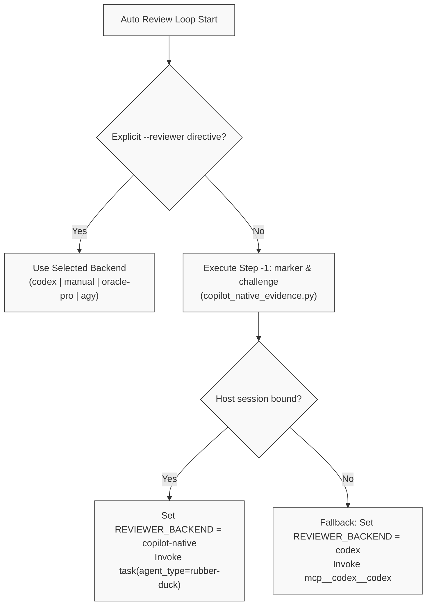
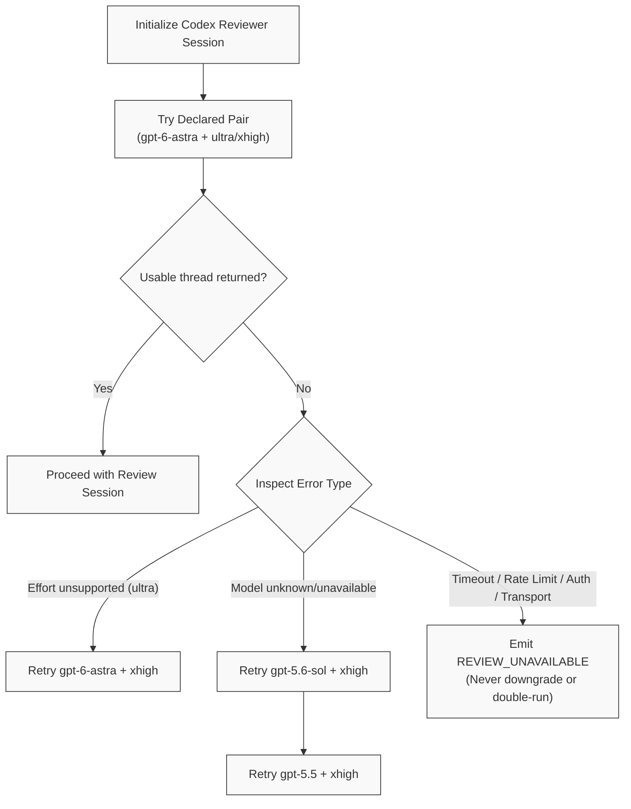
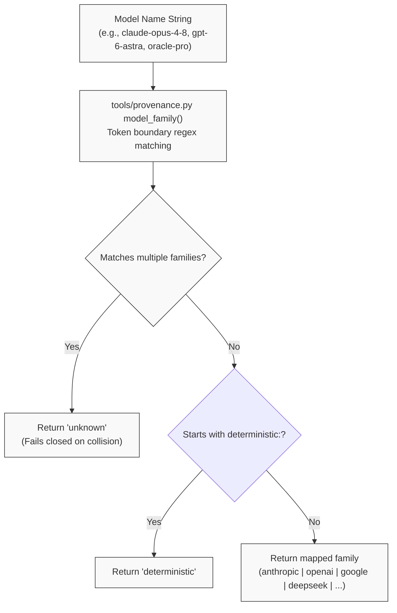
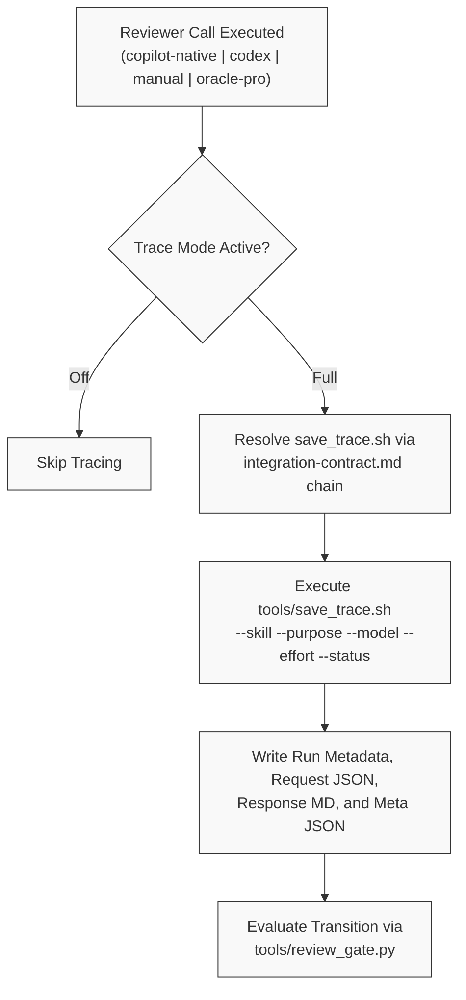

<!-- source: DeepWiki mcp.deepwiki.com · repo wanshuiyin/Auto-claude-code-research-in-sleep · extra page Reviewer Routing & Backend Selection · fetched 2026-10-26 -->

# Reviewer Routing & Backend Selection

Relevant source files

The following files were used as context for generating this wiki page:

- [docs/COPILOT_CLI_ADAPTATION.md](docs/COPILOT_CLI_ADAPTATION.md)
- [skills/auto-review-loop/SKILL.md](skills/auto-review-loop/SKILL.md)
- [skills/shared-references/integration-contract.md](skills/shared-references/integration-contract.md)
- [skills/shared-references/review-tracing.md](skills/shared-references/review-tracing.md)
- [skills/shared-references/reviewer-routing.md](skills/shared-references/reviewer-routing.md)
- [skills/shared-references/skill-governance.md](skills/shared-references/skill-governance.md)
- [skills/skills-codex/shared-references/integration-contract.md](skills/skills-codex/shared-references/integration-contract.md)
- [skills/skills-codex/shared-references/reviewer-routing.md](skills/skills-codex/shared-references/reviewer-routing.md)
- [tests/test_copilot_install.py](tests/test_copilot_install.py)
- [tests/test_copilot_native_evidence.py](tests/test_copilot_native_evidence.py)
- [tests/test_http_reviewer_fallback_contract.py](tests/test_http_reviewer_fallback_contract.py)
- [tests/test_http_reviewer_provenance_alignment.py](tests/test_http_reviewer_provenance_alignment.py)
- [tests/test_http_reviewer_review_gate.py](tests/test_http_reviewer_review_gate.py)
- [tests/test_llm_chat_review_fallback.py](tests/test_llm_chat_review_fallback.py)
- [tests/test_provenance.py](tests/test_provenance.py)
- [tests/test_review_gate.py](tests/test_review_gate.py)
- [tools/provenance.py](tools/provenance.py)
- [tools/review_gate.py](tools/review_gate.py)
- [tools/save_trace.sh](tools/save_trace.sh)

## Purpose and Scope

This document specifies the internal architecture of ARIS reviewer routing, backend resolution, capability fallback hierarchies, reasoning-effort tiers, and provenance/identity assurance classification. It governs how execution agents delegate critique tasks to independent reviewer backends, ensuring strict cross-model validation invariants and tamper-evident audit records.

Sources: [skills/shared-references/reviewer-routing.md:1-89](), [tools/provenance.py:1-18](), [tools/review_gate.py:1-7]()

---

## 1. `REVIEWER_BACKEND` Resolution & Routing Architecture

ARIS supports multiple reviewer backends depending on the active skill and host environment. When no explicit reviewer flag is provided, skills resolve their target backend through environment inspection and protocol probing.

### Supported Backends and Defaults

| Skill / Context | Default Backend | Opt-in Overrides / Aliases |
|-----------------|-----------------|----------------------------|
| `/auto-review-loop` | **`copilot-native`** (if host session marker binds) or **`codex`** [skills/auto-review-loop/SKILL.md:29](), [skills/shared-references/reviewer-routing.md:9]() | `--reviewer: codex`, `oracle-pro`, `agy`, `manual`, `copilot` [skills/shared-references/reviewer-routing.md:9]() |
| All other reviewer skills | **Codex MCP** (`mcp__codex__codex`), model `gpt-6-astra` [skills/shared-references/reviewer-routing.md:10]() | `--reviewer: oracle-pro`, `agy`, `manual` [skills/shared-references/reviewer-routing.md:10]() |

### The `copilot-native` Protocol

When `/auto-review-loop` executes without an explicit `--reviewer:` flag, it enters `auto` resolution mode [skills/auto-review-loop/SKILL.md:48-49](). Step -1 executes a two-call native marker/challenge probe via `copilot_native_evidence.py` [skills/auto-review-loop/SKILL.md:29]():
1. Issues a distinct run token binding (`<run_id>_r<round>_review_<8-random-hex>`) [skills/auto-review-loop/SKILL.md:52-53]().
2. Invokes `marker` and `challenge` as two separate root Bash calls [skills/auto-review-loop/SKILL.md:53-54]().
3. If the host session binds successfully, `REVIEWER_BACKEND` resolves to `copilot-native`, utilizing the built-in complementary `rubber-duck` subagent without hardcoding a static reviewer model [skills/auto-review-loop/SKILL.md:29, 54-57]().
4. If the probe exits with status `3` (unbound Copilot root session), the system falls back to `codex` [skills/auto-review-loop/SKILL.md:57]().

Sources: [skills/auto-review-loop/SKILL.md:28-60](), [skills/shared-references/reviewer-routing.md:3-27](), [tests/test_copilot_native_evidence.py:158-201]()

---

## 2. Reasoning-Effort Tiers & Capability Fallback Hierarchy

When Codex MCP is active (`mcp__codex__codex`), ARIS enforces a strict two-tier reasoning-effort policy using model `gpt-6-astra` [skills/shared-references/reviewer-routing.md:32-37]().

### Reasoning-Effort Tier Table

| Tier | `model_reasoning_effort` | Applicable Skills / Calls |
|------|--------------------------|---------------------------|
| **Deep-audit** | `ultra` | `/proof-checker`, `/kill-argument` (core attack/defense/adjudication threads), `/research-review`, `/experiment-audit`, `/paper-claim-audit`, `/result-to-claim`, `/meta-apply` [skills/shared-references/reviewer-routing.md:36]() |
| **Regular** | `xhigh` | All other reviewer calls, including all rounds of `/auto-review-loop` and per-item fan-outs like `/citation-audit` [skills/shared-references/reviewer-routing.md:37]() |

> ⚠️ **Configuration Rule:** Always pin both `model` and `config.model_reasoning_effort` explicitly in the first call of every thread [skills/shared-references/reviewer-routing.md:39](). Relying on `~/.codex/config.toml` defaults risks falling back to `low` reasoning effort [skills/shared-references/reviewer-routing.md:39]().

### Capability Fallback Protocol

When initializing a new reviewer session, ARIS attempts the declared model/effort pair [skills/shared-references/reviewer-routing.md:46-47](). If initialization fails before returning a usable thread, the capability chain applies strict rules:
1. **Effort Unsupported (older `codex-cli`):** If the error explicitly identifies the requested effort (`ultra`) as unsupported, retry with `gpt-6-astra` + `xhigh` [skills/shared-references/reviewer-routing.md:49]().
2. **Model Unknown/Unavailable:** If the error explicitly identifies `gpt-6-astra` as unavailable to the account, retry `gpt-5.6-sol` + `xhigh`, then `gpt-5.5` + `xhigh` [skills/shared-references/reviewer-routing.md:50]().
3. **Forbidden Downgrades:** Never downgrade on timeout, rate-limit, auth, transport, server, sandbox, context-length, or parse errors, as retrying risks double-running and double-billing [skills/shared-references/reviewer-routing.md:51]().
4. **Failure State:** If no allowed pair succeeds, emit `REVIEW_UNAVAILABLE` (or `ERROR` for mandatory audit gates) rather than fabricating a verdict [skills/shared-references/reviewer-routing.md:55]().

Sources: [skills/shared-references/reviewer-routing.md:30-56]()

---

## 3. Provenance & Identity Assurance Classification

To prevent self-acquittal bias (where a single model family authors and approves its own modifications), ARIS enforces structural provenance rules via `tools/provenance.py` and `tools/review_gate.py` [tools/provenance.py:1-18](), [tools/review_gate.py:1-6]().

### Model Family Mapping

The helper function `model_family(name)` maps model and vendor identifiers into coarse families while defending against substring collisions [tools/provenance.py:55-77](). It uses token boundary matching with version suffix support [tools/provenance.py:31-35]() and maps `oracle-pro` to the `openai` family (preventing an Oracle reviewer from pseudo-cross-checking a GPT-series executor) [tools/provenance.py:22-23]().

### Acceptance Status & Sidecar Stamping

When an auto-authored artifact is verified, `provenance.py` writes a tamper-evident `.provenance.json` sidecar record [tools/provenance.py:108-135](). 
- **Accepted (`stamp()`):** Requires `assert_cross_family(author_model, reviewer_model)` to pass [tools/provenance.py:80-99, 138-154](). The author and reviewer must belong to distinct families (or the reviewer must be a `deterministic:<verifier>`) [tools/provenance.py:80-86]().
- **Provisional (`stamp_provisional()`):** Used in Codex-only single-family workflows, recording `review_independence: same-family` and `acceptance_status: provisional` [tools/provenance.py:137-156](). Provisional artifacts are traceable but lack auto-curation authority [tools/provenance.py:11-17]().

Sources: [tools/provenance.py:1-156](), [tools/review_gate.py:59-164](), [tests/test_provenance.py:16-156]()

---

## 4. Trace Integration and Decision Gates

Every cross-model review invocation records full forensic traces under `.aris/traces/<skill-name>/<YYYY-MM-DD>_run<NN>/` via `tools/save_trace.sh` [skills/shared-references/review-tracing.md:21-31]().

### State Transitions and Gate Logic

The script `tools/review_gate.py` evaluates review outputs (scores, verdicts, and backend metadata) to compute authoritative state transitions [tools/review_gate.py:1-6, 136-158](). It parses native evidence artifacts, checks numeric bounds (`1 <= score <= 10`) [tools/review_gate.py:181](), and applies the operative Phase-E stop condition:
$$\text{Positive Threshold} \iff (\text{score} \geq 6/10) \land (\text{verdict} \in \{\text{ready}, \text{almost}\})$$

Sources: [skills/auto-review-loop/SKILL.md:26](), [tools/review_gate.py:1-186](), [skills/shared-references/review-tracing.md:1-143](), [tools/save_trace.sh:1-151]()

---

