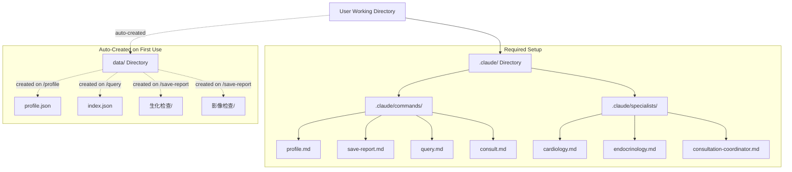
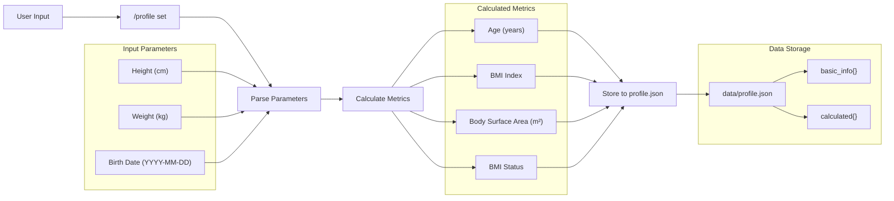
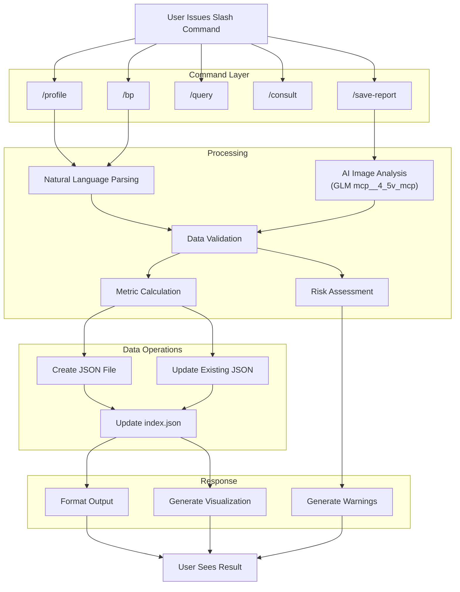
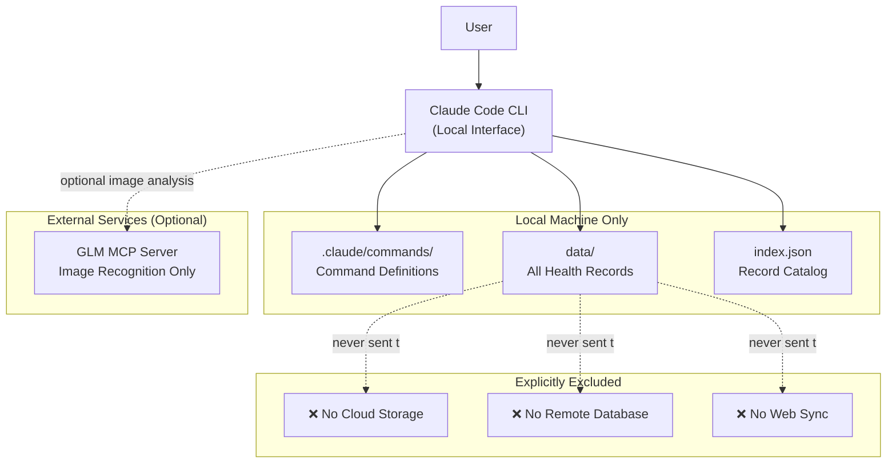

<!-- source: DeepWiki mcp.deepwiki.com · repo huifer/Claude-Ally-Health · page 2 Getting Started · fetched 2026-10-26 -->

# Getting Started

<details>
<summary>Relevant source files</summary>

The following files were used as context for generating this wiki page:

- [.claude/commands/get-profile.md](.claude/commands/get-profile.md)
- [.github/CONTRIBUTING.en.md](.github/CONTRIBUTING.en.md)
- [.github/SECURITY.en.md](.github/SECURITY.en.md)
- [README.md](README.md)
- [README.zh-CN.md](README.zh-CN.md)
- [docs/data-structures.md](docs/data-structures.md)

</details>


This document provides step-by-step instructions for setting up Claude-Ally-Health and performing initial configuration. It covers prerequisites, installation, first-time setup, and basic usage patterns to help you begin managing your personal health data.

For information about specific health tracking modules (pregnancy, diabetes, etc.), see [Health Tracking Modules](#4). For advanced features like multi-disciplinary consultations, see [AI Consultation System](#7).

---

## Purpose and Scope

This guide will help you:
- Install and configure Claude-Ally-Health on your local machine
- Set up your initial health profile
- Understand the file-based storage structure
- Execute your first commands
- Verify the system is working correctly

By the end of this guide, you will have a functioning local health information system ready to store medical reports, track health metrics, and provide AI-assisted analysis.

Sources: [README.md:99-109](), [README.zh-CN.md:98-109]()

---

## Prerequisites

### Required Software

Claude-Ally-Health operates entirely through the Claude Code CLI interface. Before beginning, ensure you have:

| Requirement | Description | Status Check |
|------------|-------------|--------------|
| **Claude Code** | Command-line interface for Claude AI | Must be installed and functional |
| **File System Access** | Read/write permissions to a local directory | Required for data storage |
| **Operating System** | Windows, macOS, or Linux | Any modern OS |

**Verification Steps:**

1. Open a terminal or command prompt
2. Navigate to your desired working directory
3. Verify Claude Code is accessible and you can execute commands

### Optional Components

| Component | Purpose | When Needed |
|-----------|---------|-------------|
| **GLM MCP Server** | Image recognition for medical reports | When using `/save-report` with images |
| **Disk Encryption** | Additional data security | Recommended for sensitive health data |
| **Backup Solution** | Data protection | Strongly recommended |

**Important Security Note:** The system stores all data locally in plain JSON files. Enable disk encryption (BitLocker on Windows, FileVault on macOS) to protect sensitive health information. See [Security & Privacy](#8.2) for detailed security practices.

Sources: [README.md:100-101](), [.github/SECURITY.en.md:63-84]()

---

## Installation & Project Setup

### Directory Structure Creation

Claude-Ally-Health uses a specific directory structure. The system will automatically create data directories when needed, but you must set up the command structure manually.

**Setup Diagram:**



Sources: [README.md:42-90](), [README.zh-CN.md:41-89]()

**Installation Steps:**

1. **Clone or Download Repository:**
   ```bash
   git clone https://github.com/huifer/Claude-Ally-Health.git
   cd Claude-Ally-Health
   ```

2. **Verify Directory Structure:**
   The repository includes pre-configured command and specialist files in the `.claude/` directory. Verify these exist:
   - `.claude/commands/` - Contains all slash command definitions
   - `.claude/specialists/` - Contains AI specialist skill definitions

3. **Initialize Working Directory:**
   Open Claude Code in the project root directory. The `data/` directory will be created automatically on first use.

Sources: [README.md:40-90]()

---

## Initial Configuration

### User Profile Setup

The first step in using Claude-Ally-Health is establishing your basic health profile. This profile provides foundational data for all calculations and assessments.

**Profile Command Structure:**



Sources: [.claude/commands/get-profile.md:1-156](), [docs/data-structures.md:98-132]()

**First-Time Setup Command:**

```bash
/profile set 175 70 1990-01-01
```

**Parameter Specification:**

| Position | Parameter | Type | Format | Example | Validation |
|----------|-----------|------|--------|---------|------------|
| 1 | Height | Integer | Centimeters | 175 | 50-250 cm |
| 2 | Weight | Number | Kilograms | 70 | 20-300 kg |
| 3 | Birth Date | String | YYYY-MM-DD | 1990-01-01 | Valid date, not future |

**Generated Data Structure:**

The profile command creates [data/profile.json]() with the following structure:

```json
{
  "basic_info": {
    "height": 175,
    "height_unit": "cm",
    "weight": 70,
    "weight_unit": "kg",
    "birth_date": "1990-01-01"
  },
  "calculated": {
    "age": 35,
    "bmi": 22.9,
    "bmi_status": "正常",
    "body_surface_area": 1.85,
    "bsa_unit": "m²"
  }
}
```

**Key Calculated Metrics:**

- **BMI (Body Mass Index):** Weight (kg) / [Height (m)]² - Used for nutritional assessment
- **BSA (Body Surface Area):** Calculated using Mosteller formula - Critical for radiation dose adjustments
- **Age:** Automatically calculated from birth date - Used for age-specific reference ranges

**Verification:**

Execute the following command to verify profile creation:

```bash
/get-profile
```

This displays a formatted visualization of your profile data as defined in [.claude/commands/get-profile.md:23-60]().

Sources: [README.md:103](), [.claude/commands/get-profile.md:1-156](), [docs/data-structures.md:98-132]()

---

## Understanding the File Structure

### Data Directory Organization

Claude-Ally-Health uses a hierarchical file system structure for data storage. Understanding this organization is essential for troubleshooting and data management.

**Data Directory Hierarchy:**

```mermaid
graph TB
    Root["data/"]
    
    subgraph "Core Files"
        Profile["profile.json<br/>User basic parameters"]
        Index["index.json<br/>Global catalog"]
        Allergies["allergies.json<br/>Allergy history"]
        Radiation["radiation-records.json<br/>Exposure tracking"]
    end
    
    subgraph "Medical Examinations"
        Biochem["生化检查/<br/>Biochemical tests"]
        BiochemMonth["YYYY-MM/<br/>Month directories"]
        BiochemFile["YYYY-MM-DD_test_name.json"]
        
        Imaging["影像检查/<br/>Medical imaging"]
        ImagingMonth["YYYY-MM/<br/>Month directories"]
        ImagingFile["YYYY-MM-DD_test_name_part.json"]
        ImagingImg["images/<br/>Original image backup"]
    end
    
    subgraph "Medications"
        MedDir["medications/"]
        MedFile["medications.json<br/>Active medication list"]
        MedLogs["medication-logs/<br/>Daily adherence records"]
        
        IntDir["interactions/"]
        IntDB["interaction-db.json<br/>Interaction rules"]
        IntLogs["interaction-logs/<br/>Check history"]
    end
    
    subgraph "Health Tracking"
        Pregnancy["pregnancy-tracker.json<br/>Pregnancy data"]
        Postpartum["postpartum-tracker.json<br/>Postpartum care"]
        Chronic["chronic-disease-trackers/<br/>hypertension.json<br/>diabetes.json<br/>copd.json"]
    end
    
    Root --> Profile
    Root --> Index
    Root --> Allergies
    Root --> Radiation
    
    Root --> Biochem
    Biochem --> BiochemMonth
    BiochemMonth --> BiochemFile
    
    Root --> Imaging
    Imaging --> ImagingMonth
    ImagingMonth --> ImagingFile
    ImagingMonth --> ImagingImg
    
    Root --> MedDir
    MedDir --> MedFile
    MedDir --> MedLogs
    
    Root --> IntDir
    IntDir --> IntDB
    IntDir --> IntLogs
    
    Root --> Pregnancy
    Root --> Postpartum
    Root --> Chronic
```



Sources: [README.md:67-89](), [README.zh-CN.md:66-88]()

**Directory Purposes:**

| Directory | Purpose | File Format | Auto-Created |
|-----------|---------|-------------|--------------|
| `data/` | Root data directory | N/A | Yes |
| `data/生化检查/` | Biochemical test results | JSON | On first `/save-report` |
| `data/影像检查/` | Medical imaging reports | JSON + Images | On first `/save-report` |
| `data/medications/` | Medication management | JSON | On first `/medication` |
| `data/interactions/` | Drug interaction database | JSON | Pre-configured |
| `data/pregnancy-tracker.json` | Pregnancy tracking | JSON | On `/pregnancy start` |
| `data/hypertension-tracker.json` | Blood pressure data | JSON | On first `/bp record` |

**Month-Based Organization:**

Medical examination data uses month-based subdirectories (`YYYY-MM/`) to organize historical records efficiently. This structure enables:

- Fast queries by date range
- Easy archival of old data
- Reduced file system overhead

**Example File Paths:**

```
data/生化检查/2025-12/2025-12-31_血常规.json
data/影像检查/2025-12/2025-12-31_胸部CT_胸部.json
data/影像检查/2025-12/images/original_20251231123456.jpg
data/medications/medication-logs/2025-12/2025-12-31.json
```

Sources: [README.md:67-89](), [docs/data-structures.md:1-510]()

### Index File Structure

The [data/index.json]() file serves as a global catalog of all medical records, enabling efficient queries across multiple data sources.

**Index Organization:**

```json
{
  "biochemical_exams": [
    {
      "id": "20251231123456789",
      "date": "2025-12-31",
      "type": "生化检查",
      "file_path": "data/生化检查/2025-12/2025-12-31_血常规.json"
    }
  ],
  "imaging_exams": [
    {
      "id": "20251231123456789",
      "date": "2025-12-31",
      "type": "影像检查",
      "subtype": "CT",
      "file_path": "data/影像检查/2025-12/2025-12-31_胸部CT_胸部.json"
    }
  ],
  "last_updated": "2025-12-31T12:34:56.789Z"
}
```

The index is automatically maintained by commands that create or modify data files. You never need to edit it manually.

Sources: [docs/data-structures.md:133-163]()

---

## Basic Workflow

### Command Execution Patterns

All operations in Claude-Ally-Health follow a consistent command → process → store → respond pattern.

**Command Processing Flow:**



Sources: [README.md:118-133]()

### Common First Commands

After setting up your profile, execute these commands to familiarize yourself with the system:

**1. Save a Medical Report**

```bash
/save-report /path/to/blood_test.jpg
```

This command:
- Invokes AI image recognition via GLM MCP server
- Extracts biochemical test values and reference ranges
- Creates a JSON file in `data/生化检查/YYYY-MM/`
- Updates `data/index.json` catalog
- Returns formatted test results with abnormal value highlighting

Command definition: [.claude/commands/save-report.md]()

**2. Query All Records**

```bash
/query all
```

Returns a chronological list of all medical records from [data/index.json]().

Command definition: [.claude/commands/query.md]()

**3. Record Blood Pressure**

```bash
/bp record 120/80
```

Creates or updates [data/hypertension-tracker.json]() with:
- Systolic/diastolic readings
- Timestamp
- ACOG classification (Normal/Elevated/Stage 1/Stage 2)
- Trend analysis if multiple readings exist

See [Hypertension Management](#4.5.1) for detailed tracking features.

**4. Check Drug Interactions**

```bash
/interaction check
```

Analyzes current medications in [data/medications/medications.json]() against the interaction database in [data/interactions/interaction-db.json](), checking for:
- Drug-drug interactions
- Drug-disease interactions
- Drug-dose warnings
- Drug-food interactions

Returns severity-graded warnings (A/B/C/D/X levels). Command definition: [.claude/commands/interaction.md]()

**5. View User Profile**

```bash
/get-profile
```

Displays formatted visualization of [data/profile.json]() including BMI status and body surface area calculations.

Sources: [README.md:99-109](), [README.md:118-133]()

---

## Verification & Testing

### System Health Check

After initial setup, verify the system is functioning correctly:

**Verification Command Sequence:**

| Step | Command | Expected Behavior | Verification File |
|------|---------|-------------------|-------------------|
| 1 | `/profile set 175 70 1990-01-01` | Profile created successfully | `data/profile.json` exists |
| 2 | `/get-profile` | Displays formatted profile with BMI 22.9 | Visual output shows calculated metrics |
| 3 | `/query all` | Returns empty list or existing records | `data/index.json` exists |
| 4 | `/bp record 120/80` | Creates hypertension tracker | `data/hypertension-tracker.json` exists |
| 5 | `/query all` | Returns blood pressure record | Index shows hypertension entry |

**File System Verification:**

After executing the above commands, verify the following files exist:

```
data/
├── profile.json
├── index.json
└── hypertension-tracker.json
```

**Common Issues:**

| Issue | Symptom | Solution |
|-------|---------|----------|
| Commands not recognized | "Command not found" error | Verify `.claude/commands/` directory exists |
| Data not saving | No files created in `data/` | Check write permissions on working directory |
| Image recognition failing | "Cannot analyze image" | Verify GLM MCP server is configured |
| Profile calculation errors | Incorrect BMI/BSA values | Check input parameter formats |

Sources: [README.md:99-109](), [.github/SECURITY.en.md:106-115]()

---

## Understanding Data Privacy

### Local-Only Storage Model

Claude-Ally-Health implements a **zero-cloud** architecture where all data remains on your local machine.

**Privacy Architecture:**



Sources: [README.md:111-116](), [.github/SECURITY.en.md:54-84]()

**Security Features:**

1. **Local Storage:** All JSON files stored in `data/` directory on local file system
2. **No Cloud Sync:** System never uploads data to external services
3. **No External Database:** Pure file-based storage, no network connections
4. **Git Exclusion:** `.gitignore` prevents accidental commits of `data/` directory
5. **OS-Level Protection:** Relies on operating system access controls and disk encryption

**Single Exception:**

When using the `/save-report` command with image files, the system may call external AI services (GLM MCP server) for image recognition. The original image is sent to the service for analysis, then results are stored locally. This is documented in [README.md:17]() and [README.zh-CN.md:17]().

**Recommended Security Practices:**

- Enable disk encryption (BitLocker/FileVault/LUKS)
- Use strong computer account passwords
- Regularly backup the `data/` directory to encrypted storage
- Verify `.gitignore` excludes `data/` before committing code changes
- Review security policy: [.github/SECURITY.en.md]()

Sources: [README.md:111-116](), [.github/SECURITY.en.md:54-99]()

---

## Next Steps

After completing initial setup, explore these capabilities:

### Core Features to Explore

| Feature | Documentation | Command |
|---------|---------------|---------|
| **Medical Report Management** | [Saving Medical Reports](#5.1) | `/save-report` |
| **Query System** | [Querying Health Records](#5.2) | `/query` |
| **Emergency Information** | [Emergency Medical Information Card](#5.3) | `/emergency-card` |
| **Drug Safety** | [Drug Interaction Detection](#6.1) | `/interaction` |
| **AI Consultations** | [AI Consultation System](#7) | `/consult` |

### Health Domain Modules

Depending on your health management needs, explore specialized tracking modules:

| Life Stage | Module | Documentation |
|------------|--------|---------------|
| Women | Pregnancy, Postpartum, Menopause | [Women's Health](#4.1) |
| Men | Prostate, Fertility, Andropause | [Men's Health](#4.2) |
| Child | Growth, Vaccination, Puberty | [Child & Adolescent Health](#4.3) |
| Elderly | Cognitive, Fall Risk, Polypharmacy | [Elderly Health](#4.4) |
| Chronic Disease | Hypertension, Diabetes, COPD | [Chronic Disease Management](#4.5) |

### Advanced Topics

- **User Profile Management:** See [User Profile Setup](#2.1) for detailed profile configuration
- **Data Storage Architecture:** See [Data Storage & Privacy Model](#3.2)
- **Multi-Disciplinary Consultations:** See [Multi-Disciplinary Team (MDT) Consultation](#7.1)
- **Contributing to the Project:** See [Development & Contributing](#8)

### Learning Resources

- **Full User Guide:** Comprehensive command documentation in [docs/user-guide.md]() (Chinese) or [docs/user-guide.en.md]() (English)
- **Data Structure Reference:** Complete JSON schemas in [docs/data-structures.md]()
- **Medical Safety Principles:** Critical safety information in [docs/safety-guidelines.md]() (Chinese)

Sources: [README.md:92-97](), [README.md:118-133]()

---

## Quick Reference

### Essential Commands

```bash
# Profile Management
/profile set [height] [weight] [birth_date]  # Create/update profile
/get-profile                                  # View profile

# Medical Records
/save-report [image_path]                     # Save medical report
/query all                                    # List all records
/query recent                                 # Recent records

# Health Tracking
/bp record [systolic/diastolic]               # Blood pressure
/glucose record [value]                       # Blood glucose
/pregnancy start                              # Start pregnancy tracking

# Safety & Medication
/interaction check                            # Check drug interactions
/allergy add [allergen]                       # Record allergy

# AI Consultation
/consult                                      # Multi-disciplinary consultation
/specialist [specialty]                       # Single specialist consultation
```

### Data File Locations

```bash
data/profile.json                             # User profile
data/index.json                               # Global catalog
data/生化检查/YYYY-MM/                         # Biochemical tests
data/影像检查/YYYY-MM/                         # Imaging reports
data/medications/medications.json             # Active medications
data/interactions/interaction-db.json         # Interaction rules
data/[condition]-tracker.json                 # Condition-specific trackers
```

### Support Resources

- **GitHub Repository:** https://github.com/huifer/Claude-Ally-Health
- **Issue Tracker:** https://github.com/huifer/Claude-Ally-Health/issues
- **Security Contact:** huifer97@163.com
- **Developer:** WellAlly Tech (https://www.wellally.tech/)

Sources: [README.md:1-190](), [.github/SECURITY.en.md:129-131]()

---

