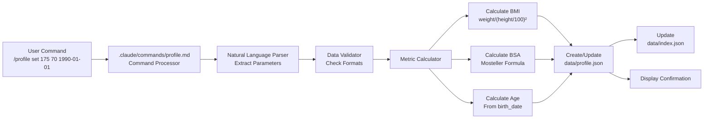
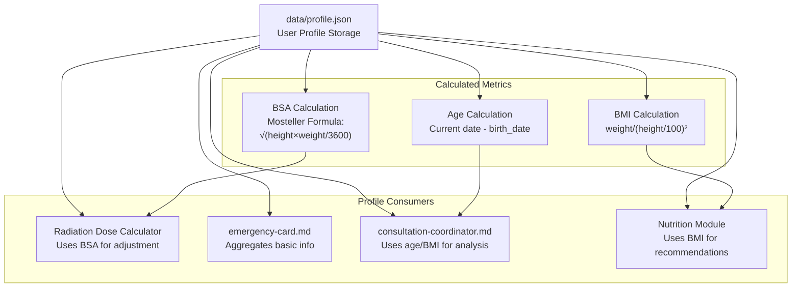
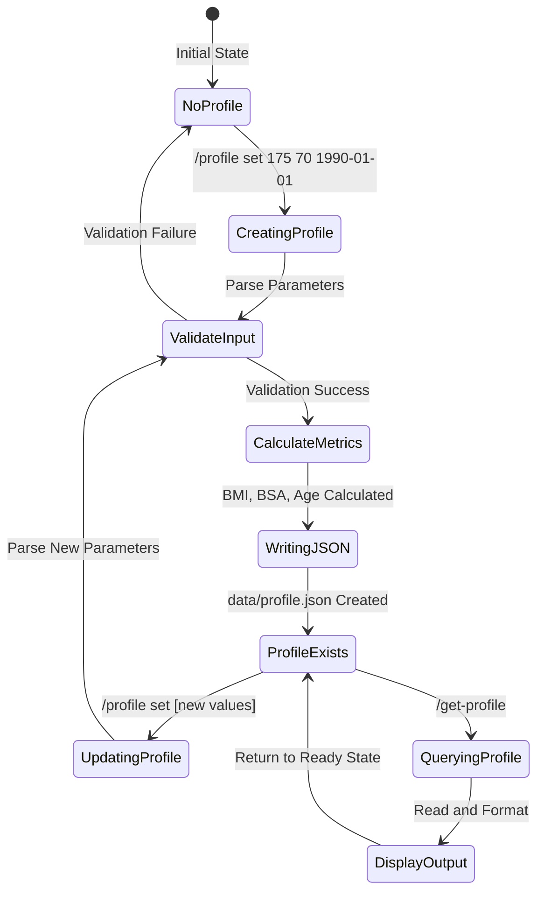

<!-- source: DeepWiki mcp.deepwiki.com · repo huifer/Claude-Ally-Health · page 2.1 User Profile Setup · fetched 2026-10-26 -->

# User Profile Setup

<details>
<summary>Relevant source files</summary>

The following files were used as context for generating this wiki page:

- [.claude/commands/get-profile.md](.claude/commands/get-profile.md)
- [.github/CONTRIBUTING.en.md](.github/CONTRIBUTING.en.md)
- [.github/SECURITY.en.md](.github/SECURITY.en.md)
- [README.md](README.md)
- [README.zh-CN.md](README.zh-CN.md)
- [docs/data-structures.md](docs/data-structures.md)

</details>


## Purpose and Scope

This document explains the user profile management system in Claude-Ally-Health, which stores and manages basic health parameters including height, weight, birth date, and automatically calculated metrics such as BMI (Body Mass Index) and BSA (Body Surface Area). The profile serves as foundational data used throughout the system for medical calculations, radiation dose adjustments, and emergency information generation.

For information about emergency information cards that aggregate profile data with other health records, see [Emergency Medical Information Card](#5.3).

**Sources:** [README.md:103](), [README.md:122]()

---

## Profile Data Structure

The user profile is stored as a JSON file at `data/profile.json` with two primary sections: basic information entered by the user and calculated metrics derived from that information.

### JSON Schema

```json
{
  "basic_info": {
    "height": 175,
    "height_unit": "cm",
    "weight": 70,
    "weight_unit": "kg",
    "birth_date": "1990-01-01"
  },
  "calculated": {
    "age": 35,
    "bmi": 22.9,
    "bmi_status": "正常",
    "body_surface_area": 1.85,
    "bsa_unit": "m²"
  }
}
```

### Field Definitions

| Field | Type | Description | Source |
|-------|------|-------------|--------|
| `basic_info.height` | Number | User height value | User input |
| `basic_info.height_unit` | String | Unit of measurement, always "cm" | System default |
| `basic_info.weight` | Number | User weight value | User input |
| `basic_info.weight_unit` | String | Unit of measurement, always "kg" | System default |
| `basic_info.birth_date` | String | Date in YYYY-MM-DD format | User input |
| `calculated.age` | Number | Age in years | Calculated from birth_date |
| `calculated.bmi` | Number | Body Mass Index | Calculated: weight/(height/100)² |
| `calculated.bmi_status` | String | BMI classification (偏瘦/正常/超重/肥胖) | Derived from BMI |
| `calculated.body_surface_area` | Number | Body surface area in m² | Mosteller formula |
| `calculated.bsa_unit` | String | Unit, always "m²" | System default |

**Sources:** [docs/data-structures.md:100-132]()

---

## Profile Command Interface

### Command: `/profile set`

The `/profile` command is defined in `.claude/commands/profile.md` and provides functionality for setting user profile parameters.

**Syntax:**
```
/profile set <height> <weight> <birth_date>
```

**Parameters:**
- `height`: Height in centimeters (integer)
- `weight`: Weight in kilograms (number, can include decimals)
- `birth_date`: Date of birth in YYYY-MM-DD format

**Example:**
```bash
/profile set 175 70 1990-01-01
```

This creates or updates the profile with:
- Height: 175 cm
- Weight: 70 kg  
- Birth Date: January 1, 1990

### Command: `/get-profile`

The `/get-profile` command is defined in `.claude/commands/get-profile.md` and displays the user's profile information with calculated metrics and visualization.

**Syntax:**
```
/get-profile
```

**Output:** The command generates a formatted display showing:
- Basic information (height, weight, birth date, age)
- BMI with visual indicator on a scale
- Body surface area
- Record metadata (creation date, last update)
- Weight history trend (if available)

**Sources:** [README.md:103](), [.claude/commands/get-profile.md:1-156]()

---

## Profile Data Flow

### Diagram: Profile Command Processing Pipeline



**Sources:** [README.md:103](), [README.md:140-144](), [docs/data-structures.md:100-132]()

### Diagram: Profile Data Usage Across System



**Sources:** [README.md:42-88](), [.claude/commands/get-profile.md:48-49]()

---

## Calculated Health Metrics

### Body Mass Index (BMI)

BMI is calculated using the formula:
```
BMI = weight (kg) / [height (m)]²
```

The system automatically categorizes BMI values using Chinese health standards:

| BMI Range | Status | Classification |
|-----------|--------|----------------|
| < 18.5 | 偏瘦 | Underweight |
| 18.5 - 23.9 | 正常 | Normal |
| 24.0 - 27.9 | 超重 | Overweight |
| ≥ 28.0 | 肥胖 | Obese |

**Implementation Note:** The BMI status is recalculated every time the profile is queried or updated to ensure accuracy with current weight values.

**Sources:** [.claude/commands/get-profile.md:107-113](), [docs/data-structures.md:127-130]()

### Body Surface Area (BSA)

BSA is calculated using the Mosteller formula:
```
BSA (m²) = √[(height (cm) × weight (kg)) / 3600]
```

**Purpose:** BSA is a critical metric used throughout the system for:
- **Radiation Dose Adjustment**: Different body sizes result in different effective radiation doses for the same imaging procedure. The radiation tracking system uses BSA to calculate adjustment factors and actual doses received.
- **Medication Dosing**: Some medications (particularly chemotherapy) are dosed based on BSA rather than weight.
- **Physiological Calculations**: BSA is used in various physiological calculations across medical specialties.

The BSA value is stored in `calculated.body_surface_area` and updated automatically whenever height or weight changes.

**Sources:** [docs/data-structures.md:130-131](), [.claude/commands/get-profile.md:118-123](), [docs/data-structures.md:80-97]()

---

## Profile Storage and File Management

### File Location

The profile is stored at:
```
data/profile.json
```

This file is excluded from version control via `.gitignore` to maintain data privacy.

### Directory Structure Context

```
my-his/
├── .claude/
│   └── commands/
│       ├── profile.md          # Profile set command
│       └── get-profile.md      # Profile query command
└── data/
    ├── profile.json            # User profile storage
    └── index.json              # Global catalog (references profile)
```

**Sources:** [README.md:40-90](), [docs/data-structures.md:99-132]()

### Data Privacy Protections

The profile system implements privacy-first design:

1. **Local Storage Only**: All data remains on the local filesystem with no cloud synchronization.
2. **Version Control Exclusion**: The `data/` directory is excluded via `.gitignore` to prevent accidental commits.
3. **No External Dependencies**: Profile data never leaves the local machine except when explicitly using optional AI image analysis features.

**Sources:** [README.md:111-116](), [.github/SECURITY.en.md:54-84]()

---

## Profile Update Workflow

### Diagram: Profile Creation and Update Lifecycle



**Sources:** [README.md:103](), [.claude/commands/get-profile.md:12-17]()

### Update History Tracking

The profile system can optionally maintain a `history` array for tracking weight changes over time:

```json
{
  "basic_info": { ... },
  "calculated": { ... },
  "history": [
    {
      "date": "2025-12-31",
      "weight": 70.0,
      "bmi": 22.9
    },
    {
      "date": "2025-11-15", 
      "weight": 71.5,
      "bmi": 23.4
    }
  ]
}
```

When history data exists, the `/get-profile` command displays weight trends showing the most recent 5 entries with calculated BMI and percentage change.

**Sources:** [.claude/commands/get-profile.md:127-142]()

---

## Integration with Other System Components

### Profile as Foundation Data

The user profile serves as foundational data referenced by multiple system components:

| Component | Uses Profile For | Specific Fields Used |
|-----------|------------------|---------------------|
| Radiation Tracking | Dose adjustment calculations | `body_surface_area` |
| Emergency Card | Basic patient identification | `height`, `weight`, `birth_date`, `age` |
| MDT Consultation | Age-appropriate medical analysis | `age`, `bmi` |
| Nutrition Tracking | BMI-based recommendations | `bmi`, `bmi_status` |
| Child Health Modules | Age-appropriate assessments | `birth_date`, `age` |
| Elderly Health Modules | Geriatric-specific analysis | `age` |

### Global Index Integration

When the profile is created or updated, the system updates `data/index.json` to maintain a global catalog. While the index primarily tracks medical records, it also stores profile metadata for quick access without reading the full profile file.

**Sources:** [README.md:31-38](), [docs/data-structures.md:133-163]()

---

## Profile Validation Rules

The profile command processor implements the following validation rules:

### Height Validation
- **Range**: 50 cm - 250 cm
- **Type**: Integer
- **Purpose**: Ensure physiologically plausible values

### Weight Validation  
- **Range**: 2 kg - 300 kg
- **Type**: Number (decimals allowed)
- **Purpose**: Support pediatric to adult ranges

### Birth Date Validation
- **Format**: YYYY-MM-DD (ISO 8601)
- **Range**: Must be in the past
- **Maximum Age**: Typically validated to not exceed 150 years
- **Purpose**: Prevent future dates and implausible ages

**Sources:** [.claude/commands/get-profile.md:15-17]()

---

## Common Operations

### Initial Profile Setup
```bash
# First time usage
/profile set 175 70 1990-01-01
```

### Updating Weight Only
```bash
# When weight changes, re-run with current height and birth date
/profile set 175 68.5 1990-01-01
```

### Viewing Current Profile
```bash
/get-profile
```

### Viewing Profile with History
If weight history is tracked, the `/get-profile` command automatically displays trends when the `history` array contains data.

**Sources:** [README.md:103](), [.claude/commands/get-profile.md:145-155]()

---

## Error Handling

### Profile Not Found
When `/get-profile` is executed before profile setup:

```
┌────────────────────────────────────────────┐
│         ⚠️  数据未设置                      │
├────────────────────────────────────────────┤
│                                            │
│  还未设置个人健康档案信息                   │
│  请使用以下命令设置：                       │
│  /profile set 175 70 1990-01-01            │
│                                            │
└────────────────────────────────────────────┘
```

### Incomplete Data
When some profile fields are missing, the system displays available data with placeholders for missing values and prompts for completion.

**Sources:** [.claude/commands/get-profile.md:84-101]()

---

