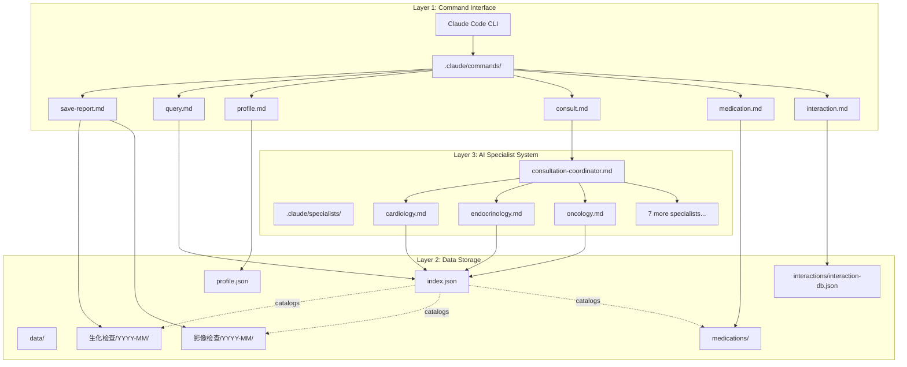
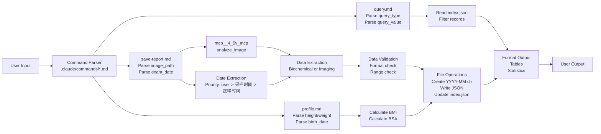
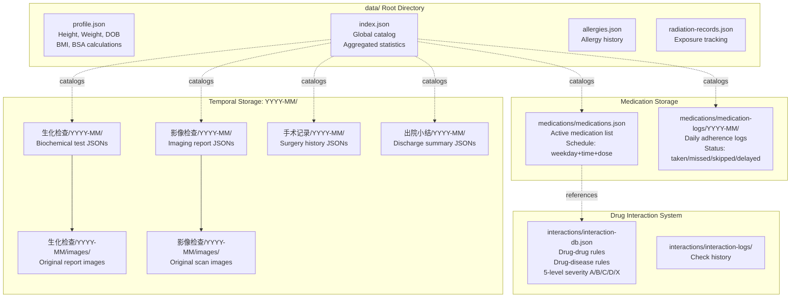
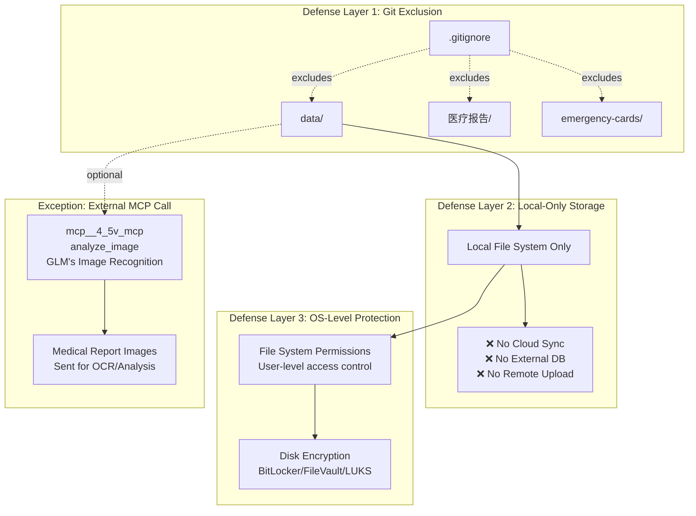
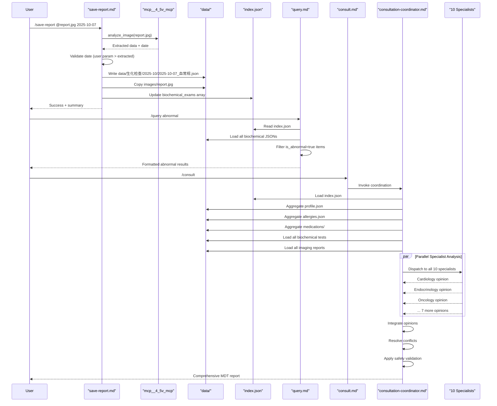

<!-- source: DeepWiki mcp.deepwiki.com · repo huifer/Claude-Ally-Health · page 3 Core Architecture · fetched 2026-10-26 -->

# Core Architecture

<details>
<summary>Relevant source files</summary>

The following files were used as context for generating this wiki page:

- [.claude/commands/query.md](.claude/commands/query.md)
- [.claude/commands/save-report.md](.claude/commands/save-report.md)
- [.gitignore](.gitignore)
- [README.md](README.md)
- [README.zh-CN.md](README.zh-CN.md)
- [docs/data-structures.md](docs/data-structures.md)

</details>


## Purpose and Scope

This document describes the fundamental architectural design of Claude-Ally-Health, including its three-layer architecture (Command Interface, Data Storage, AI Specialist Framework), command processing pipeline, and data flow patterns. For specific health tracking modules and their implementations, see [Health Tracking Modules](#4). For setup and basic usage, see [Getting Started](#2).

## System Overview

Claude-Ally-Health implements a three-layer architecture built on Claude Code's slash command system and local file storage. The system operates entirely locally with no cloud dependencies, processing user commands through a structured pipeline that coordinates data operations and AI specialist analysis.

### Architectural Layers



**Sources:** [README.md:40-90](), [.gitignore:1-17]()

| Layer | Location | Purpose | Key Components |
|-------|----------|---------|----------------|
| **Command Interface** | `.claude/commands/` | User interaction via slash commands | `save-report.md`, `query.md`, `profile.md`, `consult.md`, `medication.md`, `interaction.md` |
| **Data Storage** | `data/` | Local JSON file storage with month-based directories | `index.json`, `profile.json`, `生化检查/`, `影像检查/`, `medications/`, `interactions/` |
| **AI Specialist System** | `.claude/specialists/` | Domain-specific medical analysis | `consultation-coordinator.md`, 10+ specialist skill files |

**Sources:** [README.md:40-90](), [README.zh-CN.md:39-89]()

## Command Processing Pipeline

The system processes user commands through a structured five-stage pipeline: Parse → Validate → Process → Store → Output. Each command defined in `.claude/commands/` follows this pattern.

### Command Execution Flow



**Sources:** [.claude/commands/save-report.md:1-407](), [.claude/commands/query.md:1-104]()

### Command Argument Processing

Commands use a declarative YAML front-matter format for argument specification. The system parses these arguments from natural language input.

**Example from `save-report.md`:**
```yaml
---
arguments:
  - name: image_path
    description: 检查单图片的本地路径
    required: true
  - name: exam_date
    description: 检查日期（格式：YYYY-MM-DD）
    required: false
---
```

**Date Priority Resolution** (used in `save-report.md`):
1. User-provided `exam_date` parameter (highest priority)
2. 采样时间 (sample collection time) from image
3. 送样时间 (sample submission time) from image  
4. 检测时间/报告时间 (test/report time) from image
5. Other date identifiers from image
6. Current date (fallback only)

**Sources:** [.claude/commands/save-report.md:1-25](), [.claude/commands/save-report.md:63-76]()

### Image Recognition Integration

The `save-report` command integrates with GLM's MCP server (`mcp__4_5v_mcp__analyze_image`) for medical report extraction. Different report types use specialized prompts.

**Report Type Detection:**
- **生化检查 (Biochemical)**: Blood tests, urine analysis → extracts items with values, units, reference ranges
- **影像检查 (Imaging)**: B超, CT, MRI, X光, etc. → extracts findings, measurements, conclusions

**Specialized Imaging Templates** (9 types):
1. B超/彩超 - extracts TI-RADS grading, nodule sizes
2. X光 - extracts fracture lines, density descriptions
3. CT - extracts CT values (HU), RECIST assessments
4. MRI - extracts ADC values, BI-RADS/PI-RADS grading
5. 内窥镜 - extracts polyp location, Paris classification
6. 病理 - extracts TNM staging, immunohistochemistry
7. 心电图 - extracts PR/QRS/QT intervals, heart rate
8. 乳腺钼靶 - extracts BI-RADS 0-6 classification
9. PET-CT - extracts SUVmax, metabolic tumor volume

**Sources:** [.claude/commands/save-report.md:205-380](), [README.md:17]()

## Data Storage Architecture

The system uses a hierarchical file-based storage model with month-based directories and a global index for efficient queries.

### Directory Structure and File Organization



**Sources:** [README.md:40-90](), [docs/data-structures.md:1-509]()

### File Naming Conventions

| Data Type | Path Format | Example |
|-----------|-------------|---------|
| Biochemical Tests | `data/生化检查/YYYY-MM/YYYY-MM-DD_test_name.json` | `data/生化检查/2025-10/2025-10-07_血液常规.json` |
| Imaging Reports | `data/影像检查/YYYY-MM/YYYY-MM-DD_test_name_body_part.json` | `data/影像检查/2025-10/2025-10-07_B超_甲状腺.json` |
| Surgery Records | `data/手术记录/YYYY-MM/YYYY-MM-DD_surgery_name.json` | `data/手术记录/2025-08/2025-08-15_胆囊切除.json` |
| Discharge Summaries | `data/出院小结/YYYY-MM/YYYY-MM-DD_main_diagnosis.json` | `data/出院小结/2025-08/2025-08-20_胆囊结石.json` |
| Medication Logs | `data/medications/medication-logs/YYYY-MM/YYYY-MM-DD.json` | `data/medications/medication-logs/2025-12/2025-12-31.json` |

**Sources:** [README.md:66-88](), [docs/data-structures.md:98-101]()

### Data Structure Specifications

**`index.json` Global Catalog:**
```json
{
  "biochemical_exams": [
    {
      "id": "20251231123456789",
      "date": "2025-12-31",
      "type": "生化检查",
      "file_path": "data/生化检查/2025-12/2025-12-31_血常规.json"
    }
  ],
  "imaging_exams": [...],
  "medications": [...],
  "medication_logs": [...],
  "last_updated": "2025-12-31T12:34:56.789Z"
}
```

**Biochemical Test Record:**
```json
{
  "id": "{{timestamp}}",
  "type": "生化检查",
  "date": "YYYY-MM-DD",
  "hospital": "医院名称",
  "original_image": "images/{{filename}}",
  "items": [
    {
      "name": "检查项目",
      "value": "数值",
      "unit": "单位",
      "min_ref": "最小值",
      "max_ref": "最大值",
      "is_abnormal": true/false
    }
  ]
}
```

**Imaging Report Record with Target Tracking:**
```json
{
  "id": "{{timestamp}}",
  "type": "影像检查",
  "subtype": "B超/CT/MRI/X光",
  "date": "YYYY-MM-DD",
  "body_part": "检查部位",
  "findings": {
    "description": "描述",
    "targets": [
      {
        "name": "结节/病灶名称",
        "location": "具体位置",
        "size": {
          "length": "长径",
          "width": "短径",
          "unit": "mm/cm"
        },
        "characteristics": {
          "morphology": "形态",
          "border": "边界",
          "density": "密度/回声"
        }
      }
    ],
    "measurements": {},
    "conclusion": "结论"
  }
}
```

**Sources:** [docs/data-structures.md:133-161](), [docs/data-structures.md:3-70](), [.claude/commands/save-report.md:98-160]()

### Medication Schedule Structure

The medication system uses explicit `schedule` arrays that define every dose for every day of the week.

**Schedule Generation Rules:**
- Daily 1x: 7 records (Monday-Sunday, 1 time each)
- Daily 2x: 14 records (Monday-Sunday, 2 times each)
- Daily 3x: 21 records (Monday-Sunday, 3 times each)
- Every other day: 4 records (specific weekdays)
- Weekly: 1 record (specific weekday)

**Example - Daily 2x medication:**
```json
{
  "id": "med_20251231123456789",
  "name": "阿司匹林",
  "dosage": {"value": 100, "unit": "mg"},
  "frequency": {"type": "daily", "times_per_day": 2},
  "schedule": [
    {"weekday": 1, "time": "08:00", "timing_label": "早餐后", "dose": {"value": 100, "unit": "mg"}},
    {"weekday": 1, "time": "20:00", "timing_label": "晚餐后", "dose": {"value": 100, "unit": "mg"}},
    {"weekday": 2, "time": "08:00", "timing_label": "早餐后", "dose": {"value": 100, "unit": "mg"}},
    {"weekday": 2, "time": "20:00", "timing_label": "晚餐后", "dose": {"value": 100, "unit": "mg"}},
    // ... continues for all 7 days = 14 records total
  ]
}
```

**Adherence Status Values:**
- `taken`: Taken on time or with delay
- `missed`: Not taken when scheduled
- `skipped`: Intentionally skipped per medical instruction
- `delayed`: Taken but later than scheduled time

**Adherence Calculation:**
```
Adherence % = (taken + delayed) / (total_scheduled - skipped) × 100
```

**Sources:** [docs/data-structures.md:277-474]()

### Privacy Protection Mechanisms



**`.gitignore` Exclusions:**
```
data/
医疗报告/
emergency-cards/*
*.tmp
*.log
```

**Privacy Guarantee:**
All health data remains on the local machine in the `data/` directory. The only exception is optional use of `mcp__4_5v_mcp__analyze_image` for image recognition, which sends report images to GLM's MCP server. Users can avoid this by manually entering data.

**Sources:** [.gitignore:1-17](), [README.md:111-116](), [README.zh-CN.md:110-115]()

## AI Specialist Framework

The system implements a subagent architecture where specialized AI "doctors" provide domain-specific medical analysis. This framework operates through two mechanisms: Multi-Disciplinary Team (MDT) consultations and individual specialist consultations.

### Specialist Skill Architecture

```mermaid
graph TB
    subgraph "Command Entry Points"
        ConsultCmd["/consult command<br/>consult.md"]
        SpecialistCmd["/specialist command<br/>specialist.md"]
    end
    
    subgraph "Coordination Layer"
        Coordinator[".claude/specialists/<br/>consultation-coordinator.md<br/>Data aggregation<br/>Parallel dispatch<br/>Opinion integration"]
    end
    
    subgraph "Medical Specialist Skills"
        Cardiology[".claude/specialists/cardiology.md<br/>Lipids, BP, ECG, ASCVD"]
        Endocrinology[".claude/specialists/endocrinology.md<br/>Glucose, HbA1c, Thyroid, Hormones"]
        Gastroenterology[".claude/specialists/gastroenterology.md<br/>Liver enzymes, Endoscopy, GI imaging"]
        Nephrology[".claude/specialists/nephrology.md<br/>Creatinine, eGFR, Electrolytes"]
        Hematology[".claude/specialists/hematology.md<br/>CBC, Coagulation, Blood smear"]
        Respiratory[".claude/specialists/respiratory.md<br/>PFT, Chest imaging, COPD"]
        Neurology[".claude/specialists/neurology.md<br/>Cognitive tests, Brain imaging"]
        Oncology[".claude/specialists/oncology.md<br/>Tumor markers, Imaging, Pathology"]
        Geriatrics[".claude/specialists/geriatrics.md<br/>ADL/IADL, Fall risk, Polypharmacy"]
        General[".claude/specialists/general.md<br/>Comprehensive overview"]
    end
    
    subgraph "Data Sources"
        ProfileData["profile.json"]
        AllergiesData["allergies.json"]
        MedData["medications/medications.json"]
        BiochemData["生化检查/YYYY-MM/*.json"]
        ImagingData["影像检查/YYYY-MM/*.json"]
        ChronicData["chronic-disease trackers"]
        IndexData["index.json"]
    end
    
    ConsultCmd --> Coordinator
    SpecialistCmd --> Cardiology
    SpecialistCmd --> Endocrinology
    SpecialistCmd --> Oncology
    
    Coordinator --> ProfileData
    Coordinator --> AllergiesData
    Coordinator --> MedData
    Coordinator --> BiochemData
    Coordinator --> ImagingData
    Coordinator --> ChronicData
    Coordinator --> IndexData
    
    Coordinator -.parallel_dispatch.-> Cardiology
    Coordinator -.parallel_dispatch.-> Endocrinology
    Coordinator -.parallel_dispatch.-> Gastroenterology
    Coordinator -.parallel_dispatch.-> Nephrology
    Coordinator -.parallel_dispatch.-> Hematology
    Coordinator -.parallel_dispatch.-> Respiratory
    Coordinator -.parallel_dispatch.-> Neurology
    Coordinator -.parallel_dispatch.-> Oncology
    Coordinator -.parallel_dispatch.-> Geriatrics
    Coordinator -.parallel_dispatch.-> General
    
    Cardiology --> Integration["Opinion Integration<br/>Conflict resolution<br/>Priority: urgency > safety"]
    Endocrinology --> Integration
    Gastroenterology --> Integration
    Nephrology --> Integration
    Hematology --> Integration
    Respiratory --> Integration
    Neurology --> Integration
    Oncology --> Integration
    Geriatrics --> Integration
    General --> Integration
    
    Integration --> SafetyCheck["Safety Validation<br/>❌ No diagnoses<br/>❌ No prescriptions<br/>❌ No prognosis"]
    SafetyCheck --> Report["Comprehensive MDT Report"]
```



**Sources:** [README.md:54-66](), [README.zh-CN.md:53-65]()

### Specialist Capabilities

| Specialist | File | Domain Expertise | Key Data Sources |
|------------|------|------------------|------------------|
| **Cardiology** | `cardiology.md` | Lipid panels, blood pressure trends, ECG, ASCVD risk scoring | Biochemical tests (cholesterol, triglycerides), hypertension tracker, ECG reports |
| **Endocrinology** | `endocrinology.md` | Glucose metabolism, HbA1c, thyroid function, hormones | Diabetes tracker, biochemical tests (TSH, T3, T4, glucose), hormone panels |
| **Gastroenterology** | `gastroenterology.md` | Liver enzymes, endoscopy findings, GI imaging | Biochemical tests (ALT, AST, bilirubin), endoscopy reports, abdominal imaging |
| **Nephrology** | `nephrology.md` | Renal function, electrolytes, eGFR calculations | Biochemical tests (creatinine, BUN, electrolytes), urine analysis |
| **Hematology** | `hematology.md` | Complete blood count, coagulation, blood smear analysis | Biochemical tests (WBC, RBC, platelets, PT/INR) |
| **Respiratory** | `respiratory.md` | Pulmonary function tests, chest imaging, COPD assessment | COPD tracker, chest X-ray/CT, spirometry results |
| **Neurology** | `neurology.md` | Cognitive assessment, brain imaging, neurological exams | Cognitive assessment tracker, brain MRI/CT reports |
| **Oncology** | `oncology.md` | Tumor markers, imaging surveillance, pathology review | Tumor markers (CEA, CA19-9, PSA), imaging reports, pathology results |
| **Geriatrics** | `geriatrics.md` | Functional status, fall risk, medication safety | ADL/IADL tracker, fall risk assessment, polypharmacy management |
| **General** | `general.md` | Comprehensive health overview, cross-system integration | All data sources |

**Sources:** [README.md:56-65](), [README.zh-CN.md:55-64]()

### MDT Consultation Workflow

The Multi-Disciplinary Team consultation (`/consult` command) implements parallel specialist analysis with opinion integration.

**Execution Stages:**

1. **Data Aggregation** - `consultation-coordinator.md` loads all available patient data
2. **Parallel Dispatch** - All specialists analyze data simultaneously (subagent architecture)
3. **Domain Analysis** - Each specialist generates independent assessment within their domain
4. **Opinion Collection** - Coordinator aggregates all specialist opinions
5. **Conflict Resolution** - Priority rules: urgency > safety > specialist domain expertise
6. **Synthesis** - Unified recommendation set with prioritized actions
7. **Safety Validation** - Enforce medical ethics boundaries (no diagnoses/prescriptions/prognosis)
8. **Report Generation** - Comprehensive MDT report with specialist sections

**Conflict Resolution Rules:**
- Emergency findings override routine recommendations
- Safety concerns take precedence over optimization
- Within-domain specialists have priority (e.g., Cardiology overrides General for cardiac issues)
- Multiple specialists agreeing on a recommendation elevates its priority

**Sources:** [README.md:54](), [README.zh-CN.md:53]()

### Safety Red Lines

All specialist outputs are validated against these constraints:

| Constraint | Implementation | Rationale |
|------------|----------------|-----------|
| **No Specific Diagnoses** | Specialists provide "findings suggest consideration of..." not "diagnosis is..." | Legal and ethical boundaries - diagnosis requires licensed physician |
| **No Prescription Details** | Recommend "discuss medication options" not "prescribe Drug X at Y mg" | Medication requires individual assessment and prescription authority |
| **No Prognosis Predictions** | Avoid "life expectancy" or "survival probability" statements | Ethical concerns, highly individual factors |
| **No Treatment Decisions** | Suggest "consult specialist for treatment options" not "you should do Treatment Z" | Treatment decisions require doctor-patient relationship |

**Validation Point:** Safety validation occurs after opinion integration, before report generation. Any specialist output violating these constraints is filtered or rewritten.

**Sources:** [README.md:148-159](), [README.zh-CN.md:147-158]()

## Integration and Data Flow

The three architectural layers (Command Interface, Data Storage, AI Specialist System) integrate through the `index.json` global catalog and standardized JSON data structures.

### Cross-Layer Data Flow



**Sources:** [.claude/commands/save-report.md:1-407](), [.claude/commands/query.md:1-104](), [README.md:54-66]()

### Query System Implementation

The query system (`query.md`) provides six query types, all operating through `index.json`:

**Query Types and Index Usage:**

| Query Type | Command | Index Usage | Additional Processing |
|------------|---------|-------------|----------------------|
| **All Records** | `/query all` | Read all arrays in `index.json` | Sort by date descending |
| **Biochemical Only** | `/query biochemical` | Read `biochemical_exams` array | Load referenced JSON files |
| **Imaging Only** | `/query imaging` | Read `imaging_exams` array | Load referenced JSON files |
| **Recent N** | `/query recent 10` | Read all arrays, sort, slice first N | Load top N JSON files |
| **By Date** | `/query date 2025-10-07` | Filter all arrays by `date` field | Support YYYY-MM or YYYY-MM-DD |
| **Abnormal Values** | `/query abnormal` | Read `biochemical_exams`, load files | Filter items where `is_abnormal=true` |

**Index Update Trigger Points:**
- After `save-report` writes new biochemical/imaging record
- After `medication` command adds/updates medication
- After `surgery` command records surgery
- After `discharge` command saves discharge summary

**Sources:** [.claude/commands/query.md:1-104](), [docs/data-structures.md:133-161]()

### Drug Interaction Detection System

The interaction detection system (`interaction.md`) implements a 5-level severity classification (A/B/C/D/X) for drug-drug, drug-disease, drug-dose, and drug-food interactions.

**Severity Levels:**

| Level | Name | Meaning | Clinical Action |
|-------|------|---------|----------------|
| **A** | No Known Interaction | No documented interaction | No action required |
| **B** | Minor | Minimal clinical significance | Monitor for symptoms |
| **C** | Moderate | May require monitoring or adjustment | Monitor closely, consider alternatives |
| **D** | Major | May cause serious adverse effects | Avoid combination if possible, intensive monitoring |
| **X** | Contraindicated | Absolutely contraindicated | Never use together, find alternatives |

**Detection Algorithm:**
1. Load active medications from `medications/medications.json`
2. Load allergies from `allergies.json`
3. Load interaction rules from `interactions/interaction-db.json`
4. Check all pairwise drug combinations
5. Check each drug against disease history
6. Check dose ranges against recommendations
7. Generate severity-graded warnings with management recommendations
8. Log check results to `interactions/interaction-logs/`

**Sources:** [README.md:161-186](), [README.zh-CN.md:160-184]()

---

**Key Takeaways:**
- Three-layer architecture: Command Interface (`.claude/commands/`) → Data Storage (`data/`) → AI Specialists (`.claude/specialists/`)
- Command processing follows Parse → Validate → Process → Store → Output pipeline
- All data stored locally in month-based directories (`YYYY-MM/`) with JSON format
- `index.json` serves as global catalog enabling efficient cross-domain queries
- Medication system uses explicit weekly schedules with adherence tracking
- AI specialist system implements parallel subagent analysis with opinion integration
- Privacy enforced through `.gitignore`, local-only storage, and OS-level protections
- Safety red lines prevent diagnoses, prescriptions, and prognosis predictions

---

