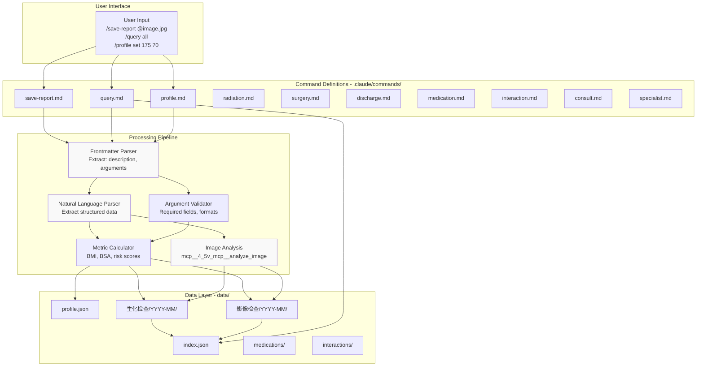
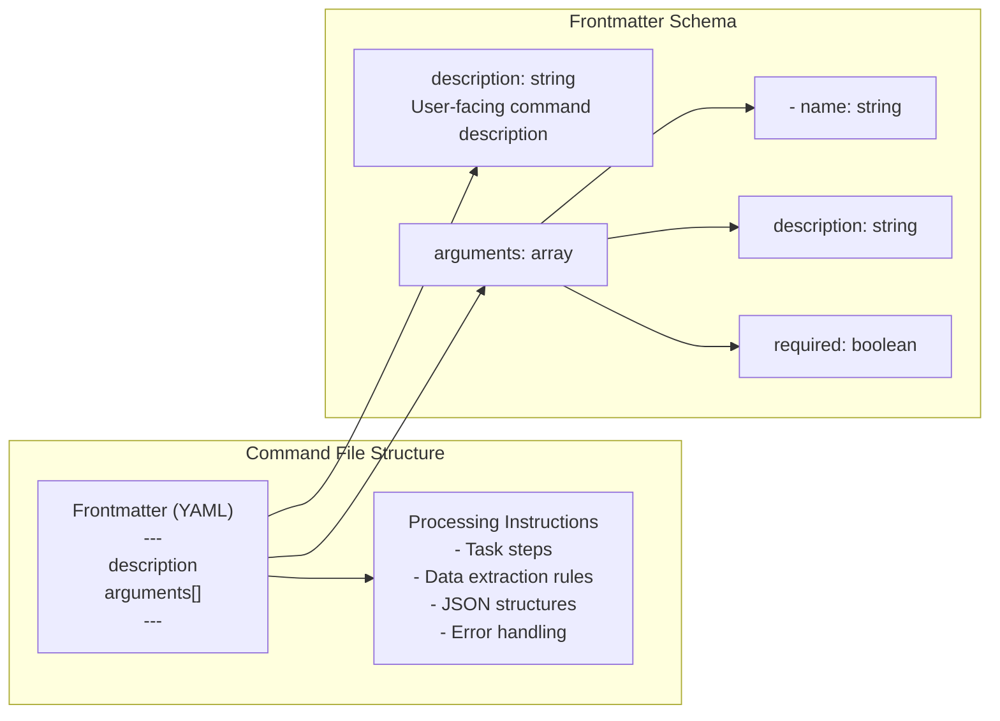
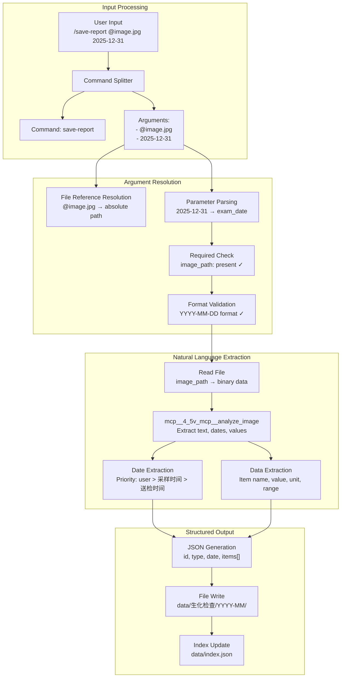
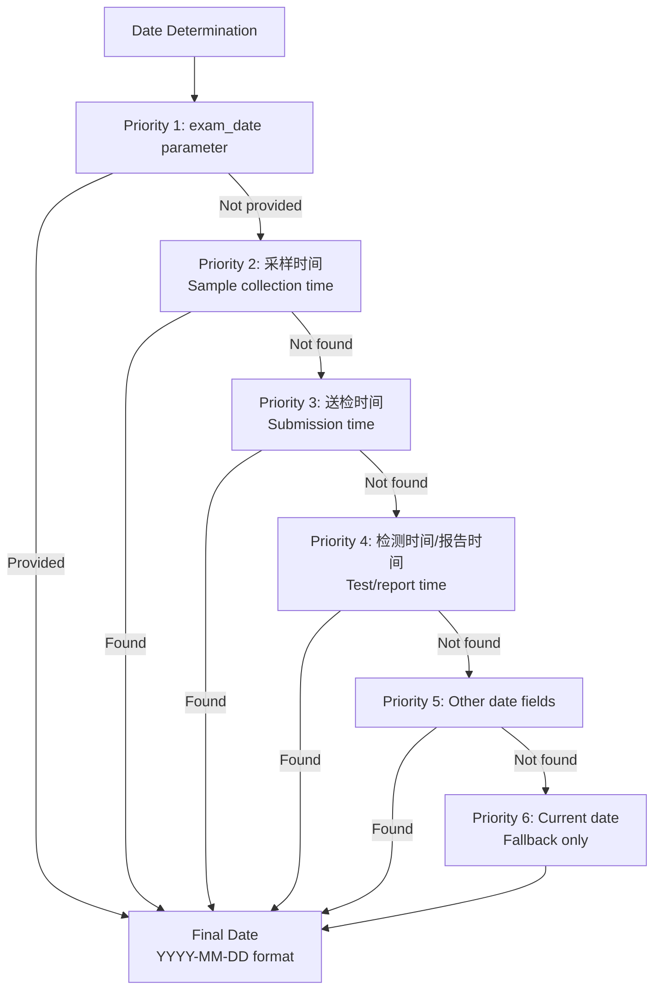
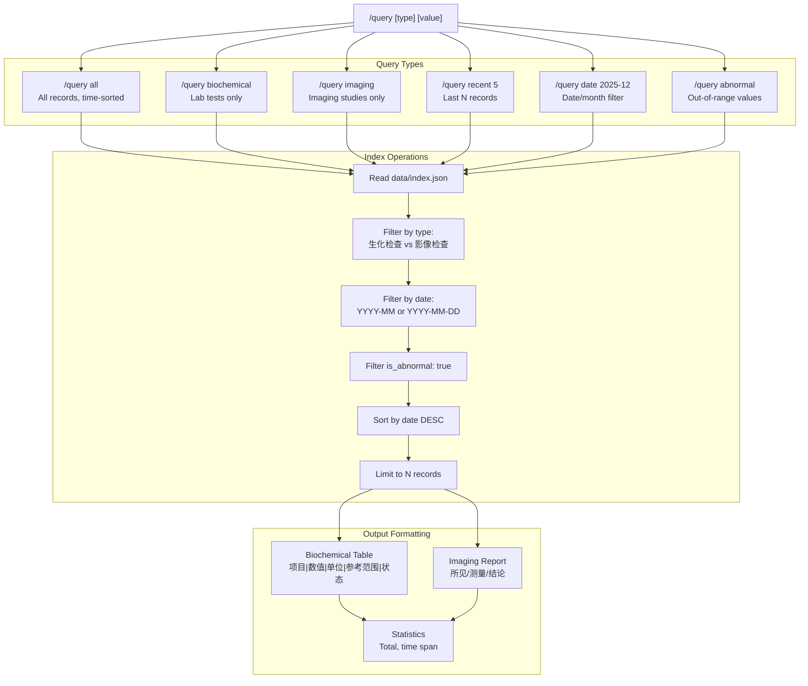
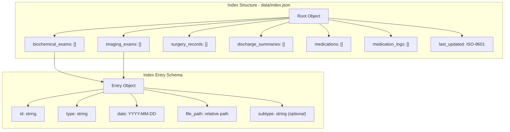
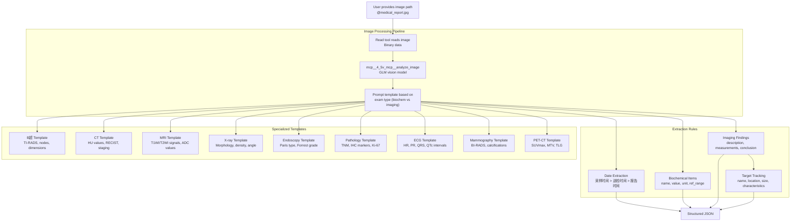
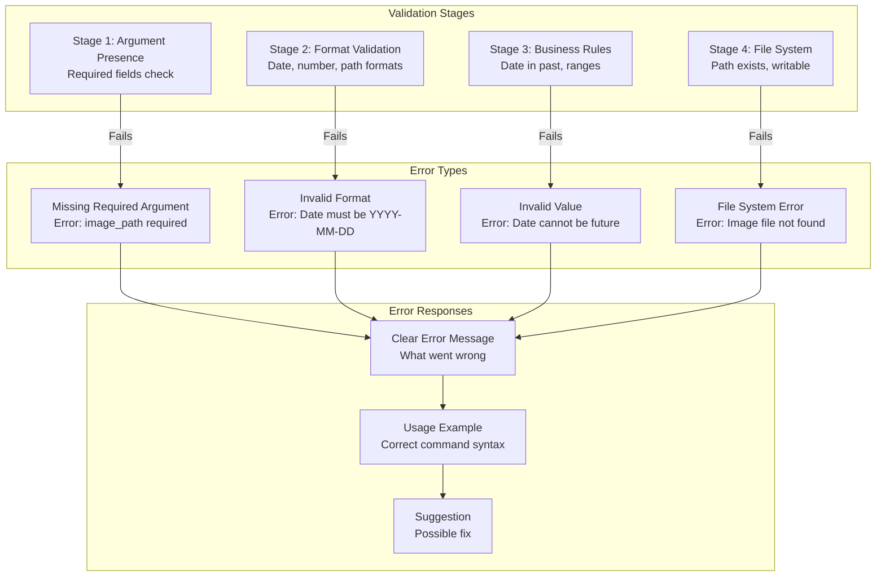

<!-- source: DeepWiki mcp.deepwiki.com · repo huifer/Claude-Ally-Health · page 3.1 Command Interface System · fetched 2026-10-26 -->

# Command Interface System

<details>
<summary>Relevant source files</summary>

The following files were used as context for generating this wiki page:

- [.claude/commands/query.md](.claude/commands/query.md)
- [.claude/commands/save-report.md](.claude/commands/save-report.md)
- [.gitignore](.gitignore)
- [README.md](README.md)
- [README.zh-CN.md](README.zh-CN.md)
- [docs/data-structures.md](docs/data-structures.md)

</details>


## Purpose and Scope

This document describes the command interface system that provides the primary user interaction layer for Claude-Ally-Health. The system implements a slash command architecture where users issue natural language commands (e.g., `/save-report`, `/query all`) that trigger structured processing pipelines. This page covers command definition structure, argument parsing, natural language processing, and the execution flow from user input to data storage.

For information about how commands interact with stored data structures, see [Data Storage & Privacy Model](#3.2). For details on specialized consultation commands that leverage AI specialists, see [AI Specialist Framework](#3.3).

## Command System Architecture

The command interface is implemented using Claude Code's slash command feature, where each command is defined as a Markdown file in `.claude/commands/` with structured frontmatter metadata. Commands operate on JSON files stored in the `data/` directory and maintain system state through a global index.



**Sources:** [README.md:40-89](), [.claude/commands/save-report.md:1-10](), [.claude/commands/query.md:1-10]()

## Command Definition Structure

Each command is defined using YAML frontmatter followed by Markdown instructions. The frontmatter specifies metadata and argument definitions that control command parsing and validation.



### Example: save-report.md Frontmatter

```yaml
---
description: 保存医疗检查单到个人医疗数据中心
arguments:
  - name: image_path
    description: 检查单图片的本地路径
    required: true
  - name: exam_date
    description: 检查日期（格式：YYYY-MM-DD，如未提供则从图片中提取）
    required: false
---
```

**Sources:** [.claude/commands/save-report.md:1-10](), [.claude/commands/query.md:1-10]()

### Available Commands

| Command | File | Purpose | Key Arguments |
|---------|------|---------|---------------|
| `/profile` | `profile.md` | User profile setup | height, weight, birth_date |
| `/save-report` | `save-report.md` | Save medical reports | image_path, exam_date |
| `/query` | `query.md` | Query health records | query_type, query_value |
| `/radiation` | `radiation.md` | Radiation tracking | exam_type, body_part |
| `/surgery` | `surgery.md` | Surgery history | natural language description |
| `/discharge` | `discharge.md` | Discharge summaries | image_path |
| `/medication` | `medication.md` | Medication management | natural language description |
| `/interaction` | `interaction.md` | Drug interactions | check/list operation |
| `/consult` | `consult.md` | MDT consultation | none (uses all data) |
| `/specialist` | `specialist.md` | Single specialist | specialist_name |

**Sources:** [README.md:118-133]()

## Natural Language Processing Pipeline

Commands implement a multi-stage pipeline that transforms natural language inputs into structured data. The pipeline varies by command type but follows a consistent pattern.



**Sources:** [.claude/commands/save-report.md:20-91](), [README.md:143]()

### Date Extraction Priority System

The `/save-report` command implements a sophisticated date extraction system with six priority levels:



**Sources:** [.claude/commands/save-report.md:62-75]()

## Command Categories and Data Flow

Commands are organized into functional categories based on their data operations and target storage locations.

```mermaid
graph TB
    subgraph "Profile Management"
        ProfileCmd["/profile set<br/>profile.md"]
        ProfileData["data/profile.json<br/>height, weight, birth_date<br/>BMI, BSA calculations"]
    end
    
    subgraph "Medical Reports"
        SaveReportCmd["/save-report<br/>save-report.md"]
        BiochemData["data/生化检查/YYYY-MM/<br/>YYYY-MM-DD_test.json"]
        ImagingData["data/影像检查/YYYY-MM/<br/>YYYY-MM-DD_type_part.json"]
        ImageBackup["images/<br/>Original image files"]
    end
    
    subgraph "Medical History"
        RadiationCmd["/radiation<br/>radiation.md"]
        SurgeryCmd["/surgery<br/>surgery.md"]
        DischargeCmd["/discharge<br/>discharge.md"]
        RadiationData["data/radiation-records.json"]
        SurgeryData["data/手术记录/YYYY-MM/"]
        DischargeData["data/出院小结/YYYY-MM/"]
    end
    
    subgraph "Medication Safety"
        MedicationCmd["/medication<br/>medication.md"]
        InteractionCmd["/interaction<br/>interaction.md"]
        MedData["data/medications/<br/>medications.json"]
        InteractionDB["data/interactions/<br/>interaction-db.json"]
        InteractionLogs["data/interactions/<br/>interaction-logs/"]
    end
    
    subgraph "Query & Consultation"
        QueryCmd["/query<br/>query.md"]
        ConsultCmd["/consult<br/>consult.md"]
        SpecialistCmd["/specialist<br/>specialist.md"]
        Index["data/index.json<br/>Global catalog"]
    end
    
    ProfileCmd --> ProfileData
    
    SaveReportCmd --> BiochemData
    SaveReportCmd --> ImagingData
    SaveReportCmd --> ImageBackup
    
    RadiationCmd --> RadiationData
    SurgeryCmd --> SurgeryData
    DischargeCmd --> DischargeData
    
    MedicationCmd --> MedData
    InteractionCmd --> InteractionDB
    InteractionCmd --> InteractionLogs
    
    BiochemData --> Index
    ImagingData --> Index
    SurgeryData --> Index
    DischargeData --> Index
    MedData --> Index
    
    QueryCmd --> Index
    ConsultCmd --> Index
    SpecialistCmd --> Index
```



**Sources:** [README.md:40-89](), [README.md:118-133]()

## File Path Mapping and Naming Conventions

Commands follow strict conventions for file naming and directory organization to maintain consistency and enable efficient querying.

### Biochemical Examination Path Pattern

```
data/生化检查/YYYY-MM/YYYY-MM-DD_检查类型.json
```

**Example:** `data/生化检查/2025-12/2025-12-31_血液常规.json`

### Imaging Examination Path Pattern

```
data/影像检查/YYYY-MM/YYYY-MM-DD_检查类型_检查部位.json
```

**Example:** `data/影像检查/2025-12/2025-12-31_B超_腹部.json`

### Image Backup Path Pattern

```
data/[检查类型]/YYYY-MM/images/[original_filename]
```

**Example:** `data/生化检查/2025-12/images/血液检查_原图.jpg`

### Surgery Records Path Pattern

```
data/手术记录/YYYY-MM/YYYY-MM-DD_手术名称.json
```

### Discharge Summaries Path Pattern

```
data/出院小结/YYYY-MM/YYYY-MM-DD_主要诊断.json
```

**Sources:** [.claude/commands/save-report.md:98-101](), [README.md:67-88]()

## Query Command Interface

The `/query` command provides a unified interface for retrieving medical records with multiple query types that operate on `data/index.json`.



**Sources:** [.claude/commands/query.md:1-103]()

### Query Output Formats

#### Biochemical Test Output

```
日期：YYYY-MM-DD
检查类型：血液常规
━━━━━━━━━━━━━━━━━━━━━━━━━━
检查项目          | 数值  | 单位    | 参考范围    | 状态
────────────────────────────────────────
白细胞计数        | 6.5   | ×10^9/L | 3.5-9.5     | ✅ 正常
血红蛋白          | 145   | g/L     | 130-175     | ✅ 正常
```

#### Imaging Study Output

```
日期：YYYY-MM-DD
检查类型：B超
检查部位：腹部
━━━━━━━━━━━━━━━━━━━━━━━━━━
检查所见：
[描述内容]

测量数据：
- 尺寸：XXX

检查结论：
[结论内容]
```

**Sources:** [.claude/commands/query.md:50-76]()

## Index Management System

The `data/index.json` file serves as a global catalog that enables efficient querying without reading all data files. Commands that create or modify records must update the index.



### Index Update Operations

When a command creates a new record, it must:

1. Read existing `data/index.json`
2. Append new entry to appropriate array
3. Update `last_updated` timestamp
4. Write modified index back to disk

**Example index entry for biochemical exam:**

```json
{
  "id": "20251231123456789",
  "type": "生化检查",
  "date": "2025-12-31",
  "file_path": "data/生化检查/2025-12/2025-12-31_血液常规.json"
}
```

**Sources:** [.claude/commands/save-report.md:170-183](), [docs/data-structures.md:133-163]()

## Image Analysis Integration

The `/save-report` command integrates with an external image analysis service (`mcp__4_5v_mcp__analyze_image`) to extract structured data from medical report images.



### Image Analysis Prompt Templates

The system uses nine specialized prompt templates for different imaging modalities:

| Modality | Template Focus | Key Extractions |
|----------|---------------|-----------------|
| B超/彩超 | Ultrasound | TI-RADS grade, node dimensions, echo characteristics |
| CT | Computed Tomography | HU values, 3D measurements, RECIST assessment |
| MRI | Magnetic Resonance | T1WI/T2WI signals, ADC values, BI-RADS/PI-RADS |
| X光 | X-ray | Morphology, density, CTR ratio, fracture healing |
| 内窥镜 | Endoscopy | Paris type, Forrest grade, LA classification |
| 病理 | Pathology | TNM staging, IHC markers (ER/PR/HER2), Ki-67 |
| 心电图 | ECG | HR, PR interval, QRS duration, QTc, axis |
| 乳腺钼靶 | Mammography | ACR density, BI-RADS grade, calcification pattern |
| PET-CT | PET-CT | SUVmax, MTV, TLG, metabolic activity |

**Sources:** [.claude/commands/save-report.md:205-380](), [README.md:17]()

### Example: B超 Analysis Prompt

```markdown
请详细识别这张B超/彩超检查报告的所有内容，包括：
1. 检查日期
2. 医院名称
3. 检查部位：如甲状腺、乳腺、肝脏、胆囊、子宫附件等
4. 监测目标：明确识别报告中描述的"结节"、"囊肿"、"占位"、"息肉"等具体对象
5. 核心量化指标：精准提取尺寸描述，例如 15mm*10mm*8mm 或 大小约1.2x0.8cm，并解析为结构化的长、宽、高数值
6. 关键定性描述：
   - 形态：类圆形、不规则形等
   - 边界：清晰、模糊等
   - 内部回声：低回声、强回声、无回声等
   - 有无钙化：微钙化、粗大钙化
   - 血流信号：CDFI描述
7. 诊断结论：提取"超声提示"或"诊断意见"，如"甲状腺结节（TI-RADS 3类）"等重要分级结论
```

**Sources:** [.claude/commands/save-report.md:209-226]()

## Parameter Validation and Error Handling

Commands implement validation at multiple stages to ensure data integrity and provide clear error messages.



### Common Validation Rules

| Field | Rule | Error Message |
|-------|------|---------------|
| `image_path` | File exists, readable | "Image file not found at [path]" |
| `exam_date` | YYYY-MM-DD format | "Date format must be YYYY-MM-DD" |
| `exam_date` | Not future date | "Exam date cannot be in the future" |
| `query_type` | One of valid types | "Invalid query type. Use: all, biochemical, imaging, recent, date, abnormal" |
| `query_value` | Integer for 'recent' | "Recent query requires a number (e.g., /query recent 10)" |
| `height` | Positive number | "Height must be a positive number" |
| `weight` | Positive number | "Weight must be a positive number" |

**Sources:** [.claude/commands/save-report.md:192-204](), [.claude/commands/query.md:86-92]()

## Success Output Format

Commands provide consistent, informative success messages that summarize the operation performed and key results.

### save-report Success Output

```
✅ 检查单保存成功！

类型：生化检查（血液常规）
日期：2025-10-07（使用用户指定日期）
提取到 15 项检查指标
文件路径：data/生化检查/2025-10/2025-10-07_血液常规.json

关键指标：
- 白细胞计数：6.5 ×10^9/L（正常）
- 血红蛋白：145 g/L（正常）
...
```

### query Success Output

```
📊 查询结果：最近5条记录

记录 1/5
日期：2025-12-31
类型：生化检查（血液常规）
━━━━━━━━━━━━━━━━━━━━━━━━━━
[详细数据表格]

统计摘要：
━━━━━━━━━━━━━━━━━━━━━━━━━━
总记录数：45
生化检查：30 | 影像检查：15
时间跨度：2024-01-15 至 2025-12-31
```

**Sources:** [.claude/commands/save-report.md:382-407](), [.claude/commands/query.md:50-84]()

## Command Execution Examples

### Example 1: Save Biochemical Report with Auto Date Extraction

```bash
/save-report @医疗报告/血液检查.jpg
```

**Execution flow:**
1. Parse command: `save-report`, argument: `@医疗报告/血液检查.jpg`
2. Resolve file reference to absolute path
3. Read image file
4. Call `mcp__4_5v_mcp__analyze_image` with biochemical prompt
5. Extract date using priority system (采样时间 first)
6. Extract items: name, value, unit, reference ranges
7. Generate ID: `20251231123456789`
8. Create JSON at `data/生化检查/2025-12/2025-12-31_血液检查.json`
9. Copy image to `data/生化检查/2025-12/images/`
10. Update `data/index.json`
11. Output success message with summary

### Example 2: Save Report with Manual Date Override

```bash
/save-report @医疗报告/血液检查.jpg 2025-10-07
```

**Execution flow:**
1. Parse command and arguments
2. Detect user-provided date: `2025-10-07`
3. Validate date format (YYYY-MM-DD ✓)
4. Process image (extract for verification only, do not override date)
5. Use user-provided date: `2025-10-07`
6. Generate and save JSON with specified date
7. Output: "日期：2025-10-07（使用用户指定日期）"

### Example 3: Query Abnormal Values

```bash
/query abnormal
```

**Execution flow:**
1. Parse command: `query`, type: `abnormal`
2. Read `data/index.json`
3. Filter for `type: "生化检查"`
4. For each biochemical exam:
   - Read JSON file
   - Filter items where `is_abnormal: true`
5. Format output with ❌ markers
6. Display statistics

**Sources:** [.claude/commands/save-report.md:382-407](), [.claude/commands/query.md:93-103]()

---

