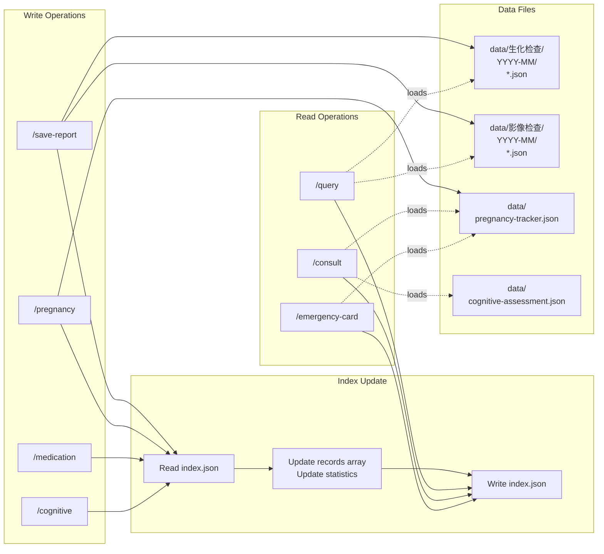
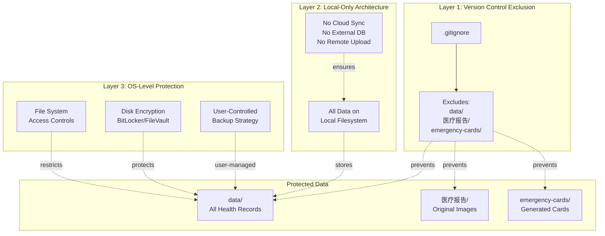
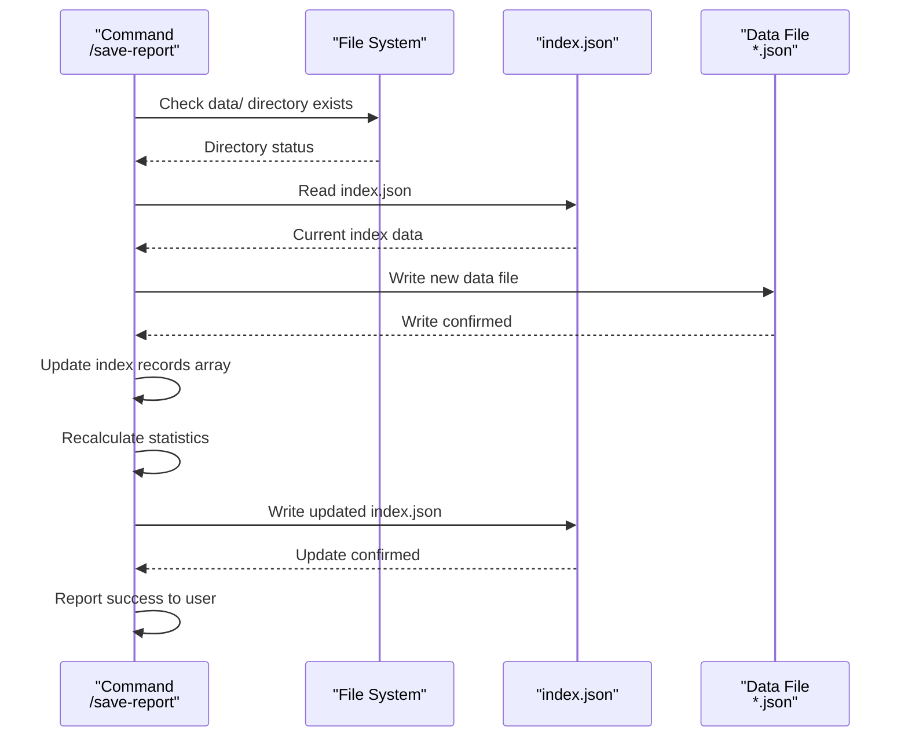
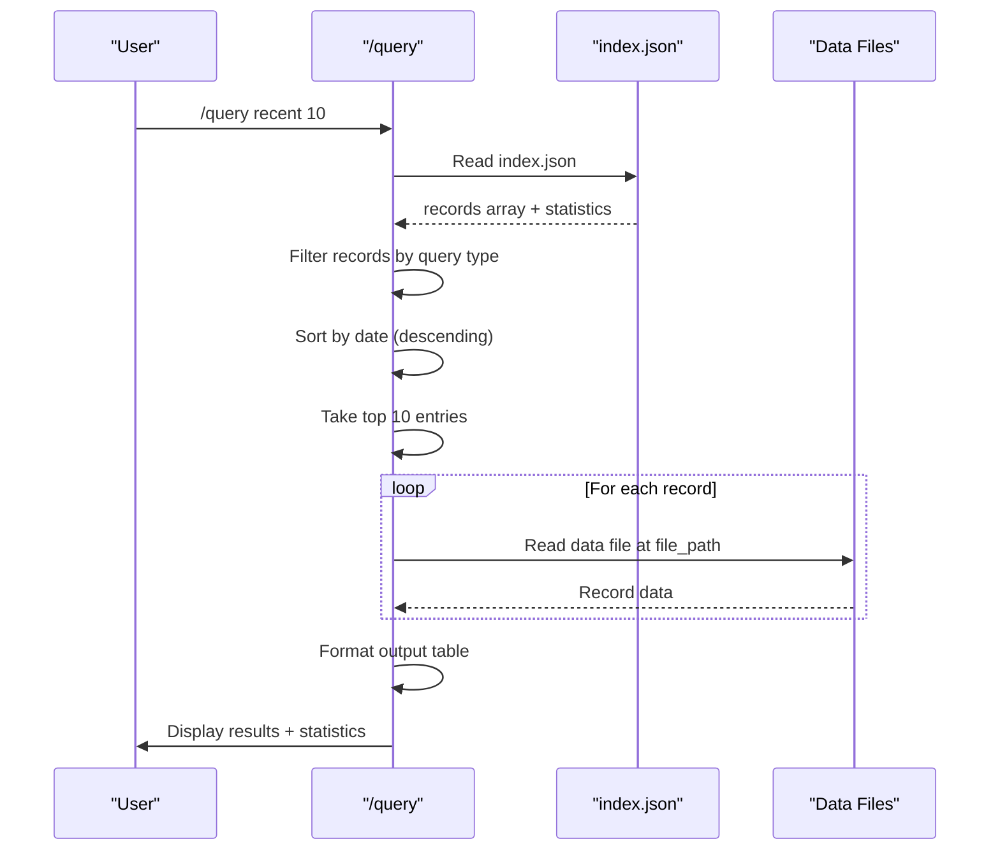
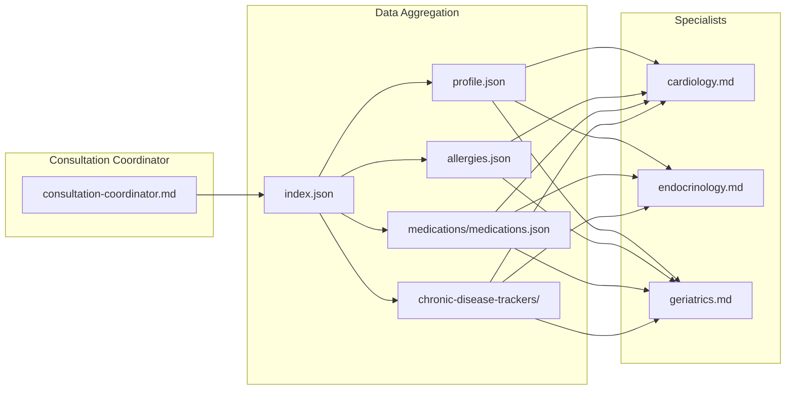

<!-- source: DeepWiki mcp.deepwiki.com · repo huifer/Claude-Ally-Health · page 3.2 Data Storage & Privacy Model · fetched 2026-10-26 -->

# Data Storage & Privacy Model

<details>
<summary>Relevant source files</summary>

The following files were used as context for generating this wiki page:

- [.claude/commands/cognitive.md](.claude/commands/cognitive.md)
- [.claude/commands/fall.md](.claude/commands/fall.md)
- [.claude/commands/polypharmacy.md](.claude/commands/polypharmacy.md)
- [.claude/commands/query.md](.claude/commands/query.md)
- [.claude/commands/save-report.md](.claude/commands/save-report.md)
- [.claude/specialists/geriatrics.md](.claude/specialists/geriatrics.md)
- [.gitignore](.gitignore)
- [README.md](README.md)
- [README.zh-CN.md](README.zh-CN.md)
- [data-example/index.json](data-example/index.json)
- [docs/data-structures.md](docs/data-structures.md)
- [scripts/test-elderly-health.sh](scripts/test-elderly-health.sh)
- [todo/03-children-health.md](todo/03-children-health.md)
- [todo/04-elderly-health.md](todo/04-elderly-health.md)

</details>


## Purpose and Scope

This document describes the file-based storage architecture and privacy protection mechanisms of Claude-Ally-Health. It covers:

- JSON-based data storage patterns and directory organization
- The global `index.json` catalog system for cross-domain queries
- Privacy-first design principles including local-only storage and version control exclusions
- Data access patterns and file lifecycle management

For information about how medical reports are saved to storage, see [Saving Medical Reports](#5.1). For query operations that access this stored data, see [Querying Health Records](#5.2).

---

## Storage Architecture Overview

Claude-Ally-Health uses a **pure file system approach** with no external database dependencies. All health data is stored as JSON files organized in a hierarchical directory structure within the `data/` folder.

### Core Architecture Principles

1. **Local Storage Only**: All data remains on the user's local filesystem
2. **JSON Format**: Structured data stored in human-readable JSON files
3. **Monthly Partitioning**: Medical records organized by `YYYY-MM/` subdirectories
4. **Global Catalog**: `index.json` maintains paths to all data files
5. **Privacy by Design**: `data/` directory excluded from version control

### Storage Architecture Diagram

```mermaid
graph TB
    subgraph "Application Layer"
        CMD["Slash Commands<br/>/save-report /query /profile"]
        SPEC["AI Specialists<br/>cardiology.md endocrinology.md"]
    end
    
    subgraph "Data Directory Structure - data/"
        INDEX["index.json<br/>Global Catalog<br/>statistics"]
        
        subgraph "Core Records"
            PROFILE["profile.json<br/>Height Weight BSA BMI"]
            ALLERGY["allergies.json<br/>Allergy History"]
            RAD["radiation-records.json<br/>Exposure Tracking"]
            VAX["vaccinations.json<br/>Vaccine Records"]
        end
        
        subgraph "Medical Examinations"
            BIO["生化检查/<br/>YYYY-MM/<br/>YYYY-MM-DD_test.json"]
            IMG["影像检查/<br/>YYYY-MM/<br/>YYYY-MM-DD_exam_part.json<br/>images/"]
            SURG["手术记录/<br/>YYYY-MM/<br/>YYYY-MM-DD_surgery.json"]
            DISC["出院小结/<br/>YYYY-MM/<br/>YYYY-MM-DD_diagnosis.json"]
        end
        
        subgraph "Medications & Interactions"
            MED["medications/<br/>medications.json<br/>medication-logs/"]
            INTER["interactions/<br/>interaction-db.json<br/>interaction-logs/"]
        end
        
        subgraph "Health Tracking"
            PREG["pregnancy-tracker.json<br/>孕期记录/"]
            POST["postpartum-tracker.json"]
            MENO["menopause-tracker.json<br/>更年期记录/"]
            SCREEN["screening-tracker.json<br/>筛查记录/"]
            CHRONIC["chronic-disease-trackers/<br/>hypertension.json<br/>diabetes.json<br/>copd.json"]
        end
        
        subgraph "Elderly Health"
            COG["cognitive-assessment.json<br/>MMSE MoCA ADL IADL"]
            FALL["fall-risk-assessment.json<br/>TUG Berg Gait Home"]
            POLY["polypharmacy-management.json<br/>Beers ACB Deprescribe"]
        end
        
        subgraph "Nutrition"
            FOOD["food-database.json<br/>50+ Foods 30+ Nutrients"]
            REF["nutritional-reference.json<br/>RDA EAR AI UL"]
        end
    end
    
    subgraph "Privacy Protection"
        GIT[".gitignore<br/>Excludes data/"]
        LOCAL["No Cloud Sync<br/>No External DB"]
        OS["OS-Level Protection<br/>Disk Encryption"]
    end
    
    CMD --> INDEX
    SPEC --> INDEX
    
    INDEX -.catalogs.-> PROFILE
    INDEX -.catalogs.-> BIO
    INDEX -.catalogs.-> IMG
    INDEX -.catalogs.-> PREG
    INDEX -.catalogs.-> CHRONIC
    INDEX -.catalogs.-> MED
    INDEX -.catalogs.-> COG
    
    GIT -.excludes.-> INDEX
    GIT -.excludes.-> PROFILE
    GIT -.excludes.-> BIO
    LOCAL -.protects.-> PROFILE
    OS -.encrypts.-> BIO
```



**Sources**: [README.md:40-90](), [README.zh-CN.md:39-89](), [.gitignore:1-17]()

---

## Directory Structure and Organization

### Root Data Directory

The `data/` directory is the root container for all health information. Its structure follows consistent organizational patterns:

| Directory/File | Purpose | Partition Pattern |
|----------------|---------|-------------------|
| `profile.json` | User basic profile (height, weight, birth date, BMI, BSA) | Single file |
| `index.json` | Global catalog of all records with statistics | Single file |
| `allergies.json` | Allergy history with severity levels | Single file |
| `radiation-records.json` | Medical radiation exposure tracking | Single file |
| `vaccinations.json` | Vaccination records and schedule | Single file |
| `生化检查/` | Biochemical test results (blood, urine) | `YYYY-MM/` subdirectories |
| `影像检查/` | Imaging exams (CT, MRI, X-ray, ultrasound) with original images | `YYYY-MM/` with `images/` |
| `手术记录/` | Surgical history and implant information | `YYYY-MM/` |
| `出院小结/` | Discharge summaries | `YYYY-MM/` |
| `medications/` | Active medications and adherence logs | `medications.json` + `medication-logs/` |
| `interactions/` | Drug interaction database and check logs | `interaction-db.json` + `interaction-logs/` |
| `pregnancy-tracker.json` | Pregnancy tracking data | Single file |
| `孕期记录/` | Prenatal checkup records | `YYYY-MM/` |
| `postpartum-tracker.json` | Postpartum recovery tracking | Single file |
| `menopause-tracker.json` | Menopause symptom tracking | Single file |
| `screening-tracker.json` | Gynecological cancer screening | Single file |
| `chronic-disease-trackers/` | Hypertension, diabetes, COPD trackers | Individual JSON files |
| `cognitive-assessment.json` | MMSE/MoCA cognitive tests | Single file |
| `fall-risk-assessment.json` | Fall risk and balance assessments | Single file |
| `polypharmacy-management.json` | Medication list and Beers criteria screening | Single file |
| `food-database.json` | Nutrition database (50+ foods, 30+ nutrients) | Single file |
| `nutritional-reference.json` | RDA/EAR/AI/UL reference values | Single file |

### Monthly Partitioning Pattern

Medical examination records use a **two-level hierarchical structure**:

```
data/
├── 生化检查/
│   ├── 2025-06/
│   │   ├── 2025-06-15_血常规.json
│   │   ├── 2025-06-20_生化全套.json
│   │   └── images/
│   │       ├── 2025-06-15_血常规.jpg
│   │       └── 2025-06-20_生化全套.jpg
│   └── 2025-07/
│       └── 2025-07-10_肝功能.json
├── 影像检查/
│   ├── 2025-06/
│   │   ├── 2025-06-18_CT_胸部.json
│   │   └── images/
│   │       └── 2025-06-18_CT_胸部.jpg
│   └── 2025-07/
└── 手术记录/
    └── 2024-08/
        └── 2024-08-15_胆囊切除术.json
```

This pattern:
- Enables efficient temporal queries (e.g., "all records from June 2025")
- Keeps directories manageable (typically <50 files per month)
- Supports archival strategies (older months can be compressed/backed up)
- Preserves original medical report images alongside extracted JSON data

**Sources**: [README.md:40-90](), [.claude/commands/save-report.md:98-101]()

---

## JSON Data Format Standards

### Common Structure Elements

All JSON data files share consistent structural patterns:

#### 1. Unique Identifier Generation

Every record uses a timestamp-based ID:

```json
{
  "id": "20251231123456789"
}
```

Generated using: `date + timestamp` (YYYYMMDD + milliseconds)

#### 2. Date Format Standardization

All dates use **ISO 8601 format**:
- Date fields: `YYYY-MM-DD`
- Timestamp fields: `YYYY-MM-DDTHH:mm:ss.sssZ`

```json
{
  "date": "2025-12-31",
  "created_at": "2025-12-31T12:34:56.789Z",
  "last_updated": "2025-12-31T12:34:56.789Z"
}
```

#### 3. Metadata Section Pattern

Most records include a `metadata` or top-level timestamp fields:

```json
{
  "metadata": {
    "created_at": "2025-12-31T12:34:56.789Z",
    "last_updated": "2025-12-31T12:34:56.789Z"
  }
}
```

### Core Data Structures

#### Profile Data (`profile.json`)

```json
{
  "basic_info": {
    "height": 175,
    "height_unit": "cm",
    "weight": 70,
    "weight_unit": "kg",
    "birth_date": "1990-01-01"
  },
  "calculated": {
    "age": 35,
    "bmi": 22.9,
    "bmi_status": "正常",
    "body_surface_area": 1.85,
    "bsa_unit": "m²"
  }
}
```

The `calculated` section is **auto-computed** when `basic_info` changes. BMI uses the formula: `weight(kg) / (height(m))²`. BSA uses the Mosteller formula: `√(height(cm) × weight(kg) / 3600)`.

**Sources**: [docs/data-structures.md:98-131]()

#### Biochemical Examination Data

```json
{
  "id": "20251231123456789",
  "type": "生化检查",
  "date": "2025-12-31",
  "hospital": "XX医院",
  "items": [
    {
      "name": "白细胞计数",
      "value": "6.5",
      "unit": "×10^9/L",
      "min_ref": "3.5",
      "max_ref": "9.5",
      "is_abnormal": false
    }
  ]
}
```

The `is_abnormal` flag is set when `value < min_ref` or `value > max_ref`. This enables the `/query abnormal` command to filter concerning results.

**Sources**: [docs/data-structures.md:1-36]()

#### Imaging Examination Data

```json
{
  "id": "20251231123456789",
  "type": "影像检查",
  "subtype": "B超",
  "date": "2025-12-31",
  "hospital": "XX医院",
  "body_part": "腹部",
  "findings": {
    "description": "检查所见描述",
    "targets": [
      {
        "name": "病灶/监测目标名称",
        "location": "具体位置",
        "size": {
          "length": "长径数值",
          "width": "短径数值",
          "height": "高度数值",
          "unit": "单位"
        },
        "characteristics": {
          "morphology": "形态描述",
          "border": "边界描述",
          "density": "密度/回声描述"
        }
      }
    ],
    "measurements": {},
    "conclusion": "检查结论"
  },
  "original_image": "images/original.jpg"
}
```

The `targets` array enables **longitudinal tracking** of specific lesions (nodules, cysts, tumors) across multiple scans. Each target's `size` object supports precise comparison over time.

**Sources**: [docs/data-structures.md:38-70](), [.claude/commands/save-report.md:126-160]()

#### Medication Data with Weekly Schedule

Medication records use a **mandatory weekly schedule pattern**:

```json
{
  "medications": [
    {
      "id": "med_20251231123456789",
      "name": "阿司匹林",
      "dosage": {
        "value": 100,
        "unit": "mg"
      },
      "frequency": {
        "type": "daily",
        "times_per_day": 1
      },
      "schedule": [
        {"weekday": 1, "time": "08:00", "timing_label": "早餐后", "dose": {"value": 100, "unit": "mg"}},
        {"weekday": 2, "time": "08:00", "timing_label": "早餐后", "dose": {"value": 100, "unit": "mg"}},
        {"weekday": 3, "time": "08:00", "timing_label": "早餐后", "dose": {"value": 100, "unit": "mg"}},
        {"weekday": 4, "time": "08:00", "timing_label": "早餐后", "dose": {"value": 100, "unit": "mg"}},
        {"weekday": 5, "time": "08:00", "timing_label": "早餐后", "dose": {"value": 100, "unit": "mg"}},
        {"weekday": 6, "time": "08:00", "timing_label": "早餐后", "dose": {"value": 100, "unit": "mg"}},
        {"weekday": 7, "time": "08:00", "timing_label": "早餐后", "dose": {"value": 100, "unit": "mg"}}
      ],
      "active": true
    }
  ]
}
```

The `schedule` array **must contain 7 entries** for daily medications (one per weekday, where `1=Monday` and `7=Sunday`). This enables accurate adherence calculation and reminder generation.

**Sources**: [docs/data-structures.md:278-426]()

---

## Global Index System (`index.json`)

### Index Architecture

The `index.json` file serves as a **centralized catalog** that enables efficient cross-domain queries without scanning the entire file system. It maintains:

1. **File Path Registry**: Paths to all data files
2. **Aggregated Statistics**: Counts and summaries across domains
3. **Last Updated Timestamps**: System-wide modification tracking

### Index Data Flow



**Sources**: [.claude/commands/save-report.md:170-183](), [.claude/commands/query.md:38-41]()

### Index Structure

```json
{
  "user_profile": "data/profile.json",
  "radiation_records": "data/radiation-records.json",
  "allergy_records": "data/allergies.json",
  "interaction_db": "data/interactions/interaction-db.json",
  "pregnancy_tracker": "data/pregnancy-tracker.json",
  "menopause_tracker": "data/menopause-tracker.json",
  "screening_tracker": "data/screening-tracker.json",
  
  "records": [
    {
      "id": "20251231123456789",
      "type": "生化检查",
      "date": "2025-12-31",
      "file_path": "data/生化检查/2025-12/2025-12-31_血常规.json"
    },
    {
      "id": "20251231987654321",
      "type": "影像检查",
      "subtype": "B超",
      "date": "2025-12-31",
      "file_path": "data/影像检查/2025-12/2025-12-31_腹部B超.json"
    }
  ],
  
  "last_updated": "2025-12-31T12:34:56.789Z",
  
  "statistics": {
    "total_records": 42,
    "biochemical_count": 25,
    "imaging_count": 17,
    "radiation_count": 8,
    "allergy_count": 2,
    "vaccination_count": 15,
    "interaction_check_count": 5,
    "cycle_count": 12,
    "pregnancy_count": 1,
    "current_pregnancy": true,
    "menopause_tracking": false,
    "screening_current": true,
    "total_medications": 3,
    "date_range": {
      "earliest": "2023-01-15",
      "latest": "2025-12-31"
    }
  }
}
```

### Index Update Rules

1. **Append-Only for `records` Array**: New entries are appended; deletions are rare
2. **Statistics Auto-Recalculation**: All counts recomputed on each write
3. **Atomic Updates**: File is read → modified → written in a single operation
4. **Last Updated Timestamp**: Set to current UTC time on every modification

### Query Optimization Patterns

The index enables efficient queries without file system traversal:

| Query Type | Index Usage | Example |
|------------|-------------|---------|
| `/query all` | Read `records` array, then load each file | Lists all medical records |
| `/query recent 10` | Sort `records` by `date`, load top 10 files | Recent records |
| `/query date 2025-12` | Filter `records` where `file_path` contains `2025-12/` | Monthly query |
| `/query biochemical` | Filter `records` where `type == "生化检查"` | Type filtering |
| `/consult` | Read tracker paths (`pregnancy_tracker`, `menopause_tracker`), load files | MDT consultation data gathering |

**Sources**: [data-example/index.json:1-61](), [docs/data-structures.md:133-163]()

---

## Privacy Protection Mechanisms

### Defense-in-Depth Privacy Architecture

Claude-Ally-Health implements **three layers** of privacy protection:



**Sources**: [.gitignore:1-17](), [README.md:111-116]()

### Layer 1: Version Control Exclusion

The `.gitignore` file explicitly excludes all health data from Git:

```
# 医疗数据隐私保护 - 不要提交到版本控制
data/
医疗报告/
emergency-cards/*
```

This prevents **accidental commits** of sensitive health information when users version control their project directory. Even if a user runs `git add .`, health data will not be staged.

**Sources**: [.gitignore:1-3](), [.gitignore:7-8]()

### Layer 2: Local-Only Architecture

The system **never transmits health data externally**:

- ❌ **No cloud synchronization**: No integration with Dropbox, Google Drive, iCloud
- ❌ **No external databases**: No connections to PostgreSQL, MySQL, MongoDB
- ❌ **No remote APIs**: No health data sent to external services
- ✅ **One exception**: Optional AI image analysis via `mcp__4_5v_mcp__analyze_image` (documented in security policies)

This architecture ensures **complete user data sovereignty**. Health information never leaves the local machine unless the user explicitly chooses to use the image analysis feature.

**Sources**: [README.md:111-116](), [README.md:17]()

### Layer 3: OS-Level Protection

Users are encouraged to leverage operating system security features:

1. **File System Permissions**: Standard Unix/Windows ACLs restrict data access
2. **Full-Disk Encryption**: BitLocker (Windows) or FileVault (macOS) encrypts data at rest
3. **User-Controlled Backups**: Users manage their own backup strategy (local external drives, encrypted archives)

The system **does not implement its own encryption** to avoid key management complexity. Instead, it relies on battle-tested OS-level encryption.

**Sources**: [README.md:111-116]()

### Privacy-First Design Decisions

| Design Choice | Privacy Benefit | Trade-off |
|---------------|-----------------|-----------|
| JSON text files | Human-readable, auditable | Larger file sizes vs binary |
| No database | No connection strings, no query logs | Slower complex queries |
| Local file system | No network attack surface | No multi-device sync |
| `.gitignore` exclusion | Prevents accidental exposure | Requires user awareness |
| Original image preservation | Data integrity, offline access | Increased storage usage |

---

## Data Access Patterns

### Read-Modify-Write Pattern

All data operations follow a consistent **atomic update pattern**:



This pattern ensures that:
1. Data files are written **before** index updates (data integrity)
2. Index is **never left in inconsistent state** (if write fails, index remains valid)
3. Statistics are **always current** (recalculated on each write)

**Sources**: [.claude/commands/save-report.md:162-183]()

### Query Access Pattern

The `/query` command demonstrates efficient index-based access:



Key optimization: The index is read **once**, then filtered in memory. Only the matching files are loaded from disk.

**Sources**: [.claude/commands/query.md:36-83]()

### Specialist Consultation Access Pattern

The MDT consultation system (`/consult`) loads data from **multiple domains**:



The coordinator reads the index to discover available data, then loads relevant files for each specialist's domain.

**Sources**: [README.md:54-55]()

---

## Data Lifecycle Management

### File Creation

New data files are created through command operations:

1. **Biochemical/Imaging Reports**: `/save-report` extracts data from medical images
2. **Health Tracking**: Commands like `/pregnancy`, `/bp`, `/glucose` create tracker files
3. **Assessment Data**: `/cognitive`, `/fall`, `/polypharmacy` create assessment files

**File Naming Convention**:
- Single-instance trackers: `{domain}-tracker.json` (e.g., `pregnancy-tracker.json`)
- Medical records: `YYYY-MM-DD_{exam_type}[_{body_part}].json`
- Medications: Fixed `medications.json` + dated logs

**Sources**: [.claude/commands/save-report.md:98-101]()

### File Updates

Files are updated using the read-modify-write pattern:

```python
# Pseudo-code for update pattern
def update_data_file(file_path, update_func):
    # 1. Read existing data
    data = read_json(file_path)
    
    # 2. Modify data structure
    updated_data = update_func(data)
    
    # 3. Update timestamps
    updated_data["last_updated"] = current_utc_timestamp()
    
    # 4. Write back atomically
    write_json(file_path, updated_data)
    
    # 5. Update index
    update_index(file_path, updated_data)
```

**Update Frequency**:
- Profile: Infrequent (height/weight changes)
- Medications: Daily (adherence logs)
- Trackers: Variable (pregnancy: weekly; BP: daily; cognitive: yearly)

### File Retention

The system does **not implement automatic deletion**. All data is retained indefinitely unless the user manually removes files. This design choice:

- ✅ Preserves complete medical history for longitudinal analysis
- ✅ Enables trend detection over years (e.g., cognitive decline, disease progression)
- ✅ Supports comprehensive specialist consultations
- ⚠️ Requires user awareness of storage growth

### Archival Strategy (User-Managed)

Users may implement their own archival strategies:

1. **Compress old months**: `tar -czf 2023.tar.gz data/生化检查/2023-* data/影像检查/2023-*`
2. **Move to external storage**: Transfer year-based archives to external drives
3. **Selective deletion**: Remove old imaging files (largest storage consumers)

The index will reflect missing files, but queries will gracefully handle file-not-found scenarios.

---

## Data Integrity Guarantees

### JSON Schema Validation

While the system does not enforce strict JSON schemas at runtime, all data structures follow **documented patterns** in [Data Structure Specification](#) (page 3.2). Commands validate:

- Required fields are present
- Date formats match `YYYY-MM-DD`
- Numeric fields contain valid numbers
- Enumerated values match allowed options (e.g., `type: "生化检查" | "影像检查"`)

### Index Consistency

The index maintains **eventual consistency**:

1. If a data file write fails, the index is **not updated** (preventing orphaned index entries)
2. If index update fails after data write, the data file exists but is **not queryable** (user can manually rebuild index)
3. Statistics are **always recomputed** from current data (no cached stale values)

### Error Handling

Commands report errors gracefully:

- **File not found**: "Record not found. It may have been moved or deleted."
- **JSON parse error**: "Data file is corrupted. Please check: {file_path}"
- **Index corruption**: "Index is inconsistent. Recommend rebuilding with /rebuild-index"

**Sources**: [.claude/commands/save-report.md:191-203](), [.claude/commands/query.md:86-91]()

---

## Storage Capacity Considerations

### Typical Storage Requirements

| Data Type | File Size | Monthly Growth | Annual Growth |
|-----------|-----------|----------------|---------------|
| Profile/trackers | 5-50 KB | N/A (single file) | N/A |
| Biochemical exam (JSON) | 2-10 KB | 10-50 KB | 120-600 KB |
| Biochemical exam (images) | 500 KB - 2 MB | 2-10 MB | 24-120 MB |
| Imaging exam (JSON) | 3-15 KB | 15-75 KB | 180-900 KB |
| Imaging exam (images) | 1-5 MB | 5-25 MB | 60-300 MB |
| Medications/logs | 5-20 KB | 5-20 KB | 60-240 KB |
| **Total (with images)** | - | **7-35 MB/month** | **~400 MB/year** |
| **Total (JSON only)** | - | **30-150 KB/month** | **~2 MB/year** |

### Storage Optimization Options

1. **Disable image preservation**: Modify save-report to skip image copying (reduces storage by ~95%)
2. **Compress images**: Convert JPEG to lower quality (reduces by 50-70%)
3. **Offload old images**: Move `images/` directories >1 year old to external storage
4. **Archive completed trackers**: Compress and remove completed pregnancy/postpartum records

**Sources**: [.claude/commands/save-report.md:161-169]()

---

## Security Best Practices for Users

### Recommended Configuration

1. **Enable full-disk encryption**: BitLocker (Windows) or FileVault (macOS)
2. **Use strong user account passwords**: Protects access to encrypted data
3. **Regular backups to encrypted external drives**: Prevents data loss
4. **Verify `.gitignore` before commits**: Ensure `data/` is excluded
5. **Limit user access**: Avoid shared accounts on multi-user systems

### What the System Does NOT Protect Against

- ❌ **Physical access attacks**: If an attacker has physical access to an unlocked computer, they can access `data/`
- ❌ **Malware**: Malicious software running with user privileges can read JSON files
- ❌ **Backup exposure**: Unencrypted cloud backups (Dropbox, Google Drive) may expose data
- ❌ **Screen capture**: Screenshots or screen recording can capture displayed health data

### Risk Mitigation

| Risk | System Design Mitigation | User Action Required |
|------|-------------------------|---------------------|
| Accidental cloud sync | `.gitignore` exclusions | Verify backup tools respect exclusions |
| Data loss | JSON text format (recoverable) | Regular local backups |
| Unauthorized local access | No built-in encryption | Enable OS-level disk encryption |
| Network exposure | No network features | Use firewall, no port forwarding |
| Version control leaks | `.gitignore` excludes `data/` | Double-check before `git push` |

**Sources**: [README.md:111-116](), [.gitignore:1-17]()

---

## Future Considerations

### Potential Enhancements

1. **Index Rebuild Command**: `/rebuild-index` to scan `data/` and regenerate `index.json`
2. **Data Export**: `/export` command to create encrypted ZIP archives for portability
3. **Selective Sync**: Optional encrypted cloud sync for specific trackers (not images)
4. **Data Validation Tool**: Batch validator to check JSON integrity across all files
5. **Storage Analytics**: `/storage-usage` command to report disk usage by domain

### Scalability Limits

The current file-based architecture is suitable for:
- ✅ **Single user, single device**: Primary design target
- ✅ **Decades of data**: 30+ years of records (~10-15 GB with images)
- ✅ **Thousands of records**: Index-based queries remain fast (<1 second)
- ⚠️ **Multi-device sync**: Would require external sync solution
- ⚠️ **Multiple family members**: Would need user separation (separate `data/` directories)

### Database Migration Path

For users requiring advanced features (SQL queries, multi-user, web interface), a future migration could:
1. Export JSON to SQLite (embedded, still local-only)
2. Preserve existing JSON files as archival copies
3. Maintain `.gitignore` exclusions for SQLite database file

This would preserve the privacy-first architecture while enabling richer queries.

**Sources**: [README.md:25](), [README.md:137-146]()

---

