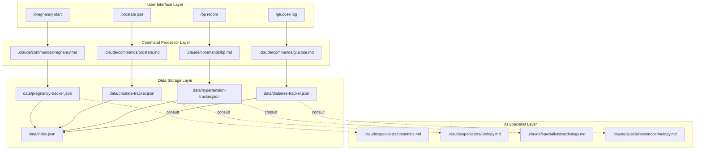
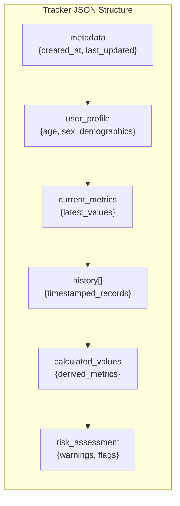
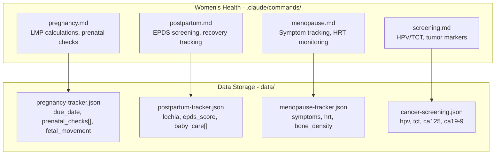
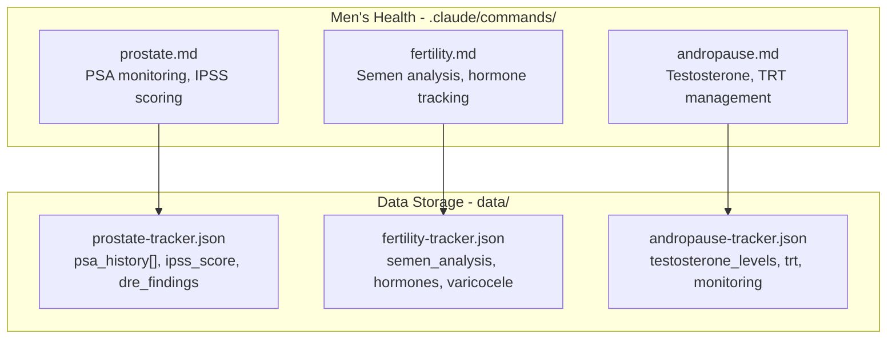
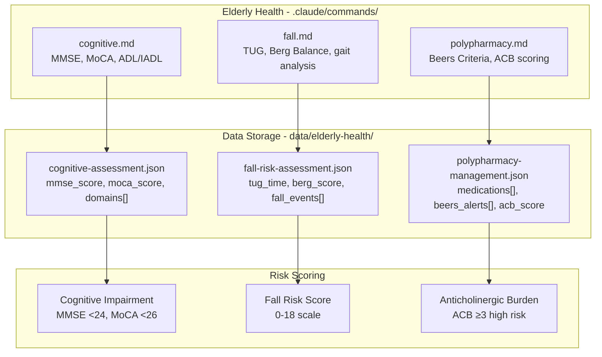
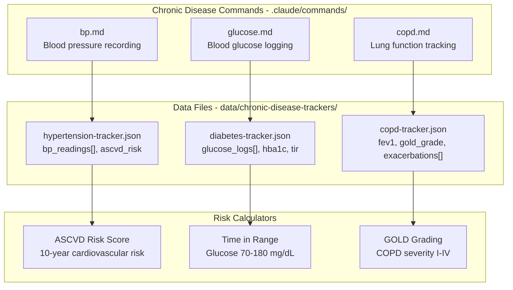
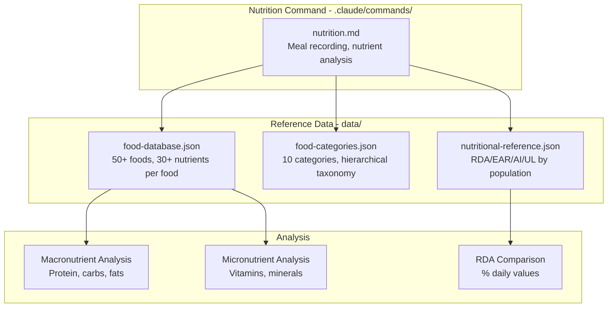
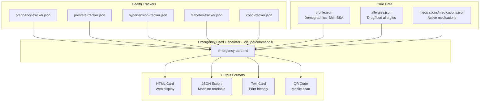
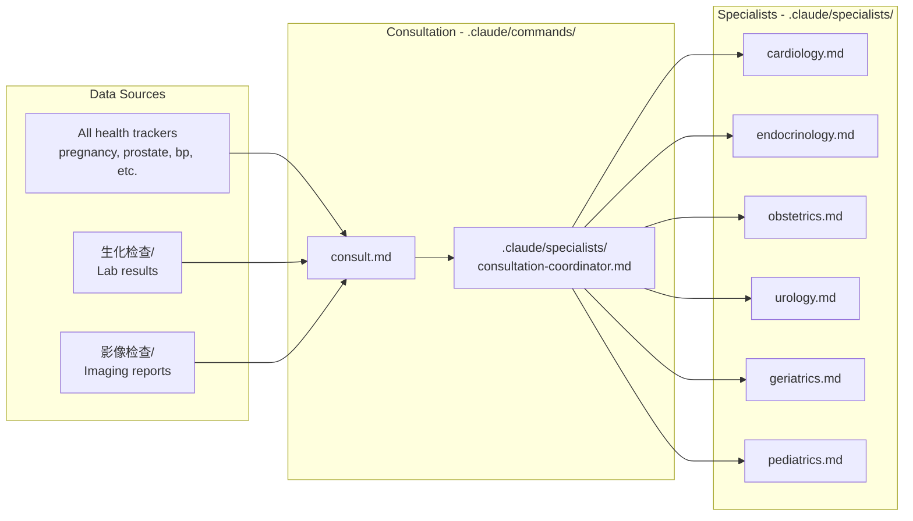

<!-- source: DeepWiki mcp.deepwiki.com · repo huifer/Claude-Ally-Health · page 4 Health Tracking Modules · fetched 2026-10-26 -->

# Health Tracking Modules

<details>
<summary>Relevant source files</summary>

The following files were used as context for generating this wiki page:

- [.claude/settings.local.json](.claude/settings.local.json)
- [README.md](README.md)
- [README.zh-CN.md](README.zh-CN.md)
- [docs/data-structures.md](docs/data-structures.md)
- [todo/01-womens-health.md](todo/01-womens-health.md)
- [todo/02-mens-health.md](todo/02-mens-health.md)

</details>


## Purpose and Scope

This document provides a comprehensive overview of the health tracking modules in Claude-Ally-Health, organized by life stage and medical specialty. Each module implements domain-specific health monitoring with standardized command interfaces, local JSON storage, and AI specialist integration.

For information about the underlying command system, see [Command Interface System](#3.1). For data storage architecture, see [Data Storage & Privacy Model](#3.2). For individual module details, see sections [4.1](#4.1) through [4.6](#4.6).

**Sources:** [README.md:23-91](), [README.zh-CN.md:22-89](), [todo/01-womens-health.md:1-705](), [todo/02-mens-health.md:1-728]()

## Module Organization

Claude-Ally-Health organizes health tracking into six primary categories based on life stage and medical domain:

| Category | Module Count | Primary Focus | Target Population |
|----------|--------------|---------------|-------------------|
| **Women's Health** | 4 modules | Pregnancy, postpartum, menopause, cancer screening | Women across reproductive lifespan |
| **Men's Health** | 3 modules | Prostate, fertility, andropause | Men across reproductive and aging stages |
| **Child & Adolescent** | 3 modules | Growth monitoring, vaccination, puberty | Ages 0-18 years |
| **Elderly Health** | 3 modules | Cognitive assessment, fall risk, polypharmacy | Ages 65+ years |
| **Chronic Disease** | 3 modules | Hypertension, diabetes, COPD | All ages with chronic conditions |
| **Nutrition** | 1 module | Diet tracking, nutrient analysis | All populations |

**Sources:** [README.md:23-39](), [todo/01-womens-health.md:13-20](), [todo/02-mens-health.md:13-18]()

## Architecture Pattern

### Command-Data-Specialist Flow

All health tracking modules follow a consistent three-layer architecture:



**Sources:** [README.md:42-89](), [README.zh-CN.md:40-88]()

### Data Structure Pattern

Each tracker JSON file implements a standardized structure:



**Sources:** [docs/data-structures.md:1-510]()

## Module Categories

### Women's Health Modules



**Pregnancy Tracking Features:**
- **LMP-based calculations**: Gestational age, due date (40 weeks singleton, 37 weeks twins, 35 weeks triplets, 32 weeks quadruplets)
- **Multi-fetal support**: Individual fetal profiles (A, B, C, D) with weight, position, heart rate tracking
- **TTTS monitoring**: Twin-to-twin transfusion syndrome stage detection (I-V)
- **Prenatal checkups**: NT, Tang screening, glucose tolerance, anatomy scan scheduling
- **Vital signs**: Blood pressure, weight gain curves, edema tracking

**Postpartum Care Features:**
- **EPDS scoring**: 10-question Edinburgh Postnatal Depression Scale (0-30 points)
- **Risk stratification**: 0-9 (low), 10-12 (moderate), 13+ (high risk - immediate referral)
- **Lochia stages**: Rubra (0-3 days), serosa (4-9 days), alba (10+ days)
- **Red flag system**: Maternal (hemorrhage, fever) and infant (feeding difficulties, respiratory distress) warnings
- **Multi-baby support**: Separate tracking for twins/triplets/quadruplets

**Sources:** [todo/01-womens-health.md:22-410]()

### Men's Health Modules



**Prostate Health Features:**
- **PSA metrics**: Total PSA (<4.0 ng/mL), free PSA, fPSA/tPSA ratio (>0.25 benign)
- **PSA velocity**: Annual change rate (>0.75 ng/mL/year indicates risk)
- **IPSS questionnaire**: 7-question International Prostate Symptom Score (0-35 points)
- **Severity grading**: 0-7 (mild), 8-19 (moderate), 20-35 (severe)
- **Screening schedule**: Annual PSA+DRE starting age 50 (45 if high risk)

**Male Fertility Features:**
- **Semen analysis**: Volume (≥1.5 mL), concentration (≥15×10⁶/mL), total count (≥39×10⁶)
- **Motility parameters**: PR (progressive, ≥32%), NP (non-progressive), IM (immotile)
- **Morphology**: Normal forms (≥4% Kruger criteria)
- **Hormone panel**: Testosterone, LH, FSH, prolactin, estradiol
- **Diagnosis engine**: Normospermia, oligospermia, asthenospermia, teratospermia, azoospermia classifications

**Andropause Features:**
- **Testosterone monitoring**: Total (<10 nmol/L hypogonadism), free testosterone, SHBG
- **Symptom domains**: Sexual (libido, erectile function), physical (fatigue, muscle mass), psychological (mood, memory)
- **Questionnaires**: ADAM (10 questions), AMS (Aging Males' Symptoms)
- **TRT tracking**: Medication type (oral/injection/gel/patch), dosage, effectiveness
- **Safety monitoring**: Hematocrit (<54%), PSA, prostate volume, cardiovascular events

**Sources:** [todo/02-mens-health.md:22-650]()

### Child & Adolescent Health Modules

| Module | Command | Data File | Key Metrics |
|--------|---------|-----------|-------------|
| **Growth Monitoring** | `/growth` | `growth-tracker.json` | WHO Z-scores (HAZ, WAZ, BAZ), percentiles, growth velocity |
| **Vaccination** | `/vaccine` | `vaccination-tracker.json` | National schedule, Class 1/2 vaccines, adverse reactions |
| **Puberty Assessment** | `/puberty` | `puberty-tracker.json` | Tanner staging (1-5), bone age, precocious/delayed detection |

**Growth Standards:**
- Height-for-age Z-score (HAZ)
- Weight-for-age Z-score (WAZ)
- BMI-for-age Z-score (BAZ)
- WHO growth charts (0-19 years)
- Growth velocity curves

**Vaccination Schedule:**
- Class 1 vaccines: BCG, HepB, OPV, DTaP, MMR, JE, MenA, HepA
- Class 2 vaccines: HIB, Pneumococcal, Rotavirus, Varicella
- Timing tracking: Birth, 1mo, 2mo, 3mo, 4mo, 6mo, 8mo, 9mo, 12mo, 18mo, 24mo, 3y, 4y, 5y, 6y
- Adverse reaction logging

**Puberty Parameters:**
- Tanner stages: Breast (girls), genital (boys), pubic hair (both)
- Bone age assessment (X-ray wrist/hand)
- Precocious puberty: <8 years (girls), <9 years (boys)
- Delayed puberty: >13 years (girls), >14 years (boys)

**Sources:** [README.md:23-39]()

### Elderly Health Modules



**Cognitive Assessment Features:**
- **MMSE**: 30-point Mini-Mental State Examination (24-30 normal, 18-23 mild, 10-17 moderate, <10 severe)
- **MoCA**: Montreal Cognitive Assessment (26-30 normal, <26 cognitive impairment)
- **Cognitive domains**: Memory, executive function, language, visuospatial, attention
- **ADL**: Activities of Daily Living (bathing, dressing, toileting, transferring, continence, feeding)
- **IADL**: Instrumental ADL (phone, shopping, cooking, housekeeping, laundry, transportation, medications, finances)

**Fall Risk Features:**
- **TUG test**: Timed Up-and-Go (<10s normal, 10-20s moderate, >20s high risk)
- **Berg Balance Scale**: 14-item assessment (0-56 points, <45 high fall risk)
- **Single-leg stance**: Duration in seconds (age-adjusted norms)
- **Gait analysis**: Speed, stride length, variability
- **Home safety**: Environmental hazards checklist
- **Fall events**: Date, circumstances, injuries, location

**Polypharmacy Features:**
- **Beers Criteria**: Potentially inappropriate medications for elderly
- **ACB scoring**: Anticholinergic Cognitive Burden (0=none, 1=possible, 2/3=definite)
- **Drug interaction detection**: Integration with `/interaction` command
- **Deprescribing plans**: Medication tapering schedules
- **Medication reconciliation**: Active vs discontinued medications

**Sources:** [README.md:23-39]()

### Chronic Disease Management Modules



**Hypertension Management:**
- **BP classification** (ACOG): Normal (<120/80), Elevated (120-129/<80), Stage 1 (130-139/80-89), Stage 2 (≥140/≥90)
- **Target organ damage**: Retinopathy, nephropathy, left ventricular hypertrophy
- **ASCVD risk**: 10-year atherosclerotic cardiovascular disease risk calculator
- **Medication tracking**: Integration with `/medication` command

**Diabetes Management:**
- **Glucose targets**: Fasting (70-130 mg/dL), postprandial (<180 mg/dL)
- **HbA1c tracking**: Quarterly measurements (target <7% most adults)
- **Time in Range (TIR)**: Percentage of readings 70-180 mg/dL (target >70%)
- **Hypoglycemia events**: Severe (<54 mg/dL) and mild (54-70 mg/dL) episode logging
- **Complication screening**: Retinopathy, nephropathy, neuropathy checks

**COPD Management:**
- **Spirometry**: FEV1, FVC, FEV1/FVC ratio
- **GOLD grades**: I (FEV1 ≥80%), II (50-79%), III (30-49%), IV (<30%)
- **CAT score**: COPD Assessment Test (0-40 points)
- **mMRC scale**: Modified Medical Research Council dyspnea scale (0-4)
- **Exacerbations**: Frequency, severity, hospitalizations
- **Oxygen therapy**: Flow rate, hours per day, saturation levels

**Sources:** [README.md:23-39]()

### Nutrition & Diet Management



**Nutrition Tracking Features:**
- **Food database**: 50+ common foods with complete nutrient profiles
- **Nutrients tracked**: Energy (kcal), protein, carbohydrates, fat, fiber, vitamins (A, B1-B12, C, D, E, K), minerals (Ca, Fe, Zn, Mg, P, Na, K)
- **Food categories**: Grains, vegetables, fruits, meat/poultry, seafood, eggs, dairy, legumes, nuts/seeds, oils/fats
- **Reference values**: RDA (Recommended Dietary Allowance), EAR (Estimated Average Requirement), AI (Adequate Intake), UL (Upper Limit)
- **Population groups**: Infants, children, adolescents, adults (male/female), pregnant, lactating, elderly
- **Meal recording**: Breakfast, lunch, dinner, snacks with portions and timing
- **Supplement tracking**: Vitamins, minerals, omega-3, probiotics

**Sources:** [README.md:23-39]()

## Integration with Core Systems

### Emergency Card Data Aggregation

All health tracking modules feed into the emergency card system, which aggregates critical information:



**Sources:** [README.md:119-133](), [README.zh-CN.md:118-132]()

### MDT Consultation Integration

Health tracker data is accessible to AI specialists during Multi-Disciplinary Team consultations:



**Sources:** [README.md:54-66](), [README.zh-CN.md:54-66]()

### Drug Interaction Safety Checks

Health trackers integrate with the drug interaction detection system to provide context-aware safety warnings:

| Tracker | Interaction Context | Example Safety Check |
|---------|---------------------|---------------------|
| `pregnancy-tracker.json` | Pregnancy category (A/B/C/D/X) | Contraindicated medications for pregnant women |
| `prostate-tracker.json` | BPH medications | Alpha-blocker + antihypertensive interaction |
| `diabetes-tracker.json` | Glucose levels | Hypoglycemia risk with insulin + beta-blocker |
| `elderly-health/*.json` | Beers Criteria | Potentially inappropriate medications for elderly |
| `copd-tracker.json` | Respiratory status | Beta-blocker contraindication in asthma/COPD |

**Sources:** [README.md:161-186](), [README.zh-CN.md:160-184]()

## Index Catalog System

All health trackers register with the global `data/index.json` catalog for efficient querying:

```json
{
  "pregnancy_trackers": [
    {
      "id": "pregnancy_20250101",
      "start_date": "2025-01-01",
      "due_date": "2025-10-08",
      "active": true,
      "file_path": "data/pregnancy-tracker.json"
    }
  ],
  "chronic_disease_trackers": [
    {
      "id": "hypertension_20240601",
      "condition": "hypertension",
      "start_date": "2024-06-01",
      "active": true,
      "file_path": "data/chronic-disease-trackers/hypertension-tracker.json"
    }
  ]
}
```

This enables the `/query` command to search across all health domains simultaneously.

**Sources:** [docs/data-structures.md:133-163]()

## Data Privacy Model

All health tracking modules store data locally with no external synchronization:

| Privacy Feature | Implementation | File Reference |
|----------------|----------------|----------------|
| **Local-only storage** | All JSON files in `data/` directory | [.gitignore]() excludes `data/*` |
| **No cloud sync** | No network calls, no external databases | Architecture principle |
| **OS-level encryption** | BitLocker (Windows) / FileVault (macOS) | User responsibility |
| **Access control** | Filesystem permissions | OS-level protection |

**Sources:** [README.md:111-117](), [README.zh-CN.md:110-116]()

---

