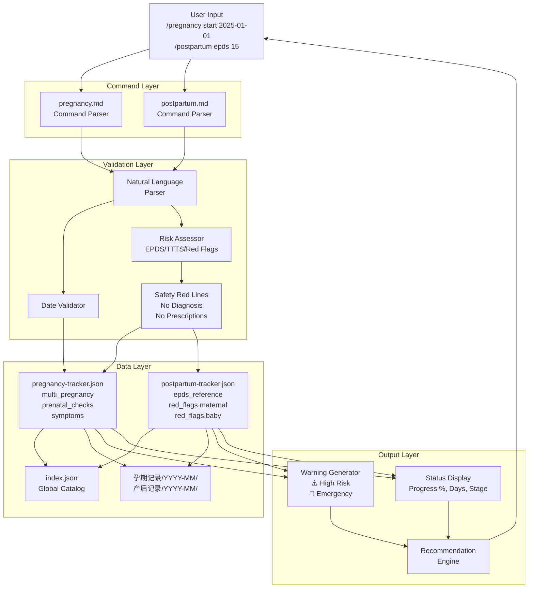
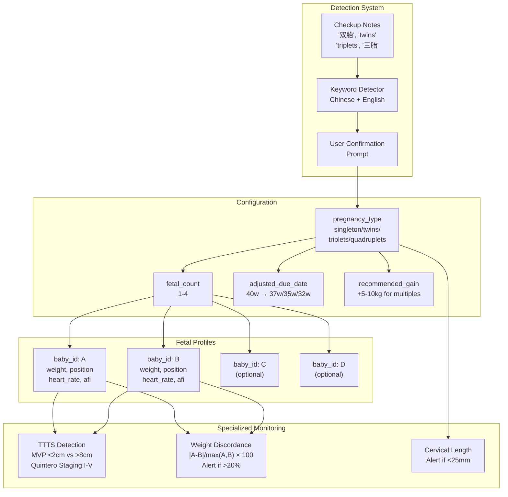
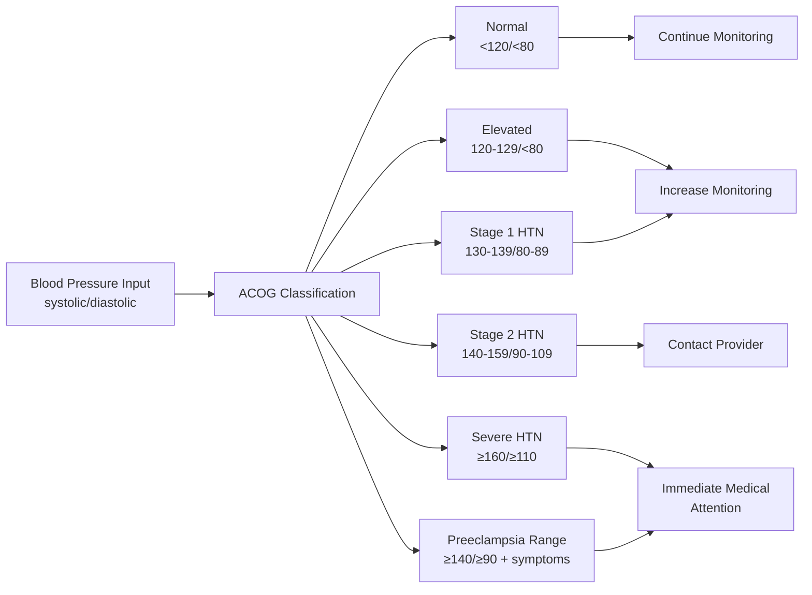
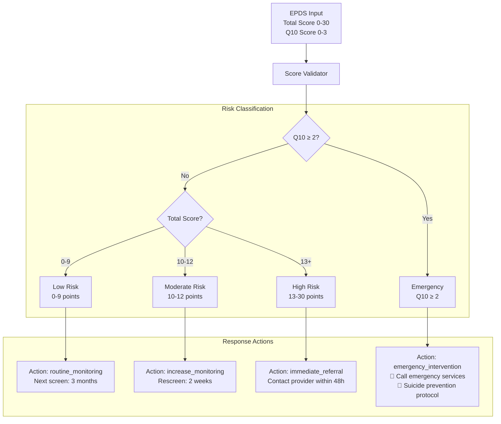
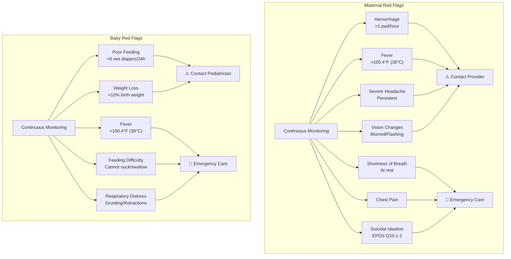
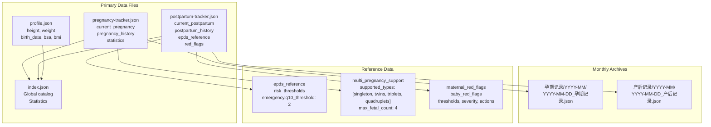
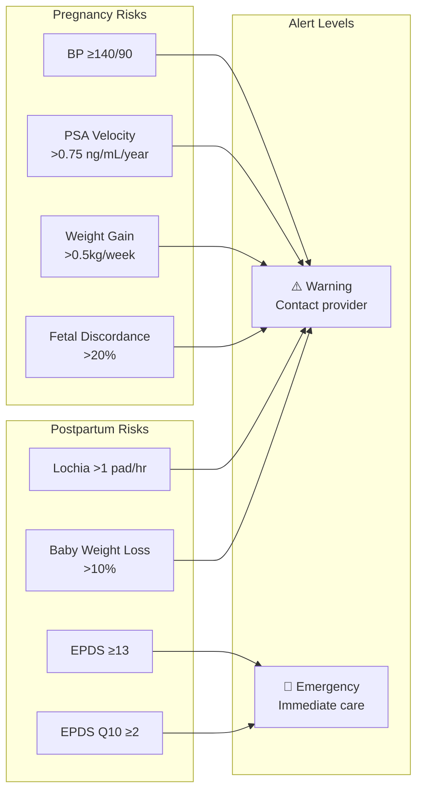
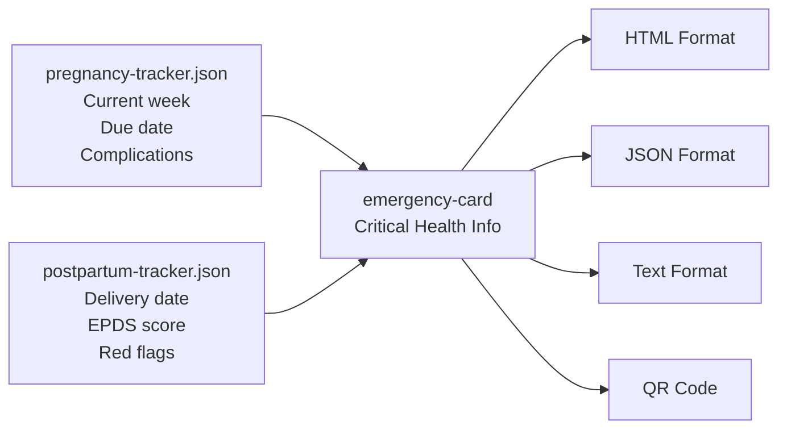

<!-- source: DeepWiki mcp.deepwiki.com · repo huifer/Claude-Ally-Health · page 4.1 Women's Health · fetched 2026-10-26 -->

# Women's Health

<details>
<summary>Relevant source files</summary>

The following files were used as context for generating this wiki page:

- [.claude/commands/postpartum.md](.claude/commands/postpartum.md)
- [.claude/commands/pregnancy.md](.claude/commands/pregnancy.md)
- [.claude/settings.local.json](.claude/settings.local.json)
- [data-example/postpartum-tracker.json](data-example/postpartum-tracker.json)
- [docs/postpartum-care-guide.md](docs/postpartum-care-guide.md)
- [scripts/test.sh](scripts/test.sh)
- [todo/01-womens-health.md](todo/01-womens-health.md)
- [todo/02-mens-health.md](todo/02-mens-health.md)
- [todo/05-pregnancy-postpartum.md](todo/05-pregnancy-postpartum.md)

</details>


## Purpose and Scope

This module provides comprehensive women's health tracking across the reproductive lifecycle, including pregnancy, postpartum recovery, menopause, and gynecological cancer screening. The system implements medical-grade assessment tools (EPDS, IPSS, TTTS staging) with automated risk stratification and safety monitoring. All data is stored locally as JSON files with no cloud synchronization.

For child development tracking, see [Child & Adolescent Health](#4.3). For chronic disease management, see [Chronic Disease Management](#4.5). For emergency information aggregation, see [Emergency Medical Information Card](#5.3).

---

## System Architecture

The Women's Health module operates through Claude Code slash commands that parse natural language input, validate against medical safety rules, update JSON data structures, and generate formatted output with risk warnings.

### Command-to-Data Flow



**Sources:** [.claude/commands/pregnancy.md:1-305](), [.claude/commands/postpartum.md:1-240](), [todo/01-womens-health.md:1-706]()

---

## Pregnancy Tracking Module

### Overview

The pregnancy tracking module supports single and multiple pregnancies (twins, triplets, quadruplets) with automatic detection from ultrasound notes, adjusted due dates, and specialized monitoring protocols.

### Command Interface Mapping

| Command | Action Type | Data Structure Updated | Output |
|---------|-------------|------------------------|--------|
| `/pregnancy start <LMP>` | Initialization | `current_pregnancy` | Due date, prenatal schedule |
| `/pregnancy checkup week <N> <type>` | Record | `prenatal_checks[]` | Completion status, next check |
| `/pregnancy symptom <type> <severity>` | Record | `symptoms{}` | Management advice, warnings |
| `/pregnancy weight <kg>` | Record | `weight_tracking[]` | BMI, gain status, recommendations |
| `/pregnancy vital bp <systolic>/<diastolic>` | Record | `blood_pressure[]` | Classification, risk assessment |
| `/pregnancy type twins` | Configuration | `multi_pregnancy{}` | Adjusted due date, monitoring plan |
| `/pregnancy fetal A weight <g>` | Record | `fetal_profiles[]` | Growth percentile, discordance |
| `/pregnancy status` | Query | N/A | Comprehensive status report |

**Sources:** [.claude/commands/pregnancy.md:20-195](), [.claude/commands/pregnancy.md:1273-1447]()

### Multi-Pregnancy Architecture



**Sources:** [.claude/commands/pregnancy.md:1476-1620](), [todo/01-womens-health.md:226-302](), [data/pregnancy-tracker.json]()

### Pregnancy Data Structure

The primary data file is [`data/pregnancy-tracker.json`](). Key components:

```json
{
  "current_pregnancy": {
    "pregnancy_id": "pregnancy_YYYYMMDD",
    "lmp_date": "YYYY-MM-DD",
    "due_date": "YYYY-MM-DD",
    "current_week": 12,
    "current_trimester": "first|second|third",
    
    "multi_pregnancy": {
      "pregnancy_type": "singleton|twins|triplets|quadruplets",
      "fetal_count": 1-4,
      "detection_method": "manual|ultrasound_notes",
      "fetal_profiles": [
        {
          "baby_id": "A|B|C|D",
          "estimated_weight": {"value": 1200, "unit": "g"},
          "position": "cephalic|breech|transverse",
          "heart_rate": {"value": 145, "unit": "bpm"},
          "amniotic_fluid_index": {"value": 9.0, "unit": "cm"}
        }
      ]
    },
    
    "prenatal_checks": [
      {
        "check_id": "check_001",
        "week": 12,
        "check_type": "NT检查|唐筛|大排畸|糖耐",
        "completed": false,
        "results": {}
      }
    ],
    
    "symptoms": {
      "nausea": {"severity": "mild|moderate|severe"},
      "edema": {"present": true, "location": "feet_ankles"}
    },
    
    "weight_tracking": [],
    "blood_pressure": []
  }
}
```

**Sources:** [.claude/commands/pregnancy.md:103-234](), [todo/01-womens-health.md:72-164]()

### Prenatal Checkup Schedule Generator

The system generates a standard prenatal checkup schedule based on gestational age:

| Week | Check Type | Template | Preparation |
|------|-----------|----------|-------------|
| 12 | NT Scan | `check_type: "NT检查"` | 需要憋尿 |
| 16 | Triple Test | `check_type: "唐筛"` | 空腹抽血 |
| 20 | Anatomy Ultrasound | `check_type: "大排畸"` | 需要预约 |
| 24 | Glucose Tolerance | `check_type: "糖耐"` | 空腹，带糖水 |
| 28-36 | Regular Checks | `check_type: "常规产检"` | Every 2-4 weeks |
| 37-40 | Weekly Checks | `check_type: "每周产检"` | Every week |

**Sources:** [.claude/commands/pregnancy.md:83-97]()

### Blood Pressure Classification



**Sources:** [.claude/commands/pregnancy.md:818-928]()

---

## Postpartum Care Module

### Overview

The postpartum module tracks maternal recovery and newborn care from delivery through 6 weeks, 6 months, or 1 year. It implements the Edinburgh Postnatal Depression Scale (EPDS) with automated risk stratification and a comprehensive red flag warning system.

### Command Interface Mapping

| Command | Action Type | Data Structure Updated | Risk Assessment |
|---------|-------------|------------------------|-----------------|
| `/postpartum start <date> <type>` | Initialization | `current_postpartum` | Calculate stage |
| `/postpartum lochia <stage> <amount>` | Record | `recovery_tracking.lochia` | Hemorrhage detection |
| `/postpartum pain <level>` | Record | `recovery_tracking.pain` | Pain threshold alerts |
| `/postpartum breastfeeding <status>` | Record | `recovery_tracking.breastfeeding` | Mastitis detection |
| `/postpartum epds <score> [q10]` | Assessment | `mental_health.epds_screening` | 4-tier risk stratification |
| `/postpartum mood <state>` | Record | `mental_health.mood_log` | Pattern analysis |
| `/postpartum baby A feeding <type>` | Record | `babies[].feeding` | Intake adequacy |
| `/postpartum baby A weight <kg>` | Record | `babies[].current_weight` | Growth monitoring |
| `/postpartum baby A diaper <type>` | Record | `babies[].diapers` | Dehydration risk |
| `/postpartum status` | Query | N/A | Comprehensive report |

**Sources:** [.claude/commands/postpartum.md:1-240](), [docs/postpartum-care-guide.md:1-100]()

### EPDS Risk Stratification System



**Sources:** [.claude/commands/postpartum.md:386-613](), [data-example/postpartum-tracker.json:83-107]()

### Postpartum Data Structure

The primary data file is [`data/postpartum-tracker.json`](). Key components:

```json
{
  "current_postpartum": {
    "postpartum_id": "postpartum_YYYYMMDD",
    "delivery_date": "YYYY-MM-DD",
    "delivery_type": "vaginal|c-section|assisted|vbac",
    "baby_count": 1-4,
    "tracking_period": "6weeks|6months|1year",
    "days_postpartum": 45,
    "stage": "immediate|early|subacute|late"
  },
  
  "recovery_tracking": {
    "lochia": {
      "stage": "rubra|serosa|alba",
      "amount": "light|moderate|heavy|excessive"
    },
    "pain": {
      "current_level": 0-10,
      "location": "uterus|incision|perineum|headache|breasts"
    },
    "breastfeeding": {
      "status": "exclusive|supplemented|formula|pumping|weaning",
      "challenges": ["engorgement", "mastitis", "low-supply"]
    }
  },
  
  "mental_health": {
    "epds_screening": {
      "total_score": 0-30,
      "q10_score": 0-3,
      "risk_level": "low|moderate|high|emergency",
      "action": "routine_monitoring|increase_monitoring|immediate_referral|emergency_intervention"
    }
  },
  
  "babies": [
    {
      "baby_id": "A|B|C|D",
      "feeding": {"type": "breastfeeding|formula|mixed"},
      "sleep": {"pattern": "newborn|3-4hrs"},
      "diapers": {"wet_per_day": 6, "soiled_per_day": 3}
    }
  ]
}
```

**Sources:** [.claude/commands/postpartum.md:83-189](), [data-example/postpartum-tracker.json:1-203]()

### Red Flag Warning System



**Sources:** [.claude/commands/postpartum.md:970-1001](), [data-example/postpartum-tracker.json:139-165]()

### Postpartum Stage Calculation

The system automatically calculates the postpartum stage based on days since delivery:

| Days Postpartum | Stage | Focus |
|----------------|-------|-------|
| 0-2 | `immediate` | Hospital recovery, initial breastfeeding establishment |
| 3-14 | `early` | Establishing feeding routines, rest, physical recovery |
| 15-42 | `subacute` | Wound healing, establishing daily routines |
| 43+ | `late` | Long-term recovery, mental health screening |

**Sources:** [.claude/commands/postpartum.md:66-79](), [data-example/postpartum-tracker.json:168-184]()

---

## Menopause Management Module

### Overview

The menopause management module tracks perimenopausal and postmenopausal symptoms, hormone replacement therapy (HRT), bone density, and cardiovascular risk factors.

### Data Structure

Defined in [`todo/01-womens-health.md:412-510`]():

```json
{
  "menopause_tracking": {
    "stage": "perimenopausal|postmenopausal",
    "symptoms": {
      "hot_flashes": {
        "frequency": "5-10_per_day",
        "severity": "mild|moderate|severe",
        "triggers": ["stress", "hot_drinks"]
      },
      "sleep_issues": {"present": true},
      "mood_changes": {"symptoms": ["anxiety", "irritability"]},
      "vaginal_dryness": {"present": false}
    },
    "hrt": {
      "on_treatment": false,
      "medication": null,
      "effectiveness": null
    },
    "bone_density": {
      "t_score": -1.5,
      "z_score": -1.2,
      "diagnosis": "osteopenia|osteoporosis"
    },
    "cardiovascular_risk": {
      "blood_pressure": "120/80",
      "lipid_panel": {"ldl": 3.2, "hdl": 1.5}
    }
  }
}
```

### Command Interface

```bash
# Symptom recording
/menopause symptom hot-flashes 5-10 moderate
/menopause symptom sleep insomnia
/menopause symptom mood anxiety

# Bone density tracking
/menopause bone-density -1.5 osteopenia

# HRT management
/menopause hrt start 雌二醇 1mg
/menopause hrt effectiveness good

# Status queries
/menopause status
/menopause risk
```

**Sources:** [todo/01-womens-health.md:412-531]()

---

## Gynecological Cancer Screening Module

### Overview

This module manages cervical cancer screening (HPV/TCT), tumor marker tracking (CA125, CA19-9), and follow-up scheduling.

### Data Structure

Defined in [`todo/01-womens-health.md:534-613`]():

```json
{
  "cancer_screening": {
    "cervical_cancer": {
      "last_hpv": "2025-01-15",
      "hpv_result": "negative|positive",
      "hpv_type": "16|18|other",
      
      "last_tct": "2025-01-15",
      "tct_result": "NILM|ASC-US|LSIL|HSIL",
      
      "screening_strategy": "hpv-only|tct-only|co-testing",
      "next_screening": "2030-01-15",
      "screening_interval": "3_years|5_years"
    },
    
    "tumor_markers": {
      "CA125": {
        "value": 15.5,
        "reference": "<35",
        "unit": "U/mL",
        "trend": "stable|rising|falling",
        "history": [18.2, 16.5, 15.5]
      },
      "CA19-9": {
        "value": 22.0,
        "reference": "<37",
        "unit": "U/mL"
      }
    }
  }
}
```

### Screening Schedule

| Age | Test | Frequency |
|-----|------|-----------|
| 21-29 | TCT | Every 3 years |
| 30-65 | HPV + TCT | Every 5 years (co-testing preferred) |
| 30-65 | HPV only | Every 5 years |
| 65+ | Discontinue | If adequate prior screening |

### Command Interface

```bash
# HPV/TCT recording
/screening hpv negative
/screening tct NILM
/screening co-testing negative NILM

# Tumor marker tracking
/screening ca125 15.5
/screening ca19-9 22.0

# Abnormal result management
/screening abnormal asc-us
/screening colposcopy scheduled 2025-07-01

# Status queries
/screening status
/screening next
/screening trend
```

**Sources:** [todo/01-womens-health.md:534-635]()

---

## Data Storage Architecture

### File System Organization



**Sources:** [data/pregnancy-tracker.json](), [data/postpartum-tracker.json](), [data/index.json]()

### Privacy Model

All data is stored locally with no external transmission:

1. **Git Exclusion**: `.gitignore` excludes `data/` directory
2. **Local-Only**: No cloud sync, no external databases
3. **OS-Level Protection**: Relies on file system permissions and disk encryption

**Exception**: AI image analysis features may call external MCP servers (GLM mcp__4_5v_mcp) for medical report OCR, which is explicitly documented in security policies.

**Sources:** [High-Level Diagram 4: Data Storage Architecture](), [.gitignore]()

---

## Medical Safety Principles

### Safety Red Lines

The system enforces strict medical safety boundaries defined in [`todo/01-womens-health.md:639-667`]():

| Red Line | Implementation |
|----------|----------------|
| **No Specific Drug Dosages** | System provides drug safety categories (e.g., FDA pregnancy categories A/B/C/D/X) but never recommends specific doses |
| **No Direct Prescriptions** | No specific prescription drug recommendations; only general classes |
| **No Pregnancy Outcome Predictions** | Does not predict miscarriage, preterm birth, or fetal health outcomes |
| **No Definitive Diagnoses** | All analyses marked "仅供参考" (for reference only) |
| **Mandatory Professional Consultation** | All warnings include "请咨询医生" (please consult doctor) |

### Automated Risk Detection



**Sources:** [todo/01-womens-health.md:639-691](), [.claude/commands/pregnancy.md:818-928](), [.claude/commands/postpartum.md:970-1001]()

---

## Testing Framework

### Native Test Architecture

The system uses a native Shell + Python testing framework without Node.js dependencies, defined in [`scripts/test.sh`]():

```bash
#!/bin/bash
# Claude Code Native Test Runner

# Test Suite 1: JSON Structure Validation
python3 -m json.tool data/pregnancy-tracker.json
python3 -m json.tool data/postpartum-tracker.json

# Test Suite 2: Required Field Validation
python3 -c "import json; data=json.load(open('data/pregnancy-tracker.json')); \
  exit(0 if 'multi_pregnancy_support' in data else 1)"

# Test Suite 3: Medical Safety Validation (EPDS thresholds)
python3 -c "import json; d=json.load(open('data/postpartum-tracker.json')); \
  rt=d['epds_reference']['risk_thresholds']; \
  exit(0 if rt['high_risk']['min']==13 and rt['high_risk']['max']==30 else 1)"

# Test Suite 4: Multi-Pregnancy Support
python3 -c "import json; d=json.load(open('data/pregnancy-tracker.json')); \
  exit(0 if d.get('multi_pregnancy_support', {}).get('max_fetal_count')==4 else 1)"
```

### Test Coverage

| Test Suite | Tests | Purpose |
|------------|-------|---------|
| JSON Structure Validation | 4 | Validate all JSON files parse correctly |
| Required Field Validation | 4 | Ensure critical data structures exist |
| Medical Safety Validation | 4 | Verify EPDS thresholds (13, Q10≥2), risk levels |
| Multi-Pregnancy Support | 3 | Confirm 4-pregnancy types, fetal count limits |
| Command Files Exist | 3 | Verify command definitions present |
| Data Directories | 3 | Check directory structure |

**Total**: 21 test cases

### Running Tests

```bash
./scripts/test.sh
```

Expected output:
```
================================
Claude Code Health Tracking Tests
================================
Testing: pregnancy-tracker.json is valid JSON ... ✓ PASSED
Testing: EPDS high_risk range is 13-30 ... ✓ PASSED
Testing: Max fetal count is 4 ... ✓ PASSED
...
Total Tests: 21
Passed: 21
All tests passed!
```

**Sources:** [scripts/test.sh:1-151](), [todo/05-pregnancy-postpartum.md:133-189]()

---

## Integration with Other Modules

### Emergency Card Aggregation

The Emergency Medical Information Card ([#5.3](#5.3)) aggregates data from pregnancy and postpartum trackers:



### MDT Consultation Integration

The Multi-Disciplinary Team (MDT) consultation system ([#7.1](#7.1)) includes obstetrics specialists that analyze pregnancy data:

- **Obstetrics Specialist**: Reviews `prenatal_checks[]`, `blood_pressure[]`, `weight_tracking[]`
- **Endocrinology Specialist**: Analyzes glucose tolerance tests, thyroid function
- **Geriatrics Specialist**: Evaluates postpartum recovery in older mothers

**Sources:** [High-Level Diagram 3: Multi-Disciplinary Consultation System](), [High-Level Diagram 5: Health Domain Coverage Matrix]()

---

## Implementation Status

### Completed Features ✅

**Pregnancy Tracking** (implemented 2026-01-01):
- Single and multi-pregnancy support (1-4 fetuses)
- Automatic multi-pregnancy detection from ultrasound notes
- Adjusted due dates for twins (37w), triplets (35w), quadruplets (32w)
- TTTS monitoring with Quintero staging
- Fetal profiles with weight discordance calculation
- Blood pressure classification (ACOG guidelines)
- 21 passing test cases

**Postpartum Care** (implemented 2026-01-01):
- Tracking periods: 6 weeks, 6 months, 1 year
- EPDS screening with 4-tier risk stratification
- Red flag warning system (maternal + baby)
- Multi-baby support (A, B, C, D identifiers)
- Lochia stage tracking (rubra/serosa/alba)
- Breastfeeding status and challenges
- Complete user guide in Chinese

### Pending Features 🚧

**Menopause Management** (status: planned):
- Symptom tracking (hot flashes, mood changes, sleep issues)
- HRT monitoring
- Bone density tracking
- Cardiovascular risk assessment

**Gynecological Cancer Screening** (status: planned):
- HPV/TCT result tracking
- Tumor marker trending (CA125, CA19-9, CEA, AFP)
- Colposcopy scheduling
- Abnormal result follow-up

**Sources:** [todo/05-pregnancy-postpartum.md:130-189](), [todo/01-womens-health.md:412-635]()

---

## References and Resources

### Medical Guidelines

- **Pregnancy**: ACOG Practice Guidelines, WHO Antenatal Care Model
- **Postpartum**: ACOG Postpartum Care Guidelines, EPDS validation studies
- **Blood Pressure**: ACOG Hypertension in Pregnancy Guidelines
- **Multi-Pregnancy**: TTTS Quintero Staging System, IOM Weight Gain Guidelines

### Data Standards

- **EPDS**: Edinburgh Postnatal Depression Scale (Cox et al., 1987)
  - Total score: 0-30
  - Risk thresholds: Low (0-9), Moderate (10-12), High (13+)
  - Emergency threshold: Q10 ≥ 2
- **Blood Pressure**: ACOG 2019 classification
- **Fetal Growth**: WHO fetal growth charts
- **Weight Gain**: IOM (Institute of Medicine) 2009 recommendations

**Sources:** [.claude/commands/pregnancy.md:818-853](), [.claude/commands/postpartum.md:181-218](), [data-example/postpartum-tracker.json:83-107]()

---

