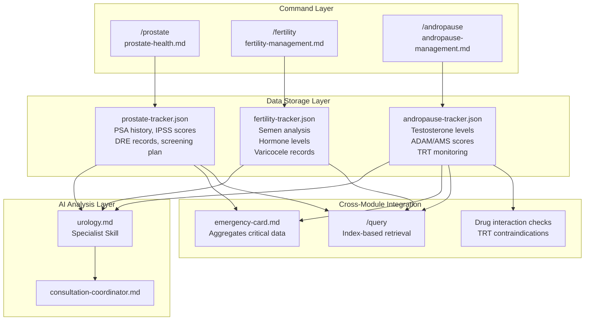
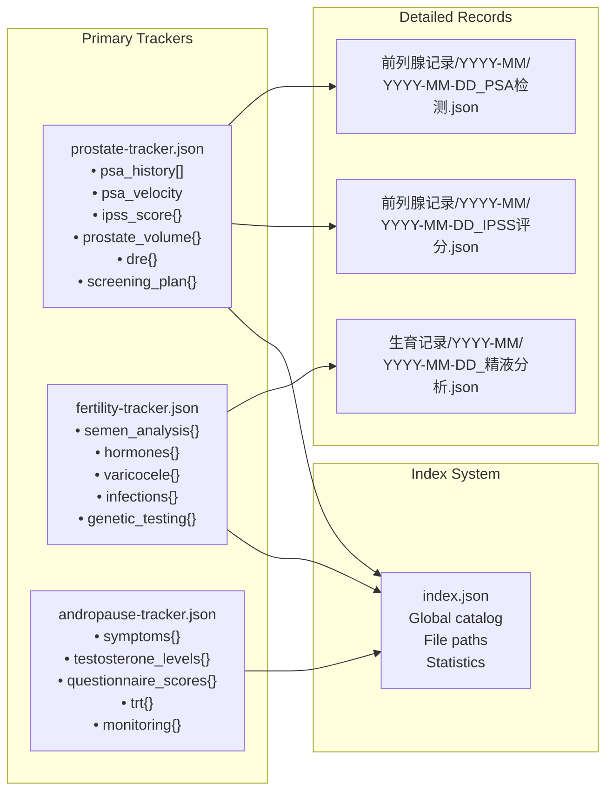
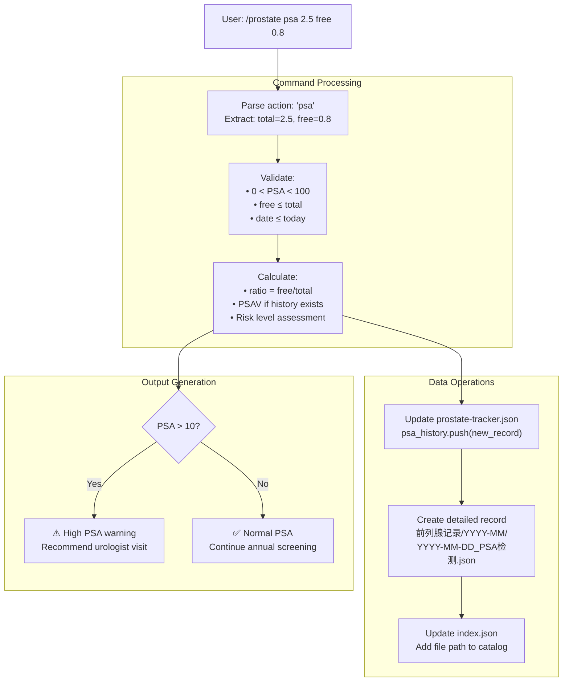
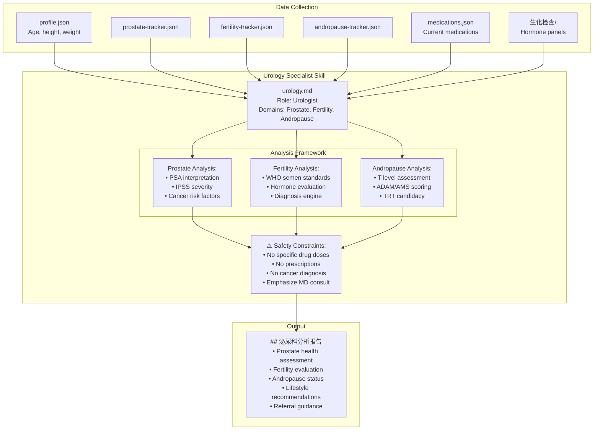

<!-- source: DeepWiki mcp.deepwiki.com · repo huifer/Claude-Ally-Health · page 4.2 Men's Health · fetched 2026-10-26 -->

# Men's Health

<details>
<summary>Relevant source files</summary>

The following files were used as context for generating this wiki page:

- [.claude/commands/prostate-health.md](.claude/commands/prostate-health.md)
- [.claude/commands/puberty.md](.claude/commands/puberty.md)
- [.claude/settings.local.json](.claude/settings.local.json)
- [.claude/specialists/pediatrics.md](.claude/specialists/pediatrics.md)
- [.claude/specialists/urology.md](.claude/specialists/urology.md)
- [data-example/andropause-tracker.json](data-example/andropause-tracker.json)
- [data-example/child-vaccinations.json](data-example/child-vaccinations.json)
- [todo/01-womens-health.md](todo/01-womens-health.md)
- [todo/02-mens-health.md](todo/02-mens-health.md)

</details>


## Purpose and Scope

This document provides a technical overview of the Men's Health module system within Claude-Ally-Health. The module encompasses three specialized health tracking subsystems:

1. **Prostate Health Management** - PSA monitoring, IPSS scoring, DRE recording, and prostate cancer risk assessment
2. **Male Fertility Assessment** - Semen analysis tracking, hormone monitoring, and infertility diagnosis support
3. **Andropause Management** - Testosterone monitoring, symptom evaluation (ADAM/AMS), and TRT tracking

For detailed documentation on each subsystem, see:
- [Prostate Health](#4.2.1)
- [Male Fertility Assessment](#4.2.2)
- [Andropause Management](#4.2.3)

For women's health tracking features, see [Women's Health](#4.1). For child and adolescent puberty assessment, see [Puberty Assessment](#4.3.3).

---

## System Architecture

### High-Level Module Organization



**Architecture Pattern**: The Men's Health module follows a command-driven architecture where each health domain (`/prostate`, `/fertility`, `/andropause`) operates independently with dedicated JSON storage files. All three modules integrate with the `urology.md` AI specialist for comprehensive analysis during MDT consultations via `/consult`.

**Sources**: [todo/02-mens-health.md:1-18](), [.claude/specialists/urology.md:1-13]()

---

## Module Components

### Prostate Health Management

**Purpose**: Track prostate-specific antigen (PSA) levels, evaluate lower urinary tract symptoms (LUTS) via IPSS scoring, and manage prostate cancer screening protocols.

**Key Features**:
- PSA tracking with trend analysis and velocity calculation (PSAV)
- IPSS (International Prostate Symptom Score) questionnaire system (0-35 points)
- Digital rectal examination (DRE) recording
- Prostate volume tracking via ultrasound
- Risk-stratified screening schedule management

**Command Interface**: `/prostate <action> [info]`

**Actions**:
- `psa` - Record PSA values (total, free, ratio)
- `ipss` - Interactive IPSS questionnaire
- `dre` - Digital rectal exam findings
- `ultrasound` - Prostate volume measurements
- `status` - Current health status summary
- `screening` - Personalized screening plan
- `risk` - Comprehensive risk assessment

**Data Location**: `data/prostate-tracker.json`

**Sources**: [todo/02-mens-health.md:20-176](), [.claude/commands/prostate-health.md:1-20]()

### Male Fertility Assessment

**Purpose**: Record and analyze semen parameters according to WHO 2021 standards, monitor reproductive hormones, and track infertility evaluation progress.

**Key Features**:
- Semen analysis recording (volume, concentration, motility, morphology)
- Hormone panel tracking (testosterone, LH, FSH, prolactin, estradiol)
- Varicocele assessment and surgical history
- Genetic testing results (Y-chromosome microdeletion, CFTR)
- Infection screening (chlamydia, gonorrhea)
- Automated diagnosis engine (normospermia, oligospermia, asthenospermia, teratospermia)

**Command Interface**: `/fertility <action> [info]`

**WHO 2021 Reference Values**:
- Semen volume: ≥1.5 mL
- Sperm concentration: ≥15 × 10⁶/mL
- Progressive motility (PR): ≥32%
- Normal morphology: ≥4%
- pH: 7.2-8.0
- Liquefaction time: ≤60 minutes

**Data Location**: `data/fertility-tracker.json`

**Sources**: [todo/02-mens-health.md:180-424](), [.claude/specialists/urology.md:20-30]()

### Andropause Management

**Purpose**: Evaluate age-related testosterone decline, assess andropause symptoms, and monitor testosterone replacement therapy (TRT) safety and efficacy.

**Key Features**:
- Morning testosterone level tracking (8-11 AM optimal)
- ADAM (Androgen Deficiency in Aging Males) questionnaire (10 questions)
- AMS (Aging Males' Symptoms) scale scoring (27 points max)
- TRT treatment recording (gel, injection, oral, patch)
- Safety monitoring (PSA, hematocrit, prostate volume)
- Symptom tracking (sexual, physical, psychological domains)

**Command Interface**: `/andropause <action> [info]`

**Diagnostic Criteria**:
- Low testosterone: Total T <10 nmol/L (confirmed on 2+ tests)
- Diagnosis requires: Low T + symptomatic
- TRT indicated: Total T <8 nmol/L + symptoms

**Data Location**: `data/andropause-tracker.json`

**Sources**: [todo/02-mens-health.md:428-649](), [data-example/andropause-tracker.json:1-189]()

---

## Data Storage Architecture



**File Organization Pattern**: Each module uses a single primary tracker JSON file in `data/` directory with detailed records stored in month-based subdirectories following the pattern `data/<domain>记录/YYYY-MM/<filename>.json`.

**Timestamp Convention**: All records use ISO 8601 format (`YYYY-MM-DDTHH:mm:ss.sssZ`) for `created_at` and `last_updated` fields.

**Sources**: [data-example/andropause-tracker.json:1-10](), [.claude/commands/prostate-health.md:959-1078]()

---

## Command Interface Mapping

### Command-to-Function Flow



**Command Pattern**: All men's health commands follow the structure `/<module> <action> [natural_language_info]` where natural language parsing extracts structured data (PSA values, hormone levels, symptom descriptions).

**Sources**: [.claude/commands/prostate-health.md:28-161]()

### Available Commands by Module

| Command | Action | Example | Output |
|---------|--------|---------|--------|
| `/prostate` | `psa` | `/prostate psa 2.5 free 0.8` | Records PSA, calculates ratio, assesses risk |
| `/prostate` | `ipss` | `/prostate ipss` | Interactive 7-question IPSS survey |
| `/prostate` | `dre` | `/prostate dre enlarged firm nodule` | Records DRE findings with abnormality warnings |
| `/prostate` | `status` | `/prostate status` | Comprehensive health summary with trends |
| `/fertility` | `semen` | `/fertility semen volume 2.5 concentration 45` | Records semen analysis per WHO standards |
| `/fertility` | `hormone` | `/fertility hormone testosterone 15.5` | Tracks reproductive hormone levels |
| `/fertility` | `diagnosis` | `/fertility diagnosis` | Automated fertility diagnosis engine |
| `/andropause` | `testosterone` | `/andropause testosterone 7.5 09:00` | Records morning T level with timestamp |
| `/andropause` | `adam` | `/andropause adam` | 10-question ADAM questionnaire |
| `/andropause` | `trt` | `/andropause trt start gel 50mg daily` | Initiates TRT tracking with safety monitoring |

**Sources**: [.claude/commands/prostate-health.md:13-20](), [todo/02-mens-health.md:166-176, 402-424, 622-649]()

---

## AI Specialist Integration

### Urology Specialist Analysis Pipeline



**Specialist Invocation**: The urology specialist is automatically invoked during `/consult` (MDT consultation) and reads all men's health tracker files to generate comprehensive analysis.

**Analysis Domains**:
1. **Prostate Health Assessment** [.claude/specialists/urology.md:16-20]()
   - PSA trend analysis and velocity calculation
   - IPSS symptom severity classification (mild/moderate/severe)
   - DRE abnormality identification
   - Risk stratification for prostate cancer

2. **Fertility Evaluation** [.claude/specialists/urology.md:22-30]()
   - Semen parameter interpretation against WHO 2021 standards
   - Hormonal axis evaluation (testosterone, LH, FSH)
   - Diagnosis classification (normospermia, oligospermia, asthenospermia, teratospermia)
   - Varicocele and infection correlation

3. **Andropause Assessment** [.claude/specialists/urology.md:27-30]()
   - Testosterone deficiency diagnosis (total T, free T, SHBG)
   - ADAM questionnaire interpretation (≥3 positive = screening positive)
   - AMS severity scoring (mild/moderate/severe)
   - TRT candidacy evaluation with safety monitoring parameters

**Sources**: [.claude/specialists/urology.md:1-186]()

---

## Medical Safety Principles

### Safety Red Lines

The men's health module strictly adheres to medical safety constraints defined in [Medical Safety Principles](#6.2):

| Prohibited Action | Rationale | Example Violation |
|-------------------|-----------|-------------------|
| **No specific drug doses** | Requires individual medical assessment | ❌ "Take finasteride 5mg daily" |
| **No prescription drug names** | Requires licensed prescriber | ❌ "Start tamsulosin 0.4mg" |
| **No cancer diagnosis** | Requires pathology confirmation | ❌ "PSA 12 = prostate cancer" |
| **No fertility prognosis** | Requires full clinical evaluation | ❌ "You cannot conceive naturally" |
| **No TRT prescribing** | Requires endocrinology/urology MD | ❌ "Begin testosterone gel 50mg" |

**Sources**: [todo/02-mens-health.md:653-681](), [.claude/specialists/urology.md:33-39]()

### Permitted System Functions

| Function | Implementation | Example Output |
|----------|----------------|----------------|
| **PSA trend tracking** | Historical data visualization | ✅ "PSA stable at 2.5 ng/mL over 3 years" |
| **IPSS symptom scoring** | Standard questionnaire | ✅ "IPSS 12/35 (moderate symptoms)" |
| **Semen analysis recording** | WHO 2021 standard comparison | ✅ "Concentration 40×10⁶/mL (normal)" |
| **Testosterone monitoring** | Reference range comparison | ✅ "Total T 7.5 nmol/L (low, confirm)" |
| **Risk factor identification** | Guideline-based screening | ✅ "Family history + age 55 = high-risk group" |
| **Referral recommendations** | Condition-based guidance | ✅ "Recommend urologist for PSA >10" |

**Warning System Implementation**: Each module generates contextual warnings based on medical thresholds:
- **PSA**: `if (psa > 10) → "⚠️ Consult urologist immediately"`
- **IPSS**: `if (total_score >= 20) → "⚠️ Severe LUTS, medical evaluation needed"`
- **Testosterone**: `if (total_t < 8 && repeat_confirmed) → "⚠️ Hypogonadism confirmed, consider TRT with MD"`

**Sources**: [.claude/commands/prostate-health.md:66-90](), [todo/02-mens-health.md:653-681]()

---

## Integration with Cross-Cutting Systems

### Emergency Medical Information Card

The `/emergency-card` aggregates critical data from men's health trackers:

**Extracted Fields**:
- Active TRT medications from `andropause-tracker.json` → "Current Medications" section
- PSA history flagging prostate cancer screening status
- Recent testosterone levels if on TRT (contraindication awareness)
- Chronic conditions: "Benign Prostatic Hyperplasia (BPH)" if IPSS ≥20

**Data Flow**: [Emergency Medical Information Card](#5.3) queries `index.json` for men's health tracker paths, extracts relevant fields, and formats for emergency responders.

**Sources**: [todo/02-mens-health.md:1-18]()

### Drug Interaction Detection

The `/interaction` command checks TRT medications against contraindications:

**TRT Interaction Checks**:
- **Anticoagulants** (warfarin): Level C interaction - increased anticoagulant effect
- **Corticosteroids**: Level D - fluid retention risk
- **Insulin**: Level C - altered glucose metabolism
- **PSA-affecting medications**: Finasteride reduces PSA by ~50%

**Implementation**: [Drug Interaction Detection](#6.1) reads `andropause-tracker.json` → `trt.medication` field and cross-references with `interaction-db.json`.

**Sources**: [todo/02-mens-health.md:428-649]()

### Multi-Disciplinary Consultation

During `/consult` execution, men's health data feeds into multiple specialists:

| Specialist | Analysis Focus | Men's Health Data Used |
|------------|----------------|------------------------|
| **Urology** | Primary domain specialist | All three trackers |
| **Endocrinology** | Testosterone, hormones | `andropause-tracker.json`, `fertility-tracker.json` |
| **Cardiology** | TRT cardiovascular effects | `andropause-tracker.json` → hematocrit |
| **Oncology** | PSA cancer screening | `prostate-tracker.json` → PSA history |

**Consultation Coordinator Flow**: See [Multi-Disciplinary Team (MDT) Consultation](#7.1) for orchestration details.

**Sources**: [.claude/specialists/urology.md:1-186]()

---

## Testing Framework

### Test Coverage

The men's health module is validated through native shell scripts as documented in [Testing Framework](#8.3):

**Test Script**: `scripts/test-mens-health.sh` [.claude/settings.local.json:22]()

**Test Categories**:
1. **Prostate Health Tests**
   - PSA recording with ratio calculation
   - IPSS questionnaire completion
   - DRE abnormality detection
   - Risk assessment algorithm validation

2. **Fertility Tests**
   - Semen analysis WHO standard validation
   - Hormone level tracking
   - Diagnosis engine accuracy

3. **Andropause Tests**
   - Testosterone level interpretation
   - ADAM/AMS questionnaire scoring
   - TRT monitoring safety thresholds

**Test Execution Pattern**:
```bash
# Execute all men's health tests
bash scripts/test-mens-health.sh

# Tests verify:
# 1. Data structure integrity
# 2. Calculation accuracy (PSA velocity, free/total ratio)
# 3. Risk classification logic
# 4. Medical safety constraint enforcement
```

**Sources**: [.claude/settings.local.json:22](), [todo/02-mens-health.md:7-8]()

---

## Implementation Status

All three men's health modules are **fully implemented** as of 2026-01-02:

| Module | Status | Test Coverage | Documentation |
|--------|--------|---------------|---------------|
| **Prostate Health** | ✅ Complete | Native Shell + Python | prostate-health.md (1163 lines) |
| **Male Fertility** | ✅ Complete | Native Shell + Python | fertility-management.md |
| **Andropause** | ✅ Complete | Native Shell + Python | andropause-management.md |

**Data Model Stability**: All JSON schemas are stable and in production use. Breaking changes require migration scripts.

**Sources**: [todo/02-mens-health.md:3-9]()

---

## Summary

The Men's Health module provides comprehensive tracking for three critical domains of male reproductive and aging health. Each subsystem operates independently via dedicated slash commands (`/prostate`, `/fertility`, `/andropause`) while integrating with the urology AI specialist for holistic analysis during MDT consultations.

**Key Characteristics**:
- **Privacy-First**: All data stored locally in `data/` directory, no cloud synchronization
- **Medical-Grade Standards**: WHO 2021 semen analysis, IPSS validated scoring, evidence-based screening protocols
- **Safety-Constrained**: Strict adherence to no-diagnosis, no-prescription principles
- **Clinically Actionable**: Clear referral guidance with risk stratification

For detailed implementation of each subsystem, see child pages [#4.2.1](#4.2.1), [#4.2.2](#4.2.2), and [#4.2.3](#4.2.3).

---

