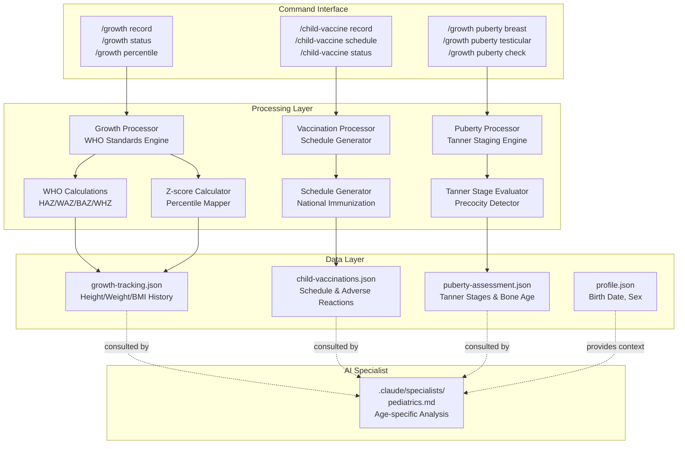
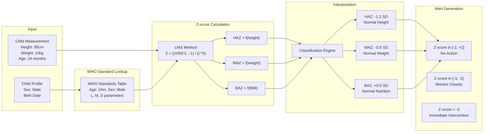
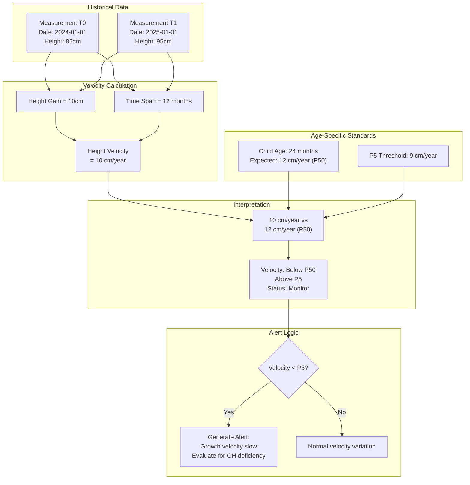
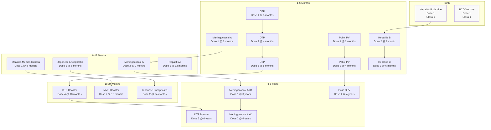
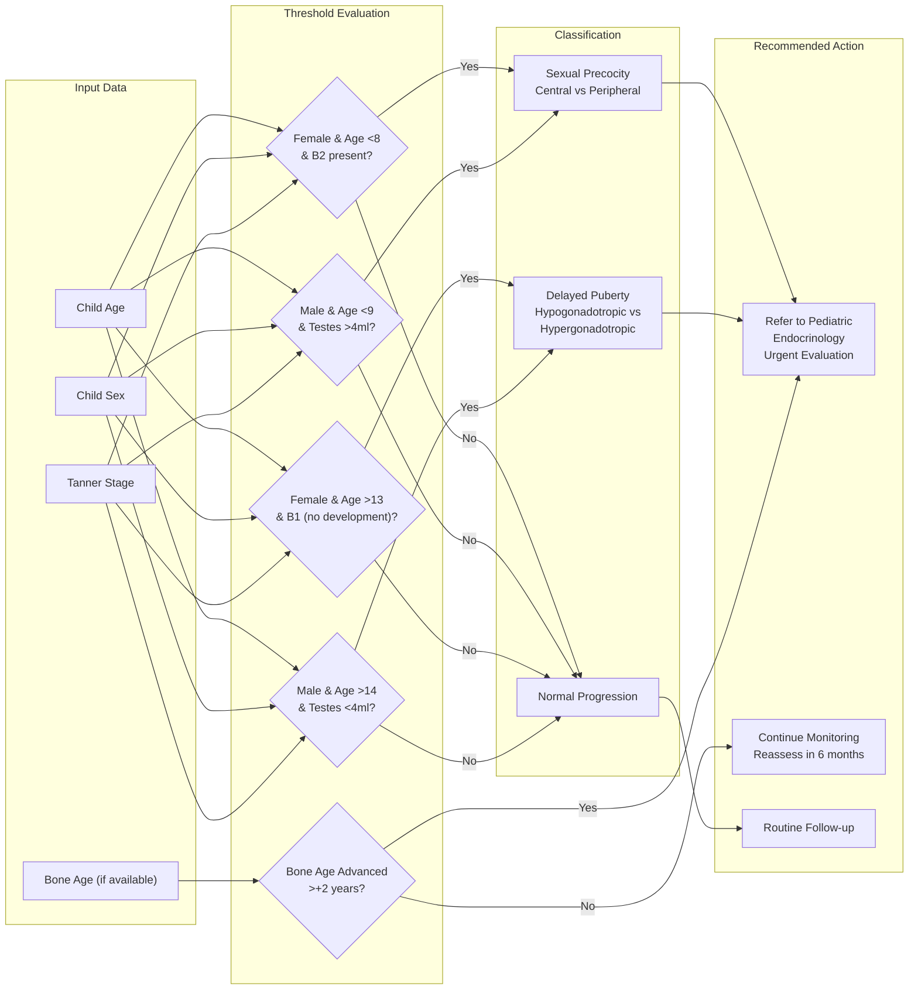
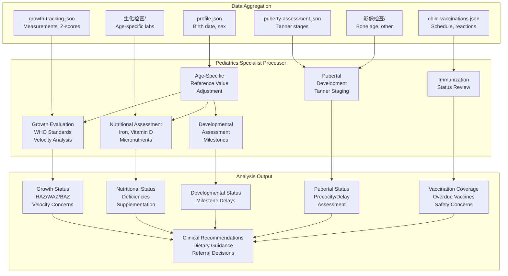

<!-- source: DeepWiki mcp.deepwiki.com · repo huifer/Claude-Ally-Health · page 4.3 Child & Adolescent Health · fetched 2026-10-26 -->

# Child & Adolescent Health

<details>
<summary>Relevant source files</summary>

The following files were used as context for generating this wiki page:

- [.claude/commands/prostate-health.md](.claude/commands/prostate-health.md)
- [.claude/commands/puberty.md](.claude/commands/puberty.md)
- [.claude/settings.local.json](.claude/settings.local.json)
- [.claude/specialists/pediatrics.md](.claude/specialists/pediatrics.md)
- [.claude/specialists/urology.md](.claude/specialists/urology.md)
- [data-example/andropause-tracker.json](data-example/andropause-tracker.json)
- [data-example/child-vaccinations.json](data-example/child-vaccinations.json)
- [todo/01-womens-health.md](todo/01-womens-health.md)
- [todo/02-mens-health.md](todo/02-mens-health.md)

</details>


## Purpose and Scope

The Child & Adolescent Health module provides comprehensive pediatric health tracking from birth through adolescence (0-18 years). This module encompasses three primary subsystems:

1. **Growth & Development Monitoring** - WHO growth standards, percentile tracking, developmental milestones (see [4.3.1](#4.3.1))
2. **Vaccination Tracking** - National immunization schedule, adverse reaction logging (see [4.3.2](#4.3.2))
3. **Puberty Assessment** - Tanner staging, sexual development tracking, precocity detection (see [4.3.3](#4.3.3))

This module integrates with the Pediatrics AI Specialist for comprehensive health assessment (see [7.3](#7.3) for specialist skills). For pregnancy and postpartum care, see [4.1.1](#4.1.1) and [4.1.2](#4.1.2). For elderly health management, see [4.4](#4.4).

---

## System Architecture

The child health subsystem uses a command-driven architecture with persistent JSON storage and AI-powered analysis.



**Sources:** [.claude/specialists/pediatrics.md:1-661](), [.claude/commands/puberty.md:1-214](), [data-example/child-vaccinations.json:1-131]()

---

## Growth & Development Monitoring

### WHO Growth Standards Engine

The growth monitoring system implements WHO Child Growth Standards (MGRS 2006) for children 0-5 years and WHO Reference 2007 for 5-19 years. The system calculates four primary anthropometric indices:

| Z-score | Full Name | Purpose | Age Range |
|---------|-----------|---------|-----------|
| HAZ | Height-for-Age Z-score | Growth stunting detection | 0-19 years |
| WAZ | Weight-for-Age Z-score | Underweight detection | 0-10 years |
| BAZ | BMI-for-Age Z-score | Nutritional status | 0-19 years |
| WHZ | Weight-for-Height Z-score | Acute malnutrition | 0-5 years |

**Sources:** [.claude/specialists/pediatrics.md:297-365]()

### Z-score Calculation and Interpretation



**Z-score Classification Matrix:**

| Z-score Range | HAZ Interpretation | WAZ Interpretation | BAZ Interpretation |
|---------------|-------------------|-------------------|-------------------|
| ≥ -1 SD | Normal height | Normal weight | Normal nutrition |
| -2 to -1 SD | Mild stunting (monitor) | Mild underweight | Risk of underweight |
| -3 to -2 SD | Moderate stunting (intervene) | Moderate underweight | Underweight |
| < -3 SD | Severe stunting (urgent) | Severe underweight | Severe underweight |
| +1 to +2 SD | Tall (evaluate) | Risk of overweight | Risk of overweight |
| > +2 SD | Very tall (evaluate) | Overweight | Overweight/obese |
| > +3 SD | - | Severe overweight | Severe obesity |

**Sources:** [.claude/specialists/pediatrics.md:297-365]()

### Growth Velocity Assessment

Growth velocity monitoring detects abnormal growth patterns by measuring the rate of height/weight increase per year:



**Age-Specific Growth Velocity Standards (P50):**

| Age Range | Height Velocity (cm/year) | Weight Velocity (kg/year) |
|-----------|--------------------------|--------------------------|
| 0-1 year | 25 | 6-7 |
| 1-2 years | 12 | 2-3 |
| 2-3 years | 9 | 2 |
| 3-4 years | 7.7 | 2 |
| 4-puberty | 5-7 | 2-3 |
| Puberty peak (girls) | 8-9 | 5-6 |
| Puberty peak (boys) | 10-12 | 6-8 |

**Growth Velocity Red Flags:**
- Height velocity < 5 cm/year after age 4 → Evaluate for growth hormone deficiency
- Sudden drop crossing 2 major percentile lines → Evaluate for chronic disease
- No weight gain for 3+ months in infancy → Failure to thrive investigation

**Sources:** [.claude/specialists/pediatrics.md:336-364]()

### Data Structure: growth-tracking.json

```json
{
  "child_profile": {
    "child_id": "child_20200101",
    "birth_date": "2020-01-01",
    "sex": "male",
    "gestational_age_weeks": 40
  },
  "measurements": [
    {
      "measurement_id": "growth_001",
      "date": "2022-01-01",
      "age_months": 24,
      "height_cm": 87.5,
      "weight_kg": 12.8,
      "head_circumference_cm": 48.2,
      "bmi": 16.7,
      "who_scores": {
        "haz": -0.8,
        "haz_percentile": 21,
        "waz": -0.5,
        "waz_percentile": 31,
        "baz": 0.2,
        "baz_percentile": 58,
        "whz": 0.3,
        "whz_percentile": 62,
        "hcaz": 0.1,
        "hcaz_percentile": 54
      },
      "interpretation": {
        "height": "normal",
        "weight": "normal",
        "nutrition": "normal",
        "head_circumference": "normal"
      },
      "alerts": []
    }
  ],
  "growth_velocity": [
    {
      "period": "12_months_to_24_months",
      "height_gain_cm": 10.5,
      "height_velocity_cm_per_year": 10.5,
      "weight_gain_kg": 2.3,
      "weight_velocity_kg_per_year": 2.3,
      "velocity_assessment": "slightly_below_p50_above_p5"
    }
  ],
  "developmental_milestones": {
    "motor": {
      "gross_motor": [
        {"milestone": "walks_independently", "achieved": true, "age_months": 12}
      ],
      "fine_motor": [
        {"milestone": "stacks_blocks", "achieved": true, "age_months": 18}
      ]
    },
    "language": {
      "expressive": [
        {"milestone": "two_word_phrases", "achieved": true, "age_months": 22}
      ]
    }
  }
}
```

**Sources:** [.claude/specialists/pediatrics.md:297-365]()

---

## Vaccination Tracking

### National Immunization Schedule

The vaccination tracking system implements China's National Immunization Program with Class 1 (mandatory, free) and Class 2 (optional, paid) vaccines.



**Vaccine Schedule Data Structure:**

```json
{
  "scheduled_vaccines": [
    {
      "vaccine_id": "hepb_b1",
      "vaccine_name": "乙肝疫苗",
      "category": "class_1",
      "dose": "第1针",
      "scheduled_age": "birth",
      "scheduled_date": "2020-01-01",
      "status": "completed",
      "actual_date": "2020-01-01",
      "batch_number": "202001001",
      "manufacturer": "康泰生物",
      "site": "left_thigh",
      "adverse_reaction": null
    }
  ],
  "upcoming": [
    {
      "vaccine": "流脑A群",
      "dose": "第1针",
      "scheduled_date": "2025-08-01",
      "days_until": 42,
      "status": "scheduled"
    }
  ],
  "overdue": [],
  "adverse_reactions": [
    {
      "vaccine": "百白破",
      "date": "2020-09-15",
      "reaction": "low_grade_fever",
      "severity": "mild",
      "duration": "24_hours",
      "treatment": "physical_cooling"
    }
  ]
}
```

**Sources:** [data-example/child-vaccinations.json:1-131](), [.claude/specialists/pediatrics.md:225-285]()

### Adverse Reaction Classification

| Severity | Symptoms | Duration | Action Required |
|----------|----------|----------|----------------|
| Mild | Local redness/swelling, fever <38.5°C, irritability | <24 hours | Monitor, symptomatic care |
| Moderate | Fever 38.5-39.5°C, extensive local reaction | 24-48 hours | Medical consultation recommended |
| Severe | Fever >39.5°C, anaphylaxis, seizures, HHE | >48 hours | Immediate medical attention |

**Common Mild Reactions:**
- Local pain/swelling at injection site → Cold compress
- Low-grade fever (<38.5°C) → Fluids, rest, monitor
- Fussiness/decreased appetite → Normal, resolves in 24-48h

**Rare Severe Reactions (Require Immediate Medical Care):**
- Anaphylaxis (difficulty breathing, throat swelling, generalized urticaria)
- Seizures (febrile or afebrile)
- High fever ≥38.5°C persisting >48 hours
- Hypotonic-hyporesponsive episode (HHE)
- Extensive limb swelling

**Sources:** [.claude/specialists/pediatrics.md:511-579]()

### Vaccination Contraindications

The system does **not** automatically determine contraindications. All vaccination decisions require physician evaluation.

**Absolute Contraindications (Physician Assessment Required):**
- Severe allergic reaction to vaccine component
- Previous severe adverse reaction to same vaccine
- Immunodeficiency (for live vaccines)

**Relative Contraindications (Defer Until Resolved):**
- Acute febrile illness (temp >38°C)
- Chronic disease acute exacerbation
- Severe malnutrition
- Current immunosuppressive therapy

**Sources:** [.claude/specialists/pediatrics.md:511-579]()

---

## Puberty Assessment

### Tanner Staging System

The puberty assessment subsystem implements Tanner staging for sexual development evaluation and precocious/delayed puberty detection.

```mermaid
graph TB
    subgraph "Female Development Stages"
        FB1["B1: Prepubertal<br>Nipple elevation only"]
        FB2["B2: Breast Budding<br>8-13 years (avg 10)<br>⚠️ <8 years = Precocious"]
        FB3["B3: Breast & Areola<br>Enlargement<br>Single contour"]
        FB4["B4: Areola Projects<br>Secondary mound"]
        FB5["B5: Mature Breast<br>Areola recessed"]
        
        FP1["P1: No Pubic Hair"]
        FP2["P2: Sparse, Long Hair<br>8-14 years (avg 11)"]
        FP3["P3: Coarser, Curled<br>Darker hair"]
        FP4["P4: Adult-type<br>Smaller area"]
        FP5["P5: Adult Distribution<br>Inverted triangle"]
        
        FMen["Menarche<br>10-15 years (avg 12-13)<br>Usually 2-2.5 years<br>after B2 onset<br>⚠️ <10 years = Precocious<br>⚠️ >16 years = Delayed"]
    end
    
    subgraph "Male Development Stages"
        MG1["G1: Prepubertal<br>Testicular Volume <4ml"]
        MG2["G2: Testicular Enlargement<br>4-6ml<br>9-14 years (avg 11)<br>⚠️ <9 years = Precocious"]
        MG3["G3: Further Enlargement<br>6-10ml<br>Penis lengthens"]
        MG4["G4: Near Adult Size<br>10-20ml<br>Glans develops"]
        MG5["G5: Adult Genitalia<br>>20ml"]
        
        MP1["P1: No Pubic Hair"]
        MP2["P2: Sparse Hair<br>Penis base"]
        MP3["P3: Coarser, Curled<br>Spreads laterally"]
        MP4["P4: Adult-type<br>Smaller area"]
        MP5["P5: Adult Distribution<br>Diamond shape"]
        
        MVoice["Voice Change<br>Usually at G3-G4<br>13-14 years average"]
    end
    
    FB1 --> FB2
    FB2 --> FB3
    FB3 --> FB4
    FB4 --> FB5
    
    FB2 -.2-2.5 years later.-> FMen
    
    FP1 --> FP2
    FP2 --> FP3
    FP3 --> FP4
    FP4 --> FP5
    
    MG1 --> MG2
    MG2 --> MG3
    MG3 --> MG4
    MG4 --> MG5
    
    MG3 -.triggers.-> MVoice
    
    MP1 --> MP2
    MP2 --> MP3
    MP3 --> MP4
    MP4 --> MP5
```

**Sources:** [.claude/specialists/pediatrics.md:366-508](), [.claude/commands/puberty.md:1-214]()

### Sexual Precocity and Delay Detection



**Precocious Puberty Definitions:**
- **Female**: Breast development (B2) before age 8 years OR menarche before age 10 years
- **Male**: Testicular enlargement (>4ml) before age 9 years

**Delayed Puberty Definitions:**
- **Female**: No breast development (B1) at age 13 years OR no menarche by age 16 years
- **Male**: No testicular enlargement (<4ml) at age 14 years

**Bone Age Evaluation:**
- Bone age vs chronological age difference of **>+2 years** suggests accelerated maturation
- Bone age vs chronological age difference of **<-1 year** suggests delayed maturation
- Requires left hand/wrist X-ray using Greulich-Pyle or Tanner-Whitehouse method

**Sources:** [.claude/specialists/pediatrics.md:447-508](), [.claude/commands/puberty.md:119-139]()

### Data Structure: puberty-assessment.json

```json
{
  "puberty_tracking": {
    "child_id": "child_20120101",
    "sex": "female",
    "current_age_years": 10.5,
    
    "female_development": {
      "breast_stage": "B3",
      "breast_stage_age": 9.8,
      "pubic_hair_stage": "P2",
      "pubic_hair_age": 10.2,
      "menarche": {
        "occurred": false,
        "age_at_menarche": null,
        "expected_age_range": "10-15_years"
      }
    },
    
    "male_development": {
      "testicular_volume": {
        "left": null,
        "right": null,
        "measurement_method": null
      },
      "testicular_stage": null,
      "penis_stage": null,
      "pubic_hair_stage": null,
      "voice_break": false,
      "facial_hair": false
    },
    
    "bone_age": {
      "chronological_age_years": 10.5,
      "bone_age_years": 10.8,
      "difference_years": 0.3,
      "method": "greulich_pyle",
      "date": "2025-06-15",
      "interpretation": "normal_range"
    },
    
    "assessment": {
      "pubertal_status": "early_puberty",
      "precocious_puberty": false,
      "delayed_puberty": false,
      "progression": "normal",
      "predicted_adult_height_cm": null,
      "concerns": [],
      "recommendations": [
        "Continue routine monitoring",
        "Re-assess in 6 months"
      ]
    },
    
    "history": [
      {
        "date": "2024-12-15",
        "age_years": 9.8,
        "breast_stage": "B2",
        "notes": "Breast budding noted"
      }
    ]
  }
}
```

**Sources:** [.claude/commands/puberty.md:142-169]()

---

## Command Interface

### Growth Monitoring Commands

The `/growth` command family manages height, weight, and BMI tracking with WHO standard evaluation.

**Command: `/growth record`**
- Records new measurement (height, weight, head circumference)
- Automatically calculates BMI, Z-scores (HAZ/WAZ/BAZ/WHZ), percentiles
- Evaluates against WHO standards and generates alerts

**Command: `/growth status`**
- Displays current growth status and trends
- Shows latest Z-scores and percentiles
- Highlights growth velocity concerns

**Command: `/growth percentile`**
- Displays detailed percentile breakdown
- Shows position on WHO growth curves
- Identifies percentile crossings

**Sources:** [.claude/specialists/pediatrics.md:582-608]()

### Vaccination Commands

The `/child-vaccine` command family manages immunization schedules and tracking.

**Command: `/child-vaccine record`**
- Records completed vaccination
- Captures batch number, manufacturer, site, adverse reactions
- Updates schedule and coverage statistics

**Command: `/child-vaccine schedule`**
- Generates age-appropriate vaccination schedule
- Identifies overdue vaccines
- Lists upcoming vaccines (next 30 days)

**Command: `/child-vaccine status`**
- Shows vaccination coverage by category (Class 1/Class 2)
- Displays adverse reaction history
- Calculates completion percentage

**Sources:** [data-example/child-vaccinations.json:1-131](), [.claude/specialists/pediatrics.md:599-608]()

### Puberty Assessment Commands

The `/growth puberty` command family assesses sexual development using Tanner staging.

**Command: `/growth puberty breast <stage>`**
- Records female breast development stage (B1-B5)
- Detects precocious puberty if B2 before age 8

**Command: `/growth puberty testicular <volume>`**
- Records testicular volume in ml (measured by orchidometer)
- Detects precocious puberty if >4ml before age 9

**Command: `/growth puberty menarche <true|false> <age>`**
- Records menarche occurrence and age
- Flags if menarche occurred before age 10 (precocious)

**Command: `/growth puberty bone-age <age>`**
- Records bone age from radiological assessment
- Calculates bone age advancement/delay
- Flags if difference >2 years

**Command: `/growth puberty check`**
- Comprehensive precocity/delay screening
- Generates referral recommendations if abnormal

**Sources:** [.claude/commands/puberty.md:1-214]()

---

## AI Specialist Integration

### Pediatrics Specialist Analysis

The Pediatrics AI Specialist (defined in `.claude/specialists/pediatrics.md`) provides domain-specific analysis of child health data. It is invoked during `/consult` multi-disciplinary consultations.



**Pediatrics Specialist Capabilities:**

| Analysis Domain | Data Sources | Key Evaluations |
|----------------|--------------|-----------------|
| Growth Assessment | growth-tracking.json, profile.json | HAZ/WAZ/BAZ classification, velocity trends, stunting detection |
| Nutritional Status | Biochemical labs, growth data | Anemia, vitamin D deficiency, malnutrition, obesity |
| Developmental Milestones | User-reported milestones | Motor, language, social development delays |
| Pubertal Development | puberty-assessment.json, bone age | Tanner staging, precocity/delay detection |
| Immunization Status | child-vaccinations.json | Coverage gaps, overdue vaccines, contraindication review |
| Age-Specific Labs | Biochemical test results | Pediatric reference ranges for hemoglobin, WBC, etc. |

**Age-Specific Reference Value Handling:**

The Pediatrics Specialist adjusts reference ranges based on child age. Example for hemoglobin:

| Age | Hemoglobin Reference (g/L) | Anemia Threshold |
|-----|---------------------------|------------------|
| Birth | 135-195 | <135 |
| 1-3 months | 95-135 | <95 |
| 6 months - 2 years | 105-135 | <105 |
| 2-6 years | 115-145 | <115 |
| 6-12 years | 120-150 | <120 |
| 12-18 years (male) | 130-160 | <130 |
| 12-18 years (female) | 120-150 | <120 |

**Sources:** [.claude/specialists/pediatrics.md:1-661](), [.claude/specialists/pediatrics.md:16-47]()

### Multi-Disciplinary Consultation Integration

The child health module integrates with the MDT consultation system (see [7.1](#7.1)) for comprehensive assessment:

**Consultation Scenarios:**
- **Growth concerns** → Pediatrics + Endocrinology consultation for growth hormone evaluation
- **Precocious puberty** → Pediatrics + Endocrinology for hormonal assessment
- **Developmental delays** → Pediatrics + Neurology for neurological evaluation
- **Malnutrition** → Pediatrics + Gastroenterology for GI causes

**Example Consultation Command:**
```bash
/consult 儿科+内分泌科 8岁女孩乳房发育、疑似性早熟
```

This triggers parallel analysis by both Pediatrics and Endocrinology specialists, with opinion integration and unified recommendations.

**Sources:** [.claude/specialists/pediatrics.md:609-629]()

---

## Medical Safety Principles

### Safety Red Lines

The child health module enforces strict safety boundaries to prevent misuse:

**System Restrictions:**

1. **No Specific Diagnoses**
   - System identifies abnormal values but does not diagnose diseases
   - Example: "HAZ < -2 suggests growth concern" NOT "diagnosed with growth hormone deficiency"

2. **No Medication Dosing**
   - System references medications by class only
   - Example: "Iron supplementation recommended" NOT "ferrous sulfate 3mg/kg/day"

3. **No Vaccination Contraindication Decisions**
   - All contraindications require physician evaluation
   - System flags potential concerns but does not make final decisions

4. **No Prognosis Predictions**
   - System does not predict adult height, developmental outcomes, or disease progression
   - Example: "Growth velocity slow, requires evaluation" NOT "will be short as adult"

5. **Age-Specific Reference Values Required**
   - All pediatric lab interpretations must use age-adjusted ranges
   - System alerts if age-specific standards are not available

**Sources:** [.claude/specialists/pediatrics.md:48-67](), [.claude/commands/puberty.md:173-189]()

### Appropriate System Capabilities

**What the System CAN Do:**

| Capability | Example Output |
|-----------|----------------|
| Growth evaluation | "HAZ: -2.3 SD (moderate stunting). Height is below 3rd percentile. Recommend pediatric endocrinology evaluation." |
| Percentile calculation | "Weight at 15th percentile for age. Within normal range but below average." |
| Vaccination schedule | "Next due: MMR dose 2 at 18 months (in 42 days)" |
| Precocity screening | "Breast development at age 7.5 years. Meets criteria for sexual precocity. Recommend pediatric endocrinology referral." |
| Trend analysis | "Height velocity 4cm/year (below 5th percentile for age). Evaluate for growth hormone deficiency." |
| Milestone tracking | "Walking independently at 12 months (normal range). Two-word phrases at 22 months (normal)." |

**Sources:** [.claude/specialists/pediatrics.md:142-155](), [.claude/specialists/pediatrics.md:643-656]()

---

## Data Privacy and Storage

All child health data is stored locally in the `data/` directory with no cloud synchronization:

**Primary Data Files:**
- `data/growth-tracking.json` - Growth measurements and WHO scores
- `data/child-vaccinations.json` - Vaccination records and schedule
- `data/puberty-assessment.json` - Tanner staging and sexual development
- `data/profile.json` - Basic demographics (birth date, sex)
- `data/生化检查/` - Age-specific laboratory results
- `data/影像检查/` - Bone age and other imaging

**Privacy Features:**
- `.gitignore` excludes `data/` directory from version control
- No external API calls for health data processing
- All AI analysis occurs locally via Claude Code
- Parents have complete control over data access and deletion

**Sources:** [.claude/specialists/pediatrics.md:651-659]()

---

## Testing

The child health module includes native Shell + Python test scripts:

**Test Script: `scripts/test-children-health.sh`**
- Growth percentile calculations
- Vaccination schedule generation
- Tanner staging evaluation
- Precocity/delay detection
- WHO Z-score accuracy

**Test Coverage:**
- 21+ test cases for growth monitoring
- 15+ test cases for vaccination tracking
- 12+ test cases for puberty assessment
- Age-specific reference value validation

**Running Tests:**
```bash
bash scripts/test-children-health.sh
```

**Sources:** [.claude/settings.local.json:23](), [todo/01-womens-health.md:294-302]()

---

