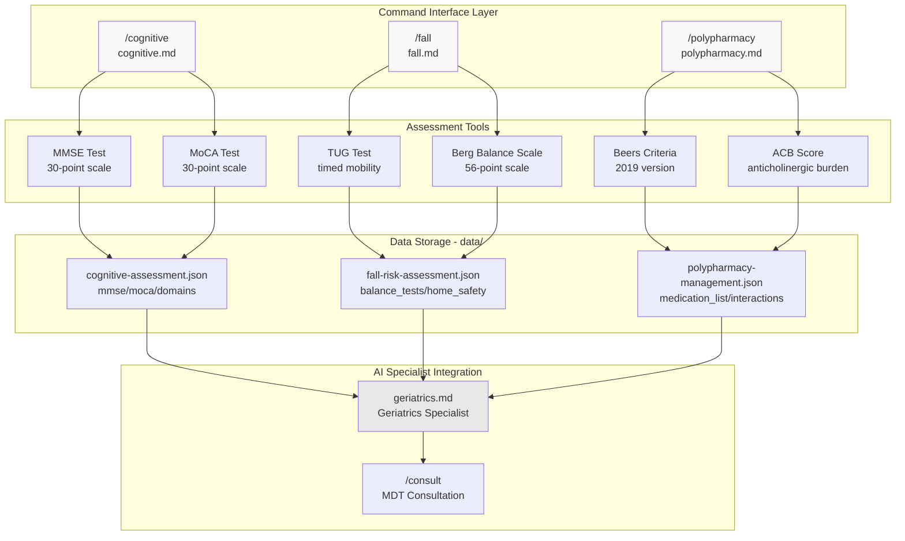
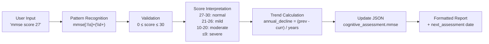
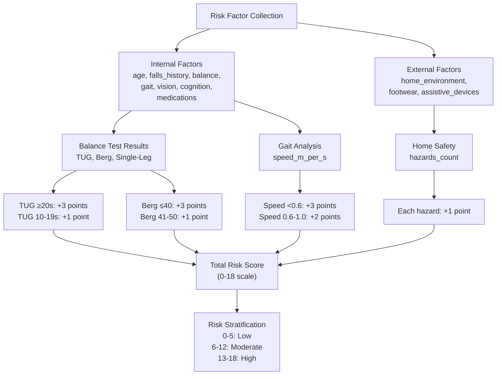
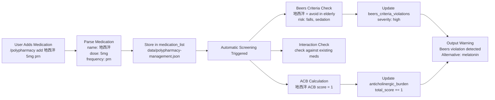
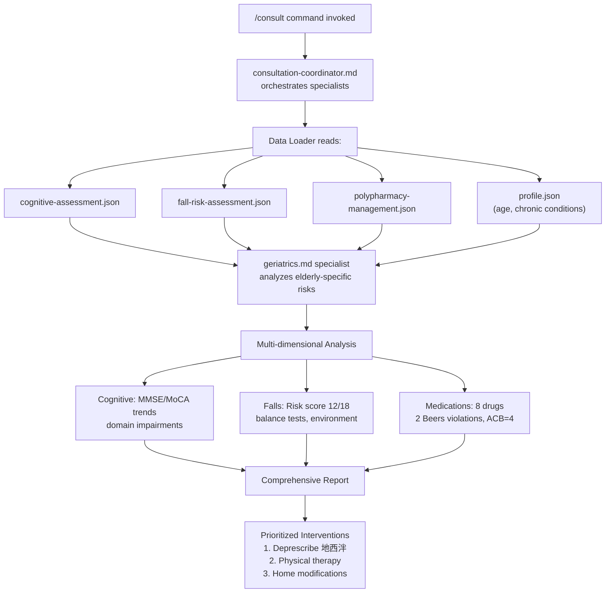
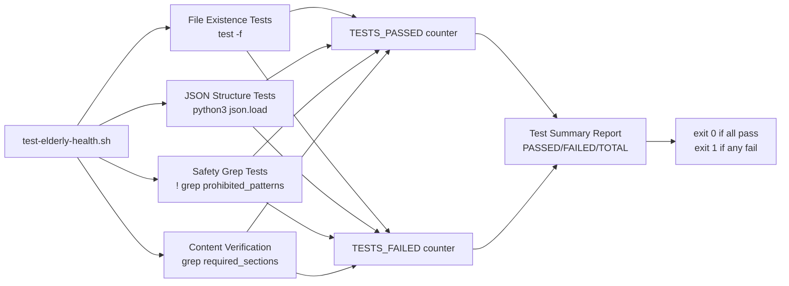

<!-- source: DeepWiki mcp.deepwiki.com · repo huifer/Claude-Ally-Health · page 4.4 Elderly Health · fetched 2026-10-26 -->

# Elderly Health

<details>
<summary>Relevant source files</summary>

The following files were used as context for generating this wiki page:

- [.claude/commands/cognitive.md](.claude/commands/cognitive.md)
- [.claude/commands/fall.md](.claude/commands/fall.md)
- [.claude/commands/polypharmacy.md](.claude/commands/polypharmacy.md)
- [.claude/commands/prostate-health.md](.claude/commands/prostate-health.md)
- [.claude/commands/puberty.md](.claude/commands/puberty.md)
- [.claude/specialists/geriatrics.md](.claude/specialists/geriatrics.md)
- [.claude/specialists/pediatrics.md](.claude/specialists/pediatrics.md)
- [.claude/specialists/urology.md](.claude/specialists/urology.md)
- [data-example/andropause-tracker.json](data-example/andropause-tracker.json)
- [data-example/child-vaccinations.json](data-example/child-vaccinations.json)
- [data-example/index.json](data-example/index.json)
- [scripts/test-elderly-health.sh](scripts/test-elderly-health.sh)
- [todo/03-children-health.md](todo/03-children-health.md)
- [todo/04-elderly-health.md](todo/04-elderly-health.md)

</details>


## Purpose and Scope

This document provides technical documentation for the Elderly Health module, a comprehensive geriatric health management system consisting of three integrated sub-modules: cognitive function assessment, fall risk evaluation, and medication safety management. The module addresses the unique health challenges faced by adults aged 65 and older through standardized clinical assessment tools, risk stratification algorithms, and evidence-based intervention recommendations.

The Elderly Health module implements geriatric screening protocols using validated instruments (MMSE, MoCA, TUG test, Berg Balance Scale, Beers Criteria) and maintains longitudinal tracking to detect functional decline. All components integrate with the multi-disciplinary consultation system via the geriatrics specialist skill.

For child development tracking, see [Child & Adolescent Health](#4.3). For chronic disease management applicable to elderly populations, see [Chronic Disease Management](#4.5). For drug interaction checking across all patient groups, see [Drug Interaction Detection](#6.1).

---

## System Architecture

The Elderly Health module operates as three parallel tracking systems with shared data access patterns and unified safety constraints.

### High-Level Component Structure



**Sources:** [.claude/commands/cognitive.md:1-354](), [.claude/commands/fall.md:1-451](), [.claude/commands/polypharmacy.md:1-437](), [.claude/specialists/geriatrics.md:1-413]()

---

## Sub-Module 1: Cognitive Assessment

### Overview

The cognitive assessment sub-module implements standardized cognitive screening using MMSE (Mini-Mental State Examination) and MoCA (Montreal Cognitive Assessment) protocols. It tracks five cognitive domains (memory, executive function, language, visuospatial, orientation) and evaluates functional impact through ADL/IADL assessments.

**Key Concepts:**
- **MMSE Score Range:** 0-30 points, stratified into normal (27-30), mild impairment (21-26), moderate (10-20), and severe (≤9)
- **MoCA Score Range:** 0-30 points with +1 education adjustment for ≤12 years schooling
- **Cognitive Domains:** Five areas of brain function evaluated independently
- **Functional Impact:** ADL (6 basic activities) and IADL (8 instrumental activities)

### Command Interface

The `/cognitive` command provides eight action verbs for different assessment types:

| Action | Purpose | Data Updated | Example |
|--------|---------|--------------|---------|
| `mmse` | Record MMSE score | `cognitive_assessment.mmse` | `/cognitive mmse score 27` |
| `moca` | Record MoCA score | `cognitive_assessment.moca` | `/cognitive moca 24` |
| `domain` | Assess cognitive domain | `cognitive_assessment.cognitive_domains` | `/cognitive domain memory mild_impairment` |
| `adl` | Basic activities assessment | `functional_impact.activities_of_daily_living` | `/cognitive adl independent` |
| `iadl` | Instrumental activities | `functional_impact.instrumental_activities` | `/cognitive iadl shopping needs_assistance` |
| `status` | View current state | Read-only | `/cognitive status` |
| `trend` | View historical changes | Read-only | `/cognitive trend` |
| `risk` | Risk factor analysis | Read-only | `/cognitive risk` |

**Sources:** [.claude/commands/cognitive.md:46-323]()

### MMSE Data Processing Flow



**Sources:** [.claude/commands/cognitive.md:48-86]()

### Cognitive Assessment Data Structure

The system stores cognitive data in `data/cognitive-assessment.json` with the following schema:

```json
{
  "cognitive_assessment": {
    "user_id": "user_001",
    "age": 75,
    "education_years": 12,
    "mmse": {
      "date": "2025-06-20",
      "total_score": 27,
      "subscores": {
        "orientation": {"time": 4, "place": 5},
        "registration": 3,
        "attention": 4,
        "recall": 2,
        "language": 9
      },
      "history": [
        {"date": "2024-06-20", "score": 28},
        {"date": "2023-06-20", "score": 29}
      ],
      "trend": "stable_decline",
      "annual_decline": 1.0
    },
    "cognitive_domains": {
      "memory": {
        "status": "mild_impairment",
        "immediate_recall": "normal",
        "short_term_memory": "mild_impairment"
      },
      "executive_function": {
        "status": "normal"
      }
    },
    "functional_impact": {
      "activities_of_daily_living": {
        "bathing": "independent",
        "dressing": "independent",
        "toileting": "independent"
      },
      "instrumental_activities": {
        "shopping": "needs_assistance",
        "managing_medications": "supervision_needed"
      }
    }
  }
}
```

**Sources:** [todo/04-elderly-health.md:128-244]()

### Risk Assessment Algorithm

The cognitive risk assessment evaluates multiple factors:

**Risk Factors Evaluated:**
1. Age factor: >75 years = high risk
2. Education: ≤12 years = increased risk
3. Vascular factors: hypertension, diabetes
4. MMSE/MoCA scores: <26 MMSE or <25 MoCA
5. Impaired cognitive domains: ≥2 domains
6. Functional decline: ADL/IADL dependency

**Risk Stratification:**
- Low risk: 0-1 factors, scores normal
- Medium risk: 2-3 factors or declining trend
- High risk: ≥4 factors or rapid decline (>2 points/year)

**Sources:** [.claude/commands/cognitive.md:297-323](), [.claude/specialists/geriatrics.md:21-51]()

---

## Sub-Module 2: Fall Risk Management

### Overview

The fall risk sub-module implements balance function testing (TUG, Berg Balance Scale, single-leg stance), gait analysis, and home environment safety assessment. It tracks fall history and generates risk scores (0-18 scale) to stratify intervention needs.

**Assessment Components:**
- **TUG Test (Timed Up and Go):** Measures mobility, <10s normal, ≥30s dependent
- **Berg Balance Scale:** 14 tasks scored 0-4, total 56 points
- **Single-Leg Stance:** Age-adjusted thresholds (>30s for <60y, >5s for 70-79y)
- **Home Safety:** 4 rooms evaluated with 15+ safety criteria

### Command Interface

The `/fall` command structure:

| Action | Purpose | Data Structure | Example |
|--------|---------|----------------|---------|
| `record` | Log fall event | `fall_history.last_fall` | `/fall record 2025-03-15 bathroom slippery` |
| `history` | View fall events | Read `fall_history` | `/fall history` |
| `tug` | TUG test result | `balance_tests.tug_test` | `/fall tug 18` |
| `berg` | Berg scale score | `balance_tests.berg_balance_scale` | `/fall berg 42` |
| `single-leg-stance` | Balance test | `balance_tests.single_leg_stance` | `/fall single-leg-stance 8` |
| `gait` | Gait analysis | `gait_analysis` | `/fall gait speed 0.8` |
| `home` | Environment assessment | `home_safety.[room]` | `/fall home bathroom grab_bars true` |
| `risk` | Risk calculation | Computed from all factors | `/fall risk` |

**Sources:** [.claude/commands/fall.md:48-423]()

### Fall Risk Scoring Algorithm



**Sources:** [.claude/commands/fall.md:348-377](), [todo/04-elderly-health.md:281-370]()

### Home Safety Assessment Matrix

The home environment evaluation covers four areas with specific safety criteria:

| Room | Safety Items Evaluated | Data Path |
|------|------------------------|-----------|
| Living Room | `floor_slippery`, `adequate_lighting`, `obstacles_removed`, `rugs_secure` | `home_safety.living_room` |
| Bedroom | `bedside_light`, `night_light`, `bed_height_appropriate`, `clutter_free` | `home_safety.bedroom` |
| Bathroom | `non_slip_mat`, `grab_bars`, `shower_chair`, `easy_access` | `home_safety.bathroom` |
| Stairs | `handrails`, `non_slip_treads`, `adequate_lighting`, `clutter_free` | `home_safety.stairs` |

**Pattern Recognition for Home Assessment:**
```javascript
// From user input: "/fall home bathroom grab_bars true"
const pattern = /home[:\s]+(\w+)[\s]+(\w+)[\s]+(\w+)/
// Extracts: room="bathroom", item="grab_bars", status="true"
```

**Sources:** [.claude/commands/fall.md:286-344]()

### Balance Test Data Schema

```json
{
  "fall_risk_assessment": {
    "balance_tests": {
      "tug_test": {
        "date": "2025-06-20",
        "time_seconds": 18,
        "interpretation": "mobility_limitation",
        "reference": "<10_seconds_normal"
      },
      "berg_balance_scale": {
        "date": "2025-06-20",
        "score": 42,
        "max_score": 56,
        "interpretation": "moderate_risk"
      },
      "single_leg_stance": {
        "date": "2025-06-20",
        "eyes_open_seconds": 8,
        "eyes_closed_seconds": 2,
        "age_reference": ">5_seconds_normal",
        "result": "impaired"
      }
    },
    "overall_risk": "moderate",
    "risk_score": 12,
    "max_score": 18
  }
}
```

**Sources:** [todo/04-elderly-health.md:371-495]()

---

## Sub-Module 3: Polypharmacy Management

### Overview

The polypharmacy module screens for potentially inappropriate medications using the 2019 Beers Criteria, calculates anticholinergic burden (ACB score), checks drug-drug and drug-disease interactions, and generates deprescribing recommendations. It addresses medication safety in patients taking ≥5 concurrent medications.

**Core Functions:**
- **Beers Criteria Screening:** Identifies 100+ potentially inappropriate medications for elderly
- **ACB Scoring:** Cumulative anticholinergic burden (0-3 per drug, ≥4 = significant risk)
- **Interaction Detection:** Drug-drug and drug-disease interaction checking
- **Deprescribing Plans:** Taper schedules and alternative medication recommendations

### Command Interface

The `/polypharmacy` command operations:

| Action | Purpose | Data Updated | Example |
|--------|---------|--------------|---------|
| `add` | Add medication | `medication_list[]` | `/polypharmacy add 阿司匹林 100mg qd` |
| `list` | View medications | Read-only | `/polypharmacy list` |
| `beers` | Run Beers screening | `beers_criteria_violations[]` | `/polypharmacy beers` |
| `inappropriate` | View flagged meds | Read-only | `/polypharmacy inappropriate` |
| `interaction` | Check interactions | `drug_interactions[]` | `/polypharmacy interaction check` |
| `anticholinergic` | Calculate ACB | `anticholinergic_burden` | `/polypharmacy anticholinergic` |
| `deprescribe` | Generate plan | `deprescribing_plan[]` | `/polypharmacy deprescribe` |

**Sources:** [.claude/commands/polypharmacy.md:50-400]()

### Medication Processing Pipeline



**Sources:** [.claude/commands/polypharmacy.md:64-91]()

### Beers Criteria Implementation

The system implements the 2019 AGS Beers Criteria with classification by issue type:

**Common Potentially Inappropriate Medications:**

| Medication Class | Examples | Beers Issue | Severity | Alternative |
|-----------------|----------|-------------|----------|-------------|
| Benzodiazepines | 地西泮, 阿普唑仑 | Falls, sedation | High | Melatonin, CBT-I |
| Anticholinergics | 氯苯那敏, 奥昔布宁 | Cognitive impairment | Moderate | Loratadine, behavioral therapy |
| First-gen antihistamines | 苯海拉明 | Sedation, anticholinergic | Moderate | Cetirizine, loratadine |
| NSAIDs | 布洛芬, 吲哚美辛 | GI bleeding, renal | High | Acetaminophen |
| Long-term corticosteroids | 泼尼松 | Osteoporosis, hyperglycemia | Moderate | Minimize dose/duration |

**Data Structure:**
```json
{
  "beers_criteria_violations": [
    {
      "medication": "地西泮",
      "issue": "falls_risk_sedation",
      "recommendation": "avoid_use",
      "severity": "high",
      "alternative": "melatonin_cbt_i"
    }
  ]
}
```

**Sources:** [.claude/commands/polypharmacy.md:148-158](), [.claude/specialists/geriatrics.md:106-119]()

### Anticholinergic Burden Calculation

The ACB (Anticholinergic Cognitive Burden) score sums individual medication scores:

**ACB Scoring Scale:**
- Each medication: 0-3 points
- ACB 0-1: Acceptable
- ACB 2-3: Avoid if possible
- ACB ≥4: Significant risk (cognitive impairment, falls, constipation)

**Common ACB Contributors:**

| Medication | ACB Score | Class |
|------------|-----------|-------|
| Benzodiazepines | 1 | Sedative |
| First-gen antihistamines | 2-3 | Antihistamine |
| Tricyclic antidepressants | 3 | Antidepressant |
| Antipsychotics (typical) | 2-3 | Antipsychotic |
| Bladder antimuscarinics | 1-2 | Urologic |

**Calculation Example:**
```javascript
// User taking: 地西泮(1) + 氯苯那敏(2) + 奥昔布宁(1)
total_acb = 1 + 2 + 1 = 4
interpretation = "significant_risk"
risks = ["cognitive_impairment", "falls", "dry_mouth", "constipation"]
```

**Sources:** [.claude/commands/polypharmacy.md:236-287](), [.claude/specialists/geriatrics.md:134-147]()

### Drug Interaction Detection

The system checks two interaction types:

**Drug-Drug Interactions:**
| Interaction | Severity | Effect | Management |
|-------------|----------|--------|------------|
| Warfarin + Aspirin | Moderate | Increased bleeding risk | Monitor INR |
| ACEI + K-sparing diuretic | Moderate | Hyperkalemia | Monitor K+ |
| β-blocker + Digoxin | Moderate | Bradycardia | Monitor HR |
| NSAID + ACEI | Moderate | Renal dysfunction | Monitor Cr |

**Drug-Disease Interactions:**
| Medication | Disease | Effect | Severity |
|------------|---------|--------|----------|
| NSAID | CKD stage 3 | Worsens renal function | High |
| β-blocker | Asthma/COPD | Bronchospasm | Moderate |
| Anticholinergic | Constipation/BPH | Worsens symptoms | Moderate |
| Corticosteroid | Diabetes/osteoporosis | Worsens disease | Moderate |

**Data Schema:**
```json
{
  "drug_interactions": [
    {
      "medications": ["华法林", "阿司匹林"],
      "severity": "moderate",
      "interaction": "increased_bleeding_risk",
      "recommendation": "monitor_inr",
      "clinically_significant": true
    }
  ],
  "disease_drug_interactions": [
    {
      "medication": "布洛芬",
      "condition": "chronic_kidney_disease_stage_3",
      "interaction": "worsens_renal_function",
      "severity": "high"
    }
  ]
}
```

**Sources:** [.claude/commands/polypharmacy.md:201-233](), [.claude/specialists/geriatrics.md:120-133]()

### Deprescribing Algorithm

The system generates deprescribing recommendations following these steps:

1. **Candidate Identification:**
   - Beers Criteria violations (priority 1)
   - High ACB contributors (priority 2)
   - No clear indication (priority 3)
   - Therapy duplication (priority 4)

2. **Action Classification:**
   - `taper`: Gradual dose reduction (e.g., benzodiazepines)
   - `switch`: Replace with safer alternative
   - `discontinue`: Immediate cessation if safe

3. **Timeline Generation:**
   - Benzodiazepines: 4-8 weeks taper (reduce 25% every 1-2 weeks)
   - Antihistamines: Immediate switch
   - PPIs: 2-4 weeks taper

**Example Deprescribing Plan:**
```json
{
  "deprescribing_plan": [
    {
      "medication": "地西泮",
      "action": "taper",
      "timeline": "4-8_weeks",
      "taper_schedule": "reduce_by_25_every_1-2_weeks",
      "alternative": "sleep_hygiene_melatonin",
      "monitoring": ["withdrawal_symptoms", "sleep_quality"]
    },
    {
      "medication": "氯苯那敏",
      "action": "switch",
      "alternative": "loratadine",
      "timeline": "immediate"
    }
  ]
}
```

**Sources:** [.claude/commands/polypharmacy.md:290-348](), [todo/04-elderly-health.md:591-745]()

---

## Integration with Geriatrics Specialist

### Specialist Data Access Pattern

The geriatrics specialist (`geriatrics.md`) reads from all three elderly health data files during MDT consultations:



**Sources:** [.claude/specialists/geriatrics.md:254-288]()

### Specialist Analysis Framework

The geriatrics specialist employs a structured assessment framework:

**1. Cognitive Dimension Analysis:**
- MMSE/MoCA interpretation with education adjustment
- Cognitive domain mapping (memory, executive, language, visuospatial)
- Functional impact assessment (ADL/IADL)
- Trend analysis: annual decline rate calculation

**2. Functional Dimension Analysis:**
- Balance test results: TUG, Berg, single-leg stance
- Gait analysis: speed, abnormalities
- Fall history: frequency, causes, injuries
- Home safety evaluation: hazard identification

**3. Medication Dimension Analysis:**
- Total medication count (polypharmacy threshold: ≥5)
- Beers Criteria violations identification
- Drug-drug and drug-disease interactions
- Anticholinergic burden calculation
- Deprescribing opportunities

**4. Comorbidity Dimension:**
- Chronic disease interactions (hypertension, diabetes, COPD)
- Medication-disease conflicts
- Multi-organ system impacts

**Sources:** [.claude/specialists/geriatrics.md:19-167](), [.claude/specialists/geriatrics.md:252-288]()

### Output Format Template

The geriatrics specialist generates reports in this structure:

```markdown
## 老年医学综合评估报告

### 数据概览
- 年龄: [age]岁
- 主要异常: [list anomalies]

### 1. 认知功能评估
#### MMSE/MoCA结果
- MMSE评分: [score]/30分 - [interpretation]
#### 认知域评估
- 记忆力: [status]
- 执行功能: [status]

### 2. 跌倒风险评估
#### 平衡功能测试
- TUG测试: [time]秒 - [interpretation]
- Berg平衡量表: [score]/56分

### 3. 多重用药管理
#### Beers标准筛查
- 不适当用药: [count]种
#### 抗胆碱能负荷
- ACB评分: [score]分

### 4. 综合建议
#### 就医建议
[specialist referrals]
#### 治疗指导
[treatment recommendations]
```

**Sources:** [.claude/specialists/geriatrics.md:289-381]()

---

## Medical Safety Framework

### Safety Constraints Implementation

All three sub-modules implement identical safety red lines enforced at the command processing and specialist analysis layers:

**Universal Prohibitions:**

| Prohibited Action | Enforcement Point | Example Violation | System Response |
|-------------------|-------------------|-------------------|-----------------|
| Medical diagnosis | Command output, specialist analysis | "诊断为阿尔茨海默病" | Reject, recommend professional evaluation |
| Medication dosing | Command output | "服用多奈哌齐 10mg" | Reject, general class only |
| Prognosis predictions | Specialist analysis | "将发展成重度痴呆" | Reject, risk factors only |
| Injury treatment | Fall command | "骨折在家休息" | Reject, immediate medical care message |

**Implementation in Code:**

Cognitive safety: [.claude/commands/cognitive.md:20-43]()
```markdown
## ⚠️ 安全红线
1. **不诊断认知功能障碍或痴呆**
   - 不做阿尔茨海默病等痴呆诊断
   - 诊断需神经科/老年科医生
```

Fall safety: [.claude/commands/fall.md:20-34]()
```markdown
## ⚠️ 安全红线
1. **不处理跌倒后的损伤**
   - 跌倒受伤需立即就医
   - 系统仅记录跌倒事件
```

Polypharmacy safety: [.claude/commands/polypharmacy.md:20-35]()
```markdown
## ⚠️ 安全红线
1. **不调整药物剂量或停药**
   - 不建议具体药物剂量调整
   - 调整需医生评估
```

**Sources:** [.claude/commands/cognitive.md:20-43](), [.claude/commands/fall.md:20-34](), [.claude/commands/polypharmacy.md:20-35](), [.claude/specialists/geriatrics.md:169-196]()

### Permitted System Capabilities

The safety framework explicitly defines allowed operations:

**Cognitive Module Permissions:**
- ✅ Cognitive function screening (MMSE/MoCA recording)
- ✅ Cognitive decline trend tracking (annual_decline calculation)
- ✅ Daily living function assessment (ADL/IADL status)
- ✅ Risk factor identification and stratification
- ✅ Referral recommendations (neurologist, geriatrician)

**Fall Module Permissions:**
- ✅ Fall risk factor assessment (internal/external)
- ✅ Balance function test recording (TUG, Berg, single-leg stance)
- ✅ Gait analysis recording (speed, abnormalities)
- ✅ Home environment safety evaluation
- ✅ Fall prevention recommendations (environmental modifications)

**Polypharmacy Module Permissions:**
- ✅ Medication list management (add, view)
- ✅ Potentially inappropriate medication screening (Beers Criteria)
- ✅ Drug-drug and drug-disease interaction checking
- ✅ Anticholinergic burden calculation (ACB score)
- ✅ Deprescribing plan suggestions (not prescriptions)

**Sources:** [.claude/commands/cognitive.md:35-43](), [.claude/commands/fall.md:36-44](), [.claude/commands/polypharmacy.md:37-47]()

---

## Data Storage Model

### File Structure and Naming

All elderly health data resides in the `data/` directory with fixed filenames:

```
data/
├── cognitive-assessment.json          # MMSE, MoCA, domains, ADL/IADL
├── fall-risk-assessment.json         # Balance tests, falls, home safety
├── polypharmacy-management.json      # Medications, Beers, interactions
└── index.json                         # Global catalog (statistics section)
```

Each file follows a three-section structure:

1. **Primary Assessment Data:** Current state and historical records
2. **Statistics Section:** Aggregated metrics for quick queries
3. **Settings Section:** Reminder frequencies and preferences

**Sources:** [data-example/index.json:1-61](), [todo/04-elderly-health.md:128-244]()

### Cognitive Assessment JSON Schema

```json
{
  "cognitive_assessment": {
    "user_id": "user_001",
    "age": 75,
    "education_years": 12,
    "mmse": {
      "date": "2025-06-20",
      "total_score": 27,
      "max_score": 30,
      "interpretation": "normal",
      "subscores": {
        "orientation": {"time": 4, "place": 5, "total": 9},
        "registration": 3,
        "attention": 4,
        "recall": 2,
        "language": 9
      },
      "history": [
        {"date": "2024-06-20", "score": 28},
        {"date": "2023-06-20", "score": 29}
      ],
      "trend": "stable_decline",
      "annual_decline": 1.0
    },
    "moca": {
      "date": "2025-06-20",
      "total_score": 24,
      "education_adjusted": 25,
      "interpretation": "mild_impairment",
      "subscores": {
        "visuospatial_executive": 4,
        "naming": 3,
        "attention": 5,
        "language": 2,
        "abstraction": 2,
        "delayed_recall": 4,
        "orientation": 6
      }
    },
    "cognitive_domains": {
      "memory": {
        "status": "mild_impairment",
        "immediate_recall": "normal",
        "short_term_memory": "mild_impairment",
        "long_term_memory": "normal"
      },
      "executive_function": {
        "status": "normal"
      }
    },
    "functional_impact": {
      "activities_of_daily_living": {
        "bathing": "independent",
        "dressing": "independent",
        "toileting": "independent",
        "transferring": "independent",
        "continence": "independent",
        "feeding": "independent"
      },
      "instrumental_activities": {
        "shopping": "needs_assistance",
        "cooking": "needs_assistance",
        "managing_medications": "supervision_needed",
        "using_telephone": "independent",
        "managing_finances": "needs_assistance"
      }
    }
  },
  "statistics": {
    "total_assessments": 3,
    "latest_mmse": 27,
    "latest_moca": 25,
    "impaired_domains": 1,
    "adl_dependent_count": 0,
    "iadl_dependent_count": 3
  },
  "settings": {
    "reminder_months": 12,
    "education_adjustment": true
  }
}
```

**Sources:** [todo/04-elderly-health.md:128-244]()

### Fall Risk Assessment JSON Schema

```json
{
  "fall_risk_assessment": {
    "user_id": "user_001",
    "age": 78,
    "fall_history": {
      "fallen_last_year": true,
      "fall_count_last_year": 2,
      "last_fall": {
        "date": "2025-03-15",
        "location": "bathroom",
        "time": "06:00",
        "cause": "slippery_floor",
        "injury": "bruise",
        "fracture": false
      }
    },
    "risk_factors": {
      "age_over_65": true,
      "previous_falls": true,
      "balance_impairment": true,
      "gait_abnormality": true,
      "medications": ["sedatives", "antihypertensives"]
    },
    "balance_tests": {
      "tug_test": {
        "date": "2025-06-20",
        "time_seconds": 18,
        "interpretation": "mobility_limitation"
      },
      "berg_balance_scale": {
        "date": "2025-06-20",
        "score": 42,
        "max_score": 56,
        "interpretation": "moderate_risk"
      },
      "single_leg_stance": {
        "date": "2025-06-20",
        "eyes_open_seconds": 8,
        "eyes_closed_seconds": 2,
        "result": "impaired"
      }
    },
    "gait_analysis": {
      "date": "2025-06-20",
      "speed_m_per_s": 0.8,
      "interpretation": "mobility_impaired",
      "abnormalities": ["shortened_step_length", "widened_base"]
    },
    "home_safety": {
      "living_room": {
        "floor_slippery": false,
        "adequate_lighting": true,
        "obstacles_removed": true,
        "rugs_secure": true
      },
      "bathroom": {
        "non_slip_mat": true,
        "grab_bars": true,
        "shower_chair": false
      },
      "overall_safety": "good",
      "recommendations": ["add_shower_chair"]
    },
    "overall_risk": "moderate",
    "risk_score": 12,
    "max_score": 18
  },
  "statistics": {
    "total_falls": 2,
    "falls_last_6_months": 1,
    "risk_level": "moderate",
    "tug_average": 18
  },
  "settings": {
    "reminder_months": 6,
    "balance_test_frequency": "quarterly"
  }
}
```

**Sources:** [todo/04-elderly-health.md:371-495]()

### Polypharmacy Management JSON Schema

```json
{
  "polypharmacy_management": {
    "user_id": "user_001",
    "age": 82,
    "medication_list": [
      {
        "name": "阿司匹林",
        "dose": "100mg",
        "frequency": "qd",
        "indication": "cardiovascular_protection",
        "start_date": "2015-01-01",
        "appropriate": true,
        "beers_criteria": false
      },
      {
        "name": "地西泮",
        "dose": "5mg",
        "frequency": "prn",
        "indication": "insomnia",
        "start_date": "2020-06-01",
        "appropriate": false,
        "beers_criteria": true,
        "beers_recommendation": "avoid",
        "alternative": "melatonin_sleep_hygiene"
      }
    ],
    "total_medications": 8,
    "beers_criteria_violations": [
      {
        "medication": "地西泮",
        "issue": "falls_risk_sedation",
        "recommendation": "avoid_use",
        "severity": "high",
        "alternative": "melatonin_cbt_i"
      }
    ],
    "drug_interactions": [
      {
        "medications": ["华法林", "阿司匹林"],
        "severity": "moderate",
        "interaction": "increased_bleeding_risk",
        "recommendation": "monitor_inr"
      }
    ],
    "disease_drug_interactions": [
      {
        "medication": "布洛芬",
        "condition": "chronic_kidney_disease_stage_3",
        "severity": "high"
      }
    ],
    "anticholinergic_burden": {
      "total_score": 4,
      "medications_contributing": [
        {"name": "地西泮", "score": 1},
        {"name": "氯苯那敏", "score": 2},
        {"name": "奥昔布宁", "score": 1}
      ],
      "interpretation": "significant_risk",
      "risks": ["cognitive_impairment", "falls"]
    },
    "deprescribing_plan": [
      {
        "medication": "地西泮",
        "action": "taper",
        "timeline": "4-8_weeks",
        "taper_schedule": "reduce_by_25_every_1-2_weeks",
        "monitoring": ["withdrawal_symptoms", "sleep_quality"]
      }
    ]
  },
  "statistics": {
    "total_medications": 8,
    "inappropriate_medications": 2,
    "interaction_count": 3,
    "acb_score": 4
  },
  "settings": {
    "review_months": 3,
    "auto_beers_screening": true
  }
}
```

**Sources:** [todo/04-elderly-health.md:609-745]()

### Index Integration

The global `index.json` file maintains high-level statistics for dashboard queries:

```json
{
  "statistics": {
    "cognitive_status": "mild_impairment",
    "latest_mmse": 27,
    "fall_risk_level": "moderate",
    "total_falls_last_year": 2,
    "total_medications": 8,
    "inappropriate_medications": 2,
    "acb_score": 4
  }
}
```

This enables quick status checks without parsing full assessment files.

**Sources:** [data-example/index.json:1-61]()

---

## Test Infrastructure

### Test Script Architecture

The elderly health test suite (`scripts/test-elderly-health.sh`) validates 12 categories across 60+ test cases:

**Test Categories:**

1. **Command File Validation** (tests 1-3): Verify existence of `cognitive.md`, `fall.md`, `polypharmacy.md`
2. **Data File Validation** (tests 4-6): Verify JSON file presence
3. **Specialist File Validation** (test 7): Verify `geriatrics.md`
4. **JSON Structure** (tests 8-15): Validate data schema completeness
5. **Statistics Section** (tests 16-21): Verify aggregated metrics
6. **Settings Section** (tests 22-24): Verify configuration fields
7. **Medical Safety** (tests 25-30): Detect prohibited language patterns
8. **Command Completeness** (tests 31-43): Verify all action verbs present
9. **Specialist File Structure** (tests 44-51): Verify analysis framework sections
10. **Medical Standards** (tests 52-58): Verify citation of clinical standards
11. **YAML Frontmatter** (tests 59-64): Validate command metadata
12. **Parameter Recognition** (tests 65-71): Verify natural language parsing patterns

**Test Execution Flow:**



**Sources:** [scripts/test-elderly-health.sh:1-217]()

### Key Test Patterns

**JSON Structure Validation Example:**
```bash
# Test: Cognitive has mmse section
python3 -c "import json; d=json.load(open('data/cognitive-assessment.json')); exit(0 if 'cognitive_assessment' in d and 'mmse' in d['cognitive_assessment'] else 1)"
```

**Medical Safety Pattern Detection:**
```bash
# Test: No dementia diagnosis in cognitive.md
! grep -E '(诊断为.*痴呆|确诊阿尔茨海默病|肯定性痴呆)' .claude/commands/cognitive.md | grep -v '^#' | grep -q .
```

**Command Completeness Verification:**
```bash
# Test: Cognitive.md has mmse action
grep -q '### 1. MMSE测试' .claude/commands/cognitive.md
```

**Sources:** [scripts/test-elderly-health.sh:70-196]()

### Test Coverage Matrix

| Category | Test Count | Pass Criteria | Critical Tests |
|----------|-----------|---------------|----------------|
| File Existence | 3 | All command files present | cognitive.md, fall.md, polypharmacy.md |
| Data Structure | 12 | All JSON sections valid | mmse, balance_tests, medication_list |
| Safety Constraints | 6 | No prohibited language | No diagnosis, no prescriptions |
| Command Actions | 13 | All verbs documented | mmse, tug, beers, etc. |
| Specialist Integration | 8 | Geriatrics skill complete | Analysis framework, safety lines |
| Medical Standards | 7 | Clinical references cited | MMSE, TUG, Beers, Berg |
| Parameter Parsing | 7 | NLP patterns defined | Score extraction, date parsing |

**Total Test Count:** 60 tests (as of test script line count analysis)

**Sources:** [scripts/test-elderly-health.sh:1-217]()

---

## Clinical Reference Standards

All assessment tools implement published clinical standards:

### Cognitive Assessment Standards

| Tool | Standard | Citation | Scoring |
|------|----------|----------|---------|
| MMSE | Folstein et al. (1975) | Mini-Mental State Examination | 0-30 points |
| MoCA | Nasreddine et al. (2005) | Montreal Cognitive Assessment | 0-30 points, +1 education |
| ADL | Katz Index | Activities of Daily Living | 6 items, 0-6 dependent |
| IADL | Lawton-Brody Scale | Instrumental Activities | 8 items, 0-8 dependent |

**Sources:** [.claude/commands/cognitive.md:349-354](), [.claude/specialists/geriatrics.md:385-391]()

### Fall Risk Standards

| Tool | Standard | Citation | Interpretation |
|------|----------|----------|----------------|
| TUG Test | Podsiadlo & Richardson (1991) | Timed Up and Go | <10s normal, ≥30s dependent |
| Berg Balance | Berg et al. (1989) | 14-item balance scale | 0-20: wheelchair, 41-56: independent |
| Single-Leg Stance | Vellas et al. (1997) | Age-adjusted thresholds | >30s (<60y), >5s (70-79y) |

**Sources:** [.claude/commands/fall.md:447-451](), [.claude/specialists/geriatrics.md:392-397]()

### Medication Safety Standards

| Standard | Organization | Version | Purpose |
|----------|--------------|---------|---------|
| Beers Criteria | American Geriatrics Society | 2019 | Potentially inappropriate medications |
| ACB Scale | Anticholinergic Cognitive Burden | 2012 | Anticholinergic burden scoring |
| START/STOP | Gallagher et al. | 2014 | Prescribing optimization |

**Sources:** [.claude/commands/polypharmacy.md:432-437](), [.claude/specialists/geriatrics.md:398-403]()

---

## Usage Examples

### Complete Cognitive Assessment Workflow

```bash
# 1. Record MMSE test
/cognitive mmse score 24

# 2. Record MoCA test  
/cognitive moca 23 education 12

# 3. Assess cognitive domains
/cognitive domain memory mild_impairment
/cognitive domain executive normal

# 4. Evaluate functional impact
/cognitive adl independent
/cognitive iadl shopping needs_assistance managing_medications supervision_needed

# 5. View comprehensive status
/cognitive status

# 6. Check trends
/cognitive trend

# 7. Risk assessment
/cognitive risk
```

### Fall Prevention Assessment Workflow

```bash
# 1. Record fall event
/fall record 2025-03-15 bathroom slippery_floor bruise

# 2. Perform balance tests
/fall tug 18
/fall berg 42
/fall single-leg-stance eyes_open 8

# 3. Gait analysis
/fall gait speed 0.8
/fall gait abnormal shortened_step widened_base

# 4. Home safety assessment
/fall home bathroom grab_bars true
/fall home bathroom non_slip_mat true
/fall home bedroom night_light false

# 5. Comprehensive risk evaluation
/fall risk

# 6. View interventions
/fall interventions
```

### Medication Safety Review Workflow

```bash
# 1. Add medications
/polypharmacy add 阿司匹林 100mg qd cardiovascular_protection
/polypharmacy add 氨氯地平 5mg qd hypertension
/polypharmacy add 地西泮 5mg prn insomnia

# 2. Run Beers screening
/polypharmacy beers

# 3. Check drug interactions
/polypharmacy interaction check

# 4. Calculate anticholinergic burden
/polypharmacy anticholinergic

# 5. Generate deprescribing plan
/polypharmacy deprescribe

# 6. View comprehensive status
/polypharmacy status
```

### Multi-Disciplinary Consultation

```bash
# Invoke geriatrics specialist analysis across all three modules
/consult

# The geriatrics specialist automatically reads:
# - data/cognitive-assessment.json
# - data/fall-risk-assessment.json
# - data/polypharmacy-management.json
# And generates comprehensive elderly health assessment
```

**Sources:** [.claude/commands/cognitive.md:1-354](), [.claude/commands/fall.md:1-451](), [.claude/commands/polypharmacy.md:1-437]()

---

