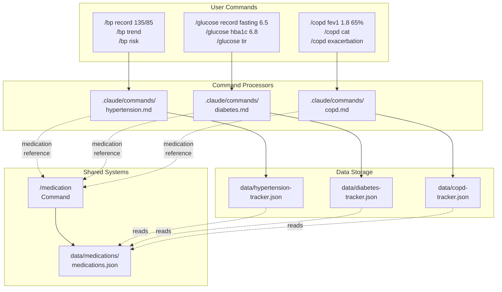
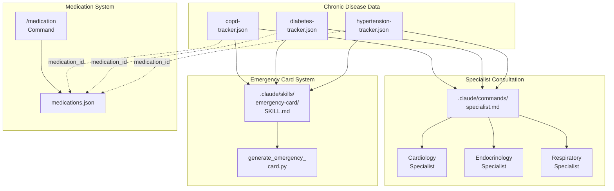
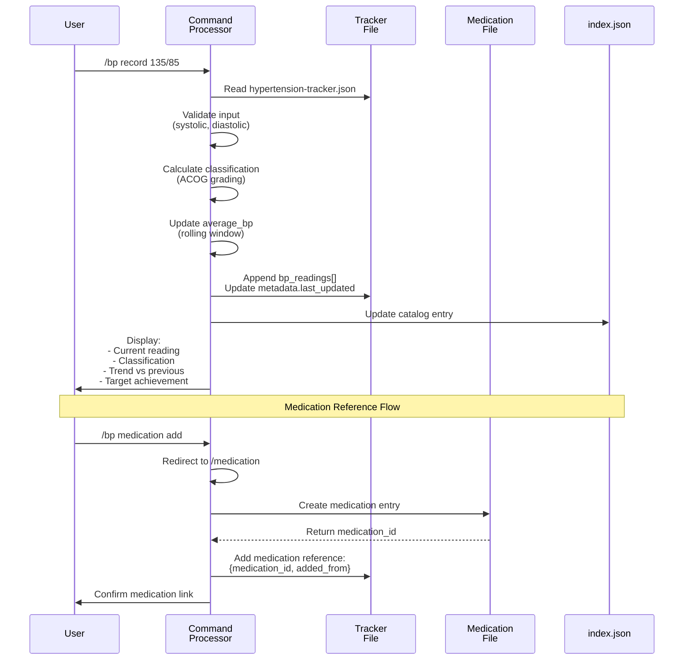

<!-- source: DeepWiki mcp.deepwiki.com · repo huifer/Claude-Ally-Health · page 4.5 Chronic Disease Management · fetched 2026-10-26 -->

# Chronic Disease Management

<details>
<summary>Relevant source files</summary>

The following files were used as context for generating this wiki page:

- [.claude/settings.local.json](.claude/settings.local.json)
- [.claude/skills/emergency-card/SKILL.md](.claude/skills/emergency-card/SKILL.md)
- [data-example/copd-tracker.json](data-example/copd-tracker.json)
- [data-example/diabetes-tracker.json](data-example/diabetes-tracker.json)
- [data-example/hypertension-tracker.json](data-example/hypertension-tracker.json)
- [scripts/test-chronic-diseases.sh](scripts/test-chronic-diseases.sh)
- [todo/01-womens-health.md](todo/01-womens-health.md)
- [todo/02-mens-health.md](todo/02-mens-health.md)
- [todo/06-chronic-diseases.md](todo/06-chronic-diseases.md)

</details>


## Purpose and Scope

This document describes the Chronic Disease Management module, which provides tracking and monitoring capabilities for three common chronic conditions: hypertension (high blood pressure), type 2 diabetes, and COPD (Chronic Obstructive Pulmonary Disease). The module implements standardized clinical assessment tools, trend analysis, and risk evaluation while maintaining strict medical safety boundaries.

For information about:
- Individual disease-specific tracking details, see [Hypertension Management](#4.5.1), [Diabetes Management](#4.5.2), and [COPD Management](#4.5.3)
- Drug interaction checking with chronic disease medications, see [Drug Interaction Detection](#6.1)
- Emergency medical information card generation including chronic conditions, see [Emergency Medical Information Card](#5.3)
- AI specialist consultations that analyze chronic disease data, see [Multi-Disciplinary Team Consultation](#7.1)

The chronic disease module differs from other health tracking modules by focusing on long-term conditions requiring continuous monitoring, medication management, and complication screening. It emphasizes data aggregation for trend analysis and integration with emergency medical systems.

**Sources:** [todo/06-chronic-diseases.md:1-16]()

## System Architecture

### File-Based Storage Model

The chronic disease management system uses dedicated JSON files stored in the `data/` directory with corresponding example files in `data-example/`:

| Disease | Data File | Example File | Command File |
|---------|-----------|--------------|--------------|
| Hypertension | `data/hypertension-tracker.json` | `data-example/hypertension-tracker.json` | `.claude/commands/hypertension.md` |
| Diabetes | `data/diabetes-tracker.json` | `data-example/diabetes-tracker.json` | `.claude/commands/diabetes.md` |
| COPD | `data/copd-tracker.json` | `data-example/copd-tracker.json` | `.claude/commands/copd.md` |

Each tracker file contains:
- **Diagnosis information**: Date, classification, duration
- **Measurement readings**: Time-series data with timestamps
- **Assessment scores**: Standardized clinical evaluation tools
- **Medication references**: Links to medications managed via `/medication` command
- **Complication screening**: Results from organ damage assessments
- **Metadata**: Creation and update timestamps in ISO 8601 format

**Sources:** [todo/06-chronic-diseases.md:754-763](), [data-example/hypertension-tracker.json:1-114](), [data-example/diabetes-tracker.json:1-141](), [data-example/copd-tracker.json:1-111]()

### Command Interface Pattern



**Diagram: Command and Data Flow Architecture**

Each command file follows a standardized YAML frontmatter structure:

```yaml
---
name: hypertension|diabetes|copd
description: Natural language description of the command
---
```

The commands support common operation patterns:
- **record**: Add new measurement readings
- **trend**: Analyze time-series data
- **status**: Display current management state
- **assessment**: Perform standardized clinical scoring
- **medication**: Reference medications via medication ID

**Sources:** [todo/06-chronic-diseases.md:160-185](), [todo/06-chronic-diseases.md:365-393](), [todo/06-chronic-diseases.md:571-601](), [scripts/test-chronic-diseases.sh:212-222]()

## Disease Tracking Systems

### Hypertension Management

The hypertension tracker implements blood pressure monitoring with ACOG (American College of Obstetricians and Gynecologists) classification and cardiovascular risk assessment.

**Key Data Structures:**

```json
{
  "hypertension_management": {
    "diagnosis_date": "2023-01-01",
    "classification": "grade_1",
    "bp_readings": [
      {
        "date": "2025-06-20",
        "time": "08:00",
        "systolic": 135,
        "diastolic": 85,
        "pulse": 78,
        "position": "sitting",
        "measurement_device": "home_monitor"
      }
    ],
    "average_bp": {
      "systolic": 132,
      "diastolic": 82,
      "calculation_period": "last_7_days"
    },
    "target_organ_damage": {
      "left_ventricular_hypertrophy": {...},
      "microalbuminuria": {...},
      "retinopathy": {...}
    },
    "cardiovascular_risk": {
      "ascvd_score_10yr": 0.12,
      "risk_level": "moderate"
    }
  }
}
```

**Blood Pressure Classification:**
- **Grade 1**: 130-139/80-89 mmHg
- **Grade 2**: 140-159/90-99 mmHg
- **Grade 3**: ≥160/≥100 mmHg

**Target Organ Damage Assessments:**
- Left ventricular hypertrophy (LVH) via echocardiogram
- Microalbuminuria (UACR <30 mg/g)
- Retinopathy grading (grade 0-4)
- Arterial stiffness (PWV <10 m/s)

**Sources:** [todo/06-chronic-diseases.md:22-157](), [data-example/hypertension-tracker.json:1-114]()

### Diabetes Management

The diabetes tracker monitors blood glucose, HbA1c, and implements Time-in-Range (TIR) calculations for glycemic control assessment.

**Key Data Structures:**

```json
{
  "diabetes_management": {
    "type": "type_2",
    "diagnosis_date": "2022-05-10",
    "glucose_readings": [
      {
        "date": "2025-06-20",
        "time": "07:00",
        "type": "fasting",
        "value": 6.5,
        "unit": "mmol/L"
      }
    ],
    "hba1c": {
      "history": [...],
      "target": "<7.0",
      "achievement": true
    },
    "tir": {
      "percentage": 85,
      "target": ">70",
      "time_in_range_hours": 20.4
    },
    "hypoglycemia_episodes": [...],
    "complications_screening": {
      "retinopathy": {...},
      "nephropathy": {...},
      "neuropathy": {...},
      "foot": {...}
    }
  }
}
```

**Glucose Measurement Types:**
- `fasting`: Morning fasting glucose (4.4-7.0 mmol/L)
- `postprandial_2h`: 2 hours post-meal (<10.0 mmol/L)
- `bedtime`: Before sleep (6.0-9.0 mmol/L)
- `random`: Random glucose measurement

**TIR Calculation:**
- Time in range (3.9-10.0 mmol/L): Target >70%
- Time above range (>10.0 mmol/L): Minimize
- Time below range (<3.9 mmol/L): Minimize

**Hypoglycemia Severity Levels:**
- **Level 1**: 3.0-3.9 mmol/L (alert value)
- **Level 2**: <3.0 mmol/L (serious, clinically significant)
- **Level 3**: Severe event requiring assistance

**Sources:** [todo/06-chronic-diseases.md:189-393](), [data-example/diabetes-tracker.json:1-141]()

### COPD Management

The COPD tracker implements lung function monitoring with GOLD grading and standardized symptom assessment tools (CAT, mMRC).

**Key Data Structures:**

```json
{
  "copd_management": {
    "diagnosis_date": "2020-03-15",
    "gold_grade": "2",
    "gold_group": "B",
    "lung_function": {
      "post_bronchodilator": {
        "fev1": 1.8,
        "fev1_percent_predicted": 65,
        "fvc": 3.2,
        "fev1_fvc_ratio": 0.56
      }
    },
    "symptom_assessment": {
      "cat_score": {
        "total_score": 18,
        "items": {
          "cough": 2,
          "sputum": 2,
          "chest_tightness": 2,
          "breathlessness_climbing": 3
        }
      },
      "mmrc_score": {
        "score": 2
      }
    },
    "exacerbations": {
      "last_year": 2,
      "history": [...]
    }
  }
}
```

**GOLD Grading (Post-bronchodilator FEV1):**
- **GOLD 1**: ≥80% predicted (mild)
- **GOLD 2**: 50-79% predicted (moderate)
- **GOLD 3**: 30-49% predicted (severe)
- **GOLD 4**: <30% predicted (very severe)

**CAT Score (COPD Assessment Test):**
- 0-10: Low impact
- 11-20: Medium impact
- 21-30: High impact
- 31-40: Very high impact

**mMRC (Modified Medical Research Council) Scale:**
- Grade 0: Dyspnea only with strenuous exercise
- Grade 1: Short of breath when hurrying on level or walking up slight hill
- Grade 2: Walks slower than contemporaries or stops for breath when walking at own pace
- Grade 3: Stops for breath after walking ~100m or after few minutes
- Grade 4: Too breathless to leave house or breathless when dressing

**Sources:** [todo/06-chronic-diseases.md:397-601](), [data-example/copd-tracker.json:1-111]()

## Integration Architecture



**Diagram: Chronic Disease Integration Points**

### Emergency Card Integration

The emergency card skill extracts chronic disease diagnoses and control status for rapid medical information display. The extraction logic is implemented in [.claude/skills/emergency-card/SKILL.md:131-183]():

```javascript
// Hypertension extraction
const hypertensionData = readFile('data/hypertension-tracker.json');
if (hypertensionData.hypertension_management?.diagnosis_date) {
  chronicConditions.push({
    condition: '高血压',
    diagnosis_date: hypertensionData.hypertension_management.diagnosis_date,
    classification: hypertensionData.hypertension_management.classification,
    current_bp: hypertensionData.hypertension_management.average_bp,
    risk_level: hypertensionData.hypertension_management.cardiovascular_risk?.risk_level
  });
}

// Diabetes extraction
const diabetesData = readFile('data/diabetes-tracker.json');
if (diabetesData.diabetes_management?.diagnosis_date) {
  chronicConditions.push({
    condition: diabetesData.diabetes_management.type === 'type_1' ? '1型糖尿病' : '2型糖尿病',
    hba1c: diabetesData.diabetes_management.hba1c?.history?.[0]?.value,
    control_status: diabetesData.diabetes_management.hba1c?.achievement ? '控制良好' : '需改善'
  });
}

// COPD extraction
const copdData = readFile('data/copd-tracker.json');
if (copdData.copd_management?.diagnosis_date) {
  chronicConditions.push({
    condition: '慢阻肺（COPD）',
    gold_grade: `GOLD ${copdData.copd_management.gold_grade}级`,
    cat_score: copdData.copd_management.symptom_assessment?.cat_score?.total_score
  });
}
```

**Emergency Card Output Format:**

```
║ 🏥 慢性疾病                                              ║
║ ─────────────────────────────────────────────────────── ║
║ • 高血压（2023-01-01诊断，1级，控制中）                 ║
║   平均血压：132/82 mmHg                                 ║
║ • 2型糖尿病（2022-05-10诊断，HbA1c 6.8%）              ║
║   控制状态：良好                                        ║
║ • 慢阻肺（2020-03-15诊断，GOLD 2级）                    ║
║   CAT评分：18分                                        ║
```

**Sources:** [.claude/skills/emergency-card/SKILL.md:131-183](), [.claude/skills/emergency-card/SKILL.md:369-372]()

### Medication Management Integration

Chronic disease trackers reference medications by storing `medication_id` rather than duplicating medication data:

```json
{
  "medications": [
    {
      "medication_id": "med_example_001",
      "added_from": "hypertension_management",
      "added_date": "2023-01-01",
      "indication": "高血压"
    }
  ]
}
```

This enables:
- Single source of truth for medication details (dose, frequency, warnings)
- Cross-referencing in drug interaction checks
- Adherence tracking across multiple conditions
- Unified medication list in emergency card

**Sources:** [data-example/hypertension-tracker.json:70-77](), [data-example/diabetes-tracker.json:126-133](), [data-example/copd-tracker.json:84-91]()

### Specialist Consultation Integration

The `/specialist` command reads chronic disease tracker files to provide domain-specific analysis:

- **Cardiology specialist** analyzes `hypertension-tracker.json` for:
  - Blood pressure trends and control
  - Target organ damage progression
  - ASCVD risk stratification
  - Medication effectiveness

- **Endocrinology specialist** analyzes `diabetes-tracker.json` for:
  - Glycemic control (HbA1c, TIR)
  - Hypoglycemia frequency and severity
  - Complication screening adherence
  - Medication adjustment needs

- **Respiratory specialist** analyzes `copd-tracker.json` for:
  - Lung function decline rate
  - Exacerbation patterns and triggers
  - Symptom burden (CAT/mMRC)
  - Inhaler technique and adherence

**Sources:** [todo/06-chronic-diseases.md:730-734](), [todo/06-chronic-diseases.md:792-801]()

## Data Flow and Update Patterns



**Diagram: Typical Data Update Sequence**

### Timestamp Management

All chronic disease data uses ISO 8601 timestamps:

```json
{
  "metadata": {
    "created_at": "2023-01-01T00:00:00.000Z",
    "last_updated": "2025-06-20T20:00:00.000Z"
  }
}
```

Individual readings include date and time fields:

```json
{
  "date": "2025-06-20",
  "time": "08:00",
  "created_at": "2025-06-20T08:00:00.000Z"
}
```

This enables:
- Time-series analysis and trend calculation
- Chronological ordering of measurements
- Date range queries
- Data synchronization tracking

**Sources:** [data-example/hypertension-tracker.json:108-111](), [data-example/diabetes-tracker.json:136-139](), [data-example/copd-tracker.json:105-108]()

## Medical Safety Framework

All chronic disease management commands implement strict safety boundaries defined in command files and validated by tests.

### Safety Principles

**The system DOES NOT:**
- ❌ Provide specific medication dosage recommendations
- ❌ Make diagnostic conclusions (e.g., "You have hypertension")
- ❌ Predict disease outcomes or complications
- ❌ Recommend treatment changes without medical supervision
- ❌ Replace professional medical consultation

**The system DOES:**
- ✅ Record measurements with timestamps
- ✅ Calculate standardized clinical scores (CAT, IPSS, HbA1c targets)
- ✅ Identify abnormal values requiring medical attention
- ✅ Track trends and achievement rates
- ✅ Generate data summaries for medical professionals
- ✅ Remind users to seek professional care when indicated

### Implementation in Code

Each command file includes a medical safety declaration:

```markdown
## ⚠️ 医学安全声明

本系统提供的所有分析和建议仅供参考，不能替代专业医疗诊断和治疗。

**安全红线：**
- 不给出具体用药剂量调整建议
- 不直接诊断疾病或预测并发症
- 所有异常值需由医生评估
- 用药方案调整需医生指导

如有以下情况，请立即就医：
- 血压 ≥180/120 mmHg（高血压危象）
- 血糖 <3.0 mmol/L 或 >16.7 mmol/L
- 呼吸困难加重或静息时气短
- 意识改变、胸痛、严重头痛
```

The test script [scripts/test-chronic-diseases.sh:135-144]() validates that all command files contain required safety statements:

```bash
for file in .claude/commands/hypertension.md .claude/commands/diabetes.md .claude/commands/copd.md; do
    echo "测试文件: $file"
    test_medical_safety "$file" "不能替代" "声明不能替代专业医疗"
    test_medical_safety "$file" "仅供参考" "声明分析仅供参考"
done
```

**Sources:** [todo/06-chronic-diseases.md:607-634](), [scripts/test-chronic-diseases.sh:135-144]()

## Testing Infrastructure

The chronic disease module includes comprehensive test coverage via [scripts/test-chronic-diseases.sh:1-265]().

### Test Categories

| Category | Tests | Purpose |
|----------|-------|---------|
| Command File Existence | 3 | Verify `.claude/commands/*.md` files exist |
| Medical Safety Statements | 6 | Validate safety declarations present |
| Data File Existence | 6 | Verify tracker and example files exist |
| JSON Structure Validation | 6 | Validate JSON schema correctness |
| Functionality Keywords | 12 | Check command operations implemented |
| Integration Tests | 6 | Validate cross-system references |
| YAML Frontmatter | 3 | Verify command metadata format |

### Test Execution

```bash
# Run chronic disease tests
bash scripts/test-chronic-diseases.sh

# Expected output:
━━━━━━━━━━━━━━━━━━━━━━━━━━━━━━━━━━━━━━━━━━━━━━
🏥 慢性病管理功能测试
━━━━━━━━━━━━━━━━━━━━━━━━━━━━━━━━━━━━━━━━━━━━━━

总测试数: 48
通过: 46 ✅
失败: 0 ❌

通过率: 95%
🎉 优秀！测试通过率 ≥90%
```

### JSON Validation

The test script uses Python for JSON structure validation:

```bash
if python3 -c "import json; d=json.load(open('$file')); exit(0 if '$key' in d else 1)" 2>/dev/null; then
    echo "✅ $description"
else
    echo "❌ $description - 缺少字段: $key"
fi
```

This validates:
- `hypertension_management` key in hypertension-tracker.json
- `diabetes_management` key in diabetes-tracker.json
- `copd_management` key in copd-tracker.json

**Sources:** [scripts/test-chronic-diseases.sh:1-265](), [scripts/test-chronic-diseases.sh:178-197]()

## Summary

The Chronic Disease Management module provides structured tracking for three major chronic conditions through:

1. **File-based storage** in `data/` directory with JSON format
2. **Command interface** via `.claude/commands/*.md` files
3. **Integration** with emergency card, medication management, and specialist consultations
4. **Medical safety** framework preventing diagnostic conclusions
5. **Test coverage** validating functionality and safety compliance

The module follows the system's privacy-first architecture with all data stored locally, no cloud synchronization, and explicit medical safety boundaries.

**Sources:** [todo/06-chronic-diseases.md:679-848]()

---

