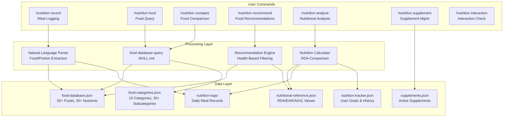
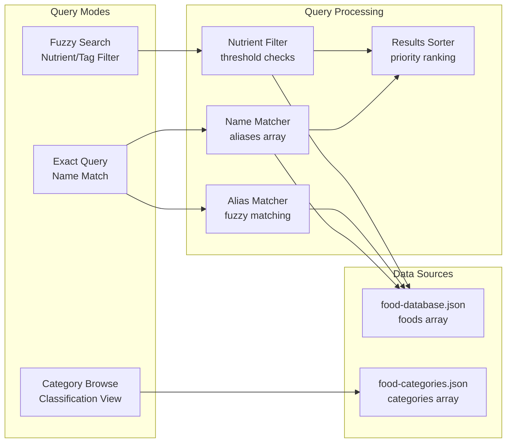
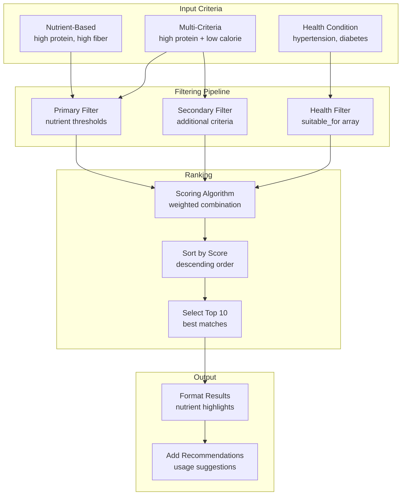
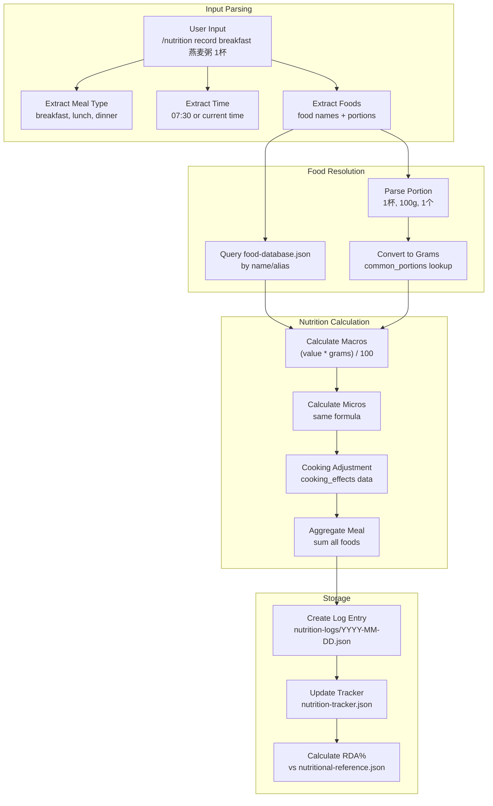
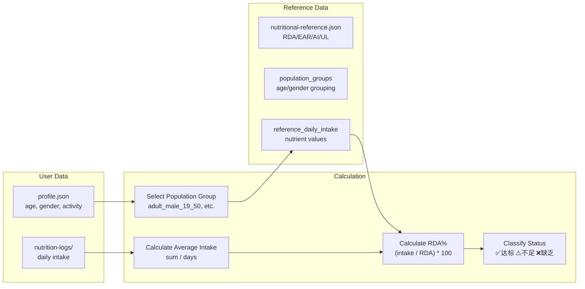
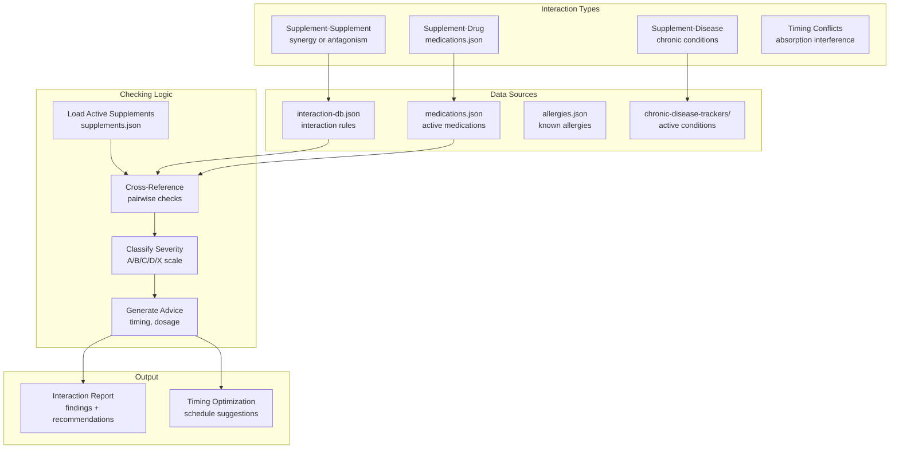
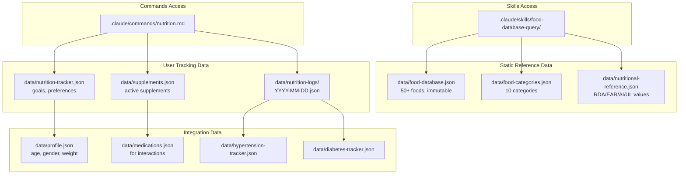

<!-- source: DeepWiki mcp.deepwiki.com · repo huifer/Claude-Ally-Health · page 4.6 Nutrition & Diet Management · fetched 2026-10-26 -->

# Nutrition & Diet Management

<details>
<summary>Relevant source files</summary>

The following files were used as context for generating this wiki page:

- [.claude/commands/nutrition.md](.claude/commands/nutrition.md)
- [.claude/skills/food-database-query/SKILL.md](.claude/skills/food-database-query/SKILL.md)
- [data-example/README-food-database.md](data-example/README-food-database.md)
- [data-example/README.md](data-example/README.md)
- [data-example/food-categories.json](data-example/food-categories.json)
- [data-example/food-database.json](data-example/food-database.json)
- [data-example/nutritional-reference.json](data-example/nutritional-reference.json)
- [scripts/test-food-database.sh](scripts/test-food-database.sh)

</details>


## Purpose and Scope

This document describes the Nutrition & Diet Management module, which provides comprehensive diet tracking, nutritional analysis, and personalized food recommendations. The module includes a curated food database with 50+ foods and 30+ nutrients per food, meal logging capabilities, supplement management with interaction checking, and automated nutritional calculations against RDA values.

For general profile setup including height, weight, and BMI calculations, see [User Profile Setup](#2.1). For chronic disease-specific dietary recommendations (hypertension DASH diet, diabetes low-GI foods), see [Chronic Disease Management](#4.5). For drug-supplement interactions, see [Drug Interaction Detection](#6.1).

---

## System Architecture

The Nutrition & Diet Management module operates through a command-driven interface with four primary components: food database management, meal tracking, nutritional analysis, and supplement management. All data is stored locally in JSON format with no external synchronization.

### Nutrition Module Architecture



**Sources:** [.claude/commands/nutrition.md:1-1148](), [.claude/skills/food-database-query/SKILL.md:1-781]()

---

## Food Database System

The food database is the foundation of the nutrition module, containing detailed nutritional information for 50+ commonly consumed foods. Each food entry includes macronutrients, micronutrients, glycemic index data, health tags, and portion information.

### Database Structure

| File | Contents | Data Points |
|------|----------|-------------|
| `food-database.json` | 50+ foods with complete nutritional profiles | 30+ nutrients per food |
| `food-categories.json` | Hierarchical classification system | 10 categories, 30+ subcategories |
| `nutritional-reference.json` | RDA/EAR/AI/UL values for all nutrients | 10+ population groups |

**Sources:** [data-example/food-database.json:1-4171](), [data-example/food-categories.json:1-331]()

### Food Data Model

Each food entry in `food-database.json` follows this structure:

```json
{
  "id": "FD_001",
  "name": "燕麦",
  "name_en": "Oats",
  "aliases": ["燕麦片", "oats", "rolled oats"],
  "category": "grains",
  "subcategory": "whole_grains",
  "nutrition_per_100g": {
    "calories": 389,
    "protein_g": 16.9,
    "carbs_g": 66.3,
    "fat_g": 6.9,
    "fiber_g": 10.6,
    "vitamin_a_mcg": 0,
    "vitamin_c_mg": 0,
    "calcium_mg": 54,
    "iron_mg": 4.72
  },
  "special_nutrients": {
    "omega_3_g": 0.685,
    "omega_6_g": 1.428,
    "choline_mg": 43.4
  },
  "glycemic_index": {
    "value": 55,
    "level": "低",
    "glycemic_load": 11
  },
  "common_portions": [],
  "health_tags": ["高纤维", "低GI"],
  "suitable_for": ["素食者", "高血压", "糖尿病"]
}
```

**Sources:** [data-example/food-database.json:11-89](), [.claude/skills/food-database-query/SKILL.md:413-520]()

### Food Categories

The system organizes foods into a 2-level taxonomy:

| Category Code | Category Name | Subcategories | Example Foods |
|---------------|---------------|---------------|---------------|
| `grains` | 谷物类 | whole_grains, refined_grains, pseudocereals | 燕麦, 糙米, 白米, 藜麦 |
| `vegetables` | 蔬菜类 | leafy_greens, cruciferous, root_vegetables | 菠菜, 西兰花, 胡萝卜 |
| `fruits` | 水果类 | citrus, berries, tropical, temperate | 橙子, 草莓, 香蕉, 苹果 |
| `protein` | 蛋白质来源 | meat, poultry, fish_seafood, eggs, legumes, nuts_seeds, dairy | 鸡胸肉, 三文鱼, 鸡蛋, 豆腐 |
| `fats_oils` | 油脂类 | vegetable_oils, animal_fats, special_oils | 橄榄油, 鱼油 |

**Sources:** [data-example/food-categories.json:10-329]()

---

## Food Query and Comparison

### Query Capabilities

The `food-database-query` skill provides three query modes:



**Sources:** [.claude/skills/food-database-query/SKILL.md:40-143]()

### Query Examples

**Exact Name Query:**
```bash
/nutrition food 燕麦
/nutrition food Salmon
/nutrition food 三文鱼
```

The system searches in this order:
1. Exact match on `name` field
2. Exact match on `name_en` field  
3. Exact match in `aliases` array
4. Fuzzy match with edit distance ≤2

**Sources:** [.claude/commands/nutrition.md:94-111](), [.claude/skills/food-database-query/SKILL.md:366-388]()

**Nutrient-Based Search:**
```bash
/nutrition food search 高蛋白
/nutrition food search 高纤维 低GI
/nutrition food search 富含Omega-3
```

Threshold definitions:
- High protein: ≥15g per 100g
- High fiber: ≥5g per 100g
- Low GI: GI value ≤55
- Rich in Omega-3: ≥1g per 100g

**Sources:** [.claude/skills/food-database-query/SKILL.md:92-115]()

### Food Comparison

The `/nutrition compare` command generates side-by-side nutritional comparisons:

```bash
/nutrition compare 燕麦 白米
/nutrition compare 三文鱼 鸡胸肉 营养素
/nutrition compare 全麦面包 白面包 GI
```

Comparison dimensions:
- **Macronutrients:** calories, protein, carbs, fat, fiber
- **Micronutrients:** vitamins (A, C, D, E, K, B-complex), minerals (Ca, Fe, Mg, Zn)
- **Glycemic Index:** GI value, glycemic load
- **Special Nutrients:** Omega-3/6, choline
- **Health Tags:** suitable conditions, dietary labels

**Sources:** [.claude/commands/nutrition.md:181-263](), [.claude/skills/food-database-query/SKILL.md:147-186]()

---

## Food Recommendations

### Recommendation Engine Logic



**Sources:** [.claude/skills/food-database-query/SKILL.md:199-275]()

### Recommendation Categories

| Recommendation Type | Filter Criteria | Example Command |
|---------------------|-----------------|-----------------|
| High Protein | protein_g ≥ 15 | `/nutrition recommend 高蛋白` |
| High Fiber | fiber_g ≥ 5 | `/nutrition recommend 高纤维` |
| Low GI | GI value ≤ 55 | `/nutrition recommend 低GI` |
| Rich in Vitamin C | vitamin_c_mg ≥ 50 | `/nutrition recommend 高维生素C` |
| Rich in Omega-3 | omega_3_g ≥ 1 | `/nutrition recommend 富含Omega-3` |
| High Calcium | calcium_mg ≥ 100 | `/nutrition recommend 高钙` |

**Sources:** [.claude/commands/nutrition.md:267-420](), [.claude/skills/food-database-query/SKILL.md:226-234]()

### Health Condition-Based Recommendations

The system provides specialized recommendations based on health conditions by filtering the `suitable_for` field:

**Hypertension (DASH Diet):**
```bash
/nutrition recommend for 高血压
```
Filters for foods marked with "高血压" in `suitable_for` array. Prioritizes:
- Low sodium (sodium_mg < 100)
- High potassium (potassium_mg > 300)
- High calcium, magnesium

**Diabetes:**
```bash
/nutrition recommend for 糖尿病
```
Filters for low GI foods (GI ≤ 55) with "糖尿病" tag. Prioritizes:
- High fiber (fiber_g ≥ 5)
- Low glycemic load
- Complex carbohydrates

**Sources:** [.claude/commands/nutrition.md:280-286](), [.claude/skills/food-database-query/SKILL.md:248-274]()

---

## Meal Tracking and Recording

### Meal Recording Flow



**Sources:** [.claude/commands/nutrition.md:43-63](), [.claude/skills/food-database-query/SKILL.md:279-357]()

### Meal Types and Timing

Supported meal types in the system:

| Meal Type Code | Display Name | Typical Time Range |
|----------------|--------------|-------------------|
| `breakfast` | 早餐 | 06:00 - 10:00 |
| `lunch` | 午餐 | 11:00 - 14:00 |
| `dinner` | 晚餐 | 17:00 - 21:00 |
| `snack` | 加餐 | Anytime |
| `morning_snack` | 上午加餐 | 09:00 - 11:00 |
| `afternoon_snack` | 下午加餐 | 14:00 - 17:00 |
| `evening_snack` | 晚间加餐 | 20:00 - 22:00 |
| `late_night_snack` | 夜宵 | After 22:00 |

**Sources:** [.claude/commands/nutrition.md:64-67]()

### Portion Parsing and Conversion

The system handles multiple portion formats:

**Common Portion Formats:**
```
1杯 / 1 cup → Lookup in common_portions array
100g → Direct weight
1个 → Lookup by food type (egg=50g, apple=150g)
约600卡 → Calorie-based estimation (reverse calculation)
```

**Portion Data Structure:**
```json
{
  "common_portions": [
    {
      "amount": 30,
      "unit": "g",
      "description": "1/4杯",
      "approximate_volume": "1/4 cup"
    }
  ]
}
```

**Sources:** [data-example/food-database.json:71-83](), [.claude/skills/food-database-query/SKILL.md:307-332]()

### Auto-Nutrition Calculation

When recording meals, the system automatically:

1. **Identifies foods** from natural language input
2. **Queries `food-database.json`** for nutritional data
3. **Converts portions** to grams using `common_portions`
4. **Calculates nutrients** using formula: `(nutrient_per_100g × portion_grams) / 100`
5. **Applies cooking adjustments** if `cooking_effects` data exists
6. **Aggregates** all foods in the meal

**Sources:** [.claude/commands/nutrition.md:424-451](), [.claude/skills/food-database-query/SKILL.md:334-357]()

---

## Nutritional Analysis and Reporting

### Analysis Types

The `/nutrition analyze` command provides multiple analysis modes:

| Analysis Mode | Command | Output |
|---------------|---------|--------|
| Comprehensive | `/nutrition analyze` | All categories combined |
| Macronutrients | `/nutrition analyze macronutrients` | Protein, carbs, fat, fiber, calories |
| Micronutrients | `/nutrition analyze micronutrients` | All vitamins and minerals |
| Vitamins Only | `/nutrition analyze vitamins` | Vitamin A, C, D, E, K, B-complex |
| Minerals Only | `/nutrition analyze minerals` | Ca, Fe, Mg, Zn, K, Na, etc. |
| Trends | `/nutrition analyze trend 30days` | 30-day nutritional trends |

**Sources:** [.claude/commands/nutrition.md:482-503]()

### RDA Comparison Logic



**Sources:** [data-example/nutritional-reference.json:14-155](), [.claude/commands/nutrition.md:542-639]()

### Nutritional Status Classification

The system classifies nutrient intake using these thresholds:

| Status | Criteria | Symbol |
|--------|----------|--------|
| 充足 (Adequate) | Intake ≥ 100% RDA | ✅ |
| 接近目标 (Near Target) | 80% ≤ Intake < 100% RDA | ✅ |
| 不足 (Insufficient) | 50% ≤ Intake < 80% RDA | ⚠️ |
| 缺乏 (Deficient) | Intake < 50% RDA | ❌ |
| 过量 (Excessive) | Intake > UL (if defined) | ⚠️ |

**Sources:** [.claude/commands/nutrition.md:577-585]()

### Analysis Report Structure

The analysis report includes:

1. **Analysis Period:** Date range analyzed (e.g., past 7 days)
2. **Macronutrient Summary:** Average daily intake vs. targets
3. **Vitamin Status Table:** All vitamins with RDA achievement %
4. **Mineral Status Table:** All minerals with RDA achievement %
5. **Special Nutrients:** Omega-3/6, choline with recommendations
6. **Key Insights:** Priority issues requiring attention
7. **Improvement Suggestions:** Actionable dietary changes
8. **Correlation Analysis:** Nutrient intake vs. weight, exercise, sleep

**Sources:** [.claude/commands/nutrition.md:543-639]()

---

## Supplement Management

### Supplement Data Model

Supplements are stored in a dedicated structure with tracking and monitoring capabilities:

```json
{
  "id": "supp_001",
  "name": "维生素D3",
  "brand": "Nature Made",
  "dose": "2000 IU",
  "frequency": "daily",
  "timing": "breakfast",
  "indication": "vitamin_d_deficiency",
  "start_date": "2025-06-01",
  "prescribing_doctor": "",
  "interactions_checked": true,
  "monitoring": {
    "baseline_test": "2025-05-15",
    "current_level": 18,
    "target_level": "40-60",
    "next_test": "2025-09-01"
  }
}
```

**Sources:** [.claude/commands/nutrition.md:1041-1062]()

### Supplement Commands

| Command | Purpose |
|---------|---------|
| `/nutrition supplement <name> <dose> <frequency> <timing>` | Add new supplement |
| `/nutrition supplement list` | View all active supplements |
| `/nutrition supplement <name>` | View specific supplement details |
| `/nutrition supplement <name> 剂量调整为 <new_dose>` | Update dosage |
| `/nutrition supplement <name> 停用` | Discontinue supplement |
| `/nutrition supplement take <name>` | Record adherence |

**Sources:** [.claude/commands/nutrition.md:643-665]()

### Common Supplement Categories

The system recognizes these supplement types:

**Vitamins:**
- 维生素D3 (Vitamin D3)
- 复合维生素B (B-Complex)
- 维生素C (Vitamin C)

**Minerals:**
- 钙+维生素D (Calcium + D)
- 镁 (Magnesium)
- 锌 (Zinc)
- 铁 (Iron)

**Special Nutrients:**
- 鱼油/Omega-3 (Fish Oil)
- 辅酶Q10 (CoQ10)
- 益生菌 (Probiotics)

**Sources:** [.claude/commands/nutrition.md:678-695]()

---

## Supplement Interaction Checking

### Interaction Check System



**Sources:** [.claude/commands/nutrition.md:697-753]()

### Interaction Severity Levels

The system uses a 5-level severity classification aligned with drug interaction standards:

| Level | Name | Action Required | Example |
|-------|------|-----------------|---------|
| A | No Interaction | None | Vitamin C + Vitamin E |
| B | Minor | Monitor | Calcium + Iron (reduced absorption) |
| C | Moderate | Consider alternatives | Fish Oil + Aspirin (bleeding risk) |
| D | Serious | Consult doctor before use | St. John's Wort + SSRIs |
| X | Contraindicated | Do not use together | Vitamin K + Warfarin |

**Sources:** [.claude/commands/nutrition.md:712-753]()

### Common Supplement Interactions

**Positive Interactions (Synergy):**
- Vitamin D + Calcium: Enhanced absorption
- Vitamin C + Iron: Improved non-heme iron absorption
- Omega-3 + Vitamin E: Antioxidant protection

**Negative Interactions (Antagonism):**
- Calcium + Iron: Reduced iron absorption (separate by 2+ hours)
- Zinc + Copper: High zinc inhibits copper absorption
- Calcium + Magnesium: Competition for absorption sites

**Sources:** [.claude/commands/nutrition.md:721-727]()

---

## Personalized Nutrition Recommendations

### Recommendation Generation Pipeline

The `/nutrition recommendations` command generates personalized advice based on:

1. **Current Nutritional Status:** From analysis of `nutrition-logs/`
2. **User Profile:** Age, gender, activity level from `profile.json`
3. **Health Conditions:** Active chronic diseases from `hypertension-tracker.json`, `diabetes-tracker.json`, etc.
4. **Goals:** Weight management, muscle gain, disease management
5. **RDA Gaps:** Nutrients falling below targets

**Sources:** [.claude/commands/nutrition.md:757-774]()

### Recommendation Categories

| Category | Focus | Example Output |
|----------|-------|----------------|
| `weight_loss` | Caloric deficit, satiety | High protein, high fiber foods |
| `muscle_gain` | Protein timing, leucine | 30g protein per meal, post-workout |
| `heart_health` | Omega-3, fiber, sodium | Fatty fish 2-3×/week, <2300mg Na |
| `energy` | Complex carbs, iron, B-vitamins | Whole grains, leafy greens |
| `bone_health` | Calcium, vitamin D, K | Dairy, fortified foods, sunlight |
| `hypertension` | DASH diet principles | High K, low Na, ≥5 servings vegetables |
| `diabetes` | Low GI, portion control | GI≤55 foods, carb counting |

**Sources:** [.claude/commands/nutrition.md:764-774]()

### Priority-Based Recommendations

The system prioritizes recommendations by severity:

**Priority 1 (Immediate Action):**
- Nutrients <50% RDA (deficient)
- Excessive intake >UL
- Medication-nutrient interactions

**Priority 2 (Short-term Goal, 2 weeks):**
- Nutrients 50-79% RDA (insufficient)
- Suboptimal macronutrient ratios
- Low nutritional diversity

**Priority 3 (Long-term Optimization):**
- Nutrients 80-99% RDA (near target)
- Special nutrient enhancement (Omega-3, antioxidants)
- Habit formation and sustainability

**Sources:** [.claude/commands/nutrition.md:797-873]()

---

## Data Storage Architecture

### File Organization



**Sources:** [data-example/README.md:8-28]()

### Daily Meal Log Structure

Daily logs are stored in `data/nutrition-logs/YYYY-MM-DD.json`:

```json
{
  "date": "2025-06-20",
  "meals": [
    {
      "type": "breakfast",
      "time": "07:30",
      "foods": ["鸡蛋", "牛奶", "全麦面包"],
      "calories": 450,
      "macronutrients": {
        "protein_g": 20,
        "carbs_g": 55,
        "fat_g": 15,
        "fiber_g": 5
      },
      "micronutrients": {
        "vitamin_a_mcg": 150,
        "calcium_mg": 250,
        "iron_mg": 2
      }
    }
  ],
  "daily_summary": {
    "total_calories": 2000,
    "rda_achievement": {
      "protein": 100,
      "vitamin_c": 85,
      "calcium": 90
    }
  }
}
```

**Sources:** [.claude/commands/nutrition.md:989-1039]()

### Nutrition Tracker Schema

The `nutrition-tracker.json` file maintains user goals and long-term tracking:

```json
{
  "user_id": "user_001",
  "goals": {
    "daily_calories": 2000,
    "protein_g": 80,
    "carbs_g": 250,
    "fat_g": 65,
    "fiber_g": 30
  },
  "preferences": {
    "dietary_style": "vegetarian",
    "excluded_foods": [],
    "favorite_foods": []
  },
  "history": {
    "start_date": "2025-01-01",
    "total_days_logged": 180
  }
}
```

**Sources:** [data-example/README.md:16]()

---

## Integration with Health Modules

### Cross-Module Data Flow

The nutrition module integrates with other health trackers:

**Hypertension Module Integration:**
- Reads `data/hypertension-tracker.json` for DASH diet recommendations
- Filters foods by sodium content (<100mg/100g preferred)
- Recommends high-potassium foods (>300mg/100g)

**Diabetes Module Integration:**
- Reads `data/diabetes-tracker.json` for carb counting
- Prioritizes low-GI foods (GI ≤55)
- Calculates carbohydrate impact on blood glucose

**Medication Module Integration:**
- Reads `data/medications.json` for drug-nutrient interactions
- Checks supplement compatibility via `interaction-db.json`
- Generates timing recommendations to avoid interactions

**Sources:** [.claude/commands/nutrition.md:875-931](), [data-example/README.md:19-27]()

### Emergency Card Integration

The emergency card aggregates critical nutritional information:

- Active supplements with doses
- Known food allergies from `allergies.json`
- Nutritional restrictions (e.g., low sodium for hypertension)
- Critical deficiencies requiring attention

**Sources:** Referenced in overall system architecture, see [Emergency Medical Information Card](#5.3)

---

## Data Quality and Testing

### Validation Framework

The system includes comprehensive testing via `scripts/test-food-database.sh`:

**Test Categories (100 tests total):**

| Test Group | Tests | Focus Area |
|------------|-------|------------|
| Basic File Tests | 10 | File existence, JSON structure |
| Database Structure | 15 | Required fields, data types |
| Food Quantity | 10 | Minimum food counts per category |
| Nutrient Completeness | 15 | All required nutrients present |
| Feature Tests | 15 | GI data, health tags, portions |
| Command Integration | 10 | Command syntax, function availability |
| Skill Tests | 10 | Query logic, search algorithms |
| Data Quality | 15 | Source attribution, ID uniqueness |

**Sources:** [scripts/test-food-database.sh:1-490]()

### Data Sources and Accuracy

All nutritional data is sourced from authoritative references:

- **中国食物成分表 (第6版)**: Primary source for Chinese foods
- **USDA FoodData Central**: Primary source for international foods
- **WHO/FAO Nutrition Standards**: Reference intake values

Each food entry in `food-database.json` includes a `data_source` field in the metadata for traceability.

**Sources:** [data-example/food-database.json:7-12](), [data-example/nutritional-reference.json:8-12]()

---

## Medical Safety Principles

### System Limitations

The nutrition module adheres to strict safety boundaries:

**The System CAN Do:**
- ✅ Record and track dietary intake
- ✅ Calculate nutritional values against RDA
- ✅ Identify potential deficiencies
- ✅ Provide general nutrition education
- ✅ Record supplement usage
- ✅ Check known supplement interactions

**The System CANNOT Do:**
- ❌ Diagnose nutritional deficiencies or diseases
- ❌ Prescribe supplements or specific dosages
- ❌ Replace registered dietitians or doctors
- ❌ Treat severe malnutrition or metabolic disorders
- ❌ Diagnose or manage food allergies

**Sources:** [.claude/commands/nutrition.md:14-41]()

### When to Seek Professional Help

Users should consult healthcare professionals when:

- 🏥 Suspected severe nutritional deficiency (e.g., scurvy, severe anemia)
- 🏥 Starting new supplements with chronic diseases or medications
- 🏥 Experiencing supplement adverse reactions
- 🏥 During pregnancy, lactation, or planning pregnancy
- 🏥 Managing chronic diseases (kidney disease, liver disease, diabetes)
- 🏥 Experiencing abnormal weight changes (rapid gain or loss)

**Sources:** [.claude/commands/nutrition.md:33-40]()

### Supplement Safety Guidelines

**Core Principles:**
- Food-first approach: Natural foods preferred over supplements
- Evidence-based supplementation: Only for documented deficiencies
- Safe dosing: Never exceed UL (tolerable upper intake level)
- Quality assurance: Use reputable brands
- Regular monitoring: Periodic blood tests for fat-soluble vitamins, minerals

**Sources:** [.claude/commands/nutrition.md:1108-1115]()

---

## Usage Examples

### Example 1: Recording a Meal

**Command:**
```bash
/nutrition record breakfast 燕麦粥 1杯 + 鸡蛋 1个 + 牛奶 250ml
```

**System Processing:**
1. Parse meal type: `breakfast`
2. Extract foods: `["燕麦粥", "鸡蛋", "牛奶"]`
3. Extract portions: `["1杯", "1个", "250ml"]`
4. Query `food-database.json` for each food
5. Convert portions to grams: `[200g, 50g, 250g]`
6. Calculate nutrients for each food
7. Aggregate total meal nutrition
8. Save to `nutrition-logs/2025-06-20.json`
9. Update `nutrition-tracker.json` daily summary

**Output Includes:**
- Total calories and macronutrients
- Key micronutrient highlights (e.g., 33% daily calcium)
- RDA achievement percentages

**Sources:** [.claude/commands/nutrition.md:46-63](), [.claude/skills/food-database-query/SKILL.md:603-634]()

### Example 2: Querying Food Information

**Command:**
```bash
/nutrition food 三文鱼
```

**System Actions:**
1. Search `food-database.json` for name="三文鱼" or name_en="Salmon"
2. Retrieve complete nutritional profile
3. Format output with:
   - Basic info (category, standard portion)
   - Macronutrients per 100g
   - Key micronutrients
   - Special nutrients (Omega-3: 2.5g)
   - GI data
   - Health tags and suitable populations

**Sources:** [.claude/commands/nutrition.md:97-100](), [.claude/skills/food-database-query/SKILL.md:637-673]()

### Example 3: Getting Food Recommendations

**Command:**
```bash
/nutrition recommend 高纤维
```

**System Logic:**
1. Filter `food-database.json` where `fiber_g >= 5`
2. Sort by fiber content descending
3. Select top 10 foods
4. For each food, calculate:
   - Fiber per 100g
   - % of daily fiber goal (25-30g)
   - Other nutritional highlights
5. Add usage recommendations (portions, meal ideas)
6. Generate sample high-fiber meal plan

**Output Includes:**
- Top 10 high-fiber foods with fiber content
- Practical serving suggestions
- Sample daily meal plan achieving fiber goal
- Gradual implementation advice (avoid sudden increases)

**Sources:** [.claude/commands/nutrition.md:288-420]()

---

## Future Enhancements

### Planned Expansions

**Short-term (1-2 months):**
- Expand food database to 100 foods
- Add more common portions per food
- Enhance cooking effect calculations
- Improve portion estimation algorithms

**Medium-term (3-6 months):**
- Expand to 300 foods
- Add branded food products
- Support user-defined custom foods
- Add food photography support
- Implement barcode scanning integration

**Long-term (Ongoing):**
- Continuous database updates
- Seasonal food availability tracking
- AI-powered food recognition from images
- Integration with fitness trackers for calorie expenditure
- Meal planning automation

**Sources:** [data-example/README.md:118-133](), [.claude/skills/food-database-query/SKILL.md:710-729]()

---

