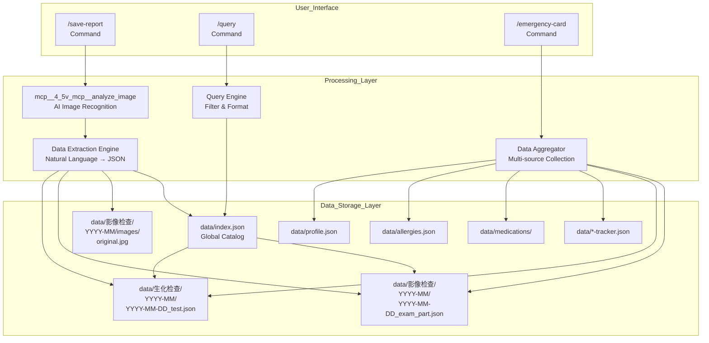
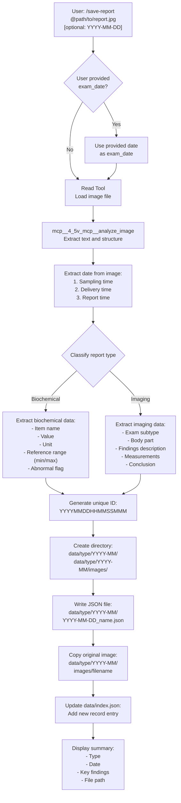
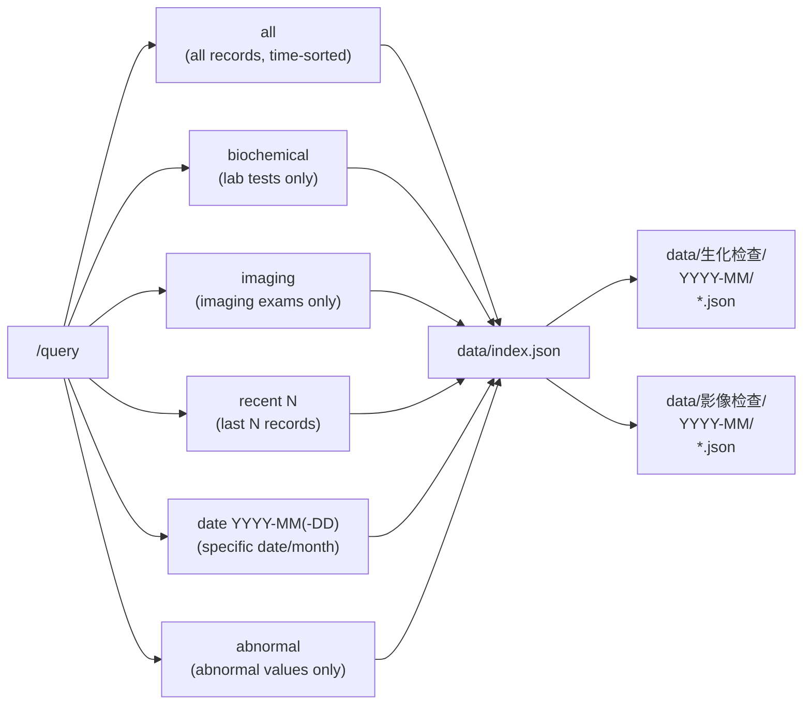
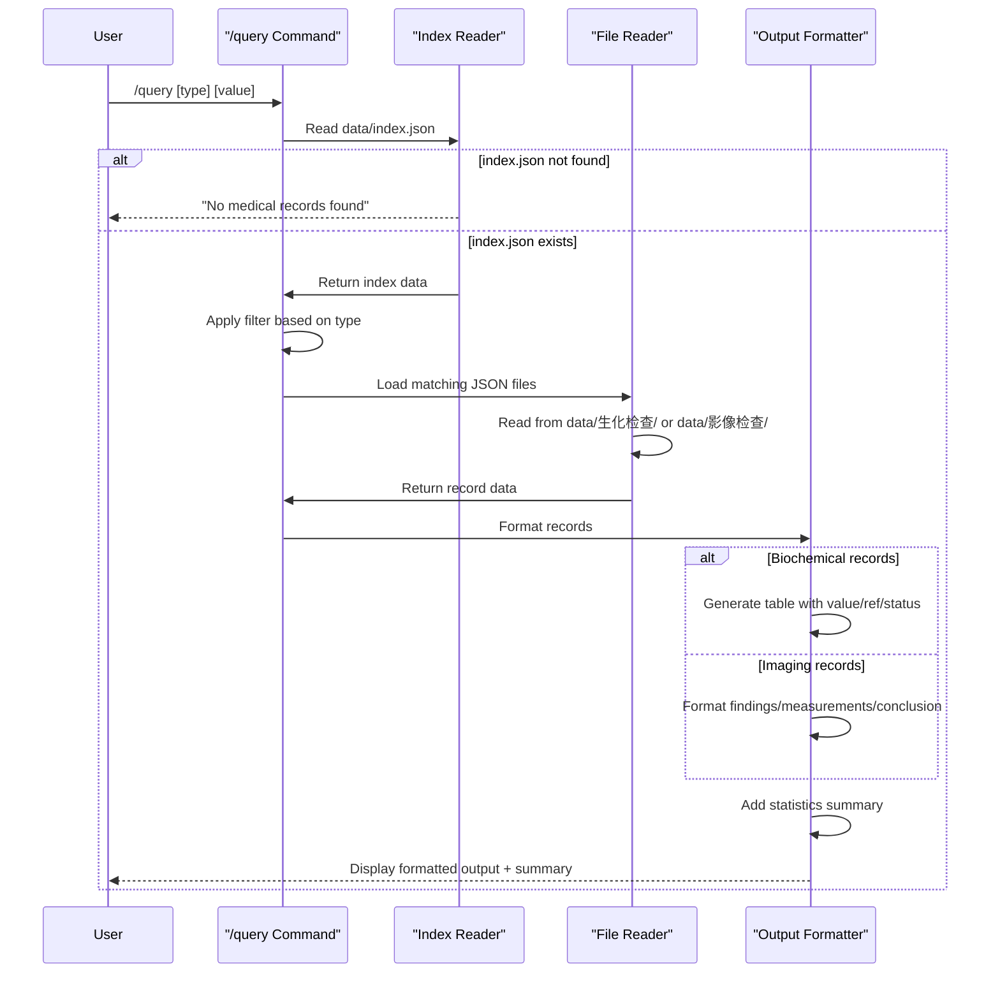
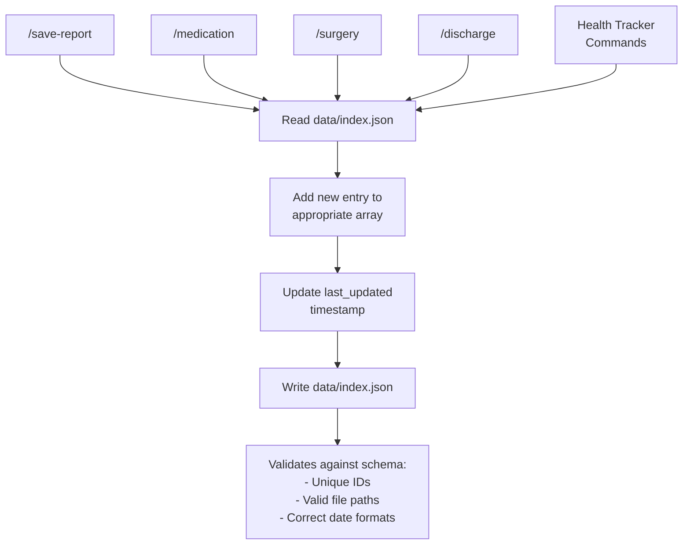
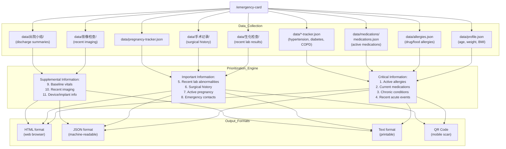
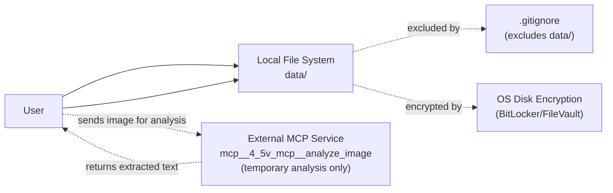

<!-- source: DeepWiki mcp.deepwiki.com · repo huifer/Claude-Ally-Health · page 5 Medical Data Management · fetched 2026-10-26 -->

# Medical Data Management

<details>
<summary>Relevant source files</summary>

The following files were used as context for generating this wiki page:

- [.claude/commands/query.md](.claude/commands/query.md)
- [.claude/commands/save-report.md](.claude/commands/save-report.md)
- [.gitignore](.gitignore)
- [README.md](README.md)
- [README.zh-CN.md](README.zh-CN.md)
- [docs/data-structures.md](docs/data-structures.md)

</details>


## Purpose and Scope

This document describes the medical data management subsystem of Claude-Ally-Health, which handles the ingestion, storage, retrieval, and aggregation of medical records. The system provides three core capabilities:

1. **Saving medical reports** - Converting paper/image medical reports into structured JSON data using AI image recognition
2. **Querying health records** - Retrieving stored medical data through a flexible query interface
3. **Emergency information aggregation** - Generating comprehensive emergency medical cards from all stored health data

This page focuses on the core data management infrastructure. For information about the underlying storage architecture and privacy model, see [Data Storage & Privacy Model](#3.2). For domain-specific health tracking modules that generate their own data, see [Health Tracking Modules](#4).

Sources: [README.md:1-192](), [.claude/commands/save-report.md:1-408](), [.claude/commands/query.md:1-104]()

## System Architecture

The medical data management system follows a command-driven architecture where users interact through slash commands that trigger data ingestion, transformation, and retrieval operations. All data is stored locally as JSON files organized in a hierarchical directory structure, with a centralized index file enabling efficient cross-dataset queries.



**Architecture Overview**

The system implements a three-tier architecture:

- **User Interface Layer**: Slash commands exposed through `.claude/commands/` markdown files that define command syntax and processing logic
- **Processing Layer**: Data transformation pipelines that convert unstructured input (images, natural language) into structured JSON using external AI services and rule-based extraction
- **Data Storage Layer**: File-system-based storage with month-partitioned directories and a centralized `data/index.json` catalog

Sources: [.claude/commands/save-report.md:1-20](), [.claude/commands/query.md:1-11](), [README.md:40-90]()

## Data Storage Structure

Medical data is organized using a hierarchical directory structure that partitions data by type and date. This design enables efficient archival, query performance, and human-readable organization.

### Directory Organization

```mermaid
graph TB
    DataRoot["data/"]
    
    DataRoot --> Profile["profile.json<br/>(height, weight, BMI, BSA)"]
    DataRoot --> Index["index.json<br/>(catalog of all records)"]
    DataRoot --> Allergies["allergies.json"]
    DataRoot --> Radiation["radiation-records.json"]
    
    DataRoot --> BiochemRoot["生化检查/"]
    BiochemRoot --> BiochemMonth["YYYY-MM/"]
    BiochemMonth --> BiochemFile["YYYY-MM-DD_test_name.json"]
    BiochemMonth --> BiochemImages["images/original.jpg"]
    
    DataRoot --> ImagingRoot["影像检查/"]
    ImagingRoot --> ImagingMonth["YYYY-MM/"]
    ImagingMonth --> ImagingFile["YYYY-MM-DD_exam_part.json"]
    ImagingMonth --> ImagingImages["images/original.jpg"]
    
    DataRoot --> SurgeryRoot["手术记录/"]
    SurgeryRoot --> SurgeryMonth["YYYY-MM/"]
    SurgeryMonth --> SurgeryFile["YYYY-MM-DD_surgery.json"]
    
    DataRoot --> DischargeRoot["出院小结/"]
    DischargeRoot --> DischargeMonth["YYYY-MM/"]
    DischargeMonth --> DischargeFile["YYYY-MM-DD_diagnosis.json"]
    
    DataRoot --> MedicationsRoot["medications/"]
    MedicationsRoot --> MedFile["medications.json"]
    MedicationsRoot --> MedLogs["medication-logs/"]
    
    DataRoot --> InteractionsRoot["interactions/"]
    InteractionsRoot --> InteractionDB["interaction-db.json"]
    InteractionsRoot --> InteractionLogs["interaction-logs/"]
```



**Key Design Decisions**

| Aspect | Implementation | Rationale |
|--------|---------------|-----------|
| **Partitioning** | Month-based directories (`YYYY-MM/`) | Balances query performance with file system limits |
| **Naming Convention** | `YYYY-MM-DD_description.json` | Sortable, human-readable, collision-resistant |
| **Image Storage** | Separate `images/` subdirectory | Preserves original data for re-analysis |
| **Index File** | Centralized `data/index.json` | Enables cross-dataset queries without scanning all files |
| **Type Separation** | Top-level directories by exam type | Reflects medical categorization, simplifies backup |

Sources: [README.md:42-89](), [docs/data-structures.md:1-510](), [.gitignore:1-17]()

## Report Saving Pipeline

The `/save-report` command implements a multi-stage pipeline that transforms medical report images into structured JSON data. The pipeline handles both biochemical test reports (blood tests, urinalysis) and imaging reports (X-ray, CT, MRI, ultrasound, etc.).

### Processing Flow



### Date Extraction Priority

The system implements a priority-based date extraction algorithm to ensure accurate dating of medical reports:

| Priority | Source | Description |
|----------|--------|-------------|
| 1 (Highest) | `exam_date` parameter | User-provided date via command argument |
| 2 | Sampling time | "采样时间", "标本采集时间" from image |
| 3 | Delivery time | "送检时间", "送样时间" from image |
| 4 | Report time | "检测时间", "报告时间" from image |
| 5 | Generic date | "检查日期", "检验日期" from image |
| 6 (Lowest) | Current date | Fallback if no dates found |

Sources: [.claude/commands/save-report.md:22-76]()

### Image Analysis Templates

The system uses specialized prompts for different imaging modalities to ensure comprehensive data extraction. Nine template categories are defined:

1. **B超/彩超** (Ultrasound): Extracts nodule size, echo characteristics, CDFI blood flow, TI-RADS classification
2. **X光** (X-ray): Extracts lesion dimensions, density, border characteristics, CTR ratio
3. **CT**: Extracts 3D measurements, CT values (HU), enhancement patterns, RECIST assessment
4. **MRI**: Extracts signal characteristics across sequences (T1WI/T2WI/DWI), ADC values, BI-RADS/PI-RADS grading
5. **内窥镜** (Endoscopy): Extracts polyp location/size, Paris classification, LA grading, Forrest staging
6. **病理** (Pathology): Extracts histology type, differentiation grade, TNM staging, IHC markers (ER/PR/HER2/Ki-67)
7. **心电图** (ECG): Extracts HR, intervals (PR/QRS/QT/QTc), rhythm, conduction abnormalities
8. **乳腺钼靶** (Mammography): Extracts breast density (ACR), mass/calcification characteristics, BI-RADS category
9. **PET-CT**: Extracts SUVmax, MTV, TLG, metabolic activity, anatomical correlations

Sources: [.claude/commands/save-report.md:205-381]()

### JSON Data Structures

**Biochemical Test Structure**

```json
{
  "id": "20251231123456789",
  "type": "生化检查",
  "date": "2025-12-31",
  "hospital": "XX Hospital",
  "original_image": "images/original.jpg",
  "items": [
    {
      "name": "White Blood Cell Count",
      "value": "6.5",
      "unit": "×10^9/L",
      "min_ref": "3.5",
      "max_ref": "9.5",
      "is_abnormal": false
    }
  ]
}
```

**Imaging Report Structure**

```json
{
  "id": "20251231123456789",
  "type": "影像检查",
  "subtype": "CT",
  "date": "2025-12-31",
  "hospital": "XX Hospital",
  "body_part": "Chest",
  "findings": {
    "description": "Imaging findings description",
    "targets": [
      {
        "name": "Lesion/Target name",
        "location": "Specific location",
        "size": {
          "length": "15",
          "width": "10",
          "height": "8",
          "unit": "mm"
        },
        "characteristics": {
          "morphology": "Morphology description",
          "border": "Border description",
          "density": "Density/echo/signal description"
        }
      }
    ],
    "measurements": {},
    "conclusion": "Diagnostic impression"
  },
  "original_image": "images/original.jpg"
}
```

Sources: [docs/data-structures.md:4-69](), [.claude/commands/save-report.md:95-160]()

## Query System

The `/query` command provides a flexible interface for retrieving and filtering stored medical records. The system supports six query types with formatted output tailored to data type.

### Query Types and Syntax



**Query Implementation**

| Query Type | Filter Logic | Output Format |
|------------|--------------|---------------|
| `all` | No filter, sort by date descending | Grouped by type, paginated (20/page) |
| `biochemical` | `type === "生化检查"` | Table format with value/reference/status |
| `imaging` | `type === "影像检查"` | Structured findings with measurements |
| `recent N` | Take first N records (default 10) | Same as `all` |
| `date YYYY-MM` | Month match | Same as `all` |
| `date YYYY-MM-DD` | Exact date match | Same as `all` |
| `abnormal` | `items[].is_abnormal === true` | Highlighted abnormal values only |

Sources: [.claude/commands/query.md:17-48]()

### Query Execution Flow



### Output Formatting

**Biochemical Test Output**

```
Date: 2025-12-31
Test Type: Blood Routine
━━━━━━━━━━━━━━━━━━━━━━━━━━━━━━━━━━━━━━
Test Item          | Value | Unit    | Reference  | Status
──────────────────────────────────────────────────
White Blood Cell   | 6.5   | ×10^9/L | 3.5-9.5    | ✅ Normal
Hemoglobin         | 145   | g/L     | 130-175    | ✅ Normal
Platelet Count     | 189   | ×10^9/L | 125-350    | ✅ Normal
```

**Imaging Report Output**

```
Date: 2025-12-31
Test Type: Ultrasound
Body Part: Abdomen
━━━━━━━━━━━━━━━━━━━━━━━━━━━━━━━━━━━━━━
Findings:
[Description content]

Measurements:
- Size: XXX

Conclusion:
[Diagnostic impression]
```

Sources: [.claude/commands/query.md:49-77]()

## Index Management

The `data/index.json` file serves as a centralized catalog that enables efficient queries without scanning the entire file system. The index is automatically updated by all commands that create or modify medical records.

### Index Structure

```json
{
  "biochemical_exams": [
    {
      "id": "20251231123456789",
      "date": "2025-12-31",
      "type": "生化检查",
      "file_path": "data/生化检查/2025-12/2025-12-31_blood_test.json"
    }
  ],
  "imaging_exams": [
    {
      "id": "20251231123456789",
      "date": "2025-12-31",
      "type": "影像检查",
      "subtype": "CT",
      "file_path": "data/影像检查/2025-12/2025-12-31_chest_CT.json"
    }
  ],
  "medications": [
    {
      "id": "med_20251231123456789",
      "name": "Aspirin",
      "dosage_value": 100,
      "dosage_unit": "mg",
      "frequency_type": "daily",
      "file_path": "data/medications/medications.json",
      "active": true,
      "created_at": "2025-12-31T12:34:56.789Z"
    }
  ],
  "medication_logs": [
    {
      "id": "log_20251231080000001",
      "date": "2025-12-31",
      "medication_id": "med_20251231123456789",
      "medication_name": "Aspirin",
      "status": "taken",
      "file_path": "data/medication-logs/2025-12/2025-12-31.json"
    }
  ],
  "last_updated": "2025-12-31T12:34:56.789Z"
}
```

### Index Update Operations



**Index Update Rules**

1. **Atomic Operations**: Index updates occur after successful data file writes to maintain consistency
2. **No Duplicates**: The `id` field ensures no duplicate entries; updates modify existing entries
3. **Path Consistency**: All `file_path` entries use relative paths from the `data/` directory root
4. **Timestamp Tracking**: `last_updated` field enables change detection and synchronization
5. **Backward Compatibility**: New fields can be added without breaking existing queries

Sources: [docs/data-structures.md:133-163](), [docs/data-structures.md:482-509](), [.claude/commands/save-report.md:168-183]()

## Emergency Card Generation

The emergency card feature aggregates critical medical information from all data sources into a comprehensive summary suitable for emergency situations. This cross-cutting system integrates data from the medical data management subsystem with health tracking modules.

### Data Aggregation Pipeline



**Priority-Based Information Display**

The emergency card system implements a three-tier priority model:

| Priority Level | Information Category | Use Case |
|----------------|---------------------|----------|
| **Critical** | Drug allergies, active medications, life-threatening conditions | First responders, emergency department triage |
| **Important** | Recent acute events, surgical history, pregnancy status | Emergency physician assessment, admission decisions |
| **Supplemental** | Baseline lab values, imaging findings, implanted devices | Detailed medical workup, specialist consultation |

**Output Format Specifications**

- **HTML**: Responsive layout with color-coded sections, suitable for display on emergency room computers
- **JSON**: Structured format for integration with hospital information systems, follows FHIR-like schema
- **Text**: Plain text format optimized for printing on standard paper, includes QR code reference
- **QR Code**: Compact URL encoding linking to JSON payload, scannable by mobile devices

Sources: [README.md:131-132](), [docs/data-structures.md:98-131]()

## Data Privacy and Security

All medical data management operations adhere to strict local-only storage principles:

1. **No Cloud Upload**: The `.gitignore` excludes the entire `data/` directory from version control
2. **Local Processing**: Image analysis calls external MCP services but does not persist data externally
3. **No Database**: Pure file-system storage eliminates database security concerns
4. **OS-Level Protection**: Users responsible for enabling disk encryption (BitLocker/FileVault)



**Security Considerations**

- Image analysis via `mcp__4_5v_mcp__analyze_image` temporarily transmits images to external services; this is the only network interaction
- All structured data remains on local disk throughout its lifecycle
- Users should enable full-disk encryption on systems storing sensitive medical data
- The `emergency-cards/` output directory is also excluded from version control

Sources: [.gitignore:1-17](), [README.md:111-116](), [README.md:15-17]()

---

