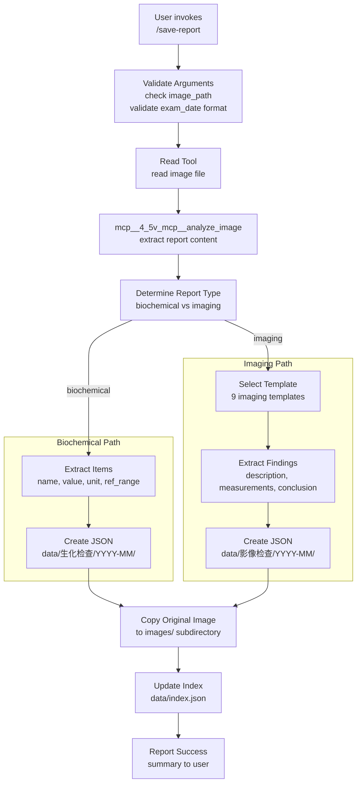
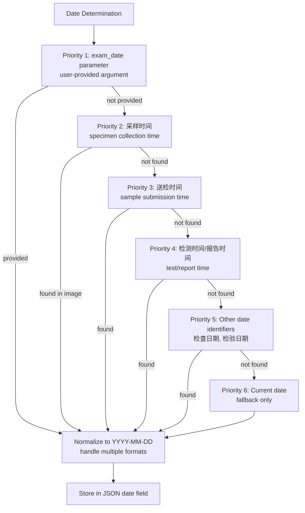
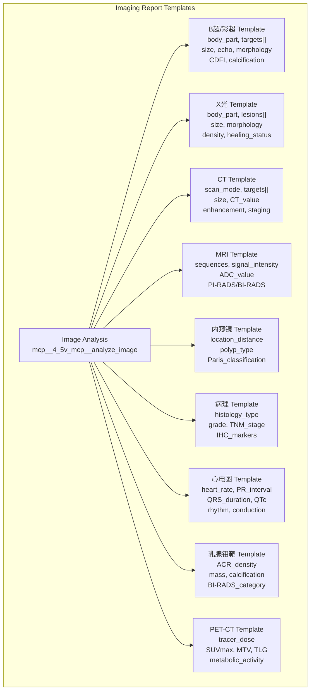
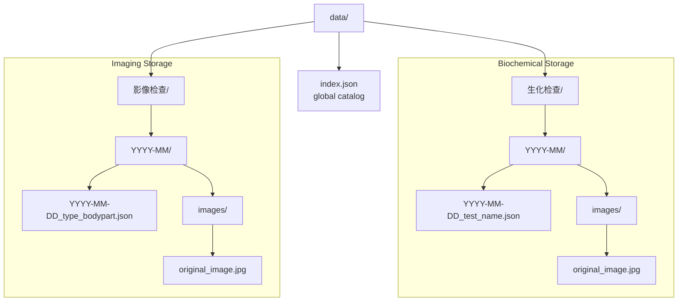
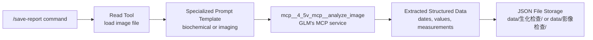

<!-- source: DeepWiki mcp.deepwiki.com · repo huifer/Claude-Ally-Health · page 5.1 Saving Medical Reports · fetched 2026-10-26 -->

# Saving Medical Reports

<details>
<summary>Relevant source files</summary>

The following files were used as context for generating this wiki page:

- [.claude/commands/query.md](.claude/commands/query.md)
- [.claude/commands/save-report.md](.claude/commands/save-report.md)
- [.gitignore](.gitignore)
- [README.md](README.md)
- [README.zh-CN.md](README.zh-CN.md)
- [docs/data-structures.md](docs/data-structures.md)

</details>


This page describes the `/save-report` command system that enables users to save medical examination reports (both biochemical and imaging types) to their personal health information system. The command uses AI-powered image recognition to extract structured data from medical report images and stores them in a file-based system.

For information about querying saved reports, see [Querying Health Records](#5.2). For information about aggregating reports into emergency cards, see [Emergency Medical Information Card](#5.3).

## Purpose and Scope

The `/save-report` command system provides:

- **AI-powered extraction** of medical data from report images using GLM's `mcp__4_5v_mcp__analyze_image` service
- **Dual report type support**: biochemical tests (blood work, urinalysis) and imaging studies (X-ray, CT, MRI, ultrasound, etc.)
- **Intelligent date extraction** with a priority-based system for determining examination dates
- **Structured data storage** in JSON format with original image backup
- **Automatic index management** for efficient querying across the health record system

## Command Interface

### Command Definition

The `/save-report` command is defined in [.claude/commands/save-report.md:1-408]() and accepts the following arguments:

| Argument | Required | Description |
|----------|----------|-------------|
| `image_path` | Yes | Local path to the medical report image |
| `exam_date` | No | Examination date in `YYYY-MM-DD` format (overrides auto-extraction) |

### Usage Examples

```bash
# Automatic date extraction from image
/save-report @medical-reports/blood-test.jpg

# Manual date specification (highest priority)
/save-report @medical-reports/blood-test.jpg 2025-10-07
```

Sources: [.claude/commands/save-report.md:385-407]()

## Processing Pipeline

### Overall Flow



Sources: [.claude/commands/save-report.md:20-191]()

### Date Extraction Priority System

The system implements a six-level priority hierarchy for determining the examination date:



The system handles various date formats including `YYYY-MM-DD`, `YYYY/MM/DD`, `YYYY年MM月DD日`, and `MM-DD-YYYY`, normalizing them to `YYYY-MM-DD` for storage.

Sources: [.claude/commands/save-report.md:62-76]()

## Report Types and Data Structures

### Biochemical Reports

Biochemical reports include blood tests, urinalysis, and other laboratory examinations. The system extracts individual test items with their values, units, and reference ranges.

#### JSON Structure

```json
{
  "id": "{{timestamp_based_unique_id}}",
  "type": "生化检查",
  "date": "YYYY-MM-DD",
  "hospital": "{{hospital_name}}",
  "original_image": "images/{{filename}}",
  "items": [
    {
      "name": "白细胞计数",
      "value": "6.5",
      "unit": "×10^9/L",
      "min_ref": "3.5",
      "max_ref": "9.5",
      "is_abnormal": false
    }
  ]
}
```

#### Storage Path

```
data/生化检查/YYYY-MM/YYYY-MM-DD_test_name.json
data/生化检查/YYYY-MM/images/original_image.jpg
```

Sources: [.claude/commands/save-report.md:104-123](), [docs/data-structures.md:3-35]()

### Imaging Reports

Imaging reports include X-ray, CT, MRI, ultrasound, endoscopy, pathology, ECG, mammography, and PET-CT examinations. The system uses specialized templates for each imaging modality.

#### Generic JSON Structure

```json
{
  "id": "{{timestamp_based_unique_id}}",
  "type": "影像检查",
  "subtype": "B超/CT/MRI/X光/内窥镜/病理/心电图/乳腺钼靶/PET-CT",
  "date": "YYYY-MM-DD",
  "hospital": "{{hospital_name}}",
  "body_part": "{{examination_area}}",
  "findings": {
    "description": "{{detailed_findings}}",
    "targets": [
      {
        "name": "{{lesion_or_target_name}}",
        "location": "{{specific_location}}",
        "size": {
          "length": "{{value}}",
          "width": "{{value}}",
          "height": "{{value}}",
          "unit": "cm/mm"
        },
        "characteristics": {
          "morphology": "{{shape_description}}",
          "border": "{{border_description}}",
          "density": "{{density_or_echo_description}}",
          "other_features": "{{additional_features}}"
        }
      }
    ],
    "measurements": {},
    "conclusion": "{{diagnosis_or_impression}}"
  },
  "original_image": "images/{{filename}}"
}
```

#### Storage Path

```
data/影像检查/YYYY-MM/YYYY-MM-DD_test_type_body_part.json
data/影像检查/YYYY-MM/images/original_image.jpg
```

Sources: [.claude/commands/save-report.md:125-159](), [docs/data-structures.md:37-69]()

## Nine Imaging Report Templates

The system provides specialized extraction templates for nine imaging modalities, each optimized for the specific data characteristics of that modality.



### Template Details

| Modality | Key Extraction Points | Specialized Fields | Clinical Grading |
|----------|----------------------|-------------------|------------------|
| **B超/彩超** | targets, size (mm), echo characteristics | CDFI blood flow, calcification, morphology | TI-RADS (thyroid) |
| **X光** | lesions, size, density | morphology, border, healing status | None |
| **CT** | targets, size, CT value (HU) | enhancement pattern, growth assessment | LUNG-RADS, LI-RADS |
| **MRI** | targets, signal intensity, ADC value | T1WI/T2WI/DWI sequences, enhancement | PI-RADS, BI-RADS |
| **内窥镜** | location (cm from landmark), size, count | Paris classification, surface features | LA grade, Forrest grade |
| **病理** | histology type, differentiation grade | TNM stage, IHC markers (ER/PR/HER2/Ki-67) | Gleason, Nottingham |
| **心电图** | heart rate, PR interval, QRS duration, QTc | rhythm type, conduction abnormalities | None |
| **乳腺钼靶** | mass characteristics, calcification | ACR density classification | BI-RADS 0-6 |
| **PET-CT** | SUVmax, MTV, TLG | metabolic activity, anatomical size | RECIST evaluation |

Sources: [.claude/commands/save-report.md:205-380]()

### B超/彩超 (Ultrasound) Template

Extracts targets (nodules, cysts, masses), quantitative size measurements, morphology (round, irregular), border clarity, internal echo patterns, presence of calcification, and CDFI blood flow signals. Clinical grading includes TI-RADS for thyroid nodules.

Sources: [.claude/commands/save-report.md:209-226]()

### X光 (X-ray) Template

Extracts lesion locations, precise size measurements (diameter, length x width), morphology (round, irregular, linear, patchy), border characteristics (clear, blurry, spiculated), density descriptions (high-density, low-density, ground-glass), accompanying signs, and healing status for fractures.

Sources: [.claude/commands/save-report.md:228-248]()

### CT Template

Extracts scan mode (plain/enhanced), three-dimensional lesion sizes, CT values in Hounsfield Units (HU), morphology with specific signs (spiculation, pleural indentation), internal characteristics (pure/mixed ground-glass, solid component, cavitation, calcification, necrosis), enhancement patterns, and clinical grading (LUNG-RADS, LI-RADS).

Sources: [.claude/commands/save-report.md:250-268]()

### MRI Template

Extracts scan sequences (T1WI, T2WI, FLAIR, DWI, ADC), contrast agent usage, three-dimensional sizes, ADC values (apparent diffusion coefficient), signal intensity characteristics across sequences, morphology and borders, enhancement patterns, and clinical grading (BI-RADS for breast, PI-RADS for prostate).

Sources: [.claude/commands/save-report.md:270-285]()

### 内窥镜 (Endoscopy) Template

Extracts examination type (gastroscopy/colonoscopy), anesthesia method, precise location descriptions (distance from anatomical landmarks in cm), target identification (polyps, ulcers, erosions), size and count, morphology (pedunculated, sessile, flat), Paris classification, surface features, standardized grading (LA grade for reflux esophagitis, Forrest classification for ulcers), endoscopic procedures (EMR/ESD, APC), and biopsy information.

Sources: [.claude/commands/save-report.md:287-305]()

### 病理 (Pathology) Template

Extracts pathology number, specimen submission date, histological type (invasive ductal carcinoma, adenocarcinoma, squamous cell carcinoma), differentiation grade/Gleason score/Nottingham grade, tumor size, invasion depth and extent, vascular and neural invasion status, surgical margin status, lymph node status (format: positive/total), TNM staging, and immunohistochemistry results (Ki-67, ER/PR/HER2, PD-L1, MMR/MSI).

Sources: [.claude/commands/save-report.md:307-327]()

### 心电图 (ECG) Template

Extracts quantitative parameters (heart rate, PR interval, QRS duration, QT/QTc interval, QRS axis), rhythm type (sinus, atrial fibrillation, paced), arrhythmias (premature beats, tachycardia), conduction abnormalities (AV block, bundle branch block), ischemia/injury patterns (ST-T wave abnormalities), and ventricular hypertrophy indicators.

Sources: [.claude/commands/save-report.md:329-348]()

### 乳腺钼靶 (Mammography) Template

Extracts breast background density (ACR a/b/c/d classification), lesion types (mass, calcification), mass characteristics (size, shape, margin, density), calcification morphology and distribution patterns (scattered, regional, clustered, segmental, linear), accompanying signs (skin/nipple retraction, axillary lymph nodes), and BI-RADS final category (0-6) with management recommendations.

Sources: [.claude/commands/save-report.md:350-363]()

### PET-CT Template

Extracts tracer type (¹⁸F-FDG), injection dose, blood glucose level at examination, high-metabolism lesion identification, quantitative metabolic parameters (SUVmax, SUVmean, MTV, TLG), anatomical size from CT component, metabolic activity descriptions (mild/moderate/marked FDG uptake), precise anatomical location, CT density characteristics, and treatment response evaluation based on standardized criteria.

Sources: [.claude/commands/save-report.md:365-380]()

## File System Integration

### Directory Structure



Sources: [README.md:40-90]()

### Index File Structure

The `data/index.json` file maintains a global catalog of all saved reports for efficient querying:

```json
{
  "biochemical_exams": [
    {
      "id": "20251231123456789",
      "date": "2025-12-31",
      "type": "生化检查",
      "file_path": "data/生化检查/2025-12/2025-12-31_血常规.json"
    }
  ],
  "imaging_exams": [
    {
      "id": "20251231123456789",
      "date": "2025-12-31",
      "type": "影像检查",
      "subtype": "B超",
      "file_path": "data/影像检查/2025-12/2025-12-31_腹部B超.json"
    }
  ],
  "last_updated": "2025-12-31T12:34:56.789Z"
}
```

The index is updated automatically each time a new report is saved via the `/save-report` command.

Sources: [.claude/commands/save-report.md:170-183](), [docs/data-structures.md:133-163]()

## Image Recognition and AI Analysis

### GLM MCP Integration

The system uses GLM's Model Context Protocol (MCP) server for AI-powered image analysis through the `mcp__4_5v_mcp__analyze_image` tool.



### Prompt Engineering

The system employs specialized prompt templates for each report type to guide the AI's extraction process:

**Biochemical Report Prompt** [.claude/commands/save-report.md:36-55]():
- Prioritizes date/time information extraction (sampling time, submission time, report time)
- Requests structured format for test items, values, units, reference ranges
- Identifies abnormal markers (arrows ↑↓)

**Imaging Report Prompts** [.claude/commands/save-report.md:209-380]():
- Nine specialized templates corresponding to imaging modalities
- Each template focuses on modality-specific quantitative parameters (SUVmax for PET-CT, ADC for MRI, CT values for CT)
- Extracts standardized clinical grading systems (BI-RADS, PI-RADS, TI-RADS, LUNG-RADS)
- Captures anatomical location, size measurements, and diagnostic conclusions

Sources: [README.md:17](), [.claude/commands/save-report.md:31-55](), [.claude/commands/save-report.md:58-93]()

## Privacy and Data Security

The `/save-report` system adheres to the project's privacy-first architecture:

- **Local-only storage**: All JSON files and images are stored in the `data/` directory on the local filesystem
- **No cloud upload**: Original images and extracted data never leave the user's machine (except for the one-time AI analysis via GLM MCP)
- **Git exclusion**: The `.gitignore` file explicitly excludes the `data/` directory and `医疗报告/` directory from version control
- **Original image backup**: All original report images are preserved in `images/` subdirectories for reference and verification

Sources: [README.md:111-116](), [.gitignore:1-2]()

## Command Output

Upon successful execution, the `/save-report` command provides a structured summary:

```
✅ 检查单保存成功！

类型：生化检查（血液常规）
日期：2025-10-07（使用用户指定日期）
提取到 15 项检查指标
文件路径：data/生化检查/2025-10/2025-10-07_血液常规.json

关键指标：
- 白细胞计数：6.5 ×10^9/L（正常）
- 血红蛋白：145 g/L（正常）
...
```

The output includes:
- Success confirmation
- Report type classification
- Examination date (with source indication if manually specified)
- Count of extracted items
- File path for the saved JSON
- Summary of key findings with normal/abnormal status

Sources: [.claude/commands/save-report.md:394-407]()

## Error Handling

The system handles various error scenarios:

| Scenario | Behavior |
|----------|----------|
| Image file not found | Report error and request valid path |
| Invalid date format | Validate and request correction if `exam_date` provided |
| Unclear image content | Extract maximum possible data and note missing fields as `null` |
| Ambiguous report type | Prompt user for clarification |
| Date extraction failure | Fall back to current date (Priority 6) |
| Missing reference ranges | Store values without `min_ref`/`max_ref`, mark `is_abnormal` as `null` |

Sources: [.claude/commands/save-report.md:192-203]()

---

