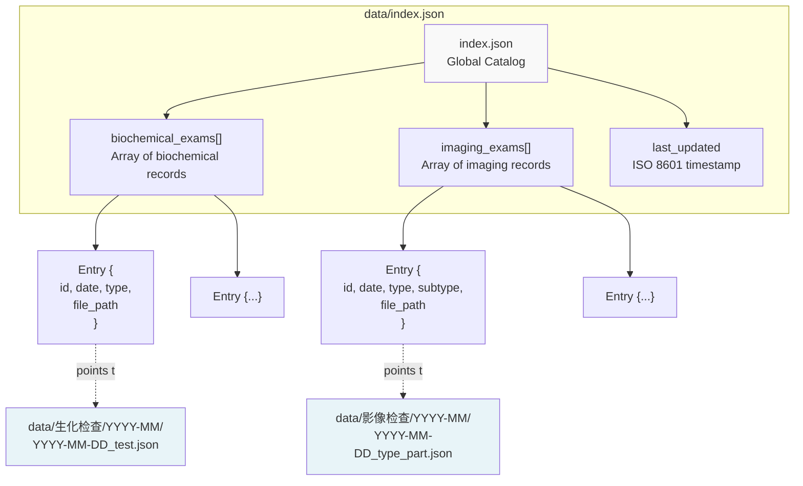
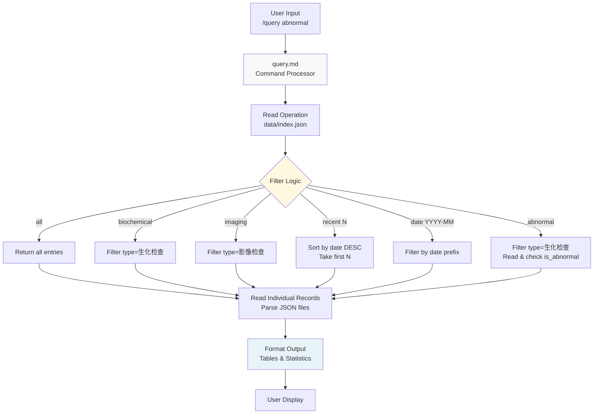
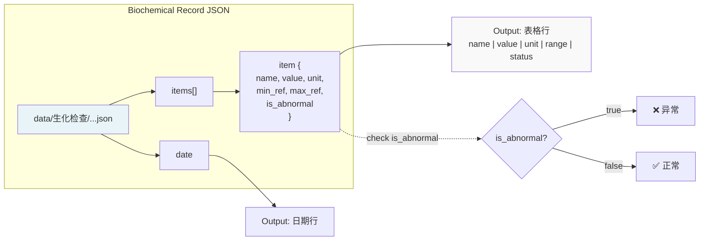
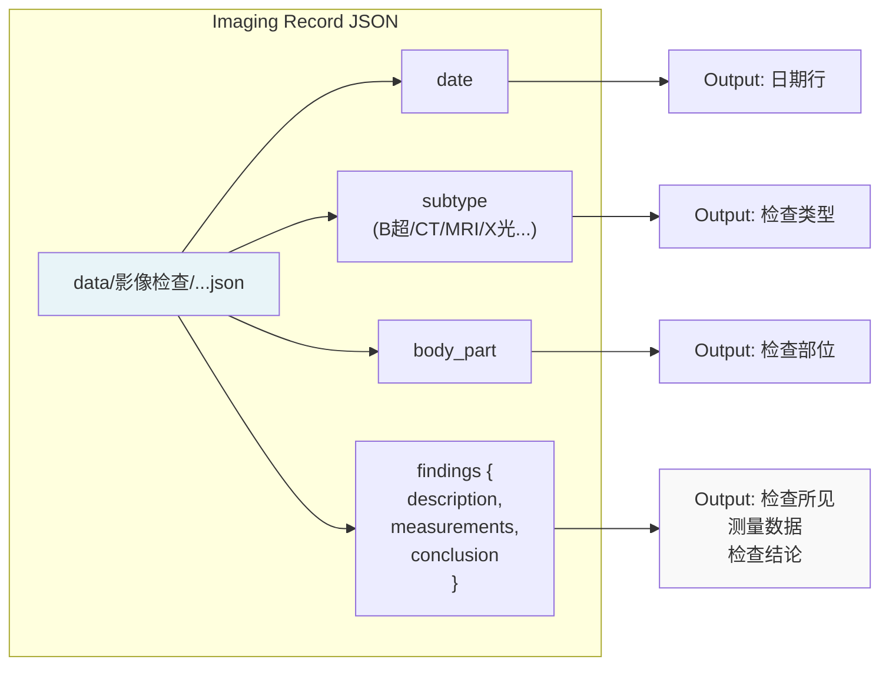
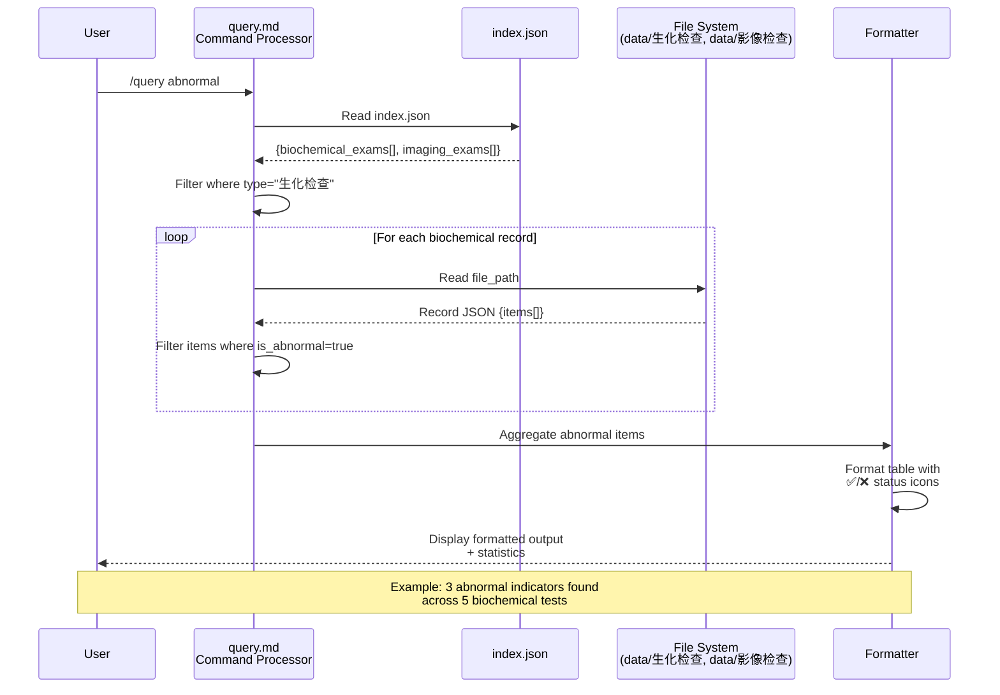

<!-- source: DeepWiki mcp.deepwiki.com · repo huifer/Claude-Ally-Health · page 5.2 Querying Health Records · fetched 2026-10-26 -->

# Querying Health Records

<details>
<summary>Relevant source files</summary>

The following files were used as context for generating this wiki page:

- [.claude/commands/query.md](.claude/commands/query.md)
- [.claude/commands/save-report.md](.claude/commands/save-report.md)
- [.gitignore](.gitignore)
- [README.md](README.md)
- [README.zh-CN.md](README.zh-CN.md)
- [docs/data-structures.md](docs/data-structures.md)

</details>


## Purpose and Scope

This document explains the query system for retrieving and displaying saved health records. It covers the `/query` command, the `index.json` catalog mechanism, supported query types, and output formatting. For information about saving medical reports, see [Saving Medical Reports](#5.1). For information about aggregating health data into emergency cards, see [Emergency Medical Information Card](#5.3).

---

## Query Command Overview

The `/query` command provides a unified interface for retrieving medical records from the local file system. The command processes natural language queries, translates them into file system operations, and formats the results for human readability.

### Command Structure

```bash
/query <query_type> [query_value]
```

**Parameters:**
- `query_type` (required): The type of query to perform
- `query_value` (optional): Additional parameter for certain query types

Sources: [.claude/commands/query.md:1-10]()

### Supported Query Types

| Query Type | Syntax | Description |
|------------|--------|-------------|
| `all` | `/query all` | List all saved records, ordered by date (descending) |
| `biochemical` | `/query biochemical` | Filter for biochemical test records only |
| `imaging` | `/query imaging` | Filter for imaging examination records only |
| `recent` | `/query recent [N]` | Retrieve the most recent N records (default: 10) |
| `date` | `/query date [YYYY-MM-DD]` or `[YYYY-MM]` | Filter by specific date or month |
| `abnormal` | `/query abnormal` | Extract all abnormal indicators from biochemical tests |

Sources: [.claude/commands/query.md:17-35](), [README.md:130]()

---

## Index Catalog System

The query system relies on `data/index.json` as a centralized catalog that tracks all medical records. This index eliminates the need for filesystem scanning and provides O(1) lookup performance.

### Index Structure



**Index Entry Schema:**

```json
{
  "biochemical_exams": [
    {
      "id": "20251231123456789",
      "date": "2025-12-31",
      "type": "生化检查",
      "file_path": "data/生化检查/2025-12/2025-12-31_血常规.json"
    }
  ],
  "imaging_exams": [
    {
      "id": "20251231123456789",
      "date": "2025-12-31",
      "type": "影像检查",
      "subtype": "B超",
      "file_path": "data/影像检查/2025-12/2025-12-31_腹部B超.json"
    }
  ],
  "last_updated": "2025-12-31T12:34:56.789Z"
}
```

Sources: [docs/data-structures.md:133-163](), [.claude/commands/query.md:38-40]()

### File Path Organization

The index catalog maintains references to records stored in month-based directory structures:

- Biochemical tests: `data/生化检查/YYYY-MM/YYYY-MM-DD_<test_type>.json`
- Imaging exams: `data/影像检查/YYYY-MM/YYYY-MM-DD_<exam_type>_<body_part>.json`

This organization enables efficient temporal queries and archival.

Sources: [.claude/commands/save-report.md:98-100](), [README.md:67-87]()

---

## Query Processing Architecture



Sources: [.claude/commands/query.md:36-48]()

### Processing Steps

1. **Index Loading**: Read `data/index.json` to obtain the catalog of all records
2. **Filtering**: Apply query-type-specific filters to the index entries
3. **Record Retrieval**: For matched entries, read the corresponding JSON files from disk
4. **Data Processing**: Parse record contents, extract relevant fields
5. **Output Formatting**: Transform data into user-friendly tables or lists
6. **Statistics Aggregation**: Calculate summary metrics (record counts, date ranges, abnormality rates)

Sources: [.claude/commands/query.md:42-48]()

---

## Query Type Implementations

### 1. Query All Records (`all`)

Lists all records across both biochemical and imaging categories, sorted by date in descending order.

**Example:**
```bash
/query all
```

**Processing:**
- Load all entries from `index.json`
- Sort by `date` field (descending)
- Read and format each record
- Display with type indicators

Sources: [.claude/commands/query.md:18-19]()

### 2. Query Biochemical Tests (`biochemical`)

Filters for records where `type == "生化检查"`.

**Example:**
```bash
/query biochemical
```

**Processing:**
- Filter `index.json.biochemical_exams[]`
- Read files from `data/生化检查/` directory structure
- Display with item-level detail (name, value, unit, reference range, abnormality status)

Sources: [.claude/commands/query.md:21-22]()

### 3. Query Imaging Exams (`imaging`)

Filters for records where `type == "影像检查"`.

**Example:**
```bash
/query imaging
```

**Processing:**
- Filter `index.json.imaging_exams[]`
- Read files from `data/影像检查/` directory structure
- Display with findings, measurements, and conclusions

Sources: [.claude/commands/query.md:24-25]()

### 4. Query Recent Records (`recent`)

Retrieves the N most recent records (default N=10) across all categories.

**Example:**
```bash
/query recent 5
```

**Processing:**
1. Combine `biochemical_exams[]` and `imaging_exams[]`
2. Sort by `date` field (descending)
3. Take first N entries
4. Read and display records

Sources: [.claude/commands/query.md:27-28]()

### 5. Query by Date (`date`)

Filters records by exact date (`YYYY-MM-DD`) or month (`YYYY-MM`).

**Examples:**
```bash
/query date 2025-12-31    # Specific day
/query date 2025-12       # Entire month
```

**Processing:**
- For `YYYY-MM-DD`: Exact match on `date` field
- For `YYYY-MM`: Prefix match on `date` field (matches all records in that month)

Sources: [.claude/commands/query.md:30-31](), [.claude/commands/query.md:100-101]()

### 6. Query Abnormal Indicators (`abnormal`)

Extracts all abnormal test results from biochemical examinations.

**Example:**
```bash
/query abnormal
```

**Processing:**
1. Filter for `type == "生化检查"` in index
2. Read each biochemical record file
3. For each record, filter `items[]` where `is_abnormal == true`
4. Aggregate and display abnormal items with reference ranges

Sources: [.claude/commands/query.md:33-34]()

---

## Output Formatting

### Biochemical Test Output

The system formats biochemical test results as tabular data with status indicators.

**Output Structure:**

```
日期：YYYY-MM-DD
检查类型：血液常规
━━━━━━━━━━━━━━━━━━━━━━━━━━
检查项目          | 数值  | 单位    | 参考范围    | 状态
────────────────────────────────────────
白细胞计数        | 6.5   | ×10^9/L | 3.5-9.5     | ✅ 正常
血红蛋白          | 145   | g/L     | 130-175     | ✅ 正常
血小板计数        | 189   | ×10^9/L | 125-350     | ✅ 正常
```

**Data Source Mapping:**



Sources: [.claude/commands/query.md:50-61](), [docs/data-structures.md:5-36]()

### Imaging Exam Output

Imaging exams are formatted to display findings, measurements, and diagnostic conclusions.

**Output Structure:**

```
日期：YYYY-MM-DD
检查类型：B超
检查部位：腹部
━━━━━━━━━━━━━━━━━━━━━━━━━━
检查所见：
[描述内容]

测量数据：
- 尺寸：XXX

检查结论：
[结论内容]
```

**Data Source Mapping:**



Sources: [.claude/commands/query.md:63-76](), [docs/data-structures.md:38-70]()

### Statistics Summary

After displaying query results, the system appends statistical information:

- **Total Record Count**: Combined biochemical and imaging records
- **Biochemical Test Count**: Number of biochemical examinations
- **Imaging Exam Count**: Number of imaging examinations
- **Date Range**: Earliest to latest examination date

Sources: [.claude/commands/query.md:78-84]()

---

## Error Handling and Edge Cases

### Empty Index

If `data/index.json` does not exist or is empty:
- Return message: "暂无医疗记录" (No medical records available)
- Do not attempt file system scanning

Sources: [.claude/commands/query.md:40]()

### Empty Query Results

If a query filter returns zero records:
- Clearly inform the user: "未找到匹配的记录" (No matching records found)
- Display the query parameters used

Sources: [.claude/commands/query.md:91]()

### Pagination

For queries returning more than 20 records:
- Display results in pages of 20 records each
- Provide navigation indicators

Sources: [.claude/commands/query.md:89]()

### Malformed Records

If a record file referenced in `index.json` is missing or malformed:
- Log the error
- Skip the record
- Continue processing remaining records

---

## Data Flow Diagram



Sources: [.claude/commands/query.md:36-84]()

---

## Integration with Other Systems

### Relationship to `/save-report`

The `/save-report` command (documented in [Saving Medical Reports](#5.1)) is responsible for:
1. Creating record JSON files in the appropriate directory structure
2. Updating `index.json` with new entries

The `/query` command reads from the data structures created by `/save-report`.

Sources: [.claude/commands/save-report.md:165-183](), [README.md:45-50]()

### Relationship to Emergency Card Generation

The emergency card system (documented in [Emergency Medical Information Card](#5.3)) uses similar index-based queries to aggregate recent medical data. However, it applies different filtering logic focused on critical information.

Sources: [README.md:30-31]()

### Relationship to MDT Consultation

The Multi-Disciplinary Team consultation system reads medical records using the same file system structure. However, it loads complete record histories rather than filtered subsets.

Sources: [README.md:54-55]()

---

## Example Usage Patterns

### Daily Health Review

```bash
# Check recent test results
/query recent 5

# Review any abnormal indicators
/query abnormal
```

### Pre-Appointment Preparation

```bash
# Gather all imaging from the past year
/query date 2025

# Check biochemical trends
/query biochemical
```

### Specific Investigation

```bash
# Review December 2025 records
/query date 2025-12

# Check a specific examination date
/query date 2025-12-31
```

Sources: [.claude/commands/query.md:93-103]()

---

## Technical Constraints

1. **Date Format**: All queries use `YYYY-MM-DD` or `YYYY-MM` format
2. **Sorting**: Default sort order is descending by date (most recent first)
3. **Status Indicators**: Use `✅` for normal and `❌` for abnormal values
4. **Pagination**: Maximum 20 records per page for readability
5. **Encoding**: All file operations use UTF-8 encoding (supports Chinese characters)

Sources: [.claude/commands/query.md:85-91]()

---

