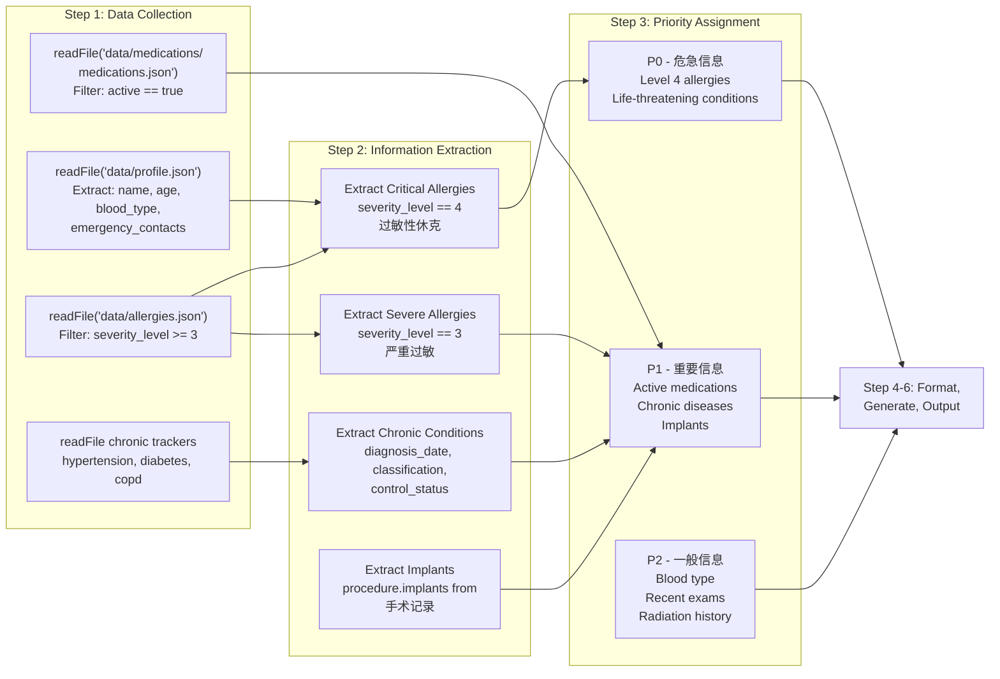
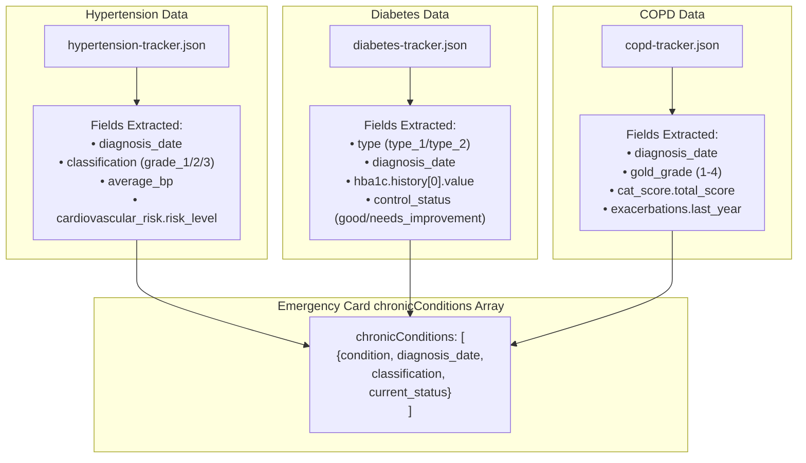
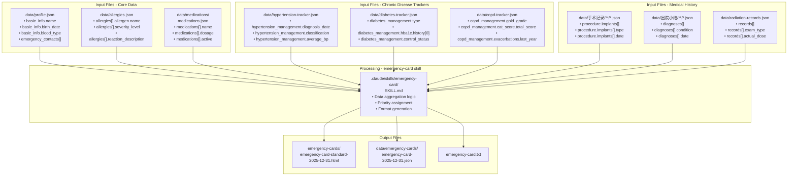
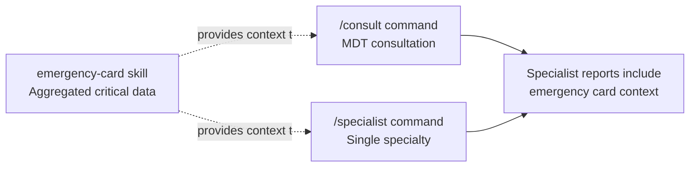

<!-- source: DeepWiki mcp.deepwiki.com · repo huifer/Claude-Ally-Health · page 5.3 Emergency Medical Information Card · fetched 2026-10-26 -->

# Emergency Medical Information Card

<details>
<summary>Relevant source files</summary>

The following files were used as context for generating this wiki page:

- [.claude/skills/emergency-card/SKILL.md](.claude/skills/emergency-card/SKILL.md)
- [README.md](README.md)
- [README.zh-CN.md](README.zh-CN.md)
- [data-example/copd-tracker.json](data-example/copd-tracker.json)
- [data-example/diabetes-tracker.json](data-example/diabetes-tracker.json)
- [data-example/hypertension-tracker.json](data-example/hypertension-tracker.json)
- [docs/data-structures.md](docs/data-structures.md)
- [scripts/test-chronic-diseases.sh](scripts/test-chronic-diseases.sh)
- [todo/06-chronic-diseases.md](todo/06-chronic-diseases.md)

</details>


## Purpose and Scope

The Emergency Medical Information Card system generates comprehensive medical summary cards that aggregate critical health data from all tracking modules for quick access in emergency situations, medical visits, or travel. This system consolidates user allergies, current medications, chronic disease diagnoses, implanted devices, and recent medical history into prioritized, portable formats.

For information about querying general health records, see [Querying Health Records](#5.2). For details on the broader medical data management architecture, see [Medical Data Management](#5).

## System Architecture

The emergency card system operates as a Claude skill that aggregates data from multiple health tracking modules. The system reads data from various JSON files, applies priority-based information filtering, and generates output in multiple formats suitable for different emergency scenarios.

**System Component Overview**

```mermaid
graph TB
    subgraph "Emergency Card Skill"
        Skill["emergency-card skill<br/>.claude/skills/emergency-card/SKILL.md"]
        Generator["Python Generator Script<br/>scripts/generate_emergency_card.py"]
    end
    
    subgraph "Core Data Sources"
        Profile["data/profile.json<br/>basic_info, emergency_contacts"]
        Allergies["data/allergies.json<br/>allergies array, severity_level"]
        Meds["data/medications/medications.json<br/>medications array, active status"]
    end
    
    subgraph "Chronic Disease Data Sources"
        HTN["data/hypertension-tracker.json<br/>hypertension_management"]
        DM["data/diabetes-tracker.json<br/>diabetes_management"]
        COPD["data/copd-tracker.json<br/>copd_management"]
    end
    
    subgraph "Medical History Sources"
        Surgery["data/手术记录/**/*.json<br/>procedure.implants"]
        Discharge["data/出院小结/**/*.json<br/>diagnoses"]
        Radiation["data/radiation-records.json<br/>records array"]
    end
    
    subgraph "Output Files"
        HTML["emergency-cards/<br/>emergency-card-{variant}-{date}.html"]
        JSON["data/emergency-cards/<br/>emergency-card-{date}.json"]
        Text["emergency-card.txt"]
    end
    
    Skill --> Profile
    Skill --> Allergies
    Skill --> Meds
    Skill --> HTN
    Skill --> DM
    Skill --> COPD
    Skill --> Surgery
    Skill --> Discharge
    Skill --> Radiation
    
    Generator --> HTML
    Skill --> JSON
    Skill --> Text
```



**Sources:** [.claude/skills/emergency-card/SKILL.md:1-427](), [todo/06-chronic-diseases.md:732-735]()

## Data Aggregation Process

The emergency card system follows a six-step data aggregation workflow that extracts, filters, prioritizes, and formats information from multiple health tracking modules.

**Data Collection and Priority Assignment Pipeline**



**Sources:** [.claude/skills/emergency-card/SKILL.md:78-259]()

### Core Data Extraction Logic

The system extracts data from specific JSON fields across multiple data sources. The following table maps data sources to extracted fields:

| Data Source | JSON Path | Extracted Fields | Priority |
|-------------|-----------|------------------|----------|
| `profile.json` | `basic_info.*` | `name`, `age`, `gender`, `blood_type`, `weight`, `height`, `bmi` | P2 |
| `profile.json` | `emergency_contacts[]` | `name`, `relationship`, `phone` | P1 |
| `allergies.json` | `allergies[]` | `allergen.name`, `severity_level`, `reaction_description` | P0/P1 |
| `medications/medications.json` | `medications[]` | `name`, `dosage.value`, `dosage.unit`, `frequency`, `instructions` | P1 |
| `hypertension-tracker.json` | `hypertension_management` | `diagnosis_date`, `classification`, `average_bp`, `cardiovascular_risk.risk_level` | P1 |
| `diabetes-tracker.json` | `diabetes_management` | `type`, `diagnosis_date`, `hba1c.history[0].value`, `control_status` | P1 |
| `copd-tracker.json` | `copd_management` | `diagnosis_date`, `gold_grade`, `cat_score.total_score`, `exacerbations.last_year` | P1 |
| `手术记录/**/*.json` | `procedure.implants[]` | `type`, `date`, `hospital`, `notes` | P1 |

**Sources:** [.claude/skills/emergency-card/SKILL.md:103-237](), [data-example/hypertension-tracker.json:1-114](), [data-example/diabetes-tracker.json:1-141](), [data-example/copd-tracker.json:1-111]()

### Chronic Disease Data Integration

The system reads chronic disease management data to include diagnosis information, current control status, and key clinical metrics on the emergency card.

**Chronic Disease Data Extraction (Added in v2.0)**



**Sources:** [.claude/skills/emergency-card/SKILL.md:131-183](), [todo/06-chronic-diseases.md:730-735]()

The chronic disease integration logic in the skill file implements try-catch blocks for each chronic disease tracker to handle cases where the files don't exist:

```javascript
// Example from SKILL.md lines 136-166
try {
  const hypertensionData = readFile('data/hypertension-tracker.json');
  if (hypertensionData.hypertension_management?.diagnosis_date) {
    chronicConditions.push({
      condition: '高血压',
      diagnosis_date: hypertensionData.hypertension_management.diagnosis_date,
      classification: hypertensionData.hypertension_management.classification,
      current_bp: hypertensionData.hypertension_management.average_bp,
      risk_level: hypertensionData.hypertension_management.cardiovascular_risk?.risk_level
    });
  }
} catch (e) {
  // File doesn't exist or read failed, skip
}
```

**Sources:** [.claude/skills/emergency-card/SKILL.md:136-183]()

## Information Priority System

The emergency card system implements a three-tier priority hierarchy (P0, P1, P2) that determines information display order and visual prominence. This ensures critical life-saving information appears first.

**Priority Classification Rules**

| Priority | Category | Criteria | Display Treatment |
|----------|----------|----------|-------------------|
| **P0 - 危急信息** | Critical Allergies | `severity_level == 4` (过敏性休克) | Red warning icon 🆘, top position |
| **P0 - 危急信息** | Life-threatening Conditions | Active cancer, severe cardiac conditions | Red warning icon 🆘, top position |
| **P1 - 重要信息** | Current Medications | `active == true` in medications.json | Standard formatting, early position |
| **P1 - 重要信息** | Chronic Diseases | Hypertension, Diabetes, COPD with `diagnosis_date` | Standard formatting, grouped display |
| **P1 - 重要信息** | Implanted Devices | From `手术记录/**/*.json` with `implants[]` | Icon 📿, affects imaging procedures |
| **P2 - 一般信息** | Basic Demographics | Blood type, age, weight, height, BMI | Lower position, reference data |
| **P2 - 一般信息** | Recent Radiation | Last exam from `radiation-records.json` | Lower position, reference data |

**Sources:** [.claude/skills/emergency-card/SKILL.md:20-25]()

### Priority-Based Card Structure

The emergency card JSON structure organizes information according to priority levels:

```json
{
  "version": "1.0",
  "generated_at": "2025-06-20T12:00:00.000Z",
  "basic_info": { /* P2 data */ },
  "critical_allergies": [ /* P0 data: severity_level >= 3 */ ],
  "current_medications": [ /* P1 data: active == true */ ],
  "medical_conditions": [ /* P0/P1: acute + chronic */ ],
  "chronic_conditions": [ /* P1 data: from chronic disease trackers */ ],
  "implants": [ /* P1 data */ ],
  "recent_radiation_exposure": { /* P2 data */ }
}
```

**Sources:** [.claude/skills/emergency-card/SKILL.md:238-255]()

## Output Formats

The emergency card system supports four output formats, each optimized for different use cases: HTML (printable/viewable), JSON (machine-readable), Text (portable), and PDF (professional archival).

### HTML Format

The HTML output is the recommended format, generated by the Python script `scripts/generate_emergency_card.py`. It produces a standalone HTML file with embedded Tailwind CSS and Lucide icons via CDN.

**HTML Generation Command Options**

```bash
# Standard card (recommended)
python scripts/generate_emergency_card.py

# Card type variants
python scripts/generate_emergency_card.py standard    # General adult
python scripts/generate_emergency_card.py child       # Pediatric adaptations
python scripts/generate_emergency_card.py elderly     # Geriatric focus
python scripts/generate_emergency_card.py severe      # Severe allergy emphasis

# Print size variants
python scripts/generate_emergency_card.py standard a4       # A4 full page
python scripts/generate_emergency_card.py standard wallet   # Wallet-sized card
python scripts/generate_emergency_card.py standard large    # Large text (elderly)
```

**Output Location:** `emergency-cards/emergency-card-{variant}-{YYYY-MM-DD}.html`

**Sources:** [.claude/skills/emergency-card/SKILL.md:33-59]()

The HTML format includes:
- Responsive design (mobile and desktop optimized)
- Print-optimized CSS (page breaks, margins)
- Tailwind CSS via CDN (https://cdn.tailwindcss.com)
- Lucide icons via CDN for visual clarity
- Automatic card type detection based on data content

**Sources:** [.claude/skills/emergency-card/SKILL.md:33-41]()

### JSON Format

The JSON format provides structured, machine-readable data suitable for digital storage and system integration.

**JSON Structure Example**

```json
{
  "version": "1.0",
  "generated_at": "2025-06-20T12:34:56.000Z",
  "basic_info": {
    "name": "张三",
    "age": 35,
    "blood_type": "A+",
    "weight": "70 kg",
    "height": "175 cm",
    "bmi": 22.9,
    "emergency_contacts": [
      {"name": "李四", "relationship": "配偶", "phone": "138****1234"}
    ]
  },
  "critical_allergies": [
    {
      "allergen": "青霉素",
      "severity": "过敏性休克（4级）",
      "reaction": "呼吸困难、喉头水肿、意识丧失",
      "diagnosed_date": "2020-05-10"
    }
  ],
  "current_medications": [
    {
      "name": "氨氯地平",
      "dosage": "5mg",
      "frequency": "每日1次",
      "instructions": "早餐后服用"
    }
  ],
  "chronic_conditions": [
    {
      "condition": "高血压",
      "diagnosis_date": "2023-01-01",
      "classification": "1级",
      "current_bp": "132/82 mmHg"
    }
  ],
  "disclaimer": "此信息卡仅供参考，不替代专业医疗诊断",
  "data_source": "my-his个人健康信息系统"
}
```

**Output Location:** `data/emergency-cards/emergency-card-{YYYY-MM-DD}.json`

**Sources:** [.claude/skills/emergency-card/SKILL.md:238-255](), [.claude/skills/emergency-card/SKILL.md:260-261]()

### Text Format

The text format generates ASCII-art formatted cards suitable for printing or copy-pasting into text documents. The format uses box-drawing characters for visual structure.

**Text Format Layout Structure**

```
╔═══════════════════════════════════════════════════════════╗
║                  紧急医疗信息卡                          ║
╠═══════════════════════════════════════════════════════════╣
║ 姓名：张三                      年龄：35岁               ║
║ 血型：A+                       体重：70kg                ║
╠═══════════════════════════════════════════════════════════╣
║ 🆘 严重过敏                                              ║
║ ─────────────────────────────────────────────────────── ║
║ • 青霉素 - 过敏性休克（4级）🆘                          ║
║   反应：呼吸困难、喉头水肿、意识丧失                     ║
╠═══════════════════════════════════════════════════════════╣
║ 💊 当前用药                                              ║
║ 🏥 慢性疾病                                              ║
║ 📿 植入物                                                ║
║ 📞 紧急联系人                                            ║
╠═══════════════════════════════════════════════════════════╣
║ ⚠️  免责声明                                            ║
║ 此信息卡仅供参考，不替代专业医疗诊断                     ║
╚═══════════════════════════════════════════════════════════╝
```

**Output Location:** `emergency-card.txt`

**Sources:** [.claude/skills/emergency-card/SKILL.md:263-308]()

The text format includes:
- Box-drawing characters for section separation
- Emoji icons for quick visual identification
- Compact layout for wallet-sized printing
- All critical sections (allergies, medications, chronic conditions, implants, contacts)

**Sources:** [.claude/skills/emergency-card/SKILL.md:263-308]()

### QR Code Format

The system can generate QR codes encoding the JSON data for quick smartphone scanning. This feature requires a QR code generation library.

```javascript
// QR code generation (optional feature)
const qrCode = generateQRCode(JSON.stringify(emergencyCard));
emergencyCard.qr_code = qrCode;
```

**Output Location:** `emergency-card-qr.png`

**Sources:** [.claude/skills/emergency-card/SKILL.md:310-316]()

## File Structure and Data Flow

The emergency card system aggregates data from a distributed file structure across multiple health tracking modules. Understanding this structure is essential for data maintenance and troubleshooting.

**Complete File Structure Mapping**



**Sources:** [.claude/skills/emergency-card/SKILL.md:362-381](), [README.md:66-88]()

### Data Source Priority

When data exists in multiple locations, the emergency card system applies the following priority order:

1. **Chronic Disease Trackers** (highest priority for ongoing conditions)
   - `data/hypertension-tracker.json`
   - `data/diabetes-tracker.json`
   - `data/copd-tracker.json`

2. **Discharge Summaries** (recent acute conditions)
   - `data/出院小结/**/*.json`

3. **Profile and Allergy Data** (always included)
   - `data/profile.json`
   - `data/allergies.json`

4. **Active Medications** (always included)
   - `data/medications/medications.json` (where `active == true`)

**Sources:** [.claude/skills/emergency-card/SKILL.md:362-381]()

## Safety Principles and Constraints

The emergency card system adheres to strict medical safety principles to ensure it provides helpful reference information without overstepping the boundaries of medical AI systems.

### Medical Safety Red Lines

The system **MUST NOT**:

| Prohibited Action | Enforcement Method | Reference |
|-------------------|-------------------|-----------|
| Add medication advice | Only list current medications from `medications.json`, no recommendations | Lines 385-388 |
| Provide diagnostic conclusions | Only list recorded diagnoses from source files, no interpretation | Lines 385-388 |
| Suggest treatments | No treatment plans, only display existing medication records | Lines 385-388 |
| Omit disclaimer | Every output includes "不替代专业医疗诊断" disclaimer | Lines 385-388 |

**Sources:** [.claude/skills/emergency-card/SKILL.md:383-399]()

### Information Accuracy Principles

The system **MUST**:

1. **Extract Only Recorded Information**
   - No inference or speculation about medical conditions
   - No filling in missing data with estimates
   - Sources: [.claude/skills/emergency-card/SKILL.md:391-394]()

2. **Annotate Information Sources**
   - Include `generated_at` timestamp in all outputs
   - Mark `data_source` as "my-his个人健康信息系统"
   - Sources: [.claude/skills/emergency-card/SKILL.md:391-394]()

3. **Recommend Regular Updates**
   - Suggest updates every 3 months or after health changes
   - Sources: [.claude/skills/emergency-card/SKILL.md:356-360]()

### Privacy Protection

The emergency card system implements privacy safeguards:

- **Phone Number Masking**: Display as `138****1234`
- **Optional Sensitive Data Hiding**: User can choose to exclude certain information
- **Local-Only Storage**: All data remains on local filesystem (no cloud sync)

**Sources:** [.claude/skills/emergency-card/SKILL.md:395-399]()

### Disclaimer Text

Every emergency card output includes the following mandatory disclaimer:

```
⚠️ 免责声明
此信息卡仅供参考，不替代专业医疗诊断
生成时间：2025-12-31 12:34:56
```

This appears in all formats: HTML footer, JSON `disclaimer` field, and text format bottom section.

**Sources:** [.claude/skills/emergency-card/SKILL.md:304-307](), [.claude/skills/emergency-card/SKILL.md:332-360]()

## Error Handling

The emergency card system implements graceful degradation when data sources are missing or corrupted.

### Data Missing Scenarios

| Missing Data | System Behavior | Output |
|--------------|-----------------|--------|
| `profile.json` not found | Use default values | `name: "未设置"`, continue generation |
| `allergies.json` not found | Skip allergy section | Output: "未记录过敏史" |
| `medications.json` not found | Skip medication section | Output: "未记录当前用药" |
| Chronic disease tracker missing | Skip that condition | Continue with other available data |
| Surgery records missing | Skip implants section | Output: "无植入物" |

**Sources:** [.claude/skills/emergency-card/SKILL.md:401-415]()

### File Read Failures

The chronic disease data extraction implements try-catch blocks for each tracker file:

```javascript
// Example error handling pattern
try {
  const hypertensionData = readFile('data/hypertension-tracker.json');
  if (hypertensionData.hypertension_management?.diagnosis_date) {
    // Extract and add to chronicConditions
  }
} catch (e) {
  // File doesn't exist or read failed, skip this condition
  // Continue processing other data sources
}
```

This pattern is repeated for:
- `data/hypertension-tracker.json` (lines 137-150)
- `data/diabetes-tracker.json` (lines 153-167)
- `data/copd-tracker.json` (lines 170-183)

**Sources:** [.claude/skills/emergency-card/SKILL.md:136-183](), [.claude/skills/emergency-card/SKILL.md:407-411]()

### QR Code Generation Failures

If QR code generation fails:
1. Degrade to text format output
2. Prompt user to manually save JSON data
3. Continue with other output formats

**Sources:** [.claude/skills/emergency-card/SKILL.md:413-415]()

## Usage Examples

The emergency card skill is triggered through natural language commands in Claude Code. The system automatically detects emergency card generation requests.

### Trigger Conditions

The skill activates when users mention:

- ✅ "生成紧急医疗信息卡"
- ✅ "我需要旅行，如何快速提供医疗信息"
- ✅ "把我的过敏信息整理成卡片"
- ✅ "紧急情况急救信息"
- ✅ "就医准备资料"
- ✅ "医疗信息摘要"

**Sources:** [.claude/skills/emergency-card/SKILL.md:69-76]()

### Example Interaction Flow

```
User: "生成紧急医疗信息卡"

System: [Executes emergency-card skill]
        ↓
        [Reads 9+ data sources]
        ↓
        [Applies priority filtering]
        ↓
        [Generates outputs]

Output:
✅ 紧急医疗信息卡已生成

文件位置：data/emergency-cards/emergency-card-2025-12-31.json
生成时间：2025-12-31 12:34:56

包含信息：
━━━━━━━━━━━━━━━━━━━━━━━━━━
✓ 基础信息（姓名、年龄、血型）
✓ 严重过敏（1项4级过敏）
✓ 当前用药（2种药物）
✓ 慢性疾病（3种：高血压、糖尿病、COPD）
✓ 植入物（1项）
✓ 紧急联系人（1人）

💡 使用建议：
━━━━━━━━━━━━━━━━━━━━━━━━━━
• 将JSON文件保存到手机云盘
• 打印文本版随身携带
• 旅行前更新信息
```

**Sources:** [.claude/skills/emergency-card/SKILL.md:332-360]()

## Integration with Other Systems

The emergency card system integrates with multiple health tracking modules and is itself referenced by specialist consultation systems.

### Integration with Specialist Consultations

When specialists invoke `/consult` or `/specialist` commands, they can access emergency card data to understand the patient's critical medical information:



**Sources:** [.claude/skills/emergency-card/SKILL.md:1-4](), [todo/06-chronic-diseases.md:730-747]()

### Integration with Chronic Disease Management

The emergency card automatically pulls data from chronic disease trackers added in module 06:

- `/bp` (hypertension) → `hypertension-tracker.json` → Emergency card "慢性疾病" section
- `/glucose` (diabetes) → `diabetes-tracker.json` → Emergency card "慢性疾病" section  
- `/copd` → `copd-tracker.json` → Emergency card "慢性疾病" section

This integration was added in v2.0 of the chronic disease management module.

**Sources:** [todo/06-chronic-diseases.md:730-735](), [.claude/skills/emergency-card/SKILL.md:369-373]()

### Data Update Workflow

When health data changes, the emergency card should be regenerated:

```
User updates data:
  /bp record 130/80         → Updates hypertension-tracker.json
  /glucose hba1c 6.5        → Updates diabetes-tracker.json
  /medication add 药物名     → Updates medications.json
  /allergy add 过敏原        → Updates allergies.json

Recommended action:
  Regenerate emergency card → New card includes updated data
```

The system recommends regenerating the emergency card:
- Every 3 months (routine update)
- After any health status change
- Before travel or medical appointments

**Sources:** [.claude/skills/emergency-card/SKILL.md:356-360]()

## Technical Implementation Details

### Skill Metadata

The emergency-card skill is defined with the following metadata:

```yaml
---
name: emergency-card
description: 生成紧急情况下快速访问的医疗信息摘要卡片。当用户需要旅行、就诊准备、紧急情况或询问"紧急信息"、"医疗卡片"、"急救信息"时使用此技能。提取关键信息（过敏、用药、急症、植入物），支持多格式输出（JSON、文本、二维码），用于急救或快速就医。
---
```

**Sources:** [.claude/skills/emergency-card/SKILL.md:1-4]()

### Allergy Severity Filtering Logic

The system filters allergies using the `severity_level` field from `allergies.json`:

```javascript
// Filter critical allergies (level 3-4)
const criticalAllergies = allergies.allergies
  .filter(a => a.severity_level >= 3 && a.current_status.status === 'active')
  .map(a => ({
    allergen: a.allergen.name,
    severity: `过敏${getSeverityLabel(a.severity_level)}（${a.severity_level}级）`,
    reaction: a.reaction_description,
    diagnosed_date: a.diagnosis_date
  }));
```

Severity levels:
- Level 4: 过敏性休克 (Anaphylactic shock) → P0 priority, 🆘 icon
- Level 3: 严重过敏 (Severe allergy) → P1 priority
- Level 1-2: Not included in emergency card

**Sources:** [.claude/skills/emergency-card/SKILL.md:119-129]()

### Medication Filtering Logic

Only active medications are included on the emergency card:

```javascript
// Filter active medications only
const currentMedications = medications.medications
  .filter(m => m.active === true)
  .map(m => ({
    name: m.name,
    dosage: `${m.dosage.value}${m.dosage.unit}`,
    frequency: getFrequencyLabel(m.frequency),
    instructions: m.instructions,
    warnings: m.warnings || []
  }));
```

This ensures only current medications appear, not historical medication records.

**Sources:** [.claude/skills/emergency-card/SKILL.md:186-197]()

### Age Calculation

The system calculates age from `birth_date` in `profile.json`:

```javascript
const basicInfo = {
  age: calculateAge(profile.basic_info?.birth_date),
  // ... other fields
};
```

This ensures the age is always current when the card is generated.

**Sources:** [.claude/skills/emergency-card/SKILL.md:106-116]()

### Chronic Disease Condition Mapping

The system maps chronic disease tracker data to display-friendly condition names:

| Tracker File | `type` Field | Display Name |
|--------------|--------------|--------------|
| `diabetes-tracker.json` | `type: "type_1"` | "1型糖尿病" |
| `diabetes-tracker.json` | `type: "type_2"` | "2型糖尿病" |
| `hypertension-tracker.json` | N/A | "高血压" |
| `copd-tracker.json` | N/A | "慢阻肺（COPD）" |

**Sources:** [.claude/skills/emergency-card/SKILL.md:153-167]()

---

