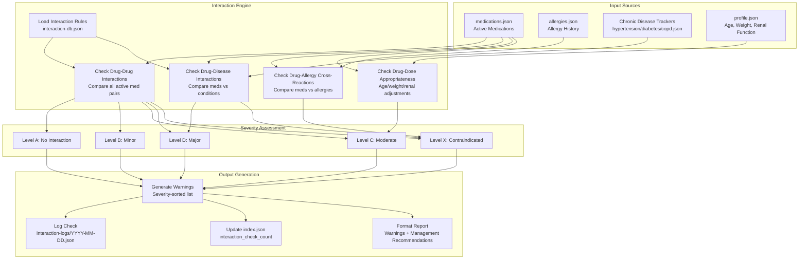
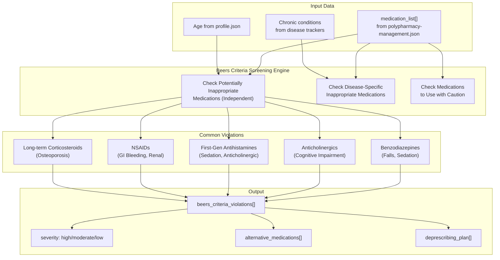
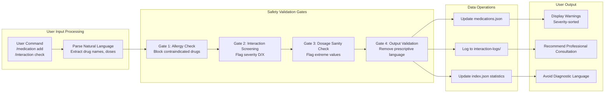

<!-- source: DeepWiki mcp.deepwiki.com · repo huifer/Claude-Ally-Health · page 6 Safety & Medication Management · fetched 2026-10-26 -->

# Safety & Medication Management

<details>
<summary>Relevant source files</summary>

The following files were used as context for generating this wiki page:

- [.claude/commands/cognitive.md](.claude/commands/cognitive.md)
- [.claude/commands/fall.md](.claude/commands/fall.md)
- [.claude/commands/polypharmacy.md](.claude/commands/polypharmacy.md)
- [.claude/specialists/geriatrics.md](.claude/specialists/geriatrics.md)
- [README.md](README.md)
- [README.zh-CN.md](README.zh-CN.md)
- [data-example/index.json](data-example/index.json)
- [docs/data-structures.md](docs/data-structures.md)
- [scripts/test-elderly-health.sh](scripts/test-elderly-health.sh)
- [todo/03-children-health.md](todo/03-children-health.md)
- [todo/04-elderly-health.md](todo/04-elderly-health.md)

</details>


This document describes the medication safety framework within Claude-Ally-Health, encompassing drug interaction detection, allergy management, and medical safety constraints. The system provides comprehensive medication tracking with multi-level severity warnings while maintaining strict boundaries on prescriptive medical advice.

For specific medication tracking features in elderly populations, see [Polypharmacy Management](#4.4.3). For emergency medication information aggregation, see [Emergency Medical Information Card](#5.3).

---

## Overview

The medication safety system implements a four-layer protection model:

1. **Medication Tracking**: Structured recording of active medications with dosage, frequency, and adherence monitoring
2. **Interaction Detection**: Five-level severity classification (A/B/C/D/X) for drug-drug, drug-disease, drug-dose, and drug-food interactions
3. **Allergy Management**: Comprehensive allergy history with severity levels and cross-checking against active medications
4. **Safety Constraints**: Enforcement of medical ethics boundaries preventing diagnostic or prescriptive overreach

This framework integrates with multiple health tracking modules including pregnancy ([#4.1.1](#4.1.1)), postpartum ([#4.1.2](#4.1.2)), chronic disease management ([#4.5](#4.5)), and elderly health ([#4.4](#4.4)) to provide context-aware medication safety assessments.

**Sources**: [README.md:161-186](), [README.zh-CN.md:160-184]()

---

## System Architecture

### File Structure and Data Model

```mermaid
graph TB
    subgraph "Data Storage Layer"
        AllergiesJSON["data/allergies.json<br/>Allergy History"]
        MedicationsJSON["data/medications/medications.json<br/>Active Medication List"]
        MedicationLogs["data/medications/medication-logs/<br/>YYYY-MM-DD.json<br/>Daily Adherence"]
        InteractionDB["data/interactions/interaction-db.json<br/>Interaction Rules Database"]
        InteractionLogs["data/interactions/interaction-logs/<br/>Check History"]
        PolyManagementJSON["data/polypharmacy-management.json<br/>Elderly-Specific Analysis"]
        IndexJSON["data/index.json<br/>Global Catalog"]
    end
    
    subgraph "Command Interface Layer"
        MedicationCmd[".claude/commands/medication.md<br/>/medication Command"]
        InteractionCmd[".claude/commands/interaction.md<br/>/interaction Command"]
        AllergyCmd[".claude/commands/allergy.md<br/>/allergy Command"]
        PolypharmacyCmd[".claude/commands/polypharmacy.md<br/>/polypharmacy Command"]
    end
    
    subgraph "Specialist Integration"
        GeriatricsSpec[".claude/specialists/geriatrics.md<br/>Polypharmacy Expert"]
        ConsultCoord[".claude/specialists/consultation-coordinator.md<br/>MDT Coordinator"]
    end
    
    MedicationCmd --> MedicationsJSON
    MedicationCmd --> MedicationLogs
    InteractionCmd --> InteractionDB
    InteractionCmd --> InteractionLogs
    InteractionCmd --> MedicationsJSON
    InteractionCmd --> AllergiesJSON
    AllergyCmd --> AllergiesJSON
    PolypharmacyCmd --> PolyManagementJSON
    PolypharmacyCmd --> MedicationsJSON
    PolypharmacyCmd --> InteractionDB
    
    GeriatricsSpec --> PolyManagementJSON
    GeriatricsSpec --> InteractionDB
    ConsultCoord --> AllergiesJSON
    ConsultCoord --> MedicationsJSON
    
    IndexJSON -.catalogs.-> AllergiesJSON
    IndexJSON -.catalogs.-> MedicationsJSON
    IndexJSON -.catalogs.-> InteractionDB
```



**Diagram: Medication Safety Data Architecture - File-Level Mapping**

This diagram maps the medication safety system's natural language concepts to concrete file paths in the data storage layer. Each JSON file serves a specific role:

- **allergies.json**: Records allergy history with severity classification
- **medications.json**: Maintains active medication list with dosage/frequency schedules
- **interaction-db.json**: Stores interaction rules with severity levels A/B/C/D/X
- **polypharmacy-management.json**: Elderly-specific analysis including Beers Criteria violations and anticholinergic burden

**Sources**: [data-example/index.json:1-61](), [docs/data-structures.md:277-509](), [README.md:67-88]()

---

## Data Structures

### Medication Record Schema

The medication tracking system uses a structured JSON format with mandatory weekly schedules for each medication:

| Field | Type | Description | Example |
|-------|------|-------------|---------|
| `id` | string | Unique identifier (med_timestamp) | `"med_20251231123456789"` |
| `name` | string | Medication name (generic or brand) | `"阿司匹林"` |
| `dosage.value` | number | Dosage amount | `100` |
| `dosage.unit` | string | Unit (mg/g/ml/IU/片/粒) | `"mg"` |
| `frequency.type` | enum | daily/weekly/every_other_day/as_needed | `"daily"` |
| `frequency.times_per_day` | number | Number of daily doses | `1` |
| `schedule[]` | array | Weekly schedule (7-21 records depending on frequency) | See below |
| `active` | boolean | Current usage status | `true` |

The `schedule` array must contain explicit entries for each weekday (1-7, Monday-Sunday). For a daily medication taken once per day, the system generates 7 records. For twice daily, 14 records. For three times daily, 21 records. This design ensures unambiguous adherence tracking.

**Schedule Record Structure**:
```json
{
  "weekday": 1,
  "time": "08:00",
  "timing_label": "早餐后",
  "dose": {
    "value": 100,
    "unit": "mg"
  }
}
```

**Sources**: [docs/data-structures.md:279-509]()

### Allergy Record Schema

| Field | Type | Description |
|-------|------|-------------|
| `id` | string | Unique identifier |
| `allergen` | string | Allergen name (medication/food) |
| `type` | enum | medication/food/environmental |
| `severity` | enum | mild/moderate/severe/life_threatening |
| `reaction` | string | Description of allergic reaction |
| `first_occurrence` | date | Date of first known reaction |
| `last_occurrence` | date | Most recent reaction |

**Sources**: [README.md:69-70](), [data-example/index.json:4]()

### Interaction Database Schema

The interaction database ([data/interactions/interaction-db.json]()) implements a rule-based matching system:

```json
{
  "drug_drug_interactions": [
    {
      "id": "interaction_001",
      "drug1": "华法林",
      "drug2": "阿司匹林",
      "severity": "D",
      "interaction_type": "drug_drug",
      "mechanism": "increased_bleeding_risk",
      "clinical_significance": true,
      "management": "monitor_inr_closely",
      "monitoring_parameters": ["INR", "bleeding_signs"]
    }
  ],
  "drug_disease_interactions": [
    {
      "id": "interaction_101",
      "drug": "布洛芬",
      "condition": "chronic_kidney_disease",
      "severity": "X",
      "interaction_type": "drug_disease",
      "mechanism": "worsens_renal_function",
      "contraindication": true,
      "alternative": "acetaminophen"
    }
  ]
}
```

**Sources**: [README.md:161-186](), [todo/04-elderly-health.md:558-687]()

---

## Drug Interaction Detection System

### Severity Classification

The system implements a five-level severity scale based on clinical guidelines:

| Level | Label | Clinical Significance | Action Required |
|-------|-------|----------------------|-----------------|
| **A** | No Interaction | No known interaction | None |
| **B** | Minor | Clinically insignificant, no action needed | Monitor |
| **C** | Moderate | May require monitoring or dosage adjustment | Monitor closely |
| **D** | Major | May cause serious adverse effects | Avoid unless benefits outweigh risks |
| **X** | Contraindicated | Absolute contraindication | Do not co-administer |

**Sources**: [README.md:163-169](), [.claude/commands/polypharmacy.md:183-232]()

### Interaction Checking Workflow



**Diagram: Interaction Detection Engine Data Flow**

The interaction detection engine ([.claude/commands/interaction.md]()) performs four parallel checks:

1. **Drug-Drug**: All pairwise combinations of active medications checked against `drug_drug_interactions` rules
2. **Drug-Disease**: Each medication checked against chronic conditions from disease trackers
3. **Drug-Allergy**: Each medication checked for cross-reactivity with documented allergies
4. **Drug-Dose**: Dosage appropriateness checked against age/weight/renal function from profile

Results are classified into severity levels A-X and logged to [data/interactions/interaction-logs/]() with timestamps for audit trails.

**Sources**: [.claude/commands/interaction.md](), [.claude/commands/polypharmacy.md:183-232](), [README.md:161-186]()

---

## Interaction Detection Types

### 1. Drug-Drug Interactions

Common high-severity drug-drug interactions detected by the system:

| Drug 1 | Drug 2 | Severity | Mechanism | Management |
|--------|--------|----------|-----------|------------|
| 华法林 (Warfarin) | 阿司匹林 (Aspirin) | D | Additive antiplatelet effect | Monitor INR closely |
| ACEI | 保钾利尿剂 (K-sparing diuretics) | D | Hyperkalemia risk | Monitor serum potassium |
| β-Blockers | 地高辛 (Digoxin) | D | Bradycardia, AV block | Monitor heart rate, ECG |
| NSAID | ACEI/ARB | D | Reduced antihypertensive effect, renal impairment | Monitor BP, renal function |
| MAOIs | SSRIs | X | Serotonin syndrome | Contraindicated |

**Sources**: [.claude/specialists/geriatrics.md:120-127](), [todo/04-elderly-health.md:559-569]()

### 2. Drug-Disease Interactions

Disease-specific contraindications and cautions:

| Medication | Condition | Severity | Reason | Alternative |
|------------|-----------|----------|--------|-------------|
| NSAID | Peptic ulcer disease | X | Worsens ulceration, bleeding risk | Acetaminophen |
| β-Blockers | Asthma/COPD | D | Bronchospasm | Calcium channel blockers |
| Anticholinergics | Glaucoma | X | Increased intraocular pressure | Non-anticholinergic alternatives |
| Corticosteroids | Diabetes | D | Hyperglycemia | Minimize dose/duration |

**Sources**: [.claude/specialists/geriatrics.md:128-133](), [.claude/commands/polypharmacy.md:183-232]()

### 3. Drug-Allergy Cross-Reactivity

The system checks for known cross-reactive medication classes when allergies are documented. For example, penicillin allergy triggers warnings for all beta-lactam antibiotics.

**Sources**: [README.md:129]()

### 4. Drug-Dose Appropriateness

Age and renal function-based dosage adjustments are flagged as Level C warnings when standard doses may be inappropriate. This integrates with profile data ([data/profile.json]()) to access age and calculated body surface area.

**Sources**: [docs/data-structures.md:98-132]()

---

## Elderly-Specific Medication Safety

### Beers Criteria Screening

The polypharmacy module ([.claude/commands/polypharmacy.md]()) implements the 2019 American Geriatrics Society Beers Criteria for potentially inappropriate medication use in older adults:



**Diagram: Beers Criteria Screening Engine**

The screening engine identifies potentially inappropriate medications by matching active drugs against three Beers Criteria categories. Violations are stored in `beers_criteria_violations[]` with severity ratings and deprescribing recommendations.

**Sources**: [.claude/commands/polypharmacy.md:122-158](), [.claude/specialists/geriatrics.md:106-155](), [todo/04-elderly-health.md:542-558]()

### Anticholinergic Cognitive Burden (ACB) Scale

The system calculates cumulative anticholinergic burden using the ACB scale:

| ACB Score | Drug Examples | Cognitive Risk |
|-----------|---------------|----------------|
| 0 | No anticholinergic activity | None |
| 1 | Benzodiazepines, H2 blockers | Possible |
| 2 | First-gen antihistamines (low dose) | Moderate |
| 3 | Tricyclic antidepressants, strong antihistamines | Definite |

**Total ACB Score Interpretation**:
- **0-1**: Acceptable risk
- **2-3**: Minimize if possible
- **≥4**: Significant risk of cognitive impairment, falls, delirium

The cumulative score is stored in `anticholinergic_burden` within [data/polypharmacy-management.json]().

**Sources**: [.claude/specialists/geriatrics.md:134-147](), [.claude/commands/polypharmacy.md:236-286](), [todo/04-elderly-health.md:575-590]()

---

## Allergy Management

### Allergy Data Model

Allergies are stored in [data/allergies.json]() with the following severity classification:

```json
{
  "allergies": [
    {
      "id": "allergy_001",
      "allergen": "青霉素",
      "type": "medication",
      "severity": "severe",
      "reaction": "全身荨麻疹、呼吸困难",
      "first_occurrence": "2015-06-20",
      "last_occurrence": "2015-06-20",
      "notes": "急诊处理后缓解",
      "cross_reactive_drugs": ["头孢类抗生素"],
      "reported_by": "patient",
      "verified": true
    }
  ]
}
```

**Severity Levels**:
- **mild**: Local reaction, minor discomfort
- **moderate**: Systemic reaction requiring treatment
- **severe**: Anaphylaxis, respiratory distress
- **life_threatening**: Requires emergency intervention

**Sources**: [README.md:70](), [data-example/index.json:4]()

### Integration with Medication Safety

When a new medication is added ([.claude/commands/medication.md]()), the system automatically:

1. Checks the medication against documented allergies in [allergies.json]()
2. Checks for cross-reactive drug classes (e.g., penicillin → cephalosporins)
3. Generates Level X warnings for direct matches
4. Generates Level D warnings for cross-reactive drugs requiring careful monitoring

**Sources**: [.claude/commands/interaction.md](), [README.md:129]()

---

## Medical Safety Principles

### Safety Red Lines

The system enforces strict boundaries on medical advice, explicitly documented in all relevant command files:

#### Prohibited Actions

1. **No Medication Dosing**: System never recommends specific medication dosages
2. **No Prescription Drug Recommendations**: No brand-name prescription drug suggestions
3. **No Medication Adjustments**: No instructions to start, stop, or change medications
4. **No Diagnosis**: No definitive diagnoses of conditions requiring medications
5. **No Prognosis**: No predictions about medication treatment outcomes

These constraints are embedded in specialist skill files ([.claude/specialists/geriatrics.md:169-195]()) and command files ([.claude/commands/polypharmacy.md:20-35]()).

**Sources**: [README.md:148-158](), [.claude/commands/polypharmacy.md:20-35](), [.claude/specialists/geriatrics.md:169-195]()

#### Permitted Actions

The system provides:
- Medication list management and adherence tracking
- Interaction screening with severity classification
- Allergy documentation and cross-checking
- Beers Criteria screening (identification only, not prescriptive action)
- General educational information about medication safety
- Recommendations to consult healthcare providers

**Sources**: [.claude/commands/polypharmacy.md:37-47](), [.claude/commands/interaction.md]()

### Safety Validation Pipeline



**Diagram: Multi-Gate Safety Validation Pipeline**

Every medication-related operation passes through four validation gates before data persistence:

1. **Gate 1**: Checks proposed medications against documented allergies
2. **Gate 2**: Screens for drug interactions and classifies severity
3. **Gate 3**: Validates dosage values are within reasonable ranges
4. **Gate 4**: Ensures output language avoids prescriptive or diagnostic statements

**Sources**: [.claude/commands/medication.md](), [.claude/commands/interaction.md]()

---

## Integration with Health Modules

### Emergency Card Integration

The emergency medical information card ([emergency-card skill]()) aggregates medication and allergy data:

```json
{
  "emergency_card": {
    "critical_medications": [],
    "active_medications": [],
    "medication_allergies": [],
    "drug_interactions": [],
    "chronic_conditions": []
  }
}
```

Priority display order:
1. Life-threatening allergies (severity: severe/life_threatening)
2. Critical medications (anticoagulants, insulin, etc.)
3. High-severity drug interactions (Level D/X)
4. All active medications with dosing schedules

**Sources**: [README.md:34](), [data-example/index.json:4-8]()

### Pregnancy & Postpartum Safety

Pregnancy tracking ([#4.1.1](#4.1.1)) and postpartum care ([#4.1.2](#4.1.2)) modules check medications against pregnancy safety categories:

- **Category A/B**: Generally safe
- **Category C**: Use with caution
- **Category D**: Potential risk, benefits may outweigh
- **Category X**: Contraindicated in pregnancy

**Sources**: [README.md](), [High-level diagrams]()

### Chronic Disease Management

Hypertension ([#4.5.1](#4.5.1)), diabetes ([#4.5.2](#4.5.2)), and COPD ([#4.5.3](#4.5.3)) trackers reference medication lists for:
- Adherence correlation with control metrics (BP, glucose, FEV1)
- Medication-related adverse effects (hypoglycemia, electrolyte imbalances)
- Drug-disease interactions (β-blockers in COPD, NSAIDs in hypertension)

**Sources**: [High-level diagrams - Diagram 5]()

---

## Command Interface Reference

### Core Commands

| Command | File | Primary Function | Data Modified |
|---------|------|------------------|---------------|
| `/medication add` | [.claude/commands/medication.md]() | Add new medication to active list | [medications.json]() |
| `/medication list` | [.claude/commands/medication.md]() | Display active medications | None (read-only) |
| `/medication adherence` | [.claude/commands/medication.md]() | Calculate adherence rates from logs | [medication-logs/]() |
| `/interaction check` | [.claude/commands/interaction.md]() | Screen all active medications | [interaction-logs/]() |
| `/interaction list` | [.claude/commands/interaction.md]() | Display interaction rules by severity | None (read-only) |
| `/allergy add` | [.claude/commands/allergy.md]() | Document new allergy | [allergies.json]() |
| `/allergy list` | [.claude/commands/allergy.md]() | Display allergy history | None (read-only) |
| `/polypharmacy beers` | [.claude/commands/polypharmacy.md:122-158]() | Run Beers Criteria screening | [polypharmacy-management.json]() |
| `/polypharmacy anticholinergic` | [.claude/commands/polypharmacy.md:236-286]() | Calculate ACB score | [polypharmacy-management.json]() |

**Sources**: [README.md:118-133](), [.claude/commands/]()

---

## Data Flow Summary

The medication safety system implements a centralized validation architecture where all medication-related operations flow through interaction detection and allergy checking before data persistence:

1. **Input**: User adds medication via `/medication add` command
2. **Parsing**: Natural language processed to extract drug name, dosage, frequency
3. **Validation**: 
   - Check against [allergies.json]() for contraindications
   - Screen against [interaction-db.json]() for drug-drug/drug-disease interactions
   - Validate dosage appropriateness from [profile.json]() (age/weight)
4. **Persistence**: Update [medications.json]() with new medication
5. **Logging**: Record interaction check in [interaction-logs/YYYY-MM-DD.json]()
6. **Output**: Display severity-sorted warnings with management recommendations

This architecture ensures no medication can be added without passing through safety checks, while maintaining audit trails of all screening operations.

**Sources**: [.claude/commands/medication.md](), [.claude/commands/interaction.md](), [docs/data-structures.md:277-509]()

---

