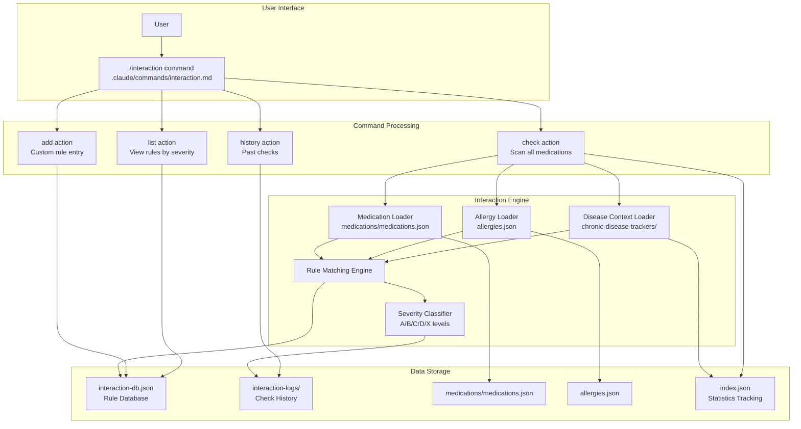
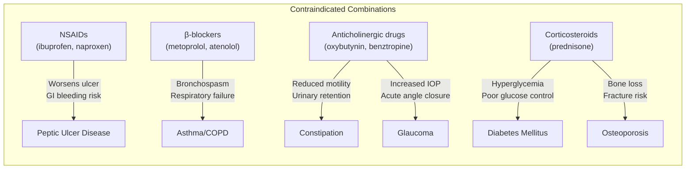
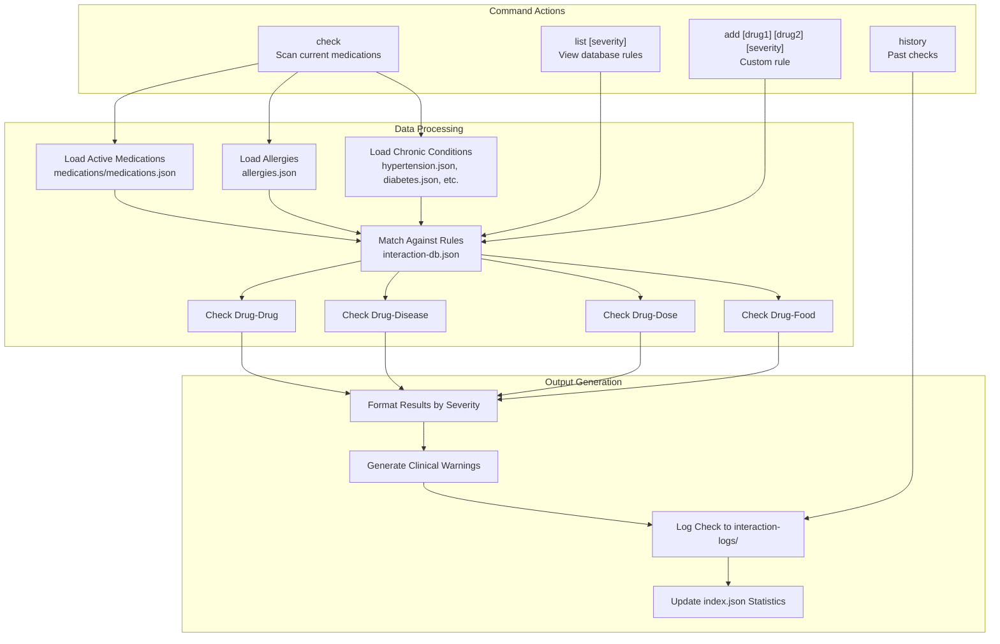
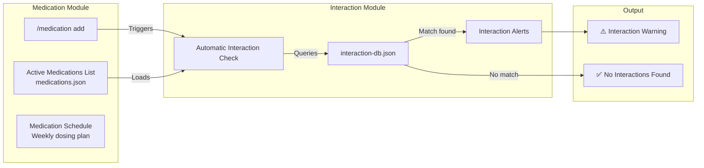
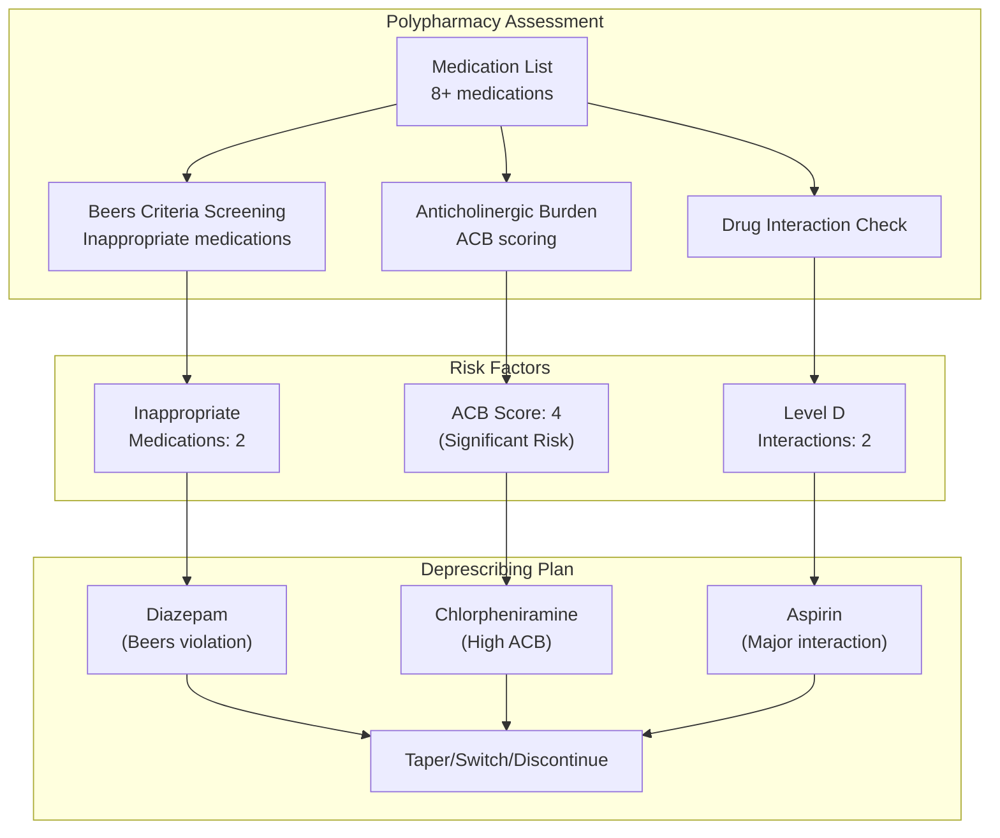

<!-- source: DeepWiki mcp.deepwiki.com · repo huifer/Claude-Ally-Health · page 6.1 Drug Interaction Detection · fetched 2026-10-26 -->

# Drug Interaction Detection

<details>
<summary>Relevant source files</summary>

The following files were used as context for generating this wiki page:

- [.claude/commands/cognitive.md](.claude/commands/cognitive.md)
- [.claude/commands/fall.md](.claude/commands/fall.md)
- [.claude/commands/polypharmacy.md](.claude/commands/polypharmacy.md)
- [.claude/specialists/geriatrics.md](.claude/specialists/geriatrics.md)
- [README.md](README.md)
- [README.zh-CN.md](README.zh-CN.md)
- [data-example/index.json](data-example/index.json)
- [docs/data-structures.md](docs/data-structures.md)
- [scripts/test-elderly-health.sh](scripts/test-elderly-health.sh)
- [todo/03-children-health.md](todo/03-children-health.md)
- [todo/04-elderly-health.md](todo/04-elderly-health.md)

</details>


## Purpose and Scope

This document describes the drug interaction detection system in Claude-Ally-Health, which identifies potential adverse interactions between medications, diseases, dosages, and food. The system implements a five-level severity classification (A/B/C/D/X) and provides management recommendations for identified interactions.

For general medication management including adherence tracking and dosage schedules, see [Polypharmacy Management](#4.4.3). For allergy management and integration with interaction checking, see [Allergy Management](#6.3).

---

## System Architecture

The drug interaction detection system consists of three primary components: a command interface for user interactions, a rules-based database engine, and a persistent storage layer for tracking interaction checks over time.



**Diagram: Drug Interaction Detection System Architecture** - This diagram shows how user commands flow through the processing layer to query the interaction rules database and log results.

Sources: [README.md:34-35](), [README.md:161-186](), [.claude/commands/polypharmacy.md:186-233](), [data-example/index.json:7-8]()

---

## Five-Level Severity Classification

The system implements a standardized severity classification based on clinical significance and required management actions:

| Severity | Clinical Significance | Management Strategy | Example |
|----------|----------------------|---------------------|---------|
| **Level A** | No known interaction | Routine monitoring | Compatible combinations |
| **Level B** | Minor interaction | Monitor symptoms, no intervention usually needed | Mild drowsiness risk |
| **Level C** | Moderate interaction | Monitor closely, consider alternatives | Warfarin + Aspirin (bleeding risk) |
| **Level D** | Major interaction | Avoid combination if possible, intensive monitoring required | ACEI + Potassium-sparing diuretics (hyperkalemia) |
| **Level X** | Absolute contraindication | Never combine, severe harm risk | MAOIs + SSRIs (serotonin syndrome) |

### Severity Determination Factors

The severity level assigned to each interaction considers:

1. **Clinical outcome severity**: Risk of death, hospitalization, permanent disability
2. **Predictability**: How reliably the interaction occurs
3. **Reversibility**: Whether effects can be reversed with intervention
4. **Time to onset**: Immediate vs. delayed reactions
5. **Monitoring feasibility**: Whether the interaction can be effectively monitored

Sources: [README.md:163-169](), [.claude/specialists/geriatrics.md:120-133]()

---

## Interaction Type Classification

### Drug-Drug Interactions

Drug-drug interactions occur when two or more medications affect each other's pharmacokinetics (absorption, distribution, metabolism, excretion) or pharmacodynamics (therapeutic or adverse effects).

**Common Critical Interactions Monitored:**

| Drug Combination | Severity | Mechanism | Clinical Risk |
|------------------|----------|-----------|---------------|
| Warfarin + Aspirin/NSAID | D | Synergistic antiplatelet effect | Increased bleeding risk |
| ACEI + Potassium-sparing diuretics | D | Additive potassium retention | Hyperkalemia |
| β-blocker + Digoxin | C | Additive AV node suppression | Bradycardia, heart block |
| NSAID + ACEI/ARB/Diuretic | C | Reduced renal blood flow | Acute kidney injury |
| Antidepressants + MAOIs | X | Serotonin accumulation | Serotonin syndrome, potentially fatal |

**Database Structure for Drug-Drug Interactions:**

```json
{
  "drug_interactions": [
    {
      "medications": ["Warfarin", "Aspirin"],
      "severity": "D",
      "interaction_type": "drug_drug",
      "mechanism": "synergistic_antiplatelet_effect",
      "clinical_effect": "increased_bleeding_risk",
      "frequency": "common",
      "onset": "days_to_weeks",
      "management": [
        "Monitor INR closely",
        "Watch for bleeding signs",
        "Consider reducing warfarin dose",
        "Evaluate if aspirin necessary"
      ],
      "monitoring": [
        "INR weekly initially",
        "CBC if bleeding signs",
        "Stool occult blood"
      ],
      "alternatives": [
        "Consider clopidogrel if antiplatelet needed",
        "Consider apixaban/rivaroxaban instead of warfarin"
      ]
    }
  ]
}
```

Sources: [.claude/specialists/geriatrics.md:120-127](), [.claude/commands/polypharmacy.md:220-227](), [todo/04-elderly-health.md:672-686]()

### Drug-Disease Interactions

Drug-disease interactions occur when a medication exacerbates an existing medical condition or interferes with disease management.

**Critical Drug-Disease Combinations:**



**Diagram: Common Drug-Disease Interactions** - Shows critical medication-condition combinations that require avoidance or intensive monitoring.

**Database Structure for Drug-Disease Interactions:**

```json
{
  "disease_drug_interactions": [
    {
      "medication": "Ibuprofen",
      "medication_class": "NSAID",
      "condition": "chronic_kidney_disease_stage_3",
      "severity": "D",
      "interaction_type": "drug_disease",
      "mechanism": "reduced_renal_prostaglandin_synthesis",
      "clinical_effect": "worsens_renal_function",
      "recommendation": "avoid_use_substitute_acetaminophen",
      "alternatives": [
        "Acetaminophen (up to 3g/day)",
        "Topical NSAIDs for localized pain"
      ],
      "monitoring_if_unavoidable": [
        "Serum creatinine weekly",
        "Potassium level",
        "Blood pressure",
        "Volume status"
      ]
    }
  ]
}
```

Sources: [.claude/specialists/geriatrics.md:128-133](), [.claude/commands/polypharmacy.md:688-697]()

### Drug-Dose Interactions

Drug-dose interactions occur when the combination of medications affects the appropriate dosing of one or both drugs, requiring dose adjustments.

**Common Scenarios:**

- **Renal elimination drugs in kidney disease**: Adjust doses based on creatinine clearance
- **Hepatically metabolized drugs**: CYP450 inhibitors/inducers affect drug levels
- **Narrow therapeutic index drugs**: Small dose changes have significant clinical impact (warfarin, digoxin, lithium, phenytoin)

### Drug-Food Interactions

Drug-food interactions occur when food intake affects medication absorption, metabolism, or excretion.

**Critical Drug-Food Combinations:**

| Medication | Food/Beverage | Effect | Management |
|------------|---------------|--------|------------|
| Warfarin | Vitamin K-rich foods (leafy greens) | Reduces anticoagulation | Maintain consistent intake |
| MAOIs | Tyramine-rich foods (aged cheese, wine) | Hypertensive crisis | Strict dietary restrictions |
| Levothyroxine | Coffee, calcium, iron | Reduced absorption | Take on empty stomach |
| Grapefruit juice | Statins, calcium channel blockers | Increased drug levels | Avoid grapefruit |
| Alcohol | Metronidazole, some cephalosporins | Disulfiram-like reaction | Complete abstinence |

Sources: [README.md:163](), [.claude/commands/polypharmacy.md:186-233]()

---

## Command Interface

The `/interaction` command provides the primary interface for drug interaction detection and management.



**Diagram: Command Processing Flow for `/interaction check`** - Shows the complete data flow from command invocation through medication loading, rule matching, and result logging.

### Command Syntax Examples

```bash
# Check all active medications for interactions
/interaction check

# List all interaction rules in database
/interaction list

# List only severe contraindications
/interaction list X

# List major interactions requiring action
/interaction list D

# Add a custom interaction rule
/interaction add warfarin aspirin moderate

# View interaction check history
/interaction history
```

### Command Output Format

When `/interaction check` is executed, the system generates a structured report:

```
=== Drug Interaction Detection Report ===
Scan Date: 2025-06-20 10:30:00
Medications Analyzed: 8

=== LEVEL X CONTRAINDICATIONS (0 found) ===
None detected.

=== LEVEL D MAJOR INTERACTIONS (2 found) ===
⚠️ WARNING: Major interaction detected
Medications: Warfarin + Aspirin
Severity: D (Major - Avoid if possible)
Mechanism: Synergistic antiplatelet effect
Clinical Risk: Significantly increased bleeding risk
Management:
  • Monitor INR weekly
  • Watch for bleeding signs (bruising, blood in stool/urine)
  • Consider reducing warfarin dose by 10-20%
  • Evaluate if aspirin is necessary
Monitoring Required:
  • INR weekly for 2-4 weeks, then bi-weekly
  • CBC if any bleeding signs
  • Stool occult blood test

⚠️ WARNING: Major interaction detected
Medications: Lisinopril + Spironolactone
Severity: D (Major - Avoid if possible)
Mechanism: Additive potassium retention
Clinical Risk: Hyperkalemia (life-threatening arrhythmias)
Management:
  • Monitor serum potassium closely
  • Consider alternative (thiazide instead of spironolactone)
  • Reduce potassium-rich foods
Monitoring Required:
  • Serum potassium within 3-7 days, then weekly x 4
  • ECG if potassium >5.5 mEq/L

=== LEVEL C MODERATE INTERACTIONS (3 found) ===
[Details for each moderate interaction...]

=== LEVEL B MINOR INTERACTIONS (1 found) ===
[Details for minor interactions...]

=== DRUG-DISEASE INTERACTIONS (1 found) ===
⚠️ CAUTION: Drug-Disease interaction
Medication: Ibuprofen (NSAID)
Condition: Chronic Kidney Disease Stage 3
Severity: D (Major)
Clinical Risk: Worsening renal function, possible acute kidney injury
Recommendation: Avoid NSAID use; substitute acetaminophen
Alternative: Acetaminophen up to 3g/day or topical NSAIDs

=== RECOMMENDATIONS ===
• Urgent physician review required for 2 Level D interactions
• Consider medication regimen adjustment
• Implement intensive monitoring protocols
• Patient education on warning signs

Next review: 2025-07-20 (1 month)
```

Sources: [.claude/commands/polypharmacy.md:186-233](), [README.md:172-181]()

---

## Data Storage Architecture

### Interaction Rules Database

The interaction rules are stored in `data/interactions/interaction-db.json` with a structured format supporting multiple interaction types.

```json
{
  "version": "1.0",
  "last_updated": "2025-01-02T00:00:00Z",
  "total_rules": 150,
  
  "drug_drug_interactions": [
    {
      "id": "dd_001",
      "drug1": "Warfarin",
      "drug1_class": "anticoagulant",
      "drug2": "Aspirin",
      "drug2_class": "antiplatelet",
      "severity": "D",
      "mechanism": "synergistic_antiplatelet_effect",
      "clinical_effect": "increased_bleeding_risk",
      "predictability": "highly_predictable",
      "documentation": "well_documented",
      "onset": "days_to_weeks",
      "management": [
        "Monitor INR closely",
        "Watch for bleeding signs",
        "Consider dose adjustment",
        "Evaluate necessity of combination"
      ],
      "monitoring": [
        "INR weekly initially",
        "CBC if bleeding symptoms",
        "Stool occult blood"
      ],
      "references": [
        "PMID: 12345678",
        "Micromedex DrugDex"
      ]
    }
  ],
  
  "drug_disease_interactions": [
    {
      "id": "dd_disease_001",
      "medication": "Ibuprofen",
      "medication_class": "NSAID",
      "condition": "chronic_kidney_disease",
      "condition_severity": "stage_3_or_higher",
      "severity": "D",
      "mechanism": "prostaglandin_inhibition",
      "clinical_effect": "acute_kidney_injury_risk",
      "recommendation": "avoid_use",
      "alternatives": [
        "Acetaminophen (max 3g/day)",
        "Topical NSAIDs",
        "Non-pharmacological approaches"
      ],
      "monitoring_if_unavoidable": [
        "Serum creatinine weekly",
        "Potassium level",
        "Blood pressure"
      ]
    }
  ],
  
  "drug_dose_interactions": [
    {
      "id": "dd_dose_001",
      "primary_drug": "Digoxin",
      "affected_by": "Furosemide",
      "severity": "C",
      "mechanism": "hypokalemia_increases_digoxin_toxicity",
      "dose_adjustment": "monitor_digoxin_level",
      "clinical_effect": "increased_toxicity_risk",
      "monitoring": [
        "Digoxin level",
        "Serum potassium",
        "ECG"
      ]
    }
  ],
  
  "drug_food_interactions": [
    {
      "id": "df_001",
      "medication": "Warfarin",
      "food_item": "vitamin_k_rich_foods",
      "examples": ["kale", "spinach", "broccoli"],
      "severity": "C",
      "mechanism": "vitamin_k_antagonizes_warfarin",
      "clinical_effect": "reduced_anticoagulation",
      "recommendation": "maintain_consistent_intake",
      "patient_education": "Do not suddenly increase or decrease leafy green vegetable intake"
    }
  ]
}
```

**Database Schema Design Principles:**

1. **Bidirectional matching**: Rules support matching in both directions (Drug A + Drug B = Drug B + Drug A)
2. **Class-based rules**: Support for drug class interactions (e.g., all NSAIDs + all ACE inhibitors)
3. **Condition context**: Drug-disease rules include condition severity thresholds
4. **Evidence levels**: Track documentation quality and clinical evidence strength
5. **Actionable recommendations**: Each rule includes specific management guidance

Sources: [README.md:71-73](), [data-example/index.json:7-8](), [.claude/commands/polypharmacy.md:688-697]()

### Interaction Check Logs

Each interaction check is logged to `data/interactions/interaction-logs/YYYY-MM/YYYY-MM-DD_timestamp.json`:

```json
{
  "check_id": "ic_20250620103000",
  "check_date": "2025-06-20T10:30:00Z",
  "medications_analyzed": [
    {
      "id": "med_001",
      "name": "Warfarin",
      "dosage": "5mg",
      "frequency": "qd"
    },
    {
      "id": "med_002",
      "name": "Aspirin",
      "dosage": "81mg",
      "frequency": "qd"
    }
  ],
  "allergies_analyzed": ["Penicillin", "Sulfa drugs"],
  "conditions_analyzed": ["Hypertension", "Diabetes Type 2"],
  
  "interactions_found": {
    "level_x": [],
    "level_d": [
      {
        "interaction_id": "dd_001",
        "medications": ["Warfarin", "Aspirin"],
        "severity": "D",
        "type": "drug_drug",
        "clinical_significance": "major"
      }
    ],
    "level_c": [],
    "level_b": [],
    "level_a": []
  },
  
  "drug_disease_interactions": [
    {
      "medication": "Ibuprofen",
      "condition": "CKD_stage_3",
      "severity": "D"
    }
  ],
  
  "total_interactions": 1,
  "high_priority_count": 1,
  "requires_physician_review": true,
  
  "recommendations": [
    "Urgent physician consultation required",
    "Implement INR monitoring protocol",
    "Patient education on bleeding signs"
  ],
  
  "next_check_recommended": "2025-07-20"
}
```

Sources: [README.md:72](), [data-example/index.json:8]()

### Index Tracking

The global `data/index.json` maintains statistics on interaction checking:

```json
{
  "interaction_db": "data/interactions/interaction-db.json",
  "interaction_logs": "data/interactions/interaction-logs",
  
  "statistics": {
    "interaction_check_count": 15,
    "last_interaction_check": "2025-06-20T10:30:00Z"
  }
}
```

Sources: [data-example/index.json:7-8](), [data-example/index.json:34](), [data-example/index.json:48]()

---

## Integration with Other Modules

### Medication Management Integration

The interaction detection system is tightly integrated with the medication management module (`data/medications/medications.json`):



**Diagram: Automatic Interaction Checking on Medication Addition** - Shows how adding a new medication automatically triggers interaction screening.

**Workflow:**

1. User adds medication via `/medication add`
2. System loads all active medications from `medications.json`
3. Automatic interaction check is triggered
4. Results are displayed immediately
5. If Level D or X interactions found, user is warned before confirming

Sources: [.claude/commands/polypharmacy.md:52-91](), [data-example/index.json:7-8]()

### Polypharmacy Management Integration

The interaction detection is a core component of elderly polypharmacy management:



**Diagram: Integration with Polypharmacy Management** - Shows how interaction detection combines with Beers Criteria and ACB scoring to inform deprescribing decisions.

Sources: [.claude/commands/polypharmacy.md:1-437](), [.claude/specialists/geriatrics.md:102-155](), [todo/04-elderly-health.md:526-773]()

### Allergy Cross-Referencing

The system checks new medications against known allergies stored in `data/allergies.json`:

```json
{
  "allergies": [
    {
      "allergen": "Penicillin",
      "allergen_type": "medication",
      "reaction": "rash",
      "severity": "moderate",
      "cross_reactivity": [
        "Amoxicillin",
        "Ampicillin",
        "Other penicillins"
      ]
    },
    {
      "allergen": "Sulfa drugs",
      "allergen_type": "medication_class",
      "reaction": "Stevens-Johnson syndrome",
      "severity": "severe",
      "cross_reactivity": [
        "Sulfamethoxazole",
        "Sulfasalazine",
        "Sulfadiazine"
      ]
    }
  ]
}
```

When checking interactions, the system automatically flags any medication that matches known allergens or cross-reactive agents.

Sources: [README.md:69-70](), [data-example/index.json:4]()

---

## Clinical Safety Guidelines

### Safety Red Lines

The interaction detection system strictly adheres to medical safety principles:

1. **No dosage recommendations**: System never recommends specific dose adjustments
2. **No medication substitution**: System suggests alternatives but defers prescription to physicians
3. **No self-discontinuation**: System never advises patients to stop medications without physician guidance
4. **Physician consultation required**: All Level D and X interactions trigger urgent physician review recommendation

### Appropriate System Responses

**✅ Acceptable:**
- "Major interaction detected between Warfarin and Aspirin - increased bleeding risk. Physician review recommended."
- "This combination requires close monitoring. Suggest discussing with your doctor."
- "Alternative medications to consider (requires physician evaluation): [list]"

**❌ Prohibited:**
- "Stop taking Aspirin immediately" (self-discontinuation)
- "Reduce Warfarin to 2.5mg daily" (specific dosage)
- "Switch from Aspirin to Clopidogrel 75mg once daily" (prescription)
- "This combination is safe, no need to worry" (absolute safety claim)

Sources: [README.md:149-160](), [.claude/commands/polypharmacy.md:20-48](), [.claude/specialists/geriatrics.md:169-196]()

### Output Format Standards

All interaction reports include:

1. **Clear severity classification**: Visual severity indicators (⚠️, 🚨)
2. **Mechanism explanation**: Plain-language description of why interaction occurs
3. **Clinical consequences**: Specific adverse outcomes that may occur
4. **Management guidance**: General monitoring and precaution recommendations
5. **Physician consultation recommendation**: Explicit guidance to seek medical review
6. **Monitoring parameters**: Lab tests and clinical assessments needed
7. **Timeline guidance**: When monitoring should occur

Sources: [.claude/commands/polypharmacy.md:186-233]()

---

## Example Interaction Rules

### Drug-Drug Interaction: Warfarin + Aspirin

```
Interaction ID: dd_001
Medications: Warfarin (Anticoagulant) + Aspirin (Antiplatelet)
Severity: Level D (Major - Avoid if possible)

Mechanism:
Both medications inhibit different aspects of hemostasis:
- Warfarin: Inhibits vitamin K-dependent clotting factors (II, VII, IX, X)
- Aspirin: Irreversibly inhibits platelet cyclooxygenase (COX-1)
The combination produces synergistic antiplatelet effects beyond simple addition.

Clinical Consequences:
- 2-3x increased risk of major bleeding
- GI bleeding most common (30-40% of events)
- Intracranial hemorrhage risk increased
- Bleeding may occur even with therapeutic INR

Management Recommendations:
1. Evaluate necessity of dual antiplatelet/anticoagulation
2. If unavoidable:
   - Monitor INR weekly initially, then bi-weekly
   - Consider reducing warfarin target INR by 0.5
   - Use lowest effective aspirin dose (81mg)
   - Add PPI for GI protection
3. Patient education:
   - Recognize bleeding signs (bruising, blood in stool/urine)
   - Avoid trauma/contact sports
   - Report bleeding immediately

Monitoring Protocol:
- INR: Weekly x 2-4 weeks, then bi-weekly ongoing
- CBC: Baseline and as clinically indicated
- Stool occult blood: Consider screening
- Renal function: Monitor for GI bleed effect on kidney
- Blood pressure: Control BP to reduce bleeding risk

Alternative Strategies:
- Monotherapy if clinically acceptable
- Novel anticoagulants (less food/drug interaction)
- Clopidogrel instead of aspirin (if antiplatelet needed)
- Consider clinical indication: AF, VTE, ACS have different guidelines

Documentation Quality: Well-documented (multiple RCTs, meta-analyses)
Evidence Level: Level 1 (highest quality evidence)
```

Sources: [.claude/specialists/geriatrics.md:120-121](), [.claude/commands/polypharmacy.md:220-227]()

### Drug-Disease Interaction: NSAID + Chronic Kidney Disease

```
Interaction ID: dd_disease_003
Medication: Ibuprofen (or any NSAID)
Condition: Chronic Kidney Disease Stage 3 or higher (eGFR <60 mL/min)
Severity: Level D (Major - Avoid if possible)

Mechanism:
NSAIDs inhibit cyclooxygenase (COX) enzymes, reducing prostaglandin synthesis.
In the kidney, prostaglandins maintain renal blood flow, especially in states
of reduced perfusion (CKD, hypovolemia, heart failure). NSAID use causes:
1. Afferent arteriole vasoconstriction → Reduced GFR
2. Impaired autoregulation of renal blood flow
3. Sodium and water retention → Edema, hypertension
4. Hyperkalemia (reduced potassium excretion)

Clinical Consequences:
- Acute kidney injury (AKI) - can occur within days
- Accelerated progression of CKD
- Volume overload and edema
- Hyperkalemia (life-threatening arrhythmia risk)
- Hypertension worsening
- Increased cardiovascular event risk

Management Recommendations:
1. Avoid all NSAIDs if possible (including OTC products)
2. Alternative analgesics:
   - Acetaminophen (up to 3g/day in CKD)
   - Topical NSAIDs for localized pain (minimal systemic absorption)
   - Tramadol (with dose adjustment)
   - Duloxetine for neuropathic pain
3. If NSAID unavoidable (inflammatory arthritis):
   - Lowest effective dose
   - Shortest duration possible
   - Intensive monitoring protocol

Monitoring Protocol (if NSAID use unavoidable):
- Serum creatinine: Baseline, day 3-7, weekly x 4, then monthly
- Potassium: Same schedule as creatinine
- Blood pressure: Weekly
- Volume status: Daily weights
- Discontinue immediately if creatinine ↑ >0.5 mg/dL

Patient Education:
- Avoid OTC NSAIDs (Advil, Aleve, Motrin)
- Read labels for hidden NSAIDs in combination products
- Report reduced urine output or swelling
- No dehydration (maintain adequate fluid intake)

Alternative Pain Management:
- Non-pharmacological: Physical therapy, heat/cold, TENS
- Pharmacological: Acetaminophen as first-line
- Interventional: Joint injections, nerve blocks

Risk Stratification:
- Higher risk: CKD Stage 4-5, concurrent ACEi/ARB, diuretics, heart failure
- Duration dependent: Risk increases with chronic use
- Dose dependent: Higher doses = higher risk

Documentation Quality: Well-documented
Evidence Level: Level 2 (observational studies, expert consensus)
```

Sources: [.claude/specialists/geriatrics.md:128-130](), [.claude/commands/polypharmacy.md:688-697]()

### Drug-Food Interaction: MAOIs + Tyramine

```
Interaction ID: df_002
Medication: Monoamine Oxidase Inhibitors (Phenelzine, Tranylcypromine)
Food: Tyramine-rich foods
Severity: Level X (Absolute contraindication - Never combine)

Mechanism:
MAOIs irreversibly inhibit monoamine oxidase enzymes (MAO-A and MAO-B),
which normally metabolize tyramine in the gut and liver. When MAO is
inhibited, dietary tyramine is absorbed intact and causes:
1. Massive norepinephrine release from sympathetic neurons
2. Systemic vasoconstriction
3. Hypertensive crisis (BP can exceed 200/120 mmHg)

Clinical Consequences:
- Severe hypertensive emergency (potentially fatal)
- Symptoms: Severe headache, stiff neck, palpitations, sweating, nausea
- Complications: Stroke, myocardial infarction, aortic dissection
- Onset: 20 minutes to 2 hours after ingestion
- Can occur with as little as 6mg tyramine (10mg is dangerous threshold)

High Tyramine Foods (MUST AVOID):
- Aged cheeses (cheddar, blue cheese, parmesan)
- Cured/fermented meats (salami, pepperoni, sausage)
- Sauerkraut, kimchi, pickles
- Soy sauce, miso, tofu
- Draft beer, red wine
- Fava beans, broad beans
- Overripe bananas
- Yeast extracts (Marmite, Vegemite)

Management:
PREVENTION IS CRITICAL - This interaction can be fatal
1. Mandatory patient education BEFORE starting MAOI
2. Provide written list of prohibited foods
3. Dietary counseling with dietitian
4. Family member education
5. Medical alert bracelet recommended

Emergency Treatment (if tyramine reaction occurs):
- Immediate medical attention (call 911)
- Phentolamine 5mg IV (alpha-blocker)
- Nifedipine 10mg sublingual
- Blood pressure monitoring every 5 minutes
- Head CT if severe headache/neuro symptoms

Duration of Restriction:
- Continue dietary restrictions for 14 days AFTER stopping MAOI
- MAO enzyme regeneration takes 10-14 days
- Reversible MAOIs (moclobemide) have shorter restriction period

Patient Education Points:
- "This is a life-threatening interaction"
- "Read all food labels carefully"
- "When in doubt, avoid it"
- "Carry emergency contact card"
- "Inform all healthcare providers about MAOI use"

Documentation Quality: Well-documented (case reports, case series)
Evidence Level: Level 3 (consistent case reports, established mechanism)
```

Sources: [README.md:163](), [.claude/specialists/geriatrics.md:120-127]()

---

## Contributing to the Interaction Database

Medical professionals can contribute to the interaction database by following the structured format defined in the data model. Each new rule should include:

1. **Complete identification**: Drug names (generic + brand), drug classes
2. **Evidence-based severity**: Clinical evidence supporting classification
3. **Mechanism description**: Pharmacological basis for interaction
4. **Clinical outcomes**: Documented adverse events
5. **Management protocols**: Evidence-based monitoring and intervention
6. **Alternative strategies**: Therapeutic alternatives when available
7. **Literature references**: PubMed IDs or authoritative source citations

Contribution guidelines are available in [Drug Interaction Database Complete Guide](docs/drug-interaction-database.md) (referenced in README).

Sources: [README.md:182-186]()

---

