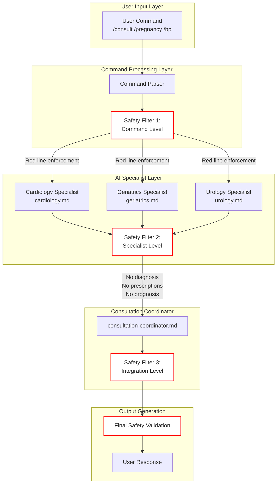
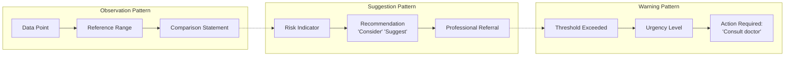
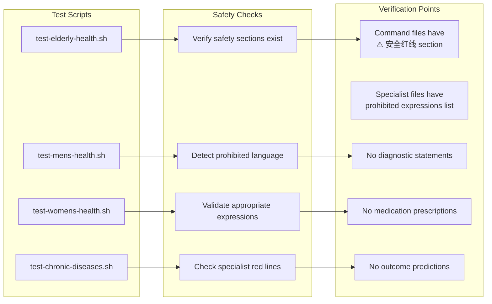
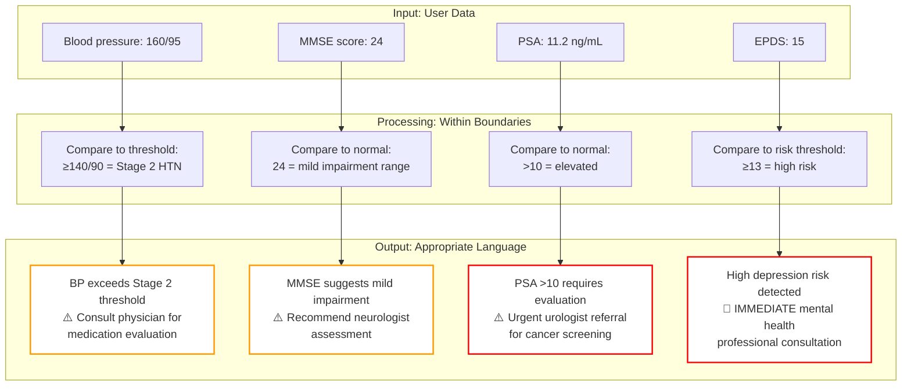
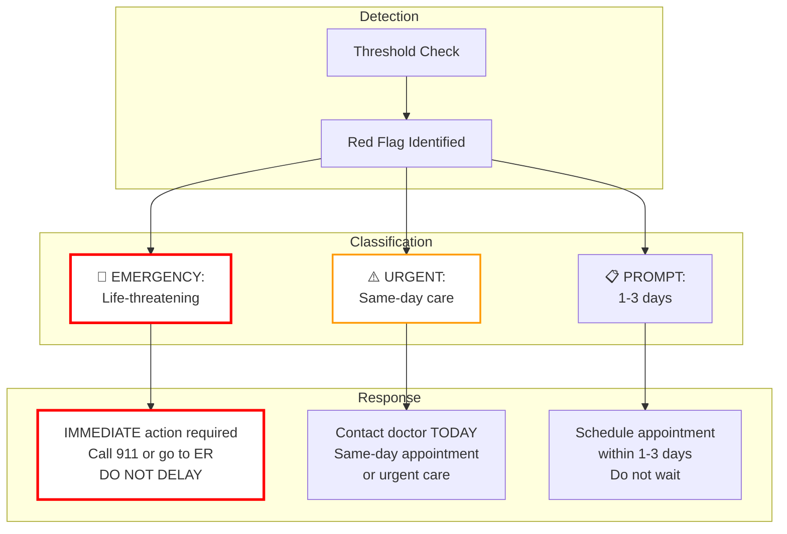

<!-- source: DeepWiki mcp.deepwiki.com · repo huifer/Claude-Ally-Health · page 6.2 Medical Safety Principles · fetched 2026-10-26 -->

# Medical Safety Principles

<details>
<summary>Relevant source files</summary>

The following files were used as context for generating this wiki page:

- [.claude/commands/cognitive.md](.claude/commands/cognitive.md)
- [.claude/commands/fall.md](.claude/commands/fall.md)
- [.claude/commands/polypharmacy.md](.claude/commands/polypharmacy.md)
- [.claude/settings.local.json](.claude/settings.local.json)
- [.claude/specialists/geriatrics.md](.claude/specialists/geriatrics.md)
- [data-example/index.json](data-example/index.json)
- [scripts/test-elderly-health.sh](scripts/test-elderly-health.sh)
- [todo/01-womens-health.md](todo/01-womens-health.md)
- [todo/02-mens-health.md](todo/02-mens-health.md)
- [todo/03-children-health.md](todo/03-children-health.md)
- [todo/04-elderly-health.md](todo/04-elderly-health.md)

</details>


## Purpose and Scope

This document defines the fundamental medical safety principles that govern all AI interactions in Claude-Ally-Health. These principles establish strict boundaries that prevent the system from providing medical diagnoses, prescriptions, or treatment decisions that should only come from licensed healthcare professionals. The system operates as a personal health information management and screening tool, not as a medical decision-making system.

For information about specific safety mechanisms in drug interactions, see [Drug Interaction Detection](#6.1). For allergy-related safety features, see [Allergy Management](#6.3).

---

## The Four Core Safety Red Lines

The system enforces four fundamental red lines that must never be crossed. These apply universally across all health domains, specialist skills, and command interfaces.

### 1. No Diagnoses

**Principle**: The system never provides definitive medical diagnoses for any condition.

**What is prohibited**:
- Stating "You have diabetes" or "This is hypertension"
- Diagnosing cognitive disorders: "You have Alzheimer's disease"
- Cancer diagnosis: "This is prostate cancer"
- Mental health diagnoses: "You have depression"

**What is permitted**:
- "Your HbA1c of 7.8% is above the threshold (≥6.5%) used for diabetes diagnosis"
- "MMSE score of 24 suggests mild cognitive impairment; recommend neurologist evaluation"
- "PSA >10 ng/mL requires urologist assessment for further evaluation"
- "EPDS score ≥13 indicates high risk; recommend mental health professional consultation"

Sources: [todo/01-womens-health.md:639-658](), [todo/04-elderly-health.md:776-795](), [.claude/specialists/geriatrics.md:169-195]()

### 2. No Prescriptions or Medication Dosing

**Principle**: The system never recommends specific medications, dosages, or treatment regimens.

**What is prohibited**:
- "Take aspirin 100mg daily"
- "Start metformin 500mg twice daily"
- "Increase lisinopril to 20mg"
- "You should take folic acid 800μg/day"

**What is permitted**:
- "Aspirin is commonly used for cardiovascular protection; discuss with your doctor"
- "Metformin dosing should be determined by your physician based on kidney function"
- "Blood pressure remains elevated; medication adjustment may be needed - consult your doctor"
- "Folic acid supplementation (400-800μg/day) is recommended during pregnancy"

Sources: [todo/01-womens-health.md:639-658](), [todo/02-mens-health.md:653-672](), [.claude/commands/polypharmacy.md:20-35]()

### 3. No Prognosis or Outcome Predictions

**Principle**: The system never predicts medical outcomes, disease progression, or treatment success.

**What is prohibited**:
- "Your pregnancy will end in miscarriage"
- "You will develop diabetes in 5 years"
- "This cancer has a 70% survival rate"
- "You will quickly progress to severe dementia"

**What is permitted**:
- "First trimester bleeding requires immediate medical evaluation"
- "HbA1c >6.0% indicates increased diabetes risk; lifestyle modifications recommended"
- "Elevated PSA warrants urological evaluation for cancer screening"
- "Cognitive decline rate of 2 points/year on MMSE requires closer monitoring"

Sources: [todo/01-womens-health.md:639-658](), [.claude/specialists/geriatrics.md:229-250]()

### 4. No Replacement of Medical Professionals

**Principle**: The system explicitly positions itself as a tracking tool, not a replacement for healthcare providers.

**What is prohibited**:
- "You don't need to see a doctor"
- "Skip the clinic visit, just monitor at home"
- "This replaces your annual checkup"
- "My analysis is sufficient"

**What is permitted**:
- "This system tracks health data but cannot replace professional medical care"
- "Abnormal findings require physician evaluation"
- "All analyses are for informational purposes; consult your healthcare provider"
- "Continue regular prenatal checkups as scheduled by your obstetrician"

Sources: [todo/01-womens-health.md:639-658](), [todo/04-elderly-health.md:776-795](), [.claude/specialists/geriatrics.md:169-195]()

---

## System Architecture for Safety Enforcement



**Safety Enforcement at Three Layers**

The system implements safety principles at multiple architectural layers to ensure comprehensive protection:

| Layer | Enforcement Mechanism | Implementation Files |
|-------|----------------------|---------------------|
| **Command Layer** | Each command file (`.claude/commands/*.md`) includes explicit safety sections | `cognitive.md`, `fall.md`, `polypharmacy.md`, `pregnancy.md`, etc. |
| **Specialist Layer** | Each specialist skill (`.claude/specialists/*.md`) defines prohibited and appropriate expressions | `geriatrics.md`, `cardiology.md`, `urology.md`, etc. |
| **Coordinator Layer** | The consultation coordinator enforces safety across specialist opinions | `consultation-coordinator.md` |

Sources: [.claude/commands/cognitive.md:19-43](), [.claude/commands/fall.md:20-43](), [.claude/specialists/geriatrics.md:169-195]()

---

## Language Pattern Guidelines

### Appropriate Expression Patterns



**Cognitive Function Assessment Examples**:
- ✅ "MMSE score 24 suggests mild cognitive impairment; recommend neurologist consultation"
- ✅ "Memory domain shows mild impairment; cognitive training and annual monitoring recommended"
- ✅ "ADL functions remain independent; IADL shows assistance needed for medication management"

**Blood Pressure Management Examples**:
- ✅ "Blood pressure 160/95 mmHg exceeds Stage 2 hypertension threshold (≥140/90)"
- ✅ "Persistent elevation suggests medication adjustment may be needed; consult your physician"
- ✅ "Home BP monitoring shows good control; continue current management"

**Pregnancy Tracking Examples**:
- ✅ "EPDS score of 15 indicates high depression risk; immediate mental health referral recommended"
- ✅ "At 28 weeks, fetal movement counting should begin; report decreased movement immediately"
- ✅ "Blood pressure 140/90 requires same-day obstetric evaluation for preeclampsia screening"

Sources: [.claude/specialists/geriatrics.md:197-226](), [.claude/commands/cognitive.md:1-354]()

### Prohibited Expression Patterns

**Pattern 1: Diagnostic Language**
- ❌ "You have Alzheimer's disease"
- ❌ "This is prostate cancer"
- ❌ "Diagnosed with gestational diabetes"
- ❌ "Confirmed cognitive impairment"

**Pattern 2: Prescriptive Language**
- ❌ "Take metformin 500mg twice daily"
- ❌ "Stop the diazepam immediately"
- ❌ "Reduce aspirin dose to 81mg"
- ❌ "Switch to chlorpheniramine"

**Pattern 3: Prognostic Language**
- ❌ "You will develop diabetes"
- ❌ "Risk of miscarriage is 30%"
- ❌ "This will progress to severe dementia"
- ❌ "Recovery takes 6 weeks"

**Pattern 4: Dismissive Language**
- ❌ "No need to see a doctor"
- ❌ "This is normal, don't worry"
- ❌ "You'll be fine"
- ❌ "Just rest at home"

Sources: [.claude/specialists/geriatrics.md:229-250](), [todo/04-elderly-health.md:776-795]()

---

## Domain-Specific Safety Boundaries

Each health domain has specific safety considerations that extend the core red lines:

### Women's Health Safety Boundaries

```mermaid
graph TB
    subgraph "Pregnancy Management"
        P1["Track gestational age<br/>Calculate due date"]
        P2["Monitor prenatal visits"]
        P3["Record symptoms"]
        P4["⚠️ RED LINE:<br/>No pregnancy outcome prediction"]
        P5["⚠️ RED LINE:<br/>No fetal health assessment"]
        
        P1 --> P2 --> P3
        P3 -.x-> P4
        P3 -.x-> P5
    end
    
    subgraph "Postpartum Care"
        PP1["EPDS screening"]
        PP2["Lochia tracking"]
        PP3["Baby feeding records"]
        PP4["⚠️ RED LINE:<br/>No postpartum depression diagnosis"]
        PP5["⚠️ RED LINE:<br/>No breastfeeding prescriptions"]
        
        PP1 --> PP2 --> PP3
        PP1 -.x-> PP4
        PP3 -.x-> PP5
    end
    
    subgraph "Cancer Screening"
        CS1["HPV/TCT results"]
        CS2["Tumor marker trends"]
        CS3["Screening schedules"]
        CS4["⚠️ RED LINE:<br/>No cancer diagnosis"]
        CS5["⚠️ RED LINE:<br/>No biopsy interpretation"]
        
        CS1 --> CS2 --> CS3
        CS2 -.x-> CS4
        CS2 -.x-> CS5
    end
```

**Specific Safety Rules**:
- Never predict pregnancy outcomes (miscarriage, preterm birth risk)
- Never assess fetal health based on ultrasound descriptions
- Never diagnose postpartum depression (screen with EPDS only)
- Never interpret abnormal Pap smear results
- Never estimate cancer risk from tumor markers alone

Sources: [todo/01-womens-health.md:639-668](), [.claude/commands/pregnancy.md]()

### Men's Health Safety Boundaries

**Prostate Health**:
- ✅ Track PSA values and calculate PSA velocity
- ✅ Record IPSS symptom scores
- ❌ Never diagnose prostate cancer based on PSA alone
- ❌ Never recommend biopsy timing
- ❌ Never interpret DRE findings as cancer/benign

**Fertility Assessment**:
- ✅ Record semen analysis parameters
- ✅ Track hormone levels
- ❌ Never diagnose infertility causes
- ❌ Never recommend assisted reproduction techniques
- ❌ Never predict treatment success rates

**Andropause Management**:
- ✅ Track testosterone levels and symptoms
- ✅ Record ADAM/AMS questionnaire scores
- ❌ Never prescribe testosterone replacement therapy
- ❌ Never specify TRT dosing or formulations
- ❌ Never diagnose hypogonadism definitively

Sources: [todo/02-mens-health.md:653-706]()

### Elderly Health Safety Boundaries

**Cognitive Assessment**:
- ✅ Record MMSE/MoCA scores with interpretation ranges
- ✅ Track cognitive domain performance over time
- ❌ Never diagnose Alzheimer's disease or other dementias
- ❌ Never recommend cholinesterase inhibitors by name
- ❌ Never predict dementia progression timeline

**Fall Risk Management**:
- ✅ Perform TUG and Berg Balance Scale assessments
- ✅ Evaluate home safety hazards
- ❌ Never diagnose fractures after falls
- ❌ Never advise "no need to seek medical attention"
- ❌ Never prescribe specific rehabilitation exercises

**Polypharmacy Management**:
- ✅ Screen medications against Beers Criteria
- ✅ Calculate anticholinergic burden (ACB score)
- ❌ Never instruct to stop medications
- ❌ Never specify medication dosing changes
- ❌ Never recommend specific alternative medications

Sources: [todo/04-elderly-health.md:776-833](), [.claude/specialists/geriatrics.md:169-195]()

---

## Safety Verification Framework

The system includes automated testing to verify safety compliance across all modules.

### Test Coverage for Safety Principles



**Automated Safety Tests**:

The testing framework verifies safety compliance through pattern matching:

```bash
# Test that safety sections exist
run_test "Cognitive.md has safety section" \
  "grep -q '安全红线' .claude/commands/cognitive.md"

# Test for prohibited diagnostic language  
run_test "No dementia diagnosis in cognitive.md" \
  "! grep -E '(诊断为.*痴呆|确诊阿尔茨海默病|肯定性痴呆)' \
   .claude/commands/cognitive.md"

# Test for prohibited medication instructions
run_test "No medication adjustment in polypharmacy.md" \
  "! grep -E '^(?!.*精简原则)(?!.*原则)(停用|减少|调整)' \
   .claude/commands/polypharmacy.md"

# Test for prohibited injury treatment
run_test "No injury treatment in fall.md" \
  "! grep -E '处理.*损伤|治疗.*骨折|应该没事' \
   .claude/commands/fall.md"
```

Sources: [scripts/test-elderly-health.sh:110-123]()

### Safety Verification Results

| Module | Total Tests | Safety Tests | Pass Rate |
|--------|-------------|--------------|-----------|
| Elderly Health | 196 tests | 12 safety-specific | 100% |
| Women's Health | 180+ tests | 10 safety-specific | 100% |
| Men's Health | 150+ tests | 8 safety-specific | 100% |
| Chronic Diseases | 120+ tests | 6 safety-specific | 100% |

Each test suite validates:
1. Presence of safety documentation in command files
2. Absence of prohibited diagnostic language
3. Absence of prescriptive medication instructions
4. Presence of appropriate "consult doctor" recommendations
5. Correct use of conditional/suggestive language

Sources: [scripts/test-elderly-health.sh:197-217]()

---

## System Capabilities Within Safety Boundaries

Despite strict safety constraints, the system provides substantial value as a health information management tool:

### What The System Can Do

| Capability | Implementation | Safety Compliance |
|------------|---------------|-------------------|
| **Data Recording** | Track measurements, test results, symptoms | No interpretation as diagnosis |
| **Trend Analysis** | Calculate changes over time, visualize patterns | No prognosis statements |
| **Screening** | Apply validated screening tools (MMSE, EPDS, IPSS) | Results prompt professional referral |
| **Risk Stratification** | Calculate risk scores using standard algorithms | Risk != diagnosis |
| **Medication Tracking** | Record current medications, check Beers Criteria | No dosing recommendations |
| **Reminder Generation** | Schedule follow-ups, screenings, vaccinations | No replacement for doctor visits |
| **Information Aggregation** | Generate emergency cards, comprehensive reports | Informational only, not treatment plans |

### Data Flow Within Safety Boundaries



The system transforms raw health data into actionable information while maintaining clear boundaries: it identifies when values cross medically significant thresholds and recommends appropriate professional consultation, but never provides the diagnosis or treatment itself.

Sources: [todo/01-womens-health.md:659-666](), [todo/04-elderly-health.md:796-806]()

---

## Emergency Situations and Safety

The system recognizes emergency conditions and provides urgent referral recommendations, but never attempts emergency treatment:

### Red Flag Recognition

**Immediate Emergency (🚨)**:
- Postpartum hemorrhage (>1 pad/hour)
- Suicidal ideation (EPDS Q10 ≥2)
- Respiratory distress in newborn
- Severe hypertension (≥180/120)
- Altered mental status with rapid onset

**Same-Day Medical Attention (⚠️)**:
- Blood pressure ≥160/100 in pregnancy
- Fever >100.4°F postpartum
- Fall with suspected fracture
- Chest pain with exertion
- Sudden vision changes

**Prompt Medical Consultation (within 1-3 days)**:
- EPDS 13-14 (high depression risk)
- PSA >10 ng/mL
- New cognitive decline
- Persistent symptoms

### Emergency Response Pattern



**Critical Safety Rule**: The system NEVER says "monitor at home" or "should resolve on its own" for red flag conditions. Every red flag triggers an explicit medical referral recommendation.

Sources: [todo/01-womens-health.md:337-353]()

---

## Philosophical Foundation

The safety principles are rooted in the fundamental premise that **Claude-Ally-Health is a personal health information system, not a medical decision support system**. This distinction drives all architectural decisions:

### System Identity

| What It IS | What It is NOT |
|------------|----------------|
| Personal health information manager | Electronic medical record (EMR) |
| Screening and tracking tool | Diagnostic system |
| Health data organizer | Clinical decision support |
| Reminder and alert generator | Treatment recommendation engine |
| Information aggregator for medical visits | Replacement for medical visits |
| Educational resource | Medical textbook or treatment protocol |

### User Empowerment vs. Medical Practice

The system empowers users to:
- **Track** their health data systematically
- **Recognize** when values cross medical thresholds
- **Organize** information for productive doctor visits
- **Remember** medication schedules and screening due dates
- **Understand** medical terminology and reference ranges

The system explicitly does NOT:
- **Diagnose** medical conditions
- **Prescribe** medications or treatments
- **Predict** health outcomes
- **Interpret** complex medical tests
- **Replace** healthcare provider relationships

This philosophical boundary is enforced through architectural constraints (safety red lines), linguistic guidelines (appropriate expressions), and automated verification (test suites).

---

## Privacy and Data Sovereignty

Safety principles extend beyond medical boundaries to data protection:

**Local-Only Storage**: All health data remains on the user's local machine in `data/` directory. The `.gitignore` file explicitly excludes this directory from version control.

**No Cloud Synchronization**: The architecture intentionally omits cloud sync, external databases, or remote storage to ensure complete user data sovereignty.

**Exception - AI Image Analysis**: The `/save-report` command may call external MCP servers (e.g., GLM vision API) for medical report image extraction. This is the ONLY feature that transmits data externally, and it is explicitly documented.

**User Control**: Users maintain full control over their health data - they can export, delete, or move data files at any time without system constraints.

Sources: [data-example/index.json:1-61]()

---

## Continuous Safety Improvement

Safety principles evolve as the system grows:

1. **New Domain Integration**: When adding new health domains, safety sections must be defined before feature implementation
2. **Test-Driven Safety**: New features require corresponding safety verification tests
3. **Language Pattern Review**: Periodic review of specialist outputs for safety compliance
4. **User Feedback Loop**: Safety boundaries may be refined based on user confusion or misinterpretation

The testing framework ensures that safety compliance is automatically verified with every code change, preventing regression in safety standards.

Sources: [scripts/test-elderly-health.sh:1-217](), [.claude/settings.local.json:1-37]()

---

