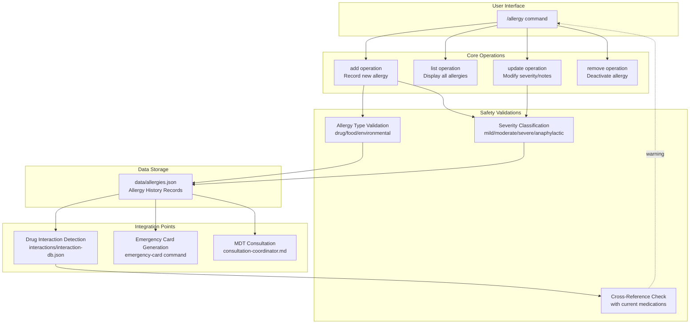
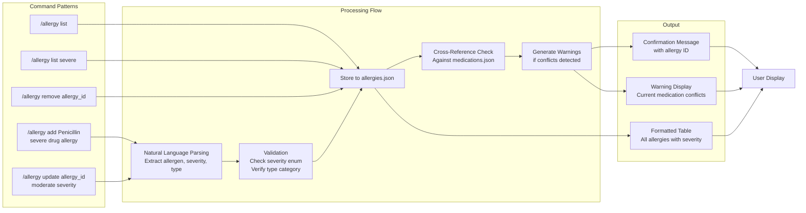
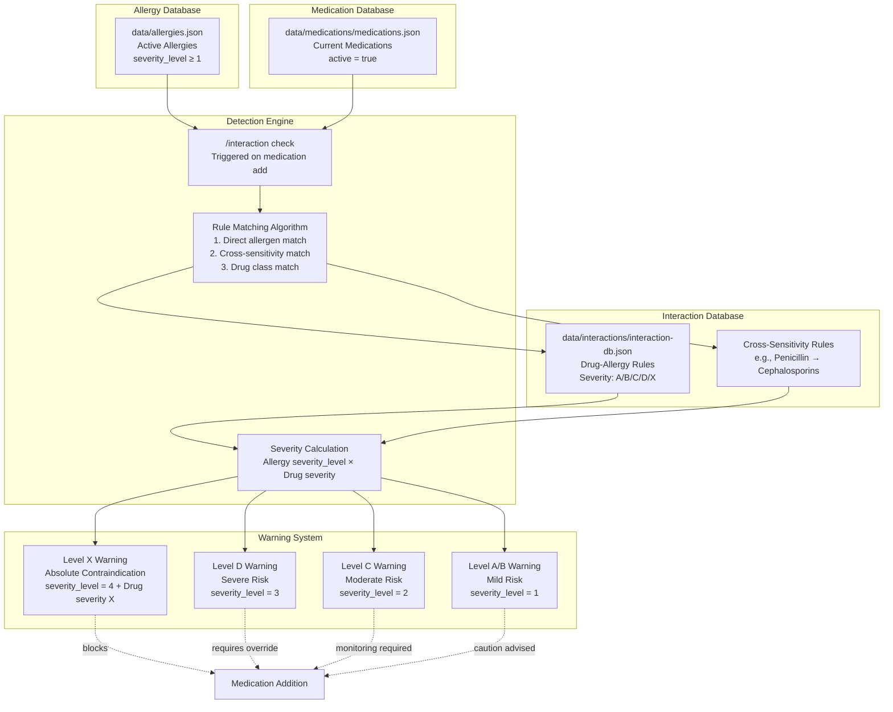
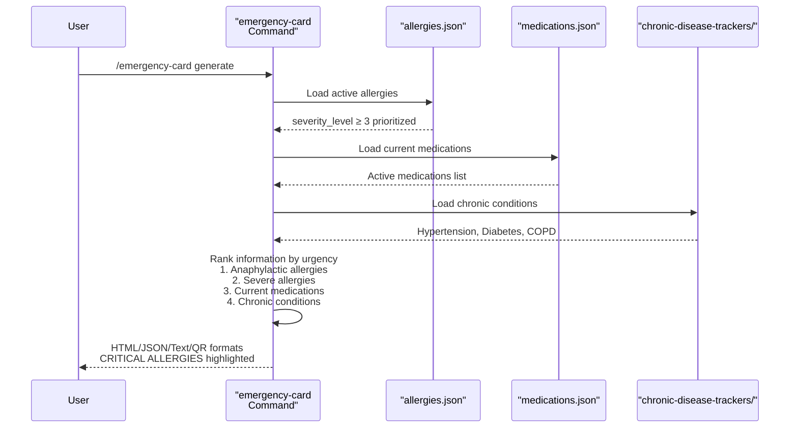
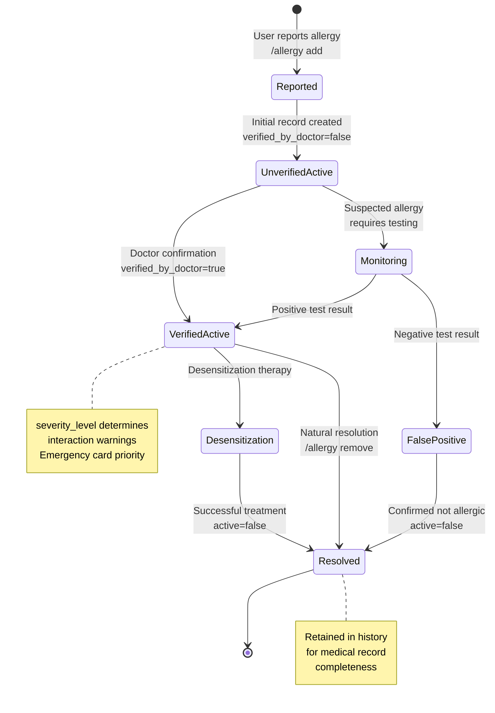

<!-- source: DeepWiki mcp.deepwiki.com · repo huifer/Claude-Ally-Health · page 6.3 Allergy Management · fetched 2026-10-26 -->

# Allergy Management

<details>
<summary>Relevant source files</summary>

The following files were used as context for generating this wiki page:

- [README.md](README.md)
- [README.zh-CN.md](README.zh-CN.md)
- [docs/data-structures.md](docs/data-structures.md)

</details>


## Purpose and Scope

This document describes the allergy management system within Claude-Ally-Health. The system tracks patient allergy history with severity classifications and integrates this information into drug interaction safety checks and emergency medical information. Allergy records are stored in `data/allergies.json` and accessed via the `/allergy` command.

For information about how allergy data integrates with medication safety checks, see [Drug Interaction Detection](#6.1). For how allergy information appears in emergency situations, see [Emergency Medical Information Card](#5.3).

Sources: [README.md:70](), [README.md:129]()

---

## System Overview

The allergy management system provides structured storage and retrieval of patient allergy history. It categorizes allergies by type (drug, food, environmental), records severity levels, and makes this data available to other safety systems for cross-referencing during medication management and emergency situations.



Sources: [README.md:43-89](), [README.md:129]()

---

## Data Structure

The `data/allergies.json` file stores allergy records in a structured JSON format. Each allergy entry includes the allergen name, type classification, severity level, reaction description, onset date, and current status.

### Allergy Record Schema

```json
{
  "allergies": [
    {
      "id": "allergy_20251231123456789",
      "allergen": "Penicillin",
      "type": "drug",
      "severity": "severe",
      "severity_level": 3,
      "reaction": "Anaphylactic shock with hives and difficulty breathing",
      "onset_date": "2015-08-15",
      "first_occurrence": "2015-08-15",
      "last_occurrence": "2015-08-15",
      "verified_by_doctor": true,
      "notes": "Confirmed by allergist. Avoid all beta-lactam antibiotics.",
      "active": true,
      "created_at": "2025-12-31T12:34:56.789Z",
      "last_updated": "2025-12-31T12:34:56.789Z"
    }
  ]
}
```

### Field Specifications

| Field | Type | Required | Description |
|-------|------|----------|-------------|
| `id` | string | Yes | Unique identifier with prefix `allergy_` + timestamp |
| `allergen` | string | Yes | Name of the allergen (drug name, food item, environmental substance) |
| `type` | enum | Yes | Allergy category: `drug`, `food`, `environmental`, `other` |
| `severity` | enum | Yes | Clinical severity: `mild`, `moderate`, `severe`, `anaphylactic` |
| `severity_level` | integer | Yes | Numeric severity: 1 (mild), 2 (moderate), 3 (severe), 4 (anaphylactic) |
| `reaction` | string | Yes | Description of allergic reaction symptoms |
| `onset_date` | string | No | Date of first known reaction (YYYY-MM-DD format) |
| `first_occurrence` | string | No | Date of initial allergic episode |
| `last_occurrence` | string | No | Most recent reaction date |
| `verified_by_doctor` | boolean | No | Whether allergy was confirmed by medical professional |
| `notes` | string | No | Additional information, cross-sensitivities, alternatives |
| `active` | boolean | Yes | Current status (true = active, false = resolved/inactive) |
| `created_at` | string | Yes | Record creation timestamp (ISO 8601 format) |
| `last_updated` | string | Yes | Last modification timestamp (ISO 8601 format) |

Sources: [README.md:70](), [docs/data-structures.md:1-509]()

---

## Allergy Classification System

### Allergy Types

The system categorizes allergies into four primary types for appropriate handling in different clinical contexts.

| Type | Code | Examples | Interaction Checks |
|------|------|----------|-------------------|
| Drug | `drug` | Penicillin, Sulfa drugs, NSAIDs, Aspirin | Checked against `medications.json` |
| Food | `food` | Peanuts, Shellfish, Milk, Eggs, Soy | Checked in nutrition tracking |
| Environmental | `environmental` | Pollen, Dust mites, Pet dander, Latex | Noted in surgical records |
| Other | `other` | Chemical substances, Materials | General documentation |

### Severity Levels

A four-tier severity classification aligns with clinical assessment standards and determines urgency in warnings.

| Level | Severity | Description | Clinical Impact |
|-------|----------|-------------|-----------------|
| 1 | Mild | Local skin reactions, mild itching | Monitor, alternative preferred |
| 2 | Moderate | Widespread rash, localized swelling, GI symptoms | Avoid allergen, consider alternatives |
| 3 | Severe | Facial swelling, respiratory symptoms, cardiovascular effects | Absolute contraindication |
| 4 | Anaphylactic | Life-threatening systemic reaction, shock | Emergency protocol, strict avoidance |

Sources: [README.md:163-170]()

---

## Command Interface

### Command Syntax

The `/allergy` command provides operations for adding, listing, updating, and removing allergy records.



### Operation Examples

**Adding New Allergy:**
```bash
/allergy add Penicillin severe drug allergy with anaphylactic reaction in 2015
```

**Listing All Allergies:**
```bash
/allergy list
```

**Listing Severe Allergies Only:**
```bash
/allergy list severe
/allergy list anaphylactic
```

**Updating Severity:**
```bash
/allergy update allergy_20251231123456789 moderate
```

**Deactivating Allergy:**
```bash
/allergy remove allergy_20251231123456789 resolved after desensitization
```

Sources: [README.md:129]()

---

## Integration with Drug Interaction System

The allergy management system integrates tightly with the drug interaction detection engine to prevent prescription of contraindicated medications.



### Cross-Sensitivity Rules

The system implements cross-sensitivity detection for drug classes with known allergic cross-reactivity.

| Primary Allergy | Cross-Sensitive Drugs | Sensitivity Rate |
|-----------------|----------------------|------------------|
| Penicillin | Cephalosporins (1st/2nd gen) | ~10% |
| Penicillin | Carbapenems | 1-3% |
| Sulfonamides | Sulfonylureas, Thiazides | Variable |
| Aspirin | NSAIDs (COX inhibitors) | ~10-20% |
| Latex | Banana, Avocado, Kiwi | ~30-50% |

Sources: [README.md:161-170](), [README.md:71-73]()

---

## Integration with Emergency Card

Allergy information is prioritized in emergency card generation, appearing prominently for first responders and emergency medical personnel.

### Emergency Card Data Flow



### Emergency Card Allergy Display Priority

| Priority | Criteria | Display Treatment |
|----------|----------|------------------|
| 1 | `severity_level = 4` (anaphylactic) | RED highlight, top of card |
| 2 | `severity_level = 3` (severe) | Bold, prominent placement |
| 3 | `severity_level = 2` (moderate) | Standard listing |
| 4 | `severity_level = 1` (mild) | Included if space permits |

Sources: [README.md:129](), [README.md:111-117]()

---

## Integration with MDT Consultation

During multi-disciplinary team consultations, allergy history is provided to all specialist agents to inform their clinical analysis.

### Consultation Data Distribution

The `consultation-coordinator.md` skill loads allergy data from `allergies.json` and distributes it to all specialist subagents.

**Specialists Utilizing Allergy Data:**

| Specialist | Allergy Consideration |
|------------|----------------------|
| Cardiology (`cardiology.md`) | NSAID allergies for anti-inflammatory therapy |
| Endocrinology (`endocrinology.md`) | Sulfa drug allergies for diabetes medications |
| Gastroenterology (`gastroenterology.md`) | Food allergies affecting nutrition plans |
| Nephrology (`nephrology.md`) | Contrast dye allergies for imaging |
| Hematology (`hematology.md`) | Aspirin allergies for anticoagulation |
| Respiratory (`respiratory.md`) | Environmental allergies, steroid allergies |
| General (`general.md`) | All drug allergies for general prescribing |
| Oncology (`oncology.md`) | Chemotherapy agent allergies |

Sources: [README.md:54-66](), [README.md:131-132]()

---

## Allergy Data Lifecycle

### State Transitions



Sources: [docs/data-structures.md:1-509]()

---

## Data Validation Rules

The allergy management system enforces validation rules to maintain data integrity and clinical accuracy.

### Required Field Validation

| Field | Validation Rule | Error Message |
|-------|----------------|---------------|
| `allergen` | Non-empty string, max 200 chars | "Allergen name is required" |
| `type` | Must be: drug, food, environmental, other | "Invalid allergy type" |
| `severity` | Must be: mild, moderate, severe, anaphylactic | "Invalid severity level" |
| `severity_level` | Integer 1-4 matching severity enum | "Severity level mismatch" |
| `reaction` | Non-empty string, max 500 chars | "Reaction description required" |

### Cross-Validation Checks

1. **Severity Consistency:**
   - `severity = "mild"` must have `severity_level = 1`
   - `severity = "moderate"` must have `severity_level = 2`
   - `severity = "severe"` must have `severity_level = 3`
   - `severity = "anaphylactic"` must have `severity_level = 4`

2. **Date Validation:**
   - `onset_date` must be ≤ current date
   - `first_occurrence` ≤ `last_occurrence`
   - `created_at` ≤ `last_updated`

3. **Type-Specific Validation:**
   - Drug allergies: Check against known drug names
   - Food allergies: Validate against common food allergens
   - Environmental: Accept free-text with suggestions

Sources: [docs/data-structures.md:1-509]()

---

## Index Integration

The global `data/index.json` file maintains references to allergy records for efficient cross-module queries.

### Index Structure for Allergies

```json
{
  "allergies": [
    {
      "id": "allergy_20251231123456789",
      "allergen": "Penicillin",
      "type": "drug",
      "severity": "severe",
      "severity_level": 3,
      "active": true,
      "file_path": "data/allergies.json"
    }
  ],
  "allergy_stats": {
    "total_allergies": 5,
    "active_allergies": 3,
    "severity_breakdown": {
      "anaphylactic": 1,
      "severe": 2,
      "moderate": 1,
      "mild": 1
    },
    "type_breakdown": {
      "drug": 3,
      "food": 1,
      "environmental": 1
    }
  },
  "last_updated": "2025-12-31T12:34:56.789Z"
}
```

### Index Update Triggers

The index is automatically updated when:
- New allergy added via `/allergy add`
- Allergy severity updated via `/allergy update`
- Allergy deactivated via `/allergy remove`
- Doctor verification status changed

Sources: [README.md:88](), [docs/data-structures.md:133-163]()

---

## Query Operations

The `/query` command includes allergy-specific query patterns for retrieving allergy information.

### Query Patterns

```bash
# Query all allergies
/query allergies

# Query severe allergies only
/query allergies severe

# Query drug allergies
/query allergies drug

# Query active allergies
/query allergies active

# Query verified allergies
/query allergies verified
```

### Query Result Format

Query results return formatted tables with the following columns:

| Column | Description |
|--------|-------------|
| Allergen | Name of the allergen |
| Type | drug/food/environmental |
| Severity | mild/moderate/severe/anaphylactic |
| Reaction | Description of allergic reaction |
| First Occurrence | Date of first known reaction |
| Status | Active/Resolved |
| Verified | Doctor confirmed: Yes/No |

Sources: [README.md:130]()

---

## Safety Considerations

### Medical Safety Principles Applied to Allergies

In accordance with the system's overall medical safety principles, the allergy management system:

1. **Does Not Diagnose:** Does not confirm or rule out allergies; only records user-reported information
2. **Does Not Prescribe:** Does not recommend specific allergy medications or treatments
3. **Requires Professional Verification:** Emphasizes the importance of professional allergy testing
4. **Provides Warnings Only:** Offers drug interaction warnings based on recorded allergies, not medical advice

### Red Flag Warnings

The system generates immediate warnings for high-risk scenarios:

| Scenario | Warning Level | Action Required |
|----------|--------------|-----------------|
| Anaphylactic allergy + matching medication added | CRITICAL (X) | Block medication addition |
| Severe allergy + cross-sensitive drug | HIGH (D) | Require explicit override |
| Multiple drug allergies (≥5) in same class | REVIEW | Suggest specialist referral |
| Anaphylactic allergy without epinephrine noted | ALERT | Remind about emergency preparedness |

Sources: [README.md:147-159]()

---

## File System Organization

Allergy data resides in a dedicated JSON file at the root of the data directory for centralized access by all health modules.

### File Location and Structure

```
data/
├── allergies.json              # Primary allergy storage
├── medications/
│   └── medications.json        # Cross-referenced for interactions
├── interactions/
│   ├── interaction-db.json     # Drug-allergy interaction rules
│   └── interaction-logs/       # Historical interaction checks
└── index.json                  # Global catalog including allergy stats
```

### Backup and Versioning

- Allergy records are never deleted, only marked `active = false`
- Historical allergy information retained for medical record completeness
- Modifications tracked via `last_updated` timestamp
- Index maintains complete allergy history for timeline reconstruction

Sources: [README.md:40-89]()

---

## Privacy and Security

Allergy data is considered highly sensitive medical information and receives the same privacy protections as all health data in the system.

### Privacy Features

1. **Local Storage Only:** All allergy data stored in `data/allergies.json` on local filesystem
2. **No Cloud Synchronization:** Zero transmission to external servers or cloud services
3. **No External Databases:** Pure file-based storage, no database dependencies
4. **Git Exclusion:** `.gitignore` prevents accidental commits to version control
5. **OS-Level Protection:** Relies on operating system file permissions and disk encryption

### Access Control

- File permissions should be set to user-only read/write (600 on Unix-like systems)
- Encryption at rest via OS-level disk encryption (BitLocker, FileVault, LUKS)
- No authentication layer within application (relies on OS user authentication)

Sources: [README.md:111-117]()

---

## Common Allergen Reference

The system maintains awareness of common allergens to assist with data entry validation and cross-sensitivity checks.

### Drug Allergens

| Category | Common Allergens |
|----------|-----------------|
| Antibiotics | Penicillin, Cephalosporins, Sulfonamides, Fluoroquinolones |
| NSAIDs | Aspirin, Ibuprofen, Naproxen, Celecoxib |
| Contrast Agents | Iodinated contrast, Gadolinium |
| Anesthetics | Lidocaine, Procaine, Ester anesthetics |
| Chemotherapy | Platinum agents, Taxanes, Anthracyclines |

### Food Allergens (Major 8)

- Milk
- Eggs
- Fish
- Crustacean shellfish
- Tree nuts
- Peanuts
- Wheat
- Soybeans

### Environmental Allergens

- Pollen (grass, tree, weed)
- Dust mites
- Mold spores
- Pet dander (cat, dog)
- Latex
- Insect venom (bee, wasp)

Sources: [README.md:70]()

---

