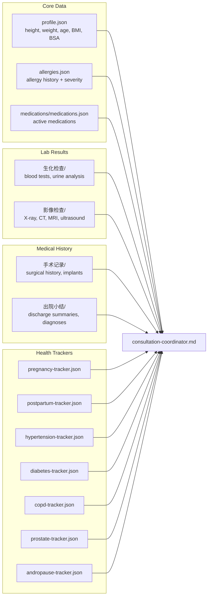
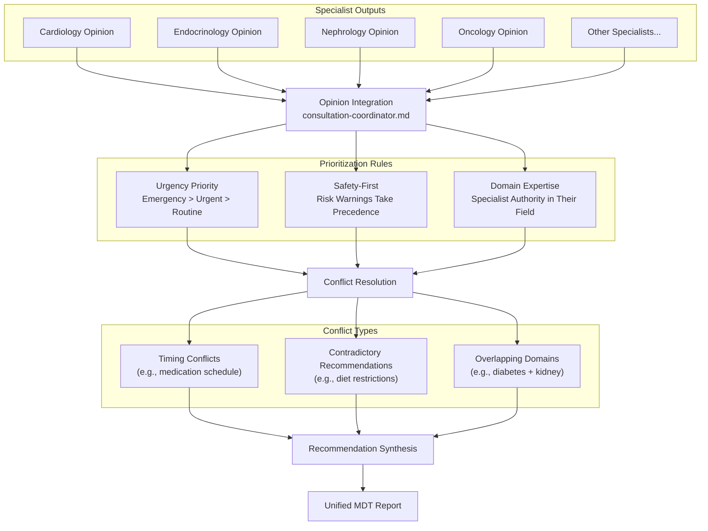
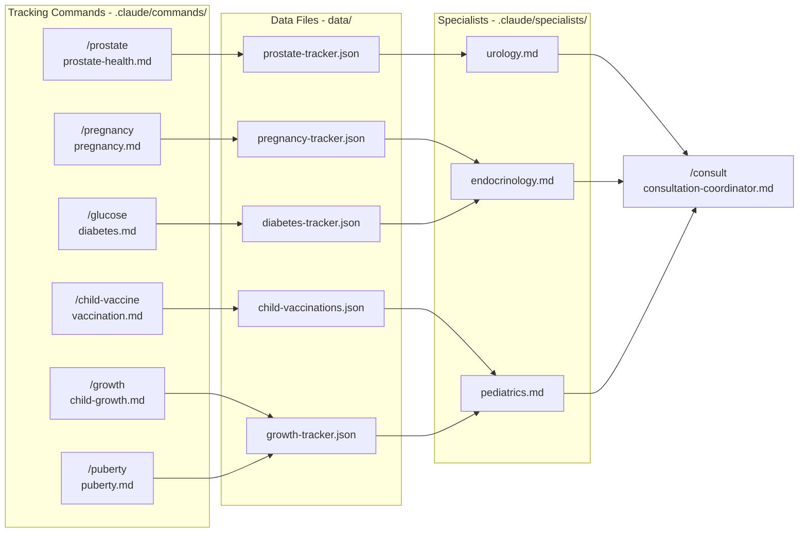

<!-- source: DeepWiki mcp.deepwiki.com · repo huifer/Claude-Ally-Health · page 7 AI Consultation System · fetched 2026-10-26 -->

# AI Consultation System

<details>
<summary>Relevant source files</summary>

The following files were used as context for generating this wiki page:

- [.claude/commands/prostate-health.md](.claude/commands/prostate-health.md)
- [.claude/commands/puberty.md](.claude/commands/puberty.md)
- [.claude/specialists/pediatrics.md](.claude/specialists/pediatrics.md)
- [.claude/specialists/urology.md](.claude/specialists/urology.md)
- [README.md](README.md)
- [README.zh-CN.md](README.zh-CN.md)
- [data-example/andropause-tracker.json](data-example/andropause-tracker.json)
- [data-example/child-vaccinations.json](data-example/child-vaccinations.json)
- [docs/data-structures.md](docs/data-structures.md)

</details>


The AI Consultation System provides multi-disciplinary team (MDT) consultations where specialized AI "doctors" analyze a patient's complete medical dataset in parallel and produce integrated recommendations. This system aggregates data from all health tracking modules (pregnancy, chronic diseases, medications, lab results, imaging) and distributes it to domain-specific specialists for comprehensive analysis.

For information about individual health tracking modules that feed data into consultations, see [Health Tracking Modules](#4). For data storage architecture, see [Data Storage & Privacy Model](#3.2). For individual specialist consultations without the full MDT process, see [Individual Specialist Consultations](#7.2).

---

## System Architecture

The AI Consultation System implements a subagent architecture with three primary layers: the command interface, the specialist analysis layer, and the data aggregation layer.

```mermaid
graph TB
    User["User"]
    ConsultCmd["/consult command<br/>.claude/commands/consult.md"]
    SpecialistCmd["/specialist command<br/>.claude/commands/specialist.md"]
    
    Coordinator["Consultation Coordinator<br/>.claude/specialists/consultation-coordinator.md"]
    
    subgraph "Specialist Skills - .claude/specialists/"
        Cardio["cardiology.md<br/>Cardiovascular Analysis"]
        Endo["endocrinology.md<br/>Endocrine Assessment"]
        Gastro["gastroenterology.md<br/>Digestive System"]
        Nephro["nephrology.md<br/>Kidney Function"]
        Hemato["hematology.md<br/>Blood Analysis"]
        Resp["respiratory.md<br/>Respiratory System"]
        Neuro["neurology.md<br/>Neurological"]
        Onco["oncology.md<br/>Cancer Screening"]
        General["general.md<br/>General Assessment"]
        Ped["pediatrics.md<br/>Child Health"]
        Uro["urology.md<br/>Urological"]
    end
    
    subgraph "Data Sources - data/"
        Profile["profile.json"]
        Allergies["allergies.json"]
        Meds["medications/medications.json"]
        Biochem["生化检查/YYYY-MM/*.json"]
        Imaging["影像检查/YYYY-MM/*.json"]
        Surgery["手术记录/YYYY-MM/*.json"]
        Discharge["出院小结/YYYY-MM/*.json"]
        Chronic["*-tracker.json files"]
    end
    
    User --> ConsultCmd
    User --> SpecialistCmd
    
    ConsultCmd --> Coordinator
    SpecialistCmd --> Cardio
    SpecialistCmd --> Endo
    SpecialistCmd --> Uro
    
    Coordinator --> Cardio
    Coordinator --> Endo
    Coordinator --> Gastro
    Coordinator --> Nephro
    Coordinator --> Hemato
    Coordinator --> Resp
    Coordinator --> Neuro
    Coordinator --> Onco
    Coordinator --> General
    Coordinator --> Ped
    Coordinator --> Uro
    
    Coordinator -.reads.-> Profile
    Coordinator -.reads.-> Allergies
    Coordinator -.reads.-> Meds
    Coordinator -.reads.-> Biochem
    Coordinator -.reads.-> Imaging
    Coordinator -.reads.-> Surgery
    Coordinator -.reads.-> Discharge
    Coordinator -.reads.-> Chronic
```



**Sources:** [README.md:31-66](), [README.zh-CN.md:30-65]()

---

## Command Interface

### `/consult` Command

The `/consult` command initiates a full MDT consultation where all specialists analyze the patient's data in parallel. The command has no required arguments and automatically aggregates all available health data.

**Invocation:**
```bash
/consult
```

The command is defined in `.claude/commands/consult.md` and triggers the consultation coordinator, which orchestrates the parallel specialist analysis process.

### `/specialist` Command

The `/specialist` command invokes a single specialist for domain-specific consultation without the full MDT process.

**Invocation:**
```bash
/specialist cardiology
/specialist endocrinology
/specialist pediatrics
```

This is defined in `.claude/commands/specialist.md` and directly invokes the specified specialist skill file.

**Sources:** [README.md:54-55](), [README.zh-CN.md:53-54]()

---

## Consultation Coordinator

The consultation coordinator is defined in `.claude/specialists/consultation-coordinator.md` and serves as the orchestration layer for MDT consultations. Its responsibilities include:

1. **Data Collection**: Aggregating patient data from all available sources
2. **Specialist Invocation**: Distributing data to all specialist skills simultaneously
3. **Opinion Integration**: Synthesizing findings from multiple specialists
4. **Conflict Resolution**: Resolving contradictory recommendations using prioritization rules
5. **Report Generation**: Producing a unified, comprehensive consultation report

### Coordinator Data Aggregation Flow



**Sources:** [README.md:66](), [README.zh-CN.md:65]()

---

## Specialist Skills

Each specialist is defined as a separate skill file in `.claude/specialists/` with domain-specific expertise. All specialists follow a common analysis framework while maintaining specialized focus areas.

### Available Specialists

| Specialist | File | Domain Focus |
|------------|------|--------------|
| **Cardiology** | `cardiology.md` | Cardiovascular system, lipid panels, blood pressure, ASCVD risk |
| **Endocrinology** | `endocrinology.md` | Hormones, thyroid, diabetes, growth, reproductive health |
| **Gastroenterology** | `gastroenterology.md` | Digestive system, liver function, GI symptoms |
| **Nephrology** | `nephrology.md` | Kidney function, electrolytes, eGFR, urinalysis |
| **Hematology** | `hematology.md` | Blood cells, anemia, coagulation, CBC analysis |
| **Respiratory** | `respiratory.md` | Lung function, respiratory symptoms, oxygen saturation |
| **Neurology** | `neurology.md` | Neurological function, cognitive assessment, nerve conduction |
| **Oncology** | `oncology.md` | Cancer screening, tumor markers, imaging abnormalities |
| **General Practice** | `general.md` | Comprehensive assessment, health maintenance, preventive care |
| **Pediatrics** | `pediatrics.md` | Child growth, development, vaccinations, age-specific references |
| **Urology** | `urology.md` | Prostate health, male fertility, urological function |

### Specialist Analysis Framework

Each specialist skill follows a consistent structure defined in their respective markdown files:

```markdown
## 角色定义 (Role Definition)
## 专业领域 (Professional Domain)
## 分析重点 (Analysis Focus)
### 生化指标关注 (Biochemical Indicators)
### 影像检查关注 (Imaging Focus)
## 分析原则 (Analysis Principles)
### ⚠️ 安全红线 (Safety Red Lines)
### 分析框架 (Analysis Framework)
## 输出格式 (Output Format)
```

**Example from Pediatrics Specialist:**

The pediatrics specialist ([.claude/specialists/pediatrics.md:1-660]()) focuses on:
- Age-specific reference values for blood tests
- WHO growth standards (HAZ, WAZ, BAZ, WHZ Z-scores)
- Nutritional indicators (iron, zinc, vitamins)
- Developmental milestones
- Vaccination schedules
- Tanner staging for puberty assessment

**Example from Urology Specialist:**

The urology specialist ([.claude/specialists/urology.md:1-186]()) analyzes:
- PSA levels and PSA velocity ([urology.md:17-20]())
- IPSS scoring for prostate symptoms ([urology.md:18]())
- Semen analysis parameters ([urology.md:23-24]())
- Testosterone levels for andropause ([urology.md:28-30]())

**Sources:** [README.md:57-65](), [README.zh-CN.md:56-65](), [.claude/specialists/pediatrics.md:1-660](), [.claude/specialists/urology.md:1-186]()

---

## Data Aggregation Process

Before specialist analysis begins, the consultation coordinator aggregates data from multiple sources. The data structure for consultation includes:

### Profile Data

From `data/profile.json`:
- Basic demographics: height, weight, birth_date
- Calculated metrics: age, BMI, BSA (body surface area)

**Structure:** [docs/data-structures.md:99-131]()

### Allergy History

From `data/allergies.json`:
- Known allergies and their severity levels
- Used by all specialists to avoid contraindicated recommendations

### Medication Data

From `data/medications/medications.json`:
- Active medications with dosage and frequency
- Schedule arrays showing weekly medication patterns ([data-structures.md:342-412]())
- Medication adherence logs from `data/medication-logs/`

**Structure:** [docs/data-structures.md:280-509]()

### Biochemical Test Results

From `data/生化检查/YYYY-MM/*.json`:
- Laboratory test results with reference ranges
- Items array containing individual test parameters
- Abnormality flags for out-of-range values

**Structure:** [docs/data-structures.md:5-36]()

### Imaging Reports

From `data/影像检查/YYYY-MM/*.json`:
- Imaging study findings (CT, MRI, X-ray, ultrasound)
- Measurements and conclusions
- References to original images

**Structure:** [docs/data-structures.md:38-70]()

### Surgical History

From `data/手术记录/YYYY-MM/*.json`:
- Past surgical procedures
- Implant information
- Surgical complications

### Discharge Summaries

From `data/出院小结/YYYY-MM/*.json`:
- Hospital admission summaries
- Diagnoses and treatment courses
- Discharge medications

### Health Tracker Data

Disease-specific trackers that feed into specialist analysis:

| Tracker | File | Specialist Relevance |
|---------|------|---------------------|
| **Pregnancy** | `pregnancy-tracker.json` | Endocrinology, General |
| **Postpartum** | `postpartum-tracker.json` | General, Endocrinology |
| **Hypertension** | `hypertension-tracker.json` | Cardiology, Nephrology |
| **Diabetes** | `diabetes-tracker.json` | Endocrinology, Nephrology |
| **COPD** | `copd-tracker.json` | Respiratory |
| **Prostate** | `prostate-tracker.json` | Urology, Oncology |
| **Andropause** | `andropause-tracker.json` | Urology, Endocrinology |

**Example - Andropause Tracker Structure:**

The andropause tracker ([data-example/andropause-tracker.json:1-189]()) contains:
- Symptom categories: sexual, physical, psychological
- Testosterone levels: total, free, SHBG
- ADAM and AMS questionnaire scores
- TRT (testosterone replacement therapy) monitoring data
- Safety monitoring: PSA, hematocrit, prostate volume

**Example - Child Vaccination Tracker:**

The vaccination tracker ([data-example/child-vaccinations.json:1-131]()) provides:
- Scheduled vaccines with completion status
- Class 1 (mandatory) and Class 2 (optional) vaccines
- Adverse reaction history
- Upcoming and overdue vaccinations

**Sources:** [docs/data-structures.md:1-509](), [data-example/andropause-tracker.json:1-189](), [data-example/child-vaccinations.json:1-131]()

---

## Specialist Analysis Execution

When the consultation coordinator invokes specialists, each specialist skill file processes the aggregated data according to its domain focus. The analysis follows a standardized framework:

### Analysis Steps (Common Framework)

1. **数据解读 (Data Interpretation)**: Parse and interpret relevant indicators
2. **异常识别 (Anomaly Identification)**: Flag values outside reference ranges
3. **风险评估 (Risk Assessment)**: Evaluate disease risk factors
4. **趋势分析 (Trend Analysis)**: Compare with historical data if available
5. **生活方式建议 (Lifestyle Recommendations)**: Provide dietary, exercise, sleep guidance
6. **就医建议 (Medical Consultation Advice)**: Determine if professional medical attention is needed

**Example - Pediatrics Analysis Framework:**

From [.claude/specialists/pediatrics.md:60-67]():
```markdown
### 分析框架
1. **数据解读**：解读各项指标，考虑年龄因素
2. **生长评估**：评估身高、体重、头围生长发育
3. **营养评估**：评估营养状态和微量元素
4. **发育评估**：评估运动、语言、社交发育
5. **疾病识别**：识别常见儿科疾病
6. **预防保健**：疫苗接种、健康指导
7. **就医建议**：儿科/专科复查建议
```

**Example - Urology Analysis Framework:**

From [.claude/specialists/urology.md:40-46]():
```markdown
### 分析框架
1. **数据解读**: 解读各项指标的临床意义
2. **异常识别**: 标注超出参考范围的指标
3. **风险评估**: 评估疾病风险因素
4. **趋势分析**: 对比历史数据,观察变化趋势
5. **生活方式建议**: 提供饮食、运动、作息建议
6. **就医建议**: 是否需要及时就医或专科复查
```

### Domain-Specific Analysis Examples

**Pediatrics - Growth Assessment:**

The pediatrics specialist uses WHO growth standards to calculate Z-scores:
- HAZ (Height-for-Age Z-score): [.claude/specialists/pediatrics.md:304-307]()
- WAZ (Weight-for-Age Z-score): [.claude/specialists/pediatrics.md:309-315]()
- BAZ (BMI-for-Age Z-score): [.claude/specialists/pediatrics.md:317-321]()
- WHZ (Weight-for-Height Z-score): [.claude/specialists/pediatrics.md:323-328]()

**Pediatrics - Puberty Assessment:**

The pediatrics specialist evaluates Tanner staging:
- Female breast development (B1-B5): [.claude/specialists/pediatrics.md:371-382]()
- Male testicular volume (G1-G5): [.claude/specialists/pediatrics.md:401-411]()
- Pubic hair development (P1-P5): [.claude/specialists/pediatrics.md:383-391](), [.claude/specialists/pediatrics.md:420-425]()
- Bone age assessment: [.claude/specialists/pediatrics.md:433-437]()

**Urology - Prostate Health:**

The urology specialist analyzes PSA trends and prostate symptoms:
- PSA reference values: [.claude/specialists/urology.md:157-162]()
- IPSS scoring: [.claude/specialists/urology.md:164-168]()
- Semen analysis standards (WHO 2021): [.claude/specialists/urology.md:169-174]()
- Testosterone levels: [.claude/specialists/urology.md:176-181]()

**Urology - Prostate Command Integration:**

The urology specialist directly references data from the prostate health tracking command:
- PSA history: [.claude/commands/prostate-health.md:106-124]()
- IPSS score data: [.claude/commands/prostate-health.md:262-278]()
- DRE findings: [.claude/commands/prostate-health.md:413-425]()
- Prostate volume: [.claude/commands/prostate-health.md:559-572]()

**Sources:** [.claude/specialists/pediatrics.md:60-67](), [.claude/specialists/pediatrics.md:297-660](), [.claude/specialists/urology.md:40-186](), [.claude/commands/prostate-health.md:1-1163]()

---

## Safety Constraints

All specialist skills enforce strict safety constraints defined as "安全红线" (Safety Red Lines). These constraints are non-negotiable and prevent the AI from crossing ethical boundaries.

### The Four Safety Red Lines

From [.claude/specialists/pediatrics.md:51-57]():

```markdown
### ⚠️ 安全红线（严格遵守）
1. **不给出具体用药剂量**
2. **不直接开具处方药名**
3. **不判断生死预后**
4. **不替代医生诊断**
```

Translation:
1. **Do not provide specific medication dosages**
2. **Do not directly prescribe prescription drug names**
3. **Do not predict life prognosis**
4. **Do not replace doctor diagnosis**

### Enforcement Across All Specialists

These four red lines are consistently enforced across all specialist skills:
- Pediatrics: [.claude/specialists/pediatrics.md:51-57]()
- Urology: [.claude/specialists/urology.md:35-38]()
- (Similarly defined in all other specialist files)

### Permitted vs. Prohibited Expressions

**Example from Pediatrics Specialist:**

From [.claude/specialists/pediatrics.md:142-155]():

**✅ Permitted:**
- "6个月婴儿血红蛋白95g/L，轻度贫血，建议补充铁剂，继续母乳喂养，及时添加富含铁的辅食，1个月后复查血常规"
- "身高处于第3百分位，生长速度减慢，建议查生长激素、甲状腺功能，骨龄片，儿科内分泌就诊"
- "维生素D缺乏，建议每日补充400IU维生素D，适当户外活动，3个月后复查"

**❌ Prohibited:**
- "服用阿莫西林干混悬剂" (prescribing amoxicillin)
- "布洛芬混悬液 5ml" (specific dosage)
- "肯定性早熟，打针治疗" (definitive diagnosis and treatment)
- "长不高了" (predicting prognosis)

**Example from Urology Specialist:**

From [.claude/specialists/urology.md:138-154]():

**✅ Permitted:**
- "PSA值轻度升高,建议3个月后复查PSA和游离PSA"
- "IPSS评分中度,建议泌尿科评估是否需要药物治疗"
- "精子密度偏低,建议改善生活方式,避免高温环境"

**❌ Prohibited:**
- "服用非那雄胺 5mg每日" (specific dosage)
- "开具坦索罗辛处方" (prescription)
- "PSA 10,肯定是前列腺癌" (cancer diagnosis)
- "确诊为前列腺增生,必须手术" (replacing doctor diagnosis)

### Safety Validation Layer

The consultation coordinator includes a safety validation gate that reviews all specialist outputs to ensure compliance with the four red lines before generating the final report.

**Sources:** [.claude/specialists/pediatrics.md:51-57](), [.claude/specialists/pediatrics.md:142-155](), [.claude/specialists/urology.md:35-38](), [.claude/specialists/urology.md:138-154](), [README.md:150-158](), [README.zh-CN.md:148-158]()

---

## Opinion Integration Algorithm

When multiple specialists provide recommendations, the consultation coordinator integrates their findings using prioritization rules and conflict resolution logic.

### Integration Principles



### Prioritization Rules

1. **Urgency Priority**: Emergency findings override routine recommendations
   - Emergency (Level 4): Immediate action required
   - Urgent (Level 3): Action needed within 24-48 hours
   - Routine (Level 2): Non-urgent follow-up
   - Observation (Level 1): Monitor at home

2. **Safety-First**: Risk warnings and red flags take precedence over optimization recommendations

3. **Specialist Authority**: Within their domain, specialists have highest authority
   - Example: Cardiology opinion on blood pressure management overrides general practitioner's cardiovascular suggestions

### Conflict Resolution Examples

**Example 1: Timing Conflicts**

If Endocrinology recommends fasting glucose test and Cardiology recommends lipid panel (both requiring fasting), the coordinator consolidates:
```markdown
建议：空腹状态下同时检测血糖和血脂，提高效率
(Recommendation: Test both glucose and lipids in fasting state to improve efficiency)
```

**Example 2: Contradictory Diet Recommendations**

If Nephrology recommends low-protein diet (kidney protection) but Hematology recommends high-protein (anemia correction), the coordinator prioritizes based on severity:
```markdown
综合建议：中等蛋白质摄入，优先保护肾功能，同时补充铁剂改善贫血
(Integrated recommendation: Moderate protein intake, prioritize kidney protection while supplementing iron for anemia)
```

**Example 3: Overlapping Domain Expertise**

Diabetes care involves both Endocrinology (glucose control) and Nephrology (kidney complications). The coordinator distributes:
- Endocrinology: HbA1c targets, glucose monitoring frequency
- Nephrology: Albuminuria monitoring, eGFR trends, medication adjustments for kidney function

**Sources:** High-level system diagrams provided in prompt (Diagram 3)

---

## Report Generation

The final MDT report synthesizes all specialist opinions into a structured, comprehensive document.

### Report Structure

```markdown
## 多学科会诊报告 (Multi-Disciplinary Consultation Report)

### 患者信息 (Patient Information)
- 基本信息 (Basic demographics from profile.json)
- 主要疾病 (Primary conditions from trackers)
- 用药情况 (Current medications)

### 数据汇总 (Data Summary)
- 生化指标 (Biochemical tests)
- 影像检查 (Imaging studies)
- 健康追踪 (Health tracker data)

### 专科分析 (Specialist Analysis)

#### 心内科 (Cardiology)
[Cardiovascular analysis...]

#### 内分泌科 (Endocrinology)
[Endocrine assessment...]

#### 肾内科 (Nephrology)
[Kidney function analysis...]

#### 血液科 (Hematology)
[Blood analysis...]

#### 呼吸科 (Respiratory)
[Respiratory assessment...]

#### 神经科 (Neurology)
[Neurological evaluation...]

#### 肿瘤科 (Oncology)
[Cancer screening...]

#### 全科 (General Practice)
[Comprehensive assessment...]

### 综合建议 (Integrated Recommendations)
- 立即行动项 (Immediate actions)
- 短期计划 (Short-term plan)
- 长期管理 (Long-term management)
- 生活方式调整 (Lifestyle modifications)

### 复查计划 (Follow-up Plan)
- 检查项目和时间 (Tests and timing)
- 监测指标 (Monitoring parameters)

### ⚠️ 重要提示 (Important Disclaimer)
[Safety statement emphasizing this is not medical diagnosis]
```

### Example Report Section - Pediatrics

From [.claude/specialists/pediatrics.md:70-140]():

```markdown
## 儿科分析报告

### 数据概览
- 年龄：[年龄]
- 主要异常：[列出异常指标]

### 详细分析

#### 1. 生长发育评估
- 身高：[数值+百分位/标准差] - [评估]
- 体重：[数值+百分位/标准差] - [评估]
- BMI：[数值] - [评估]
- 生长发育速度：[评估]
- 骨龄：[如有，与实际年龄比较]

#### 2. 营养评估
- 血红蛋白：[数值] - [贫血评估]
- 铁/铁蛋白：[数值] - [铁储备评估]
- 锌：[数值] - [评估]
- 维生素D：[数值] - [充足/不足/缺乏]
- 钙、磷：[数值] - [评估]

[... continues with other assessment categories ...]
```

### Example Report Section - Urology

From [.claude/specialists/urology.md:48-131]():

```markdown
## 泌尿科分析报告

### 数据概览
- 主要异常指标: [列出异常指标]
- 数据完整性: [完整/部分缺失]

### 详细分析

#### 1. 前列腺健康评估
**PSA检测**:
- 总PSA: [数值] ng/mL - [正常/异常] - [临床意义]
- 游离PSA: [数值] ng/mL - [游离/总比值: X%]
- PSA趋势: [稳定/上升/下降]
- PSA速率: [X ng/mL/年] - [正常/异常]

**IPSS评分**:
- 总分: [X/35分] - [轻度/中度/重度]
- 主要症状: [列出症状]

[... continues with other assessments ...]
```

**Sources:** [.claude/specialists/pediatrics.md:70-140](), [.claude/specialists/urology.md:48-131]()

---

## Integration with Health Tracking Modules

The consultation system deeply integrates with individual health tracking commands, creating a bidirectional flow where tracking commands feed data into consultations, and consultation recommendations may suggest using specific tracking commands.

### Tracking Command to Consultation Flow



### Consultation to Tracking Recommendations

MDT consultations may recommend using specific tracking commands:

**Example from Pediatrics:**

When pediatrics specialist identifies growth concerns, the report may suggest:
```markdown
建议行动:
- 使用 /growth record 持续记录身高体重
- 使用 /growth percentile 查看生长曲线
- 使用 /growth puberty check 评估青春期发育
```

**Example from Urology:**

When urology specialist analyzes prostate health, the report integrates with prostate tracking:
```markdown
筛查计划:
- 使用 /prostate psa 记录PSA检测结果
- 使用 /prostate ipss 评估排尿症状
- 使用 /prostate screening 查看筛查计划
- 使用 /prostate risk 评估前列腺癌风险
```

### Multi-Disciplinary Coordination Examples

**Example - Pediatrics + Endocrinology Coordination:**

From [.claude/specialists/pediatrics.md:611-629]():

```markdown
### 与儿科内分泌科协作
- **指征**：生长迟缓、性早熟、青春期延迟、骨龄异常
- **内容**：提供生长曲线、青春期发育分期、骨龄数据

### 使用 `/consult` 命令进行多学科会诊
```bash
/consult 儿科+内分泌科 生长速度过慢、身高<P3
/consult 儿科+儿童保健科 8岁女孩乳房发育、疑似性早熟
/consult 儿科+预防接种 严重湿疹患儿疫苗接种建议
```
```

**Sources:** [.claude/specialists/pediatrics.md:581-629](), [.claude/commands/prostate-health.md:1-1163](), [.claude/commands/puberty.md:1-214]()

---

## Performance and Scalability

The consultation system's architecture supports efficient parallel processing while maintaining data coherence.

### Parallel Specialist Execution

All specialists analyze data simultaneously rather than sequentially, reducing total consultation time. This is possible because:
1. All specialists read from the same aggregated dataset (read-only access)
2. No data mutations occur during analysis
3. Each specialist operates independently within their domain

### Data Caching Strategy

The consultation coordinator aggregates all necessary data once at the beginning of the consultation process, preventing redundant file reads across specialists.

### File-Based Architecture Advantages

The system uses a pure file-based storage model with no database:
- All data in `data/` directory as JSON files
- Monthly subdirectories for temporal data (`YYYY-MM/`)
- No network latency or database connection overhead
- Complete data sovereignty (local-only storage)

**Data Privacy Statement:**

From [README.md:111-117]():
```markdown
## Data Privacy

- All data stored on local filesystem
- No uploads to any cloud services
- No external database dependencies
- Completely private management
```

**Sources:** [README.md:25](), [README.md:111-117](), [README.zh-CN.md:24](), [README.zh-CN.md:110-116]()

---

## Example Consultation Workflow

### Step-by-Step Process

1. **User Invocation:**
   ```bash
   /consult
   ```

2. **Coordinator Initialization:**
   - Reads `consultation-coordinator.md` skill definition
   - Identifies all available specialist skill files in `.claude/specialists/`

3. **Data Aggregation:**
   - Loads `data/profile.json`
   - Loads `data/allergies.json`
   - Loads `data/medications/medications.json`
   - Scans `data/生化检查/` for recent biochemical tests
   - Scans `data/影像检查/` for recent imaging studies
   - Loads all `*-tracker.json` files (pregnancy, diabetes, hypertension, etc.)
   - Reads `data/手术记录/` for surgical history
   - Reads `data/出院小结/` for discharge summaries

4. **Parallel Specialist Invocation:**
   - Distributes aggregated data to all 11 specialist skills
   - Each specialist analyzes independently
   - Specialists generate domain-specific findings and recommendations

5. **Opinion Integration:**
   - Coordinator collects all specialist outputs
   - Applies prioritization rules (urgency, safety, domain authority)
   - Resolves conflicts between contradictory recommendations
   - Synthesizes integrated recommendations

6. **Safety Validation:**
   - Reviews all outputs for compliance with four safety red lines
   - Ensures no specific dosages, prescriptions, diagnoses, or prognoses
   - Adds disclaimer emphasizing reference-only nature

7. **Report Generation:**
   - Formats comprehensive MDT report with all specialist sections
   - Adds patient summary and integrated recommendations
   - Includes follow-up plan and monitoring schedule
   - Outputs to user

8. **Data Persistence:**
   - Optionally saves consultation report to `data/consultations/YYYY-MM/`
   - Updates `data/index.json` with consultation record

**Sources:** High-level system diagrams provided in prompt (Diagram 2, Diagram 3)

---

## Extensibility

The consultation system is designed for easy extension with new specialists or enhanced analysis capabilities.

### Adding a New Specialist

To add a new specialist (e.g., Dermatology):

1. Create `.claude/specialists/dermatology.md` following the standard skill template:
   ```markdown
   # 皮肤科专家 Skill
   
   ## 角色定义
   您是一位经验丰富的**皮肤科专家**...
   
   ## 专业领域
   - 皮肤疾病诊断
   - 皮肤癌筛查
   - 过敏性皮肤病
   
   ## 分析重点
   ### 生化指标关注
   - IgE水平
   - 嗜酸性粒细胞
   
   ### 影像检查关注
   - 皮肤镜检查
   - 皮肤活检结果
   
   ## 分析原则
   ### ⚠️ 安全红线（严格遵守）
   1. **不给出具体用药剂量**
   2. **不直接开具处方药名**
   3. **不判断生死预后**
   4. **不替代医生诊断**
   
   [... continue with analysis framework and output format ...]
   ```

2. The consultation coordinator will automatically include the new specialist in subsequent `/consult` invocations

### Adding New Data Sources

To integrate a new health tracker:

1. Create the tracker command in `.claude/commands/`
2. Define data structure in `docs/data-structures.md`
3. Create tracker JSON file in `data/` (e.g., `asthma-tracker.json`)
4. Relevant specialists will automatically access the data through coordinator aggregation

**Sources:** [.claude/specialists/pediatrics.md:1-10](), [.claude/specialists/urology.md:1-13]()

---

## Limitations and Future Enhancements

### Current Limitations

1. **Sequential Data Loading**: Coordinator loads data files sequentially rather than in parallel
2. **No Opinion Ranking**: Equal weight given to all specialists; no confidence scoring
3. **Limited Cross-Reference**: Specialists don't directly reference each other's findings
4. **English Support**: Most specialist skills are defined in Chinese; English translations needed
5. **No Automated Testing**: Consultation quality relies on manual validation

### Potential Future Enhancements

1. **Opinion Confidence Scores**: Specialists could indicate confidence levels (high/medium/low) for their recommendations
2. **Historical Consultation Comparison**: Compare current consultation with previous MDT reports to track health trajectory
3. **Specialist Collaboration**: Allow specialists to review and comment on each other's findings before final integration
4. **Automated Quality Checks**: Validate specialist outputs against medical knowledge bases
5. **Multi-Language Support**: Full English and additional language support for specialist skills
6. **Performance Metrics**: Track consultation execution time and specialist analysis quality
7. **User Feedback Loop**: Allow users to rate consultation quality and specialist relevance

**Sources:** [README.md:1-192](), [README.zh-CN.md:1-191]()

---

