<!-- source: DeepWiki mcp.deepwiki.com · repo huifer/Claude-Ally-Health · page 7.1 Multi-Disciplinary Team (MDT) Consultation · fetched 2026-10-26 -->

# Multi-Disciplinary Team (MDT) Consultation

<details>
<summary>Relevant source files</summary>

The following files were used as context for generating this wiki page:

- [.claude/commands/prostate-health.md](.claude/commands/prostate-health.md)
- [.claude/commands/puberty.md](.claude/commands/puberty.md)
- [.claude/specialists/pediatrics.md](.claude/specialists/pediatrics.md)
- [.claude/specialists/urology.md](.claude/specialists/urology.md)
- [README.md](README.md)
- [README.zh-CN.md](README.zh-CN.md)
- [data-example/andropause-tracker.json](data-example/andropause-tracker.json)
- [data-example/child-vaccinations.json](data-example/child-vaccinations.json)
- [docs/data-structures.md](docs/data-structures.md)

</details>


## Purpose and Scope

The Multi-Disciplinary Team (MDT) Consultation system enables comprehensive health assessment by coordinating multiple AI medical specialists to analyze patient data in parallel. This page documents the `/consult` command implementation, the consultation coordination workflow, specialist integration architecture, and opinion synthesis algorithms.

For information about individual specialist consultations, see [Individual Specialist Consultations](#7.2). For details about available specialist skills and their analysis domains, see [Available Specialist Skills](#7.3).

Sources: [README.md:31-32](), [README.zh-CN.md:30-31]()

---

## System Architecture

The MDT consultation system implements a **subagent architecture** where independent AI specialists execute domain-specific analyses concurrently, coordinated by a central orchestrator that aggregates findings and resolves conflicts.

### High-Level Architecture

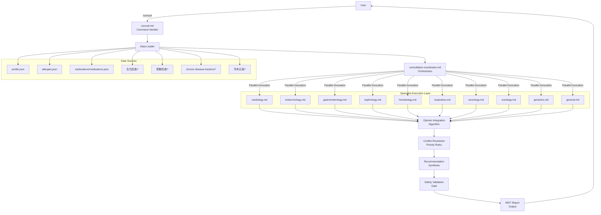

**Key Components:**

| Component | File Path | Role |
|-----------|-----------|------|
| Command Handler | `.claude/commands/consult.md` | Entry point for `/consult` command |
| Data Loader | (embedded in coordinator) | Aggregates all patient data sources |
| Orchestrator | `.claude/specialists/consultation-coordinator.md` | Coordinates specialist invocations |
| Specialist Skills | `.claude/specialists/*.md` | Domain-specific analysis engines |
| Integration Layer | (embedded in coordinator) | Opinion synthesis and conflict resolution |
| Safety Gate | (embedded in coordinator) | Validates medical safety constraints |

Sources: [README.md:54-66](), [README.zh-CN.md:54-66]()

---

## Command Invocation

The `/consult` command triggers the MDT consultation workflow. The command accepts no required parameters but operates on all available patient data in the system.

### Command Definition Structure

```markdown
---
description: Multi-disciplinary team consultation
arguments: []
---
```

### Invocation Patterns

```bash
# Basic consultation
/consult

# Consultation with focus area (if implemented)
/consult focus:cardiovascular

# Consultation for specific concern
/consult "recent abnormal lipid panel"
```

### Execution Flow

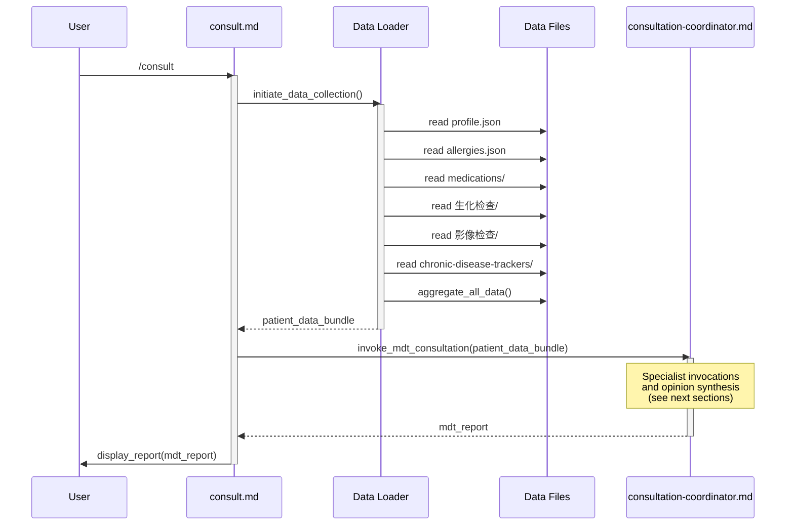

Sources: [README.md:109](), [README.md:131]()

---

## Data Collection Phase

The data loader aggregates patient information from all available local data sources before specialist analysis begins. This ensures each specialist has access to comprehensive patient context.

### Data Source Inventory

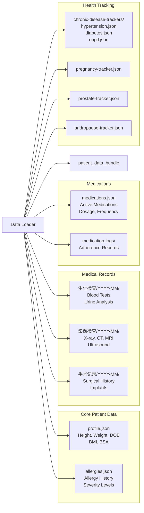

### Data Loading Priority

The data loader follows this prioritization:

1. **Critical Safety Data** (loaded first)
   - `data/allergies.json` - allergy history
   - `data/medications/medications.json` - active medications
   - `data/interactions/interaction-db.json` - drug interactions

2. **Core Identity Data**
   - `data/profile.json` - basic demographics, calculated metrics

3. **Medical Records** (by recency)
   - `data/生化检查/` - biochemical test results
   - `data/影像检查/` - imaging examinations
   - `data/手术记录/` - surgical history

4. **Health Trackers** (all active trackers)
   - `data/chronic-disease-trackers/*.json`
   - `data/pregnancy-tracker.json` (if exists)
   - `data/prostate-tracker.json` (if exists)
   - Other domain-specific trackers

Sources: [README.md:67-88]()

### Data Bundle Structure

The aggregated data is structured as a comprehensive patient context object:

```json
{
  "patient_profile": {
    "basic_info": { /* from profile.json */ },
    "calculated_metrics": { "age": 45, "bmi": 24.5, "bsa": 1.85 }
  },
  "allergies": [ /* from allergies.json */ ],
  "medications": {
    "active": [ /* from medications.json */ ],
    "recent_logs": [ /* from medication-logs/ */ ]
  },
  "biochemical_exams": [ /* recent from 生化检查/ */ ],
  "imaging_exams": [ /* recent from 影像检查/ */ ],
  "surgical_history": [ /* from 手术记录/ */ ],
  "chronic_conditions": {
    "hypertension": { /* if exists */ },
    "diabetes": { /* if exists */ },
    "copd": { /* if exists */ }
  },
  "specialized_trackers": {
    "pregnancy": { /* if applicable */ },
    "prostate": { /* if applicable */ },
    "andropause": { /* if applicable */ }
  }
}
```

Sources: [docs/data-structures.md:1-509]()

---

## Consultation Coordinator

The `consultation-coordinator.md` skill orchestrates the MDT consultation process, managing specialist invocations, collecting opinions, and synthesizing recommendations.

### Coordinator Responsibilities

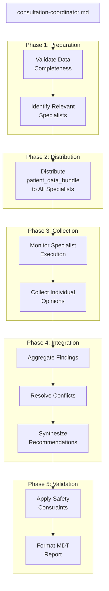

### Specialist Selection Logic

The coordinator identifies which specialists to invoke based on available data:

| Data Present | Specialists Invoked |
|--------------|---------------------|
| Biochemical tests with cardiac markers | `cardiology.md` |
| Glucose, HbA1c, insulin tests | `endocrinology.md` |
| Liver enzymes, GI imaging | `gastroenterology.md` |
| Kidney function tests | `nephrology.md` |
| CBC, coagulation tests | `hematology.md` |
| Pulmonary function, chest imaging | `respiratory.md` |
| Neurological imaging, cognitive tests | `neurology.md` |
| Tumor markers, imaging with masses | `oncology.md` |
| Age ≥ 65 or geriatric assessments | `geriatrics.md` |
| Age ≤ 18 or pediatric records | `pediatrics.md` |
| Male-specific conditions (PSA, etc.) | `urology.md` |
| **Always invoked** | `general.md` |

Sources: [README.md:57-66]()

### Parallel Execution Model

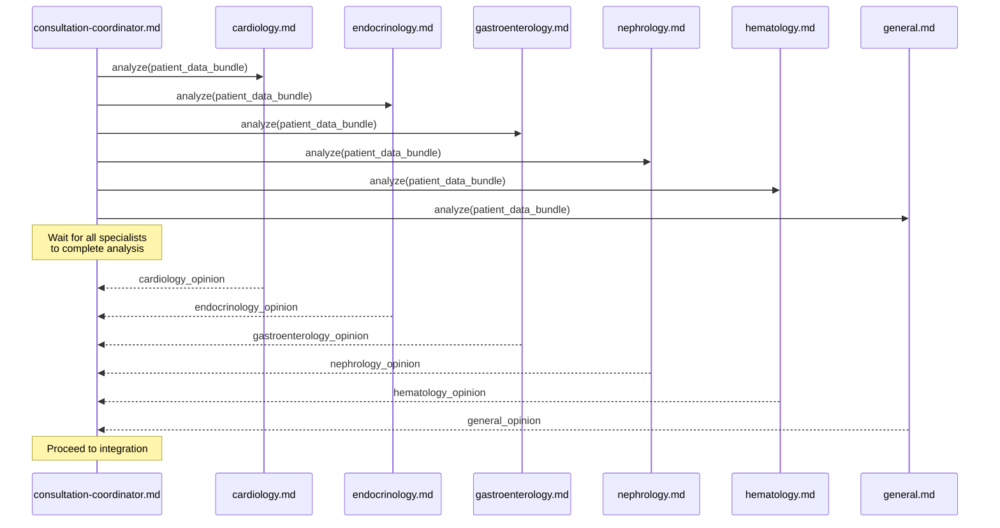

All specialists execute **concurrently** with access to the complete patient data bundle. The coordinator waits for all analyses to complete before proceeding to integration.

Sources: [README.md:140]()

---

## Specialist Analysis

Each specialist skill implements domain-specific analysis logic following a standardized framework. Specialists analyze data within their expertise and generate structured opinions.

### Specialist Skill Structure

All specialist skills in `.claude/specialists/*.md` follow this template:

```markdown
# [Specialty] 专家 Skill

## 角色定义
[Role description]

## 专业领域
[Domain areas]

## 分析重点
### 生化指标关注
[Biochemical markers of interest]

### 影像检查关注
[Imaging types of interest]

## 分析原则
### ⚠️ 安全红线（严格遵守）
1. **不给出具体用药剂量**
2. **不直接开具处方药名**
3. **不判断生死预后**
4. **不替代医生诊断**

### 分析框架
[Analysis methodology]

## 输出格式
[Structured output template]
```

Sources: [.claude/specialists/pediatrics.md:1-141](), [.claude/specialists/urology.md:1-186]()

### Example: Pediatrics Specialist

The `pediatrics.md` specialist demonstrates the analysis framework:

**Focus Areas:**
- Age-specific reference values for blood tests
- Growth assessment (WHO standards)
- Nutritional indicators (iron, vitamins, minerals)
- Vaccination status
- Developmental milestones

**Key Analysis Sections:**
1. **数据解读** - Interpret indicators with age-appropriate context
2. **生长评估** - Assess height, weight, BMI percentiles
3. **营养评估** - Evaluate nutritional status
4. **发育评估** - Assess motor, language, social development
5. **疾病识别** - Identify common pediatric conditions
6. **就医建议** - Provide referral recommendations

Sources: [.claude/specialists/pediatrics.md:49-67]()

### Example: Urology Specialist

The `urology.md` specialist focuses on male urogenital health:

**Focus Areas:**
- Prostate health (PSA, IPSS, DRE findings)
- Male fertility (semen analysis, hormones)
- Andropause symptoms (testosterone levels)
- Erectile function

**Analysis Framework:**
1. **数据解读** - Interpret urological indicators
2. **异常识别** - Flag out-of-range values
3. **风险评估** - Assess disease risk factors
4. **趋势分析** - Compare with historical data
5. **生活方式建议** - Lifestyle recommendations
6. **就医建议** - Referral timing and urgency

Sources: [.claude/specialists/urology.md:32-46]()

### Specialist Output Schema

Each specialist generates a structured opinion following this schema:

```json
{
  "specialist": "cardiology",
  "analysis_date": "2025-12-31T12:00:00Z",
  "data_reviewed": {
    "biochemical_tests": ["lipid_panel", "troponin"],
    "imaging": ["echocardiogram"],
    "medications": ["atorvastatin"]
  },
  "findings": [
    {
      "category": "lipid_metabolism",
      "observation": "LDL-C 4.2 mmol/L, above target",
      "severity": "moderate",
      "clinical_significance": "increased ASCVD risk"
    }
  ],
  "risk_assessment": {
    "ascvd_10yr_risk": "12%",
    "risk_category": "moderate"
  },
  "recommendations": [
    {
      "priority": "high",
      "category": "lifestyle",
      "recommendation": "Dietary modification: reduce saturated fat intake"
    },
    {
      "priority": "medium",
      "category": "monitoring",
      "recommendation": "Repeat lipid panel in 3 months"
    }
  ],
  "referral_needed": false,
  "urgency": "routine"
}
```

---

## Opinion Integration

The consultation coordinator implements opinion integration algorithms to synthesize findings from all specialists into a coherent assessment.

### Integration Architecture

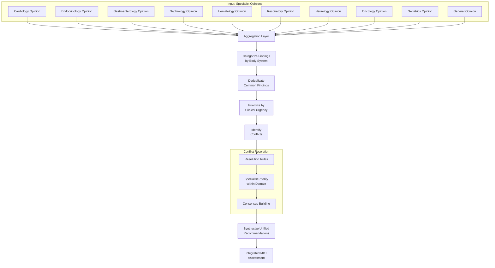

### Aggregation Logic

**Phase 1: Categorization**

Findings are categorized by body system and urgency:

```javascript
categories = {
  "cardiovascular": [],
  "endocrine": [],
  "gastrointestinal": [],
  "renal": [],
  "hematologic": [],
  "respiratory": [],
  "neurologic": [],
  "oncologic": [],
  "general": []
}

urgency_levels = {
  "emergency": [],    // Requires immediate attention
  "urgent": [],       // Requires attention within 24-48 hours
  "routine": [],      // Requires follow-up but not urgent
  "observation": []   // Monitor but no immediate action
}
```

**Phase 2: Deduplication**

Common findings mentioned by multiple specialists are deduplicated:

| Finding | Mentioned By | Action |
|---------|--------------|--------|
| "Elevated LDL-C" | Cardiology, General | Keep Cardiology (domain expert) |
| "HbA1c 7.2%" | Endocrinology, General, Cardiology | Keep Endocrinology (primary) |
| "Mild anemia" | Hematology, Gastroenterology | Keep both (different perspectives) |

**Phase 3: Prioritization**

Recommendations are sorted by clinical priority:

1. **Emergency/Safety Issues** - Immediate action required
2. **Acute Findings** - Action within days
3. **Chronic Management** - Ongoing monitoring
4. **Preventive Measures** - Long-term health optimization

Sources: [README.md:140]()

### Conflict Resolution

When specialists provide contradictory recommendations, the coordinator applies resolution rules:

#### Resolution Rule Set

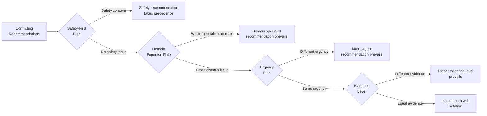

#### Conflict Resolution Examples

**Example 1: Safety-First Rule**

```
Conflict:
- Endocrinologist: "Start metformin for diabetes management"
- Nephrologist: "Avoid metformin due to eGFR < 30"

Resolution:
→ Nephrologist's recommendation prevails (safety concern)
→ Note: "Metformin contraindicated due to reduced kidney function"
```

**Example 2: Domain Expertise Rule**

```
Conflict:
- Cardiologist: "Lipid target LDL-C < 1.8 mmol/L for high ASCVD risk"
- General: "Lipid target LDL-C < 2.6 mmol/L"

Resolution:
→ Cardiologist's recommendation prevails (domain expertise)
→ Note: "Per cardiology guidelines for secondary prevention"
```

**Example 3: Include Both Perspectives**

```
Conflict:
- Hematologist: "Anemia likely iron deficiency, suggest iron supplementation"
- Gastroenterologist: "Anemia may indicate GI blood loss, recommend colonoscopy"

Resolution:
→ Include both recommendations (complementary, not contradictory)
→ Combined recommendation: "Iron supplementation + GI evaluation for source"
```

Sources: [README.md:140]()

---

## Safety Validation

The safety validation gate enforces medical ethics and system boundaries before generating the final MDT report. This is the **last checkpoint** before output.

### Safety Constraint Enforcement

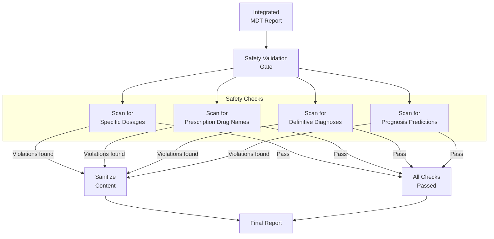

### The Four Safety Red Lines

The system enforces these **absolute prohibitions**:

| Red Line | Description | Prohibited Examples | Allowed Examples |
|----------|-------------|---------------------|------------------|
| **No Specific Dosages** | Cannot provide exact drug quantities | ❌ "Metformin 500mg twice daily" | ✅ "Consider metformin (dosage per physician)" |
| **No Prescription Drugs** | Cannot name prescription medications directly | ❌ "Start atorvastatin 20mg" | ✅ "Statin therapy may be indicated" |
| **No Diagnoses** | Cannot make definitive diagnostic conclusions | ❌ "You have Type 2 Diabetes" | ✅ "Elevated glucose suggests diabetes, confirm with physician" |
| **No Prognosis** | Cannot predict life expectancy or outcomes | ❌ "5-year survival rate is 60%" | ✅ "Early detection improves outcomes" |

Sources: [README.md:149-156](), [.claude/specialists/pediatrics.md:50-56](), [.claude/specialists/urology.md:34-39]()

### Content Sanitization Rules

When violations are detected, the sanitizer applies these transformations:

```javascript
// Dosage sanitization
"Metformin 500mg twice daily"
→ "Metformin (dosage to be determined by physician)"

// Prescription drug name sanitization
"Start lisinopril 10mg"
→ "ACE inhibitor therapy may be considered"

// Diagnosis sanitization
"You have hypertension"
→ "Blood pressure readings suggest hypertension, please consult physician for diagnosis"

// Prognosis sanitization
"Life expectancy is reduced"
→ "Condition requires ongoing management, consult physician for individual assessment"
```

### Safety Disclaimer Injection

Every MDT report includes this mandatory disclaimer:

```markdown
⚠️ **Important Medical Disclaimer**

This Multi-Disciplinary Team (MDT) consultation report is generated by AI 
specialists for **informational purposes only** and does NOT constitute 
medical advice, diagnosis, or treatment.

This report:
- Does NOT replace professional medical consultation
- Does NOT provide specific medication dosages
- Does NOT make definitive diagnoses
- Does NOT predict medical outcomes

All health decisions must be made in consultation with qualified healthcare
professionals. If you have medical concerns, please seek immediate medical
attention.
```

Sources: [README.md:149-159](), [docs/safety-guidelines.md]() (referenced but not in provided files)

---

## Output Generation

The MDT consultation produces a comprehensive, structured report synthesizing all specialist opinions with prioritized recommendations.

### Report Structure

```mermaid
graph TB
    Report["MDT Consultation<br/>Report"]
    
    subgraph "Section 1: Executive Summary"
        Overview["Key Findings<br/>Overview"]
        Urgent["Urgent Issues<br/>(if any)"]
    end
    
    subgraph "Section 2: Specialist Analyses"
        Cardio["Cardiology<br/>Analysis"]
        Endo["Endocrinology<br/>Analysis"]
        GI["Gastroenterology<br/>Analysis"]
        Nephro["Nephrology<br/>Analysis"]
        Heme["Hematology<br/>Analysis"]
        Resp["Respiratory<br/>Analysis"]
        Neuro["Neurology<br/>Analysis"]
        Onco["Oncology<br/>Analysis"]
        Geri["Geriatrics<br/>Analysis"]
        Gen["General<br/>Assessment"]
    end
    
    subgraph "Section 3: Integrated Assessment"
        Findings["Consolidated<br/>Findings"]
        Risks["Risk<br/>Assessment"]
    end
    
    subgraph "Section 4: Recommendations"
        Immediate["Immediate<br/>Actions"]
        ShortTerm["Short-term<br/>Follow-up"]
        LongTerm["Long-term<br/>Management"]
        Lifestyle["Lifestyle<br/>Modifications"]
    end
    
    subgraph "Section 5: Referrals"
        Referrals["Specialist<br/>Referrals"]
        Tests["Recommended<br/>Tests"]
    end
    
    Report --> Overview
    Report --> Cardio
    Report --> Findings
    Report --> Immediate
    Report --> Referrals
```

### Sample Report Output

```markdown
# 多学科专家会诊报告 (MDT Consultation Report)

**会诊日期**: 2025-12-31
**患者档案**: 男性, 55岁, BMI 24.5

---

## 执行摘要 (Executive Summary)

### 主要发现
- 血脂轻度升高 (LDL-C 4.2 mmol/L)
- 前列腺PSA正常且稳定 (2.5 ng/mL)
- 血糖控制良好 (HbA1c 6.2%)
- 肝肾功能正常

### 紧急关注事项
✅ 无紧急医疗问题

---

## 专科分析 (Specialist Analyses)

### 1. 心血管专科 (Cardiology)

**数据分析**:
- 总胆固醇: 5.8 mmol/L (参考值: <5.2)
- LDL-C: 4.2 mmol/L (参考值: <3.4) ⚠️
- HDL-C: 1.2 mmol/L (正常)
- 甘油三酯: 1.8 mmol/L (正常)

**ASCVD 10年风险**: 12% (中等风险)

**建议**:
- 饮食控制: 减少饱和脂肪摄入
- 有氧运动: 每周150分钟
- 3个月后复查血脂
- 如3个月后LDL-C仍>4.0, 考虑他汀类药物治疗(需医生处方)

---

### 2. 内分泌专科 (Endocrinology)

**数据分析**:
- HbA1c: 6.2% (参考值: <5.7% 正常, 5.7-6.4% 糖尿病前期)
- 空腹血糖: 6.1 mmol/L (正常高值)
- 甲状腺功能: 正常

**评估**: 糖尿病前期

**建议**:
- 体重管理: 减重5-10%
- 低升糖指数饮食
- 每年监测HbA1c
- 预防进展为糖尿病

---

### 3. 泌尿专科 (Urology)

**前列腺健康**:
- PSA: 2.5 ng/mL (正常) ✓
- 前列腺体积: 32 mL (轻度增大)
- IPSS评分: 9分 (中度症状)

**建议**:
- 继续年度PSA监测
- 生活方式调整改善排尿症状
- 如症状加重, 泌尿科评估药物治疗

---

### 4. 血液专科 (Hematology)

**数据分析**:
- 血红蛋白: 148 g/L (正常)
- 白细胞: 6.5 × 10⁹/L (正常)
- 血小板: 220 × 10⁹/L (正常)

**评估**: 血液系统无异常

---

### 5. 综合评估 (General Assessment)

**整体健康状况**: 良好
**慢性病风险**: 中等 (心血管, 糖尿病前期)
**功能状态**: 正常

---

## 综合风险评估 (Integrated Risk Assessment)

### 心血管风险
- **10年ASCVD风险**: 12% (中等风险)
- **风险因素**: 年龄, 血脂升高, 糖尿病前期
- **保护因素**: 不吸烟, BMI正常, 规律运动

### 代谢综合征
- **风险**: 糖尿病前期需密切监测
- **干预机会**: 生活方式干预可有效预防进展

---

## 优先建议 (Prioritized Recommendations)

### 🚨 立即行动 (Immediate Actions)
✅ 无需立即就医

### 📅 短期随访 (Short-term Follow-up, 1-3个月)
1. 调整饮食结构 (低饱和脂肪, 低升糖指数)
2. 增加有氧运动强度
3. 3个月后复查血脂和HbA1c

### 📊 长期管理 (Long-term Management)
1. 年度PSA监测 (下次: 2026-06)
2. 年度血脂、血糖监测
3. 保持健康体重 (BMI 18.5-24)

### 🏃 生活方式改善 (Lifestyle Modifications)

**饮食**:
- ↓ 饱和脂肪 (<7%总热量)
- ↑ 膳食纤维 (25-30g/天)
- ↑ 水果蔬菜 (≥5份/天)
- 限制精制碳水化合物

**运动**:
- 有氧运动: 150分钟/周 (中等强度)
- 力量训练: 2次/周
- 减少久坐时间

**监测**:
- 家庭血压监测 (如需)
- 体重管理记录
- 血糖监测 (如需)

---

## 专科转诊建议 (Specialist Referrals)

### 需要专科就诊
- **心血管科**: 如3个月后血脂未达标, 评估他汀治疗
- **内分泌科**: 如糖尿病前期进展, 制定干预方案

### 推荐进一步检查
- 3个月后: 血脂全套, HbA1c
- 1年后: PSA, 前列腺超声(如IPSS加重)

---

## ⚠️ 重要医学免责声明

本多学科专家会诊报告由AI专家系统生成，**仅供参考**，不构成医疗建议、诊断或治疗。

本报告:
- **不能替代**专业医疗咨询
- **不提供**具体药物剂量
- **不做出**确诊诊断
- **不预测**医疗结局

所有医疗决策必须在合格医疗专业人员指导下做出。
如有医疗问题，请立即就医。

---

**报告生成时间**: 2025-12-31 12:00:00
**数据来源**: 本地健康档案
**下次建议会诊**: 3个月后或健康状况变化时
```

---

## Data Structures

### Consultation Request Schema

```json
{
  "consultation_id": "consult_20251231120000",
  "timestamp": "2025-12-31T12:00:00.000Z",
  "patient_data_bundle": {
    "profile": { /* ... */ },
    "allergies": [ /* ... */ ],
    "medications": { /* ... */ },
    "biochemical_exams": [ /* ... */ ],
    "imaging_exams": [ /* ... */ ],
    "chronic_conditions": { /* ... */ }
  },
  "requested_specialists": [
    "cardiology",
    "endocrinology",
    "gastroenterology",
    "nephrology",
    "hematology",
    "respiratory",
    "neurology",
    "oncology",
    "geriatrics",
    "general"
  ]
}
```

### Specialist Opinion Schema

```json
{
  "specialist": "cardiology",
  "specialist_file": ".claude/specialists/cardiology.md",
  "analysis_timestamp": "2025-12-31T12:05:00.000Z",
  "data_completeness": "complete",
  "data_reviewed": {
    "biochemical_tests": ["lipid_panel", "glucose", "HbA1c"],
    "imaging": ["echocardiogram"],
    "medications": ["atorvastatin"],
    "trackers": ["hypertension"]
  },
  "findings": [
    {
      "category": "lipid_metabolism",
      "parameter": "LDL-C",
      "value": 4.2,
      "unit": "mmol/L",
      "reference_range": "<3.4",
      "status": "elevated",
      "severity": "moderate",
      "clinical_significance": "Increased ASCVD risk"
    }
  ],
  "risk_assessments": [
    {
      "risk_type": "ascvd_10yr",
      "score": "12%",
      "category": "moderate",
      "factors": ["age", "elevated_ldl", "prediabetes"]
    }
  ],
  "recommendations": [
    {
      "priority": 1,
      "urgency": "routine",
      "category": "lifestyle",
      "action": "Dietary modification",
      "details": "Reduce saturated fat intake to <7% of total calories"
    },
    {
      "priority": 2,
      "urgency": "routine",
      "category": "monitoring",
      "action": "Repeat lipid panel",
      "timeframe": "3 months"
    }
  ],
  "referral": {
    "needed": false,
    "urgency": null,
    "specialty": null,
    "reason": null
  },
  "notes": "Patient has moderate cardiovascular risk. Lifestyle modifications recommended first-line."
}
```

### Integrated MDT Report Schema

```json
{
  "consultation_id": "consult_20251231120000",
  "report_timestamp": "2025-12-31T12:30:00.000Z",
  "executive_summary": {
    "urgent_issues": [],
    "key_findings": [
      "Elevated LDL-C (4.2 mmol/L)",
      "Prediabetes (HbA1c 6.2%)",
      "Mild prostate enlargement (32 mL)"
    ],
    "overall_status": "stable_with_risks"
  },
  "specialist_analyses": [
    {
      "specialist": "cardiology",
      "findings": [ /* ... */ ],
      "recommendations": [ /* ... */ ]
    },
    {
      "specialist": "endocrinology",
      "findings": [ /* ... */ ],
      "recommendations": [ /* ... */ ]
    }
    /* ... other specialists ... */
  ],
  "integrated_assessment": {
    "risk_profile": {
      "cardiovascular": "moderate",
      "metabolic": "moderate",
      "oncologic": "low",
      "overall": "moderate"
    },
    "prioritized_recommendations": [
      {
        "priority": "high",
        "category": "lifestyle",
        "action": "Diet and exercise modifications",
        "timeframe": "immediate"
      },
      {
        "priority": "medium",
        "category": "monitoring",
        "action": "Lipid and glucose follow-up",
        "timeframe": "3 months"
      }
    ]
  },
  "referrals": [
    {
      "specialty": "cardiology",
      "urgency": "routine",
      "reason": "Persistent dyslipidemia evaluation",
      "timeframe": "if no improvement in 3 months"
    }
  ],
  "next_consultation": "2026-03-31",
  "safety_validation": {
    "passed": true,
    "violations_found": 0,
    "sanitized": false
  }
}
```

Sources: [docs/data-structures.md:1-509]()

---

## Integration with Health Modules

The MDT consultation system integrates with all health tracking modules to provide comprehensive analysis.

### Data Flow from Health Modules

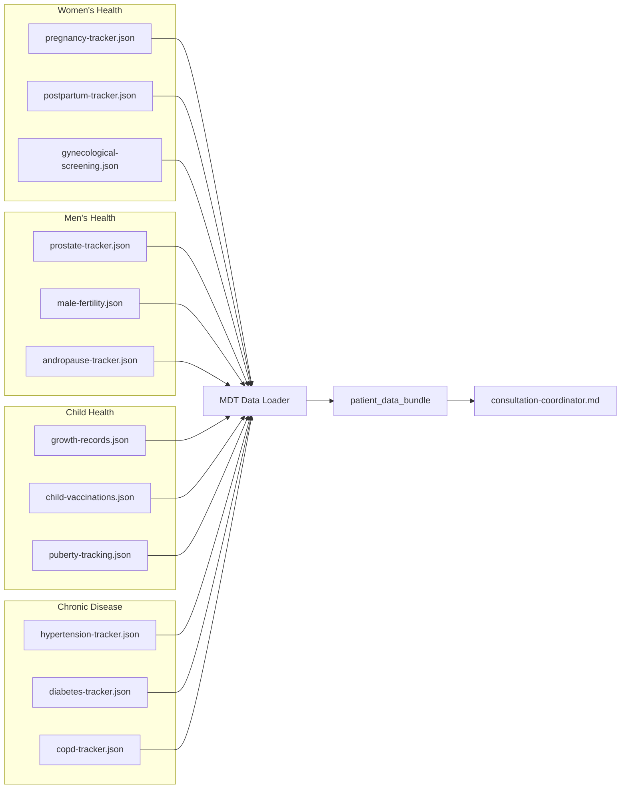

### Module-Specific Specialist Routing

| Active Tracker | Triggered Specialists |
|----------------|----------------------|
| `pregnancy-tracker.json` | General, Endocrinology (if GDM), Hematology |
| `postpartum-tracker.json` | General, (Psychiatry if EPDS elevated) |
| `prostate-tracker.json` | Urology, Oncology (if PSA elevated) |
| `andropause-tracker.json` | Urology, Endocrinology |
| `male-fertility.json` | Urology, Endocrinology |
| `hypertension-tracker.json` | Cardiology, Nephrology |
| `diabetes-tracker.json` | Endocrinology, Cardiology, Nephrology, (Ophthalmology) |
| `copd-tracker.json` | Respiratory, Cardiology |
| `growth-records.json` | Pediatrics, Endocrinology (if abnormal) |
| `child-vaccinations.json` | Pediatrics |

Sources: [data-example/andropause-tracker.json:1-189](), [data-example/child-vaccinations.json:1-131](), [.claude/commands/prostate-health.md:1-1163](), [.claude/commands/puberty.md:1-214]()

---

## Performance Considerations

### Parallel Execution Benefits

The parallel specialist execution model provides significant performance advantages:

- **Concurrent Analysis**: All specialists analyze data simultaneously rather than sequentially
- **No Blocking**: Slow specialists don't delay fast specialists
- **Scalability**: Adding new specialists doesn't increase total execution time proportionally

**Estimated Execution Times:**

| Phase | Sequential Model | Parallel Model |
|-------|-----------------|----------------|
| Data Loading | 2-3 seconds | 2-3 seconds |
| Specialist Analysis (10 specialists × 10s each) | 100 seconds | 10-15 seconds |
| Integration | 5 seconds | 5 seconds |
| Safety Validation | 2 seconds | 2 seconds |
| **Total** | **~109 seconds** | **~22 seconds** |

### Data Caching Strategy

For repeated consultations within a session, the system can cache:
- Patient profile data (changes infrequently)
- Historical test results (immutable once recorded)
- Specialist opinion templates (static)

However, **fresh data loading** is always performed to ensure current state accuracy.

---

## Error Handling

### Missing Data Scenarios

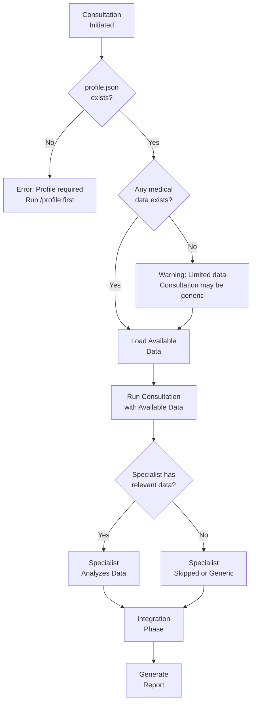

### Specialist Execution Failures

If a specialist fails during execution:

1. **Log Error**: Record specialist name, error type, timestamp
2. **Continue**: Don't block other specialists
3. **Partial Report**: Generate report with note: "Specialist X unavailable"
4. **Retry Option**: Offer user option to retry consultation

### Safety Validation Failures

If safety violations are detected that cannot be sanitized:

1. **Block Report**: Do not display to user
2. **Log Violation**: Record violation details for debugging
3. **Error Message**: "Report generation failed safety checks. Please contact support."
4. **Fallback**: Optionally show safe sections only

---

## Usage Examples

### Basic Consultation

```bash
# Trigger MDT consultation
/consult

# Expected output:
# ✅ Starting Multi-Disciplinary Team Consultation...
# 📊 Loading patient data...
# 👨‍⚕️ Invoking specialists: Cardiology, Endocrinology, ...
# 🔄 Integrating specialist opinions...
# ✅ MDT Report generated
# [Full report displayed]
```

### Consultation After New Test Results

```bash
# User saves new biochemical test
/save-report @lab-results/2025-12-31.jpg

# Then request consultation
/consult

# System automatically includes new test in analysis
```

### Consultation for Specific Concern

```bash
# User wants focused consultation
/consult "evaluate cardiovascular risk"

# Coordinator may prioritize cardiology analysis
# But still runs full MDT for comprehensive view
```

---

## Security and Privacy

### Local-Only Processing

**All consultation processing occurs locally:**
- No data transmitted to external servers
- No cloud API calls for specialist logic
- All opinions generated on-device

**Exception**: If using AI image analysis features (GLM MCP server), image data may be sent externally. This is documented in system security policies.

### Data Access Permissions

Specialists have **read-only access** to patient data:
- Cannot modify source data files
- Cannot delete records
- Cannot export data outside system

### Audit Trail

Each consultation generates an audit log:

```json
{
  "consultation_id": "consult_20251231120000",
  "timestamp": "2025-12-31T12:00:00.000Z",
  "data_accessed": [
    "data/profile.json",
    "data/生化检查/2025-12/2025-12-20_blood_test.json",
    "data/medications/medications.json"
  ],
  "specialists_invoked": ["cardiology", "endocrinology", ...],
  "safety_checks_passed": true,
  "report_generated": true
}
```

Sources: [README.md:111-117]()

---

## Future Enhancements

Potential improvements to the MDT consultation system:

1. **Specialist Weighting**: Dynamic confidence scoring based on data quality
2. **Interactive Clarification**: Specialists can request additional user input
3. **Trend Analysis**: Compare current consultation with previous ones
4. **Visualization**: Graphical risk summaries and health trajectories
5. **Custom Specialist Sets**: User-defined specialist combinations for focused consultations
6. **Multi-Language Reports**: Generate reports in user's preferred language
7. **Export Formats**: PDF, HTML, and structured JSON export options

---

## Related Commands

- **`/specialist`** - Consult with individual specialists (see [Individual Specialist Consultations](#7.2))
- **`/query`** - Query health records to gather data for consultation (see [Querying Health Records](#5.2))
- **`/save-report`** - Save medical reports that feed into consultations (see [Saving Medical Reports](#5.1))
- **`/interaction`** - Check drug interactions considered during consultations (see [Drug Interaction Detection](#6.1))

---

## Summary

The Multi-Disciplinary Team (MDT) Consultation system provides comprehensive health assessment through:

1. **Automated Data Collection**: Aggregates all patient data from local files
2. **Parallel Specialist Execution**: 10+ specialists analyze data concurrently
3. **Intelligent Opinion Integration**: Deduplicates findings and resolves conflicts
4. **Strict Safety Validation**: Enforces medical ethics boundaries
5. **Structured Report Generation**: Produces prioritized, actionable recommendations

The system bridges AI capabilities with medical safety principles, providing valuable health insights while maintaining clear boundaries and encouraging professional medical consultation for all clinical decisions.

Sources: [README.md:1-192](), [README.zh-CN.md:1-191]()

---

