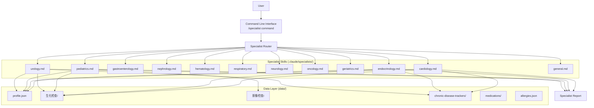
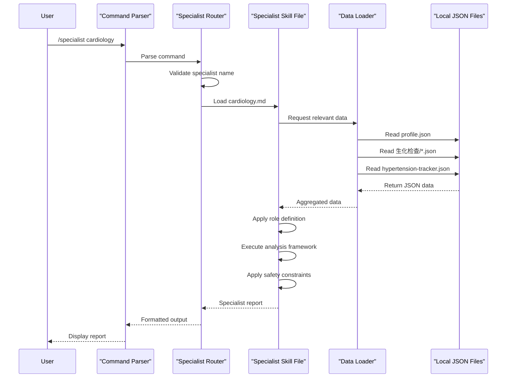
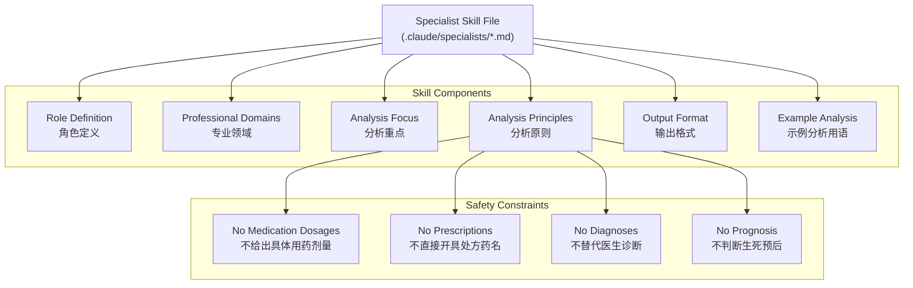
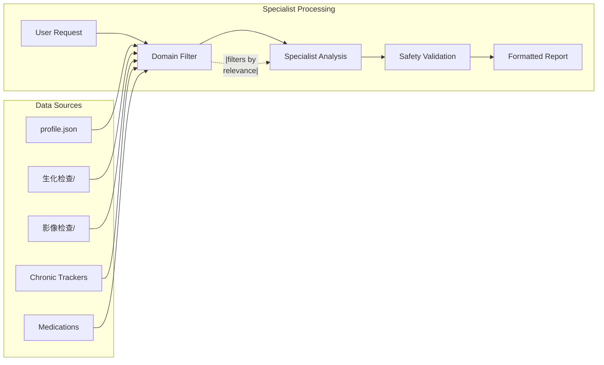
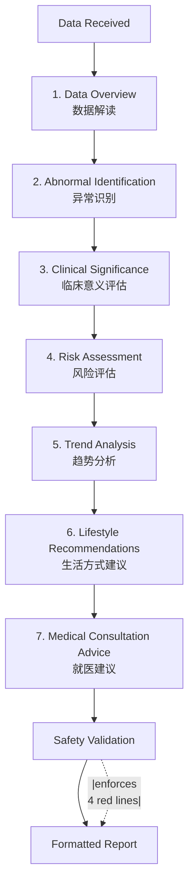
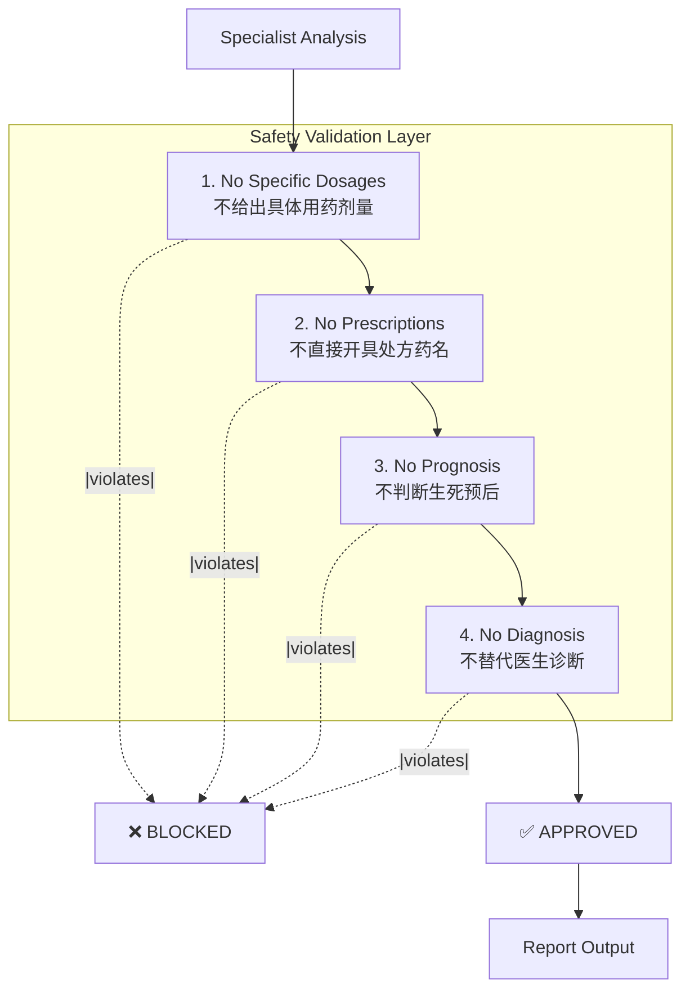
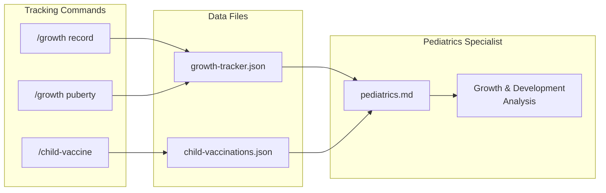
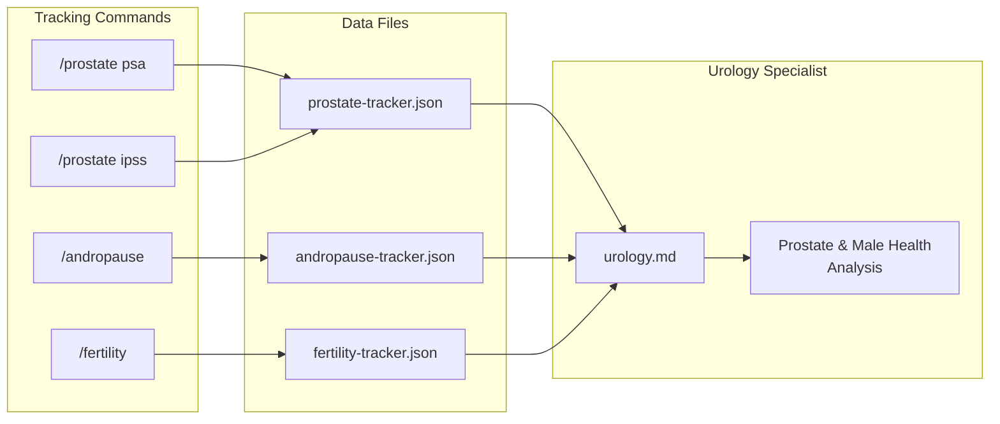

<!-- source: DeepWiki mcp.deepwiki.com · repo huifer/Claude-Ally-Health · page 7.2 Individual Specialist Consultations · fetched 2026-10-26 -->

# Individual Specialist Consultations

<details>
<summary>Relevant source files</summary>

The following files were used as context for generating this wiki page:

- [.claude/commands/prostate-health.md](.claude/commands/prostate-health.md)
- [.claude/commands/puberty.md](.claude/commands/puberty.md)
- [.claude/specialists/pediatrics.md](.claude/specialists/pediatrics.md)
- [.claude/specialists/urology.md](.claude/specialists/urology.md)
- [README.md](README.md)
- [README.zh-CN.md](README.zh-CN.md)
- [data-example/andropause-tracker.json](data-example/andropause-tracker.json)
- [data-example/child-vaccinations.json](data-example/child-vaccinations.json)
- [docs/data-structures.md](docs/data-structures.md)

</details>


## Purpose and Scope

This document describes the individual specialist consultation system, which allows users to consult with a specific medical specialist (e.g., Cardiology, Endocrinology, Pediatrics) rather than initiating a full Multi-Disciplinary Team consultation. Individual specialist consultations provide focused, domain-specific analysis of health data without the coordination overhead of the MDT system.

**Related Pages:**
- For multi-specialist consultations involving multiple domains simultaneously, see [Multi-Disciplinary Team (MDT) Consultation](#7.1)
- For a catalog of all available specialist skills and their domains, see [Available Specialist Skills](#7.3)
- For the general AI specialist framework architecture, see [AI Specialist Framework](#3.3)

---

## System Overview

Individual specialist consultations enable targeted analysis from a single medical domain expert. This is useful when:

- Users need focused advice on a specific condition (e.g., diabetes management from Endocrinology)
- Follow-up analysis is needed after an MDT consultation
- Users want to understand domain-specific metrics without comprehensive evaluation
- Quick consultation is needed for a particular health concern

### Architecture Overview



**Diagram: Individual Specialist Consultation Architecture**

Sources: [README.md:54-66](), [.claude/specialists/pediatrics.md:1-10](), [.claude/specialists/urology.md:1-10]()

---

## Command Interface

### The `/specialist` Command

The `/specialist` command provides direct access to individual medical specialists. Unlike the `/consult` command which activates all specialists simultaneously, this command routes the consultation to a single specialist.

**Command Structure:**
```
/specialist <specialist_name> [additional_context]
```

**Arguments:**

| Argument | Type | Required | Description |
|----------|------|----------|-------------|
| `specialist_name` | String | Yes | Name of the specialist to consult (e.g., "cardiology", "endocrinology") |
| `additional_context` | String | No | Optional context or specific question for the specialist |

**Example Usage:**
```bash
# Consult endocrinology specialist
/specialist endocrinology

# Consult with specific question
/specialist cardiology 请评估我的血脂水平

# Consult pediatrics for child growth
/specialist pediatrics 评估儿童生长发育

# Consult urology for prostate health
/specialist urology PSA结果解读
```

Sources: [README.md:55](), [README.md:132]()

### Command Processing Flow



**Diagram: Specialist Consultation Processing Sequence**

Sources: [.claude/specialists/cardiology.md](), [docs/data-structures.md:98-132]()

---

## Specialist Skill Architecture

Each specialist is defined by a Markdown file in the `.claude/specialists/` directory that contains:

1. **Role Definition**: Medical specialty and expertise area
2. **Professional Domains**: Specific conditions and systems covered
3. **Analysis Focus**: Key indicators and metrics to evaluate
4. **Analysis Principles**: Medical safety constraints and ethical guidelines
5. **Output Format**: Structured report template

### Specialist Skill File Structure



**Diagram: Specialist Skill File Components**

Sources: [.claude/specialists/pediatrics.md:1-100](), [.claude/specialists/urology.md:1-50]()

### Example: Pediatrics Specialist Skill

The pediatrics specialist skill demonstrates the comprehensive structure:

**Role Definition** ([.claude/specialists/pediatrics.md:1-5]()):
- Expertise: Pediatric health assessment and development guidance
- Focus: Children and adolescents (0-18 years)

**Professional Domains** ([.claude/specialists/pediatrics.md:6-14]()):
- Neonatal diseases
- Respiratory system (pneumonia, bronchitis, asthma)
- Digestive system (diarrhea, indigestion)
- Growth and development assessment
- Nutritional diseases (malnutrition, obesity, rickets, anemia)
- Infectious diseases (hand-foot-mouth, chickenpox, mumps)
- Vaccination
- Psychological and behavioral issues

**Analysis Focus** ([.claude/specialists/pediatrics.md:16-48]()):

| Category | Key Indicators | Age-Specific Considerations |
|----------|----------------|----------------------------|
| Blood Tests | Hemoglobin, WBC count, platelets | Age-specific reference values required |
| Nutrition | Iron, ferritin, zinc, calcium, vitamins | Different RDA by age group |
| Liver/Kidney | ALT, AST, creatinine, BUN | Pediatric normal ranges |
| Infection | CRP, PCT | Bacterial vs viral differentiation |
| Allergy | Total IgE, eosinophils | Common food allergies |

**Safety Principles** ([.claude/specialists/pediatrics.md:50-57]()):
```markdown
### ⚠️ 安全红线（严格遵守）
1. **不给出具体用药剂量**
2. **不直接开具处方药名**
3. **不判断生死预后**
4. **不替代医生诊断**
5. **特别注意年龄特异性参考值**
6. **关注儿童生长发育的特殊性**
```

Sources: [.claude/specialists/pediatrics.md:1-67]()

### Example: Urology Specialist Skill

The urology specialist focuses on male urogenital health:

**Professional Domains** ([.claude/specialists/urology.md:6-12]()):
- Prostate diseases (BPH, prostate cancer)
- Male infertility
- Hypogonadism (male andropause)
- Erectile dysfunction
- Varicocele
- Urinary tract infections

**Analysis Focus** ([.claude/specialists/urology.md:14-30]()):

**Prostate Health:**
- PSA testing: Total PSA, free PSA, PSA velocity, free/total ratio
- IPSS scoring: 0-35 point symptom scale
- Digital rectal exam (DRE): Size, texture, nodules
- Prostate ultrasound: Volume, residual urine, gland size

**Male Fertility:**
- Semen analysis: Sperm density, motility (PR/NP), morphology, volume, pH
- Hormone levels: Testosterone, LH, FSH, prolactin, estradiol
- Physical exam: Varicocele, testicular volume

**Male Andropause:**
- Symptom assessment: Sexual, somatic, psychological symptoms
- Testosterone levels: Total testosterone, free testosterone, SHBG
- Questionnaires: ADAM questionnaire, AMS scoring

Sources: [.claude/specialists/urology.md:1-46]()

---

## Data Access and Processing

### Data Aggregation

Each specialist skill has access to relevant patient data through the data layer. The system automatically aggregates:

**Core Patient Data:**
- `data/profile.json` - Basic demographics, height, weight, BMI, BSA
- `data/allergies.json` - Allergy history

**Medical Records:**
- `data/生化检查/YYYY-MM/*.json` - Biochemical test results
- `data/影像检查/YYYY-MM/*.json` - Imaging reports
- `data/手术记录/YYYY-MM/*.json` - Surgical history
- `data/出院小结/YYYY-MM/*.json` - Discharge summaries

**Domain-Specific Trackers:**
- `data/chronic-disease-trackers/*.json` - Hypertension, diabetes, COPD
- `data/medications/medications.json` - Current medications
- `data/pregnancy-tracker.json` - Pregnancy data (for relevant specialists)
- `data/prostate-tracker.json` - Prostate health data (Urology)



**Diagram: Specialist Data Processing Pipeline**

Sources: [docs/data-structures.md:1-510]()

### Domain-Specific Data Filtering

Each specialist automatically filters data based on relevance:

**Cardiology Specialist:**
- Blood pressure measurements
- Lipid panels (cholesterol, LDL, HDL, triglycerides)
- Cardiac enzymes (troponin, CK-MB)
- ECG and echocardiogram results
- Hypertension tracker data

**Endocrinology Specialist:**
- Glucose and HbA1c levels
- Thyroid hormones (TSH, T3, T4)
- Sex hormones (testosterone, estradiol, FSH, LH)
- Cortisol and ACTH
- Diabetes tracker data
- Andropause tracker data

**Pediatrics Specialist:**
- Age-specific blood counts
- Nutritional markers (iron, vitamins, minerals)
- Growth measurements (height, weight, BMI percentiles)
- Vaccination records
- Growth tracker data

Sources: [.claude/specialists/pediatrics.md:18-48](), [.claude/specialists/urology.md:14-30]()

---

## Analysis Framework

### Specialist Analysis Process

Each specialist follows a standardized analysis framework while maintaining domain-specific expertise:



**Diagram: Specialist Analysis Framework**

Sources: [.claude/specialists/pediatrics.md:59-67](), [.claude/specialists/urology.md:33-46]()

### Analysis Principles

All specialists adhere to these core principles ([.claude/specialists/urology.md:32-46]()):

**1. Data Interpretation (数据解读):**
- Interpret each indicator's clinical significance
- Consider context (age, sex, medical history)
- Use appropriate reference ranges

**2. Abnormal Identification (异常识别):**
- Flag values outside reference ranges
- Assess severity of abnormalities
- Identify patterns across multiple indicators

**3. Risk Assessment (风险评估):**
- Evaluate disease risk factors
- Consider family history and lifestyle
- Assess urgency of findings

**4. Trend Analysis (趋势分析):**
- Compare with historical data
- Identify improving or worsening patterns
- Calculate rate of change where applicable

**5. Lifestyle Recommendations (生活方式建议):**
- Diet and nutrition guidance
- Exercise recommendations
- Sleep and stress management
- Smoking cessation and alcohol limitation

**6. Medical Consultation Advice (就医建议):**
- Determine need for immediate medical attention
- Recommend appropriate specialist follow-up
- Suggest additional tests if needed

Sources: [.claude/specialists/urology.md:33-46]()

---

## Output Format

### Structured Report Template

Each specialist generates a structured report following their domain-specific template. The general structure includes:

**Report Sections:**

```markdown
## [Specialty] Analysis Report

### Data Overview (数据概览)
- Age: [value]
- Main Abnormalities: [list]
- Data Completeness: [complete/partial]

### Detailed Analysis (详细分析)

#### 1. [Primary System/Condition]
- Key indicators and interpretations
- Comparison with reference values
- Clinical significance

#### 2. [Secondary System/Condition]
- Additional findings
- Related indicators

### Risk Assessment (风险评估)
- Risk factors identified
- Risk level (low/moderate/high)
- Urgent concerns (if any)

### Recommendations (建议)

#### Lifestyle Adjustments (生活方式调整)
- Diet recommendations
- Exercise guidance
- Sleep and stress management

#### Monitoring Plan (监测计划)
- Follow-up schedule
- Tests to repeat
- Metrics to track

#### Medical Consultation (就医建议)
- Immediate care needed: [yes/no]
- Specialist follow-up: [recommended specialty and timeframe]
- Additional tests: [recommended investigations]

### ⚠️ Important Notice
This analysis is for reference only and cannot replace professional medical diagnosis.
Please consult with medical professionals for detailed evaluation and treatment.
```

Sources: [.claude/specialists/pediatrics.md:69-141](), [.claude/specialists/urology.md:48-130]()

### Example: Pediatrics Report Format

The pediatrics specialist provides age-specific analysis ([.claude/specialists/pediatrics.md:69-141]()):

```markdown
## Pediatrics Analysis Report (儿科分析报告)

### Data Overview
- Age: 5 years 3 months
- Main Abnormalities: Mild anemia, height below 10th percentile

### Detailed Analysis

#### 1. Growth and Development Assessment (生长发育评估)
- Height: 105 cm (P8, -1.4 SD) - Below average
- Weight: 17 kg (P25, -0.7 SD) - Normal range
- BMI: 15.4 - Normal
- Growth velocity: 5 cm/year - Normal
- Bone age: 5.0 years - Appropriate for chronological age

#### 2. Nutritional Assessment (营养评估)
- Hemoglobin: 110 g/L - Mild anemia
- Iron/Ferritin: Low iron stores
- Vitamin D: 25 nmol/L - Deficiency
- Calcium, Phosphorus: Normal

#### 3. Common Disease Screening (常见疾病筛查)
- Respiratory: No concerns
- Allergy: No evidence of allergic disease

### Risk Assessment
- Nutritional deficiency risk: Moderate
- Growth delay risk: Low-moderate
- Anemia risk: Present (mild iron deficiency)

### Recommendations

#### Nutritional Guidance (营养指导)
- Iron-rich foods: Red meat, liver, dark leafy greens
- Vitamin D supplementation: 400 IU daily
- Balanced diet with adequate protein

#### Lifestyle (生活方式)
- Sleep: 10-12 hours per night
- Outdoor activities: 1-2 hours daily
- Physical activity: Age-appropriate play

#### Medical Consultation (就医建议)
- Immediate care needed: No
- Recommended follow-up: Pediatrics clinic in 3 months
- Recheck: Hemoglobin, vitamin D, growth measurements
```

Sources: [.claude/specialists/pediatrics.md:69-141]()

---

## Safety Constraints

### The Four Red Lines

All specialist skills enforce four absolute safety constraints ([.claude/specialists/pediatrics.md:51-56](), [.claude/specialists/urology.md:35-38]()):



**Diagram: Safety Constraint Enforcement**

Sources: [.claude/specialists/pediatrics.md:50-57](), [.claude/specialists/urology.md:35-38]()

### Permitted vs Prohibited Language

**✅ Appropriate Expressions:**

From Pediatrics ([.claude/specialists/pediatrics.md:143-149]()):
- "Hemoglobin 95 g/L at 6 months, mild anemia, recommend iron supplementation, continue breastfeeding, timely addition of iron-rich complementary foods, recheck CBC in 1 month"
- "Height at 3rd percentile, growth velocity slowing, recommend testing growth hormone, thyroid function, bone age X-ray, consult pediatric endocrinology"
- "Elevated WBC with increased neutrophil percentage and high CRP suggests bacterial infection, recommend pediatrics consultation, may require antibiotic treatment"

From Urology ([.claude/specialists/urology.md:141-147]()):
- "PSA slightly elevated, recommend repeat PSA and free PSA in 3 months"
- "IPSS score moderate, recommend urology evaluation for possible medication therapy"
- "Low sperm density, recommend lifestyle improvements, avoid high-temperature environments"
- "Low testosterone with symptoms, recommend endocrinology evaluation for possible TRT"

**❌ Prohibited Expressions:**

From Pediatrics ([.claude/specialists/pediatrics.md:151-155]()):
- ❌ "Take amoxicillin dry suspension" (prescription drug)
- ❌ "Ibuprofen suspension 5ml" (giving dosage)
- ❌ "Definitely precocious puberty, needs injection treatment" (replacing doctor diagnosis)
- ❌ "Won't grow taller" (prognosis judgment)

From Urology ([.claude/specialists/urology.md:149-154]()):
- ❌ "Take finasteride 5mg daily" (giving dosage)
- ❌ "Prescribe tamsulosin" (issuing prescription)
- ❌ "PSA 10, definitely prostate cancer" (cancer diagnosis)
- ❌ "Confirmed BPH, must have surgery" (replacing doctor diagnosis)
- ❌ "Give testosterone gel treatment" (direct prescription)

Sources: [.claude/specialists/pediatrics.md:143-155](), [.claude/specialists/urology.md:141-154]()

---

## Domain-Specific Features

### Pediatrics: Age-Specific Reference Values

The pediatrics specialist has special requirements for age-appropriate evaluation:

**WHO Child Growth Standards** ([.claude/specialists/pediatrics.md:297-365]()):

| Assessment Type | Metrics | Z-Score Interpretation |
|----------------|---------|----------------------|
| Height-for-Age (HAZ) | Length/height percentiles | HAZ ≥ -1: Normal<br/>-2 ≤ HAZ < -1: Mild stunting<br/>HAZ < -3: Severe stunting |
| Weight-for-Age (WAZ) | Weight percentiles | WAZ ≥ -1: Normal<br/>-2 ≤ WAZ < -1: Underweight<br/>WAZ > +2: Obesity |
| BMI-for-Age (BAZ) | BMI percentiles | -2 ≤ BAZ ≤ +1: Normal<br/>BAZ < -2: Wasting<br/>BAZ > +2: Obesity |
| Weight-for-Height (WHZ) | Weight relative to height | -2 ≤ WHZ ≤ +1: Normal<br/>WHZ > +2: Overweight/obese |

**Tanner Staging for Puberty** ([.claude/specialists/pediatrics.md:367-445]()):

The pediatrics specialist includes comprehensive Tanner staging frameworks:
- Female breast development (B1-B5)
- Pubic hair development (P1-P5) for both sexes
- Male testicular volume (G1-G5)
- Bone age assessment relative to chronological age

**Vaccination Schedule Tracking** ([.claude/specialists/pediatrics.md:225-284]()):
- National immunization program (Class 1 vaccines)
- Optional vaccines (Class 2)
- Age-appropriate vaccination recommendations
- Adverse reaction monitoring

Sources: [.claude/specialists/pediatrics.md:297-656]()

### Urology: Prostate Cancer Risk Assessment

The urology specialist includes specialized prostate health evaluation:

**PSA Reference Values** ([.claude/specialists/urology.md:157-163]()):

| PSA Level (ng/mL) | Category | Action Required |
|-------------------|----------|-----------------|
| < 4.0 | Normal reference | Routine screening |
| 4.0 - 10.0 | Gray zone | Further evaluation needed |
| > 10.0 | Elevated | Urology consultation required |
| Free/Total ratio > 0.25 | Suggests benign | Monitor |
| PSA velocity > 0.75/year | Concerning | Further evaluation |

**IPSS Scoring** ([.claude/specialists/urology.md:165-168]()):

| Score Range | Severity | Management |
|-------------|----------|------------|
| 0-7 | Mild symptoms | Observation and follow-up |
| 8-19 | Moderate symptoms | Consider medication |
| 20-35 | Severe symptoms | Urology evaluation recommended |

**Semen Analysis Standards (WHO 2021)** ([.claude/specialists/urology.md:170-175]()):
- Semen volume: ≥ 1.5 mL
- Sperm concentration: ≥ 15 × 10⁶/mL
- Progressive motility (PR): ≥ 32%
- Normal morphology: ≥ 4%
- pH: 7.2-8.0

Sources: [.claude/specialists/urology.md:155-183]()

---

## Integration with Health Tracking Commands

### Command Integration

Individual specialist consultations can leverage data from specific health tracking commands:

**Pediatrics Integration:**



**Diagram: Pediatrics Specialist Data Integration**

References to tracking commands ([.claude/specialists/pediatrics.md:581-608]()):
- `/growth record` - Records height, weight, BMI
- `/growth status` - Displays current growth metrics
- `/growth percentile` - Calculates WHO percentiles
- `/growth puberty` - Tanner staging assessment
- `/child-vaccine record` - Vaccination tracking

**Urology Integration:**



**Diagram: Urology Specialist Data Integration**

Sources: [.claude/commands/prostate-health.md:1-1163](), [data-example/andropause-tracker.json:1-189]()

---

## Use Cases and Examples

### Example 1: Pediatric Growth Consultation

**Scenario:** Parent wants pediatrician's assessment of 5-year-old child's growth

**Command:**
```bash
/specialist pediatrics 请评估孩子的生长发育情况
```

**Data Accessed:**
- `profile.json` - Child's age, height, weight
- `growth-tracker.json` - Growth history and percentiles
- `生化检查/` - Recent blood tests (hemoglobin, vitamins)
- `child-vaccinations.json` - Vaccination status

**Analysis Performed:**
- WHO growth standard percentile calculation
- Z-score assessment (HAZ, WAZ, BAZ)
- Growth velocity evaluation
- Nutritional status assessment
- Vaccination coverage check

**Output:**
- Growth percentiles with interpretation
- Nutritional recommendations
- Vaccination schedule status
- Follow-up recommendations

Sources: [.claude/specialists/pediatrics.md:69-141]()

### Example 2: Prostate Health Consultation

**Scenario:** 55-year-old male with elevated PSA wants urologist review

**Command:**
```bash
/specialist urology PSA结果4.2,需要进一步检查吗?
```

**Data Accessed:**
- `profile.json` - Age, family history
- `prostate-tracker.json` - PSA history, IPSS scores
- `生化检查/` - Recent PSA test results

**Analysis Performed:**
- PSA value assessment (gray zone: 4.0-10.0 ng/mL)
- PSA velocity calculation (if historical data available)
- Free/total PSA ratio evaluation (if available)
- Risk factor assessment (age, family history)
- IPSS symptom severity review

**Output:**
- PSA interpretation with risk level
- Recommendations for repeat testing
- Suggestion for free PSA test
- Lifestyle modifications
- Referral recommendation (if needed)

Sources: [.claude/specialists/urology.md:48-130](), [.claude/commands/prostate-health.md:1-100]()

### Example 3: Endocrine Consultation for Andropause

**Scenario:** 52-year-old male with fatigue and low libido

**Command:**
```bash
/specialist endocrinology 评估男性更年期症状
```

**Data Accessed:**
- `andropause-tracker.json` - Symptom questionnaires (ADAM, AMS)
- `生化检查/` - Testosterone levels (total, free), SHBG
- `prostate-tracker.json` - PSA baseline for TRT safety

**Analysis Performed:**
- Testosterone level assessment (diagnostic threshold: < 8 nmol/L)
- Symptom severity evaluation (ADAM questionnaire, AMS score)
- Hypogonadism diagnosis criteria
- TRT eligibility assessment
- Safety screening (PSA, hematocrit)

**Output:**
- Testosterone interpretation
- Symptom-hormone correlation
- TRT candidacy assessment
- Monitoring recommendations
- Endocrinology referral suggestion

Sources: [data-example/andropause-tracker.json:1-189]()

---

## Comparison: Individual vs MDT Consultation

| Feature | Individual Specialist | MDT Consultation |
|---------|---------------------|------------------|
| **Command** | `/specialist <name>` | `/consult` |
| **Specialists Involved** | 1 (targeted) | 10-13 (all available) |
| **Processing Mode** | Single skill execution | Parallel subagent architecture |
| **Data Scope** | Domain-specific filtering | Comprehensive data aggregation |
| **Report Length** | Focused (single domain) | Comprehensive (all domains) |
| **Opinion Integration** | Not applicable | Conflict resolution algorithm |
| **Execution Time** | Faster (single specialist) | Slower (multiple specialists + coordination) |
| **Use Case** | Targeted question or follow-up | Comprehensive health evaluation |
| **Output File** | Single specialist report | Integrated MDT report |

**When to Use Individual Specialist:**
- Specific question about one medical domain
- Follow-up on known condition (e.g., diabetes management)
- Quick consultation for isolated concern
- Review of domain-specific test results

**When to Use MDT Consultation:**
- First-time comprehensive health assessment
- Complex cases involving multiple systems
- Unclear symptoms requiring differential diagnosis
- Pre-operative or major treatment planning

Sources: [README.md:109](), [README.md:131-132]()

---

## Data Privacy and Local Storage

All specialist consultations operate on locally-stored data with no external transmission:

**Privacy Guarantees:**
- All health data resides in `data/` directory on local filesystem
- Specialist analysis occurs locally through Claude Code
- No data uploaded to cloud services
- No external database dependencies
- Complete user data sovereignty

**Exception:** AI image analysis features (e.g., `/save-report` with medical images) may call external MCP servers (GLM's `mcp__4_5v_mcp__analyze_image`) as explicitly documented.

Sources: [README.md:111-117]()

---

## Error Handling and Edge Cases

### Missing Data Scenarios

When specialist consultations encounter missing data:

**Incomplete Profile:**
```
⚠️ Missing Profile Data

The pediatrics specialist requires age information for accurate assessment.
Please set up your profile first:
  /profile set <height_cm> <weight_kg> <birth_date>

Example:
  /profile set 110 20 2020-01-15
```

**No Relevant Records:**
```
ℹ️ No Relevant Medical Records Found

The endocrinology specialist could not find relevant data:
- No biochemical tests (血液检查)
- No chronic disease trackers (diabetes, thyroid)

Consider:
1. Saving recent lab results: /save-report <image_path>
2. Recording glucose levels: /glucose record <value>
3. Starting diabetes tracking: /diabetes start
```

**Outdated Data:**
```
⚠️ Data May Be Outdated

Last PSA test: 2023-06-15 (18 months ago)
Urology recommendation: Annual PSA screening

Consider getting updated PSA test for accurate assessment.
```

Sources: [.claude/specialists/pediatrics.md:50-67]()

### Specialist Not Available

If user specifies non-existent specialist:

```
❌ Specialist Not Found

Specialist 'dermatology' is not available in this system.

Available specialists:
  - cardiology (心内科)
  - endocrinology (内分泌科)
  - gastroenterology (消化科)
  - nephrology (肾内科)
  - hematology (血液科)
  - respiratory (呼吸科)
  - neurology (神经内科)
  - oncology (肿瘤科)
  - geriatrics (老年医学)
  - pediatrics (儿科)
  - urology (泌尿科)
  - general (全科)

See all specialists: /specialist list
```

Sources: [README.md:56-66]()

---

## Summary

Individual specialist consultations provide targeted, domain-specific health analysis through specialized AI skills. Each specialist:

1. **Accesses domain-relevant data** from local JSON files
2. **Applies medical expertise** defined in specialist skill files
3. **Enforces safety constraints** (no dosages, no prescriptions, no diagnoses, no prognosis)
4. **Generates structured reports** with clinical interpretations and recommendations
5. **Maintains privacy** through local-only data processing

The system supports 12 specialist domains with deep clinical knowledge, age-specific considerations (pediatrics), and condition-specific tracking integration (prostate, andropause, fertility).

For comprehensive multi-system evaluation, use the [Multi-Disciplinary Team (MDT) Consultation](#7.1) instead.

**Related Commands:**
- `/specialist` - Individual specialist consultation
- `/consult` - Multi-disciplinary team consultation
- Various tracking commands (e.g., `/prostate`, `/growth`, `/glucose`)

Sources: [README.md:1-192](), [.claude/specialists/pediatrics.md:1-660](), [.claude/specialists/urology.md:1-186]()

---

