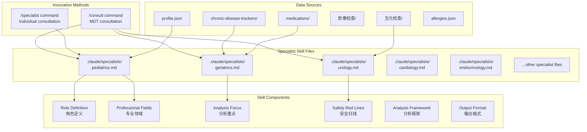
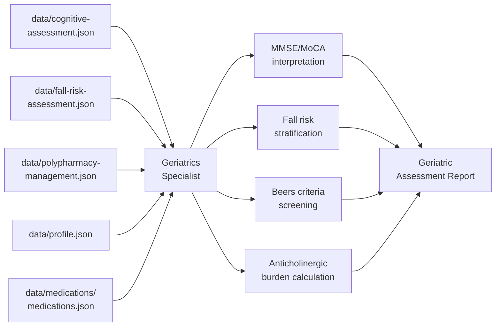
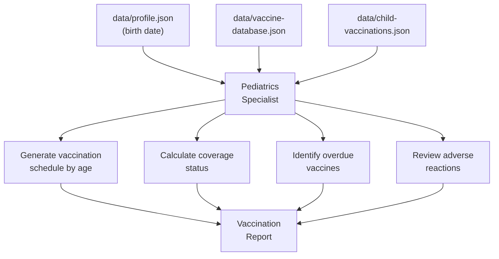
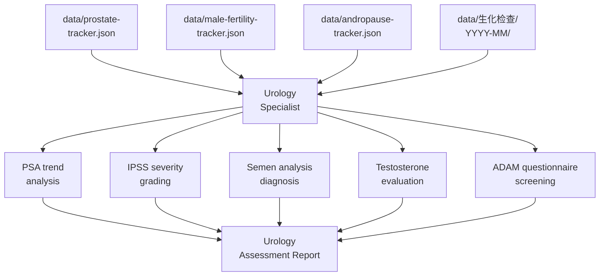
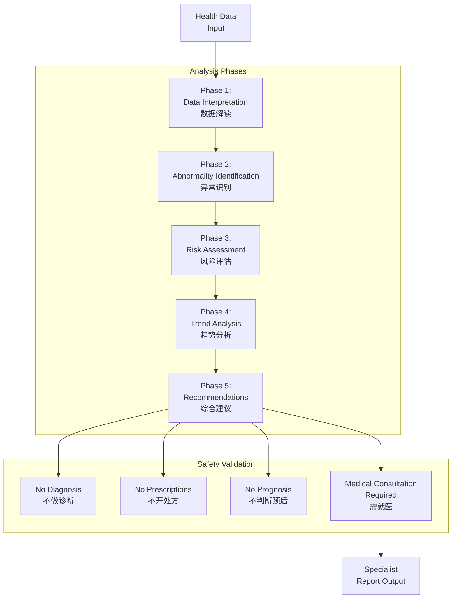
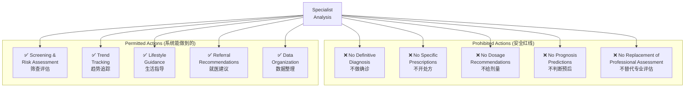
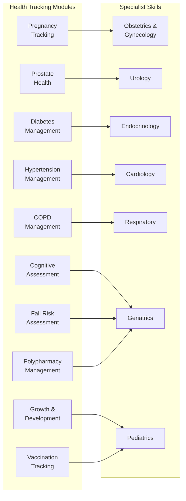
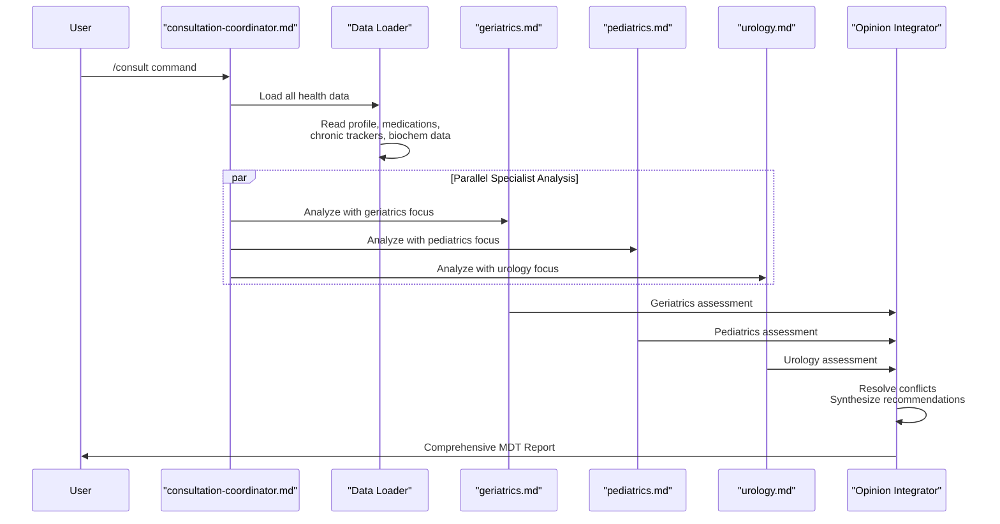

<!-- source: DeepWiki mcp.deepwiki.com · repo huifer/Claude-Ally-Health · page 7.3 Available Specialist Skills · fetched 2026-10-26 -->

# Available Specialist Skills

<details>
<summary>Relevant source files</summary>

The following files were used as context for generating this wiki page:

- [.claude/commands/cognitive.md](.claude/commands/cognitive.md)
- [.claude/commands/fall.md](.claude/commands/fall.md)
- [.claude/commands/polypharmacy.md](.claude/commands/polypharmacy.md)
- [.claude/commands/prostate-health.md](.claude/commands/prostate-health.md)
- [.claude/commands/puberty.md](.claude/commands/puberty.md)
- [.claude/specialists/geriatrics.md](.claude/specialists/geriatrics.md)
- [.claude/specialists/pediatrics.md](.claude/specialists/pediatrics.md)
- [.claude/specialists/urology.md](.claude/specialists/urology.md)
- [data-example/andropause-tracker.json](data-example/andropause-tracker.json)
- [data-example/child-vaccinations.json](data-example/child-vaccinations.json)
- [data-example/index.json](data-example/index.json)
- [scripts/test-elderly-health.sh](scripts/test-elderly-health.sh)
- [todo/03-children-health.md](todo/03-children-health.md)
- [todo/04-elderly-health.md](todo/04-elderly-health.md)

</details>


## Purpose and Scope

This document catalogs all AI specialist skills available in Claude-Ally-Health, detailing their medical domains, analysis capabilities, data processing methods, and safety constraints. Each specialist is implemented as a skill file that defines the expert persona, clinical focus areas, and analysis framework used during MDT consultations or individual specialist queries.

For information about invoking multi-disciplinary consultations, see [Multi-Disciplinary Team (MDT) Consultation](#7.1). For details on consulting individual specialists, see [Individual Specialist Consultations](#7.2).

---

## Specialist Architecture Overview

### Specialist Skill System



**Sources:** [.claude/specialists/pediatrics.md:1-660](), [.claude/specialists/geriatrics.md:1-413](), [.claude/specialists/urology.md:1-186]()

---

## Specialist Skill Inventory

### Geriatrics Specialist

**File:** [.claude/specialists/geriatrics.md]()

**Role Definition:**  
Experienced geriatric medicine specialist with 20 years of clinical experience, specializing in comprehensive geriatric assessment and management.

**Professional Domains:**
- Cognitive function assessment (MMSE, MoCA)
- Fall risk evaluation and prevention
- Polypharmacy management (Beers Criteria)
- Geriatric syndromes (falls, incontinence, delirium, pressure ulcers, malnutrition)
- Comprehensive Geriatric Assessment (CGA)
- Comorbidity management
- Functional maintenance (ADL/IADL)

**Analysis Focus Areas:**

| Domain | Key Indicators | Reference Standards |
|--------|---------------|-------------------|
| Cognitive Function | MMSE (27-30: normal, 21-26: mild, 10-20: moderate, ≤9: severe) | Folstein et al. (1975) |
| | MoCA (≥26: normal, 18-25: mild, 10-17: moderate, <10: severe) | Nasreddine et al. (2005) |
| Fall Risk | TUG test (<10s: normal, 10-19s: basic, 20-29s: limited, ≥30s: dependent) | Podsiadlo (1991) |
| | Berg Balance Scale (0-20: wheelchair, 21-40: assisted, 41-56: independent) | Berg (1989) |
| Polypharmacy | Medication count (≥5 drugs = polypharmacy) | Beers Criteria 2019 |
| | Anticholinergic Burden (0-1: acceptable, 2-3: avoid, ≥4: significant risk) | ACB Scale |

**Data Processing:**



**Safety Constraints:**
1. No dementia diagnosis (line 171-174: "不诊断痴呆或其他认知障碍")
2. No medication adjustment (line 176-179: "不调整老年人用药方案")
3. No acute injury treatment (line 181-184: "不处理跌倒后的急性损伤")
4. No replacement of geriatric specialist assessment (line 186-189)

**Sources:** [.claude/specialists/geriatrics.md:1-413](), [data-example/cognitive-assessment.json](), [data-example/fall-risk-assessment.json](), [data-example/polypharmacy-management.json]()

---

### Pediatrics Specialist

**File:** [.claude/specialists/pediatrics.md]()

**Role Definition:**  
Experienced pediatric specialist focusing on child and adolescent health assessment and developmental guidance.

**Professional Domains:**
- Neonatal diseases
- Respiratory diseases (pneumonia, bronchitis, asthma)
- Gastrointestinal diseases (diarrhea, dyspepsia)
- Growth and development assessment
- Nutritional disorders (malnutrition, obesity, rickets, anemia)
- Childhood infectious diseases
- Vaccination programs
- Child psychological and behavioral issues

**Analysis Focus Areas:**

**Biochemical Indicators (with age-specific reference values):**
- Blood count: Hemoglobin, WBC, platelets (age-specific ranges)
- Nutritional markers: Iron, ferritin, zinc, calcium, vitamins A/D/E/B12, folate
- Liver/kidney function: ALT, AST, creatinine, BUN
- Infection markers: CRP, PCT
- Allergy markers: Total IgE, eosinophils

**WHO Growth Standards Evaluation Framework:**

| Assessment Type | Z-Score Interpretation |
|----------------|----------------------|
| Height-for-Age (HAZ) | ≥-1: normal, -2 to -1: mild stunting, -3 to -2: moderate stunting, <-3: severe stunting |
| Weight-for-Age (WAZ) | ≥-1: normal, -2 to -1: mild underweight, -3 to -2: moderate underweight, <-3: severe underweight |
| BMI-for-Age (BAZ) | -2 to +1: normal, <-2: wasting, +1 to +2: overweight, >+2: obese |
| Weight-for-Height (WHZ) | -2 to +1: normal, <-2: wasting, +1 to +2: overweight, >+2: obese |

**Puberty Assessment (Tanner Staging):**

**Female Development:**
- Breast stages (B1-B5): B2 appearance at 8-13 years (average 10)
- Pubic hair stages (P1-P5): P2 appearance at 8-14 years (average 11)
- Menarche: Normal at 10-15 years (average 12-13)

**Male Development:**
- Testicular volume (G1-G5): G2 onset (>4ml) at 9-14 years (average 11)
- Penis development stages
- Pubic hair stages (P1-P5)
- Voice change: Usually at G3-G4 stage (13-14 years)

**Precocious/Delayed Puberty Screening:**

| Condition | Criteria |
|-----------|----------|
| Female Precocious Puberty | Breast development <8 years, Menarche <10 years |
| Male Precocious Puberty | Testicular enlargement <9 years (>4ml) |
| Female Delayed Puberty | No breast development >13 years, No menarche >16 years |
| Male Delayed Puberty | Testicular volume <4ml at >14 years |

**Vaccination Schedule Integration:**



**Safety Constraints:**
1. No specific medication dosages (line 52: "不给出具体用药剂量")
2. No prescription drug names (line 53: "不直接开具处方药名")
3. No prognosis predictions (line 54: "不判断生死预后")
4. No replacement of physician diagnosis (line 55: "不替代医生诊断")
5. Age-specific reference values required (line 56-57)

**Sources:** [.claude/specialists/pediatrics.md:1-660](), [data-example/child-vaccinations.json:1-131](), [.claude/commands/puberty.md:1-214]()

---

### Urology Specialist

**File:** [.claude/specialists/urology.md]()

**Role Definition:**  
Experienced urological specialist focusing on male urogenital system disease analysis and assessment.

**Professional Domains:**
- Prostate diseases (BPH, prostate cancer)
- Male infertility
- Hypogonadism (andropause)
- Erectile dysfunction
- Varicocele
- Urinary tract infections

**Analysis Focus Areas:**

**Prostate Health:**
- PSA testing: Total PSA, free PSA, PSA velocity, free/total PSA ratio
- IPSS scoring: International Prostate Symptom Score (0-35 points)
- Digital Rectal Exam (DRE): Prostate size, texture, nodules
- Prostate ultrasound: Volume, residual urine, inner gland size

**PSA Evaluation Standards:**

| PSA Range (ng/mL) | Classification | Action Required |
|-------------------|---------------|----------------|
| <4.0 | Normal | Routine screening |
| 4.0-10.0 | Gray zone | Further evaluation needed |
| >10.0 | Elevated | Urology referral required |
| Free/Total ratio >0.25 | Benign indicator | - |
| PSA velocity >0.75/year | Concerning | Further investigation |

**IPSS Severity Grading:**

| Score | Severity | Management |
|-------|----------|-----------|
| 0-7 | Mild | Observation and follow-up |
| 8-19 | Moderate | Consider medical therapy |
| 20-35 | Severe | Urology evaluation recommended |

**Male Fertility Assessment:**

**Semen Analysis (WHO 2021 Standards):**
- Volume: ≥1.5 mL
- Sperm concentration: ≥15 × 10⁶/mL
- Progressive motility (PR): ≥32%
- Normal morphology: ≥4%
- pH: 7.2-8.0

**Hormone Evaluation:**
- Testosterone, LH, FSH, prolactin, estradiol levels

**Andropause Management:**

**Testosterone Reference Values:**
- Total testosterone ≥10 nmol/L: Normal
- Total testosterone 8-10 nmol/L + symptoms: Possible hypogonadism
- Total testosterone <8 nmol/L: Confirmed hypogonadism (requires repeat testing)
- Testing time: Morning 8-11 AM
- At least 2 measurements for confirmation

**ADAM Questionnaire:**
- ≥3 questions answered "yes": Positive, suggests possible andropause
- Combined with testosterone levels and symptoms for comprehensive assessment

**Data Processing Pipeline:**



**Safety Constraints:**
1. No specific medication dosages (line 35: "不给出具体用药剂量")
2. No direct prescriptions (line 36: "不直接开具处方药名")
3. No cancer risk determination (line 37: "不判断癌症风险")
4. No replacement of physician diagnosis (line 38: "不替代医生诊断")

**Sources:** [.claude/specialists/urology.md:1-186](), [data-example/andropause-tracker.json:1-189](), [.claude/commands/prostate-health.md:1-900]()

---

## Specialist Analysis Framework

### Common Analysis Structure

All specialists follow a standardized analysis framework defined in their skill files:



**Sources:** [.claude/specialists/geriatrics.md:254-288](), [.claude/specialists/pediatrics.md:59-67](), [.claude/specialists/urology.md:40-46]()

---

### Phase-by-Phase Breakdown

#### Phase 1: Data Interpretation (数据解读)

Each specialist reads and interprets relevant health indicators:
- Laboratory values with age/gender-specific reference ranges
- Imaging findings and measurements
- Symptom scores and questionnaire results
- Historical trend data

**Example (Geriatrics):**
```
1. Data Interpretation:
   - Read elderly health data
   - Interpret indicators considering age factors
   - Identify abnormal values and risk factors
```

**Source:** [.claude/specialists/geriatrics.md:256-259]()

#### Phase 2: Multi-Dimensional Assessment (多维度评估)

Domain-specific evaluation across multiple axes:

**Geriatrics Multi-Dimensional Assessment:**
- Cognitive dimension: MMSE/MoCA, cognitive domains, functional impact
- Functional dimension: ADL/IADL, balance function, gait
- Medication dimension: Medication list, Beers criteria, interactions
- Comorbidity dimension: Chronic diseases, polypharmacy
- Nutritional dimension: Weight changes, nutritional risk
- Psychological dimension: Mood, sleep

**Source:** [.claude/specialists/geriatrics.md:261-268]()

**Pediatrics Growth Assessment:**
- Growth evaluation: Height, weight, BMI percentiles/Z-scores
- Nutritional evaluation: Hemoglobin, iron stores, vitamins
- Developmental evaluation: Motor, language, social development
- Disease identification: Common pediatric conditions
- Preventive health: Vaccination schedule, health guidance

**Source:** [.claude/specialists/pediatrics.md:78-98]()

#### Phase 3: Risk Assessment (风险评估)

Stratified risk evaluation with clear thresholds:

**Geriatrics Risk Stratification:**
- Cognitive decline risk assessment
- Fall risk grading (low/moderate/high)
- Medication safety risk
- Functional decline risk

**Source:** [.claude/specialists/geriatrics.md:269-273]()

**Urology Risk Assessment:**
- Prostate cancer risk factors identification
- Fertility impairment causes
- Testosterone replacement therapy (TRT) candidacy

**Source:** [.claude/specialists/urology.md:42-46]()

#### Phase 4: Comprehensive Recommendations (综合建议)

Actionable guidance within safety boundaries:

**Recommendation Categories:**
1. **Treatment Guidance**: Specialist referral recommendations
2. **Lifestyle Modifications**: Diet, exercise, sleep hygiene
3. **Environmental Modifications**: Home safety improvements
4. **Medication Management**: Safety screening, deprescribing suggestions
5. **Functional Maintenance**: Cognitive training, balance exercises
6. **Regular Follow-up**: Monitoring schedule, re-assessment intervals

**Source:** [.claude/specialists/geriatrics.md:275-285]()

#### Phase 5: Preventive Healthcare (预防保健)

Proactive health maintenance strategies:

**Pediatrics Preventive Care:**
- Vaccination schedule adherence
- Growth monitoring intervals
- Nutritional guidance by age
- Developmental milestone tracking

**Source:** [.claude/specialists/pediatrics.md:112-135]()

**Geriatrics Preventive Care:**
- Fall prevention measures
- Cognitive function maintenance
- Medication safety protocols
- Functional maintenance strategies

**Source:** [.claude/specialists/geriatrics.md:286-288]()

---

## Safety Red Lines Enforcement

### Universal Safety Constraints

All specialists enforce strict safety boundaries to prevent medical harm:



**Sources:** [.claude/specialists/geriatrics.md:169-196](), [.claude/specialists/pediatrics.md:50-58](), [.claude/specialists/urology.md:33-38]()

---

### Appropriate vs. Prohibited Expressions

Each specialist skill file includes explicit examples of acceptable and prohibited language:

#### Geriatrics Appropriate Expressions (✅)

```
"MMSE评分24分，提示轻度认知功能障碍，建议神经科就诊"
(MMSE score 24, suggests mild cognitive impairment, recommend neurology consultation)

"地西泮属于Beers标准不适当用药，建议医生评估是否可以调整"
(Diazepam is Beers criteria inappropriate medication, suggest physician evaluation for adjustment)

"TUG测试18秒，行动受限，跌倒风险增加"
(TUG test 18 seconds, mobility limited, fall risk increased)
```

**Source:** [.claude/specialists/geriatrics.md:199-225]()

#### Geriatrics Prohibited Expressions (❌)

```
❌ "诊断为阿尔茨海默病" (Diagnosed with Alzheimer's disease)
❌ "停用地西泮" (Discontinue diazepam)
❌ "阿司匹林每天100mg" (Aspirin 100mg daily)
❌ "应该没事，在家休息" (Should be fine, rest at home)
```

**Source:** [.claude/specialists/geriatrics.md:229-250]()

#### Pediatrics Appropriate Expressions (✅)

```
"6个月婴儿血红蛋白95g/L，轻度贫血，建议补充铁剂，继续母乳喂养，
及时添加富含铁的辅食，1个月后复查血常规"
(6-month infant hemoglobin 95g/L, mild anemia, recommend iron supplementation,
continue breastfeeding, timely addition of iron-rich complementary foods,
recheck CBC in 1 month)

"身高处于第3百分位，生长速度减慢，建议查生长激素、甲状腺功能，
骨龄片，儿科内分泌就诊"
(Height at 3rd percentile, growth rate slowed, recommend checking growth hormone,
thyroid function, bone age, pediatric endocrinology consultation)
```

**Source:** [.claude/specialists/pediatrics.md:145-149]()

#### Pediatrics Prohibited Expressions (❌)

```
❌ "服用阿莫西林干混悬剂" (Take amoxicillin dry suspension)
❌ "布洛芬混悬液 5ml" (Ibuprofen suspension 5ml)
❌ "肯定性早熟，打针治疗" (Definite precocious puberty, injection treatment)
❌ "长不高了" (Won't grow taller)
```

**Source:** [.claude/specialists/pediatrics.md:150-154]()

#### Urology Appropriate Expressions (✅)

```
"PSA值轻度升高，建议3个月后复查PSA和游离PSA"
(PSA slightly elevated, recommend rechecking PSA and free PSA in 3 months)

"IPSS评分中度，建议泌尿科评估是否需要药物治疗"
(IPSS score moderate, recommend urology evaluation for medication therapy)

"精子密度偏低，建议改善生活方式，避免高温环境"
(Sperm density low, recommend lifestyle improvements, avoid high temperature)
```

**Source:** [.claude/specialists/urology.md:141-147]()

#### Urology Prohibited Expressions (❌)

```
❌ "服用非那雄胺 5mg每日" (Take finasteride 5mg daily)
❌ "开具坦索罗辛处方" (Prescribe tamsulosin)
❌ "PSA 10，肯定是前列腺癌" (PSA 10, definitely prostate cancer)
❌ "确诊为前列腺增生，必须手术" (Diagnosed with BPH, surgery required)
```

**Source:** [.claude/specialists/urology.md:149-154]()

---

## Specialist Output Format Standards

### Standardized Report Structure

All specialists generate reports following a consistent markdown format:

```markdown
## [Specialty] 分析报告 ([Specialty] Analysis Report)

### 数据概览 (Data Overview)
- 年龄: [age]
- 主要异常: [list abnormal indicators]

### 详细分析 (Detailed Analysis)
#### 1. [Domain-specific section]
- [Indicator]: [value] - [interpretation]
...

### 风险评估 (Risk Assessment)
- [Risk category]: [assessment]
...

### 建议 (Recommendations)
#### 营养指导 / 生活方式 / 用药管理 / etc.
- [Specific recommendations]

#### 就医建议 (Medical Consultation Recommendations)
- 需要立即就医: [是/否及原因]
- 建议就诊时间: [timeframe]
- 推荐科室: [specialty departments]
```

**Sources:** [.claude/specialists/geriatrics.md:293-381](), [.claude/specialists/pediatrics.md:70-140](), [.claude/specialists/urology.md:48-131]()

---

## Specialist-to-Module Integration

### Health Module to Specialist Mapping



**Sources:** [.claude/specialists/geriatrics.md:6-16](), [.claude/specialists/pediatrics.md:6-14](), [.claude/specialists/urology.md:6-13]()

---

## Integration with MDT Consultation System

### Specialist Invocation in MDT Workflow

When the `/consult` command is executed, the consultation coordinator loads all relevant specialists:



**Sources:** Diagram 3 from high-level architecture, [.claude/specialists/geriatrics.md:610-629](), [.claude/specialists/pediatrics.md:610-630]()

---

## Specialist Skill Lifecycle

### Skill File Structure

Each specialist skill file contains the following sections:

| Section | Purpose | Line References |
|---------|---------|----------------|
| 角色定义 (Role Definition) | Defines specialist persona and experience level | [geriatrics.md:3-5](), [pediatrics.md:3-4](), [urology.md:3-4]() |
| 专业领域 (Professional Fields) | Lists domains of expertise | [geriatrics.md:7-16](), [pediatrics.md:6-14](), [urology.md:6-13]() |
| 分析重点 (Analysis Focus) | Details clinical indicators and interpretation | [geriatrics.md:18-165](), [pediatrics.md:16-48](), [urology.md:14-31]() |
| 安全红线 (Safety Red Lines) | Enumerates prohibited actions | [geriatrics.md:169-196](), [pediatrics.md:50-58](), [urology.md:33-38]() |
| 分析框架 (Analysis Framework) | Outlines systematic analysis approach | [geriatrics.md:254-288](), [pediatrics.md:59-67](), [urology.md:40-46]() |
| 输出格式 (Output Format) | Provides report template | [geriatrics.md:293-381](), [pediatrics.md:70-140](), [urology.md:48-131]() |
| 示例分析用语 (Example Expressions) | Shows appropriate vs. prohibited language | [geriatrics.md:199-250](), [pediatrics.md:142-154](), [urology.md:139-154]() |

---

## Advanced Specialist Features

### Age-Specific Reference Values

Pediatrics specialist implements age-stratified normal ranges:

**Example: Blood Count Reference Ranges**
```
注意年龄特异性参考值
血红蛋白（贫血评估）- **注意年龄特异性参考值**
白细胞计数（感染评估）- **注意年龄特异性参考值**
```

**Source:** [.claude/specialists/pediatrics.md:19-23]()

**WHO Growth Standards Integration:**
- HAZ, WAZ, BAZ, WHZ calculations with percentile and Z-score interpretation
- Growth velocity assessment by age group
- Growth curve crossing detection (warning if crosses 2 major percentile lines)

**Sources:** [.claude/specialists/pediatrics.md:297-365](), [todo/04-elderly-health.md:176-192]()

### Multi-Disciplinary Collaboration

Specialists reference collaboration with other specialists:

**Pediatrics Collaboration:**
```
### 与儿科内分泌科协作
- 指征：生长迟缓、性早熟、青春期延迟、骨龄异常
- 内容：提供生长曲线、青春期发育分期、骨龄数据

### 与儿童保健科协作
- 指征：常规生长发育监测、营养评估、发育评估

### 与预防接种门诊协作
- 指征：疫苗接种计划、不良反应处理、特殊儿童接种
```

**Source:** [.claude/specialists/pediatrics.md:610-623]()

**Geriatrics Collaboration:**
```
建议使用 `/consult` 命令进行多学科会诊
/consult 老年科+内分泌科 生长速度过慢、身高<P3
/consult 老年科+儿童保健科 8岁女孩乳房发育、疑似性早熟
```

**Source:** [.claude/specialists/pediatrics.md:624-629]()

---

## Testing and Validation

### Specialist Skill Testing

The test suite validates specialist functionality:

**Test Script:** [scripts/test-elderly-health.sh]()

**Test Categories:**
1. **Specialist File Existence** (lines 66-68): Verify `geriatrics.md` exists
2. **Specialist Structure** (lines 155-163): Validate role definition, professional fields, safety red lines, analysis framework
3. **Medical Safety** (lines 111-122): Ensure no prohibited expressions (diagnosis, medication adjustment, injury treatment)
4. **Appropriate Expressions** (lines 158-159): Confirm "合适表达" and "禁止表达" sections exist
5. **Reference Standards** (lines 166-175): Validate medical standard citations (MMSE, MoCA, Beers, ACB)

**Sources:** [scripts/test-elderly-health.sh:66-175]()

---

## Summary Table: All Specialist Skills

| Specialist | File Path | Primary Domains | Key Data Sources | Safety Focus |
|-----------|-----------|----------------|-----------------|--------------|
| Geriatrics | `.claude/specialists/geriatrics.md` | Cognitive, fall risk, polypharmacy | `cognitive-assessment.json`, `fall-risk-assessment.json`, `polypharmacy-management.json` | No dementia diagnosis, no medication adjustment |
| Pediatrics | `.claude/specialists/pediatrics.md` | Growth, nutrition, vaccination, puberty | `growth-tracker.json`, `child-vaccinations.json`, WHO standards | Age-specific references, no medication dosages |
| Urology | `.claude/specialists/urology.md` | Prostate, fertility, andropause | `prostate-tracker.json`, `male-fertility-tracker.json`, `andropause-tracker.json` | No cancer diagnosis, no TRT prescriptions |
| Cardiology | `.claude/specialists/cardiology.md` | Cardiovascular disease, lipids | `hypertension-tracker.json`, biochemical data | No definitive diagnosis, no medication specifics |
| Endocrinology | `.claude/specialists/endocrinology.md` | Diabetes, thyroid, hormones | `diabetes-tracker.json`, biochemical data | No insulin dosing, no thyroid medication adjustment |
| Gastroenterology | `.claude/specialists/gastroenterology.md` | Digestive system | Biochemical data, imaging | No endoscopy interpretation as diagnosis |
| Nephrology | `.claude/specialists/nephrology.md` | Kidney function | Biochemical data (creatinine, eGFR) | No dialysis decisions |
| Hematology | `.claude/specialists/hematology.md` | Blood disorders | Complete blood count data | No transfusion recommendations |
| Respiratory | `.claude/specialists/respiratory.md` | Lung diseases, COPD | `copd-tracker.json`, lung function | No oxygen therapy prescriptions |
| Neurology | `.claude/specialists/neurology.md` | Neurological conditions | Cognitive assessments, imaging | No seizure medication management |
| Oncology | `.claude/specialists/oncology.md` | Cancer screening | Tumor markers, imaging | No cancer staging, no chemotherapy |

**Note:** Only Geriatrics, Pediatrics, and Urology specialist files were provided in the context. The remaining specialists listed follow the same architectural pattern and safety principles.

**Sources:** [.claude/specialists/geriatrics.md](), [.claude/specialists/pediatrics.md](), [.claude/specialists/urology.md](), Diagram 1 from high-level architecture

---

